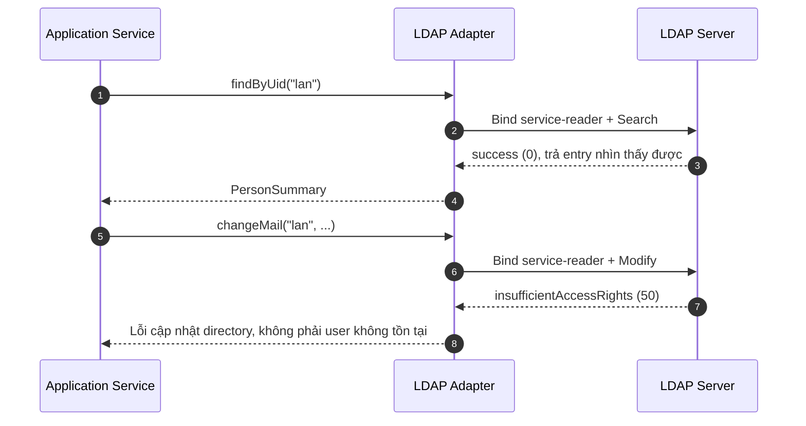
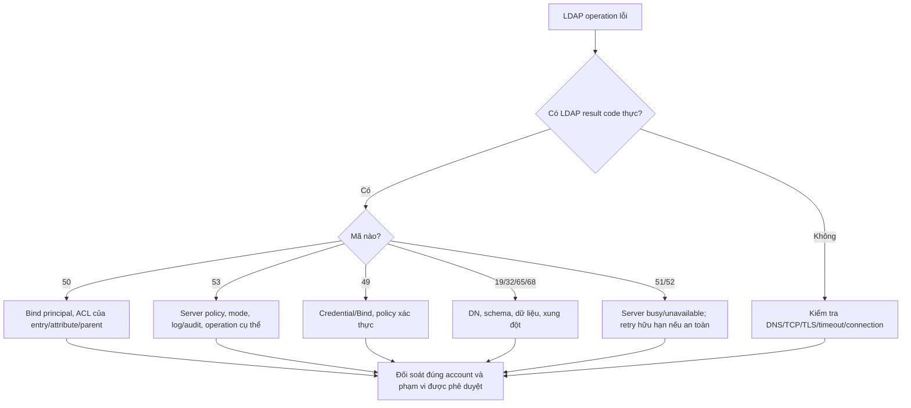

# Không đủ quyền và máy chủ từ chối thực hiện thao tác

Trong chương **Xử lý lỗi** của **SPRING_DATA_LDAP**, không phải mọi yêu cầu LDAP thất bại đều do sai mật khẩu, sai DN hoặc directory bị ngắt kết nối. Một tài khoản ứng dụng có thể **Bind thành công**, tìm thấy entry nhân viên, nhưng **không được phép sửa** thuộc tính `mail`. Ở tình huống khác, tài khoản có quyền ghi phù hợp nhưng server vẫn **từ chối đổi tên/move entry** vì một quy tắc quản trị. Hai lỗi quan trọng cần phân biệt là:

- **LDAP result code 50 — `insufficientAccessRights`:** client không có đủ quyền truy cập để hoàn tất thao tác theo chính sách directory.
- **LDAP result code 53 — `unwillingToPerform`:** server từ chối thực hiện thao tác vì một điều kiện hoặc chính sách; **không thể kết luận chắc chắn chỉ từ mã 53 rằng nguyên nhân là thiếu ACL**.

Trong Spring Data LDAP, người học dùng `LdapRepository` để tìm/lưu entry ánh xạ bằng `@Entry`, `@Id`, `@Attribute`; với Spring LDAP, `LdapTemplate` hỗ trợ Search, Add, Modify, Delete và Modify DN. Dù API Java có đơn giản đến đâu, **LDAP server là nơi cuối cùng kiểm tra quyền, schema, ranh giới DN và quy tắc vận hành**.

**Mục tiêu:** giải thích sự khác biệt giữa lỗi 50 và 53, phân loại với các mã dễ nhầm, xác định danh tính Bind và quyền cần có theo từng thao tác, chuyển ngoại lệ thành lỗi nghiệp vụ an toàn, tránh retry nguy hiểm, quan sát và kiểm thử trên directory thật.

## 1. Từ yêu cầu ứng dụng đến quyết định của LDAP server

Giả sử có entry nhân viên:

```ldif
dn: uid=lan,ou=people,dc=example,dc=org
objectClass: top
objectClass: person
objectClass: organizationalPerson
objectClass: inetOrgPerson
uid: lan
cn: Lan Nguyen
sn: Nguyen
mail: lan@example.org
```

Ứng dụng cần thực hiện hai use case:

1. **Tra cứu:** tìm nhân viên theo `uid=lan` và hiển thị `cn`, `mail`.
2. **Cập nhật:** thay `mail` hoặc di chuyển entry sang `ou=active`.

Hai use case có thể dùng cùng một LDAP endpoint nhưng **quyền truy cập khác nhau**:



Ví dụ có hai lần gọi để minh họa quyền; trong một ứng dụng có connection/context pooling, Bind có thể xảy ra khi tạo context thay vì trước **mỗi** LDAP operation. Thành công của Search **không** đồng nghĩa service Bind DN có quyền Modify.

LDAP quyền truy cập thường được kiểm tra dựa trên **danh tính đã xác thực** (Bind identity), **DN và thuộc tính mục tiêu**, **loại thao tác** và **chính sách của server**. Những điều kiện đó không nằm trong giá trị trả về của entity Java.

## 2. Hiểu đúng mã 50: insufficientAccessRights

LDAP result code **50** có tên chuẩn `insufficientAccessRights`. Server đã nhận và đánh giá một yêu cầu nhưng xác định quyền truy cập của client **không đủ để thực hiện thao tác**. Tùy server, chính sách và phạm vi quyền, tình huống có thể xảy ra khi:

| Thao tác | Tình huống có thể dẫn tới mã 50 | Điều cần đối chiếu |
| --- | --- | --- |
| **Search** | Không được phép đọc entry/thuộc tính hoặc thực hiện kiểu tìm kiếm cụ thể | Bind DN, ACL tại base DN, thuộc tính, filter, scope |
| **Add** | Không được phép tạo entry dưới DN cha đích | Quyền ở parent OU, objectClass, account thực hiện Add |
| **Modify** | Được đọc entry nhưng không được sửa `mail`, `memberUid` hoặc thuộc tính nhạy cảm | Quyền ghi theo **thuộc tính**, DN entry và loại thay đổi |
| **Delete** | Không được xóa entry hoặc xóa khỏi nhánh do policy quản lý | Quyền xóa, quyền ở parent và giới hạn subtree |
| **Modify DN** | Không được rename entry, thay RDN hoặc chuyển sang OU khác | Quyền tại DN cũ, DN cha cũ, DN đích và các điều kiện server |
| **Đọc group membership** | Không thấy `member`/`memberUid` hoặc không được truy vấn nhóm | ACL đọc thuộc tính nhóm, account được dùng cho lookup |

**Không có một ma trận ACL chung áp dụng cho mọi server.** OpenLDAP, Active Directory và các directory khác có tên quyền, mô hình inheritance và kiểm tra parent/child khác nhau. Ví dụ “được phép sửa `mail`” không đồng nghĩa “được phép sửa `userPassword` hoặc `memberUid`”; “được phép tạo user” cũng không có nghĩa “được phép xóa user”.

### 2.1. Bind thành công vẫn có thể thiếu quyền

Trường hợp dễ nhầm nhất:

```text
LDAP endpoint:      ldaps://directory.example.org:636
Bind principal:     uid=directory-reader,ou=services,dc=example,dc=org
Search uid=lan:     success, có kết quả
Modify mail Lan:   LDAP result code 50
```

Server đã xác thực được `directory-reader`, nhưng account này chỉ có quyền đọc. **Không sửa bằng cách dùng tài khoản quản trị toàn directory** để mọi lỗi biến mất. Cách đúng là xác định tác vụ cần được phép, chọn service account phù hợp và cấp **quyền tối thiểu** trong OU/thuộc tính cần thiết theo quy trình kiểm soát thay đổi.

### 2.2. Có thể không thấy entry dù nó tồn tại

Một số server có thể **ẩn sự tồn tại của entry** khi account không đủ quyền. Vì vậy Search không có kết quả hoặc lỗi `noSuchObject (32)` chưa chứng minh tuyệt đối rằng entry không tồn tại trong toàn directory.

Nếu một account tra cứu `uid=lan` không thấy kết quả, hãy phân biệt:

1. **DN/base/scope/filter sai** nên không có entry khớp.
2. **Entry có thật nhưng ACL không cho thấy** toàn bộ entry hoặc thuộc tính phục vụ filter.
3. **Truy vấn chưa hoàn tất** do referral/size/time limit.
4. **Server thực sự trả mã 50** cho thao tác bị cấm.

Quyết định thực tế phụ thuộc server. Không thiết kế ứng dụng dựa trên giả định mọi trường hợp thiếu quyền đều trả đúng mã 50.

## 3. Hiểu đúng mã 53: unwillingToPerform

LDAP result code **53**, `unwillingToPerform`, biểu thị server **từ chối thực hiện thao tác theo chính sách hoặc điều kiện vận hành hiện tại**, kể cả khi request có thể hợp lệ về mặt cú pháp.

Một số ví dụ *có thể* dẫn tới mã 53, tùy directory:

- Chính sách ngăn một loại thay đổi đối với **entry hệ thống** hoặc tài nguyên đặc biệt.
- Server được cấu hình **read-only**, hoặc thao tác phải đi qua node/đường ghi phù hợp.
- Một thao tác rename/move, Modify hoặc Delete bị hạn chế theo quy tắc directory.
- Server yêu cầu điều kiện quản trị hoặc trạng thái hoạt động cụ thể trước khi cho phép thay đổi.
- Chính sách mật khẩu, xác thực, bảo vệ kênh hoặc quy tắc riêng của server từ chối yêu cầu; một server khác có thể trả **mã chuyên biệt hơn** cho cùng tình huống.

**Mã 53 không chỉ ra duy nhất nguyên nhân.** Nó cũng không tự đồng nghĩa “server đang down”, “thiếu ACL” hoặc “input vi phạm schema”. Cần đối chiếu loại thao tác, DN, chính sách directory, server log/audit và **diagnostic message đã được xử lý an toàn**, không suy diễn từ tên exception Java.

### 3.1. Ví dụ: Modify DN bị server từ chối

Giả sử yêu cầu di chuyển:

```text
DN cũ: uid=lan,ou=people,dc=example,dc=org
DN mới: uid=lan,ou=active,dc=example,dc=org
```

Một server có thể không cho phép di chuyển qua ranh giới quản lý hoặc không chấp nhận thao tác trên loại entry cụ thể, và trả mã 53. Một server khác có thể trả 50, 32, 64 hoặc mã khác tùy nguyên nhân. **Đừng viết logic cứng “Modify DN => 53 là thiếu quyền”**.

Nếu request Modify DN bị timeout sau khi đã gửi, kết quả lại khác: client có thể **không nhận được mã LDAP nào**, dù server đã hoàn tất rename. Trước khi retry phải đọc lại DN cũ và DN mới hoặc đối chiếu định danh ổn định của entry.

### 3.2. 53 khác busy và unavailable

| Mã | Tên | Ý nghĩa chính |
| ---: | --- | --- |
| **51** | `busy` | Server báo đang bận xử lý |
| **52** | `unavailable` | Server báo dịch vụ hiện không khả dụng |
| **53** | `unwillingToPerform` | Server từ chối theo điều kiện/chính sách, không khẳng định chỉ là quá tải |

Lỗi `53` thường cần **điều tra nguyên nhân** hơn là retry liên tiếp. Retry hàng trăm lần một yêu cầu bị từ chối theo policy có thể tăng tải mà không cải thiện kết quả.

## 4. Bảng phân biệt mã LDAP thường gặp

Trong thực tế, nhiều lỗi xuất hiện với cùng triệu chứng “không sửa được user”. Việc phân loại mã đúng sẽ quyết định bước xử lý tiếp theo:

| Mã | Tên chuẩn | Dấu hiệu thường gặp | Câu hỏi chẩn đoán |
| ---: | --- | --- | --- |
| **0** | `success` | Server hoàn tất thao tác | Có đúng dữ liệu cần thiết không? |
| **8** | `strongerAuthRequired` | Cần mức xác thực mạnh hơn | Có phải đổi cơ chế authentication? |
| **13** | `confidentialityRequired` | Cần bảo vệ tính bí mật của kết nối | TLS/StartTLS đã được thiết lập và xác minh chưa? |
| **16** | `noSuchAttribute` | Modify nhắm tới giá trị/thuộc tính không có | Đang xóa giá trị nào, dữ liệu đã thay đổi chưa? |
| **19** | `constraintViolation` | Giá trị vi phạm ràng buộc | Policy/schema/giới hạn giá trị nào áp dụng? |
| **21** | `invalidAttributeSyntax` | Giá trị sai cú pháp thuộc tính | Kiểu dữ liệu `uidNumber`, DN, thời gian đã hợp lệ chưa? |
| **32** | `noSuchObject` | DN mục tiêu/base không tồn tại hoặc không nhìn thấy được | Base DN, OU, ACL và cây directory đúng chưa? |
| **34** | `invalidDNSyntax` | DN sai cú pháp | Có tự nối chuỗi DN từ input không? |
| **49** | `invalidCredentials` | Bind không thành công | Credential, Bind DN, trạng thái account hoặc chính sách xác thực? |
| **50** | `insufficientAccessRights` | Không đủ quyền trên một thao tác | Ai đã Bind? Quyền cụ thể nào còn thiếu? |
| **51** | `busy` | Server đang bận | Tải, giới hạn đồng thời, retry/backoff? |
| **52** | `unavailable` | Dịch vụ LDAP được báo không khả dụng | Node, backend, failover, health? |
| **53** | `unwillingToPerform` | Server từ chối theo điều kiện/policy | Thao tác, trạng thái server và quy tắc nào đang áp dụng? |
| **64** | `namingViolation` | RDN/DN vi phạm quy tắc đặt tên | Có thể dùng loại RDN đó tại OU đích không? |
| **65** | `objectClassViolation` | Entry không phù hợp `objectClass`/schema | Có thiếu `cn`, `sn`, `objectClass` hoặc thuộc tính MUST không? |
| **66** | `notAllowedOnNonLeaf` | Không cho xóa entry còn con | Entry là lá hay cả subtree? |
| **67** | `notAllowedOnRDN` | Thay đổi thuộc tính đang dùng đặt RDN sai cách | Có dùng Modify thay vì Modify DN không? |
| **68** | `entryAlreadyExists` | DN đích đã bị chiếm | Đang Add/rename tới một DN đã tồn tại? |
| **80** | `other` | Lỗi server chưa được mô tả cụ thể | Cần kiểm tra audit/server log đã giới hạn truy cập |

**Đặc biệt:** `49` là lỗi xác thực (thường ở **Bind**), trong khi `50` là lỗi quyền sau khi một danh tính đã được xác lập. Một dịch vụ có thể dùng account Bind hợp lệ nhưng không được phép Modify. Đồng thời, không kết luận rằng mọi `53` đều là lỗi authorization: server có thể đang thực thi các ràng buộc khác.

### 4.1. Mã LDAP và lỗi client-side không phải một thứ

LDAP result code tồn tại khi **server gửi một response có mã**. Những lỗi như DNS failure, connection refused, socket read timeout hoặc TLS handshake failure có thể xảy ra **trước khi nhận được LDAP result code**.

```text
operation=modify
ldap_result_code=50
error_family=authorization
// Server thực sự đã trả 50

operation=modify
ldap_result_code=unavailable
error_family=transport_timeout
// Client không nhận được phản hồi LDAP xác thực
```

Không “đoán” mã 52 cho mọi timeout, hoặc đoán 53 cho mọi exception không rõ nguyên nhân. Nếu Spring LDAP exception không cung cấp được số mã đáng tin cậy, sử dụng `ldap_result_code=unknown` và phân loại dựa trên loại ngoại lệ/nguồn audit phù hợp.

## 5. Thao tác LDAP nào đòi quyền gì?

**Quyền phải được đánh giá theo từng operation**, không chỉ theo “được quyền truy cập LDAP hay không”.

### 5.1. Search và Lookup

Để Search ra entry, account Bind có thể cần quyền đọc thuộc tính được dùng trong filter và/hoặc thuộc tính trả về theo ACL của server. Quy tắc cụ thể phụ thuộc directory: một số server phân biệt quyền **search**, **compare**, **read** hoặc hạn chế theo OU.

Ví dụ:

```text
Base:   ou=people,dc=example,dc=org
Scope:  subtree
Filter: (&(objectClass=inetOrgPerson)(uid=lan))
Attrs:  uid,cn,mail
```

Nếu người dùng tồn tại nhưng trả về thiếu `mail`, có thể do dữ liệu không có, projection thiếu `mail` hoặc ACL không cho đọc thuộc tính này. Không tự đánh dấu “LDAP server lỗi 50” nếu Search đã trả thành công với tập thuộc tính bị hạn chế.

### 5.2. Add entry

Tạo `uid=lan,ou=people,dc=example,dc=org` có thể cần quyền tạo child dưới `ou=people`, đồng thời entry phải đáp ứng `objectClass` và schema. Nếu Add lỗi:

- **50:** kiểm tra quyền của account đang Bind tại nhánh cha và entry đích.
- **65:** kiểm tra `objectClass`/thuộc tính bắt buộc.
- **68:** DN đã tồn tại.
- **64:** tên entry không hợp lệ theo quy tắc naming.

Không dùng biện pháp “thêm mọi objectClass có thể có” để vượt schema. Hãy thiết kế entry đúng loại trước khi cấp quyền ghi.

### 5.3. Modify một thuộc tính

Một account có thể được phép sửa `mail` nhưng không được sửa `uid`, `memberUid`, `userPassword` hoặc `objectClass`. LDAP ACL thường phân quyền theo thuộc tính, entry/OU, hoặc nhóm danh tính.

Đặc biệt, thay giá trị đang tham gia RDN (ví dụ `uid=lan`) bằng Modify thông thường có thể trả lỗi `notAllowedOnRDN (67)`. **Đổi tên entry cần thao tác Modify DN**; đó không phải vấn đề chỉ giải quyết bằng tăng ACL ghi trên `uid`.

### 5.4. Delete và Modify DN

Xóa một entry còn entry con có thể thất bại với mã `66`, ngay cả khi account có quyền Delete nhất định. Move entry giữa các OU có thể đòi quyền tại nguồn và đích, đồng thời chịu quy tắc naming context của server. Phân biệt:

```text
50 -> có thể thiếu quyền trên thao tác
53 -> server từ chối theo policy/trạng thái
64 -> naming rule không phù hợp
66 -> không được xóa non-leaf
68 -> DN đích đã tồn tại
```

Không nên chuyển sang phương án **copy entry rồi xóa bản gốc** nếu Modify DN thất bại mà chưa có thiết kế rõ ràng cho ACL, thuộc tính operational, tham chiếu nhóm và xử lý lỗi.

## 6. Xác định Bind identity nào đang thực thi thao tác

Trong ứng dụng Spring Data LDAP, danh tính gửi Search/Modify thường là tài khoản được cấu hình ở `ContextSource`. Ví dụ:

```yaml
# application.yml: minh họa kết nối an toàn qua LDAPS
spring:
  ldap:
    urls: ldaps://directory.example.org:636
    base: dc=example,dc=org
    username: uid=directory-reader,ou=services,dc=example,dc=org
    password: ${LDAP_BIND_PASSWORD}
```

Các thuộc tính có vai trò khác nhau:

| Cấu hình | Vai trò |
| --- | --- |
| `spring.ldap.urls` | Endpoint LDAP; không xác định ACL |
| `spring.ldap.base` | Base DN dùng chung của `ContextSource` |
| `spring.ldap.username` | **Bind principal** dùng cho connection của ứng dụng nếu cấu hình như trên |
| `spring.ldap.password` | Bí mật của Bind principal; không log và không viết cứng trong mã |

Nếu `@Entry(base = "ou=people")` hoặc query `.base("ou=people")` dùng DN tương đối, server thực tế thấy đường dẫn dưới `ou=people,dc=example,dc=org`. Đừng thêm lặp suffix `dc=example,dc=org` vào API đã có base.

**Spring Security LDAP có thể dùng Bind identity khác.** Một luồng đăng nhập có thể Bind bằng credential của người dùng để xác thực, còn `LdapTemplate` của ứng dụng dùng service account để đọc/ghi directory. Khi debug lỗi 50, phải tìm **account thực sự thực hiện request bị từ chối**, không chỉ danh tính người dùng đang đăng nhập trang web.

### 6.1. Kiểm tra danh tính bằng ldapwhoami

Với OpenLDAP client trong môi trường thử nghiệm đã có chứng chỉ CA tin cậy:

```bash
ldapwhoami -x -H ldaps://directory.example.org:636 \
  -D "uid=directory-reader,ou=services,dc=example,dc=org" -W
```

Lệnh dùng `-W` để nhập mật khẩu an toàn hơn việc đưa mật khẩu vào tham số dòng lệnh. Nó kiểm chứng thao tác Bind/Who Am I và danh tính được server nhận diện theo khả năng hỗ trợ; **không chứng minh account có quyền Modify**.

Nếu Bind thất bại, cần xử lý vấn đề xác thực/TLS trước khi tìm ACL của Modify. Không cấp quyền ghi rộng chỉ vì không đọc được thông tin identity.

### 6.2. Quyền ứng dụng khác với quyền LDAP server

Một API HTTP có thể yêu cầu role `HR_EDITOR` trước khi cho sửa `mail`. Nhưng:

```text
Application authorization: User HR được phép gọi use case
LDAP authorization:       Service account được phép sửa mail entry này?
```

**Cả hai phải đúng.** LDAP mã 50 không tự chứng minh người dùng HTTP thiếu role; có thể HR đã được phép nhưng service account thiếu ACL do deployment/configuration. Nếu API trả HTTP 403 cho người dùng chỉ vì service account bị LDAP từ chối, có thể gây hiểu lầm rằng họ cần xin thêm quyền cá nhân.

## 7. Spring LDAP exception translation và lỗi miền nghiệp vụ

Spring LDAP chuyển các ngoại lệ JNDI từ thao tác LDAP thành nhóm exception của Spring LDAP. Ví dụ, JNDI có `javax.naming.NoPermissionException`, trong khi Spring LDAP có `org.springframework.ldap.NoPermissionException`. Tuy nhiên, **không bảo đảm mọi server/JNDI provider luôn chuyển mã 50 hoặc 53 thành đúng một loại exception duy nhất**. Kết quả phụ thuộc request, loại response, provider và cơ chế exception translation.

**Quy tắc thiết kế:** dùng loại exception để phân loại có kiểm soát, nhưng chỉ ghi **LDAP result code số nguyên khi có nguồn response thực tế**. Không parse `getMessage()` thành “mã chuẩn” rồi dùng làm cơ sở duy nhất cho logic nghiệp vụ.

### 7.1. Ví dụ LdapTemplate sửa thuộc tính với xử lý lỗi rõ ràng

Giả sử một use case đã xác minh người gọi có quyền nghiệp vụ sửa email, username được kiểm tra và mô hình DN thực tế là `uid=...,ou=people`. Adapter có thể thực hiện:

```java
import javax.naming.Name;
import javax.naming.directory.BasicAttribute;
import javax.naming.directory.DirContext;
import javax.naming.directory.ModificationItem;

import org.springframework.ldap.NoPermissionException;
import org.springframework.ldap.core.LdapTemplate;
import org.springframework.ldap.support.LdapNameBuilder;

public final class EmployeeMailWriter {
    private final LdapTemplate ldapTemplate;

    public EmployeeMailWriter(LdapTemplate ldapTemplate) {
        this.ldapTemplate = ldapTemplate;
    }

    public void replaceMail(String validatedUid, String validatedMail) {
        Name relativeDn = LdapNameBuilder.newInstance()
            .add("ou", "people")
            .add("uid", validatedUid)
            .build();

        ModificationItem replace = new ModificationItem(
            DirContext.REPLACE_ATTRIBUTE,
            new BasicAttribute("mail", validatedMail)
        );

        try {
            ldapTemplate.modifyAttributes(
                relativeDn, new ModificationItem[]{replace});
        } catch (NoPermissionException ex) {
            // Không công bố DN, credential hay raw diagnostic ra HTTP API.
            throw new DirectoryWriteRejectedException(
                "Directory denied the requested update", ex);
        } catch (org.springframework.ldap.NamingException ex) {
            throw new DirectoryOperationFailedException(
                "Directory update failed", ex);
        }
    }
}

class DirectoryWriteRejectedException extends RuntimeException {
    DirectoryWriteRejectedException(String message, Throwable cause) {
        super(message, cause);
    }
}

class DirectoryOperationFailedException extends RuntimeException {
    DirectoryOperationFailedException(String message, Throwable cause) {
        super(message, cause);
    }
}
```

Điểm quan trọng:

1. `LdapNameBuilder` xây DN theo quy tắc escaping DN, không nối chuỗi thô từ input.
2. `replaceMail` là **Modify thuộc tính**, khác với đổi DN/RDN của entry.
3. Chỉ tên `validatedUid` và `validatedMail` không tự bảo đảm dữ liệu đã được kiểm tra: lớp service vẫn phải thực hiện validation/authorization thật, giới hạn OU và schema; với entry có thể move, nên **tra DN hiện tại** từ directory thay vì đoán từ username.
4. `NoPermissionException` cho phép nhánh xử lý thiếu quyền rõ ràng **khi** Spring LDAP thực sự ném loại exception này.
5. Các lỗi khác từ LDAP phải được giữ là lỗi phụ thuộc directory, không chuyển thành `Collections.emptyList()` hay `false` rồi giả vờ mọi thao tác bình thường.
6. Code không tự gắn số `50` cho bất kỳ exception nào. Muốn metric theo mã, cần nguồn LDAP response/audit có kiểm chứng.

**Lưu ý về phiên bản:** tên class và cơ chế chuyển đổi ngoại lệ có thể khác theo đường đi và phiên bản Spring LDAP/JNDI. Bài minh họa một ranh giới adapter; không được coi một loại exception là bằng chứng tuyệt đối về numeric result code trên mọi provider.

### 7.2. Repository cũng có thể gặp lỗi quyền

Một repository cho entity nhân viên:

```java
import java.util.List;
import javax.naming.Name;

import org.springframework.data.ldap.repository.LdapRepository;
import org.springframework.ldap.odm.annotations.Attribute;
import org.springframework.ldap.odm.annotations.Entry;
import org.springframework.ldap.odm.annotations.Id;

@Entry(
    base = "ou=people",
    objectClasses = {"top", "person", "organizationalPerson", "inetOrgPerson"}
)
class PersonEntry {
    @Id
    private Name dn;

    @Attribute(name = "uid")
    private String uid;

    @Attribute(name = "mail")
    private String mail;

    public PersonEntry() {}
    public Name getDn() { return dn; }
    public String getUid() { return uid; }
    public String getMail() { return mail; }
}

interface PersonRepository extends LdapRepository<PersonEntry> {
    List<PersonEntry> findByUid(String uid);
}
```

`findByUid(...)` có thể được server cho phép, còn `save(...)` hoặc `delete(...)` có thể bị từ chối. `LdapRepository` không thay thế LDAP ACL; `@Entry` chỉ mô tả ánh xạ objectClass/base DN, **không phải cơ chế cấp quyền**.

Khi cần Modify chọn lọc, rename/move hoặc kiểm soát chính xác giá trị thuộc tính đa trị, một adapter dùng `LdapTemplate` giúp ý định thao tác rõ ràng hơn việc sửa toàn bộ entity rồi `save`. Nhưng cả hai cùng chịu chính sách server.

## 8. Mapping lỗi LDAP sang API: tránh 403 sai ý nghĩa

HTTP status phản ánh **hợp đồng API**, không phải phép sao chép trực tiếp LDAP result code:

| Tình huống | Xử lý ở tầng API | Ghi chú |
| --- | --- | --- |
| Caller không có quyền nghiệp vụ `HR_EDITOR` | **HTTP 403** theo policy ứng dụng | Đây là authorization của chính ứng dụng |
| Bind tài khoản dịch vụ sai mật khẩu (`49`) | Lỗi dependency/configuration, có giám sát nội bộ | Đừng nói người dùng HTTP “sai mật khẩu” khi credential dịch vụ lỗi |
| Service account bị LDAP từ chối Modify (`50`) | Lỗi dependency/permission cấu hình, ví dụ HTTP 500/502 theo hợp đồng | Không mặc định HTTP 403 cho caller đã được app authorize |
| Server từ chối theo policy (`53`) | Xử lý theo nguyên nhân đã phân loại; báo lỗi ổn định | Có thể là policy dữ liệu, operation không hỗ trợ hoặc trạng thái server |
| Người dùng nhập DN không hợp lệ (`34`) | Có thể trả HTTP 400 **nếu** lỗi thuộc input được phép nhập | Không trả raw DN/server message ra client |
| Entry không tồn tại (`32`) | Có thể HTTP 404 khi nghiệp vụ thực sự không tìm thấy | ACL có thể che entry; không lộ tồn tại ngoài quyền |
| Directory quá tải/không khả dụng (`51`/`52`) | HTTP 503 hoặc status dependency phù hợp | Retry-After có thể được dùng khi đã định nghĩa chính sách |
| Schema sai (`19`/`65`) | Tùy nguồn lỗi: input hợp lệ? bug/contract? | Không biến mọi schema error thành 400 mà không xét nguyên nhân |

Một API có thể dùng HTTP 409 cho xung đột DN `68` nếu điều đó phù hợp contract nghiệp vụ. Không nên lộ LDAP error code, DN, user Bind hoặc nguyên văn diagnostic message vào response công khai; nếu cần mã ứng dụng, dùng các mã ổn định như `DIRECTORY_WRITE_DENIED` và `DIRECTORY_POLICY_REJECTED`.

### 8.1. Không dùng lỗi LDAP để suy ra vai trò người dùng

Một người gọi có role `HR_EDITOR` nhưng service account thiếu ACL không có nghĩa phải tự cấp thêm role cho người gọi. Ngược lại, một service account có quyền ghi LDAP **không** cho phép mọi người dùng HTTP gọi API sửa dữ liệu. Hãy kiểm tra authorization **trước khi** gọi LDAP và giữ LDAP ACL là hàng rào độc lập.

## 9. Không retry mù lỗi 50 và 53

Retry chỉ có ích nếu nguyên nhân có khả năng **tạm thời**. Với các lỗi quyền/chính sách:

| Lỗi | Chính sách retry gợi ý | Lý do |
| --- | --- | --- |
| `50 insufficientAccessRights` | **Không retry tự động cùng request/credential** | Quyền không tự đổi sau vài mili giây |
| `53 unwillingToPerform` | **Không retry mù**, điều tra điều kiện server trước | Có thể là chính sách cố định, không phải quá tải |
| `49 invalidCredentials` | Không retry liên tiếp cùng mật khẩu | Có thể gây account lockout và tăng rủi ro bảo mật |
| `65 objectClassViolation` | Không retry nguyên payload | Phải sửa schema/mô hình entry |
| `68 entryAlreadyExists` | Kiểm tra xung đột/idempotency | Add/rename lặp có thể sai nghiệp vụ |
| `51 busy` / `52 unavailable` | Có thể retry hữu hạn với backoff/jitter | Chỉ khi operation an toàn, còn deadline và server có khả năng phục hồi |
| Connect/read timeout | Phân biệt trước/sau khi request đã gửi | Modify/Delete/Modify DN có thể **đã thành công** dù client mất phản hồi |

Nếu tác vụ ghi bị lỗi kết nối sau khi request đã gửi, phải đối soát entry ở DN cũ/mới, thuộc tính hoặc định danh ổn định trước khi retry. Với một lỗi **đã nhận response 50/53**, server cho biết request tương ứng không được chấp nhận theo kết quả trả về; nhưng các thao tác đã thành công **trước đó** trong một workflow nhiều bước không tự được rollback.

### 9.1. Cấp quyền chỉ thông qua quy trình quản trị

Khi xác minh rằng service account thiếu quyền:

1. Xác định **use case cần thực hiện** và loại operation/thuộc tính/OU.
2. Kiểm tra policy nghiệp vụ: thao tác đó **có được phép** hay không.
3. Yêu cầu quản trị viên directory cấp quyền **tối thiểu** cho **đúng service principal** và nhánh được quản lý.
4. Kiểm thử bằng một account/entry thử nghiệm theo quy trình phê duyệt.
5. Ghi audit thay đổi ACL, đo lại lỗi và xác nhận không mở quyền đọc/ghi ngoài dự kiến.

Không tự đổi sang tài khoản admin toàn cục, vô hiệu hóa ACL, bỏ TLS hoặc dùng anonymous Bind để “vượt lỗi 50/53”. Những cách đó vừa không giải quyết đúng căn nguyên vừa làm tăng phạm vi ảnh hưởng nếu ứng dụng bị khai thác.

## 10. Chẩn đoán thực tế với LDAP client

Trình tự chẩn đoán nên đi từ **danh tính**, **đích thao tác**, **điều kiện server** đến **phản hồi và log**:



### 10.1. Kiểm tra Search bằng tài khoản đang được ứng dụng sử dụng

```bash
ldapsearch -x -H ldaps://directory.example.org:636 \
  -D "uid=directory-reader,ou=services,dc=example,dc=org" -W \
  -b "ou=people,dc=example,dc=org" -s sub \
  "(&(objectClass=inetOrgPerson)(uid=lan))" \
  dn uid cn mail
```

So sánh account Bind, base DN, scope và filter với cấu hình thật của `ContextSource`. Một lệnh chạy thành công bằng **admin DN** không chứng minh account dịch vụ có quyền tương ứng. Nếu Search không trả `mail`, kiểm tra projection, dữ liệu và ACL riêng cho thuộc tính.

### 10.2. Dùng LDIF thử Modify trong môi trường được phép

Ví dụ LDIF change record để sửa một email:

```ldif
dn: uid=lan,ou=people,dc=example,dc=org
changetype: modify
replace: mail
mail: lan.new@example.org
```

Trên **test directory** hoặc môi trường được phê duyệt, lưu đoạn LDIF đó vào `update-mail.ldif` rồi dùng:

```bash
ldapmodify -x -H ldaps://directory.example.org:636 \
  -D "uid=directory-writer,ou=services,dc=example,dc=org" -W \
  -f update-mail.ldif
```

Lệnh **thực sự thực hiện thao tác ghi**: không chạy với dữ liệu thật nếu chưa có ủy quyền và kế hoạch khôi phục. Ví dụ nhằm so sánh kết quả khi Bind bằng **account chỉ đọc** và **account ghi được phê duyệt** trên cùng entry/thuộc tính, từ đó xác minh ACL. Chú ý rằng quyền ghi ở một OU không tự suy ra quyền ở OU khác.

### 10.3. Diagnostic message không phải API ổn định

Server có thể gửi thêm `diagnosticMessage` hoặc mã phụ theo nhà cung cấp. Thông tin này hữu ích khi đối chiếu audit/server log, nhưng:

- Không được coi mọi thông điệp có cùng cấu trúc trên mọi directory.
- Có thể chứa DN, tên account, policy nội bộ hoặc dữ liệu nhạy cảm.
- Không được parse làm logic quyết định duy nhất của ứng dụng nếu không có contract được kiểm chứng.
- Nên ghi vào **kênh log bảo mật có giới hạn truy cập**, sau redaction và với mục đích điều tra rõ ràng.

Khi LDAP server không công bố chi tiết nguyên nhân `53` cho client, cần phối hợp quản trị viên xem server audit/log thay vì suy diễn hoặc thử cấp quyền rộng dần đến khi request thành công.

## 11. Logging, metric và tracing đúng ngữ nghĩa

Với các thao tác `search`, `add`, `modify`, `modify_dn`, `delete`, ứng dụng nên ghi:

| Trường | Ví dụ | Quy tắc |
| --- | --- | --- |
| `operation` | `modify` | Hữu hạn, do code chọn; không lấy từ user input tùy ý |
| `resource_kind` | `person` | Mô tả loại entry, không phải DN đầy đủ |
| `endpoint_id` | `directory-primary` | Bí danh endpoint được cấu hình |
| `outcome` | `error` | `success`/`error`/`partial` theo hợp đồng |
| `ldap_result_code` | `50` hoặc `unknown` | Chỉ ghi số khi **thật sự biết từ response/audit** |
| `error_family` | `authorization` hoặc `server_policy` | Nhóm phân loại của ứng dụng |
| `duration_ms` | `37` | Thời gian theo ranh giới đo đã định nghĩa |
| `trace_id` | `c35f...` | Dùng trong log/tracing, không làm metric label |

Ví dụ sự kiện khi server thực sự trả 53:

```json
{
  "service": "employee-api",
  "operation": "modify_dn",
  "resource_kind": "person",
  "endpoint_id": "directory-primary",
  "outcome": "error",
  "ldap_result_code": "53",
  "error_family": "server_policy",
  "duration_ms": 37,
  "message": "Directory refused requested operation"
}
```

Sự kiện này **không chứng minh** client thiếu quyền, không chứng minh directory unavailable, và không chứa raw DN hoặc thông tin Bind. Nếu tầng Spring chỉ quan sát được exception chung mà không có mã response, log phải dùng `unknown` thay vì giả định 53.

### 11.1. Cảnh báo phải tách lỗi quyền khỏi lỗi sẵn sàng

| Tín hiệu | Diễn giải có thể | Hướng xử lý |
| --- | --- | --- |
| Tỉ lệ `modify/50` tăng sau release | Service account/ACL không khớp chức năng mới | Đối chiếu identity, scope, thay đổi quyền |
| `modify_dn/53` tăng sau thay cấu hình directory | Policy rename/move hoặc server mode thay đổi | Xem log server, quy tắc naming/topology |
| `bind/49` tăng | Secret rotation/account policy | Kiểm tra secret và xác thực |
| `search/32` tăng | Base DN hoặc OU thay đổi | Xác minh naming context và ACL |
| `search/3`/`4` tăng | Chạm time/size limit | Tối ưu Search/filter/index/paging |
| `51`/`52` tăng trên nhiều operation | Khả năng quá tải hoặc outage | Kiểm tra capacity, failover, backoff |

Không đưa `uid`, DN, full LDAP filter, mail, mật khẩu hay raw diagnostic vào metric tag vì có thể làm lộ dữ liệu và gây cardinality cao. Khi có yêu cầu audit chi tiết thao tác ghi, lưu bản ghi nhạy cảm trong hệ thống riêng có quyền truy cập/retention phù hợp.

## 12. Kiểm thử quyền và chính sách bằng directory thật

Nên có một môi trường LDAP test với:

```text
dc=example,dc=org
├── ou=people
│   ├── uid=lan        (inetOrgPerson, mail)
│   └── uid=nam        (inetOrgPerson, mail)
├── ou=active
└── ou=services
    ├── uid=directory-reader
    └── uid=directory-writer
```

Thiết lập ACL ở test directory sao cho `directory-reader` được phép Search/đọc một số thuộc tính nhưng không Modify, còn `directory-writer` chỉ được sửa `mail` trong OU đã chỉ định. Đừng dùng tài khoản quản trị LDAP làm đại diện cho service account của production.

| Ca thử | Thao tác | Kết quả cần xác minh |
| --- | --- | --- |
| Bind reader hợp lệ | Đăng nhập bằng service reader | Bind success; không suy ra quyền ghi |
| Reader Search person | Tìm `uid=lan` | Có dữ liệu theo ACL; ghi rõ thuộc tính nào được trả |
| Reader Modify mail | Replace `mail` của Lan | Server từ chối theo chính sách test; 50 **nếu server thực sự trả 50** |
| Writer Modify mail được phép | Thay `mail` của Lan | Success; đọc lại dữ liệu và kiểm tra audit |
| Writer Modify thuộc tính không được phép | Thay `userPassword`/thuộc tính test bị cấm | Không thành công; không tăng quyền rộng để vượt test |
| Writer Modify ngoài OU cho phép | Thử entry ở OU khác | Server từ chối; chứng minh phạm vi ACL |
| Server policy từ chối Modify DN | Bật chính sách test phù hợp hoặc dùng entry bị hạn chế | Quan sát `53` **nếu** server trả; không gán cứng mọi server đều 53 |
| Bind sai mật khẩu | Credential test không hợp lệ | Xử lý `49`/authentication failure, không báo “thiếu quyền ghi” |
| Add sai schema | Thiếu thuộc tính bắt buộc | Phân biệt `65` với `50` |
| DN đích trùng | Add hoặc rename sang DN đã có | Phân biệt `68` với `53` |
| Không có quyền đọc thuộc tính | Reader chỉ thấy `uid`/`cn`, không thấy `mail` | Không giả định entry không tồn tại hoặc luôn nhận 50 |
| Transport/TLS lỗi | Chặn endpoint hoặc dùng CA test không tin cậy | Không gán mã 50/53 khi không có LDAP response |
| API caller thiếu quyền nghiệp vụ | Người dùng không có role sửa email | 403 từ ứng dụng **trước** LDAP Modify |
| API caller có quyền, service thiếu ACL | HR_EDITOR gọi với service reader | Lỗi dependency phù hợp, không trả ngộ nhận “user thiếu role” |
| Retry hành vi bị từ chối | Cố lặp Modify đã nhận mã 50/53 | Không retry vô hạn, không phát sinh nhiều thao tác ghi |

**Unit test** có thể kiểm chứng adapter chuyển `NoPermissionException` thành lỗi miền nghiệp vụ, service không bỏ qua exception và API không lộ dữ liệu nội bộ. Nhưng unit test mock `LdapTemplate` không chứng minh server thực sự trả mã LDAP 50 hay 53. Điều đó cần **integration test có ACL/policy tương ứng**, với log/audit hoặc nguồn response đáng tin cậy.

### 12.1. Không thay kết quả lỗi bằng “không tìm thấy”

Một anti-pattern:

```java
try {
    repository.deleteById(dn);
    return true;
} catch (RuntimeException ex) {
    return false; // Sai: có thể là 50, 53, network timeout, schema...
}
```

Không phải mọi trường hợp `deleteById` thất bại đều nghĩa entry đã bị xóa hoặc không tồn tại. Trả `false` chung có thể khiến job đồng bộ nghĩ đã hoàn tất. Nếu thao tác có tác động đến tài khoản hoặc group, hãy giữ trạng thái lỗi có phân loại, log an toàn và cơ chế đối soát khi kết quả không rõ.

## 13. Quy trình xử lý sự cố thực tế

Khi thấy `insufficientAccessRights` hoặc `unwillingToPerform`, thực hiện theo thứ tự:

1. **Xác định operation thực:** Search, Add, Modify, Delete hay Modify DN; có thể một use case gọi nhiều LDAP operation.
2. **Xác minh response:** server có trả mã `50`/`53` thật không, hay client chỉ nhận exception không chứa mã?
3. **Xác định Bind principal:** service account nào đang được `ContextSource` dùng? Có khác danh tính người dùng đang đăng nhập qua Spring Security LDAP không?
4. **Đối chiếu DN và phạm vi:** base tương đối, suffix, OU nguồn/đích, entry có tồn tại và account được phép thấy nó không?
5. **Đối chiếu schema và policy:** `objectClass`, thuộc tính bắt buộc, quyền ghi từng field, quy tắc naming, trạng thái read-only và chính sách server.
6. **Kiểm tra TLS/kết nối:** không nhầm lỗi chứng chỉ, timeout hoặc DNS thành thiếu ACL.
7. **Tái hiện có kiểm soát:** dùng tài khoản test quyền tương đương qua LDAPS/StartTLS, không thử với admin để khẳng định nguyên nhân.
8. **Tra audit/log server:** chỉ tại nơi được phép, lọc thông tin nhạy cảm và đối chiếu request ID/thời điểm/operation.
9. **Khắc phục nhỏ nhất:** sửa code/ACL/configuration đúng phạm vi; không cấp quyền rộng hoặc tắt kiểm soát.
10. **Kiểm thử lại và theo dõi:** cả đường thành công lẫn đường bị từ chối; không retry mù hoặc che lỗi trong adapter.

### 13.1. Ba kịch bản kết hợp

**Kịch bản A — Tra cứu được Lan nhưng không sửa được email:** repository `findByUid` trả một entry; `LdapTemplate.modifyAttributes` báo 50. Kiểm tra Bind account đang dùng, ACL trên `mail`, nhánh `ou=people` và quyền nghiệp vụ trước khi cập nhật. Không sửa bằng cách thay `@Entry` hay đổi search filter vì chúng không cấp quyền.

**Kịch bản B — Không di chuyển được user sang OU khác:** `modify_dn` trả 53. Kiểm tra policy chuyển OU, trạng thái server, ranh giới naming context, quyền trên nguồn/đích và log server. Cần phân biệt 53 với 50, 64, 68; không tự copy–delete entry.

**Kịch bản C — Đổi mật khẩu tài khoản Bind xong mọi thao tác hỏng:** Bind trả 49 hoặc lỗi xác thực tương ứng, nên không có căn cứ nói Search/Modify đã bị ACL từ chối. Kiểm tra nguồn secret, account lock và cơ chế tạo connection; tránh gửi lại mật khẩu sai liên tục.

## 14. Câu hỏi tự kiểm tra

1. **LDAP result code 50 nói điều gì?** Server báo quyền truy cập hiện có không đủ cho thao tác tương ứng.
2. **LDAP result code 53 có luôn nghĩa thiếu quyền không?** Không. Server từ chối thao tác theo điều kiện/chính sách; cần kiểm tra nguyên nhân cụ thể.
3. **Vì sao Bind thành công vẫn có thể Modify thất bại?** Xác thực và quyền sửa entry/attribute là hai kiểm tra khác nhau.
4. **49 và 50 khác nhau thế nào?** 49 thường là thông tin xác thực không hợp lệ ở Bind; 50 là thiếu quyền cho operation.
5. **Đọc được `cn` có chắc đọc được `mail` không?** Không. ACL có thể khác nhau giữa các thuộc tính.
6. **Spring Data LDAP repository có cấp quyền LDAP từ annotation `@Entry` không?** Không. Annotation chỉ mô tả ánh xạ entity/schema/base.
7. **Khi server trả 53 có nên retry liên tiếp không?** Không nên retry mù; cần điều tra policy và trạng thái operation.
8. **Vì sao HTTP 403 không phải mapping mặc định của LDAP 50?** Vì 50 có thể là lỗi quyền của service account, dù caller HTTP đã được ứng dụng authorize.
9. **Vì sao không parse `exception.getMessage()` để lấy result code?** Message tùy server/provider, có thể nhạy cảm, không phải nguồn mã chuẩn ổn định.
10. **Nếu Modify DN timeout sau khi gửi request, có chắc entry chưa đổi DN?** Không. Phải đọc lại trạng thái trước khi retry.
11. **Cách khắc phục đúng khi service account thiếu ACL là gì?** Xác minh use case, yêu cầu cấp quyền tối thiểu trên OU/thuộc tính đúng quy trình, không dùng admin chung.
12. **Unit test mock repository có chứng minh LDAP server trả 50/53 không?** Không. Cần integration test với ACL/policy thực tế và nguồn response đáng tin cậy.

**Ghi nhớ:** **Mã 50 (`insufficientAccessRights`)** phản ánh quyền thực hiện thao tác không đủ; **mã 53 (`unwillingToPerform`)** cho biết server từ chối nhưng **không tự xác định được nguyên nhân**. Khi làm việc với Spring Data LDAP và `LdapTemplate`, hãy kiểm tra đúng Bind identity, DN/base/scope, ACL, schema và chính sách directory; giữ ngoại lệ có phân loại, không gán mã tùy tiện, không retry mù hoặc cấp quyền quá rộng. Chỉ khi xác định được operation, nguồn lỗi và phạm vi quyền, ứng dụng mới có thể phản hồi an toàn và khắc phục đúng nguyên nhân.
