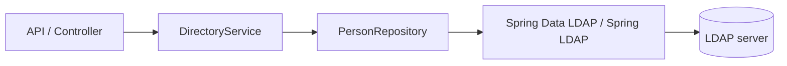

# Phân biệt kiểm thử đơn vị với kiểm thử tích hợp LDAP

Một dịch vụ Java có thể vượt qua toàn bộ bài kiểm thử dùng Mockito nhưng vẫn thất bại khi chạy với LDAP server: sai DN, sai `objectClass`, mapping `@Attribute` không khớp schema, tài khoản bind thiếu quyền hoặc bộ lọc tìm kiếm không cho ra kết quả như mong đợi. Điều này không có nghĩa kiểm thử đơn vị vô ích; nó có nhiệm vụ **khác** với kiểm thử tích hợp.

Trong chương **Kiểm thử** của `SPRING_DATA_LDAP`, bài học này làm rõ ranh giới giữa **unit test** và **integration test** khi ứng dụng dùng Spring Data LDAP để truy cập cây thư mục qua repository, ánh xạ entry sang Java và dùng `LdapTemplate`. Sau khi nắm sự khác biệt, bạn sẽ thiết kế được bộ kiểm thử đúng mức: logic của service chạy nhanh và độc lập; phần giao tiếp LDAP được chứng minh bằng một directory có dữ liệu, schema và quyền thực tế.

## 1. Mục tiêu học tập

Sau bài học, bạn có thể:

- Giải thích chính xác điều gì được kiểm chứng bởi **unit test dùng mock** và bởi **integration test dùng LDAP server**.
- Viết unit test cho service sử dụng `LdapRepository` mà không cần chạy directory.
- Thiết kế dữ liệu LDIF và chạy integration test để kiểm tra DN, `objectClass`, schema, mapping, derived query, `LdapTemplate` và CRUD.
- Chọn kết quả mong đợi cho các trường hợp không tìm thấy entry, nhiều entry, thiếu thuộc tính, bộ lọc có ký tự đặc biệt và lỗi kết nối.
- Tách biệt dữ liệu kiểm thử khỏi production, dọn entry đã tạo và đánh giá độ tin cậy của server nhúng hoặc container.
- Xây dựng chiến lược test cân bằng giữa tốc độ, mức độ cô lập và khả năng phát hiện lỗi tích hợp.

## 2. Đặt bối cảnh: Spring Data LDAP thực sự làm gì?

Giả sử một ứng dụng có chức năng tra cứu nhân viên theo mã `uid`. Dữ liệu nằm trong directory:

```text
dc=example,dc=org
└── ou=people
    ├── uid=lan
    ├── uid=minh
    └── uid=hoa
```

Entry của nhân viên Lan có thể được lưu dưới dạng LDIF:

```ldif
dn: uid=lan,ou=people,dc=example,dc=org
objectClass: top
objectClass: person
objectClass: organizationalPerson
objectClass: inetOrgPerson
uid: lan
cn: Lan Nguyen
sn: Nguyen
mail: lan@example.org
```

Ứng dụng ánh xạ entry sang Java và truy cập qua repository:



- **DN (Distinguished Name)** xác định vị trí entry, chẳng hạn `uid=lan,ou=people,dc=example,dc=org`.
- **`objectClass` và schema** quy định loại entry và các thuộc tính bắt buộc/được phép.
- **Repository** ánh xạ đối tượng Java sang entry, suy diễn truy vấn từ tên method và thực hiện các thao tác truy cập.
- **`LdapTemplate`** hỗ trợ tìm kiếm, ánh xạ và thao tác LDAP ở mức linh hoạt hơn.
- **Directory server** quyết định dữ liệu nào tồn tại, matching rule nào áp dụng và tài khoản hiện tại có quyền gì.

Phần service có thể đúng nhưng dữ liệu thật khác giả định trong mã. Đó chính là lý do cần kiểm thử ở nhiều tầng.

## 3. Unit test khác integration test ở điểm nào?

| Tiêu chí | Kiểm thử đơn vị (unit test) | Kiểm thử tích hợp LDAP (integration test) |
|---|---|---|
| Đối tượng chính | Một service, validator hoặc hàm chuyển đổi. | Sự phối hợp Spring Data LDAP, mapping, kết nối và directory. |
| Repository | Thường là mock hoặc fake. | Repository thật do Spring Data tạo. |
| LDAP server | Không cần. | Có: server nhúng, container hoặc directory thử nghiệm riêng. |
| Dữ liệu | Object Java do test tạo. | Entry thật, DN thật và LDIF/schema của directory test. |
| Logic nghiệp vụ | Có thể kiểm chứng trực tiếp. | Có thể kiểm chứng trong luồng xử lý thực tế. |
| Derived query, filter, DN | Không được chứng minh nếu repository bị mock. | Có thể kiểm tra qua truy vấn LDAP thật. |
| `objectClass`, schema, ACL | Không được kiểm chứng. | Được kiểm chứng nếu môi trường test cấu hình tương ứng. |
| Tốc độ và độ ổn định | Nhanh, dễ lặp lại, ít phụ thuộc hạ tầng. | Thường chậm hơn, phụ thuộc vòng đời server và fixture. |
| Lỗi thường bắt được | Chuẩn hóa input sai, xử lý kết quả sai, chọn nhầm lời gọi. | Sai base DN, mapping, filter, schema, quyền, TLS, thao tác ghi. |

Một cách hiểu hữu ích:

> **Unit test** hỏi: “Nếu repository trả về dữ liệu hoặc lỗi như đã giả định, service của tôi xử lý đúng không?”
>
> **Integration test** hỏi: “Repository và cấu hình của ứng dụng có thực sự đọc, tìm kiếm, ghi dữ liệu đúng trên directory không?”

Nếu một bài kiểm thử khởi động `@SpringBootTest` nhưng thay `PersonRepository` bằng mock thì nó **không chứng minh truy vấn LDAP thật hoạt động**. Ngược lại, integration test có thể gọi repository trực tiếp mà không cần đi qua API; chỉ riêng việc nó dùng LDAP server thật đã giúp kiểm chứng nhiều cơ chế không có trong unit test.

## 4. Mô hình Java dùng chung cho hai loại kiểm thử

Giả sử Spring Boot có Spring Data LDAP và Spring LDAP trong classpath, với base DN kết nối là `dc=example,dc=org`.

### 4.1. Entity ánh xạ LDAP entry

```java
import javax.naming.Name;
import org.springframework.ldap.odm.annotations.Attribute;
import org.springframework.ldap.odm.annotations.Entry;
import org.springframework.ldap.odm.annotations.Id;

@Entry(
    base = "ou=people",
    objectClasses = {
        "top", "person", "organizationalPerson", "inetOrgPerson"
    }
)
public class PersonEntry {

    @Id
    private Name dn;

    @Attribute(name = "uid")
    private String uid;

    @Attribute(name = "cn")
    private String fullName;

    @Attribute(name = "sn")
    private String surname;

    @Attribute(name = "mail")
    private String email;

    // Constructor không tham số, getter/setter được lược bớt.
}
```

Chú ý các điểm dễ sai nhưng unit test với mock khó phát hiện:

1. `@Entry(base = "ou=people")` giới hạn nhánh chứa người dùng, tính tương đối với base của `ContextSource`.
2. `@Id` sử dụng `javax.naming.Name` để biểu diễn DN; không mặc nhiên là khóa số như trong JPA.
3. `@Attribute(name = "sn")` ánh xạ thuộc tính LDAP `sn` sang property Java `surname`.
4. `@Entry(objectClasses = …)` phải tương thích với entry thật và schema; không phải mọi directory đều dùng `inetOrgPerson`.

### 4.2. Repository

```java
import java.util.List;
import java.util.Optional;
import org.springframework.data.ldap.repository.LdapRepository;

public interface PersonRepository extends LdapRepository<PersonEntry> {

    Optional<PersonEntry> findByUid(String uid);

    List<PersonEntry> findBySurname(String surname);

    List<PersonEntry> findByEmailIsNull();
}
```

`findByUid` dùng property Java `uid` để tạo điều kiện tìm kiếm trên LDAP attribute cùng tên. `findBySurname` sử dụng property Java `surname`, nhưng LDAP filter phải dựa trên attribute `sn`. `findByEmailIsNull` tương ứng việc tìm entry **không có thuộc tính** `mail`, khác với so sánh một chuỗi Java bằng `null`.

`Optional<PersonEntry>` chỉ thích hợp khi phạm vi tìm kiếm và quy tắc dữ liệu bảo đảm tối đa một entry khớp `uid`. Nếu directory cho phép trùng `uid` ở nhiều nhánh và search scope bao phủ chúng, nên điều chỉnh thiết kế truy vấn hoặc kiểu trả về.

### 4.3. Service cần kiểm thử

```java
import java.util.Optional;

public class PersonLookupService {

    private final PersonRepository repository;

    public PersonLookupService(PersonRepository repository) {
        this.repository = repository;
    }

    public Optional<PersonEntry> lookupByUid(String rawUid) {
        if (rawUid == null || rawUid.isBlank()) {
            return Optional.empty();
        }

        return repository.findByUid(rawUid.trim());
    }
}
```

Trách nhiệm riêng của service trong ví dụ gồm: bỏ qua input rỗng, loại bỏ khoảng trắng đầu/cuối và chuyển lời gọi đến repository. Đó là hành vi thích hợp để unit test. Việc repository có tìm đúng entry hay không cần integration test.

## 5. Unit test: cô lập service bằng Mockito

Unit test chạy hoàn toàn trong JVM: không kết nối LDAP, không nạp LDIF, không khởi động Spring context nếu không cần. Ta cung cấp kết quả giả lập cho repository và kiểm tra cách service xử lý.

Ví dụ sử dụng JUnit 5 và Mockito:

```java
import static org.junit.jupiter.api.Assertions.*;
import static org.mockito.Mockito.*;

import java.util.Optional;

import org.junit.jupiter.api.Test;
import org.junit.jupiter.api.extension.ExtendWith;
import org.mockito.InjectMocks;
import org.mockito.Mock;
import org.mockito.junit.jupiter.MockitoExtension;

@ExtendWith(MockitoExtension.class)
class PersonLookupServiceTest {

    @Mock
    private PersonRepository repository;

    @InjectMocks
    private PersonLookupService service;

    @Test
    void trimsUidBeforeCallingRepository() {
        PersonEntry lan = new PersonEntry();
        lan.setUid("lan");

        when(repository.findByUid("lan"))
            .thenReturn(Optional.of(lan));

        PersonEntry result =
            service.lookupByUid("  lan  ").orElseThrow();

        assertSame(lan, result);
        verify(repository).findByUid("lan");
        verifyNoMoreInteractions(repository);
    }

    @Test
    void blankUidDoesNotQueryDirectory() {
        assertTrue(service.lookupByUid("  ").isEmpty());
        assertTrue(service.lookupByUid(null).isEmpty());

        verifyNoInteractions(repository);
    }

    @Test
    void missingUidReturnsEmptyOptional() {
        when(repository.findByUid("unknown"))
            .thenReturn(Optional.empty());

        assertTrue(service.lookupByUid("unknown").isEmpty());
        verify(repository).findByUid("unknown");
    }
}
```

Trong ví dụ, các setter/getter của `PersonEntry` được giả định đã triển khai. `spring-boot-starter-test` thường cung cấp JUnit và Mockito cho dự án Spring Boot; nếu không dùng starter, thêm dependencies phù hợp với hệ thống build.

**Unit test này chứng minh được:**

- Service chuẩn hóa `uid` trước khi gọi dependency.
- Input `null` hoặc toàn khoảng trắng không kích hoạt truy vấn.
- Khi repository không tìm được entry, service trả `Optional.empty()`.
- Service gửi đúng đối số tới repository.

**Unit test này chưa chứng minh được:**

- Method `findByUid` được Spring Data LDAP phân tích và sinh filter chính xác.
- LDAP server có entry với `uid=lan`.
- Mapping `@Entry`, `@Attribute` và `@Id` hoạt động.
- Bind credentials, ACL, kết nối TLS, schema hoặc search base đúng.

Mockito chỉ thực hiện quy tắc bạn đã cấu hình bằng `when(...).thenReturn(...)`. Nếu test tự khai báo “có Lan” thì việc assert tìm thấy Lan không thể chứng minh dữ liệu thật tồn tại trên directory.

### 5.1. Khi nào cần unit test nhiều hơn?

Với service phức tạp hơn, nên kiểm thử:

- Quy tắc kiểm tra input và cách chuẩn hóa `uid`, email, mã nhân viên.
- Chọn nhánh xử lý khi repository trả rỗng, một kết quả hoặc ném exception.
- Chuyển `PersonEntry` thành DTO công khai mà không tiết lộ thuộc tính nhạy cảm.
- Chỉ thực hiện thao tác ghi sau khi nghiệp vụ cho phép, và xử lý lỗi ở biên service.
- Các chính sách cache, retry hoặc chuyển trạng thái thuần logic nếu ứng dụng thực sự có chúng.

Với mỗi điều kiện, mock cần biểu diễn một tình huống độc lập, kiểm tra đầu ra và những lời gọi quan trọng. Không cần kiểm tra từng chi tiết nội bộ nếu điều đó làm test dễ vỡ khi refactor.

## 6. Integration test: kiểm tra repository và directory thật

Một **integration test LDAP** phải đi qua stack LDAP thực: Spring Data repository/`LdapTemplate` → `ContextSource` → giao thức LDAP → directory server. Dữ liệu được lưu trong cấu trúc entry của server, chịu ràng buộc schema và quyền.

Có ba hướng phổ biến:

| Môi trường directory test | Ưu điểm | Giới hạn |
|---|---|---|
| LDAP server nhúng trong JVM | Khởi động nhanh, dễ cô lập từng lần chạy. | Có thể khác schema, ACL và hành vi của OpenLDAP/Active Directory. |
| Container LDAP tạm thời | Gần một triển khai LDAP thực; có thể nạp LDIF, cấu hình schema và ACL. | Cần runtime container, khởi động chậm hơn, quản lý fixture và port. |
| Directory test do nhóm vận hành | Có thể giống production về schema, topology và TLS. | Dữ liệu/ACL có thể thay đổi; khó cô lập và dọn sạch; thường chậm hơn. |

Không có lựa chọn nào kiểm chứng được **mọi** hành vi. Chẳng hạn, test thành công trên server nhúng không xác nhận kết nối LDAPS tới Active Directory của doanh nghiệp. Nên dùng server đơn giản để kiểm tra mapping và CRUD hằng ngày; các hành vi phụ thuộc sản phẩm directory cần được xác minh trên môi trường gần đích triển khai.

### 6.1. Chuẩn bị cây dữ liệu thử nghiệm bằng LDIF

Một fixture tối thiểu có thể là `src/test/resources/ldap/people.ldif`, được nạp vào **directory test** trước khi chạy test:

```ldif
dn: dc=example,dc=org
objectClass: top
objectClass: domain
dc: example

dn: ou=people,dc=example,dc=org
objectClass: top
objectClass: organizationalUnit
ou: people

dn: uid=lan,ou=people,dc=example,dc=org
objectClass: top
objectClass: person
objectClass: organizationalPerson
objectClass: inetOrgPerson
uid: lan
cn: Lan Nguyen
sn: Nguyen
mail: lan@example.org

dn: uid=minh,ou=people,dc=example,dc=org
objectClass: top
objectClass: person
objectClass: organizationalPerson
objectClass: inetOrgPerson
uid: minh
cn: Minh Nguyen
sn: Nguyen
mail: minh@example.org

dn: uid=hoa,ou=people,dc=example,dc=org
objectClass: top
objectClass: person
objectClass: organizationalPerson
objectClass: inetOrgPerson
uid: hoa
cn: Hoa Tran
sn: Tran
```

Fixture được cố ý thiết kế để kiểm tra nhiều trường hợp:

- `uid=lan` và `uid=minh` có cùng `sn=Nguyen`; `findBySurname("Nguyen")` phải trả **hai entry**.
- `uid=hoa` không có `mail`; có thể dùng để kiểm tra presence filter.
- Mỗi entry có DN, `objectClass` và các thuộc tính bắt buộc `cn`, `sn` đúng schema ví dụ.
- Các giá trị có thể đối chiếu chính xác, không cần phụ thuộc directory doanh nghiệp.

Việc nạp LDIF phụ thuộc server đang dùng; trong một số server, base DN phải được cấu hình trước. Nếu server đã tự tạo entry gốc, tránh nạp trùng `dc=example,dc=org`. Hãy xác nhận fixture nạp thành công trước khi kiểm tra repository.

### 6.2. Cấu hình kết nối chỉ dành cho test

Ví dụ `application-ldap-test.yml` khi directory test đã chạy ở máy local:

```yaml
spring:
  ldap:
    urls: ldap://127.0.0.1:1389
    base: dc=example,dc=org
    username: cn=admin,dc=example,dc=org
    password: test-only-password
```

Các giá trị trên chỉ minh họa; tài khoản bind, cổng và base phải khớp server test. `ldap://` thuần văn bản chỉ phù hợp ở môi trường thử nghiệm cục bộ được cô lập. Khi tích hợp kết nối thật cần TLS và xác minh chứng chỉ.

Nếu dùng container hoặc server nhúng với cổng động, nên đăng ký `spring.ldap.urls` bằng cấu hình test lúc khởi tạo Spring context (chẳng hạn `@DynamicPropertySource`), thay vì cố định cổng. Hãy giữ tài khoản thử nghiệm và thông tin kết nối tách biệt production; không ghi mật khẩu production vào repository hoặc source test.

## 7. Ví dụ integration test cho truy vấn repository

Giả sử ứng dụng có component scanning/LDAP repositories đúng cấu hình và directory test đã được nạp fixture ở trên. Ta khởi động Spring và dùng **repository thật**:

```java
import static org.assertj.core.api.Assertions.assertThat;

import java.util.List;

import org.junit.jupiter.api.Test;
import org.springframework.beans.factory.annotation.Autowired;
import org.springframework.boot.test.context.SpringBootTest;
import org.springframework.test.context.ActiveProfiles;

@SpringBootTest
@ActiveProfiles("ldap-test")
class PersonRepositoryIntegrationTest {

    @Autowired
    private PersonRepository repository;

    @Test
    void findsByUidUsingRealLdapServer() {
        PersonEntry lan =
            repository.findByUid("lan").orElseThrow();

        assertThat(lan.getUid()).isEqualTo("lan");
        assertThat(lan.getFullName())
            .isEqualTo("Lan Nguyen");
        assertThat(lan.getSurname())
            .isEqualTo("Nguyen");
        assertThat(lan.getDn()).isNotNull();
    }

    @Test
    void mapsJavaSurnameToLdapSnAttribute() {
        List<PersonEntry> people =
            repository.findBySurname("Nguyen");

        assertThat(people)
            .extracting(PersonEntry::getUid)
            .containsExactlyInAnyOrder("lan", "minh");
    }

    @Test
    void findsEntriesWithoutMailAttribute() {
        List<PersonEntry> people =
            repository.findByEmailIsNull();

        assertThat(people)
            .extracting(PersonEntry::getUid)
            .contains("hoa");
    }

    @Test
    void literalWildcardDoesNotBroadenExactSearch() {
        assertThat(repository.findByUid("lan*"))
            .isEmpty();
    }
}
```

Ý nghĩa của các kiểm thử:

1. **`findsByUidUsingRealLdapServer`** kiểm tra Spring tạo repository, kết nối và đọc đúng entry. Kiểm tra DN giúp phát hiện vấn đề mapping.
2. **`mapsJavaSurnameToLdapSnAttribute`** xác nhận property `surname` thực sự dẫn đến LDAP attribute `sn`; điều này không thể chứng minh bằng Mockito.
3. **`findsEntriesWithoutMailAttribute`** kiểm tra điều kiện “không có thuộc tính” trên directory thật.
4. **`literalWildcardDoesNotBroadenExactSearch`** thử ký tự `*` như **giá trị đầu vào**; với truy vấn bằng nhau, nó không được biến thành wildcard mở rộng kết quả.

Đoạn mã là khung minh họa với Spring Boot, JUnit 5 và AssertJ. Để chạy thành công, cần thêm dependency LDAP/test, phần khai báo entity, getter/setter, cấu hình repository và lifecycle của LDAP server test. Các annotation/test slice thay thế như `@DataLdapTest` có thể dùng khi phiên bản Spring Boot cung cấp; hãy kiểm tra cấu hình và thành phần được nạp bởi slice trước khi áp dụng.

### 7.1. Vì sao test này là integration test?

Bài test không dùng `@Mock` hoặc `@MockitoBean` để thay `PersonRepository`. Kết quả đến từ fixture LDAP được truy vấn qua kết nối thật; nó vì thế có thể thất bại khi:

- Base DN hoặc URL sai, server không nhận bind.
- `objectClass` không phù hợp.
- `@Attribute(name = "sn")` bị đổi sai thành tên không tồn tại.
- Parser repository sinh truy vấn sai hoặc filter bị xử lý không đúng.
- Server áp dụng matching rule, schema hoặc ACL khác dự kiến.

Những lỗi này là thông tin cần thiết của integration test, trong khi unit test có chủ đích cô lập chúng khỏi service.

## 8. Kiểm thử CRUD phải quản lý trạng thái directory

LDAP không phải cơ sở dữ liệu quan hệ và không nên mặc định có transaction rollback cho toàn bộ test khi thêm `@Transactional`. Một integration test tạo, sửa hoặc xóa entry cần **dọn dữ liệu rõ ràng**.

Ví dụ dưới đây dùng `uid` riêng để tránh đụng fixture khác:

```java
import static org.assertj.core.api.Assertions.assertThat;

import java.util.UUID;
import javax.naming.Name;

import org.junit.jupiter.api.Test;
import org.springframework.ldap.support.LdapNameBuilder;

@Test
void createsUpdatesAndDeletesDirectoryEntry() {
    String uid = "it-" + UUID.randomUUID();

    // DN tương đối với base dc=example,dc=org
    Name dn = LdapNameBuilder.newInstance("ou=people")
        .add("uid", uid)
        .build();

    PersonEntry person = new PersonEntry();
    person.setDn(dn);
    person.setUid(uid);
    person.setFullName("Integration Tester");
    person.setSurname("Tester");
    person.setEmail("before@example.org");

    try {
        repository.save(person);

        PersonEntry created =
            repository.findByUid(uid).orElseThrow();
        assertThat(created.getEmail())
            .isEqualTo("before@example.org");

        created.setEmail("after@example.org");
        repository.save(created);

        PersonEntry updated =
            repository.findByUid(uid).orElseThrow();
        assertThat(updated.getEmail())
            .isEqualTo("after@example.org");

    } finally {
        repository.findById(dn)
            .ifPresent(repository::delete);
    }

    assertThat(repository.findByUid(uid)).isEmpty();
}
```

Đây là **phương thức test** nằm trong class đã cấu hình Spring và inject `repository`; chỉ ví dụ phần thân kiểm thử để tập trung vào vòng đời dữ liệu.

Các điều kiện cần bảo đảm:

- `ou=people` đã tồn tại và tài khoản bind có quyền tạo, sửa, xóa entry trong nhánh test.
- Các `objectClass` và thuộc tính bắt buộc hợp schema; nếu LDAP server yêu cầu thuộc tính khác, bổ sung vào mapping/fixture.
- DN được xây bằng `LdapNameBuilder` để escape thành phần DN đúng cách, không nối thẳng chuỗi nhập từ người dùng.
- DN trong ví dụ được biểu diễn **tương đối với base của `ContextSource`**; hãy kiểm tra điều này trong cấu hình thực tế.
- Nếu test fail giữa chừng, khối `finally` cố gắng dọn entry. Vẫn cần cơ chế xóa toàn bộ fixture hoặc tái tạo server khi quá trình test bị dừng đột ngột.
- Các test ghi dùng dữ liệu riêng hoặc reset fixture; không chạy song song trên cùng entry khi chưa có chiến lược cô lập.

Không cần viết unit test để xác nhận `repository.save(person)` đã được gọi nếu mục tiêu là kiểm tra liệu directory thật đã nhận entry. Unit test phù hợp để kiểm tra **quyết định gọi save** của service, còn integration test phải **đọc lại trạng thái** sau save.

## 9. Khi kiểm thử `LdapTemplate`, ranh giới vẫn tương tự

Spring Data LDAP thường dùng `LdapRepository` cho các thao tác phổ biến, nhưng khi cần kiểm soát filter, scope và mapping, ứng dụng có thể gọi `LdapTemplate`.

Ví dụ production code:

```java
import java.util.List;
import org.springframework.ldap.core.AttributesMapper;
import org.springframework.ldap.core.LdapTemplate;
import static org.springframework.ldap.query.LdapQueryBuilder.query;

public class DirectoryNameLookup {

    private final LdapTemplate ldapTemplate;

    public DirectoryNameLookup(LdapTemplate ldapTemplate) {
        this.ldapTemplate = ldapTemplate;
    }

    public List<String> findNamesByUid(String uid) {
        return ldapTemplate.search(
            query().base("ou=people")
                   .where("uid").is(uid),
            (AttributesMapper<String>) attrs ->
                attrs.get("cn").get().toString()
        );
    }
}
```

- **Unit test** mock `LdapTemplate` để xem service sử dụng kết quả và xử lý lỗi thế nào. Nó không xác nhận filter được server hiểu đúng.
- **Integration test** inject `LdapTemplate` thật, chạy `findNamesByUid("lan")` và kỳ vọng `Lan Nguyen` từ fixture. Nó xác nhận scope/base, filter, kết nối và `AttributesMapper`.

Nếu method lấy thuộc tính `cn` nhưng một entry trong phạm vi tìm kiếm thiếu thuộc tính này, integration test có thể phát hiện `NullPointerException` hoặc lỗi LDAP mapping; unit test chỉ phát hiện nếu người viết chủ động giả lập trường hợp thiếu. Khi gặp dữ liệu không đồng nhất, cân nhắc kiểm tra thuộc tính có tồn tại trước khi gọi `get()`.

## 10. Kiểm thử filter an toàn: điều gì cần quan sát?

Một lỗi nghiêm trọng là **ghép filter LDAP từ input không đáng tin**:

```java
// Không an toàn: input có thể thay đổi cấu trúc filter.
String unsafeFilter = "(uid=" + userInput + ")";
```

LDAP filter dùng ký tự đặc biệt `*`, `(`, `)`, dấu gạch chéo ngược và ký tự null. Nếu đầu vào đi thẳng vào chuỗi filter, người gọi có thể thay đổi ngữ nghĩa của truy vấn (*LDAP injection*). Derived repository query hoặc `LdapQueryBuilder` là lựa chọn an toàn hơn khi sử dụng API binding đúng cách.

### Unit test kiểm tra điều gì?

Có thể kiểm tra service từ chối input quá dài, sai quy tắc nghiệp vụ, hoặc sử dụng repository method cố định `findByUid`. Nhưng một unit test mock repository **không khẳng định** Spring LDAP đã escape ký tự filter đúng.

### Integration test kiểm tra điều gì?

Với fixture đã biết, gọi truy vấn bằng các giá trị:

| Input thử nghiệm | Kỳ vọng |
|---|---|
| `lan` | Trả entry `lan`. |
| `lan*` | Không được tự mở rộng thành tìm các `uid` bắt đầu bằng `lan`. |
| `lan)(uid=*)` | Không được làm thay đổi cấu trúc filter; kết quả phải được xử lý an toàn. |
| Một chuỗi có dấu `\` | Không được gây filter injection; kết quả phụ thuộc entry thật. |
| `unknown` | Không có entry khớp. |

Ngoài kết quả trả về, có thể xác minh server không bị trả về toàn bộ người dùng, không xuất hiện truy vấn không kiểm soát và không log dữ liệu nhạy cảm. Test có thể dùng các công cụ quan sát LDAP phù hợp trong môi trường test, nhưng không nên phụ thuộc vào việc so sánh nguyên văn chuỗi filter khi chỉ cần kiểm tra hành vi.

**Phân biệt hai kiểu escape:** DN phải được mã hóa theo quy tắc DN; giá trị trong filter phải được mã hóa theo quy tắc LDAP filter. Không dùng cùng một hàm “escape” tự viết cho mọi vị trí.

## 11. Schema, matching rule và quyền truy cập phải được integration test

Có những giả định chỉ có thể đối chiếu khi directory thực sự xử lý request.

### 11.1. DN và `objectClass`

- Entry có DN `uid=lan,ou=people,dc=example,dc=org`, còn code truy vấn trong `ou=users`: unit test vẫn có thể xanh, integration test phải cho thấy không tìm thấy entry.
- Mapping dùng `inetOrgPerson` nhưng directory mục tiêu trả loại entry khác: truy vấn có thể bị lọc khỏi tập kết quả.
- Entry thiếu `sn` hoặc `cn` bắt buộc theo schema: thao tác save có thể bị server từ chối.
- DN được xây sai, ví dụ không escape dấu phẩy trong giá trị RDN: test tạo entry có ký tự đặc biệt sẽ phát hiện.

### 11.2. Matching rule và thuộc tính đa trị

LDAP server quyết định so sánh chuỗi có phân biệt hoa thường, chuẩn hóa dấu cách hoặc hỗ trợ phép so khớp nào thông qua schema/matching rule. Không nên giả định `findByUid("LAN")` luôn giống `findByUid("lan")` chỉ vì một test trên server nhúng cho kết quả như vậy.

Nếu một thuộc tính có nhiều giá trị, hãy dùng entity mapping phù hợp, thêm fixture đa trị và kiểm tra cả truy vấn lẫn dữ liệu đọc lại. Unit test tạo object Java với một giá trị không chứng minh được cách server lưu hoặc trả thuộc tính đa trị.

### 11.3. ACL và bind identity

Cùng một entry có thể hiển thị khác nhau với tài khoản quản trị và tài khoản ứng dụng chỉ có quyền đọc. Hãy có integration test với **bind account đúng như runtime sử dụng**, chẳng hạn:

1. Tài khoản chỉ đọc truy vấn được thuộc tính được phép.
2. Tài khoản chỉ đọc không được sửa entry.
3. Truy vấn vào nhánh bị cấm được xử lý theo hành vi thực tế của server và cách ứng dụng chuyển lỗi.
4. Tài khoản có quyền ghi chỉ cập nhật được các thuộc tính đã được ủy quyền.

Cần kiểm tra kết quả theo chính sách directory: tùy ACL và server, truy vấn không đủ quyền có thể trả rỗng, ẩn một số thuộc tính hoặc trả lỗi. Đừng mặc định mọi trường hợp đều ném cùng một exception.

### 11.4. TLS và lỗi kết nối

Unit test có thể xác nhận logic retry/backoff hoặc cách ứng dụng phản hồi một exception đã mô phỏng. Nó không xác nhận truststore, chứng chỉ, TLS handshake, timeout và hostname verification.

Integration test hạ tầng cần bao gồm kết nối LDAPS/StartTLS theo chính sách của hệ thống, chứng chỉ server hợp lệ, trường hợp chứng chỉ không được tin cậy và lỗi kết nối phù hợp. Không đưa private key hay credential production vào fixture. Với các lỗi mạng, test thường nên chạy trong một môi trường được kiểm soát để tránh kết quả lúc được lúc không.

## 12. Phân loại test theo mục tiêu thay vì tên annotation

Các annotation của Spring giúp chọn phạm vi khởi động context; bản chất unit/integration phụ thuộc vào **dependency thực sự được gọi**.

| Tình huống | Phân loại phù hợp | Vì sao? |
|---|---|---|
| `new PersonLookupService(mockRepository)` | Unit test | Chỉ chạy logic service, không có Spring/LDAP thật. |
| `@SpringBootTest` với repository bị thay bằng mock | Test logic hoặc tích hợp Spring context ở mức giới hạn | Không chứng minh query LDAP và directory. |
| `@SpringBootTest` dùng repository thật và server LDAP nhúng | Integration test LDAP | Có ánh xạ, bind, filter và giao thức LDAP thực. |
| Test gọi `LdapTemplate` thật trên container OpenLDAP | Integration test LDAP | Request được xử lý bởi server LDAP. |
| Test dùng AD test realm với TLS và ACL gần production | Integration/system test | Kiểm tra hành vi đặc thù của môi trường triển khai. |
| Gửi HTTP tới ứng dụng rồi tra LDAP và kiểm tra JSON | End-to-end hoặc system test | Kiểm chứng cả API, service và tầng dữ liệu. |

`@DataLdapTest` (ở các phiên bản Spring Boot có hỗ trợ) là một test slice có thể hữu ích để giới hạn phạm vi bean cần khởi động. Dù dùng slice hay `@SpringBootTest`, điều kiện then chốt vẫn là repository/`LdapTemplate` **kết nối với directory test thật**. Đừng đánh giá mức độ tích hợp chỉ dựa vào tên annotation.

## 13. Checklist thiết kế một bộ kiểm thử LDAP đáng tin cậy

| Vấn đề cần kiểm chứng | Unit test? | Integration test? | Gợi ý |
|---|---|---|---|
| Trim `uid`, kiểm tra input rỗng | Có | Không bắt buộc | Mock repository, kiểm tra argument truyền đi. |
| Tách thông tin nhạy cảm khỏi DTO | Có | Có thể thêm | Kiểm tra mapping trong service và API công khai. |
| Derived query `findBySurname` dùng đúng `sn` | Không nếu mock | Cần | Dùng fixture có nhiều người cùng họ. |
| Định danh theo DN và đúng base | Không nếu mock | Cần | Kiểm tra DN và entry cha thực tế. |
| `@Entry`, `objectClass`, schema khi save | Không nếu mock | Cần | Tạo entry mới theo schema test. |
| Update/delete đã có hiệu lực | Chỉ kiểm tra quyết định gọi | Cần | Đọc lại sau write và cleanup. |
| Ký tự đặc biệt trong LDAP filter | Chỉ kiểm tra rule của service | Cần | Gọi truy vấn thật với `*`, dấu ngoặc, `\`. |
| Phân quyền read/write và thuộc tính ẩn | Có thể mô phỏng lỗi | Cần | Dùng tài khoản bind theo ACL. |
| TLS, timeout, lỗi kết nối | Có thể mô phỏng phản ứng | Cần | Sử dụng server/test infrastructure kiểm soát được. |
| Tải lớn và latency | Không phù hợp | Test hiệu năng riêng | Cần dataset và tiêu chí hiệu năng thực tế. |

Để tránh integration test chập chờn:

1. **Fixture xác định:** dựng sẵn dữ liệu qua LDIF hoặc API khởi tạo; không phụ thuộc user thật trong công ty.
2. **Vòng đời server rõ ràng:** khởi động trước khi tạo Spring `ContextSource`, ngắt và dọn khi test suite kết thúc.
3. **Cô lập dữ liệu:** dùng directory riêng, nhánh riêng và định danh duy nhất cho test ghi; không dùng chung production.
4. **Dọn trạng thái:** xóa entry tạo trong test và/hoặc tạo mới toàn bộ server giữa các test suite.
5. **Không giả định rollback:** Spring Data LDAP/LDAP protocol không cung cấp mặc nhiên ngữ nghĩa transaction JPA cho toàn bộ test.
6. **Giữ đúng schema và ACL cần thử:** server nhúng nhanh cho smoke test; container/server mục tiêu cho kiểm chứng đặc thù.
7. **Chẩn đoán lỗi dễ đọc:** phân biệt server chưa chạy, bind thất bại, dữ liệu không tồn tại, sai mapping và thiếu quyền.

## 14. Những ngộ nhận thường gặp

**“Đã dùng `@SpringBootTest` thì đó là integration test LDAP.”** Không nhất thiết. Nếu bean repository bị mock, bạn chỉ kiểm tra những phần còn lại của Spring context.

**“Mock trả về entry hợp lệ nghĩa là `@Entry` và `@Attribute` đúng.”** Không. Mockito trả object theo cấu hình của test mà không dùng LDAP schema hay kiểm tra ánh xạ.

**“Test trên server nhúng xanh là chắc chắn chạy được trên Active Directory.”** Không. AD có schema, naming context, quyền và chính sách kết nối có thể khác. Kiểm tra những giả định phụ thuộc directory trên môi trường phù hợp.

**“Kết quả `findByUid("lan")` là một entry nên `uid` luôn duy nhất.”** Không. LDAP không mặc định đảm bảo thuộc tính đó duy nhất trong mọi nhánh; phạm vi truy vấn và chính sách directory mới quyết định.

**“Có thể dùng `@Transactional` để hoàn tác mọi thao tác LDAP sau test.”** Không nên giả định như vậy. LDAP và Spring LDAP không mặc nhiên có rollback cho nhiều thao tác giống giao dịch JPA; dọn dữ liệu tường minh.

**“Unit test phải test cả parser của Spring Data LDAP.”** Không. Cơ chế của framework cần xác nhận ở điểm tích hợp quan trọng với schema/fixture; unit test tập trung vào logic do nhóm phát triển sở hữu.

**“Thấy LDAP entry nghĩa là người dùng đã đăng nhập thành công.”** Không. Repository search dùng để đọc dữ liệu directory; xác thực danh tính và kiểm tra quyền đăng nhập là trách nhiệm bảo mật riêng, thường qua Spring Security LDAP.

## 15. Bài tập thực hành

### Bài tập 1: Chọn loại kiểm thử

Với các yêu cầu sau, hãy cho biết dùng unit test, integration test LDAP hoặc cả hai:

1. Input `"  lan  "` phải được chuẩn hóa thành `"lan"` trước khi tìm.
2. `findBySurname("Nguyen")` tìm hai entry có thuộc tính LDAP `sn=Nguyen`.
3. Service không trả `password` hoặc thuộc tính nội bộ trong DTO.
4. Tài khoản chỉ đọc bị từ chối thao tác xóa entry.
5. `findByUid("lan*")` không được đổi nghĩa thành wildcard query.

*Gợi ý:* mục 1 và 3 chủ yếu nằm ở logic ứng dụng; mục 2, 4 và 5 cần directory thật. Mục 3 cũng có thể xuất hiện ở test API/integration nếu muốn kiểm chứng toàn bộ luồng dữ liệu.

### Bài tập 2: Thiết kế fixture

Tạo LDIF với hai entry cùng `sn`, một entry thiếu `mail` và một entry có tên chứa dấu phẩy. Viết các assertion để chứng minh:

- Tìm theo property Java `surname` dùng LDAP attribute `sn`.
- Presence filter hoạt động.
- DN có ký tự đặc biệt được xây và đọc lại đúng.

### Bài tập 3: Tìm lỗi từ kết quả test

Unit test `DirectoryService` xanh, nhưng integration test `findByUid("lan")` trả rỗng. Hãy lần lượt kiểm tra URL/base DN, dữ liệu LDIF, `@Entry(base = …)`, `objectClass`, tên LDAP attribute, search scope, bind identity và ACL. Giải thích tại sao không nên sửa mock cho “khớp” với kết quả rỗng.

### Bài tập 4: Kiểm thử CRUD có cleanup

Tạo một entry với `uid` duy nhất trong nhánh test, lưu, đọc lại, cập nhật `mail`, đọc lại rồi xóa. Hãy cho phép test thất bại tại bước cập nhật mà vẫn đảm bảo quá trình dọn dẹp được thực hiện. Nêu giới hạn nếu process bị dừng đột ngột trước `finally`.

## 16. Tổng kết

**Unit test** bảo vệ logic Java mà ta kiểm soát: chuẩn hóa input, chọn thao tác và xử lý kết quả repository. **Integration test LDAP** bảo vệ giả định ở ranh giới framework và hạ tầng: kết nối, DN, base/scope, schema, `objectClass`, ánh xạ entry, filter, quyền và CRUD.

Hai loại kiểm thử bổ sung cho nhau. Bộ test đáng tin thường có nhiều unit test nhanh cho service, một tập integration test chạy với directory cô lập và một số bài kiểm chứng môi trường đặc thù (TLS, ACL, schema của server mục tiêu) khi cần. Với Spring Data LDAP, hãy ưu tiên kiểm tra các hành vi mà mock không thể quan sát, đặc biệt là **DN, query repository, `LdapTemplate`, escaping filter và thay đổi dữ liệu trên directory thật**.
