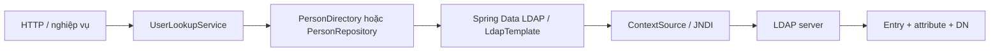

# Mock tại ranh giới dịch vụ thay vì mô phỏng toàn bộ JNDI

## Mục tiêu học tập

Sau bài này, người học có thể:

1. Giải thích vì sao **kiểm thử đơn vị logic nghiệp vụ** nên mock ở một **ranh giới rõ ràng** như repository hoặc cổng truy cập directory, thay vì dựng lại toàn bộ hành vi JNDI.
2. Thiết kế service sử dụng **Spring Data LDAP** thông qua một interface dễ thay thế trong test.
3. Viết kiểm thử bằng **JUnit 5 và Mockito** cho trường hợp tìm thấy, không tìm thấy, input không hợp lệ, kết quả trùng và lỗi từ directory.
4. Phân biệt điều gì **unit test có mock** chứng minh được với điều gì bắt buộc phải **kiểm thử tích hợp trên LDAP server**: DN, schema, `objectClass`, filter, CRUD, TLS, bind và quyền truy cập.
5. Nhận diện các kiểu kiểm thử mong manh như mock `DirContext`, `NamingEnumeration`, `ContextSource` hay xác nhận quá nhiều lời gọi nội bộ.

Bài thuộc chương **Kiểm thử** của module `SPRING_DATA_LDAP`. Bối cảnh là ứng dụng Java truy cập dịch vụ thư mục LDAP bằng repository và ánh xạ entry phân cấp; độ tin cậy của hệ thống phụ thuộc đồng thời vào logic nghiệp vụ, ánh xạ LDAP và hành vi directory thực.

## 1. Vấn đề: một lời gọi repository kéo theo nhiều lớp hạ tầng

Một service tra cứu người dùng có thể chỉ gọi một phương thức:

```java
personRepository.findByLoginId(loginId);
```

Nhưng phía sau lời gọi đó là nhiều bước:



Các tầng này có trách nhiệm khác nhau:

| Tầng | Trách nhiệm cần quan tâm | Phù hợp để kiểm thử như thế nào? |
| --- | --- | --- |
| Service nghiệp vụ | Kiểm tra input, xử lý số kết quả, quy định lỗi, tạo kết quả trả về | **Unit test** với một dependency được mock |
| Adapter/repository | Đổi kiểu Java, dùng tên property đúng, ánh xạ LDAP attribute, xây filter | Test mapping đơn giản; **integration test** cho hành vi LDAP thật |
| Spring LDAP và JNDI | Tạo context, bind, search, quản lý tài nguyên, xử lý giao thức | Dựa vào thư viện và kiểm thử tích hợp tương ứng; ít lý do tái tạo toàn bộ bằng mock |
| LDAP server | Kiểm tra schema, `objectClass`, DN/RDN, ACL, matching rule, giới hạn tìm kiếm | Test trên directory kiểm thử có schema và dữ liệu phù hợp |
| Kết nối/bảo mật | TLS, chứng chỉ, tài khoản bind, timeout, pool | Integration/E2E với cấu hình gần môi trường triển khai |

**Mục tiêu không phải mock càng nhiều càng tốt.** Mục tiêu là cô lập **quyết định của service** khỏi những chi tiết không thuộc trách nhiệm của nó, đồng thời dùng kiểu kiểm thử phù hợp để xác minh phần tích hợp còn lại.

## 2. “Ranh giới dịch vụ” là gì?

**Ranh giới dịch vụ** trong bài là nơi logic nghiệp vụ giao tiếp với một dependency mà service không tự kiểm soát: repository LDAP hoặc một interface ứng dụng gọi đến directory.

Có hai cách tổ chức thường gặp:

- **Service phụ thuộc trực tiếp vào `PersonRepository`**: trong unit test có thể mock `PersonRepository`. Đây là lựa chọn đơn giản nếu service chỉ dùng repository và không cần che giấu kiểu LDAP.
- **Service phụ thuộc vào interface `PersonDirectory` do ứng dụng định nghĩa**: trong unit test mock `PersonDirectory`; adapter thật triển khai interface và gọi `PersonRepository`. Cách này hữu ích khi muốn tách rõ logic nghiệp vụ khỏi Spring Data LDAP.

Không có yêu cầu phải tạo thêm interface cho mọi truy vấn. Chỉ tạo một abstraction khi nó làm rõ hợp đồng, hạn chế phụ thuộc hoặc phục vụ một nhu cầu thiết kế thực tế.

### 2.1. Sự khác nhau giữa mock và fake

- **Mock**: đối tượng do framework như Mockito tạo ra, được lập trình để trả dữ liệu/lỗi và có thể kiểm tra cách dependency được gọi.
- **Stub**: đối tượng cung cấp phản hồi xác định trước, thường không cần xác nhận số lời gọi.
- **Fake**: triển khai đơn giản có trạng thái, chẳng hạn directory giả lưu danh sách người dùng trong memory; có thể hữu ích cho test nhưng không mang đầy đủ semantics LDAP.

Cả mock, stub lẫn fake chỉ có giá trị trong **phạm vi hợp đồng mà chúng mô phỏng**. Một `List<PersonEntry>` được tạo trong test không chứng minh rằng LDAP server đã chấp nhận entry hoặc filter tương ứng.

## 3. Ví dụ xuyên suốt: tra cứu người dùng theo mã đăng nhập

Giả sử màn hình helpdesk nhận `loginId` và cần trả về thẻ thông tin người dùng. Quy tắc nghiệp vụ:

1. Input `loginId` không được `null` hoặc toàn khoảng trắng.
2. Không tìm thấy entry thì trả `Optional.empty()`.
3. Tìm thấy **đúng một** entry thì trả tên đăng nhập và tên hiển thị.
4. Có **nhiều hơn một** entry khớp `loginId` trong phạm vi tìm kiếm thì báo lỗi dữ liệu không nhất quán; không chọn ngẫu nhiên entry đầu tiên.
5. Lỗi hạ tầng directory phải được phân loại theo chính sách ứng dụng, không coi là “người dùng không tồn tại”.

Quy tắc thứ 4 quan trọng vì `uid` không mặc nhiên duy nhất trên toàn cây thư mục khi directory và phạm vi tìm kiếm chưa áp dụng một chính sách uniqueness cụ thể.

### 3.1. Khai báo interface và dữ liệu ở ranh giới

Ví dụ sử dụng **Java 17+** với `record`. Mỗi khai báo `public` nằm trong tệp `.java` riêng khi đưa vào dự án.

```java
// DirectoryPerson.java
public record DirectoryPerson(String loginId, String commonName) {}
```

```java
// PersonDirectory.java
import java.util.List;

public interface PersonDirectory {
    List<DirectoryPerson> findByLoginId(String loginId);
}
```

```java
// UserCard.java
public record UserCard(String loginId, String displayName) {}
```

Interface `PersonDirectory` là **cổng truy cập dữ liệu của ứng dụng**. Nó không bắt service biết `javax.naming.directory.DirContext`, LDAP filter hoặc `NamingEnumeration`.

### 3.2. Viết service chỉ xử lý nghiệp vụ

```java
// UserLookupService.java
import java.util.List;
import java.util.Optional;

public final class UserLookupService {

    private final PersonDirectory directory;

    public UserLookupService(PersonDirectory directory) {
        this.directory = directory;
    }

    public Optional<UserCard> lookup(String loginId) {
        if (loginId == null || loginId.isBlank()) {
            throw new IllegalArgumentException("loginId is required");
        }

        List<DirectoryPerson> matches =
            directory.findByLoginId(loginId);

        if (matches.size() > 1) {
            throw new IllegalStateException(
                "Multiple LDAP entries matched this loginId"
            );
        }

        if (matches.isEmpty()) {
            return Optional.empty();
        }

        DirectoryPerson person = matches.get(0);
        return Optional.of(
            new UserCard(person.loginId(), person.commonName())
        );
    }
}
```

Ở dự án thực, có thể thay `IllegalStateException` bằng exception nghiệp vụ có tên cụ thể, chẳng hạn `AmbiguousDirectoryIdentityException`. Điều cần kiểm tra là **hành vi service**, không phải bạn sử dụng lớp exception nào cho mọi dự án.

Service không tự xây LDAP filter, không mở kết nối và cũng không thử giả lập cơ chế phân giải DN của JNDI. Sự phụ thuộc duy nhất cần mock là `PersonDirectory`.

## 4. Unit test bằng JUnit 5 và Mockito

Giả sử test scope có **JUnit Jupiter**, `mockito-core` và `mockito-junit-jupiter` ở phiên bản tương thích với build của dự án. Dùng `MockitoExtension` giúp khởi tạo mock trong JUnit 5 mà **không cần chạy Spring ApplicationContext**.

```java
// UserLookupServiceTest.java
import static org.junit.jupiter.api.Assertions.assertEquals;
import static org.junit.jupiter.api.Assertions.assertThrows;
import static org.junit.jupiter.api.Assertions.assertTrue;
import static org.mockito.Mockito.verify;
import static org.mockito.Mockito.verifyNoInteractions;
import static org.mockito.Mockito.when;

import java.util.List;
import java.util.Optional;

import org.junit.jupiter.api.BeforeEach;
import org.junit.jupiter.api.Test;
import org.junit.jupiter.api.extension.ExtendWith;
import org.mockito.Mock;
import org.mockito.junit.jupiter.MockitoExtension;

@ExtendWith(MockitoExtension.class)
class UserLookupServiceTest {

    @Mock
    private PersonDirectory directory;

    private UserLookupService service;

    @BeforeEach
    void setUp() {
        service = new UserLookupService(directory);
    }

    @Test
    void returnsUserCardWhenExactlyOneEntryMatches() {
        when(directory.findByLoginId("an.nguyen"))
            .thenReturn(List.of(
                new DirectoryPerson("an.nguyen", "An Nguyen")
            ));

        Optional<UserCard> actual = service.lookup("an.nguyen");

        assertEquals(
            Optional.of(new UserCard("an.nguyen", "An Nguyen")),
            actual
        );
        verify(directory).findByLoginId("an.nguyen");
    }

    @Test
    void returnsEmptyWhenNoEntryMatches() {
        when(directory.findByLoginId("unknown"))
            .thenReturn(List.of());

        assertEquals(Optional.empty(), service.lookup("unknown"));
    }

    @Test
    void rejectsBlankInputBeforeCallingDirectory() {
        assertThrows(
            IllegalArgumentException.class,
            () -> service.lookup("   ")
        );
        verifyNoInteractions(directory);
    }

    @Test
    void rejectsAmbiguousResult() {
        when(directory.findByLoginId("duplicate"))
            .thenReturn(List.of(
                new DirectoryPerson("duplicate", "Person A"),
                new DirectoryPerson("duplicate", "Person B")
            ));

        assertThrows(
            IllegalStateException.class,
            () -> service.lookup("duplicate")
        );
    }

    @Test
    void propagatesDirectoryFailureInsteadOfPretendingNotFound() {
        when(directory.findByLoginId("an.nguyen"))
            .thenThrow(new IllegalStateException("directory offline"));

        assertThrows(
            IllegalStateException.class,
            () -> service.lookup("an.nguyen")
        );
    }
}
```

Trong một ứng dụng thật, exception hạ tầng thường được adapter chuẩn hóa thành exception có ngữ nghĩa rõ, ví dụ `DirectoryUnavailableException`. Khi đó hãy test **kiểu lỗi thực tế của hợp đồng** và quy tắc xử lý của service, thay vì dựa vào thông báo của ngoại lệ thư viện.

### 4.1. Từng test chứng minh điều gì?

| Test | Có thể kết luận | Chưa thể kết luận |
| --- | --- | --- |
| Một entry | Service ánh xạ một kết quả directory thành `UserCard` | LDAP sẽ tìm đúng entry và ánh xạ `cn` thành `commonName` |
| Không có entry | Service trả rỗng đúng chính sách | Filter LDAP thực sẽ tìm ra 0 entry |
| Input trống | Service từ chối và **không gọi dependency** | LDAP filter có escaping đúng với input phức tạp |
| Hai entry trùng | Service phát hiện kết quả mơ hồ | Directory thực cho phép hoặc ngăn trùng `uid` như thế nào |
| Dependency ném exception | Service không biến lỗi thành “không có người dùng” | Lỗi mất mạng, timeout, bind hay TLS thực sự được dịch thành loại exception nào |

Điểm mạnh của các test này là **nhanh, có tính quyết định và không phụ thuộc network**. Nếu chạy thất bại, phạm vi điều tra là logic service hoặc hợp đồng với dependency.

### 4.2. Chỉ verify lời gọi có giá trị cho yêu cầu

`verifyNoInteractions(directory)` trong test input trống có ý nghĩa: **hợp đồng yêu cầu không gọi dịch vụ ngoài khi input không hợp lệ**.

Ngược lại, không cần verify hàng loạt lời gọi như “gọi mapper đúng hai lần”, “lấy context trước khi map”, “đóng enumeration đúng thứ tự” trong unit test service khi chúng không thuộc yêu cầu nghiệp vụ. Các kiểm tra quá chặt này khiến refactor nội bộ làm test thất bại dù hành vi người dùng vẫn đúng.

## 5. Adapter thật kết nối Spring Data LDAP

Service ở trên chạy được với mock. Tiếp theo cần một triển khai thật của `PersonDirectory` để kết nối LDAP.

### 5.1. Entity LDAP được ánh xạ

Trong directory, dữ liệu của một người dùng có thể trông như sau:

```ldif
dn: uid=an.nguyen,ou=people,dc=example,dc=org
objectClass: top
objectClass: person
objectClass: organizationalPerson
objectClass: inetOrgPerson
uid: an.nguyen
cn: An Nguyen
sn: Nguyen
mail: an.nguyen@example.org
```

Một entity ODM tối giản để **đọc dữ liệu**:

```java
// PersonEntry.java
import javax.naming.Name;

import org.springframework.ldap.odm.annotations.Attribute;
import org.springframework.ldap.odm.annotations.Entry;
import org.springframework.ldap.odm.annotations.Id;

@Entry(
    base = "ou=people",
    objectClasses = {
        "top", "person", "organizationalPerson", "inetOrgPerson"
    }
)
public class PersonEntry {

    @Id
    private Name dn;

    @Attribute(name = "uid")
    private String loginId;

    @Attribute(name = "cn")
    private String commonName;

    @Attribute(name = "sn")
    private String surname;

    public PersonEntry() {}

    public Name getDn() { return dn; }
    public String getLoginId() { return loginId; }
    public String getCommonName() { return commonName; }
    public String getSurname() { return surname; }
}
```

Cần chú ý:

- `@Entry` mô tả loại entry và phần base tìm kiếm; `ou=people` thường tương đối với base DN đã cấu hình cho `ContextSource`.
- `@Id` ánh xạ DN, không phải ID số kiểu JPA.
- `@Attribute(name = "uid")` nối property Java `loginId` với attribute LDAP `uid`.
- `@Attribute(name = "cn")` nối property `commonName` với `cn`.
- `inetOrgPerson` kế thừa yêu cầu về `cn`, `sn` từ `person`; fixture phải thỏa schema khi được import.
- Class trên phục vụ minh họa truy vấn đọc; khi dùng cho tạo/sửa entry còn cần cấu hình RDN, constructor/field mapping và xử lý thuộc tính bắt buộc theo ứng dụng.

### 5.2. Repository và adapter

```java
// PersonRepository.java
import java.util.List;
import org.springframework.data.ldap.repository.LdapRepository;

public interface PersonRepository
        extends LdapRepository<PersonEntry> {

    // Theo property Java "loginId"; LDAP attribute thực là "uid".
    List<PersonEntry> findByLoginId(String loginId);
}
```

```java
// LdapPersonDirectory.java
import java.util.List;
import org.springframework.stereotype.Component;

@Component
public class LdapPersonDirectory implements PersonDirectory {

    private final PersonRepository repository;

    public LdapPersonDirectory(PersonRepository repository) {
        this.repository = repository;
    }

    @Override
    public List<DirectoryPerson> findByLoginId(String loginId) {
        return repository.findByLoginId(loginId)
            .stream()
            .map(entry -> new DirectoryPerson(
                entry.getLoginId(),
                entry.getCommonName()
            ))
            .toList();
    }
}
```

Đây là nơi tổ chức **chuyển đổi từ entity LDAP sang dữ liệu mà service hiểu**. Phần giao tiếp directory và xử lý lỗi kết nối có thể được đặt tại adapter nếu ứng dụng cần che giấu dependency Spring LDAP khỏi lớp nghiệp vụ.

### 5.3. Có cần mock JNDI để test adapter không?

Không cần mock JNDI để kiểm tra **phép ánh xạ thuần Java** giữa `PersonEntry` và `DirectoryPerson`. Có thể mock `PersonRepository` và cho trả về entity đã dựng sẵn, rồi xác minh adapter trả về record đúng trường.

Tuy nhiên, test như vậy **không chứng minh** rằng:

- Spring LDAP đọc được `uid`, `cn` và `sn` từ server.
- `findByLoginId` tạo filter đúng cho schema và scope.
- Base DN được ghép đúng.
- Bind/TLS, schema hay ACL cho phép đọc entry.
- Kết quả có thể chứa nhiều entry hoặc attribute đa trị như bạn dự đoán.

Những điều này cần integration test có directory thực hoặc directory nhúng phù hợp, bởi đó là **hành vi của tầng tích hợp**, không phải hành vi mapper Java đơn giản.

## 6. Vì sao không nên mô phỏng toàn bộ JNDI bằng Mockito?

JNDI cung cấp các API như `DirContext`, `NamingEnumeration<SearchResult>` và `SearchControls`. Để mock quá sâu, test thường phải mô tả hàng loạt bước nội bộ:

```text
ContextSource.getReadOnlyContext()
  -> DirContext.search(base, filter, controls)
  -> NamingEnumeration.hasMore()
  -> NamingEnumeration.next()
  -> SearchResult.getAttributes()
  -> Attributes.get("uid")
  -> Attribute.get()
  -> NamingEnumeration.close()
  -> DirContext.close()
```

Đây chỉ là **một đường đi giả định**. Trong thực tế, Spring LDAP có thể dùng callback, quản lý context theo template, dùng provider khác hoặc thay đổi cách duyệt kết quả giữa các phiên bản.

Mock sâu gặp các vấn đề:

| Vấn đề | Hệ quả |
| --- | --- |
| Dựng quá nhiều đối tượng `DirContext`/`NamingEnumeration` | Test dài, nhiều thiết lập không liên quan yêu cầu nghiệp vụ |
| Test xác nhận thứ tự gọi JNDI | Thay triển khai Spring LDAP làm test hỏng dù hành vi đúng |
| Mock tự trả attribute tùy ý | Không phát hiện schema sai hoặc thiếu `objectClass` |
| Dựng filter bằng string trong test rồi trả kết quả giả | Test có thể “xanh” ngay cả khi filter thực bị lỗi cú pháp hoặc escape sai |
| Mock kết nối/TLS/bind thành công | Không kiểm tra truststore, chứng chỉ, bind DN và quyền thực |
| Không xử lý đóng enumeration/context trong mock | Che giấu rò rỉ tài nguyên hoặc sai vòng đời provider |

**Ví dụ phản trực giác:** mock `DirContext.search(...)` trả một `SearchResult` với `uid=an.nguyen` dù code tạo filter `(userid=an.nguyen)`. Test vẫn chạy xanh vì Mockito không kiểm tra rằng server thật hiểu attribute `userid` hay không.

Chính vì vậy, với bài toán xác minh filter và mapping, **LDAP server kiểm thử** là oracle đáng tin hơn một mock do ta tự xây từ giả định về LDAP.

### Khi nào mock `LdapTemplate` có thể hợp lý?

Nếu code legacy gọi thẳng `LdapTemplate` mà chưa có repository/port, có thể mock **một lời gọi cấp cao** của `LdapTemplate` để kiểm thử hành vi lớp gọi nó. Ví dụ service cần xử lý kết quả rỗng hoặc lỗi từ một phương thức `find(...)`.

Nhưng khi test có mục tiêu kiểm tra cách filter được tạo hoặc liệu `objectClass` có đúng, việc mock kết quả của `LdapTemplate` chưa đủ. Tách một adapter có API rõ ràng sẽ giúp test service dễ đọc; kiểm thử tích hợp sẽ phụ trách hợp đồng giữa adapter và server.

## 7. Chia bài kiểm thử thành các mức có trách nhiệm cụ thể

Một chiến lược cho ứng dụng Spring Data LDAP có thể tổ chức như sau:

| Mức | Dependency | Điều nên kiểm tra | Ví dụ thất bại có ý nghĩa |
| --- | --- | --- | --- |
| **Unit test service** | Mock `PersonDirectory` hoặc `PersonRepository` | Validation, nhánh nghiệp vụ, cách xử lý kết quả và lỗi | Service chọn entry đầu tiên khi có nhiều kết quả |
| **Unit test adapter/mapper** | Mock repository, hoặc mapper thuần Java | Mapping giữa `PersonEntry` và DTO | Adapter đọc nhầm `surname` sang trường display name |
| **Integration test repository/LDAP** | LDAP nhúng/container hoặc server thử nghiệm | Schema, DN, `@Entry`, `@Attribute`, derived query, filter escaping, create/update/delete | `findByLoginId` không tìm thấy entry có `uid` tương ứng |
| **Integration test security** | Server với TLS/bind/ACL phù hợp | Xác thực, quyền đọc/ghi, chứng chỉ, sai mật khẩu | Tài khoản chỉ đọc có thể cập nhật nhóm |
| **End-to-end test** | Ứng dụng + directory kiểm thử | API trả đúng mã và payload; tích hợp xuyên các tầng | API trả 200 khi LDAP không khả dụng |

Không nhất thiết mỗi nhánh của business logic phải được kiểm tra lại ở tất cả các mức. Mỗi mức nên phụ trách một loại rủi ro và một hợp đồng cụ thể.

### 7.1. Kiểm thử tích hợp tối thiểu phải tạo được môi trường LDAP thực

Các lựa chọn thường gặp:

- **LDAP server chạy trong container**: ví dụ OpenLDAP với LDIF seed, schema và tài khoản bind phục vụ test.
- **LDAP server nhúng trong tiến trình thử nghiệm**: có thể thuận tiện cho bộ test nhỏ, nhưng phải biết những khác biệt về schema, matching rule và tính năng server.
- **Directory chuyên dụng cho staging**: gần production hơn với quyền, TLS và topology, nhưng cần dữ liệu cách ly và quy trình làm sạch.

Dù chọn cách nào, hãy cấu hình base DN (ví dụ `dc=example,dc=org`), tạo nhánh `ou=people`, import entry tuân thủ schema và đảm bảo mỗi test biết chính xác dữ liệu ban đầu.

Không nên chạy test thay đổi user/group trên production directory. Với dữ liệu được seed, hãy tự dọn dẹp hoặc tái tạo instance để tránh test phụ thuộc vào lần chạy trước.

### 7.2. Ma trận tình huống integration test cho repository

| Tình huống | Kỳ vọng |
| --- | --- |
| Entry có `uid=an.nguyen`, `cn=An Nguyen` | `findByLoginId("an.nguyen")` đọc đúng một entry và map đúng field |
| Không có `uid` khớp | Trả danh sách rỗng |
| Hai entry ở các nhánh phù hợp có cùng `uid` | Truy vấn trả đủ kết quả theo scope; service xử lý mơ hồ |
| Input chứa `*`, `(`, `)`, dấu `\` | Giá trị được escape/bind đúng, không biến thành LDAP filter khác |
| Entry thiếu `cn`/`sn` khi schema yêu cầu | Server từ chối dữ liệu không hợp lệ |
| Bind account không có quyền đọc `mail` | Xác minh kết quả thực tế theo ACL, không suy ra từ mock |
| Search base chỉ là `ou=people` | Không vô ý tìm entry ngoài phạm vi |
| Kết nối LDAPS/StartTLS cấu hình sai chứng chỉ | Test xác minh kết nối bị từ chối theo chính sách tin cậy |
| Ghi và xóa entry ở test directory | Thao tác CRUD tuân thủ DN/RDN và quyền thích hợp |

**Lưu ý về filter an toàn:** với truy vấn có input, hãy dùng derived query hoặc `LdapQueryBuilder` và cơ chế bind/escaping của Spring. Unit test dùng mock **không xác minh escaping**; phải có test tích hợp với những ký tự đặc biệt hoặc một test chuyên biệt kiểm tra đầu ra filter ở tầng tạo query.

### 7.3. Đọc kết quả LDAP khác với đọc mock

LDAP entry không có ngữ nghĩa hoàn toàn giống dòng SQL: có **DN**, **RDN**, `objectClass`, attribute đa trị và matching rule. Vì vậy hãy xác minh cả:

- DN thực trả về và phạm vi nhánh tìm kiếm.
- Tên và kiểu attribute ánh xạ đúng vào field Java.
- Những giá trị đa trị có thể đọc đủ; không giả định thứ tự ổn định.
- Kết quả rỗng do dữ liệu không khớp khác với lỗi ACL hoặc connection.
- Entry dùng schema của server thực tế, không chỉ là POJO tạo bằng `new`.

## 8. Thiết kế hợp đồng lỗi ở ranh giới

Khi directory gặp sự cố, Spring LDAP hoặc Spring Data có thể phát sinh exception liên quan đến network, bind, schema hoặc truy vấn. Service cần một chính sách rõ ràng, ví dụ:

| Kết quả tại adapter | Ý nghĩa nghiệp vụ | Hướng xử lý |
| --- | --- | --- |
| `List.of()` | Không có entry khớp trong phạm vi được phép đọc | Trả kết quả “không tìm thấy” theo yêu cầu |
| Một entry | Tìm thấy đúng một đối tượng | Trả dữ liệu đã được ánh xạ |
| Nhiều entry | Dữ liệu mơ hồ so với quy tắc ứng dụng | Báo lỗi consistency hoặc buộc bổ sung tiêu chí |
| Timeout/kết nối thất bại | Chưa có kết quả truy vấn đáng tin | Báo lỗi tạm thời; không chuyển thành “không có user” |
| Sai bind credentials | Không thể xác thực với tài khoản được cung cấp | Phân loại riêng theo luồng xác thực, không ghi mật khẩu |
| Không có quyền đọc | Cấu hình bind/ACL không đáp ứng yêu cầu | Theo chính sách bảo mật, log loại lỗi phù hợp và kiểm tra quyền |

Ví dụ nếu hợp đồng adapter quy định chuyển lỗi hạ tầng thành `DirectoryUnavailableException`, unit test service có thể mock `PersonDirectory` ném exception **của hợp đồng này**. Integration test adapter chịu trách nhiệm chứng minh exception thực của Spring LDAP được phân loại chính xác.

Không nên bắt mọi `RuntimeException` rồi trả `Optional.empty()`: làm như vậy che giấu directory outage thành trạng thái người dùng không tồn tại. Đây là lỗi logic có thể gây hành vi sai trong đăng nhập, cấp quyền hoặc đồng bộ người dùng.

### Test quan sát được không cần log dữ liệu nhạy cảm

Khi muốn biết test thất bại vì sao, có thể ghi tên thao tác và loại lỗi ở mức cho phép. Không ghi:

- Mật khẩu bind hoặc tài khoản người dùng.
- Full LDAP filter có chứa dữ liệu cá nhân, trừ khi đã có chính sách bảo vệ/log masking phù hợp.
- DN nhạy cảm, email hoặc token đăng nhập trong log test được chia sẻ rộng.
- Các endpoint hoặc secret thật trong mã nguồn kiểm thử.

Tài khoản kiểm thử nên có quyền tối thiểu và chỉ truy cập dữ liệu giả được phép sử dụng. Nếu kiểm thử TLS, nên kiểm tra chứng chỉ thật sự được xác minh thay vì tắt verification để test xanh.

## 9. Cách chọn ranh giới phù hợp với hệ thống đang có

### Trường hợp A: Service chỉ phụ thuộc một repository

```java
public final class SimpleUserService {
    private final PersonRepository repository;

    public SimpleUserService(PersonRepository repository) {
        this.repository = repository;
    }

    public boolean exists(String loginId) {
        if (loginId == null || loginId.isBlank()) {
            return false;
        }
        return !repository.findByLoginId(loginId).isEmpty();
    }
}
```

Trong unit test, **mock `PersonRepository` trực tiếp** là hợp lý. Test chỉ cần quy định danh sách trả về và xác nhận kết quả `exists`. Không có lợi ích tự động nào khi thêm cổng interface mới chỉ để chuyển tiếp một method nếu codebase không cần nó.

### Trường hợp B: Service cần giao tiếp với nhiều directory hoặc che giấu thư viện

```java
public interface PersonDirectory {
    List<DirectoryPerson> findByLoginId(String loginId);
}
```

Cổng ứng dụng giúp:

- Giữ kiểu `PersonEntry`, `Name` và exception Spring LDAP bên ngoài logic nghiệp vụ.
- Cho phép triển khai khác nhau cho môi trường test, LDAP thật hoặc nguồn dữ liệu được phép khác.
- Chuẩn hóa hợp đồng “không tìm thấy”, “không khả dụng” và “kết quả mơ hồ”.
- Đặt trách nhiệm bảo vệ filter, giới hạn truy vấn và ánh xạ tại adapter.

Cả hai cách đều dùng được; lựa chọn phụ thuộc độ phức tạp, quy ước dự án và ranh giới cần bảo trì.

## 10. Những lỗi kiểm thử thường gặp

| Dấu hiệu | Vì sao có vấn đề | Hướng khắc phục |
| --- | --- | --- |
| Phải mock 5–10 lớp JNDI để test một phép kiểm tra input | Test bị ràng buộc vào chi tiết library | Mock dependency của service, ví dụ `PersonDirectory` |
| Test mock repository rồi kết luận filter `uid` đúng | Repository mock không tạo LDAP filter thật | Viết integration test truy vấn với directory seed |
| `when(...).thenReturn(...)` sao chép đúng logic triển khai | Test không phát hiện sai quy tắc | Viết assertion theo yêu cầu nghiệp vụ và trường hợp biên |
| `verify(...)` mọi lời gọi getter hoặc mapper | Test phụ thuộc quá mức cách triển khai | Chỉ xác minh tương tác là một phần của hợp đồng |
| Test chỉ có case “tìm thấy” | Bỏ sót rỗng, trùng, input sai và lỗi hạ tầng | Bổ sung các nhánh có ý nghĩa nghiệp vụ |
| Dùng `Optional.empty()` để mô phỏng mọi lỗi LDAP | Che giấu khác biệt giữa không có user và không truy cập được directory | Dùng exception có ngữ nghĩa rõ theo hợp đồng |
| Tạo LDAP fixture thiếu `objectClass` hoặc `sn` | Server từ chối entry | Seed đúng schema và kiểm tra LDIF trước khi truy vấn |
| Test phụ thuộc username/email người thật | Không ổn định, rủi ro dữ liệu cá nhân | Dùng tài khoản giả trong môi trường thử nghiệm cách ly |
| Test có nhiều lượt chạy song song dùng cùng DN cố định | Tạo/xóa entry cạnh tranh, test flake | Phân vùng namespace, dùng fixture độc lập hoặc reset môi trường |
| Bỏ qua cleanup kết nối, entry tạm | Cạn tài nguyên, tác động test sau | Dọn fixture và đóng tài nguyên theo thư viện/framework |

## 11. Bài thực hành

Cho một service có yêu cầu “tra cứu nhóm theo tên”:

```java
public record DirectoryGroup(String groupName, int memberCount) {}

public interface GroupDirectory {
    List<DirectoryGroup> findByName(String groupName);
}
```

Service `GroupLookupService` sẽ trả `Optional<DirectoryGroup>`, từ chối tên trống và từ chối khi có nhiều nhóm trùng tên trong phạm vi áp dụng.

**Yêu cầu A.** Xác định đúng đối tượng cần mock để unit test service. Có cần mock `DirContext.search(...)` không?

**Yêu cầu B.** Liệt kê tối thiểu bốn tình huống cần test cho quy tắc trên.

**Yêu cầu C.** Khi chuyển sang adapter Spring Data LDAP, những điểm nào cần integration test với dữ liệu nhóm `groupOfNames` hoặc schema nhóm thực tế?

**Yêu cầu D.** Nếu test Mockito trả một nhóm hợp lệ, có thể kết luận user bind có quyền đọc thuộc tính `member` trên LDAP server không?

### Gợi ý đáp án

- **A:** Mock `GroupDirectory` (hoặc repository nếu service phụ thuộc trực tiếp repository). Không cần mock `DirContext` để kiểm tra các nhánh nghiệp vụ của service.
- **B:** Tên trống → từ chối và không gọi directory; 0 nhóm → `Optional.empty()`; 1 nhóm → trả đúng dữ liệu; nhiều nhóm → báo kết quả mơ hồ. Có thể bổ sung lỗi hạ tầng.
- **C:** Kiểm tra object class/schema nhóm, attribute đặt tên (như `cn`), DN/base DN, attribute thành viên (`member` hoặc quy ước server), mapping nhiều DN thành viên, filter có escaping đúng và ACL.
- **D:** Không. Một mock trả dữ liệu đã lập trình sẵn không xác minh ACL của server thật; cần test tích hợp với tài khoản bind và quyền tương ứng.

## 12. Ghi nhớ cốt lõi

Trong kiểm thử Spring Data LDAP, **mock tại ranh giới mà service thực sự phụ thuộc**: `PersonDirectory` hoặc `PersonRepository`. Dùng unit test để kiểm tra **validation, quy tắc nghiệp vụ, kết quả rỗng/trùng và xử lý lỗi**. Không cần tái tạo cả `ContextSource`, `DirContext`, `NamingEnumeration` hoặc quá trình LDAP search bằng mock.

Mặt còn lại của chiến lược là **kiểm thử tích hợp trên directory có schema và dữ liệu kiểm soát được**. Chỉ tầng đó mới có thể xác minh hành vi truy vấn qua `LdapTemplate`/repository, ánh xạ entry/DN/attribute, escaping filter, CRUD, ACL, TLS và cấu hình server. Hai nhóm kiểm thử bổ sung cho nhau và giúp phát hiện lỗi đúng vị trí.

## Tài liệu tham khảo

1. [Spring Data LDAP — Usage](https://docs.spring.io/spring-data/ldap/reference/ldap/usage.html): repository và ánh xạ entry.
2. [Spring LDAP — Object-Directory Mapping](https://docs.spring.io/spring-ldap/reference/odm.html): `@Entry`, `@Id`, `@Attribute` và DN.
3. [Spring LDAP — Testing](https://docs.spring.io/spring-ldap/reference/testing.html): công cụ kiểm thử LDAP.
4. [JUnit 5 User Guide](https://docs.junit.org/current/user-guide/): `@Test`, `@BeforeEach` và JUnit Jupiter.
5. [Mockito — Official Site](https://site.mockito.org/): mock, stub và kiểm tra interaction.
6. [RFC 4511 — LDAP: The Protocol](https://www.rfc-editor.org/rfc/rfc4511.html); [RFC 4512 — LDAP: Directory Information Models](https://www.rfc-editor.org/rfc/rfc4512.html).
