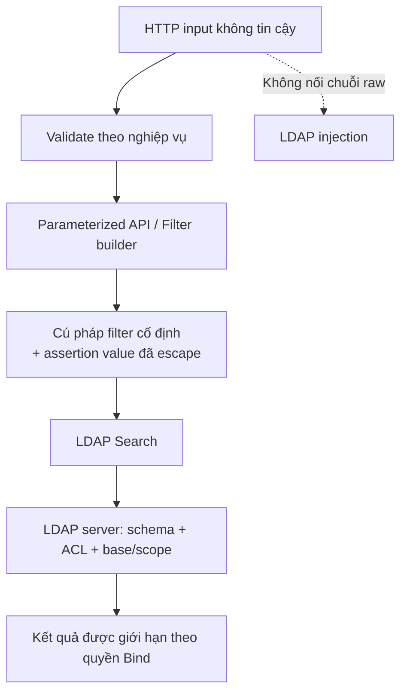
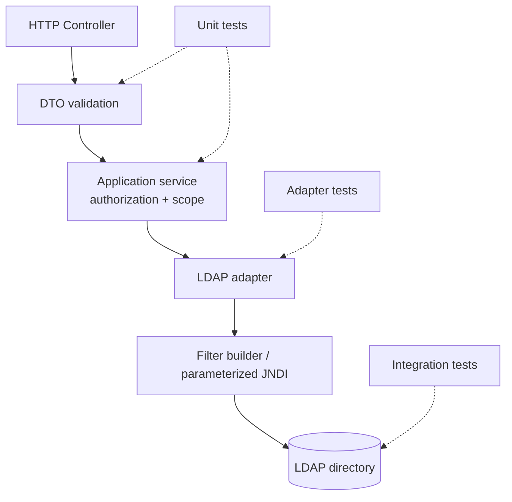

# Kiểm thử bộ lọc để ngăn LDAP injection

Trong chương **Kiểm thử** của **SPRING_DATA_LDAP**, một truy vấn tìm nhân viên theo UID có vẻ rất đơn giản:

```java
String filter = "(uid=" + userInput + ")";
```

Nhưng `userInput` đến từ HTTP request, form đăng nhập, job đồng bộ hoặc một hệ thống khác. Nếu ứng dụng nối chuỗi trực tiếp, người dùng có thể đưa ký tự đặc biệt vào giá trị và **thay đổi cấu trúc LDAP Search filter**. Một truy vấn vốn chỉ được phép tìm một nhân viên có thể trở thành truy vấn rộng hơn, bỏ qua điều kiện lọc hoặc làm lộ dữ liệu trong phạm vi Bind account được phép đọc.

Đây là **LDAP injection**. Lỗi không nằm ở việc LDAP có filter mạnh hay Spring Data LDAP dùng repository; lỗi nằm ở chỗ ứng dụng để dữ liệu không tin cậy trở thành một phần cú pháp filter.

Trong module **SPRING_DATA_LDAP**, người học cần hiểu DN, `objectClass`, schema, repository/`LdapTemplate`, CRUD, filter an toàn, bảo mật kết nối và kiểm thử với directory. Bài này tập trung vào cách **thiết kế và kiểm thử Search filter để dữ liệu người dùng chỉ được hiểu là assertion value**, không thể sửa cấu trúc truy vấn.

**Mục tiêu:** nhận diện điểm ghép filter nguy hiểm; hiểu escape theo RFC 4515; phân biệt filter escaping với DN escaping; sử dụng API parameterized hoặc builder của JNDI/Spring LDAP; giới hạn tên thuộc tính và toán tử bằng allowlist; viết unit/integration tests với payload tấn công; và xác minh quyền, base DN, scope, kết quả cũng như lỗi của directory.

## 1. LDAP injection xảy ra ở đâu?

LDAP Search sử dụng filter theo cú pháp được định nghĩa trong RFC 4515. Ví dụ:

```text
(uid=lan)
(&(objectClass=inetOrgPerson)(uid=lan))
(|(uid=lan)(mail=lan@example.org))
(!(accountStatus=disabled))
```

Filter gồm các thành phần cú pháp như:

- **Attribute description:** tên thuộc tính, ví dụ `uid`, `mail`, `objectClass`.
- **Assertion value:** giá trị dùng để so khớp, ví dụ `lan`.
- **Operators:** equality `=`, greater-or-equal `>=`, less-or-equal `<=`, approximate `~=`.
- **Boolean filters:** AND `&`, OR `|`, NOT `!`.
- **Wildcard trong substring assertion:** dấu `*`.
- **Grouping parentheses:** dấu ngoặc `(` và `)`.

Khi dữ liệu không tin cậy được nối trực tiếp vào vị trí assertion value, các ký tự có ý nghĩa cú pháp có thể **thoát khỏi vị trí dữ liệu và trở thành cú pháp filter**.

### 1.1. Ví dụ truy vấn dễ bị injection

Một adapter không an toàn:

```java
public List<PersonEntry> findByUidUnsafe(String uid) {
    String filter = "(&(objectClass=inetOrgPerson)(uid=" + uid + "))";
    return ldapTemplate.search(
        "ou=people",
        filter,
        personAttributesMapper
    );
}
```

Ứng dụng dự định tìm một entry có:

```text
(&(objectClass=inetOrgPerson)(uid=lan))
```

Nhưng nếu caller gửi:

```text
*)(|(objectClass=*))
```

filter sau khi nối chuỗi trở thành:

```text
(&(objectClass=inetOrgPerson)(uid=*)(|(objectClass=*)))
```

Trong ví dụ này, payload đã đóng assertion `uid`, thêm một nhánh OR và thay đổi ý nghĩa điều kiện. Một directory có thể từ chối filter sai cú pháp, nhưng không được dựa vào việc parser từ chối mọi payload: **một filter bị thay đổi nhưng vẫn hợp lệ có thể làm truy vấn rộng hơn**.

### 1.2. Tác động của LDAP injection

| Tác động | Ví dụ | Hậu quả |
| --- | --- | --- |
| **Đọc quá phạm vi** | Tìm mọi người thay vì một UID | Lộ tên, email, DN hoặc dữ liệu nhân sự trong quyền Bind |
| **Bypass điều kiện ứng dụng** | Làm biến đổi điều kiện lọc account | Có thể xác thực/tra cứu nhầm danh tính nếu filter dùng trong luồng login |
| **Đọc nhóm ngoài ý định** | Thay đổi nhánh OR/NOT trong filter group | Có thể dẫn đến quyết định quyền sai |
| **Tốn tài nguyên** | Filter mở rộng sang subtree lớn | Search chậm, timeout, tăng tải directory |
| **Làm hỏng chức năng** | Gửi ngoặc hoặc escape không hợp lệ | Server trả lỗi filter hoặc ứng dụng xử lý lỗi sai |
| **Lộ cấu trúc nội bộ** | Truy vấn rộng hoặc phân biệt lỗi | Tiết lộ OU, loại entry, tên thuộc tính và hành vi directory |

LDAP injection không tự vượt qua ACL. Server vẫn áp quyền theo Bind identity, DN, thuộc tính và operation. Tuy nhiên, nếu service account có quyền đọc nhiều dữ liệu, một filter bị mở rộng có thể khai thác **chính phạm vi quyền rộng đó**.

## 2. Nguyên tắc cốt lõi: tách cú pháp filter khỏi dữ liệu

Một LDAP filter nên được tạo theo hai phần:

1. **Cú pháp do ứng dụng kiểm soát:** attribute, operator, AND/OR, base DN, scope và loại entity.
2. **Assertion values đến từ input:** UID, email, mã nhân viên hoặc chuỗi tìm kiếm.

Ứng dụng phải dùng **parameterization hoặc API filter builder có escaping đúng RFC 4515** để đưa giá trị vào filter. Không nhận cả filter hoàn chỉnh từ HTTP request, không ghép chuỗi tùy ý và không cho client tự chọn tên thuộc tính.



### 2.1. Escape không thay thế validation

Hai bước có mục đích khác nhau:

| Bước | Câu hỏi | Ví dụ |
| --- | --- | --- |
| **Validation** | Giá trị có hợp lệ theo nghiệp vụ không? | UID chỉ được chứa ký tự và độ dài đã quy định |
| **Filter escaping** | Ký tự dữ liệu có bị hiểu nhầm là cú pháp LDAP không? | Dấu `*` được mã hóa thành `\2a` khi nó là dữ liệu literal |

Ví dụ một UID chỉ cho phép chữ, số, dấu chấm và gạch dưới vẫn cần được truyền qua builder/parameterized API. Validation giúp từ chối input không hợp lệ; escaping là lớp bảo vệ cú pháp filter. Không coi một regex validation là lý do để ghép raw string vào filter.

### 2.2. Escape không thay thế authorization

Một filter an toàn vẫn có thể tìm ra entry mà caller không được phép xem nếu service account có quyền rộng và ứng dụng không kiểm tra quyền nghiệp vụ. Phải có:

- Authorization ở tầng API/service.
- Base DN và search scope cố định theo use case.
- Bind account chỉ có ACL cần thiết.
- Projection thuộc tính tối thiểu.
- Kiểm tra entry thuộc đúng loại/tenant/OU trước khi trả kết quả.

**Escaping bảo vệ cú pháp; ACL và authorization bảo vệ quyền truy cập.** Không thay thế lớp nào bằng lớp nào.

## 3. Ký tự đặc biệt trong LDAP filter theo RFC 4515

Khi một ký tự đặc biệt xuất hiện **như dữ liệu literal trong assertion value**, biểu diễn filter string phải escape theo RFC 4515:

| Ký tự dữ liệu | Biểu diễn escape | Vì sao cần? |
| --- | --- | --- |
| `*` | `\2a` | Nếu không escape, có thể trở thành wildcard substring |
| `(` | `\28` | Có thể thay đổi cấu trúc filter |
| `)` | `\29` | Có thể đóng assertion/group |
| `\` | `\5c` | Ký tự escape trong filter string |
| NUL (byte 0) | `\00` | Không thể xuất hiện như ký tự NUL literal trong biểu diễn filter string |

Ví dụ dữ liệu:

```text
uid input: lan*(admin)
```

Assertion an toàn:

```text
(uid=lan\2a\28admin\29)
```

Filter này tìm giá trị UID chứa đúng dấu `*` và ngoặc như dữ liệu; nó **không** diễn giải dấu sao là wildcard.

### 3.1. Escape theo byte UTF-8, không tự xử lý Unicode bằng thay thế tùy tiện

RFC 4515 mô tả cách biểu diễn filter string dựa trên UTF-8 và escape các octet cần thiết. Với ký tự ngoài ASCII, thư viện cần xử lý đúng UTF-8 và quy tắc escaping. Không nên tự viết một hàm bằng vài lệnh `replace` cho `*`, `(` và `)` rồi cho rằng đã xử lý mọi dữ liệu Unicode/binary.

Các quy tắc thực hành:

- Dùng API đã được kiểm chứng của Spring LDAP/JNDI.
- Không tự chuyển byte binary thành chuỗi UTF-8 rồi đưa vào filter.
- Nếu attribute có syntax binary, dùng cơ chế phù hợp với dữ liệu octet và thư viện LDAP.
- Kiểm thử dấu tiếng Việt, ký tự ngoài BMP, backslash, NUL và dữ liệu bất thường theo hợp đồng của attribute.
- Không tự escape hai lần: builder đã escape rồi mà code lại thay `\` thành `\5c` sẽ làm thay đổi giá trị tìm kiếm.

### 3.2. Escape filter khác escape DN

Đây là lỗi phổ biến khi xây cả filter và DN:

| Ngữ cảnh | Chuẩn/quy tắc | Ví dụ API |
| --- | --- | --- |
| LDAP Search filter assertion value | **RFC 4515** | `LdapQueryBuilder`, `EqualsFilter`, JNDI filter arguments |
| Distinguished Name / RDN | **RFC 4514** | `LdapNameBuilder`, `LdapName` |
| LDAP URL | URI percent-encoding và cú pháp LDAP URL | URI builder phù hợp |
| JSON/HTML/SQL | Quy tắc riêng của từng ngữ cảnh | Không dùng thay LDAP escaping |

Ví dụ: dấu phẩy trong DN có ý nghĩa phân tách RDN, còn dấu ngoặc trong filter có ý nghĩa cấu trúc assertion. Một hàm escape filter không tạo ra DN hợp lệ; hàm escape DN không bảo vệ filter injection.

## 4. Cách viết không an toàn và cách sửa

### 4.1. Nối chuỗi raw

Không an toàn:

```java
String filter = "(uid=" + uid + ")";
```

An toàn hơn bằng Spring LDAP:

```java
import org.springframework.ldap.query.LdapQuery;
import org.springframework.ldap.query.LdapQueryBuilder;
import org.springframework.ldap.query.SearchScope;

LdapQuery query = LdapQueryBuilder.query()
    .base("ou=people")
    .searchScope(SearchScope.SUBTREE)
    .where("objectClass").is("inetOrgPerson")
    .and("uid").is(uid);
```

`LdapQueryBuilder` biểu diễn attribute và value thành những thành phần riêng. Giá trị `uid` được xử lý như assertion value theo cơ chế filter của Spring LDAP; ứng dụng không phải tự nối chuỗi filter.

### 4.2. Dùng EqualsFilter

Spring LDAP có các lớp filter như `EqualsFilter` và `AndFilter` để xây filter có cấu trúc:

```java
import org.springframework.ldap.filter.AndFilter;
import org.springframework.ldap.filter.EqualsFilter;

AndFilter filter = new AndFilter();
filter.and(new EqualsFilter("objectClass", "inetOrgPerson"));
filter.and(new EqualsFilter("uid", uid));

String encodedFilter = filter.encode();
```

`encodedFilter` là filter string đã được lớp filter mã hóa theo quy tắc thư viện. Cần kiểm tra phiên bản Spring LDAP đang dùng, nhưng nguyên tắc không đổi: **giá trị input đi qua API filter**, không tự nối vào cú pháp.

### 4.3. Dùng JNDI parameterized search

JNDI cung cấp overload `DirContext.search` nhận filter expression và mảng arguments:

```java
import javax.naming.NamingEnumeration;
import javax.naming.directory.DirContext;
import javax.naming.directory.SearchControls;
import javax.naming.directory.SearchResult;

public void findPerson(DirContext ctx, String uid)
        throws javax.naming.NamingException {
    SearchControls controls = new SearchControls();
    controls.setSearchScope(SearchControls.SUBTREE_SCOPE);
    controls.setCountLimit(50);
    controls.setTimeLimit(3_000);
    controls.setReturningAttributes(new String[]{"uid", "cn", "mail"});

    NamingEnumeration<SearchResult> results = ctx.search(
        "ou=people,dc=example,dc=org",
        "(&(objectClass=inetOrgPerson)(uid={0}))",
        new Object[]{uid},
        controls
    );

    try {
        while (results.hasMore()) {
            SearchResult result = results.next();
            // Map các thuộc tính được phép trả.
        }
    } finally {
        results.close();
    }
}
```

JNDI thay thế `{0}` bằng argument theo cơ chế dành cho filter arguments, xử lý dữ liệu như giá trị thay vì cú pháp do caller điều khiển. Đây là một lựa chọn tốt khi làm việc với `DirContext` trực tiếp. Trong ứng dụng Spring, ưu tiên `LdapTemplate`/`LdapQueryBuilder` để tái sử dụng cấu hình ContextSource, timeout và lifecycle.

**Không dùng placeholder ở vị trí tên thuộc tính hoặc operator.** Ví dụ `({0}={1})` không phải cách an toàn để cho client tự chọn attribute; tên thuộc tính/operator phải đến từ code/allowlist.

### 4.4. Escape thủ công chỉ khi thực sự cần

Nếu một API bắt buộc nhận filter string hoàn chỉnh, hãy dùng hàm filter encoder được thư viện LDAP cung cấp, chẳng hạn `LdapEncoder.filterEncode(...)` trong phiên bản Spring LDAP có API tương ứng:

```java
import org.springframework.ldap.support.LdapEncoder;

String safeUid = LdapEncoder.filterEncode(uid);
String filter =
    "(&(objectClass=inetOrgPerson)(uid=" + safeUid + "))";
```

Đây là cách thủ công có thể dùng khi cú pháp filter do ứng dụng cố định và **chỉ giá trị** được encode. Kiểm tra đúng package/API của phiên bản dependency. Nếu đã dùng `LdapQueryBuilder`, `EqualsFilter` hoặc JNDI parameterized search, **không encode lại cùng một giá trị**.

## 5. Tên thuộc tính và operator phải nằm trong allowlist

Một số endpoint cho phép lọc theo nhiều trường:

```json
{
  "field": "mail",
  "operator": "equals",
  "value": "lan@example.org"
}
```

Không thể giải quyết bằng cách chỉ escape `value` nếu code vẫn ghép raw `field` và `operator`:

```java
// Không an toàn: field và operator cũng là dữ liệu không tin cậy.
String filter = "(" + field + operator + value + ")";
```

Tên thuộc tính LDAP không phải assertion value; các API parameterization thường chỉ escape **giá trị**. Vì thế attribute và operator phải được chọn từ danh sách cho phép:

```java
enum SearchField {
    UID("uid"),
    EMAIL("mail"),
    COMMON_NAME("cn");

    private final String ldapAttribute;

    SearchField(String ldapAttribute) {
        this.ldapAttribute = ldapAttribute;
    }

    public String ldapAttribute() {
        return ldapAttribute;
    }
}

enum SearchOperator {
    EQUALS,
    PRESENT
}
```

Sau khi parse input thành enum, code có thể chọn builder tương ứng:

```java
public LdapQuery buildQuery(
        SearchField field, SearchOperator operator, String value) {
    var query = LdapQueryBuilder.query()
        .base("ou=people")
        .searchScope(SearchScope.SUBTREE)
        .where("objectClass").is("inetOrgPerson");

    return switch (field) {
        case UID -> switch (operator) {
            case EQUALS -> query.and("uid").is(value);
            case PRESENT -> query.and("uid").isPresent();
        };
        case EMAIL -> switch (operator) {
            case EQUALS -> query.and("mail").is(value);
            case PRESENT -> query.and("mail").isPresent();
        };
        case COMMON_NAME -> switch (operator) {
            case EQUALS -> query.and("cn").is(value);
            case PRESENT -> query.and("cn").isPresent();
        };
    };
}
```

Đây là ví dụ thiết kế theo API builder của Spring LDAP; cần đối chiếu chữ ký chính xác với phiên bản đang dùng. Ý tưởng bắt buộc là **field và operator được ánh xạ qua allowlist**, còn value được truyền qua API có escaping. Không cho caller truyền `objectClass`, base DN hoặc tên thuộc tính operational tùy ý.

### 5.1. Allowlist phải phản ánh quyền nghiệp vụ

Không phải attribute nào tồn tại trong schema cũng nên cho endpoint tìm kiếm:

| Field được API cho phép | Lý do |
| --- | --- |
| `uid` | Định danh tra cứu theo nghiệp vụ |
| `mail` | Tra cứu email nếu caller được phép |
| `cn` | Tìm tên hiển thị trong phạm vi được phép |
| `userPassword` | Không đưa vào search API thông thường |
| `creatorsName`, `modifiersName` | Metadata nội bộ, chỉ dùng ở chức năng quản trị được phê duyệt |
| `member`, `memberOf` | Quan hệ nhóm, cần policy riêng |

Allowlist nên ở **server-side code**, không tải từ request. Tên attribute cũng cần khớp schema thật và mapping trong entity.

## 6. Kiểm thử substring search và wildcard

Dấu `*` có ý nghĩa đặc biệt trong filter:

| Filter | Ý nghĩa |
| --- | --- |
| `(uid=lan)` | Equality |
| `(uid=*)` | Presence |
| `(cn=Lan*)` | Substring bắt đầu bằng Lan |
| `(cn=*Nguyen)` | Substring kết thúc bằng Nguyen |
| `(cn=*Lan*)` | Substring có chứa Lan |

Nếu use case là tìm prefix, ứng dụng có thể cố ý thêm wildcard do **code kiểm soát**, nhưng vẫn phải encode phần text do người dùng nhập. Không nên lấy nguyên chuỗi input rồi thêm `*` và nghĩ rằng mọi dấu sao trong input sẽ được hiểu là dữ liệu literal.

Ví dụ ý định:

```text
Input literal:  Lan*
Prefix search:  Lan*    (wildcard cuối do ứng dụng thêm)
```

Nếu user nhập `Lan*` và wildcard đó phải là dữ liệu thật, dấu `*` trong input cần được escape. Nếu nghiệp vụ cho phép wildcard tự do, phải thiết kế một cú pháp search rõ ràng, validate pattern và chỉ tạo wildcard ở những vị trí cho phép.

**Test cần phân biệt:**

- Tìm literal `Lan*` phải không tự động trả `Lan Nguyen`.
- Tìm prefix `Lan` có wildcard do server-side code thêm có thể trả các tên bắt đầu bằng Lan.
- Input `*` không được biến một equality lookup thành “trả tất cả” ngoài ý muốn.
- Input có ngoặc hoặc backslash không được thay đổi cấu trúc AND/OR.

## 7. Filter injection khác DN injection

Một endpoint tìm user có thể nhận UID rồi xây DN:

```java
String dn = "uid=" + uid + ",ou=people,dc=example,dc=org";
```

Đây không phải filter string, nên `LdapEncoder.filterEncode(uid)` không giải quyết đúng vấn đề. DN có quy tắc escape riêng theo RFC 4514.

Với Spring LDAP:

```java
import javax.naming.Name;
import org.springframework.ldap.support.LdapNameBuilder;

Name dn = LdapNameBuilder.newInstance()
    .add("ou", "people")
    .add("uid", uid)
    .add("dc", "example")
    .add("dc", "org")
    .build();
```

Đoạn code minh họa cách tạo `LdapName` từ các thành phần; thứ tự RDN và cách builder xây DN cần được kiểm chứng bằng test với đúng base/context. Trong ứng dụng có `ContextSource.base`, thường xây **DN tương đối** cho entry dưới base hoặc dùng DN đầy đủ theo contract rõ ràng; không ghép suffix bằng chuỗi thủ công.

| Dữ liệu cần bảo vệ | API phù hợp |
| --- | --- |
| UID trong filter `(uid=...)` | Filter builder/parameterized search/RFC 4515 encoder |
| UID trong RDN `uid=...` | `LdapNameBuilder`/`LdapName` theo RFC 4514 |
| Search URL | URI/LDAP URL builder và percent-encoding |

Một ứng dụng có thể cần **cả filter escaping lẫn DN construction** trong cùng một use case. Không tái sử dụng một hàm escape cho mọi ngữ cảnh.

## 8. Kiểm thử đơn vị: kiểm tra encoder và cấu trúc filter

Unit test có ích để xác nhận adapter đưa input qua filter builder, giữ nguyên cú pháp do ứng dụng kiểm soát và không làm lộ payload thành nhánh filter mới. Tuy nhiên, test encoder riêng **không chứng minh LDAP server thực tế trả đúng kết quả**; cần integration test ở phần sau.

### 8.1. Kiểm thử các ký tự đặc biệt

Ví dụ với Spring LDAP:

```java
import org.junit.jupiter.api.Test;
import static org.junit.jupiter.api.Assertions.*;
import org.springframework.ldap.filter.EqualsFilter;

class LdapFilterEncodingTest {
    @Test
    void shouldEscapeSpecialCharactersInEqualityValue() {
        assertEquals("(uid=\\2a)", new EqualsFilter("uid", "*").encode());
        assertEquals("(uid=\\28)", new EqualsFilter("uid", "(").encode());
        assertEquals("(uid=\\29)", new EqualsFilter("uid", ")").encode());
        assertEquals("(uid=\\5c)", new EqualsFilter("uid", "\\").encode());
    }

    @Test
    void shouldKeepInjectionPayloadInsideOneAssertionValue() {
        String payload = "*)(|(objectClass=*))";

        String encoded = new EqualsFilter("uid", payload).encode();

        assertEquals(
            "(uid=\\2a\\29\\28|(objectClass=\\2a\\29\\29)",
            encoded
        );
    }
}
```

Ví dụ kiểm tra exact encoding phải được chạy với **phiên bản Spring LDAP thực tế** của dự án; thư viện có thể thay đổi biểu diễn chữ hex nhưng phải giữ semantics escaping đúng. Khi test theo contract thay vì implementation detail, có thể xác minh các ký tự đặc biệt không còn xuất hiện như token cú pháp chưa escape trong assertion value.

Đối với NUL và chuỗi Unicode, có thể test hàm encoder ở mức byte/chuỗi theo API hỗ trợ. Không phải mọi directory syntax đều chấp nhận NUL làm dữ liệu attribute để seed; **encoder unit test** và **directory integration test** có mục tiêu khác nhau.

### 8.2. Kiểm thử filter builder không cho client điều khiển attribute

Một test cho enum/allowlist có thể kiểm tra:

```java
import static org.junit.jupiter.api.Assertions.*;
import org.junit.jupiter.api.Test;

class SearchFieldTest {
    @Test
    void onlyKnownFieldsCanBeSelected() {
        assertEquals("uid", SearchField.UID.ldapAttribute());
        assertEquals("mail", SearchField.EMAIL.ldapAttribute());
        assertThrows(
            IllegalArgumentException.class,
            () -> SearchField.valueOf("USERPASSWORD")
        );
    }
}
```

Ở API HTTP, parse enum phải xử lý input sai thành validation error; **không** dùng input raw làm tên thuộc tính khi enum parse thất bại.

### 8.3. Test các giá trị biên theo domain

| Input | Kỳ vọng |
| --- | --- |
| `lan` | Hợp lệ, tìm đúng UID |
| `Lan Nguyen` | Hợp lệ ở field tên nếu nghiệp vụ cho phép |
| `lan*` | Dấu sao là dữ liệu literal nếu endpoint equality |
| `*)(|(objectClass=*))` | Không thay đổi cấu trúc filter |
| `lan)(uid=admin` | Không tạo assertion thứ hai |
| `a\b` | Backslash không mở chuỗi escape filter |
| Chuỗi tiếng Việt | Giữ nguyên Unicode theo encoding UTF-8 |
| Chuỗi rỗng | Chấp nhận hay từ chối theo nghiệp vụ; không vô tình thành presence filter |
| Chuỗi quá dài | Bị giới hạn trước khi truy vấn |
| NUL | Encoder xử lý đúng; kiểm tra directory syntax nếu định lưu dữ liệu |
| Field không trong allowlist | Từ chối, không xây filter |
| Operator không trong allowlist | Từ chối, không ghép chuỗi |

## 9. Kiểm thử tích hợp với LDAP directory

Một test tích hợp cần kiểm tra **ngữ nghĩa kết quả trên server**, không chỉ chuỗi filter đã encode. Có thể dùng LDAP server nhúng cho test nhanh hoặc một directory container/test instance có schema tương thích. Ví dụ công cụ/thư viện như ApacheDS hoặc UnboundID In-Memory Directory Server có thể hữu ích, nhưng phải xác nhận schema và hành vi tương ứng với server đích.

**Không thay integration test của server production bằng một server nhúng khác rồi kết luận hành vi ACL, matching rule, operational attribute hoặc vendor-specific control giống nhau.** Test nhúng phù hợp kiểm tra cú pháp và luồng cơ bản; các khác biệt server cần test trên sản phẩm thực tế hoặc môi trường tương thích.

### 9.1. Seed dữ liệu có chủ đích

Ví dụ LDIF cho một directory test:

```ldif
dn: dc=example,dc=org
objectClass: top
objectClass: domain
dc: example

dn: ou=people,dc=example,dc=org
objectClass: top
objectClass: organizationalUnit
ou: people

dn: uid=lan,ou=people,dc=example,dc=org
objectClass: top
objectClass: person
objectClass: organizationalPerson
objectClass: inetOrgPerson
uid: lan
cn: Lan Nguyen
sn: Nguyen
mail: lan@example.org

dn: uid=nam,ou=people,dc=example,dc=org
objectClass: top
objectClass: person
objectClass: organizationalPerson
objectClass: inetOrgPerson
uid: nam
cn: Nam Tran
sn: Tran
mail: nam@example.org

dn: uid=admin,ou=people,dc=example,dc=org
objectClass: top
objectClass: person
objectClass: organizationalPerson
objectClass: inetOrgPerson
uid: admin
cn: Directory Admin Test
sn: Test
mail: admin@example.org
```

Đây là dữ liệu giả lập. Khi chạy test, dùng schema hợp lệ của server nhúng/đích và tạo service Bind account riêng có quyền đọc giới hạn trong `ou=people`. Không dùng credential production hoặc dữ liệu nhân sự thật trong bộ test.

### 9.2. Integration test: payload không trả thêm entry

Giả sử adapter có method an toàn `findByUid(uid)` dùng `LdapQueryBuilder`:

```java
import java.util.List;
import org.junit.jupiter.api.Test;
import static org.junit.jupiter.api.Assertions.*;

class PersonSearchIntegrationTest {
    private PersonSearchAdapter adapter;

    @Test
    void normalUidReturnsOnlyMatchingPerson() {
        List<PersonSummary> result = adapter.findByUid("lan");

        assertEquals(1, result.size());
        assertEquals("lan", result.get(0).uid());
    }

    @Test
    void ldapInjectionPayloadDoesNotBroadenSearch() {
        List<PersonSummary> result =
            adapter.findByUid("*)(|(objectClass=*))");

        assertTrue(result.isEmpty());
    }
}
```

Đây là **skeleton kiểm thử**: adapter, DTO, test context và LDAP seed phải được inject/cấu hình bởi test project. Điều quan trọng là test payload phải đi qua **đúng method production**, cùng base DN, scope, Bind account và builder. Không kiểm tra một hàm encoder độc lập rồi tuyên bố endpoint đã an toàn nếu controller vẫn gọi một đường nối chuỗi khác.

### 9.3. Kiểm thử không thể đọc entry ngoài base

Tạo thêm entry test ở `ou=services` với UID tương tự hoặc thuộc tính trùng. Endpoint nhân viên phải giữ base `ou=people` và không trả entry ở nhánh khác dù payload được gửi:

```text
*)(|(objectClass=*))
```

Kiểm thử này xác minh **phạm vi Search**, nhưng không thay ACL: Bind account vẫn phải được giới hạn để nếu một bug filter xuất hiện, quyền server giảm thiểu tác động.

### 9.4. Kiểm thử khác biệt literal wildcard và substring

Seed hai entry:

```text
uid=lan-star, cn="Lan*"
uid=lan-nguyen, cn="Lan Nguyen"
```

Các ca:

| Use case | Input | Kết quả mong đợi |
| --- | --- | --- |
| Equality literal | `Lan*` | Chỉ entry có dấu sao literal |
| Prefix search có wildcard do code thêm | `Lan` | Entry bắt đầu bằng Lan theo matching rule/server |
| Input wildcard ở equality | `*` | Không trở thành truy vấn presence/tất cả |
| Input có ngoặc | `Lan)(uid=admin` | Không tạo nhánh filter khác |

Nếu sản phẩm cố ý cung cấp tìm kiếm wildcard cho người dùng, phải định nghĩa rõ **cú pháp public API** và chuyển nó thành filter theo allowlist. Không nhận một LDAP filter hoàn chỉnh từ client.

## 10. Kiểm thử ở controller, service và repository adapter

LDAP injection có thể xuất hiện ở bất kỳ tầng nào tạo filter:



### 10.1. Controller test

Controller test kiểm tra:

- Input quá dài hoặc sai định dạng bị từ chối.
- Client không thể gửi `baseDn`, `objectClass`, `attribute` hay raw filter để điều khiển truy vấn nếu API không cho phép.
- Authorization được kiểm tra trước khi gọi adapter.
- Payload LDAP injection được truyền như **một giá trị** đến service/adapter, không được controller tự ghép filter.
- Response không lộ raw LDAP filter, Bind DN, diagnostic message hoặc dữ liệu ngoài DTO.

Một test có thể mock service để xác minh controller truyền đúng chuỗi input cho use case; nó **không** chứng minh LDAP filter được encode. Phải có test ở adapter.

### 10.2. Service test

Service test kiểm tra:

- Caller chỉ được tìm trong tenant/OU phù hợp.
- Field/operator public được ánh xạ qua allowlist.
- Các quy tắc giới hạn độ dài, trạng thái account và loại entry được áp dụng.
- Lỗi LDAP không bị biến thành danh sách rỗng rồi báo “không tìm thấy”.
- Kết quả partial/timeout/referral không được coi là danh sách hoàn chỉnh.

### 10.3. Adapter test

Adapter test kiểm tra:

- Filter được tạo bằng `LdapQueryBuilder`/`EqualsFilter`/JNDI parameterized arguments.
- Không có string concatenation với input không tin cậy.
- Base DN, scope và objectClass là cấu hình cố định theo use case.
- Attribute projection chỉ gồm các field cần thiết.
- SearchControls count/time limit được cấu hình hợp lý.
- Response exception được phân loại đúng, không parse thông điệp tùy tiện để đoán LDAP result code.

### 10.4. Integration test

Integration test kiểm chứng:

- Server thực sự nhận filter hợp lệ và trả đúng tập entry.
- Payload tấn công không mở rộng kết quả.
- Filter theo schema/matching rule đúng với server.
- Bind ACL giới hạn kết quả và thuộc tính.
- TLS/hostname được xác minh theo cấu hình test.
- Referral, size/time limit và lỗi network không bị che giấu.

## 11. Các lỗi kiểm thử thường gặp

| Lỗi trong test | Vì sao chưa đủ | Cách cải thiện |
| --- | --- | --- |
| Chỉ assert chuỗi có `\\2a` | Không chứng minh method production dùng encoder | Gọi chính adapter production với payload |
| Chỉ test input bình thường `lan` | Không phơi bày cú pháp filter bị thay đổi | Thêm `*)(|(objectClass=*))` và ký tự đặc biệt |
| Chỉ mock `LdapTemplate` | Không xác minh server parser/kết quả | Thêm LDAP integration test |
| Dùng admin Bind | Che giấu ACL quá rộng | Test bằng service account gần production |
| Test trên server khác rồi suy rộng | Schema/matching rule/ACL khác nhau | Test riêng trên server/vendor đích |
| Chỉ kiểm tra status HTTP 200/400 | Không biết Search có trả thêm entry hay không | Assert DN/UID và số lượng kết quả |
| Chỉ kiểm tra không có exception | Filter có thể hợp lệ nhưng quá rộng | Seed entry đối chứng và kiểm tra không bị trả |
| Chỉ validate regex UID | Filter vẫn có thể bị ghép sai ở field khác | Builder/parameterization và allowlist |
| Escape DN thay vì filter | Sai ngữ cảnh encoding | Dùng RFC 4515 cho filter, RFC 4514 cho DN |
| Escape hai lần | Thay đổi giá trị cần tìm | Chỉ một tầng chịu trách nhiệm encode |
| Cho user chọn raw attribute | Encoder chỉ bảo vệ assertion value | Allowlist attribute/operator |
| Nuốt lỗi LDAP rồi trả empty list | Nhầm lỗi server với không có entry | Phân loại lỗi và completeness |
| Log toàn bộ filter/input | Có thể lộ dữ liệu cá nhân, payload và cấu trúc | Log operation, endpoint alias, outcome và mã lỗi an toàn |

## 12. Kiểm thử lỗi và giới hạn server

Một filter an toàn vẫn có thể thất bại do server, ACL hoặc dữ liệu. Cần phân biệt:

| Tình huống | Dấu hiệu | Test cần xác minh |
| --- | --- | --- |
| Filter sai cú pháp | LDAP `invalidFilter (87)` | Builder tạo filter hợp lệ; lỗi được xử lý đúng |
| Attribute không tồn tại trong schema | `undefinedAttributeType (17)` hoặc kết quả không như mong đợi | Attribute nằm trong allowlist và schema server hỗ trợ |
| Assertion sai syntax | `invalidAttributeSyntax (21)` | Validate/encode giá trị theo syntax |
| Không có quyền đọc | `insufficientAccessRights (50)` hoặc kết quả bị ẩn theo server | Bind ACL và response thực tế |
| Base DN không tồn tại | `noSuchObject (32)` | Base cấu hình đúng |
| Search hết thời gian | `timeLimitExceeded (3)` hoặc client timeout | Không coi dữ liệu một phần là đầy đủ |
| Search vượt size limit | `sizeLimitExceeded (4)` | Paging/giới hạn; không bỏ qua lỗi |
| Referral/continuation | Response có reference hoặc partial result | Xử lý topology và completeness |
| TLS handshake thất bại | Không có LDAP response tương ứng | Không gán mã LDAP giả; không downgrade |
| Server unavailable/busy | `52`/`51` khi có response phù hợp | Retry hữu hạn với backoff khi operation an toàn |

Một số server có thể che giấu entry do ACL hoặc trả mã khác nhau cho cùng tình huống. **Không thấy kết quả không đồng nghĩa filter an toàn**, và **không có exception không đồng nghĩa query đúng phạm vi**.

## 13. Bảo mật bổ sung quanh filter

### 13.1. Giới hạn base DN và scope

Không cho client truyền tùy ý:

```json
{
  "baseDn": "dc=example,dc=org",
  "scope": "SUBTREE",
  "filter": "(objectClass=*)"
}
```

trừ khi đó là một chức năng quản trị được thiết kế và phân quyền đặc biệt. Với API tìm nhân viên, base thường được cố định trong adapter/configuration:

```text
base = ou=people
scope = SUBTREE
filter = (&(objectClass=inetOrgPerson)(uid={input}))
```

Filter escaping không ngăn client chọn một base DN quá rộng; scope/base cần được kiểm soát độc lập.

### 13.2. Projection tối thiểu

Nếu chức năng chỉ cần UID và tên:

```java
LdapQuery query = LdapQueryBuilder.query()
    .base("ou=people")
    .searchScope(SearchScope.SUBTREE)
    .attributes("uid", "cn")
    .where("objectClass").is("inetOrgPerson")
    .and("uid").is(uid);
```

Không trả `userPassword`, `creatorsName`, `modifiersName` hoặc toàn bộ thuộc tính chỉ vì filter đã an toàn. **Data minimization** giảm hậu quả khi có lỗi logic khác.

### 13.3. Timeout, count limit và chống truy vấn tốn kém

Input đã escape vẫn có thể là một truy vấn quá rộng nếu API hỗ trợ wildcard hoặc filter không chọn lọc. Cần:

- Giới hạn độ dài input.
- Chọn base DN hẹp và scope phù hợp.
- Hạn chế số kết quả, thời gian Search và concurrency.
- Dùng paging cho luồng đọc số lượng lớn khi server hỗ trợ; xử lý cookie hết và lỗi đầy đủ.
- Không cho caller tạo tùy ý nhiều nhánh OR/NOT hoặc regex-like patterns.
- Đo latency và số entry trả về.

### 13.4. Không log raw payload

Payload tấn công có thể chứa thông tin cá nhân, ký tự điều khiển hoặc dữ liệu gây nhiễu log. Thay vì ghi:

```text
LDAP filter = (&(objectClass=inetOrgPerson)(uid=<raw-input>))
```

ghi các trường có giới hạn:

```json
{
  "operation": "search_person",
  "field": "uid",
  "filter_builder": "equality",
  "endpoint_id": "directory-primary",
  "outcome": "success",
  "result_count": 1
}
```

Đây là schema log do ứng dụng định nghĩa. Không dùng UID, DN, email, filter đầy đủ hoặc payload raw làm metric label có cardinality cao.

## 14. Ví dụ hoàn chỉnh: adapter tìm người an toàn

Một adapter nhỏ có thể giữ base, loại entry và thuộc tính trong code:

```java
import java.util.List;
import javax.naming.NamingException;
import javax.naming.directory.Attribute;
import javax.naming.directory.Attributes;

import org.springframework.ldap.core.AttributesMapper;
import org.springframework.ldap.core.LdapTemplate;
import org.springframework.ldap.query.LdapQuery;
import org.springframework.ldap.query.LdapQueryBuilder;
import org.springframework.ldap.query.SearchScope;

public final class SafePersonSearch {
    private final LdapTemplate ldapTemplate;

    public SafePersonSearch(LdapTemplate ldapTemplate) {
        this.ldapTemplate = ldapTemplate;
    }

    public record PersonSummary(String uid, String name) {}

    public List<PersonSummary> findByUid(String uid) {
        if (uid == null || uid.isBlank() || uid.length() > 64) {
            throw new IllegalArgumentException("Invalid UID");
        }

        LdapQuery query = LdapQueryBuilder.query()
            .base("ou=people")
            .searchScope(SearchScope.SUBTREE)
            .countLimit(10)
            .timeLimit(2_000)
            .attributes("uid", "cn")
            .where("objectClass").is("inetOrgPerson")
            .and("uid").is(uid);

        return ldapTemplate.search(
            query,
            (AttributesMapper<PersonSummary>) attrs ->
                new PersonSummary(
                    first(attrs, "uid"),
                    first(attrs, "cn"))
        );
    }

    private static String first(Attributes attrs, String name)
            throws NamingException {
        Attribute attribute = attrs.get(name);
        return attribute == null || attribute.size() == 0
            ? null : String.valueOf(attribute.get());
    }
}
```

Adapter này có các thuộc tính an toàn:

1. **Validation:** từ chối null/rỗng/quá dài theo hợp đồng UID ví dụ.
2. **Base cố định:** caller không chọn toàn naming context.
3. **Scope cố định:** chỉ tìm subtree được ứng dụng quản lý.
4. **Loại entry cố định:** chỉ tìm `inetOrgPerson`.
5. **Assertion value qua builder:** `uid` không được ghép raw vào filter.
6. **Projection tối thiểu:** chỉ trả `uid` và `cn`.
7. **Giới hạn truy vấn:** có count/time limit để tránh query vô hạn.
8. **Mapper chịu được field thiếu:** không dereference attribute null.

Đây là ví dụ adapter minh họa, cần ghép với cấu hình `LdapTemplate`, Bind account, TLS, DTO và xử lý lỗi của ứng dụng thực tế. `countLimit(10)` cũng có nghĩa nếu có nhiều hơn 10 kết quả, caller phải hiểu giới hạn/completeness; không mặc định danh sách trả về là toàn bộ.

## 15. Ma trận kiểm thử đề xuất

| ID | Nhóm | Input/điều kiện | Kỳ vọng |
| --- | --- | --- | --- |
| F01 | Normal equality | `lan` | Chỉ trả UID lan |
| F02 | Literal wildcard | `lan*` | Dấu sao là dữ liệu literal trong equality |
| F03 | Open parenthesis | `lan(` | Không phá cấu trúc filter |
| F04 | Close parenthesis | `lan)` | Không đóng assertion |
| F05 | Backslash | `lan\` | Không mở chuỗi escape ngoài ý muốn |
| F06 | Injection payload | `*)(|(objectClass=*))` | Không mở rộng kết quả |
| F07 | Nested assertion payload | `lan)(uid=admin` | Không tạo điều kiện thứ hai |
| F08 | Unicode | `Nguyễn An` | Giữ đúng dữ liệu UTF-8 theo matching rule |
| F09 | Empty input | `""` | Từ chối hoặc xử lý theo contract, không tự thành presence |
| F10 | Oversized input | Chuỗi vượt max length | Validation từ chối trước LDAP |
| F11 | Attribute allowlist | `uid`/`mail` hợp lệ | Chỉ field cho phép được truy vấn |
| F12 | Attribute injection | `uid)(objectClass=*` | Parse allowlist thất bại, không ghép vào filter |
| F13 | Operator allowlist | `equals` | Chọn đúng builder equality |
| F14 | Operator injection | Chuỗi chứa cú pháp LDAP | Từ chối |
| F15 | Base isolation | Entry ngoài `ou=people` | Không được trả từ endpoint nhân viên |
| F16 | Scope | Entry nằm trong OU con | Kết quả đúng với SUBTREE/ONELEVEL contract |
| F17 | ACL | Bind account không được đọc OU khác | Không truy cập ngoài quyền |
| F18 | Projection | Chỉ yêu cầu `uid,cn` | Không trả thuộc tính ngoài hợp đồng |
| F19 | Invalid filter | Filter cố định lỗi trong test adapter | Lỗi được phân loại, không trả empty giả |
| F20 | Server limit | Search vượt size/time limit | Không coi kết quả một phần là đầy đủ |
| F21 | Referral | Search gặp continuation reference | Xử lý theo policy, không bỏ qua |
| F22 | TLS | Certificate/hostname sai | Kết nối thất bại an toàn |
| F23 | Double encoding | Input đã chứa `\2a` | Không encode hai lần ngoài ý định |
| F24 | DN construction | UID có dấu phẩy/đặc biệt khi dùng trong RDN | Dùng LdapNameBuilder; không dùng filter encoder |
| F25 | Regression | Payload cũ được gửi lặp lại | Adapter production vẫn chỉ trả kết quả đúng phạm vi |

## 16. Quy trình xử lý khi phát hiện LDAP injection

1. **Khoanh vùng điểm tạo filter:** controller, service, repository custom method, `LdapTemplate`, JNDI hoặc helper dùng chung.
2. **Xác định thành phần không tin cậy:** assertion value, attribute name, operator, base DN, scope hay raw filter.
3. **Đọc code caller:** xem input được truyền tới đâu, có encode trước/sau builder, có double-encode hay không.
4. **Thay nối chuỗi:** dùng parameterized JNDI search, `LdapQueryBuilder`, filter builder hoặc encoder đúng RFC 4515.
5. **Allowlist cấu trúc:** attribute/operator/base/scope do server-side code chọn.
6. **Bổ sung validation nghiệp vụ:** độ dài, charset, định dạng UID/email và giới hạn truy vấn.
7. **Thêm unit tests:** ký tự đặc biệt, payload injection, Unicode, null/empty và allowlist.
8. **Thêm integration tests:** kiểm kết quả trên directory có dữ liệu đối chứng và service Bind account thật.
9. **Đánh giá ACL/projection:** giới hạn dữ liệu có thể bị lộ nếu lỗi filter tái xuất hiện.
10. **Quan sát an toàn:** ghi operation/outcome/error family, không log raw credential hoặc filter chứa dữ liệu cá nhân.
11. **Kiểm tra regression:** chạy lại mọi endpoint tìm người, tìm nhóm, xác thực và đồng bộ dùng filter.
12. **Xem lại dependency/version:** xác nhận encoder/builder đang dùng có hành vi đúng và được cập nhật.

## 17. Câu hỏi tự kiểm tra

1. **LDAP injection xảy ra khi nào?** Khi dữ liệu không tin cậy được ghép thành cú pháp filter và làm thay đổi cấu trúc/ý nghĩa truy vấn.
2. **RFC nào định nghĩa biểu diễn Search filter?** RFC 4515.
3. **Dấu sao literal trong assertion value được escape thế nào?** `\2a`.
4. **Các ký tự ngoặc trái/phải và backslash được escape thế nào?** `\28`, `\29` và `\5c`.
5. **Vì sao validation không thay thế filter escaping?** Validation kiểm tra quy tắc nghiệp vụ; escaping bảo vệ ranh giới cú pháp filter.
6. **Vì sao filter escaping không thay thế authorization?** Filter đúng vẫn có thể tìm dữ liệu mà caller không được phép xem nếu base/ACL/API authorization quá rộng.
7. **Dùng `LdapQueryBuilder` có lợi ích gì?** Tách attribute/value và dùng API filter thay vì nối chuỗi raw.
8. **JNDI API nào nhận filter arguments?** Overload `DirContext.search(name, filterExpr, filterArgs, controls)`.
9. **Có thể dùng placeholder để client truyền tên attribute không?** Không. Attribute/operator phải do code chọn qua allowlist.
10. **Filter escaping và DN escaping khác gì?** Filter theo RFC 4515; DN/RDN theo RFC 4514.
11. **Nếu API cần prefix search thì wildcard được tạo ở đâu?** Ở server-side code theo contract; phần input literal vẫn phải được encode.
12. **Test encoder unit có đủ chứng minh endpoint an toàn không?** Không. Cần kiểm tra đúng adapter production và integration test với LDAP server.
13. **Tại sao cần test bằng service Bind account?** Admin account có thể che giấu ACL quá rộng và không phản ánh phạm vi dữ liệu thật.
14. **Nếu LDAP Search timeout, có được trả danh sách rỗng không?** Không mặc định; lỗi/partial result phải được phân biệt với Search thành công nhưng không có entry.
15. **Có nên log raw filter để debug?** Không trong log thông thường; nó có thể chứa dữ liệu cá nhân và cấu trúc nội bộ.
16. **Escaping hai lần có an toàn hơn không?** Không. Double encoding làm thay đổi giá trị và có thể khiến tìm kiếm sai.

**Ghi nhớ:** Để ngăn LDAP injection, hãy giữ **cú pháp filter do ứng dụng kiểm soát** và truyền dữ liệu đầu vào như assertion value qua API parameterized hoặc filter builder đã được kiểm chứng theo **RFC 4515**. Không nối raw input, không để caller chọn attribute/operator/base tùy ý, và không nhầm filter escaping với DN escaping theo **RFC 4514**. Với Spring Data LDAP, hãy kiểm thử cả builder/adapter lẫn kết quả trên directory thật bằng payload đặc biệt, dữ liệu đối chứng, Bind account giới hạn, base/scope cố định và projection tối thiểu; chỉ khi kết quả vẫn đúng phạm vi, ứng dụng mới có bằng chứng đủ mạnh rằng filter không bị input làm thay đổi.
