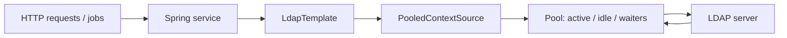
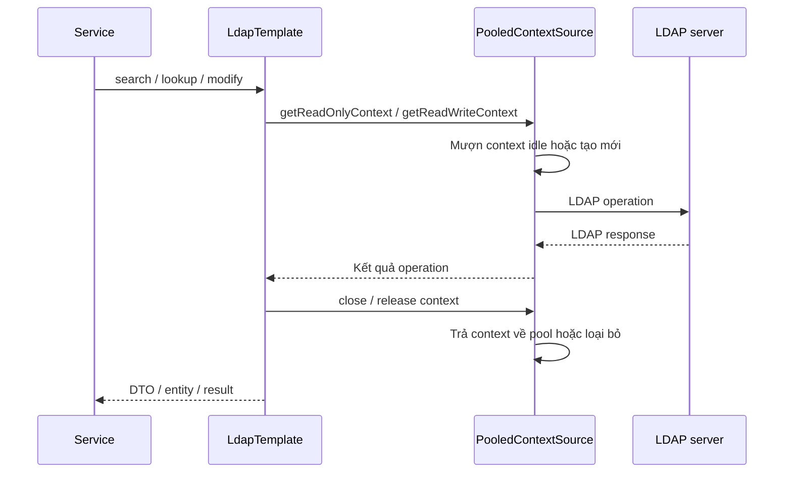
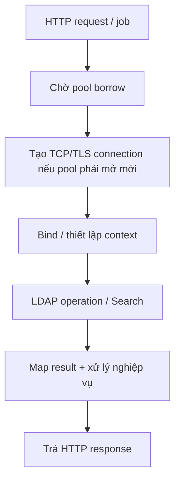

# Điều chỉnh pool, thời gian chờ và mức đồng thời

> **Chương:** Hiệu năng  
> **Module:** SPRING_DATA_LDAP — truy cập dịch vụ thư mục LDAP qua Spring Data LDAP repository và Spring LDAP `LdapTemplate`, ánh xạ entry phân cấp sang Java; hiểu DN, `objectClass`, schema, truy vấn repository/LdapTemplate, CRUD, filter an toàn, bảo mật kết nối và kiểm thử với directory.

## Mục tiêu học tập

Sau bài này, bạn có thể:

1. Giải thích vì sao LDAP context/connection là tài nguyên cần quản lý, vì sao không được chia sẻ một `DirContext` cho nhiều thread và pool giải quyết vấn đề nào.
2. Phân biệt **Spring LDAP Pool 2** với **native JNDI LDAP pooling**, biết chọn một cơ chế phù hợp và tránh cấu hình pooling chồng lớp.
3. Ước lượng kích thước pool bằng số liệu throughput/latency và định luật Little, sau đó điều chỉnh theo giới hạn server, số replica ứng dụng và tải đỉnh.
4. Cấu hình `PooledContextSource`, `PoolConfig`, validation/eviction và `LdapTemplate` theo phiên bản Spring LDAP đang dùng.
5. Phân biệt **pool borrow wait**, **connect timeout**, **LDAP read timeout**, **search time limit** và **deadline của request/job**.
6. Điều khiển mức đồng thời bằng pool, bulkhead/semaphore, executor và backpressure; tránh tạo hàng đợi vô hạn hoặc làm directory quá tải.
7. Đọc metrics pool và LDAP, chẩn đoán pool exhaustion, stale context, slow search và retry storm.
8. Thiết kế load test, kiểm tra TLS/ACL, paging cookie, referral và failure scenarios trước khi triển khai production.

## 1. Vì sao phải điều chỉnh pool và mức đồng thời?

Mỗi thao tác Spring LDAP cần một LDAP context để giao tiếp với directory. Ví dụ:

```java
List<DirectoryPerson> people =
    ldapTemplate.search(query, personMapper);
```

Với cách sử dụng thông thường, `LdapTemplate` yêu cầu `ContextSource` cung cấp context, thực hiện thao tác JNDI, đóng enumeration và giải phóng context sau khi hoàn tất. Nếu không dùng pool, việc tạo context có thể bao gồm mở TCP/TLS connection, bind danh tính dịch vụ và khởi tạo trạng thái cần thiết.

Khi lưu lượng tăng, mở kết nối mới liên tục gây chi phí và tạo áp lực lên LDAP server. Pool giữ một số context đã được tạo để tái sử dụng. Nhưng pool quá nhỏ khiến request phải chờ; pool quá lớn khiến directory nhận quá nhiều connection đồng thời, tốn tài nguyên và có thể giảm hiệu năng toàn hệ thống.



Pool là **bộ quản lý context**, không phải cơ chế làm LDAP server xử lý nhanh hơn. Nếu truy vấn chậm do filter không index, base DN quá rộng, server thiếu tài nguyên hoặc mạng lỗi, tăng số connection có thể làm tình trạng xấu hơn.

### Ba đại lượng cần phân biệt

| Đại lượng | Ý nghĩa | Câu hỏi vận hành |
| --- | --- | --- |
| **Pool size** | Số context/connection pool có thể giữ hoặc cấp | Bao nhiêu context được phép hoạt động đồng thời? |
| **Request concurrency** | Số request/job cùng lúc gọi LDAP | Bao nhiêu luồng có thể chờ hoặc đang sử dụng LDAP? |
| **LDAP throughput** | Số operation server xử lý trong một đơn vị thời gian | Directory thực sự xử lý được bao nhiêu operation/giây ở latency chấp nhận được? |

Không mặc định ba con số này bằng nhau. Một HTTP request có thể không gọi LDAP, gọi nhiều operation tuần tự, hoặc chạy nhiều LDAP operations song song. Một paged search có thể giữ một context trong thời gian dài dù chỉ đang xử lý từng trang.

## 2. Vòng đời context và nguyên tắc thread safety

Các đối tượng thường gặp:

- **`ContextSource`:** cung cấp `DirContext`/`LdapContext` theo cấu hình URL, base DN và bind identity.
- **`LdapContextSource`:** triển khai thường dùng của Spring LDAP; tạo context dựa trên JNDI.
- **`LdapTemplate`:** implementation của `LdapOperations`; quản lý context và resource trong phạm vi operation.
- **`PooledContextSource`:** decorator cấp context từ pool Spring LDAP.
- **`DirContext`/`LdapContext`:** JNDI context đang đại diện cho một phiên làm việc LDAP.

**Không chia sẻ một `DirContext` giữa nhiều thread.** JNDI context không được thiết kế như một object thread-safe dùng chung cho mọi request. Hãy inject `LdapOperations`/`LdapTemplate` singleton và để template/context source quản lý context cho từng thao tác.

`LdapTemplate` thường được dùng như singleton Spring bean vì nó giữ cấu hình và dependency, còn context thực tế được lấy/giải phóng trong từng operation. Không lưu borrowed context vào field singleton, cache hoặc HTTP session.

### Luồng khi có pool



Việc `close()` trên context được pool quản lý thường có nghĩa **trả context về pool** thông qua wrapper; nó không nhất thiết đóng TCP socket vật lý. Khi tự lấy context từ `ContextSource` mà không có wrapper quản lý, code của bạn phải đóng nó trong `finally`/try-finally.

## 3. Hai cách pooling: Spring LDAP Pool 2 và native JNDI

### 3.1. Spring LDAP Pool 2

Spring LDAP cung cấp module pool dựa trên **Apache Commons Pool 2**. Những class thường gặp:

```java
org.springframework.ldap.pool2.factory.PooledContextSource
org.springframework.ldap.pool2.factory.MutablePooledContextSource
org.springframework.ldap.pool2.factory.PoolConfig
org.springframework.ldap.pool2.validation.DefaultDirContextValidator
```

Ưu điểm:

- Quản lý pool qua abstraction Spring LDAP.
- Cấu hình giới hạn tổng context, giới hạn theo key, thời gian chờ mượn và validation.
- Có thể quan sát trạng thái pool thông qua API/JMX/metrics tùy version và cách tích hợp.
- Có wrapper mutable dành cho trường hợp cần thay request controls trên pooled context.

Với ứng dụng cần pooling có kiểm soát, đây thường là lựa chọn rõ ràng hơn so với bật native JNDI pooling mà không quan sát được vòng đời.

### 3.2. Native JNDI LDAP pooling

`LdapContextSource.setPooled(true)` bật cơ chế pooling do **LDAP provider của JNDI** quản lý. Cơ chế này khác Spring LDAP Pool 2:

| Tiêu chí | Spring LDAP Pool 2 | Native JNDI pooling |
| --- | --- | --- |
| Quản lý | Spring LDAP + Commons Pool 2 | JDK LDAP provider |
| Cấu hình | `PooledContextSource`/`PoolConfig` | Environment property/JNDI context source |
| Validation | Có thể cấu hình validator của Spring pool | Hành vi theo provider/JDK |
| Metrics/điều khiển | Pool API và Commons Pool 2 | Phụ thuộc JDK provider |
| Kết hợp với StartTLS | Phải kiểm thử context wrapper và security state | Có các giới hạn/caveat về pooling và StartTLS |
| Tích hợp ứng dụng | Dễ biểu diễn qua Spring bean | Phụ thuộc provider JNDI |

**Không bật cả hai cơ chế pooling cho cùng một đường kết nối nếu chưa có thiết kế rõ ràng.** Nếu Spring pool bọc một source mà source lại bật native JNDI pool, bạn tạo hai lớp tái sử dụng connection, làm phức tạp validation, timeout, metrics và việc đóng context.

Ví dụ khi dùng Spring LDAP Pool 2, source gốc nên tắt native pooling:

```java
targetContextSource.setPooled(false);
```

Native pooling có thể phù hợp với ứng dụng JNDI thuần hoặc cấu hình được kiểm soát chặt. Với Spring application, hãy chọn cơ chế mà đội vận hành có thể đo và kiểm tra.

Tài liệu: [Spring LDAP — Pooling Support](https://docs.spring.io/spring-ldap/reference/pooling.html), [Oracle — JNDI LDAP Connection Pooling](https://docs.oracle.com/javase/tutorial/jndi/ldap/pool.html).

## 4. Cài module Pool 2 và cấu hình theo version

Nếu ứng dụng đã dùng Spring Boot starter:

```xml
<dependency>
    <groupId>org.springframework.boot</groupId>
    <artifactId>spring-boot-starter-data-ldap</artifactId>
</dependency>
```

Để dùng Spring LDAP Pool 2, thêm module pool tương thích với version Spring LDAP mà dự án resolve:

```xml
<dependency>
    <groupId>org.springframework.ldap</groupId>
    <artifactId>spring-ldap-pool2</artifactId>
</dependency>
```

Không tự nâng riêng `spring-ldap-pool2` lên version khác `spring-ldap-core` chỉ để lấy một constructor mới. Hãy để Spring Boot BOM/dependency management chọn các version tương thích và kiểm tra dependency tree khi gặp `NoSuchMethodError`/`NoClassDefFoundError`.

### Cấu hình Spring LDAP 4.1 trở lên

Ví dụ Java configuration cho một pool:

```java
package com.example.directory.config;

import java.util.Map;

import org.springframework.beans.factory.annotation.Value;
import org.springframework.context.annotation.Bean;
import org.springframework.context.annotation.Configuration;
import org.springframework.ldap.core.ContextSource;
import org.springframework.ldap.core.LdapOperations;
import org.springframework.ldap.core.LdapTemplate;
import org.springframework.ldap.core.support.LdapContextSource;
import org.springframework.ldap.pool2.factory.PoolConfig;
import org.springframework.ldap.pool2.factory.PooledContextSource;
import org.springframework.ldap.pool2.validation.DefaultDirContextValidator;

@Configuration(proxyBeanMethods = false)
public class DirectoryPoolConfiguration {

    @Bean("targetContextSource")
    LdapContextSource targetContextSource(
            @Value("${LDAP_URL}") String url,
            @Value("${LDAP_BASE_DN}") String base,
            @Value("${LDAP_BIND_DN}") String bindDn,
            @Value("${LDAP_BIND_PASSWORD}") String password) {

        LdapContextSource target = new LdapContextSource();
        target.setUrl(url);
        target.setBase(base);
        target.setUserDn(bindDn);
        target.setPassword(password);

        // Pool Spring LDAP sẽ quản lý connection.
        target.setPooled(false);

        target.setBaseEnvironmentProperties(Map.of(
            "com.sun.jndi.ldap.connect.timeout", "1000",
            "com.sun.jndi.ldap.read.timeout", "2000"
        ));
        return target;
    }

    @Bean("pooledContextSource")
    PooledContextSource pooledContextSource(
            @org.springframework.beans.factory.annotation.Qualifier(
                "targetContextSource")
            ContextSource target) {

        PoolConfig config = new PoolConfig();
        config.setMaxTotal(32);
        config.setMaxTotalPerKey(16);
        config.setMaxIdle(8);
        config.setMinIdle(2);
        config.setMaxWaitMillis(300L);
        config.setBlockWhenExhausted(true);
        config.setTestOnBorrow(true);
        config.setTestWhileIdle(true);
        config.setTimeBetweenEvictionRunsMillis(60_000L);

        // Constructor này có từ Spring LDAP 4.1.
        PooledContextSource pool =
            new PooledContextSource(target, config);
        pool.setDirContextValidator(new DefaultDirContextValidator());
        return pool;
    }

    @Bean("ldapTemplate")
    LdapOperations ldapTemplate(
            @org.springframework.beans.factory.annotation.Qualifier(
                "pooledContextSource")
            ContextSource pooledSource) {
        return new LdapTemplate(pooledSource);
    }
}
```

Các giá trị trong ví dụ **chỉ là điểm khởi đầu minh họa**, không phải sizing production. URL là một endpoint LDAPS; bind credentials lấy từ environment/secret manager, không commit vào repository. Truststore/CA và hostname verification phải được cấu hình đúng ở JVM.

Spring container quản lý lifecycle của các bean. Không tự tạo một pool mới trong mỗi request hoặc tự giữ context qua nhiều request.

### Với Spring LDAP 3.3/4.0

Ở một số version cũ, cách tạo pool thường dùng constructor một tham số rồi set source:

```java
PoolConfig config = new PoolConfig();

PooledContextSource pool = new PooledContextSource(config);
pool.setContextSource(targetContextSource);
pool.setDirContextValidator(new DefaultDirContextValidator());
```

Constructor `PooledContextSource(ContextSource, PoolConfig)` là API mới ở Spring LDAP 4.1. Nếu project dùng version trước đó, kiểm tra Javadoc tương ứng thay vì copy ví dụ mới. Các setter Commons Pool 2 cũng có thể thay đổi/deprecate theo version thư viện.

**Lưu ý wiring:** khi tự khai báo `ContextSource` hoặc `LdapTemplate`, Spring Boot LDAP auto-configuration có thể back off theo bean conditions. Nếu có nhiều template (read/write, nhiều directory), dùng `@Qualifier` hoặc `@Primary`; repository cần chọn đúng `ldapTemplateRef`. Không để một bean tự động khác trỏ vào source chưa pooling trong khi service dùng source đã pooling.

## 5. Chọn pool size: dùng số đo, không đoán

Kích thước pool nên dựa trên:

- Throughput LDAP thực tế (operations/second).
- Thời gian một operation giữ context.
- Tải đỉnh và burst.
- Latency mục tiêu (P95/P99).
- Giới hạn connection của LDAP server và proxy.
- Số instance/pod của ứng dụng.
- Số pool khác nhau (reader, writer, service account, job).
- Tài nguyên client và directory: file descriptors, threads, memory, TLS handshake, bind load.

### 5.1. Dùng định luật Little để ước lượng ban đầu

Định luật Little:

\[
L = \lambda \times W
\]

Trong đó:

- `L`: số operation trung bình đang ở trong hệ thống (concurrency trung bình);
- `λ`: throughput, số operation mỗi giây;
- `W`: thời gian trung bình một operation, tính bằng giây.

Ví dụ workload có 250 LDAP operations/giây và mỗi operation giữ context trung bình 40 ms:

\[
L = 250 \times 0.040 = 10
\]

Trung bình có khoảng **10 operation đồng thời**. Nếu muốn pool vận hành quanh mức sử dụng 65% ở tải mục tiêu, ước lượng thô:

\[
Pool \approx \frac{10}{0.65} \approx 16
\]

Vậy có thể bắt đầu load test với pool khoảng **16 context** cho workload này. Con số này không phải đáp án cuối cùng: cần đo latency ở tải đỉnh, thời gian giữ context, phân phối request và mức giới hạn server.

### 5.2. Vì sao không đặt pool càng lớn càng tốt?

Khi pool gần bão hòa, thêm context có thể tăng throughput nếu directory còn capacity. Nhưng vượt ngưỡng server có thể:

- Tăng số thread/connection và bộ nhớ;
- Tăng context switch, TLS state, bind và server-side session;
- Tạo nhiều search đồng thời trên cùng index;
- Làm CPU/IO directory quá tải, khiến **mọi** request chậm hơn;
- Tăng áp lực khi failover/reconnect, tạo connection storm;
- Che giấu truy vấn kém hiệu quả thay vì giải quyết gốc.

Pool size nên được tăng từng bước trong load test và theo dõi **P95/P99**, throughput, result codes và server utilization. Nếu tăng pool làm throughput không tăng nhưng latency tăng, có thể đã vượt capacity hoặc bottleneck không nằm ở connection count.

### 5.3. Tính tổng connection trên toàn bộ ứng dụng

Pool size thường được cấu hình **trên mỗi JVM/process**, không phải trên toàn cluster.

Ví dụ:

| Thành phần | Số lượng | Pool max mỗi instance | Tổng connection tối đa danh nghĩa |
| --- | ---: | ---: | ---: |
| API pods | 4 | 16 | 64 |
| Background workers | 2 | 8 | 16 |
| Admin/reporting service | 1 | 4 | 4 |
| **Tổng** | **7** | — | **84** |

Nếu còn pool reader/writer riêng, tính từng pool. Cộng cả monitoring, LDAP replication consumers, các ứng dụng legacy và admin tools trước khi quyết định quota.

**Không đặt 100 connection mỗi pod rồi quên rằng 20 pod có thể tạo 2.000 connection.** Xác nhận giới hạn server, số kết nối theo bind identity, giới hạn load balancer và ngân sách dành cho vận hành/replication.

## 6. Chọn maxTotal, maxTotalPerKey và idle size

Các thuộc tính pool phổ biến (tên setter phụ thuộc Commons Pool 2 version):

| Thuộc tính | Ý nghĩa | Cách chọn |
| --- | --- | --- |
| `maxTotal` | Tổng số pooled contexts mà pool quản lý | Ràng buộc tổng tài nguyên client và server |
| `maxTotalPerKey` | Giới hạn theo key của keyed pool | Tránh một nhóm context chiếm hết pool; hiểu cách source tạo key |
| `maxIdle` | Số context nhàn rỗi tối đa được giữ | Tránh giữ quá nhiều socket không cần thiết |
| `minIdle` | Mức idle mong muốn duy trì | Giảm độ trễ tạo context khi burst; không đặt quá cao |
| `maxWaitMillis` | Thời gian tối đa chờ mượn context khi pool cạn | Phải hữu hạn và phù hợp deadline request |
| `blockWhenExhausted` | Có chờ khi pool hết context hay trả lỗi ngay | Nếu bật, bắt buộc có wait timeout hợp lý |
| `testOnBorrow` | Validate context trước khi cấp cho borrower | Tăng độ tin cậy, nhưng thêm chi phí |
| `testWhileIdle` | Validate context nhàn rỗi trong eviction run | Phát hiện connection stale trước khi được mượn |
| `timeBetweenEvictionRunsMillis` | Chu kỳ kiểm tra/eviction idle | Không chạy quá dày gây tải kiểm tra |

`maxTotalPerKey` cần được hiểu theo **key thực tế** mà pool dùng (ví dụ loại context/quyền bind tùy cấu hình), không tự suy ra luôn là số connection trên mỗi URL. Xem Javadoc của version đang dùng và đo metrics theo từng pool.

### Ví dụ sizing theo từng vai trò

Nếu app có:

- 12 concurrent directory reads thông thường;
- 3 concurrent writes;
- 2 job background có thể giữ context lâu;

có thể cân nhắc **pool reader** và **pool writer/job** riêng nếu topology và quyền yêu cầu tách biệt. Nhưng phải tính tổng connection và không để các pool tranh nhau cùng một quota không giới hạn.

Một pool duy nhất dễ vận hành hơn khi tất cả operation dùng cùng endpoint/identity và cùng chính sách. Tách pool chỉ khi có lý do như role, quota, workload isolation, latency class hoặc security boundary.

## 7. Thời gian chờ có nhiều lớp — không chỉ một timeout

Một request LDAP có thể chờ ở nhiều nơi:



Các timeout quan trọng:

| Timeout | Cấu hình thường gặp | Áp dụng cho |
| --- | --- | --- |
| **Pool borrow wait** | `PoolConfig.setMaxWaitMillis(...)` | Chờ một context nhàn rỗi/được tạo |
| **Connect timeout** | `com.sun.jndi.ldap.connect.timeout` | Thời gian thiết lập kết nối LDAP |
| **Read timeout** | `com.sun.jndi.ldap.read.timeout` | Thời gian chờ response từ LDAP provider |
| **Search time limit** | `SearchControls.setTimeLimit(ms)` | Giới hạn thời gian search theo JNDI request |
| **Application deadline** | Web server/service/job config | Tổng thời gian một request/workflow được phép chạy |
| **Retry budget** | Chính sách ứng dụng | Tổng thời gian/số lần thử lại sau lỗi tạm thời |

`com.sun.jndi.ldap.connect.timeout` và `com.sun.jndi.ldap.read.timeout` là thuộc tính của **JDK LDAP provider**, không phải mọi LDAP client library đều bắt buộc hiểu chúng. Giá trị là chuỗi mili giây. Với danh sách nhiều URL, thời gian thử có thể cộng dồn theo từng endpoint.

### 7.1. Ví dụ cấu hình connect/read timeout

```java
source.setBaseEnvironmentProperties(Map.of(
    "com.sun.jndi.ldap.connect.timeout", "1000",
    "com.sun.jndi.ldap.read.timeout", "2000"
));
```

`connect.timeout` giới hạn bước mở kết nối; `read.timeout` giới hạn thời gian provider chờ dữ liệu response. Chúng không phải deadline tổng và không thay cho pool borrow timeout.

### 7.2. Search time limit khác read timeout

```java
import javax.naming.directory.SearchControls;

SearchControls controls = new SearchControls();
controls.setSearchScope(SearchControls.SUBTREE_SCOPE);
controls.setTimeLimit(1500);
controls.setCountLimit(100);
```

`setTimeLimit(1500)` đặt giới hạn search request 1.500 ms theo JNDI semantics; server/provider có thể trả LDAP result `timeLimitExceeded` nếu search vượt giới hạn. `setCountLimit(100)` giới hạn số kết quả, không phải paging cookie hay thời gian chờ.

**Search time limit không giới hạn toàn bộ Java method.** Việc mượn pool, connect/bind, map dữ liệu và xử lý sau search vẫn cần ngân sách riêng.

### 7.3. Ngân sách timeout phải khớp deadline

Ví dụ một API có deadline tổng 4 giây:

| Bước | Ngân sách ví dụ |
| --- | ---: |
| Chờ pool | tối đa 300 ms |
| Connect/TLS/bind khi cần tạo mới | tối đa 1.000 ms |
| LDAP response | tối đa 2.000 ms |
| Mapping/serialize/response overhead | khoảng 500 ms |
| **Tổng mục tiêu** | **3.800 ms** |

Đây là ví dụ cho **một endpoint**, không phải đảm bảo cứng. Nếu có nhiều URL dự phòng, retry hoặc nhiều LDAP operations tuần tự, phải tính lại. Không cấu hình retry 3 lần × 2 giây trong khi HTTP gateway timeout sau 4 giây.

**Nguyên tắc:** timeout ở lớp dưới nên để request còn đủ thời gian xử lý lỗi và trả kết quả; retry chỉ dùng phần deadline còn lại. Tránh để thread HTTP bị giữ lâu sau khi caller đã timeout.

## 8. Pool exhaustion và backpressure

Khi tất cả context đã được mượn, request tiếp theo có thể:

- **Chờ** tới khi context được trả;
- Bị từ chối ngay nếu pool không block khi exhausted;
- Ném lỗi borrow timeout sau khi chờ quá lâu.

Nếu mọi request đều chờ và queue không có giới hạn, khi LDAP chậm bạn có thể tạo một **hàng đợi request ngày càng lớn**. Hệ quả là memory tăng, thread bị chiếm và latency lan sang API không liên quan.

### Dấu hiệu pool bị nghẽn

- `active` gần `maxTotal` trong thời gian dài;
- `idle` bằng 0;
- `waiters` tăng;
- borrow latency và pool timeout tăng;
- throughput không tăng nhưng HTTP P95/P99 tăng;
- directory operation latency cũng tăng hoặc không tăng (nếu nghẽn chỉ do pool size quá thấp).

Cần phân biệt **pool quá nhỏ** với **LDAP operation quá chậm**. Nếu mọi context bị giữ lâu do search scan lớn, chỉ tăng maxTotal có thể làm server quá tải hơn.

### Dùng bulkhead để giới hạn caller đồng thời

Pool giới hạn số context, nhưng service có thể cần giới hạn số request được phép chờ LDAP và từ chối sớm khi vượt năng lực. Có thể dùng semaphore/bulkhead hoặc bounded executor:

```java
import java.util.concurrent.Semaphore;
import java.util.concurrent.TimeUnit;
import java.util.function.Supplier;

public final class LdapBulkhead {

    private final Semaphore permits = new Semaphore(20);

    public <T> T execute(Supplier<T> operation) {
        boolean acquired = false;
        try {
            acquired = permits.tryAcquire(200, TimeUnit.MILLISECONDS);
            if (!acquired) {
                throw new LdapCapacityException(
                    "LDAP concurrency limit reached");
            }
            return operation.get();
        } catch (InterruptedException ex) {
            Thread.currentThread().interrupt();
            throw new LdapCapacityException(
                "Interrupted while waiting for LDAP capacity", ex);
        } finally {
            if (acquired) {
                permits.release();
            }
        }
    }

    public static class LdapCapacityException extends RuntimeException {
        public LdapCapacityException(String message) {
            super(message);
        }
        public LdapCapacityException(String message, Throwable cause) {
            super(message, cause);
        }
    }
}
```

Đây là ví dụ tối giản; trong ứng dụng thực nên inject semaphore/bulkhead singleton theo **pool/endpoint role**, không tạo mới mỗi request. `Supplier` không hỗ trợ checked exception; có thể dùng functional interface phù hợp với API service. Bảo đảm mọi LDAP call liên quan đều đi qua cùng bulkhead nếu muốn giới hạn tổng.

Giới hạn bulkhead **không nên lớn hơn năng lực pool** một cách tùy tiện. Nếu pool cho 16 contexts mà bulkhead cho 100 requests, vẫn có 84 request chờ pool. Nếu bulkhead nhỏ hơn pool, một phần pool có thể được dành cho background jobs/health checks theo thiết kế.

### Queue có giới hạn, không phải queue vô hạn

Với job nền:

- Dùng executor có số worker và queue hữu hạn.
- Khi queue đầy, áp dụng reject/backpressure, không tạo thêm thread vô hạn.
- Chia batch nhỏ và giới hạn số job scan directory đồng thời.
- Không để job giữ LDAP context trong lúc chờ HTTP service hoặc file upload chậm.
- Đặt timeout/cancel và checkpoint cho công việc dài.

## 9. Validation, eviction và context stale

Một context idle có thể đã mất kết nối vì:

- LDAP server restart;
- Firewall/NAT cắt idle TCP;
- Load balancer hết session;
- Certificate/TLS state thay đổi;
- Service account bị khóa hoặc đổi password;
- Directory đóng session do idle timeout.

Nếu pool cấp lại context stale, request đầu tiên có thể thất bại. Các tùy chọn validation:

### `testOnBorrow`

Kiểm tra context trước khi cấp cho caller. Điều này giảm khả năng nhận context hỏng nhưng có **chi phí validation** cho mỗi lần borrow.

### `testWhileIdle`

Pool định kỳ kiểm tra các context nhàn rỗi trong eviction runs. Nó giúp phát hiện context stale trước khi request mượn, nhưng interval dài có thể để context hỏng tồn tại một thời gian; interval quá ngắn tăng traffic kiểm tra.

### `DefaultDirContextValidator`

Spring LDAP Pool 2 cung cấp validator mặc định. Cần bảo đảm service bind account có quyền cho thao tác validation và endpoint/context hỗ trợ cách kiểm tra được dùng.

Ví dụ trong cấu hình:

```java
poolConfig.setTestOnBorrow(true);
poolConfig.setTestWhileIdle(true);
poolConfig.setTimeBetweenEvictionRunsMillis(60_000L);

pool.setDirContextValidator(new DefaultDirContextValidator());
```

Đây là điểm bắt đầu để thử nghiệm, không phải bật càng nhiều validation càng tốt. Đo chi phí validation và số context bị loại bỏ; nếu validator tạo search tới base mà account không được phép đọc, bạn có thể làm pool trông như luôn lỗi dù kết nối TLS/bind vẫn thành công.

### Khi pool phát hiện context hỏng

Pool nên loại bỏ/không tái sử dụng context không hợp lệ. Nhưng thao tác đang chạy trên context bị cắt vẫn có thể thất bại. Validation **không** tự giải quyết kết quả ghi mất response; write outcome có thể vẫn UNKNOWN.

**Không tự bắt lỗi mọi operation rồi lặp lại trên context mới.** Đối với search độc lập, retry có giới hạn có thể phù hợp; đối với Add/Modify/Delete bị mất response, phải đối soát trạng thái trước khi retry.

## 10. Không giữ context lâu hơn cần thiết

Một request nên mượn context trong khoảng thời gian ngắn của operation. Những anti-pattern thường gặp:

- Lấy `DirContext` trong controller rồi truyền qua nhiều layer và giữ đến khi HTTP response kết thúc.
- Mượn context, sau đó gọi một dịch vụ HTTP chậm trước khi đóng.
- Giữ context trong session để dùng cho lần request sau.
- Chia sẻ cùng `LdapContext` cho nhiều thread.
- Dùng một callback dài giữ context trong khi xử lý hàng nghìn entry và sleep giữa các batch.

### Trường hợp cần giữ cùng connection: LDAP paging

Một ngoại lệ có chủ đích là **Simple Paged Results Control RFC 2696**. Chuỗi trang có cookie và Spring LDAP hướng dẫn giữ cùng underlying connection cho các search tiếp theo. Có thể dùng `SingleContextSource.doWithSingleContext(...)` để bọc **toàn bộ vòng lặp paging**.

Điều đó có nghĩa callback có thể giữ một context lâu hơn bình thường. Vì vậy:

- Chạy ít paging jobs đồng thời;
- Xử lý trang nhanh, không gọi dịch vụ bên ngoài chậm trong callback;
- Có deadline toàn bộ job và cancellation;
- Nếu connection mất, không giả định cookie tiếp tục được trên context/server mới;
- Nếu pool hỗ trợ request controls, xem `MutablePooledContextSource` đúng version; mutable pool không thay thế yêu cầu giữ connection.

Ví dụ khung:

```java
long count = SingleContextSource.doWithSingleContext(
    pooledContextSource,
    operations -> {
        PagedResultsControlExchangeDirContextProcessor processor =
            new PagedResultsControlExchangeDirContextProcessor(100);

        long processed = 0;
        do {
            List<PersonRow> page = operations.search(
                query,
                mapper,
                processor
            );
            processPageQuickly(page);
            processed += page.size();
        } while (processor.hasMore());

        return processed;
    }
);
```

Đoạn trên minh họa với **Spring LDAP 4.1+**; các nhánh cũ dùng processor khác. Cần giữ query/base/scope/filter nhất quán và chỉ sử dụng một processor cho một chuỗi. Không mở một callback mới cho từng trang.

Nguồn: [RFC 2696 — Simple Paged Results Control](https://www.rfc-editor.org/rfc/rfc2696.html), [Spring LDAP — Processing the DirContext](https://docs.spring.io/spring-ldap/reference/processing-the-dircontext.html).

## 11. Truy vấn hiệu quả giúp giảm áp lực lên pool

Pool tốt không cứu được một truy vấn kém. Tối ưu từ directory query trước khi tăng connection count.

### Chọn base DN và scope hẹp

Thay vì search từ root naming context:

```java
// Hẹp hơn nếu nghiệp vụ chỉ cần nhân viên:
query().base("ou=people")
       .where("objectClass").is("inetOrgPerson");
```

Search scope thường là:

- `OBJECT_SCOPE`: chỉ entry tại base;
- `ONELEVEL_SCOPE`: các entry con trực tiếp;
- `SUBTREE_SCOPE`: toàn bộ subtree.

Chọn scope nhỏ nhất đáp ứng nghiệp vụ. `SUBTREE_SCOPE` trên root có thể quét lượng entry rất lớn.

### Chỉ yêu cầu attributes cần dùng

```java
query()
    .base("ou=people")
    .attributes("uid", "cn", "mail")
    .where("uid").is(uid);
```

Không tải mọi attribute nếu màn hình chỉ hiển thị tên và email. Việc này giảm network payload, mapping cost và nguy cơ lộ PII.

### Dùng filter builder và index đúng

`LdapQueryBuilder` giúp xây filter có escaping phù hợp; không nối raw user input:

```java
query()
    .base("ou=people")
    .where("objectClass").is("inetOrgPerson")
    .and("uid").is(uid);
```

Server cần index phù hợp cho những attribute thường lọc/sort theo matching rule của nó. Tên file cấu hình index và cú pháp phụ thuộc OpenLDAP, Active Directory hoặc sản phẩm khác. Đo query thật bằng server logs/monitoring và công cụ phù hợp; không tự thêm index trên production mà chưa đánh giá chi phí update.

### Tránh N+1 và các thao tác thừa

Nếu cần entity, tránh gọi `existsById` rồi `findById` cho cùng DN. Nếu một list 100 người cần thông tin `mail`, cân nhắc một search có scope/filter phù hợp thay vì 100 lookup riêng, nhưng phải giới hạn số kết quả và quyền truy cập.

`countLimit` chỉ giới hạn số entry một search; không phải paging. Khi cần đọc nhiều trang, dùng RFC 2696 controls nếu server hỗ trợ và giữ connection theo yêu cầu. Đừng trả về hàng nghìn entry trong một HTTP response nếu có thể xử lý theo batch.

## 12. Phân tách read/write pool và workload class

Trong hệ thống directory có read replica và writer riêng, có thể tạo pool riêng theo vai trò:

```text
readContextSource → readPool → readLdapTemplate
writeContextSource → writePool → writeLdapTemplate
```

Lợi ích:

- Search tải lớn không chiếm hết connection dành cho thao tác cập nhật quan trọng.
- Dùng service account có quyền tối thiểu riêng.
- Có thể đặt giới hạn concurrency và timeout khác nhau cho read/write.
- Có metrics/alerts riêng theo endpoint role.

Nhưng pool riêng làm **tăng tổng số connection** và tạo thêm bean/config. Phải tính tổng trên toàn bộ app replicas và server quota. Repository được cấu hình với một `ldapTemplateRef` cụ thể; không tự định tuyến method read sang pool reader và method write sang pool writer chỉ vì tên method.

### Background jobs cần quota riêng

Một job đồng bộ có thể quét hàng trăm nghìn entry. Nếu nó dùng chung pool và chạy đồng thời nhiều worker, request tương tác có thể không còn context. Có thể:

- Dùng pool hoặc bulkhead riêng cho batch jobs;
- Đặt page size, concurrency và tốc độ batch;
- Giảm concurrency khi LDAP latency tăng;
- Lập lịch ngoài giờ cao điểm khi phù hợp;
- Dừng/tiếp tục theo checkpoint thay vì mở nhiều chuỗi search song song.

Không dùng quá nhiều pool nhỏ cho cùng một endpoint mà không có tổng ngân sách. Directory server vẫn phải xử lý **tổng** tất cả connections.

## 13. Quan sát hiệu năng: metrics nào cần có?

Theo dõi cả phía ứng dụng và directory server. Một pool có thể trông khỏe trong JVM nhưng LDAP server đã chậm vì CPU/index/IO.

| Nhóm | Metrics | Cách đọc |
| --- | --- | --- |
| **Pool** | Active, idle, waiters, borrow wait, borrow timeout | Phát hiện pool exhaustion và context bị giữ lâu |
| **Connection** | Create/destroy, validation failure, connect/TLS latency | Phát hiện stale contexts, server restart, TLS issues |
| **LDAP operation** | Count, latency P50/P95/P99 theo search/lookup/bind/modify/delete | Biết operation nào chậm |
| **LDAP result** | Codes 32, 49, 50, 51, 52, 65, 68, 3, 4 | Phân biệt dữ liệu, auth, ACL, overload và limits |
| **Application** | Concurrent requests, queue depth, deadline exceeded, retries | Phát hiện backpressure và retry storm |
| **Server** | Active connections, threads, CPU, memory, disk/DB I/O, index stats | Xác định bottleneck phía directory |
| **Replication** | Lag/age, queue/backlog theo sản phẩm | Đánh giá read-after-write và consistency |

Các pool/Commons Pool 2 versions có API metrics khác nhau. Có thể lấy số liệu từ `PooledContextSource`/underlying pool hoặc tích hợp JMX/Micrometer theo phiên bản; **đừng giả định tên metric hoặc endpoint Actuator tự có**. Nếu cần, tạo wrapper đo thời gian borrow và operation ở tầng service.

### Logging an toàn

Không log:

- LDAP bind password;
- Access token hoặc session token;
- Raw attributes chứa PII;
- DN đầy đủ nếu chính sách coi đó là dữ liệu định danh nhạy cảm;
- LDAP filter nguyên văn có dữ liệu người dùng.

Có thể log correlation ID, operation type, endpoint role, thời gian, result code, pool wait và DN đã mask/hashed theo chính sách. Không để debug logs của JNDI làm lộ bind credentials.

## 14. Thiết kế load test để chọn cấu hình

Không dùng pool size mặc định rồi kết luận đủ cho production. Tạo workload gần thực tế với directory test có kích thước và index tương ứng.

### Các biến cần thay đổi

| Biến | Mức thử gợi ý |
| --- | --- |
| Pool max | 4, 8, 16, 24, 32 |
| Concurrent callers | 5, 10, 20, 40, 80 |
| Read/write mix | 95/5, 80/20, 50/50 tùy ứng dụng |
| Search latency/dataset | Dataset nhỏ, dataset đại diện, filter indexed và unindexed |
| Pool validation | testOnBorrow off/on; testWhileIdle off/on |
| Network | bình thường, latency tăng, connection reset |
| Replica count | 1 node, nhiều endpoint, failover trong test |
| Batch jobs | Không có, một job, nhiều job có quota |

### Đo gì trong từng vòng?

1. Warm-up đủ lâu để không chỉ đo TLS/connect cold start.
2. Tăng concurrency theo bậc, giữ mỗi bậc đủ lâu để metrics ổn định.
3. Ghi throughput, P50/P95/P99, pool active/idle/waiters và LDAP server CPU/connection count.
4. Lặp với pool nhỏ hơn/lớn hơn; kiểm tra khi pool cạn và khi server chậm.
5. Dừng tăng khi throughput không còn cải thiện hoặc P99/error rate/server utilization vượt mục tiêu.
6. Thử một node LDAP restart; đo thời gian loại bỏ stale contexts và phục hồi.
7. Thử read timeout, bind failure, ACL error và search size/time limit để chắc rằng ứng dụng phân loại đúng.
8. Chạy lại sau khi tối ưu base/scope/filter/index; có thể pool nhỏ hơn vẫn đáp ứng tốt hơn.

**Không chỉ nhìn average latency.** Một cấu hình có average tốt nhưng P99 rất cao do pool wait/validation hoặc retry có thể gây trải nghiệm kém và timeout dây chuyền.

### Ví dụ kết quả giả định

```text
Pool max | Throughput | P95 | P99 | LDAP CPU | Waiters
-------- | ---------- | --- | --- | -------- | -------
8        | 120 op/s  | 90ms | 260ms | 35% | tăng lúc peak
16       | 220 op/s  | 75ms | 180ms | 52% | thấp
24       | 230 op/s  | 95ms | 310ms | 78% | thấp
32       | 232 op/s  | 170ms | 650ms | 92% | thấp
```

Đây chỉ là **dữ liệu minh họa**. Trong ví dụ, pool 16 đạt gần throughput tối đa với P95/P99 và CPU tốt hơn; pool 32 hầu như không tăng throughput nhưng làm latency và server CPU xấu đi. Chọn 16 làm điểm xuất phát hợp lý hơn rồi xác nhận ở tải peak thực tế.

## 15. Các tình huống chẩn đoán thường gặp

| Triệu chứng | Nguyên nhân có thể | Hướng xử lý |
| --- | --- | --- |
| Pool active luôn bằng max, idle = 0 | Tải cao, operation giữ context lâu hoặc pool nhỏ | Đo borrow wait/operation latency; kiểm tra server capacity trước khi tăng |
| Waiters tăng nhưng LDAP latency thấp | Pool giới hạn quá thấp hoặc bulkhead/executor cấu hình sai | Tăng pool có kiểm soát, kiểm tra queue và số app replicas |
| Waiters tăng đồng thời LDAP P99 cao | Directory/index/network đang chậm | Tối ưu query/index, server capacity; không chỉ tăng pool |
| Borrow timeout | Context không được trả, pool hết hoặc maxWait quá ngắn | Kiểm tra lifecycle, exception path, pool metrics |
| Connection reset ở request đầu sau idle | Context stale do server/firewall đóng | Validation on borrow/idle eviction, timeout phù hợp |
| Tạo connection mới quá nhiều | Pool không reuse, validation loại context liên tục hoặc source bị tạo mỗi request | Dùng singleton beans, xem validator và source lifecycle |
| TLS handshake tốn nhiều thời gian | Cold connection, CA/handshake/network | Pool đúng cách, đo TLS, sửa cert/endpoint; không tắt TLS |
| Nhiều `CommunicationException` sau failover | Pool còn context tới node cũ | Invalidate stale contexts, health checks, reconnect budget |
| Server CPU cao khi tăng pool | Quá nhiều concurrent searches hoặc filter kém | Giảm concurrency, index, thu hẹp base/scope |
| Search timeout | Search rộng, index thiếu, server chậm | SearchControls time limit, filter/index, attributes tối thiểu |
| HTTP timeout nhưng LDAP vẫn chạy | Deadline app không hủy được operation đang chờ | Timeout JNDI/server, cancel policy, giới hạn concurrency |
| Paging cookie lỗi trang sau | Context khác giữa các page | Giữ cùng connection qua SingleContextSource |
| Validator liên tục fail | Validator cần quyền/search base không được phép hoặc context thật sự stale | Kiểm tra ACL/validator/endpoint |
| Pool wait tăng khi batch job chạy | Batch chiếm context của API | Bulkhead/pool/job concurrency riêng, page processing nhanh |
| Credentials đổi nhưng context pool lỗi | Context idle còn bind bằng credential cũ | Rotate pool/context theo quy trình, invalidate connections cũ |

### Đừng che lỗi bằng retry vô hạn

Retry mọi `CommunicationException` hoặc `ServiceUnavailableException` ngay lập tức có thể tạo retry storm. Đặt số lần thử nhỏ, backoff/jitter, deadline tổng và circuit breaker/bulkhead khi phù hợp. Lỗi `invalidCredentials`, `insufficientAccessRights`, `schemaViolation` hoặc `invalidAttributeSyntax` không được chữa bằng cách mở thêm connection.

Với write bị mất response, pool chỉ cấp connection mới; nó **không biết** operation trước đã được server áp dụng hay chưa. Hãy xử lý outcome UNKNOWN và reconciliation theo identity/operation.

## 16. Các lưu ý về bảo mật và topology khi pooling

### Tách bind identity và quyền

- Pool context dùng service account **read-only** cho lookup thông thường nếu không cần ghi.
- Pool write dùng bind identity có quyền giới hạn theo OU/attribute cần thiết.
- Không trộn pooled contexts của per-user bind credentials nếu chưa hiểu keying và security context.
- Khi rotate password service account, có kế hoạch invalidate pool và tạo context mới; context cũ có thể vẫn giữ session đã bind.
- Không ghi credentials vào source, log hoặc metrics labels.

### TLS và StartTLS

Dùng LDAPS hoặc StartTLS theo policy của tổ chức. Native JNDI pooling có caveat với StartTLS/security state; không coi `setPooled(true)` tương đương Spring LDAP Pool 2 và không đổi sang LDAP plaintext để vượt lỗi pooling.

Với Spring pool, cần kiểm tra context validation, đóng/trả pool, truststore và behavior khi TLS connection stale. Pool không thay thế việc kiểm tra hostname/certificate.

### Referral và multi-URL

Pool quản lý context đã tạo; nó không tự bảo đảm referral target có cùng schema/ACL hoặc multi-URL endpoint là writer. Nếu referral được follow, cần trust/credential policy. Nếu có nhiều URL, JNDI thử URL khi tạo context; operation đang chạy không tự chuyển sang endpoint khác.

### Connection affinity cho paging

Nếu một chuỗi paged results cần cùng physical connection, giữ context trong một callback có kiểm soát. Đừng mượn/trả context cho từng trang rồi kỳ vọng pool sẽ cấp lại đúng connection. Đây là ngoại lệ có chủ đích với nguyên tắc giữ context ngắn; phải giới hạn số paging jobs đồng thời và thời gian callback.

## 17. Checklist triển khai production

- [ ] Đã đo throughput, latency P50/P95/P99 và thời gian context được giữ trong workload thật.
- [ ] Chọn **một** cơ chế pooling phù hợp: Spring LDAP Pool 2 hoặc native JNDI; không chồng hai lớp ngoài ý muốn.
- [ ] `LdapTemplate`/`LdapOperations` là bean dùng chung; không chia sẻ `DirContext` giữa threads hoặc request.
- [ ] Dependency `spring-ldap-pool2` tương thích với version Spring LDAP/Boot đang resolve.
- [ ] Pool size được ước lượng bằng concurrency/latency rồi xác nhận qua load test.
- [ ] Tổng connections được tính trên **mọi app replicas**, read/write pools, jobs và công cụ vận hành.
- [ ] `maxTotal`, `maxTotalPerKey`, `maxIdle`, `minIdle` và `maxWait` có chủ đích.
- [ ] Validation/eviction được đo; validator có quyền truy cập phù hợp và không tạo traffic kiểm tra quá mức.
- [ ] Connect timeout, read timeout, pool wait, SearchControls time limit và app deadline hữu hạn.
- [ ] Retry có giới hạn và dùng phần deadline còn lại; không retry mù các LDAP write mất response.
- [ ] Có bulkhead/bounded executor/backpressure cho batch và request concurrency.
- [ ] Search base/scope hẹp, filter builder an toàn, attributes tối thiểu, index phù hợp.
- [ ] Paging dùng RFC 2696 đúng server/version và giữ cùng connection cho chuỗi cookie.
- [ ] TLS/CA/hostname và service-account permissions được xác minh trên mọi endpoint.
- [ ] Có metrics active/idle/waiters, borrow latency, validation failures, operation latency và result codes.
- [ ] Load test có cold/warm connection, burst, pool exhaustion, LDAP restart, timeout và replica lag.
- [ ] Có runbook khi pool stale/exhausted, credentials rotate, directory down và retry storm.

## 18. Bài tập tự đánh giá

**Câu 1.** Pool có 20 contexts có nghĩa ứng dụng chỉ có tối đa 20 HTTP requests đồng thời không?  
**Đáp án:** Không. HTTP requests có thể không dùng LDAP hoặc chờ pool; một request có thể thực hiện nhiều operations tuần tự. Pool chỉ giới hạn context được cấp theo cấu hình.

**Câu 2.** Vì sao không nên lưu một `DirContext` singleton rồi dùng cho mọi request?  
**Đáp án:** JNDI context không phải object thread-safe dùng chung; state/request controls và lifecycle có thể xung đột. Dùng `LdapTemplate`/`ContextSource` để quản lý context theo operation.

**Câu 3.** `com.sun.jndi.ldap.connect.timeout` có giới hạn thời gian chờ mượn connection từ pool không?  
**Đáp án:** Không. Đó là timeout tạo kết nối JNDI; pool borrow wait được cấu hình riêng qua pool.

**Câu 4.** `SearchControls.setTimeLimit(1500)` có giới hạn toàn bộ HTTP request trong 1,5 giây không?  
**Đáp án:** Không. Nó giới hạn search operation theo JNDI semantics; pool wait, connect/bind, mapping và xử lý nghiệp vụ cần deadline riêng.

**Câu 5.** Nếu pool active luôn bằng max và LDAP server CPU 95%, có nên tăng pool gấp đôi?  
**Đáp án:** Không ngay. Directory có thể đã quá tải; kiểm tra filter/index, latency, throughput và server capacity. Tăng connection có thể làm P99 tệ hơn.

**Câu 6.** Tại sao `testOnBorrow` có thể cải thiện độ tin cậy nhưng làm latency tăng?  
**Đáp án:** Nó kiểm tra context trước khi cấp; mỗi borrow có thêm chi phí validation và có thể tạo thêm LDAP traffic.

**Câu 7.** Một job phân trang giữ connection 30 giây. Điều này có sai không?  
**Đáp án:** Không tự động sai nếu RFC 2696 yêu cầu cùng connection; nhưng cần quota concurrency, deadline, xử lý trang nhanh và tránh giữ context trong lúc gọi dịch vụ ngoài.

**Câu 8.** Timeout sau một LDAP Modify có nghĩa server chưa cập nhật không?  
**Đáp án:** Không. Response có thể bị mất sau khi server đã áp dụng. Kết quả có thể UNKNOWN; cần đối soát trước retry.

**Câu 9.** Pool size 16 trên mỗi pod, có 8 pods. Server có thể nhận tối đa bao nhiêu pooled contexts danh nghĩa từ nhóm đó?  
**Đáp án:** Khoảng 128, chưa tính pool khác, monitoring và các ứng dụng khác; cần cộng toàn bộ connections trên cluster.

**Câu 10.** Có nên bật cả native JNDI pooling và Spring LDAP Pool 2 để tăng hiệu năng?  
**Đáp án:** Không mặc định. Hai lớp pooling làm phức tạp lifecycle, validation và metrics. Chọn một cơ chế có thể đo/kiểm soát rõ.

## Tài liệu tham khảo

- [Spring LDAP — Pooling Support](https://docs.spring.io/spring-ldap/reference/pooling.html)
- [Spring LDAP — PooledContextSource API](https://docs.spring.io/spring-ldap/reference/api/java/org/springframework/ldap/pool2/factory/PooledContextSource.html)
- [Spring LDAP — PoolConfig API](https://docs.spring.io/spring-ldap/reference/api/java/org/springframework/ldap/pool2/factory/PoolConfig.html)
- [Spring LDAP — MutablePooledContextSource API](https://docs.spring.io/spring-ldap/reference/api/java/org/springframework/ldap/pool2/factory/MutablePooledContextSource.html)
- [Spring LDAP — DefaultDirContextValidator API](https://docs.spring.io/spring-ldap/reference/api/java/org/springframework/ldap/pool2/validation/DefaultDirContextValidator.html)
- [Spring LDAP — AbstractContextSource API](https://docs.spring.io/spring-ldap/reference/api/java/org/springframework/ldap/core/support/AbstractContextSource.html)
- [Spring LDAP — LdapTemplate API](https://docs.spring.io/spring-ldap/reference/api/java/org/springframework/ldap/core/LdapTemplate.html)
- [Spring LDAP — Processing DirContext and paged search](https://docs.spring.io/spring-ldap/reference/processing-the-dircontext.html)
- [Spring Boot — LDAP Auto-configuration](https://docs.spring.io/spring-boot/reference/data/nosql.html#data.nosql.ldap)
- [Apache Commons Pool 2 — Configuration](https://commons.apache.org/proper/commons-pool/apidocs/org/apache/commons/pool2/impl/GenericObjectPoolConfig.html)
- [Oracle JNDI — LDAP Connection Pooling](https://docs.oracle.com/javase/tutorial/jndi/ldap/pool.html)
- [Oracle JNDI — Connection Creation and timeout](https://docs.oracle.com/javase/jndi/tutorial/ldap/connect/create.html)
- [RFC 4511 — LDAP Protocol and Search Limits](https://www.rfc-editor.org/rfc/rfc4511.html)
- [RFC 2696 — Simple Paged Results Control](https://www.rfc-editor.org/rfc/rfc2696.html)
- [Little, J. D. C. — A Proof for the Queuing Formula L = λW](https://doi.org/10.1287/opre.9.3.383)

