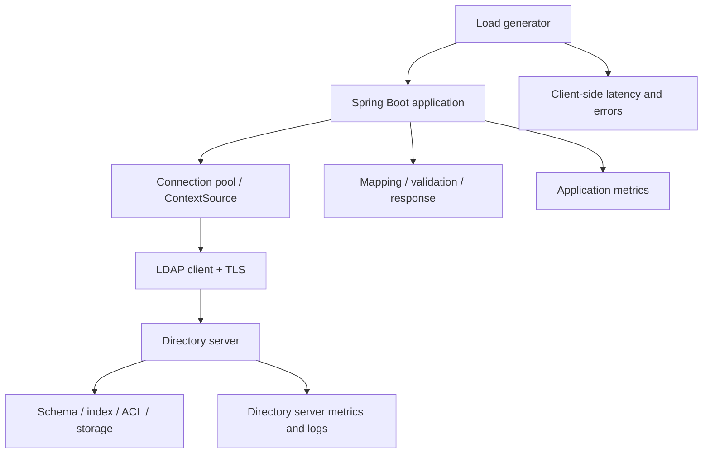
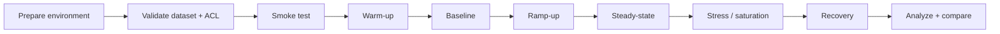

# Đo tải với schema, ACL và khối lượng dữ liệu thực tế

> **Chương:** Hiệu năng  
> **Module:** SPRING_DATA_LDAP — truy cập dịch vụ thư mục LDAP qua Spring Data LDAP repository và Spring LDAP LdapTemplate; ánh xạ entry phân cấp sang Java, hiểu DN, objectClass, schema, truy vấn repository/LdapTemplate, CRUD, filter an toàn, bảo mật kết nối và kiểm thử với directory.

## Mục tiêu học tập

Sau bài này, bạn có thể:

1. Thiết kế môi trường load test phản ánh đúng directory server, schema, index, ACL và bind identity của ứng dụng.
2. Tạo dữ liệu kiểm thử có quy mô, phân bố và độ chọn lọc gần với dữ liệu vận hành.
3. Xây dựng workload gồm lookup, subtree search, membership query, paging và write.
4. Đo throughput, p50/p95/p99 latency, error rate, result count và tài nguyên phía client/server.
5. Phân biệt độ trễ LDAP server với thời gian chờ connection pool, mapping và xử lý ở ứng dụng Spring.
6. Đánh giá tác động của schema, index, ACL, referrals, size/time limit và replication.
7. Tăng tải theo từng giai đoạn, tìm saturation point và xác định giới hạn an toàn.
8. Lập baseline, regression gate và báo cáo có thể tái lập.

## 1. Vì sao phải đo với schema, ACL và dữ liệu thực tế?

Một phép đo LDAP chỉ có giá trị khi môi trường test đại diện cho cách ứng dụng sẽ chạy. Kết quả từ một directory nhỏ, không có ACL và chỉ chứa vài trăm entry thường không dự báo được hành vi ở production.

Ba yếu tố ảnh hưởng trực tiếp tới kết quả:

- **Schema và index:** quyết định attribute nào hợp lệ, matching rule nào được dùng và server có thể tối ưu filter ra sao.
- **ACL:** quyết định entry/attribute nào bind identity được phép nhìn thấy; kiểm tra quyền cũng tiêu tốn tài nguyên và có thể làm thay đổi số kết quả trả về.
- **Khối lượng và phân bố dữ liệu:** quyết định search có chọn lọc hay phải duyệt nhiều entry, kích thước response, số page và bộ nhớ client.

Ngoài ba yếu tố đó, cần giữ tương đồng về directory product/version, topology, TLS, connection pool, referral policy, giới hạn server và cách ứng dụng gửi request.

Ví dụ, cùng filter:

```text
(&(objectClass=inetOrgPerson)(departmentNumber=FIN-01))
```

có thể trả 20 entry trong test và 200.000 entry ở môi trường thật. Nếu attribute departmentNumber có index ở test nhưng không có index ở production, latency có thể khác rất lớn. Nếu test bind bằng administrator còn production dùng service account có ACL hạn chế, số entry quan sát được và chi phí authorization cũng khác nhau.

**Không dùng kết quả test để kết luận năng lực production nếu test không tái hiện được các điều kiện ảnh hưởng tới query plan và quyền truy cập.**

## 2. Mô hình môi trường kiểm thử

### 2.1. Các thành phần cần giữ tương đồng

| Thành phần | Cần cố định hoặc ghi lại | Vì sao quan trọng |
| --- | --- | --- |
| Directory server | Sản phẩm, phiên bản, build, cấu hình | Query engine, ACL và paging khác nhau |
| Schema | Object classes, attribute syntax, matching rules, MUST/MAY | Ảnh hưởng dữ liệu hợp lệ và filter |
| Index | Attribute được index, kiểu index, trạng thái rebuild | Ảnh hưởng độ chọn lọc và chi phí search |
| Topology | Single node, replica, referral, naming context | Ảnh hưởng latency, consistency và partial result |
| TLS | LDAPS/StartTLS, cipher, certificate chain | Có chi phí handshake và xác minh |
| Bind identity | Cùng loại service account và ACL | Quyền ảnh hưởng kết quả và chi phí operation |
| Limits | Size limit, time limit, page size, server limits | Có thể cắt kết quả hoặc làm request thất bại |
| Client | JDK, Spring LDAP, pool, timeout, mapper | Ảnh hưởng connection và thời gian xử lý |
| Network | RTT, bandwidth, packet loss, vị trí client | LDAP là giao thức request/response qua mạng |

Không nhất thiết mọi test phải chạy trên bản sao production đầy đủ. Nhưng nếu môi trường khác, báo cáo phải nêu rõ khác biệt và giới hạn của kết luận.

### 2.2. Phân biệt ba tầng phép đo



- **End-to-end:** từ lúc load generator gửi request đến khi nhận response; phản ánh trải nghiệm caller.
- **Application LDAP operation:** thời gian Spring service gọi LdapOperations, gồm borrow context, network, server và mapping tùy điểm đặt timer.
- **Directory server:** thời gian server xử lý operation, queue, ACL, index lookup, backend/storage và trả response.

Đặt timer ở nhiều ranh giới giúp xác định latency nằm ở pool, ứng dụng, mạng hay server. Nếu chỉ đo end-to-end, không thể biết nguyên nhân request chậm nằm ở đâu.

## 3. Xây dựng dataset đại diện

### 3.1. Bắt đầu từ cardinality và quan hệ thực tế

Ghi lại số lượng và phân bố của các loại entry. Bảng dưới đây là ví dụ để lập kế hoạch, không phải quy mô bắt buộc:

| Thành phần | Dataset nhỏ | Dataset vừa | Dataset lớn |
| --- | ---: | ---: | ---: |
| People | 10.000 | 100.000 | 1.000.000 |
| Groups | 500 | 5.000 | 30.000 |
| OU / organizational units | 20 | 100 | 500 |
| Membership edges | 30.000 | 500.000 | 5.000.000 |
| Attributes đa giá trị | 5% entry | 10% entry | 15% entry |

Chọn mức nhỏ để kiểm tra logic, mức vừa để tìm regression và mức lớn để quan sát saturation. Nếu production có nhiều triệu entry hoặc hàng chục triệu membership edges, dataset lớn phải tiến gần quy mô đó.

### 3.2. Phân bố phải giống dữ liệu thật

Chỉ tăng số entry bằng cách lặp cùng một record không tạo được workload đại diện. Hãy tái tạo:

- Số lượng entry theo từng OU và naming context;
- Số người trong mỗi phòng ban/tenant;
- Phân bố group size: nhiều group nhỏ và một số group rất lớn;
- Tỷ lệ attribute optional bị thiếu;
- Attribute nhiều giá trị như telephoneNumber, member, uniqueMember;
- Độ dài và ký tự đặc biệt trong cn, uid, DN;
- Tỷ lệ query match 0, 1, vài chục và hàng nghìn kết quả;
- Tỷ lệ filter phổ biến và filter hiếm;
- Số lượng nested group, độ sâu và số nhánh;
- Entry inactive/disabled nếu ứng dụng cần lọc chúng;
- Phân bố giá trị skewed, ví dụ một department chiếm tỷ lệ lớn.

Đặc biệt, hãy giữ cả query phổ biến lẫn query hiếm. Một filter trả một entry và một filter trả hàng chục nghìn entry tạo tải hoàn toàn khác nhau.

### 3.3. Tạo dữ liệu có thể tái lập

Dùng generator có seed cố định và quy tắc tạo DN/attribute rõ ràng. Ghi seed, phiên bản generator và số lượng entry nạp vào báo cáo.

Ví dụ một phần LDIF fixture:

```ldif
dn: uid=user-000001,ou=people,dc=example,dc=org
objectClass: top
objectClass: person
objectClass: organizationalPerson
objectClass: inetOrgPerson
uid: user-000001
cn: Nguyen Thi Linh 000001
sn: Nguyen
givenName: Linh
mail: user-000001@example.org
departmentNumber: FIN-01
employeeNumber: EMP-000001

dn: cn=finance-readers,ou=groups,dc=example,dc=org
objectClass: top
objectClass: groupOfNames
cn: finance-readers
member: uid=user-000001,ou=people,dc=example,dc=org
member: uid=user-000002,ou=people,dc=example,dc=org
```

Đây là fixture minh họa. Khi nạp dataset lớn, nên chia file theo OU hoặc batch, theo dõi số entry nạp thành công và xác minh số lượng sau import. Không để lỗi schema hoặc duplicate DN làm dataset thiếu mà load test vẫn tiếp tục.

### 3.4. Tránh dataset làm sai kết luận

- Không dùng dữ liệu production có PII nếu chưa có quy trình bảo vệ/ẩn danh được phê duyệt.
- Không chỉ benchmark trên cache nóng; cần đo cả warm-cache và cold/restart scenarios khi phù hợp.
- Không để test data generator và load generator tranh CPU/disk với directory trong lúc đo.
- Không dùng một DN duy nhất cho mọi virtual user nếu mục tiêu là mô phỏng phân bố truy vấn thật.
- Không để dataset thay đổi giữa các lần so sánh baseline nếu không ghi rõ.
- Không nạp index mới hoặc chạy rebuild index trong giai đoạn đo steady-state.

## 4. Schema và index: xác minh trước khi chạy tải

### 4.1. Schema quyết định semantics của dữ liệu

Trước load test, xác minh:

- objectClass của từng loại entry;
- Attribute bắt buộc (MUST) và tùy chọn (MAY);
- Syntax và matching rule của attribute;
- Attribute đơn trị hay đa trị;
- Attribute case-ignore hay case-exact theo schema;
- Quy tắc DN và naming context;
- Operational attributes có được request rõ ràng không.

Nếu test schema khác production, có thể có khác biệt về filter, equality, substring và ordering match. Một query thành công trên schema test không chứng minh query hợp lệ trên directory đích.

### 4.2. Index phải tương ứng workload

Các filter thường dùng có thể cần index theo khả năng của server:

```text
(objectClass=inetOrgPerson)
(uid=user-000001)
(departmentNumber=FIN-01)
(&(objectClass=inetOrgPerson)(departmentNumber=FIN-01))
(member=uid=user-000001,ou=people,dc=example,dc=org)
```

Không có quy tắc chung rằng cứ thêm index cho mọi attribute là tốt. Index tiêu tốn storage, bộ nhớ và làm tăng chi phí ghi/update. Loại index và cách cấu hình phụ thuộc sản phẩm directory.

Quy trình:

1. Liệt kê filter thật từ application telemetry đã được loại bỏ PII.
2. Xác định attribute và matching rule trong từng filter.
3. Kiểm tra index hiện có bằng công cụ quản trị của directory server.
4. Đo query trước và sau thay đổi index trên cùng dataset.
5. Theo dõi cả search latency lẫn write latency, disk và memory.
6. Ghi lại cấu hình index trong báo cáo để lần sau có thể tái lập.

Không suy ra query plan chỉ từ việc attribute có index. Một filter AND có thể dùng index khác nhau tùy độ chọn lọc, optimizer và cách server kết hợp candidate set.

## 5. ACL và bind identity phải giống ứng dụng thật

### 5.1. Vì sao ACL ảnh hưởng hiệu năng?

Directory có thể kiểm tra quyền ở nhiều cấp:

- Quyền search trên container/base;
- Quyền duyệt entry con;
- Quyền đọc entry;
- Quyền đọc attribute;
- Quyền dùng attribute trong filter;
- Quyền xem operational attribute;
- Quyền theo referral/naming context.

Khi ACL thay đổi, server có thể trả ít entry hơn, che giấu attribute hoặc từ chối operation. Vì vậy chỉ so latency mà không so kết quả là chưa đủ.

### 5.2. Dùng đúng service account

Nếu ứng dụng production dùng cn=app-reader,..., load test cũng phải dùng account có ACL tương đương. Không dùng directory administrator để benchmark rồi kết luận ứng dụng sẽ đạt cùng throughput.

Tách profile test theo identity nếu có nhiều luồng:

| Identity | Workload | Quyền cần mô phỏng |
| --- | --- | --- |
| app-reader | User lookup, search people, read group | Search/read trong base và attribute allowlist |
| app-writer | Update profile fields | Modify đúng attribute/OU |
| directory-sync | Bulk read hoặc paging | Read các attribute cần cho đồng bộ |
| end-user | User-bound operation nếu có | ACL cá nhân của user |

### 5.3. Đo correctness cùng với latency

Với mỗi workload, ghi nhận:

- Expected result count hoặc range;
- Actual result count;
- LDAP result code/exception category;
- Có partial result/referral hay không;
- Có thiếu attribute bắt buộc hay không;
- Có duplicate DN hoặc mapping error hay không.

Ví dụ: latency giảm 40% nhưng chỉ vì ACL khiến 30% entry không còn hiển thị thì đó không phải tối ưu hợp lệ. Một phép đo performance phải giữ semantic của query không đổi.

**Không tắt ACL trong load test để làm số đẹp hơn.** Nếu cần tách chi phí ACL, chạy một thí nghiệm riêng có kiểm soát và ghi rõ đó không phải workload production.

## 6. Xây dựng workload gần với request thực tế

### 6.1. Liệt kê operation trước khi chọn tỷ lệ

Một workload Spring Data LDAP có thể gồm:

| Operation | Ví dụ | Đặc tính tải |
| --- | --- | --- |
| Exact lookup | Tìm một user theo uid | Kết quả nhỏ, thường latency thấp |
| Subtree search | Tìm nhân viên theo phòng ban | Phụ thuộc selectivity và index |
| Group membership | Tìm group có member chứa DN user | Multi-valued attribute, cardinality biến động |
| Read by DN | Đọc một entry đã biết | Ít candidate nhưng phụ thuộc network/bind |
| Paged search | Đọc toàn bộ người trong OU | Nhiều round-trip, cookie và dữ liệu |
| Modify attribute | Cập nhật số điện thoại | Write latency và replication |
| Negative lookup | Tìm user không tồn tại | Có thể phải xác nhận không match |
| Access denied | Search/read ngoài ACL | Đo error path, không tính là success |

### 6.2. Workload mix là giả định phải được xác nhận

Ví dụ ban đầu cho một ứng dụng danh bạ:

| Operation | Tỷ lệ ví dụ |
| --- | ---: |
| Exact user lookup | 45% |
| Search theo department | 20% |
| Read group membership | 15% |
| Read profile by DN | 10% |
| Update profile attribute | 5% |
| Negative lookup / denied test | 5% |

Các tỷ lệ này chỉ là điểm bắt đầu. Hãy lấy từ access log/metrics đã ẩn danh hoặc từ use case thực tế. Không đưa raw DN, UID, email hay filter có PII vào metric label.

### 6.3. Giữ selectivity của filter

Nếu query production thường trả 1–5 entry, load generator cần chọn dữ liệu sao cho phần lớn request có cardinality tương tự. Đồng thời tạo một phần query trả nhiều kết quả để phát hiện giới hạn.

Ghi nhận cardinality bucket, ví dụ:

- 0;
- 1;
- 2–10;
- 11–100;
- 101–1000;
- trên 1000.

Bucket giúp phát hiện workload thay đổi mà không tạo metric có label theo từng user.

## 7. Instrumentation ở tầng Spring LDAP

### 7.1. Đo operation bằng Micrometer

Đặt timer quanh operation LdapOperations. Tag phải có cardinality thấp, không chứa DN, UID, email, filter raw hoặc tenant ID không giới hạn.

Ví dụ service tìm một user:

```java
package com.example.directory.performance;

import static org.springframework.ldap.query.LdapQueryBuilder.query;

import java.util.List;

import org.springframework.ldap.core.ContextMapper;
import org.springframework.ldap.core.DirContextOperations;
import org.springframework.ldap.core.LdapOperations;
import org.springframework.ldap.query.SearchScope;
import org.springframework.stereotype.Component;

import io.micrometer.core.instrument.MeterRegistry;
import io.micrometer.core.instrument.Timer;

@Component
public class MeasuredPersonReader {

    private final LdapOperations ldap;
    private final MeterRegistry registry;

    public MeasuredPersonReader(
            LdapOperations ldap,
            MeterRegistry registry) {
        this.ldap = ldap;
        this.registry = registry;
    }

    public List<PersonSummary> findByUid(String uid) {
        Timer.Sample sample = Timer.start(registry);
        String outcome = "success";

        try {
            return ldap.search(
                query()
                    .base("ou=people")
                    .searchScope(SearchScope.SUBTREE)
                    .attributes("uid", "cn", "mail")
                    .where("objectClass").is("inetOrgPerson")
                    .and("uid").is(uid),
                (ContextMapper<PersonSummary>) context -> {
                    DirContextOperations entry =
                        (DirContextOperations) context;

                    return new PersonSummary(
                        entry.getStringAttribute("uid"),
                        entry.getStringAttribute("cn"),
                        entry.getStringAttribute("mail")
                    );
                }
            );
        } catch (RuntimeException ex) {
            outcome = classifyOutcome(ex);
            throw ex;
        } finally {
            sample.stop(
                Timer.builder("directory.ldap.operation")
                    .description("Duration of an LDAP operation")
                    .tag("operation", "find_by_uid")
                    .tag("outcome", outcome)
                    .publishPercentileHistogram()
                    .register(registry)
            );
        }
    }

    private static String classifyOutcome(RuntimeException ex) {
        // Ánh xạ sang một tập nhãn hữu hạn, không dùng message hoặc DN.
        return "error";
    }

    public record PersonSummary(
        String uid,
        String commonName,
        String mail
    ) {}
}
```

Ví dụ minh họa điểm đặt timer ở application boundary. Thời gian này có thể bao gồm borrow context, network round-trip, server processing, result conversion và mapping. Muốn tách các phần đó, cần metric ở pool/client/server tương ứng.

Trong code production, classifyOutcome nên phân loại vào tập nhãn hữu hạn như success, denied, timeout, unavailable, limit và error; không gắn exception message, DN hoặc filter vào tag.

### 7.2. Những metric nên thu thập

| Metric | Ý nghĩa |
| --- | --- |
| Request count | Tổng operation đã chạy |
| Throughput | Operation/second |
| p50 / p95 / p99 latency | Phân bố thời gian phản hồi |
| Error rate | Tỷ lệ lỗi theo operation và outcome |
| Result count | Số entry trả về theo bucket |
| Pool active/idle/waiters | Tình trạng connection pool |
| Connection create/borrow/return | Chi phí và sức ép connection |
| LDAP result code | Nhóm kết quả server trả về |
| Partial/referral count | Search chưa bao phủ đầy đủ |
| Client CPU/heap/GC | Chi phí mapping và giữ kết quả |
| Server CPU/memory/IO | Tài nguyên xử lý directory |
| Network bytes/RTT | Chi phí truyền dữ liệu |
| Replication lag | Độ trễ giữa primary và replica nếu có |

Không chỉ xem average latency. Một hệ thống có average 30 ms nhưng p99 2 giây vẫn có thể gây timeout cho người dùng.

### 7.3. Không tạo metric cardinality cao

Không dùng các giá trị sau làm tag:

- DN đầy đủ;
- UID, email, employee number;
- Raw LDAP filter;
- Group membership list;
- Request ID;
- Tên tenant tùy ý nếu số lượng tenant không giới hạn.

Dùng tag cố định như operation, identity_profile, scope, outcome và bucket cardinality. Nếu cần truy vết request riêng, dùng trace/log có kiểm soát và redaction.

## 8. Connection pool, concurrency và giới hạn server

### 8.1. Pool không làm server xử lý nhanh hơn vô hạn

Pool giảm chi phí tạo context/kết nối mới, nhưng pool quá nhỏ tạo wait queue; pool quá lớn có thể vượt connection limit, tăng context switch, memory và áp lực trên directory server.

Cần đo:

- Pool max active;
- Idle/min idle;
- Borrow wait time;
- Connection creation rate;
- Validation failures;
- LDAP server concurrent connection count;
- Operation throughput khi tăng pool size.

Thay đổi một yếu tố mỗi lần. Nếu tăng pool size và concurrency đồng thời, khó xác định yếu tố nào tạo ra khác biệt.

### 8.2. Tăng concurrency theo bậc

Ví dụ thử nghiệm:

| Giai đoạn | Concurrent users | Mục tiêu |
| --- | ---: | --- |
| Smoke | 1–2 | Xác minh query và dữ liệu đúng |
| Baseline | 5 | Đo latency khi tải nhẹ |
| Step 1 | 10 | Quan sát scaling ban đầu |
| Step 2 | 25 | Tìm queue/pool contention |
| Step 3 | 50 | Quan sát saturation gần ngưỡng |
| Step 4 | 100 | Xác định giới hạn trong môi trường test |
| Stress | Tăng tiếp có kiểm soát | Tìm điểm suy giảm và recovery |

Các con số là ví dụ. Chọn mức theo traffic dự kiến, tài nguyên server và giới hạn an toàn. Không nhảy thẳng tới concurrency rất cao.

### 8.3. Connection pool và danh tính

Không gộp context của nhiều bind identity vào cùng một pool không có cơ chế phân vùng đã kiểm chứng. Reader, writer và user-bound context cần profile riêng. Nếu dùng user bind, xác minh pool không trả context của user A cho user B.

Khi rotate secret, đo và kiểm tra cách pool drain/recreate connection. Một pool vẫn giữ connection đã bind bằng secret cũ có thể làm kết quả kiểm thử không phản ánh cấu hình hiện tại.

## 9. Paging và workload có kết quả lớn

LDAP paged results control (RFC 2696) cho phép client lấy kết quả theo từng page. Nó giảm lượng dữ liệu phải giữ cùng lúc ở client và hỗ trợ duyệt tập kết quả lớn, nhưng mỗi page tạo thêm round-trip.

Khi benchmark paging, ghi lại:

- Page size;
- Tổng entry dự kiến và thực tế;
- Số page;
- Tổng thời gian toàn bộ traversal;
- Latency từng page;
- Cookie còn lại hay đã hết;
- Partial result/referral;
- Server-side time/size limit;
- Heap và network bytes ở client.

Không chỉ đo page đầu rồi kết luận toàn bộ search nhanh. Với bulk sync, metric quan trọng thường là tổng thời gian hoàn thành snapshot và số entry/second.

### Page size không có một giá trị tối ưu chung

- Page nhỏ: ít dữ liệu mỗi response nhưng nhiều round-trip.
- Page lớn: ít round-trip hơn nhưng response lớn, tăng heap/network và có thể gặp server limit.
- Page size phải được thử với entry size thực tế và network latency thật.

Paging không tự bảo đảm snapshot isolation trong lúc directory thay đổi. Nếu dữ liệu được cập nhật trong khi client đi qua nhiều page, kết quả có thể không phản ánh một thời điểm duy nhất. Benchmark và đồng bộ dữ liệu phải có chiến lược watermark/change tracking hoặc reconciliation phù hợp.

Nếu server trả referral hoặc partial result, không tính traversal là hoàn tất. Hãy xác minh cookie và trạng thái page cuối theo API/provider đang dùng.

## 10. Search limits, referrals và replication

### 10.1. Size/time limit

Directory server có thể áp dụng size limit hoặc time limit. Một search bị cắt ở 1.000 entry không thể được báo cáo như thể đã trả toàn bộ 20.000 entry.

Ghi lại:
- Client count limit;
- Server size/time limit;
- LDAP result code;
- Số entry thực tế nhận được;
- Có partial result hay exception không.

Không tắt giới hạn production chỉ để benchmark; hãy kiểm tra workload với giới hạn vận hành dự kiến.

### 10.2. Referrals và naming contexts

Nếu search đi qua referral, client có thể phải kết nối sang server/naming context khác. Điều này làm thay đổi latency và có thể cần credentials/ACL khác.

Chạy riêng các scenario:
- Referral disabled/returned;
- Referral followed nếu ứng dụng cho phép;
- Naming context nằm trên cùng server;
- Naming context nằm trên server khác.

Không cộng latency của các scenario này thành một số duy nhất nếu production có policy referral khác.

### 10.3. Replica và read-after-write

Nếu đọc từ replica, replication lag có thể khiến write vừa thành công nhưng read tiếp theo chưa thấy thay đổi. Load test cần xác định:
- Write chạy trên primary hay replica;
- Read chạy trên node nào;
- Replication lag trong steady-state;
- Read-after-write có yêu cầu strong consistency không;
- Failover có làm thay đổi latency/error rate không.

Không so một lần chạy single-node với một lần chạy multi-replica rồi kết luận khác biệt chỉ do code ứng dụng.

## 11. Quy trình chạy load test có thể tái lập

Một lần đo nên có các giai đoạn rõ ràng:



### Bước 1 — Chuẩn bị

- Ghi version directory, JDK, Spring LDAP và ứng dụng;
- Ghi schema, index, ACL, bind identity, topology và server limits;
- Nạp dataset và xác minh entry counts;
- Kiểm tra filter, result count và expected authorization;
- Kiểm tra TLS và pool;
- Đồng bộ clock của load generator, app và directory server.

### Bước 2 — Smoke test

Chạy một vài request cho từng operation. Xác minh:
- Query đúng base/scope/filter;
- Result count đúng;
- ACL đúng;
- Write chỉ tác động fixture;
- Không có mapping error;
- Không có referral/partial result ngoài dự kiến.

Không bắt đầu tải lớn nếu smoke test chưa đúng.

### Bước 3 — Warm-up

Warm-up giúp JVM JIT, connection pool, TLS session và server cache ổn định. Không lấy warm-up làm số đo steady-state.

Ghi riêng cold-start nếu production cần biết thời gian phục hồi sau restart.

### Bước 4 — Baseline

Chạy tải thấp và đủ thời gian để lấy baseline:
- Throughput;
- p50/p95/p99;
- Error rate;
- Result cardinality;
- Client/server CPU;
- Pool wait và connection count.

### Bước 5 — Ramp-up và steady-state

Tăng concurrency theo từng bậc. Sau mỗi bậc:
- Chờ metric ổn định;
- Ghi throughput/latency/error;
- Kiểm tra pool và server resource;
- Xác minh result count;
- Dừng nếu vượt safety threshold.

Steady-state phải đủ dài để phát hiện queue tích lũy, GC, connection leak và server resource pressure. Một đợt test ngắn vài giây thường không phát hiện được các vấn đề này.

### Bước 6 — Stress, spike và soak

- **Stress:** tăng tải đến khi SLO không còn đạt hoặc tài nguyên bão hòa.
- **Spike:** tăng tải đột ngột để xem queue và recovery.
- **Soak:** giữ tải ổn định lâu để tìm leak, connection exhaustion, heap growth và replication drift.

Không phải release nào cũng cần chạy mọi loại test; chọn theo thay đổi và rủi ro.

### Bước 7 — Recovery

Giảm tải về mức thấp và quan sát:
- Queue có thoát hết không;
- Pool có phục hồi không;
- Error rate có trở về baseline không;
- Server có còn CPU/IO pressure không;
- Replica có bắt kịp không.

Khả năng phục hồi cũng là một phần của capacity.

## 12. Định nghĩa ngưỡng pass/fail

Không có một ngưỡng latency đúng cho mọi LDAP deployment. Đặt SLO dựa trên yêu cầu nghiệp vụ và baseline của môi trường.

Ví dụ policy test (chỉ minh họa):

| Chỉ số | Ngưỡng ví dụ |
| --- | --- |
| p95 exact lookup | Dưới 150 ms |
| p99 exact lookup | Dưới 400 ms |
| Error rate ở steady-state | Dưới 0,5% |
| Unexpected partial result | 0 |
| Missing required attributes | 0 |
| Result count mismatch | 0 |
| Pool borrow timeout | 0 |
| Write correctness | 100% fixture đúng |
| Recovery sau stress | Trở về baseline trong 2 phút |

Không sao chép các ngưỡng ví dụ vào production mà không đánh giá RTT, server, dataset, SLO và timeout thực tế.

### So sánh regression

Khi so phiên bản A và B:
- Dùng cùng dataset seed;
- Cùng workload mix;
- Cùng bind identity/ACL;
- Cùng server node/topology;
- Cùng pool size/timeouts;
- Cùng thời lượng warm-up và steady-state;
- Chạy nhiều lần nếu kết quả có biến động;
- So p95/p99 và error rate, không chỉ average;
- Ghi confidence/variability nếu có.

Nếu thay đổi index hoặc ACL, đó là thay đổi điều kiện thử nghiệm; phải báo riêng và không quy toàn bộ kết quả cho code.

## 13. Phân tích bottleneck

| Dấu hiệu | Nguyên nhân có thể | Cách kiểm tra |
| --- | --- | --- |
| Latency tăng, pool wait tăng, server nhàn | Pool quá nhỏ hoặc connection không được trả | Active/idle/waiters, close lifecycle |
| Pool wait thấp, server CPU cao | Query/index/ACL hoặc concurrency quá lớn | Server operation stats, index diagnostics |
| CPU server thấp, latency cao | Network RTT, TLS, referral hoặc backend IO | Network trace, server logs, storage metrics |
| Exact lookup nhanh, subtree search chậm | Filter kém chọn lọc hoặc thiếu index | Query selectivity, index config |
| Search latency ổn, end-to-end chậm | Mapping, serialization, application queue hoặc GC | App profiler, heap, GC, thread pool |
| p50 ổn nhưng p99 tăng mạnh | Queueing, lock contention, GC pause, hot partition | Histograms, thread dump, GC logs |
| Error 49 tăng | Bind credential/rotation hoặc account state | Bind metrics, secret version |
| Error 50 tăng | ACL không phù hợp với workload | Bind identity và ACL logs |
| Partial result/referral tăng | Naming context/topology hoặc referral policy | Referral logs, search completion |
| Kết quả ít hơn dự kiến | ACL, filter, replica lag hoặc dataset lỗi | Expected count, bind identity, replication |
| Write chậm khi tăng index | Index maintenance và write amplification | Write latency, index/storage metrics |
| Latency tăng theo thời gian soak | Leak, pool exhaustion, heap growth hoặc server resource leak | Connection count, GC, open context, server resource |

Không tối ưu dựa trên một metric đơn lẻ. Ví dụ tăng pool có thể giảm pool wait nhưng làm server bão hòa và p99 xấu hơn.

## 14. Capacity, backpressure và retry

Khi xác định được saturation point, đặt giới hạn ứng dụng thấp hơn điểm đó để còn headroom cho burst và hoạt động nền.

- Giới hạn concurrent LDAP operations;
- Dùng bounded executor/queue;
- Đặt connect/read/search timeout;
- Giới hạn result size và page size;
- Không retry vô hạn;
- Chỉ retry operation idempotent hoặc có cơ chế chống ghi lặp;
- Exponential backoff có jitter để tránh retry storm;
- Phân biệt lỗi transient với invalid credentials/ACL;
- Tách workload bulk sync khỏi request latency-sensitive;
- Có circuit breaker hoặc load shedding theo policy ứng dụng nếu cần.

Một retry cho operation bị code 49 hoặc 50 không giúp phục hồi. Nó chỉ tăng tải và làm log nhiễu hơn. Với timeout của write, cần xác minh trạng thái trước khi retry vì server có thể đã áp dụng thay đổi nhưng response bị mất.

## 15. Báo cáo kết quả

Mỗi lần chạy nên lưu một report có đủ ngữ cảnh:

| Trường | Ví dụ |
| --- | --- |
| Run ID | ldap-load-2026-11-26-a |
| Directory | Product/version/build |
| Topology | Primary + 2 read replicas |
| Schema/index | Schema revision và index profile |
| ACL identity | app-reader-v3 / app-writer-v2 |
| Dataset | 100.000 people, 5.000 groups, seed 42 |
| Client | JDK/Spring LDAP/app build |
| Pool | Max active, min idle, borrow timeout |
| Workload | Operation mix và selectivity |
| Concurrency | Ramp schedule và peak |
| Warm-up | Thời lượng |
| Steady-state | Thời lượng |
| Throughput | Operations/second |
| Latency | p50/p95/p99 từng operation |
| Errors | Rate và LDAP result categories |
| Correctness | Result count, partial result, write verification |
| Resources | App/server CPU, heap, GC, IO, connections |
| Deviations | Khác biệt với production |
| Conclusion | Pass/fail, bottleneck và hành động tiếp theo |

Không chỉ lưu ảnh dashboard. Lưu raw histogram/time series và cấu hình test để lần chạy sau so sánh được.

## 16. Những lỗi thường gặp

| Cách làm sai | Vì sao sai | Cách làm đúng |
| --- | --- | --- |
| Test với vài trăm entry rồi ngoại suy production | Không phản ánh cardinality/selectivity | Tạo nhiều dataset size và phân bố thực tế |
| Dùng administrator bind | ACL và result set khác ứng dụng | Dùng service account/ACL tương đương |
| Tắt ACL để tăng tốc | Thay đổi semantics và chi phí thực tế | Giữ ACL, đo riêng nếu cần nghiên cứu |
| Chỉ đo average latency | Che giấu tail latency | Báo p50/p95/p99 và histogram |
| Chỉ đo page đầu | Không đo tổng traversal | Đo toàn bộ cookie/page sequence |
| Tính partial result là success | Kết quả thiếu nhưng số liệu đẹp | Ghi result code và completeness |
| Tăng pool vô hạn | Có thể làm directory quá tải | Tìm pool/concurrency tối ưu theo saturation |
| Không warm-up | Trộn JIT/cache startup với steady-state | Tách warm-up và cold-start test |
| Dùng raw DN làm metric tag | Cardinality bùng nổ và lộ PII | Dùng operation/outcome/cardinality bucket |
| Chỉ load test server, bỏ qua Spring | Bỏ qua pool, mapping, GC và serialization | Đo cả end-to-end và app boundary |
| Chạy data import trong lúc benchmark | CPU/IO contention làm sai kết quả | Tách preparation và measurement |
| Retry mọi lỗi | Tăng tải, che lỗi auth/ACL | Phân loại error và retry có giới hạn |

## 17. Checklist trước khi công bố kết quả

- [ ] Directory product/version và topology đã được ghi lại.
- [ ] Schema/object classes/attribute syntax/matching rules tương ứng môi trường mục tiêu.
- [ ] Index profile được xác minh và không thay đổi giữa các run so sánh.
- [ ] ACL và bind identity tương đương ứng dụng thật.
- [ ] Dataset có cardinality, skew và quan hệ group/OU đại diện.
- [ ] Dataset seed và generator version được lưu.
- [ ] Workload mix và filter selectivity phản ánh use case.
- [ ] Query base/scope/filter/attributes được cố định.
- [ ] Paging đo hết toàn bộ kết quả.
- [ ] Size/time limits, referrals và partial result được ghi nhận.
- [ ] Warm-up, baseline, ramp, steady-state và recovery được tách.
- [ ] Throughput, p50/p95/p99, error rate và result count được đo.
- [ ] Pool wait, connection count, client/server CPU, heap/GC và IO được thu thập.
- [ ] Không dùng DN, UID, email hoặc raw filter làm metric tag.
- [ ] Write test chỉ thay đổi fixture và có xác minh kết quả.
- [ ] Có ngưỡng pass/fail dựa trên SLO.
- [ ] Có report, raw metrics và cấu hình để tái lập.

## 18. Câu hỏi tự đánh giá

**Câu 1.** Vì sao load test phải dùng cùng loại bind identity và ACL với ứng dụng?  
**Đáp án:** ACL có thể thay đổi entry/attribute nhìn thấy, operation được phép và chi phí kiểm tra quyền. Administrator account không đại diện cho service account của ứng dụng.

**Câu 2.** Vì sao dataset lớn nhưng tất cả entry giống nhau vẫn có thể cho kết quả sai lệch?  
**Đáp án:** Nó không tái tạo skew, selectivity, group size, optional attributes và phân bố OU của dữ liệu thật.

**Câu 3.** Average latency thấp có đủ chứng minh hệ thống đáp ứng SLO không?  
**Đáp án:** Không. Cần xem p95/p99, error rate, throughput và correctness để phát hiện tail latency.

**Câu 4.** Index có luôn làm LDAP nhanh hơn không?  
**Đáp án:** Không. Index tăng chi phí storage và write/update; phải đo theo workload và matching rule cụ thể.

**Câu 5.** Đo paging chỉ ở page đầu có đủ không?  
**Đáp án:** Không. Cần đo toàn bộ traversal, số page, tổng thời gian, result completeness và resource usage.

**Câu 6.** Search trả ít entry hơn sau khi bật ACL có phải là tối ưu hiệu năng không?  
**Đáp án:** Không nếu kết quả nghiệp vụ phải đầy đủ. Cần xác minh ACL không làm mất dữ liệu mà caller được phép đọc.

**Câu 7.** Vì sao tăng pool size có thể làm p99 xấu hơn?  
**Đáp án:** Nhiều connection đồng thời có thể làm directory bão hòa CPU/IO hoặc chạm giới hạn connection; giảm pool wait không đảm bảo server xử lý nhanh hơn.

**Câu 8.** Khi nào retry LDAP write là nguy hiểm?  
**Đáp án:** Khi client timeout nhưng server có thể đã commit thay đổi. Cần xác minh trạng thái hoặc dùng operation idempotent/cơ chế chống lặp trước khi retry.

## Tài liệu tham khảo

- [Spring LDAP — Configuration and ContextSource](https://docs.spring.io/spring-ldap/reference/configuration.html)
- [Spring LDAP — LdapOperations API](https://docs.spring.io/spring-ldap/reference/api/java/org/springframework/ldap/core/LdapOperations.html)
- [Spring LDAP — Query Builder](https://docs.spring.io/spring-ldap/reference/query-builder-advanced.html)
- [Spring Boot — Metrics](https://docs.spring.io/spring-boot/reference/actuator/metrics.html)
- [Micrometer — Timers](https://docs.micrometer.io/micrometer/reference/concepts/timers.html)
- [RFC 4511 — LDAPv3 Protocol](https://www.rfc-editor.org/rfc/rfc4511.html)
- [RFC 2696 — LDAP Control Extension for Simple Paged Results Manipulation](https://www.rfc-editor.org/rfc/rfc2696.html)
- [RFC 4512 — LDAP Directory Information Models](https://www.rfc-editor.org/rfc/rfc4512.html)
- [OpenLDAP Administrator's Guide](https://www.openldap.org/doc/admin/)

