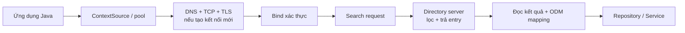

# Đo thời gian kết nối, xác thực và tìm kiếm

## Mục tiêu học tập

Sau bài này, người học có thể:

1. Phân biệt **thời gian lấy kết nối/context**, **thời gian xác thực LDAP (bind)** và **thời gian tìm kiếm (search)** trong ứng dụng **Spring Data LDAP / Spring LDAP**.
2. Đặt điểm đo đúng vị trí khi dùng `ContextSource`, `LdapTemplate` và repository; nhận ra những pha không thể tách chính xác chỉ bằng một lời gọi API.
3. Dùng `System.nanoTime()` và **Micrometer `Timer`** để thu thập thời lượng, tỷ lệ lỗi và phân vị độ trễ.
4. Đọc dashboard để phân biệt nghẽn kết nối, vấn đề xác thực và truy vấn chậm; hiểu ảnh hưởng của TLS, connection pool, schema, index và lượng kết quả.
5. Thiết kế log/metric có giá trị chẩn đoán mà vẫn bảo vệ mật khẩu, DN, filter và dữ liệu người dùng.

Bài thuộc chương **Quan sát** của module `SPRING_DATA_LDAP`: truy cập LDAP qua repository và ánh xạ entry phân cấp sang đối tượng Java, với các chủ đề liên quan như DN, `objectClass`, schema, `LdapTemplate`, CRUD, filter an toàn, kết nối bảo mật và kiểm thử trên directory.

## 1. Vì sao cần đo theo từng pha?

Một API đăng nhập có thể chậm 900 ms dù đoạn gọi repository chỉ dài một dòng. Muốn sửa đúng nguyên nhân, chúng ta phải trả lời:

- **Lấy context lâu?** Ứng dụng có thể đang chờ một kết nối rảnh, phân giải DNS, mở TCP, thương lượng TLS hoặc bind tài khoản dịch vụ.
- **Xác thực lâu?** Ứng dụng có thể phải tìm DN của người dùng trước, sau đó dùng mật khẩu để bind; máy chủ cũng có thể bị quá tải hoặc liên hệ directory khác.
- **Tìm kiếm lâu?** Bộ lọc LDAP, phạm vi tìm kiếm, thuộc tính chưa được lập chỉ mục, server, mạng hoặc số entry/attribute trả về đều có thể góp phần.
- **Ánh xạ lâu?** Sau khi nhận dữ liệu, Spring Data LDAP vẫn phải tạo object Java, xử lý các giá trị đa trị và hoàn tất luồng gọi ứng dụng.

Nếu chỉ đo “thời gian API” hoặc “thời gian LDAP” tổng, các nguyên nhân này bị gộp chung, rất khó chẩn đoán.

### Một luồng LDAP điển hình



Sơ đồ mô tả **luồng logic**, không khẳng định rằng API Java nào cũng cung cấp điểm đo cho từng ô. Chẳng hạn JNDI có thể trì hoãn phần thiết lập kết nối cho đến thao tác thật sự sử dụng context; cơ chế pooling cũng làm nhiều bước biến mất khỏi một lần truy vấn cụ thể.

## 2. Định nghĩa ranh giới của các phép đo

Trước khi đặt timer, hãy định nghĩa rõ **bắt đầu**, **kết thúc** và **phần công việc được bao gồm**.

| Metric đề xuất | Bắt đầu → kết thúc | Bao gồm | Không nên diễn giải là |
| --- | --- | --- | --- |
| `context_acquire` | Trước → sau `ContextSource.getReadOnlyContext()` | Lấy/khởi tạo `DirContext`; có thể chờ pool và thực hiện kết nối, TLS, bind | “TCP connect thuần” hoặc “TLS handshake thuần” |
| `bind_context_total` | Trước → sau `ContextSource.getContext(dn, password)` | Lấy context có danh tính được yêu cầu; thường gồm connect/TLS/bind | Chỉ riêng thời gian xử lý mật khẩu tại server |
| `authentication_e2e` | Trước → sau toàn bộ luồng xác thực ứng dụng | Có thể gồm tìm entry theo `uid`, lấy DN, bind và logic xác thực | Đồng nghĩa với một lệnh bind |
| `search_e2e` | Trước → sau `LdapTemplate.search(...)` hoặc lời gọi repository | Lấy context, search, duyệt kết quả, ánh xạ và giải phóng tài nguyên theo API | “LDAP server execution time” thuần |
| `search_on_context` | Sau khi đã có context → sau khi duyệt hết kết quả | Gửi search, server xử lý, truyền/duyệt kết quả | Không gồm thời gian mạng hoặc thời gian ánh xạ |
| `directory_request_e2e` | Vào → ra một API nghiệp vụ gọi LDAP | LDAP cùng các bước khác của ứng dụng | Chỉ riêng thời gian LDAP |

**Điểm mấu chốt:** `search_e2e` thông thường **đã chứa** thời gian lấy context. Không được cộng trực tiếp số đo `context_acquire` từ một lần probe riêng vào `search_e2e` rồi xem đó là tổng thời gian: khác request, khác trạng thái pool và có thể đếm trùng.

### 2.1. “Kết nối” có thể là nhiều bước

Đối với LDAP qua `ldaps://`, lần kết nối mới có thể gồm:

1. Phân giải hostname sang địa chỉ mạng.
2. Mở TCP socket.
3. Thiết lập TLS và kiểm tra chứng chỉ.
4. Bind bằng tài khoản dịch vụ hoặc tài khoản cần xác thực.
5. Trả `DirContext` cho Spring LDAP.

Với **StartTLS**, thời điểm thương lượng TLS có thể khác luồng LDAPS trực tiếp. Với **connection pooling**, lấy context có thể chỉ là mượn đối tượng đang được kết nối và xác thực. Một số JNDI provider có thể khởi tạo kết nối theo cơ chế trì hoãn; vì thế chỉ đo `getReadOnlyContext()` chưa luôn chứng minh TCP/TLS đã diễn ra.

Nếu yêu cầu phải tách riêng DNS, TCP, TLS và LDAP bind, cần **thêm thông tin ở tầng mạng/client provider/server**, chẳng hạn sự kiện TLS, telemetry của pool và server logs. Bản thân API repository không cung cấp sẵn đồng hồ đo chính xác cho từng pha đó.

### 2.2. Xác thực thường gồm hai thao tác

Một luồng đăng nhập thường là:

```text
username -> search theo (uid=...) -> tìm DN
         -> bind bằng DN + mật khẩu -> kết quả xác thực
```

Phương thức `LdapTemplate.authenticate(LdapQuery, String)` thực hiện việc tìm entry phù hợp trước khi thử bind bằng mật khẩu. Vì vậy đo thời gian gọi phương thức này là **xác thực đầu cuối**, gồm cả tìm DN; nếu dùng `ContextSource.getContext(principal, credentials)` khi DN đã biết, phép đo có phạm vi hẹp hơn nhưng vẫn thường gồm chi phí kết nối/TLS. Tùy phiên bản Spring LDAP, hành vi trả kết quả hoặc ném ngoại lệ của các overload `authenticate` cũng khác nhau; cần theo đúng API dự án.

### 2.3. Tìm kiếm kết thúc khi nào?

Với `LdapTemplate.search(...)` trả về `List<T>`, thời gian lời gọi bao gồm cả việc xử lý kết quả trước khi trả list. Với truy vấn trả stream, cursor hay xử lý phân đoạn nếu có, **không được dừng timer ngay khi nhận đối tượng lazy**; phải xác định lúc duyệt và đóng stream/`NamingEnumeration`. Nếu dùng repository, đo quanh `findBy...` hoặc `findAll...` để nắm độ trễ người gọi thấy, bao gồm chi phí ánh xạ entry LDAP thành object Java.

## 3. Chọn kỹ thuật đo thời gian

### 3.1. Dùng đồng hồ đơn điệu cho elapsed time

Trong JVM, sử dụng `System.nanoTime()` để đo khoảng thời gian:

```java
long start = System.nanoTime();
try {
    // Gọi LDAP
} finally {
    long elapsedNanos = System.nanoTime() - start;
    // Gửi elapsedNanos tới hệ thống metric.
}
```

`System.currentTimeMillis()` hữu ích khi ghi **mốc thời gian sự kiện** trong log, nhưng có thể bị ảnh hưởng bởi điều chỉnh đồng hồ hệ thống; không phải lựa chọn tốt cho elapsed time. Đừng dùng `nanoTime()` như timestamp để so sánh trực tiếp giữa hai JVM.

### 3.2. Thu thập phân phối thay vì chỉ lấy trung bình

Một request nhanh không chứng minh directory khỏe. Các chỉ số nên quan sát cùng nhau:

| Chỉ số | Câu hỏi trả lời |
| --- | --- |
| Count / throughput | Mỗi giây có bao nhiêu lời gọi LDAP? |
| Mean | Tổng quan về thời gian trung bình trong một khoảng đo |
| p50 | Mức độ trễ thường gặp |
| p95 / p99 | Có bao nhiêu request gặp độ trễ ở phần đuôi phân phối? |
| Error rate | Bao nhiêu lời gọi thất bại hoặc trả lỗi hạ tầng? |
| Timeouts | Kết nối/đọc dữ liệu hoặc search có vượt giới hạn thời gian? |
| In-use / idle / waiting pool | Có tranh chấp kết nối khi tải tăng không? |

Sử dụng **Micrometer `Timer`** (có thể xuất sang Prometheus qua Spring Boot Actuator) giúp lưu count, total time và, nếu cấu hình histogram/percentiles phù hợp, phân vị độ trễ.

## 4. Đo thời gian tìm kiếm bằng Micrometer

### 4.1. Ví dụ dịch vụ Spring LDAP

Đo ngay quanh thao tác tìm kiếm bằng `LdapTemplate`. Giả định ứng dụng đã cấu hình Spring LDAP, `LdapTemplate` và `MeterRegistry` (chẳng hạn có Micrometer trong Spring Boot):

```java
import io.micrometer.core.instrument.MeterRegistry;
import io.micrometer.core.instrument.Timer;
import java.util.List;
import java.util.concurrent.TimeUnit;
import java.util.function.Supplier;
import org.springframework.ldap.core.AttributesMapper;
import org.springframework.ldap.core.LdapTemplate;

import static org.springframework.ldap.query.LdapQueryBuilder.query;

public final class ObservedPersonSearch {

    private final LdapTemplate ldapTemplate;
    private final MeterRegistry meterRegistry;

    public ObservedPersonSearch(
            LdapTemplate ldapTemplate, MeterRegistry meterRegistry) {
        this.ldapTemplate = ldapTemplate;
        this.meterRegistry = meterRegistry;
    }

    public List<String> findUsernames(String username) {
        return timed("search_e2e", () ->
            ldapTemplate.search(
                query()
                    .base("ou=people")
                    .attributes("uid")
                    .where("uid").is(username),
                (AttributesMapper<String>) attributes ->
                    (String) attributes.get("uid").get()
            )
        );
    }

    private <T> T timed(String phase, Supplier<T> operation) {
        long started = System.nanoTime();
        String outcome = "success";

        try {
            return operation.get();
        } catch (RuntimeException | Error failure) {
            outcome = "error";
            throw failure;
        } finally {
            Timer.builder("ldap.client.duration")
                .description("Elapsed time of client-side LDAP operations")
                .tag("phase", phase)
                .tag("outcome", outcome)
                .publishPercentileHistogram()
                .register(meterRegistry)
                .record(System.nanoTime() - started, TimeUnit.NANOSECONDS);
        }
    }
}
```

**Điểm cần hiểu khi đọc đoạn mã:**

- `phase=search_e2e` được đo từ **trước khi gọi `LdapTemplate.search` đến lúc hàm kết thúc hoặc lỗi**. Do đó bao gồm việc tìm context, thực hiện search, duyệt entry, ánh xạ `uid` và giải phóng theo cơ chế Spring LDAP.
- `LdapQueryBuilder.where("uid").is(username)` xử lý giá trị đầu vào qua API tạo filter. Tránh tự ghép chuỗi `"(uid=" + username + ")"` vì có thể dẫn tới LDAP filter injection.
- `Timer` nhận giá trị tính bằng nanosecond; backend giám sát có thể biểu diễn theo giây. Không chuyển thủ công sai đơn vị.
- `outcome` chỉ có hai giá trị cố định. Không đặt `uid`, email, DN, mật khẩu hay LDAP filter nguyên văn vào tag; chúng vừa có thể chứa dữ liệu nhạy cảm vừa làm **cardinality** bùng nổ.
- Ví dụ giả định entry có attribute `uid` và tài khoản có quyền đọc; nếu server ẩn thuộc tính, bước mapping có thể phát sinh lỗi và sẽ được đếm vào `outcome=error`.

Trong dự án có lưu lượng lớn, có thể cache các `Timer` đăng ký sẵn cho các tổ hợp tag giới hạn để giảm overhead đăng ký lặp; quy tắc tên và tag phải nhất quán giữa các dịch vụ.

### 4.2. Đo repository theo đúng ranh giới

Khi ứng dụng sử dụng Spring Data LDAP repository để ánh xạ entry sang Java object:

```java
public PersonEntry findOneByUid(String uid) {
    return timed("repository_lookup_e2e",
        () -> personRepository.findByUsername(uid));
}
```

Đây là mã minh họa với repository giả định đã khai báo `findByUsername(String uid)` phù hợp entity. Timer đo **độ trễ người gọi thấy**, gồm chi phí của Spring Data LDAP và Object-Directory Mapping (ODM); nó không thể tự chỉ ra có bao nhiêu millisecond do server search hay do mapper.

Nếu một request gọi nhiều repository method, đặt thêm timer ở mức dịch vụ để biết tổng thời gian nghiệp vụ, tránh coi các timer riêng là phép cộng luôn khớp do logic khác xen giữa.

## 5. Đo thời gian lấy context và bind

### 5.1. Đo lấy context

`ContextSource.getReadOnlyContext()` trả `DirContext` dùng để đọc. Khi đo, phải đóng context để trả kết nối hoặc tài nguyên về nguồn quản lý:

```java
import javax.naming.NamingException;
import javax.naming.directory.DirContext;
import org.springframework.ldap.core.ContextSource;

public void measureContextAcquisition(
        ContextSource contextSource, MeterRegistry registry)
        throws NamingException {

    long started = System.nanoTime();
    DirContext context = null;
    String outcome = "success";

    try {
        context = contextSource.getReadOnlyContext();
    } catch (NamingException failure) {
        outcome = "error";
        throw failure;
    } finally {
        registry.timer(
            "ldap.client.duration",
            "phase", "context_acquire",
            "outcome", outcome
        ).record(System.nanoTime() - started, TimeUnit.NANOSECONDS);

        if (context != null) {
            try {
                context.close();
            } catch (NamingException closeFailure) {
                registry.counter("ldap.client.context.close.errors")
                        .increment();
            }
        }
    }
}
```

Ở đây điểm kết thúc của timer nằm **trước phần đóng context**. Vì vậy đây là metric **context acquisition**, không gồm chi phí trả connection về pool. Nếu muốn đo toàn bộ vòng đời mượn/trả, phải đặt một timer ngoài cả hai bước.

**Giới hạn phép đo:** lấy context nhanh có thể do pool đã có kết nối sẵn; một số provider có thể thực hiện network I/O muộn hơn. Không nên đặt tên metric này là `tcp_connect_ms` hoặc `tls_handshake_ms`.

### 5.2. Đo xác thực bằng DN đã biết

`ContextSource.getContext(principal, credentials)` tạo context xác thực bằng thông tin đã cung cấp. Trong một phép thử có kiểm soát, có thể đo như sau:

```java
import javax.naming.AuthenticationException;
import javax.naming.NamingException;
import javax.naming.directory.DirContext;
import org.springframework.ldap.core.ContextSource;

public boolean checkBind(
        ContextSource source,
        MeterRegistry registry,
        String userDn,
        String password) throws NamingException {

    long started = System.nanoTime();
    String outcome = "success";
    DirContext context = null;

    try {
        context = source.getContext(userDn, password);
        return true;
    } catch (AuthenticationException invalidCredentials) {
        outcome = "invalid_credentials";
        return false;
    } catch (NamingException directoryFailure) {
        outcome = "directory_error";
        throw directoryFailure;
    } finally {
        registry.timer(
            "ldap.client.duration",
            "phase", "bind_context_total",
            "outcome", outcome
        ).record(System.nanoTime() - started, TimeUnit.NANOSECONDS);

        if (context != null) {
            try {
                context.close();
            } catch (NamingException closeFailure) {
                registry.counter("ldap.client.context.close.errors")
                        .increment();
            }
        }
    }
}
```

Đoạn mã dành cho **chẩn đoán ranh giới bind** khi đã có DN và được cấp quyền thực hiện. Trong ứng dụng xác thực thực tế, nên tuân thủ cơ chế Spring Security LDAP hoặc luồng xác thực hiện có, tránh tự thiết kế chính sách đăng nhập chỉ từ ví dụ này.

Ba điểm quan trọng:

- `invalid_credentials` là một kết quả nghiệp vụ dự kiến; cần **phân loại riêng** với `directory_error` (ví dụ timeout hoặc mất kết nối). Tỷ lệ đăng nhập sai không đồng nghĩa dịch vụ LDAP lỗi.
- Phép đo `bind_context_total` có thể bao gồm tạo TCP/TLS và không phải chỉ riêng thời gian kiểm tra mật khẩu ở server. Theo tài liệu Spring LDAP, `getContext(principal, credentials)` không dùng native Java LDAP pooling để tránh dùng thông tin xác thực cũ.
- Không ghi `userDn`, `password`, exception message chứa dữ liệu truy vấn hoặc chi tiết bind nhạy cảm vào metric/log. Nếu cần theo dõi người dùng cụ thể trong điều tra, hãy dùng luồng audit được phân quyền và lưu trữ phù hợp.

### 5.3. Đo luồng đăng nhập có tìm DN

Nếu ứng dụng dùng:

```java
ldapTemplate.authenticate(
    query().base("ou=people").where("uid").is(username),
    password
);
```

thì timer bọc **toàn bộ lời gọi** nên mang nhãn `authentication_e2e`, vì API có thể tìm DN từ `uid` trước khi bind.

Ví dụ:

```text
authentication_e2e
  = tìm DN theo filter
  + thiết lập/lấy context cần thiết
  + bind bằng mật khẩu
  + phần xử lý phát sinh
```

Đây là **các thành phần logic**, không nhất thiết có timer riêng để cộng lại chính xác. Khi xác thực chậm, hãy đo thêm search dùng để định vị DN và thử bind với DN đã biết trong môi trường kiểm thử để khoanh vùng nguyên nhân; không công bố hay dùng mật khẩu thực cho phép thử tải.

## 6. Khi cần tách context và search trên cùng một connection

Thông thường `LdapTemplate.search(...)` là điểm đo nên dùng trong hệ thống chạy thật. Khi điều tra sâu, có thể thực hiện một **probe JNDI có kiểm soát**, đo thời gian lấy context và thời gian thực hiện search trên chính context đó. Điều này giúp giảm sai lệch do hai phép thử diễn ra ở những lần kết nối khác nhau.

Ví dụ cho Java 17 trở lên:

```java
import javax.naming.NamingEnumeration;
import javax.naming.NamingException;
import javax.naming.directory.DirContext;
import javax.naming.directory.SearchControls;
import javax.naming.directory.SearchResult;
import org.springframework.ldap.core.ContextSource;

public final class LdapProbe {
    public record ProbeTimes(
            long contextNanos, long searchNanos, int matches) {}

    public ProbeTimes probe(ContextSource source, String username)
            throws NamingException {

        long startContext = System.nanoTime();
        DirContext context = source.getReadOnlyContext();
        long endContext = System.nanoTime();

        try {
            SearchControls controls = new SearchControls();
            controls.setSearchScope(SearchControls.SUBTREE_SCOPE);
            controls.setReturningAttributes(new String[] { "uid" });
            controls.setCountLimit(50);

            long startSearch = System.nanoTime();
            NamingEnumeration<SearchResult> results =
                context.search(
                    "ou=people",
                    "(uid={0})",
                    new Object[] { username },
                    controls
                );

            int matches = 0;
            try {
                while (results.hasMore()) {
                    results.next();
                    matches++;
                }
            } finally {
                results.close();
            }
            long endSearch = System.nanoTime();

            return new ProbeTimes(
                endContext - startContext,
                endSearch - startSearch,
                matches
            );
        } finally {
            context.close();
        }
    }
}
```

Lưu ý giới hạn:

- `contextNanos` đo lấy `DirContext`; nếu provider trì hoãn kết nối, một phần chi phí tạo socket/bind có thể chuyển sang `searchNanos`.
- `searchNanos` bao gồm gửi yêu cầu, xử lý tại server, truyền response và **duyệt toàn bộ `NamingEnumeration`**. Nó không phản ánh riêng thời gian server thực thi truy vấn và chưa có ODM mapping.
- Tham số `"(uid={0})"` với `filterArgs` của JNDI xử lý việc thay giá trị trong filter; không nối trực tiếp input vào chuỗi filter.
- `setCountLimit(50)` đặt giới hạn số entry trả về theo khả năng provider/server; hãy chọn số thực tế theo mục tiêu probe. Nếu truy vấn bị cắt bởi giới hạn, kết quả không đại diện truy vấn trả đủ dữ liệu.
- Ví dụ này phục vụ **chẩn đoán**; trong production nên dùng API Spring LDAP, chuẩn hóa xử lý lỗi `close()` và giới hạn query phù hợp. Khi probe thất bại, hệ thống thu metric cần ghi cả duration của lần thất bại, không chỉ lần thành công.

## 7. Đọc metric trên dashboard

Giả sử dùng Spring Boot Actuator cùng Prometheus registry và đã bật histogram như trong ví dụ ở mục 4, một số dạng truy vấn PromQL có thể là:

### Độ trễ p95 của tìm kiếm đầu cuối

```promql
histogram_quantile(
  0.95,
  sum by (le) (
    rate(ldap_client_duration_seconds_bucket{
      phase="search_e2e"
    }[5m])
  )
)
```

### Tần suất tìm kiếm theo kết quả

```promql
sum by (outcome) (
  rate(ldap_client_duration_seconds_count{
    phase="search_e2e"
  }[5m])
)
```

Tên metric `ldap.client.duration` có thể được registry đổi thành `ldap_client_duration_seconds_*` khi xuất Prometheus. Hãy kiểm tra tên thật trên endpoint metrics của môi trường đang dùng. Histogram phải được cấu hình cho series đo thì mới có `_bucket`; nếu chỉ thu count/sum, không thể tính p95 chính xác bằng truy vấn này.

Nếu muốn xem p50, p95 và p99, chỉ cần thay tham số đầu tiên của `histogram_quantile` bằng `0.50`, `0.95` hoặc `0.99`.

### Các chiều quan sát có giá trị

Nên gắn **nhãn có tập giá trị nhỏ, cố định**, ví dụ:

| Nhãn | Giá trị ví dụ | Mục đích |
| --- | --- | --- |
| `phase` | `context_acquire`, `bind_context_total`, `search_e2e` | So sánh các ranh giới đã định nghĩa |
| `outcome` | `success`, `invalid_credentials`, `directory_error` | Tách kết quả hợp lệ khỏi lỗi hạ tầng |
| `operation` | `lookup_user`, `lookup_group` | Nhận biết loại nghiệp vụ, không chứa input |
| `directory_cluster` | `primary`, `backup` | Phân biệt cụm directory theo cấu hình tĩnh |
| `environment` | `dev`, `staging`, `prod` | So sánh kết quả theo môi trường |

Không dùng giá trị vô hạn như `uid`, full DN, filter tùy ý hoặc exception message làm nhãn. Số series sẽ tăng theo số tổ hợp nhãn; rò rỉ dữ liệu cũng có thể xảy ra qua hệ thống metrics.

## 8. Từ số đo đến nguyên nhân

Bảng sau mô tả các **mẫu chẩn đoán khả dĩ**, không phải quy luật tuyệt đối:

| Quan sát | Giả thuyết nên kiểm tra | Bước xác minh |
| --- | --- | --- |
| `context_acquire` tăng khi tải tăng | Pool cạn, hàng đợi mượn kết nối dài hoặc mở kết nối mới tốn thời gian | Kiểm tra busy/idle/waiting, pool exhaustion, cấu hình maxTotal, thời gian chờ |
| `context_acquire` tăng ngay cả khi tải thấp | DNS, TCP, TLS, bind tài khoản dịch vụ hoặc directory network chậm | So sánh cold/warm connection, TLS diagnostics và log server |
| `authentication_e2e` tăng nhưng bind với DN đã biết ổn | Bước **tìm DN** hoặc phạm vi tìm user có vấn đề | Đo search theo `uid`, xem index, base và số entry khớp |
| `bind_context_total` tăng nhưng search trên context sẵn có ổn | Chi phí kết nối/TLS hoặc dịch vụ xác thực máy chủ | Đối chiếu sự kiện bind, trạng thái TLS, network và tải server |
| `search_on_context` tăng, `context_acquire` ổn | Bộ lọc kém chọn lọc, thiếu index, base quá rộng, lượng dữ liệu lớn | So sánh filter, search scope, entry count và log index/slow query |
| `search_e2e` tăng trong khi server search time ổn | Truyền dữ liệu, mapper, JVM/GC hoặc hàng đợi context | Đo số entry, byte response, thời gian mapper và GC |
| p50 ổn nhưng p99 tăng mạnh | Một số kết nối hoặc request bị nghẽn, retry/referral hoặc pool cạnh tranh | Phân tích tail latency, timeout, topology và trace mẫu |
| Tỷ lệ `directory_error` tăng | Mất kết nối, timeout, chứng chỉ, ACL hoặc lỗi server | Nhóm theo loại lỗi đã chuẩn hóa và đối chiếu log bảo mật |

**Ví dụ minh họa giả định**: bình thường `search_e2e` có p95 80 ms. Sau khi mở rộng phạm vi từ `ou=people` sang gốc `dc=example,dc=org`, p95 lên 420 ms nhưng `context_acquire` gần như không đổi. Đây là tín hiệu ưu tiên xem xét **search base**, filter, index và số entry trả về. Nó **không** đủ để kết luận do thiếu index nếu chưa đối chiếu dữ liệu server.

Một dashboard phù hợp nên đặt trên cùng trục thời gian: throughput, p95/p99, error/timeout, metric pool và các sự kiện triển khai. Sự tăng latency chỉ có ý nghĩa chẩn đoán khi biết đồng thời tải và điều kiện truy vấn.

## 9. Phân biệt lỗi, timeout và giới hạn server

Trong quá trình đo, ghi nhận những tình huống khác nhau thay vì gộp tất cả thành một loại “LDAP chậm”:

- **Kết nối thất bại**: DNS, TCP, chứng chỉ TLS hoặc directory không sẵn sàng.
- **Sai mật khẩu**: kết quả xác thực âm tính được dự kiến; báo riêng, không tính như outage.
- **Bị từ chối truy cập**: bind thành công nhưng không có quyền search/đọc attribute; kết quả có thể bị ẩn theo ACL.
- **Search không có kết quả**: có thể là kết quả hợp lệ, không nhất thiết lỗi.
- **Client timeout / read timeout**: ứng dụng dừng chờ phản hồi ở mức network/provider; khác với giới hạn thời gian tìm kiếm tại LDAP server.
- **Server-side size/time limit**: máy chủ dừng hoặc giới hạn truy vấn theo chính sách; cần biết kết quả đã đầy đủ hay bị cắt.
- **Mapping exception**: server có thể đã trả dữ liệu nhưng ánh xạ sang Java thất bại.

Với JNDI LDAP provider, có các thuộc tính như `com.sun.jndi.ldap.connect.timeout` và `com.sun.jndi.ldap.read.timeout`, được thiết lập tại môi trường kết nối phù hợp. Spring LDAP cũng hỗ trợ cấu hình giới hạn search. **Timeout mạng, time limit truy vấn và timeout HTTP của ứng dụng là các khái niệm khác nhau**; giá trị nào được áp dụng và khi nào phải được kiểm tra theo provider/server cụ thể.

Trong log của ứng dụng nên ghi **tên phase, loại lỗi đã chuẩn hóa, elapsed time, mã tương quan request nội bộ và môi trường**. Nếu cần log ngoại lệ chi tiết, lọc bỏ thông tin xác thực và dữ liệu người dùng theo chính sách bảo mật. Không bật logging giao thức chi tiết chứa bind credentials cho môi trường thật.

## 10. Connection pool, TLS và cách đo công bằng

Spring LDAP có hỗ trợ connection pooling; các `DirContext` mượn lại được có thể làm thời gian lấy context giảm đáng kể. Nhưng pooling cũng tạo hàng đợi và yêu cầu xác minh kết nối trước khi mượn; cần đo riêng việc chờ pool nếu thư viện/triển khai cung cấp metrics.

### So sánh cold và warm

| Điều kiện | Ý nghĩa | Cách đo |
| --- | --- | --- |
| **Cold**: lần đầu hoặc không có kết nối tái sử dụng | Thấy chi phí DNS/TCP/TLS/bind hoặc khởi tạo | Dùng lượt riêng trong môi trường test, ghi rõ cấu hình |
| **Warm**: context/connection đã sẵn sàng | Phản ánh tải thường xuyên khi pool hoạt động | Chạy nhiều lượt ổn định, quan sát phân phối |
| **Tải đồng thời** | Thấy hàng đợi, tranh chấp pool và server | Tăng đồng thời có kiểm soát, đo throughput/p95 và failures |
| **Tải nhiều entry** | Thấy chi phí truyền/duyệt/ánh xạ dữ liệu | Giữ filter/base và số thuộc tính phù hợp; thay đổi một yếu tố mỗi lần |

Không trộn cold và warm trong cùng một phép so sánh hiệu năng mà không ghi nhãn: độ trễ lần đầu khác bản chất độ trễ sau khi pool đã nóng. Cũng không so sánh một query trả 1 entry với query trả 20.000 entry mà bỏ qua khối lượng dữ liệu.

Với **TLS**, cần giữ nguyên chế độ bảo mật giữa các lần đo. Không tắt xác minh chứng chỉ hoặc chuyển sang LDAP không mã hóa để “tăng tốc”. Nếu TLS handshake chậm, hãy tối ưu đường mạng và khả năng tái sử dụng kết nối trong phạm vi chính sách an toàn.

## 11. Quy trình thực hành chẩn đoán

Giả định ứng dụng quản lý người dùng sử dụng `PersonRepository` và `LdapTemplate` để tìm theo `uid` trên directory thử nghiệm.

1. **Chốt ranh giới**: đặt timer `search_e2e` quanh lookup và `authentication_e2e` quanh toàn bộ đăng nhập; ghi loại môi trường và phiên bản cấu hình.
2. **Thu baseline**: đo count, p50, p95, p99, lỗi trong một khoảng tải ổn định; kiểm tra có cả thành công và thất bại.
3. **Đo context có kiểm soát**: thu `context_acquire` với và không có pool (nếu được phép cấu hình) để biết khác biệt; không tự kết luận đây là TCP connect.
4. **Tách xác thực**: nếu login chậm, đo search tìm DN và thử bind có DN xác định trong môi trường test; không dùng mật khẩu người dùng thật.
5. **Tách search**: khi cần, đo JNDI search trên context đã có; duyệt hết kết quả, ghi số entry và thuộc tính được yêu cầu.
6. **Đối chiếu máy chủ**: xem access log/slow query, index, CPU, giới hạn connection và kết quả kiểm soát truy cập của LDAP server.
7. **Thay một yếu tố và đo lại**: chẳng hạn thu hẹp base DN hoặc điều chỉnh index theo quy trình quản trị. So sánh dưới cùng mức tải và cùng cấu hình bảo mật.

### Tình huống kiểm tra kiến thức

**Câu A.** `LdapTemplate.search(...)` mất 250 ms. Có thể kết luận LDAP server xử lý filter trong 250 ms không?

**Câu B.** Sau khi bật pooling, `context_acquire` giảm từ 120 ms còn 3 ms ở median. Có thể kết luận thời gian TCP connect của mỗi request bằng 3 ms không?

**Câu C.** `authentication_e2e` tăng mạnh, nhưng phép thử bind với DN đã biết vẫn nhanh. Nên xem bước nào tiếp theo?

**Câu D.** Nên chọn tag `uid` hoặc `directory_cluster` cho biểu đồ latency? Vì sao?

**Đáp án gợi ý:**

- **A:** Không. `LdapTemplate.search(...)` có thể gồm lấy context, network, server, duyệt result và mapping; cần dữ liệu riêng từ server hoặc probe sâu.
- **B:** Không. Thời gian mượn kết nối từ pool thường khác việc mở TCP socket mới.
- **C:** Đo thao tác tìm DN theo `uid`, kiểm tra base/filter/index và số lượng kết quả.
- **D:** Chọn `directory_cluster` nếu danh sách giá trị nhỏ, cố định. `uid` có cardinality cao và chứa định danh cá nhân; không đưa vào metric tags.

## 12. Ghi nhớ cốt lõi

Đối với Spring Data LDAP, cần đo ít nhất **xác thực đầu cuối** và **tìm kiếm đầu cuối**, rồi dùng `ContextSource`/pool và dữ liệu LDAP server để chia nhỏ khi chẩn đoán. Đặt tên metric theo **ranh giới thực sự quan sát được**: `getReadOnlyContext()` không luôn tương đương TCP connect; `getContext(dn,password)` không chỉ là bind của server; `LdapTemplate.search(...)` không chỉ là thời gian xử lý filter.

Timer và histogram giúp phát hiện độ trễ ở phần đuôi; error rate, count, pool và kích thước kết quả giúp giải thích độ trễ. Luôn đo với kết nối bảo mật, query filter an toàn, giới hạn hợp lý và **không đưa credential, DN hoặc dữ liệu người dùng vào telemetry công khai**.

## Tài liệu tham khảo

1. [Spring LDAP — `ContextSource` API](https://docs.spring.io/spring-ldap/reference/api/java/org/springframework/ldap/core/ContextSource.html).
2. [Spring LDAP — `LdapTemplate` API](https://docs.spring.io/spring-ldap/reference/api/java/org/springframework/ldap/core/LdapTemplate.html), bao gồm `search` và `authenticate`.
3. [Spring LDAP — Configuration](https://docs.spring.io/spring-ldap/reference/configuration.html) và [Pooling Support](https://docs.spring.io/spring-ldap/reference/pooling.html).
4. [Micrometer — Timers](https://docs.micrometer.io/micrometer/reference/concepts/timers.html).
5. [RFC 4511 — Lightweight Directory Access Protocol (LDAP): The Protocol](https://www.rfc-editor.org/rfc/rfc4511.html).
