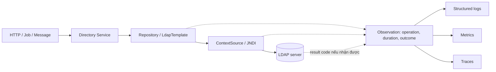
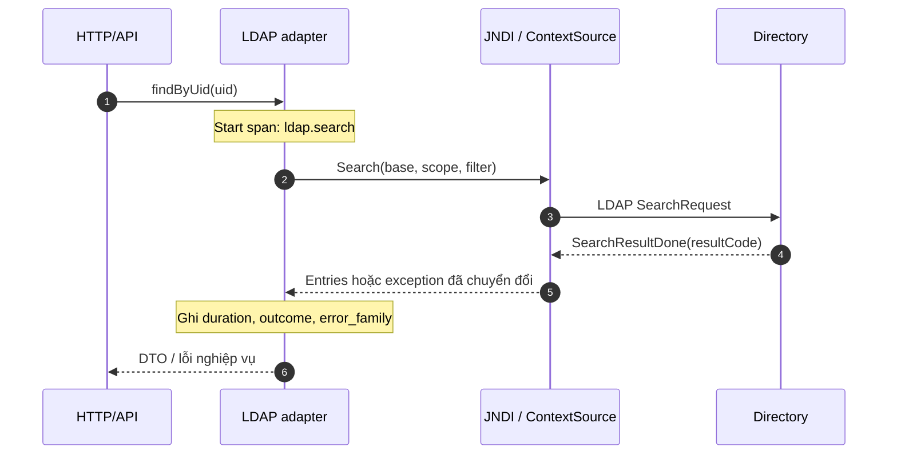

# Theo dõi lỗi theo loại thao tác và mã kết quả

Trong chương **Quan sát** của **SPRING_DATA_LDAP**, một câu log như “LDAP error” thường không đủ để xử lý sự cố. Khi ứng dụng truy cập directory qua Spring Data LDAP repository hoặc `LdapTemplate`, cần biết **thao tác nào thất bại**, **LDAP server có trả mã kết quả nào**, **lỗi xảy ra ở mạng/TLS hay ở dữ liệu và quyền**, và **ảnh hưởng thực tế tới chức năng nào**.

Ví dụ, `search` trả danh sách rỗng với mã LDAP `0 (success)` khác hoàn toàn `lookup` thất bại với `32 (noSuchObject)`. Lỗi `49 (invalidCredentials)` ở bước Bind cũng khác `50 (insufficientAccessRights)` khi ghi entry. Nếu gộp tất cả thành một bộ đếm lỗi, đội vận hành khó biết nên kiểm tra mật khẩu, base DN, ACL, schema, tốc độ directory hay kết nối mạng.

Bài này xây dựng phương pháp theo dõi lỗi **theo loại thao tác và mã kết quả**, từ kiến thức LDAP đến thiết kế log, metric, trace, cách tích hợp trong ứng dụng Java và quy trình điều tra/kiểm thử. Các ví dụ áp dụng cho một directory với entry phân cấp có DN, `objectClass` và schema, kết nối thông qua Spring LDAP và Spring Data LDAP.

## 1. Mô hình quan sát: thao tác × kết quả × ngữ cảnh

Mỗi lần gọi LDAP nên được nhìn qua ba chiều riêng biệt:

1. **Loại thao tác**: kết nối/TLS, Bind, Search, Add, Modify, Modify DN (rename/move), Delete; với ứng dụng có thể bổ sung `lookup` như một nhãn nghiệp vụ/client.
2. **Kết quả**: thành công, mã kết quả LDAP từ server, hoặc ngoại lệ phía client khi không nhận được phản hồi LDAP.
3. **Ngữ cảnh an toàn**: chức năng gọi, loại entry (người dùng/nhóm), endpoint logic, thời gian xử lý, số lần thử lại, trace ID và nhánh tìm kiếm ở dạng nhãn đã định nghĩa sẵn.



**Không phải mọi sự kiện lỗi đều có LDAP result code.** LDAP result code là phần dữ liệu trong **phản hồi LDAP**, còn DNS failure, connection refused, socket timeout, TLS handshake failure và lỗi chứng chỉ có thể xảy ra **trước khi server gửi phản hồi**. Những trường hợp này cần nhãn `result_code=unavailable` hoặc `not_applicable` theo quy ước, cùng `error_family` riêng, thay vì tự gán mã `52` hay `80`.

### 1.1. Phân biệt mức nghiệp vụ và mức giao thức

Một lần gọi `personRepository.findByUid("linh")` là **thao tác repository**. Bên dưới, Spring LDAP/JNDI có thể thực hiện một hay nhiều thao tác giao thức, tùy trạng thái kết nối và cơ chế Bind. Do đó có hai loại số liệu:

| Mức | Ví dụ | Dùng để trả lời |
| --- | --- | --- |
| **Use case / adapter** | `directory.lookup_user`, `repository.findByUid` | Chức năng người dùng có thành công không? Mất bao lâu? |
| **LDAP request/response** | `BindResponse(resultCode=49)`, `SearchResultDone(resultCode=0)` | Server trả kết quả gì cho từng thao tác thực tế? |

Đừng mặc định **một lần gọi repository = một LDAP request**. Nếu hệ thống có retry hoặc tự Bind khi tạo connection, một use case có thể sinh nhiều attempt. Metric theo use case và metric theo LDAP request đều hữu ích, nhưng phải đặt tên khác để không cộng trùng.

## 2. Gắn nhãn loại thao tác theo đúng ý nghĩa LDAP

Đề xuất tập tên nhãn hữu hạn:

| `operation` | Chức năng | Tình huống lỗi thường gặp |
| --- | --- | --- |
| `connect` | Mở socket/kết nối đến directory; là sự kiện client, không phải LDAP operation trong giao thức | DNS, timeout, connection refused |
| `start_tls` | Gửi StartTLS extended operation rồi bắt tay TLS | Server không hỗ trợ, chứng chỉ sai, handshake thất bại |
| `bind` | Xác thực bằng danh tính Bind | Credential sai, cần mức bảo mật cao hơn |
| `search` | Tìm entry theo base DN, scope và filter | Base không tồn tại, giới hạn số kết quả, thiếu quyền |
| `lookup` | Đọc một entry theo DN ở tầng Spring LDAP (thường ánh xạ tới thao tác Search) | DN không tồn tại, thiếu quyền |
| `add` | Tạo entry mới với DN/`objectClass`/thuộc tính hợp lệ | DN trùng, thiếu thuộc tính bắt buộc, thiếu quyền |
| `modify` | Thêm/thay/xóa giá trị thuộc tính | Sai schema, vi phạm ràng buộc, thiếu quyền |
| `modify_dn` | Đổi RDN hoặc chuyển DN cha | DN đích trùng, OU đích không có, ACL, quy định naming |
| `delete` | Xóa entry | Không tồn tại, còn entry con, thiếu quyền |
| `unbind` | Kết thúc phiên LDAP; không có phản hồi kết quả theo kiểu các thao tác trên | Socket/đóng kết nối phía client |

Tên thao tác là **hằng số của ứng dụng**. Không dùng `uid`, DN, hostname đầy đủ hay tên phương thức do người dùng nhập làm giá trị `operation`: chúng tạo nhãn metric có cardinality cao và có thể lộ thông tin danh bạ.

Đặc biệt, `lookup` là tên thao tác tiện dụng ở **API Spring LDAP**; ở mức LDAP wire protocol, đọc một entry thường được biểu diễn thành **Search** với base DN chính là entry và scope chỉ lấy entry đó. Nếu lập dashboard kết hợp dữ liệu client và audit log server, cần thống nhất cách ánh xạ để không tưởng nhầm `lookup` là một operation code LDAP riêng.

## 3. LDAP result code cần theo dõi

LDAP result code là một số nguyên trong phản hồi của server, được định nghĩa chủ yếu bởi LDAPv3 (RFC 4511 và các phần mở rộng). `0` là thành công; nhiều mã khác mô tả lỗi hoặc tình huống điều khiển cần xử lý. Bảng sau chọn những mã hay gặp khi triển khai Spring Data LDAP:

| Mã | Tên LDAP | Gặp ở thao tác | Cách hiểu / hướng kiểm tra |
| ---: | --- | --- | --- |
| **0** | `success` | Bind, Search, Add, Modify, Modify DN, Delete | Server hoàn tất thao tác; Search trả 0 entry vẫn có thể là mã 0 |
| **1** | `operationsError` | Nhiều loại | Server không xử lý được do điều kiện/nội bộ; kiểm tra log server |
| **2** | `protocolError` | Nhiều loại | Request không đúng giao thức hoặc server không hỗ trợ |
| **3** | `timeLimitExceeded` | Search | **Giới hạn thời gian do server áp dụng**, khác socket timeout của client |
| **4** | `sizeLimitExceeded` | Search | Kết quả vượt giới hạn; có thể đã nhận một phần entry |
| **8** | `strongerAuthRequired` | Bind/Search/Write | Server yêu cầu cơ chế xác thực mạnh hơn |
| **10** | `referral` | Search và thao tác khác | Server chuyển hướng tới directory khác; cách xử lý tùy client/referral policy |
| **11** | `adminLimitExceeded` | Search | Vượt giới hạn quản trị như tài nguyên/truy vấn của server |
| **13** | `confidentialityRequired` | Bind/Search/Write | Directory yêu cầu bảo vệ đường truyền/thông tin |
| **16** | `noSuchAttribute` | Modify | Thuộc tính/giá trị mục tiêu không tồn tại như yêu cầu |
| **19** | `constraintViolation` | Add/Modify | Giá trị vi phạm ràng buộc schema hoặc chính sách |
| **20** | `attributeOrValueExists` | Modify | Cố thêm thuộc tính/giá trị đã tồn tại |
| **21** | `invalidAttributeSyntax` | Add/Modify | Giá trị không hợp lệ theo cú pháp thuộc tính |
| **32** | `noSuchObject` | Search/Lookup/Delete/Modify | DN base hoặc DN đích không tồn tại/không thấy được trong điều kiện truy cập |
| **34** | `invalidDNSyntax` | Nhiều loại dùng DN | DN đưa vào thao tác sai cú pháp |
| **49** | `invalidCredentials` | Bind | DN/mật khẩu không đúng hoặc nguyên nhân xác thực tương đương theo server |
| **50** | `insufficientAccessRights` | Search/Add/Modify/Modify DN/Delete | Account Bind không được phép thực hiện thao tác |
| **51** | `busy` | Nhiều loại | Server bận, cân nhắc retry có kiểm soát |
| **52** | `unavailable` | Nhiều loại | Server trả rằng dịch vụ LDAP hiện không khả dụng |
| **53** | `unwillingToPerform` | Nhiều loại | Server từ chối do chính sách hoặc trạng thái; cần log chuyên biệt |
| **64** | `namingViolation` | Add/Modify DN | DN/RDN vi phạm quy tắc đặt tên |
| **65** | `objectClassViolation` | Add/Modify | `objectClass` hoặc thuộc tính bắt buộc không hợp lệ |
| **66** | `notAllowedOnNonLeaf` | Delete | Không thể xóa entry còn con theo chính sách server |
| **67** | `notAllowedOnRDN` | Modify | Cố sửa/xóa giá trị thuộc tính đang tạo RDN theo cách không hợp lệ |
| **68** | `entryAlreadyExists` | Add/Modify DN | DN đích đã được sử dụng |
| **80** | `other` | Nhiều loại | Server báo lỗi chưa phân loại; kiểm tra log/diagnostic có kiểm soát |

Không có “mã lỗi chung cho mọi kết nối LDAP”: bảng này mô tả **result code mà server đã gửi**. Ví dụ khi TCP connection refused, không có BindResponse và **không thể kết luận server đã trả 52**. Một số server còn kèm diagnostic message riêng hoặc subcode cho Bind; chúng có thể chứa thông tin nhạy cảm và không phải là mã chuẩn chung để dùng làm metric label.

### 3.1. Ba trường hợp thường gây nhầm lẫn

**Trường hợp A – Search không có kết quả nhưng vẫn thành công:**

```text
operation=search
base=ou=people,dc=example,dc=org
filter=(uid=khong-ton-tai)
entry_count=0
ldap_result_code=0
outcome=success
```

`findByUid` trả một `List` rỗng hoặc API nghiệp vụ trả “không tìm thấy”; đây không phải failure ở mức LDAP. Nếu quy tắc ứng dụng coi “không có user” là lỗi 404, hãy theo dõi riêng **business outcome**, đừng làm sai metric lỗi giao thức.

**Trường hợp B – Search bắt đầu tại base DN không tồn tại:**

```text
operation=search
base=ou=missing,dc=example,dc=org
ldap_result_code=32
outcome=error
error_family=directory_data
```

Ở trường hợp này, server báo `noSuchObject`. Cần đối chiếu `ContextSource.base`, base tương đối của query/`@Entry`, naming context thực tế và ACL; không tự quy lỗi cho sai filter.

**Trường hợp C – Request chưa tới được server:**

```text
operation=search
ldap_result_code=unavailable
outcome=error
error_family=transport_timeout
```

Đây có thể là socket timeout hoặc kết nối bị ngắt. Nó khác mã `3 timeLimitExceeded` từ server và cũng khác `52 unavailable` trong LDAP response.

## 4. Phân loại lỗi bằng hai trục thay vì một nhãn duy nhất

Mã kết quả được giữ **nguyên giá trị chuẩn** nếu biết chính xác. Ngoài ra nên gắn `error_family` để tổng hợp và cảnh báo:

| `error_family` | Nguồn tín hiệu | Ví dụ / phản ứng |
| --- | --- | --- |
| `none` | Response thành công | Mã 0; latency và số lượng kết quả vẫn cần giám sát |
| `authentication` | LDAP 49, 8 hoặc lỗi xác thực đã xác minh | Kiểm tra credential, secret rotation, Bind policy |
| `authorization` | LDAP 50 | Kiểm tra ACL theo operation, DN/OU và danh tính Bind |
| `data_or_schema` | LDAP 16, 19, 20, 21, 32, 34, 64, 65, 66, 67, 68 | Kiểm tra base DN, entry, schema, naming rule, request |
| `server_limit` | LDAP 3, 4, 11 | Rà soát base/scope/filter, giới hạn server và phân trang |
| `server_availability` | LDAP 51, 52; một số trường hợp 1/80 sau xác minh | Kiểm tra tải, listener, trạng thái directory |
| `server_policy_or_other` | LDAP 53 hoặc mã chưa phân loại | Kiểm tra chính sách và log server, không đoán trước |
| `transport` | DNS, connection refused/reset, socket timeout **không có LDAP response** | Kiểm tra mạng, endpoint, pool và timeout |
| `tls` | Handshake fail, certificate/hostname mismatch | Kiểm tra CA, chứng chỉ, TLS và StartTLS |
| `client_mapping` | Java mapper, chuyển kiểu thuộc tính, lỗi code | Kiểm tra DTO, `@Entry`/`@Attribute`, dữ liệu đa trị |
| `unknown` | Không đủ dữ kiện để xác định mã và loại | Giữ trace/log an toàn để điều tra |

Đây là **bảng phân loại do ứng dụng đề xuất**, không phải một taxonomy bắt buộc của LDAP. Không phải lúc nào một mã chỉ có một nguyên nhân: chẳng hạn `53 unwillingToPerform` có thể biểu thị chính sách server và không nhất thiết là server quá tải. Các mã `10 referral`, `14 saslBindInProgress` có ngữ nghĩa điều khiển đặc biệt; phải đánh giá quá trình hoàn chỉnh thay vì luôn xem chúng là lỗi cuối cùng.

Đề xuất ba field tách biệt:

- `ldap_result_code`: `0`, `49`, `50`, `68`... nếu **đã nhận và xác minh** từ LDAP response; `unavailable` khi không có phản hồi, `unknown` khi wrapper không lấy được mã.
- `outcome`: `success`, `error` hoặc `partial` theo cách ứng dụng định nghĩa có căn cứ. Search vượt size/time limit có thể đã nhận một phần entry nhưng không nên được đánh dấu thành công hoàn toàn.
- `error_family`: nhóm vận hành tổng hợp như `authentication`, `transport`, `data_or_schema`; dùng `none` cho thao tác thành công.

## 5. Lược đồ sự kiện dùng chung cho log, metric và trace

Một **sự kiện có cấu trúc** nên mang thông tin dễ đối chiếu, nhưng không lộ thuộc tính LDAP hoặc tạo cardinality cao:

| Field | Ví dụ | Quy tắc |
| --- | --- | --- |
| `service` | `employee-api` | Tên dịch vụ cố định |
| `operation` | `search` | Một trong tập nhãn hữu hạn |
| `resource_kind` | `person`, `group` | Loại tài nguyên do ứng dụng định nghĩa |
| `endpoint_id` | `ldap-primary` | Bí danh endpoint cố định; tránh IP/hostname tùy ý |
| `outcome` | `error` | `success`/`error`/`partial` |
| `ldap_result_code` | `50`, `unknown`, `unavailable` | Chỉ dùng số chuẩn khi có chứng cứ |
| `error_family` | `authorization` | Giá trị từ bảng phân loại hữu hạn |
| `duration_ms` | `42` | Độ trễ đo ở ranh giới xác định |
| `attempt` | `1` | Số lần thử, ưu tiên log/trace; không nhất thiết là metric label |
| `trace_id` | `f4e...` | Dùng để tìm log/trace, **không** làm metric label |
| `result_count` | `0` | Có ích cho Search; là giá trị số, **không** là nhãn theo từng số |

Ví dụ log khi server **thực sự đã trả** `50` cho một thao tác Modify:

```json
{
  "service": "employee-api",
  "operation": "modify",
  "resource_kind": "person",
  "endpoint_id": "ldap-primary",
  "outcome": "error",
  "ldap_result_code": "50",
  "error_family": "authorization",
  "duration_ms": 42,
  "attempt": 1,
  "trace_id": "7b12f8c0ab204eef",
  "message": "LDAP operation rejected"
}
```

Log không cần chứa `bindPassword`, DN người dùng, nguyên filter `(uid=...)`, `userPassword`, giá trị email, `member` đầy đủ, nội dung entry hoặc diagnostic message chưa được lọc. Những dữ liệu này có thể là thông tin cá nhân hoặc bí mật. Nếu cần phân tích một DN cụ thể, dùng **mã tham chiếu nội bộ được kiểm soát truy cập** trong log bảo mật chuyên biệt thay vì đưa toàn bộ DN vào mọi trace và metric.

## 6. Gắn đo lường tại ranh giới Spring Data LDAP

Spring Data LDAP không bảo đảm tự công bố một metric có đủ `operation` **và LDAP result code** cho mọi lời gọi repository. Hãy xác định rõ điểm instrumentation:

1. **Tầng adapter/repository-facing** đo thời gian và outcome của use case như `findByUid` hoặc `updateGroup`; tiện để biết lỗi ảnh hưởng nghiệp vụ.
2. **Tầng LDAP protocol hoặc audit log server** thu thập mã LDAP chính xác khi phản hồi thực sự có mã; kết nối với operation tương ứng bằng cách đo/ghi thống nhất.
3. **Tầng kết nối/TLS** ghi rõ sự cố không có LDAP response; không tự “điền” mã giao thức vào ngoại lệ mạng.

### 6.1. Ví dụ đo thao tác với Micrometer

Với ứng dụng có Micrometer, ta có thể bọc một lời gọi repository bằng bộ đo thời gian và counter. Ví dụ dưới đây chỉ dùng nhãn có tập giá trị hữu hạn và **không đoán mã LDAP từ exception**:

```java
import java.util.Locale;
import java.util.function.Supplier;
import io.micrometer.core.instrument.Counter;
import io.micrometer.core.instrument.MeterRegistry;
import io.micrometer.core.instrument.Timer;
import org.springframework.ldap.NamingException;
import org.springframework.stereotype.Component;

@Component
public class LdapClientMetrics {
    public enum Operation { SEARCH, ADD, MODIFY, MODIFY_DN, DELETE }

    private final MeterRegistry registry;

    public LdapClientMetrics(MeterRegistry registry) {
        this.registry = registry;
    }

    public <T> T measure(Operation operation, Supplier<T> action) {
        Timer.Sample sample = Timer.start(registry);
        String outcome = "success";
        String errorFamily = "none";

        try {
            return action.get();
        } catch (NamingException ex) {
            outcome = "error";
            errorFamily = "ldap_client_exception";
            throw ex;
        } catch (RuntimeException ex) {
            outcome = "error";
            errorFamily = "application_exception";
            throw ex;
        } finally {
            String op = operation.name().toLowerCase(Locale.ROOT);

            sample.stop(Timer.builder("directory.ldap.operation.duration")
                    .tag("operation", op)
                    .tag("outcome", outcome)
                    .tag("error_family", errorFamily)
                    .register(registry));

            Counter.builder("directory.ldap.operation")
                    .tag("operation", op)
                    .tag("outcome", outcome)
                    .tag("error_family", errorFamily)
                    .register(registry)
                    .increment();
        }
    }
}
```

Sử dụng ở ranh giới adapter (ví dụ repository có `findByUid`):

```java
// Hai dependency này được inject vào adapter bằng constructor.
List<PersonEntry> entries = ldapClientMetrics.measure(
    LdapClientMetrics.Operation.SEARCH,
    () -> personRepository.findByUid(uid)
);
```

Ví dụ minh họa cách đo **một lần gọi nghiệp vụ từ adapter**. `uid` không xuất hiện trong nhãn metric. `NamingException` ở đây là loại exception do **Spring LDAP** công bố (`org.springframework.ldap.NamingException`), không phải `javax.naming.NamingException` từ JNDI. Các lỗi LDAP/JNDI khác có thể được Spring chuyển thành lớp ngoại lệ cụ thể hoặc wrapper khác; bảng phân loại nghiệp vụ cần được hiệu chỉnh theo phiên bản thư viện và đường đi thực tế.

Đoạn code trên chỉ tạo **outcome và nhóm lỗi rộng**, chưa tạo `ldap_result_code` vì không có cơ chế chung bảo đảm lấy được số mã từ tất cả Spring LDAP exception. Một exception `AuthenticationException` có thể gợi ý lỗi Bind, nhưng **không đủ để khẳng định luôn có response code 49** nếu chưa kiểm tra phản hồi. Không lấy mã bằng cách parse chuỗi `getMessage()` tùy nhà cung cấp và không ghi nguyên message có thể chứa thông tin nhạy cảm.

Để thu mã chính xác, cần một nguồn có thể quan sát response (LDAP client/protocol instrumentation phù hợp) hoặc audit log của directory server. Khi sử dụng log server, cần cân nhắc việc ghép sự kiện request với kết quả và trace ở client; **không tự giả định** trace ID HTTP sẽ được gửi qua giao thức LDAP.

### 6.2. Đo mã kết quả khi có dữ liệu giao thức xác thực

Giả sử hệ thống có một bộ thu nhận response đã được xác minh từ server (hoặc bộ xử lý audit log directory). Khi đó có thể xuất bộ đếm theo `operation` và mã LDAP **thực sự quan sát được**:

```java
import io.micrometer.core.instrument.Counter;
import io.micrometer.core.instrument.MeterRegistry;

public final class LdapResponseMetrics {
    private final MeterRegistry registry;

    public LdapResponseMetrics(MeterRegistry registry) {
        this.registry = registry;
    }

    // Chỉ gọi khi có resultCode thực sự lấy từ LDAP response/audit.
    public void recordResponse(String knownOperation, int resultCode) {
        Counter.builder("directory.ldap.response")
            .tag("operation", knownOperation)
            .tag("result_code", Integer.toString(resultCode))
            .register(registry)
            .increment();
    }
}
```

`recordResponse` là hàm ứng dụng **tự xây**, không phải callback có sẵn tự động được `LdapTemplate` gọi. Bộ thu nhận ở ngoài phải kiểm soát `knownOperation` là một trong các tên hợp lệ và bảo đảm mỗi response chỉ được đếm một lần. Không truyền input tùy ý vào label `operation`. Nếu chưa có nguồn mã chính xác, hãy giữ metric response riêng ở trạng thái chưa triển khai thay vì dựng mã số từ suy đoán.

### 6.3. Mức tự động hóa cần kiểm tra trong dự án

Trong Spring Boot, **Actuator + Micrometer** có thể cung cấp registry và endpoint metric nếu đã cấu hình dependency/exporter. Tuy nhiên:

- `spring-boot-starter-actuator` không tự động biến mọi repository method thành metric LDAP result code.
- `@Observed`/Micrometer Observation có thể tạo span và metric cho điểm gọi được instrument, nhưng nhãn LDAP result code vẫn cần nguồn dữ liệu chuẩn để gắn vào.
- JNDI LDAP pool hoặc connection factory có thể tạo thêm Bind/StartTLS khi mượn hoặc tạo kết nối; đo riêng connection nếu cần, thay vì tính lẫn vào một thao tác Search.
- Không bật log wire toàn bộ dữ liệu LDAP ở production để lấy result code khi log đó có nguy cơ chứa mật khẩu Bind hay thuộc tính cá nhân.

## 7. Ví dụ đặt metric và dashboard

Một lược đồ tên metric có thể gồm:

| Metric logic | Loại | Labels | Ý nghĩa |
| --- | --- | --- | --- |
| `directory.ldap.operation` | Counter | `operation`, `outcome`, `error_family` | Số lần gọi adapter theo loại thao tác |
| `directory.ldap.operation.duration` | Timer | `operation`, `outcome`, `error_family` | Độ trễ của lời gọi adapter |
| `directory.ldap.response` | Counter | `operation`, `result_code` | Số phản hồi LDAP có mã được xác nhận |
| `directory.ldap.retry` | Counter | `operation`, `reason` (tập hữu hạn) | Số lần retry thực sự |
| `directory.ldap.pool.active` | Gauge (khi có pool được hỗ trợ) | `pool_id` | Số connection hoạt động |

Nếu dùng Prometheus registry, tên được chuyển đổi sang dạng Prometheus; chẳng hạn counter `directory.ldap.operation` có thể được xuất thành `directory_ldap_operation_total` và Timer `directory.ldap.operation.duration` có các chuỗi `_seconds_count`, `_seconds_sum` tương ứng. Kiểm tra **tên thực tế ở exporter**, vì quy tắc tên, suffix và cấu hình có thể khác theo registry/phiên bản.

Các truy vấn PromQL minh họa, giả sử metric trên đã được xuất đúng tên:

**Tốc độ lỗi theo thao tác trong 5 phút:**

```promql
sum by (operation) (
  rate(directory_ldap_operation_total{outcome="error"}[5m])
)
```

**Tỉ lệ lỗi của thao tác Search** (nên dùng khi lượng request đủ lớn):

```promql
sum(rate(directory_ldap_operation_total{
  operation="search",outcome="error"}[5m]))
/
clamp_min(
  sum(rate(directory_ldap_operation_total{
    operation="search"}[5m])),
  0.001
)
```

**Tốc độ LDAP response code 49 ở Bind:**

```promql
sum(rate(directory_ldap_response_total{
  operation="bind",result_code="49"}[5m]))
```

**Top mã kết quả LDAP theo operation:**

```promql
sum by (operation, result_code) (
  rate(directory_ldap_response_total[5m])
)
```

Nên bố trí dashboard theo các nhóm ô: **request rate + error rate**, **latency (p50/p95/p99 nếu Timer được cấu hình histogram/phân vị phù hợp)**, **top operation × result code**, **lỗi transport/TLS không có response**, **retry**, **trạng thái từng endpoint** và **mức độ ảnh hưởng đến API nghiệp vụ**.

Không dùng `uid`, DN, filter, email, trace ID hay error message nguyên văn làm label. Metrics có cardinality tăng theo dữ liệu người dùng sẽ tốn tài nguyên và có thể đưa dữ liệu cá nhân lên hệ thống giám sát.

## 8. Đặt cảnh báo theo loại lỗi, tránh gộp nhầm

Không phải mọi mã non-zero đều cần gọi trực vận hành. Tùy chức năng:

| Tín hiệu | Mức độ xử lý gợi ý | Hành động đầu tiên |
| --- | --- | --- |
| `search` trả mã 0 và `result_count=0` | Kết quả nghiệp vụ bình thường hoặc sự kiện cần theo dõi riêng | Kiểm tra tình huống “không tìm thấy”, không báo LDAP outage |
| `bind` mã 49 tăng đột biến | Cảnh báo credential hoặc sự kiện xác thực bất thường | Tách Bind tài khoản dịch vụ với Bind người dùng, xem thay đổi secret/chính sách |
| `modify`/`modify_dn` mã 50 tăng | Cảnh báo quyền hoặc sai luồng cập nhật | Kiểm tra danh tính Bind, OU đích, ACL và triển khai gần đây |
| `add`/`modify_dn` mã 68 tăng | Theo dõi xung đột định danh | Rà soát logic sinh DN, retry và idempotency |
| `search` mã 3/4/11 tăng | Cảnh báo truy vấn vượt hạn mức | Kiểm tra search base, scope, filter, giới hạn trả kết quả, phân trang |
| `search` mã 32 tăng | Cảnh báo thay đổi cấu trúc directory/base DN | Kiểm tra base DN, OU, ACL và naming context |
| Nhiều thao tác mã 51/52 hoặc timeout | Sự cố khả dụng của directory | Kiểm tra tải server, listener, mạng, connection pool |
| Lỗi TLS/hostname mismatch | Ưu tiên cao do nguy cơ dừng kết nối an toàn | Kiểm tra chứng chỉ, truststore và DNS; không tắt xác minh |
| `modify` mã 65 tăng | Lỗi schema hoặc code triển khai | Kiểm tra `objectClass`, thuộc tính `MUST`/`MAY`, payload |

Ví dụ tiêu chí cảnh báo *tham khảo* (phải hiệu chỉnh theo baseline thực tế): với một thao tác có đủ lưu lượng, tỉ lệ lỗi vượt **2% liên tục 10 phút** có thể là tín hiệu điều tra. Nên kết hợp **số request tối thiểu**, ảnh hưởng API và mức độ lặp lại; nếu chỉ có 1 request trong 10 phút, tỉ lệ 100% không tự động có cùng độ ưu tiên với hàng nghìn request lỗi.

Phân biệt **security alert** với **availability alert**: nhiều lần Bind thất bại mã 49 có thể là secret rotation sai, account bị khóa hoặc truy cập bất thường; không xem chúng giống hệt lỗi `52 unavailable`. Đồng thời tránh đưa UID/password vào thông báo cảnh báo.

## 9. Log và trace: đủ tìm nguyên nhân nhưng không lộ dữ liệu

Một request đi qua controller → service → repository/`LdapTemplate` → `ContextSource` → directory. Có thể tạo span ở ranh giới service hoặc adapter để thấy thời gian chờ, số lần retry và nơi phát sinh lỗi.



Những quy ước hữu ích:

- **Log ở đúng ranh giới:** ghi một event hoàn tất cho mỗi attempt hoặc lời gọi adapter, kèm `operation`/`outcome`. Tránh log lỗi trùng ở controller, service và repository nếu không cần.
- **Trace ID và request ID:** dùng để nối nhiều sự kiện trong ứng dụng. Span ở client không tự chứng minh server LDAP biết trace ID; cần cơ chế correlation nếu muốn ghép với audit log directory.
- **Phân biệt timeout:** log timeout do ứng dụng đặt, timeout socket, server `timeLimitExceeded(3)` và query vượt `sizeLimitExceeded(4)` thành các trường hợp khác.
- **Giữ nguyên thông tin về retry:** một logical request có thể có attempt 1 và 2. Ghi `attempt`, backoff và outcome cuối cùng; theo dõi riêng số lần retry và số yêu cầu thành công sau retry.
- **Không log bí mật:** không ghi password, nội dung Bind request, full DN/filter hoặc thuộc tính cá nhân theo mặc định. Khi server gửi diagnostic message, chỉ đưa bản đã qua phân loại và redaction vào hệ thống log tập trung.
- **Kiểm soát quyền xem telemetry:** các mã lỗi xác thực, top chức năng tra cứu và thời điểm thao tác có thể là dữ liệu nhạy cảm về vận hành ngay cả khi không chứa mật khẩu.

### 9.1. Vì sao không lấy nguyên exception text làm mã LDAP?

Spring LDAP thường chuyển `javax.naming.NamingException` từ JNDI thành ngoại lệ của Spring LDAP. Ngoại lệ ở tầng này hữu ích để phân loại lỗi, nhưng **không bảo đảm trường result code số nguyên chuẩn luôn được công bố**.

Ví dụ một message có thể chứa `LDAP: error code 49` trong một phiên bản provider, nhưng provider khác có thể đổi định dạng, gắn thêm subcode hoặc không đưa code vào message. Parse text làm nguồn số liệu chuẩn dễ gây **sai phân loại**, rò rỉ thông tin và hỏng khi nâng cấp thư viện. Với cơ chế không thể xác minh response, đặt `ldap_result_code=unknown` và ghi `exception_type` đã chuẩn hóa vào log là lựa chọn có thể kiểm toán.

## 10. Điều tra sự cố theo một quy trình cố định

Khi dashboard báo lỗi tăng, hãy lần lượt xác định:

1. **Lỗi xuất hiện ở operation nào?** `bind`, `search`, `modify`, `modify_dn` hay `delete`? Chỉ một operation hay mọi operation?
2. **Có nhận mã LDAP thật hay không?** Nếu không, kiểm tra DNS/TCP/TLS/connection pool trước. Nếu có mã số, phân tích theo bảng mã kết quả.
3. **Lỗi ảnh hưởng endpoint và resource_kind nào?** Chỉ nhánh `people` hay cả `groups`? Chỉ server primary hay cả các node?
4. **Tỉ lệ và phạm vi tác động?** Bao nhiêu attempt và logical request; tăng cùng deployment, secret rotation, thay đổi ACL/schema hoặc sự kiện trên directory server?
5. **Có xảy ra retry/partial result không?** Kết quả cuối cùng là thành công hay lỗi; search đã trả dữ liệu một phần nhưng bị `3`/`4` chặn chưa?
6. **Kiểm chứng với directory:** dùng test endpoint và account đúng quyền để tái hiện. Tránh thử mật khẩu thật trên LDAP không mã hóa; với simple Bind dùng LDAPS hoặc StartTLS đã xác minh.
7. **Khắc phục ở đúng lớp:** cấu hình URL/truststore cho TLS, quyền Bind cho 49/50, base/scope cho 32, schema cho 65, filter/phân trang cho 3/4/11.

### 10.1. Ba kịch bản thực tế

**Kịch bản 1 – Sau khi đổi mật khẩu tài khoản Bind, mọi thao tác Search lỗi**

Dashboard có `bind/result_code=49` tăng, trong khi server vẫn hoạt động. Xem secret rotation, cấu hình `spring.ldap.username/password`, cách tái tạo connection và tình trạng tài khoản. Không nên nới ACL hay chỉnh search base để “sửa” lỗi này.

**Kịch bản 2 – Thêm tính năng tìm nhân viên dưới OU mới nhưng không thấy dữ liệu**

Truy vấn `search` có thể trả mã `32` nếu **base DN mới không tồn tại**, hoặc mã `0` cùng `result_count=0` nếu base tồn tại nhưng scope/filter không khớp. Hai trường hợp có bước khắc phục khác nhau: kiểm tra base trước với `32`; kiểm tra scope, filter và quyền với mã 0/0 kết quả.

**Kịch bản 3 – Rename người dùng thất bại sau khi chuyển OU**

`modify_dn/result_code=68` gợi ý DN đích đã tồn tại; `50` gợi ý account Bind thiếu quyền, `64` gợi ý quy tắc naming, và `52` là server báo không khả dụng. Nếu không có response mà chỉ có timeout, không được tự kết luận rename thất bại chắc chắn: thao tác có thể đã thành công trên server rồi connection bị mất trước khi client nhận kết quả. Cần đọc **DN cũ, DN mới và định danh ổn định của entry** trước khi retry để tránh làm hỏng dữ liệu.

## 11. Kiểm thử hệ thống quan sát

Tách **kiểm thử thu thập metric** với **kiểm thử LDAP thực tế**. Unit test có thể xác nhận bộ đếm/timer và nhãn hữu hạn; nhưng muốn xác minh result code theo thao tác, cần directory test tương thích schema, ACL và khả năng cấu hình lỗi.

| Ca kiểm thử | Dữ liệu/điều kiện | Tín hiệu mong đợi |
| --- | --- | --- |
| Search tìm thấy 1 entry | Base/filter đúng | `operation=search`, `outcome=success`, mã 0 nếu có nguồn response, `result_count=1` |
| Search không thấy entry nhưng base tồn tại | Filter không khớp | Mã 0, `result_count=0`; **không** tăng metric LDAP error |
| Search với base không tồn tại | Base DN sai | Mã 32 nếu server phản hồi tương ứng |
| Bind sai credential | Account/mật khẩu sai trong môi trường test | Mã 49 khi có LDAP response; không log password |
| Modify thiếu ACL | Bind bằng account chỉ đọc | Mã 50, `operation=modify` |
| Add DN đã tồn tại | Tạo entry trùng DN | Mã 68, `operation=add` |
| Add thiếu thuộc tính MUST | Schema test directory | Mã 65 hoặc phản hồi vi phạm schema phù hợp |
| Delete entry có con | Entry không phải lá, server không cho phép | Mã 66 khi server trả lỗi này |
| Search vượt giới hạn server | Tạo đủ entry để vượt hạn mức | Mã 3/4/11 theo giới hạn áp dụng; không đánh dấu thành công hoàn toàn |
| Server dừng trước khi kết nối | TCP bị từ chối | `error_family=transport`, `ldap_result_code=unavailable` |
| Chứng chỉ không tin cậy | CA/hostname không hợp lệ | `error_family=tls`; không fallback sang kênh không mã hóa |
| Timeout sau một lần Modify DN | Mất phản hồi sau thao tác | Ghi attempt, đối soát DN trước retry, không khẳng định mã LDAP nếu không có response |

Với Micrometer, có thể dùng `SimpleMeterRegistry` trong unit test để đọc lại counter và timer sau khi gọi `measure(...)`. Kiểm tra cả đường thành công và lỗi: phải có **một lần ghi** cho mỗi attempt đã đo, không ghi credential/UID thành tag, không đánh dấu thành công khi lambda ném exception.

Trong integration test, cần kiểm tra **mã từ nguồn thực sự có khả năng lấy LDAP response**, không tạo test khớp mã “49” bằng cách hardcode nó vào mapper từ bất kỳ `AuthenticationException` nào. Nếu chỉ có Spring LDAP exception mà không có mã chuẩn, unit test nên xác nhận `error_family` và `ldap_result_code=unknown`, đồng thời ghi rõ hạn chế của nguồn quan sát.

## 12. Checklist triển khai trong ứng dụng thực

1. **Liệt kê operation** mà ứng dụng thực sự gọi: `bind`, `search`, `add`, `modify`, `modify_dn`, `delete`, cộng lỗi kết nối/TLS.
2. **Chọn ranh giới đo rõ ràng:** operation của adapter hay request/response giao thức, ghi tên metric riêng cho hai mức.
3. **Giữ result code chuẩn nếu có bằng chứng:** phân biệt `0`, `32`, `49`, `50`, `52`, `65`, `68` và các mã liên quan; không suy diễn mã từ exception mạng.
4. **Định nghĩa outcome và error_family:** tách thành công nhưng 0 entry, partial result, lỗi xác thực, lỗi phân quyền, lỗi schema và lỗi transport.
5. **Giới hạn cardinality:** chỉ dùng operation, resource_kind, endpoint_id và nhóm lỗi hữu hạn trong metric; đưa trace ID/attempt vào log hoặc trace.
6. **Bảo vệ dữ liệu:** không log mật khẩu, Bind payload, DN/filter/entry nguyên vẹn hoặc server diagnostic chưa qua xử lý.
7. **Quan sát retry và timeout:** đo latency từng attempt và kết quả cuối use case; theo dõi hành vi sau lỗi Modify/Modify DN không rõ đã thành công hay chưa.
8. **Thiết lập dashboard/cảnh báo theo operation × code:** điều chỉnh ngưỡng theo lưu lượng và mức ảnh hưởng, phân biệt sự cố hệ thống với input/nghiệp vụ thông thường.
9. **Kiểm thử trên directory:** chạy ca 0/0 entry, 32, 49, 50, 65, 68, timeout và lỗi TLS nếu có khả năng mô phỏng an toàn.
10. **Kiểm tra khi đổi thư viện hoặc server:** mapping exception, diagnostic, format log, policy referral, code và exporter metric có thể thay đổi.

## 13. Câu hỏi tự kiểm tra

1. **`findByUid` trả danh sách rỗng có phải LDAP error 32?** Không. Nếu base hợp lệ và server hoàn tất Search bình thường, kết quả 0 entry thường đi cùng LDAP result code 0.
2. **Socket timeout có luôn là LDAP result code 3 hoặc 52?** Không. `3` và `52` là mã trong phản hồi của server; timeout phía client có thể không có LDAP response.
3. **`49` và `50` khác nhau thế nào?** `49` thường xuất hiện khi Bind thất bại do thông tin xác thực; `50` thể hiện quyền truy cập không đủ cho một thao tác đã yêu cầu.
4. **Mã nào nên điều tra khi Add thất bại do DN đã tồn tại?** `68 entryAlreadyExists` nếu server trả mã này.
5. **Có được dùng DN hoặc UID làm metric tag để dễ tìm log không?** Không nên. Chúng có cardinality cao và có thể là thông tin nhạy cảm; dùng trace/log an toàn để tra cứu chi tiết.
6. **Có thể đảm bảo lấy LDAP result code chính xác từ mọi `LdapRepository` exception không?** Không. Cần xác định nguồn response thực tế; khi không có, đánh dấu `unknown` hoặc `unavailable`.
7. **Có nên retry Modify DN ngay khi bị timeout?** Không nên tự động retry mù. Phải đối soát DN cũ/mới và định danh entry trước vì server có thể đã thực hiện thao tác.
8. **Tại sao cần hai mức metric ứng dụng và LDAP response?** Một use case có thể tạo nhiều request/attempt; hai mức giúp vừa đo tác động nghiệp vụ vừa tìm nguyên nhân ở directory.

**Ghi nhớ:** Theo dõi lỗi LDAP hiệu quả cần **operation**, **mã result code thật khi có**, và **loại lỗi khi không có phản hồi**, cùng ngữ cảnh an toàn và thời gian xử lý. Trong SPRING_DATA_LDAP, hãy đặt đo lường tại adapter/`ContextSource` và kết hợp nguồn response/audit phù hợp để phân biệt Search rỗng, sai credential, thiếu quyền, vi phạm schema, xung đột DN, giới hạn server và lỗi kết nối/TLS. Giữ nhãn metric hữu hạn, không lộ dữ liệu directory, và kiểm thử bằng các tình huống lỗi thực tế.
