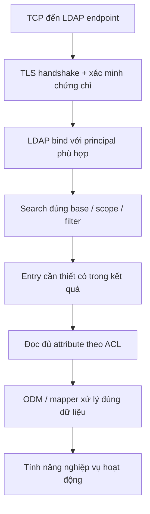
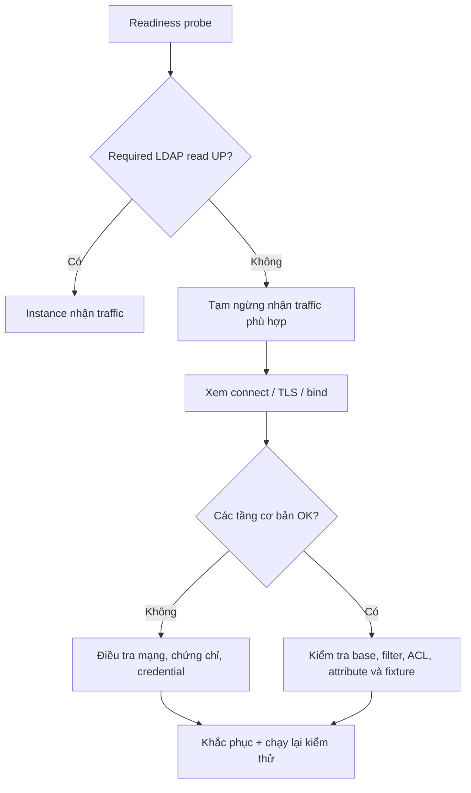

# Phân biệt health check kết nối với quyền đọc dữ liệu cần thiết

## Mục tiêu học tập

Sau bài học này, bạn có thể:

1. Phân biệt **khả năng kết nối LDAP** với **khả năng thực hiện truy vấn nghiệp vụ và đọc các attribute cần thiết**.
2. Giải thích vì sao TCP, TLS và **bind thành công** vẫn chưa chứng minh `LdapTemplate` hoặc Spring Data LDAP repository đọc được người dùng/nhóm.
3. Thiết kế một **readiness probe** dùng đúng bind identity, base DN, search scope, LDAP filter và tập attribute mà ứng dụng phụ thuộc.
4. Phân biệt liveness với readiness và chọn cách tích hợp **Spring Boot Actuator HealthIndicator** phù hợp.
5. Viết ví dụ Java kiểm tra một entry thử nghiệm cố định, không lấy dữ liệu nhạy cảm hoặc thực hiện thao tác ghi trong health check.
6. Phân loại lỗi kết nối, TLS, bind, ACL, search, mapping và dữ liệu; biết khi nào kết quả rỗng không đồng nghĩa với directory đang hoạt động tốt.
7. Kiểm thử quyền đọc trên directory thật và theo dõi metric an toàn, tránh làm quá tải LDAP server.

Bài thuộc chương **Quan sát** của module `SPRING_DATA_LDAP`. Trong module này, ứng dụng Java truy cập directory bằng repository và ánh xạ LDAP entry phân cấp sang object; việc kiểm tra sức khỏe hệ thống phải xét cả DN, `objectClass`, schema, `LdapTemplate`, CRUD, filter an toàn, quyền truy cập, kết nối bảo mật và dữ liệu thực tế.

## 1. Một kết nối LDAP khỏe chưa chắc ứng dụng hoạt động được

Giả sử dịch vụ đăng nhập nội bộ truy vấn người dùng dưới `ou=people` và sau đó tìm nhóm phân quyền dưới `ou=groups`. Một health check đơn giản báo **UP** vì TCP đến server thành công. Tuy nhiên, người dùng vẫn không đăng nhập được do tài khoản dịch vụ đã bị thu hồi quyền search trong nhánh `ou=people`.

Từ góc nhìn vận hành, hai kết luận rất khác nhau:

- **“LDAP endpoint reachable”**: ứng dụng có thể tiếp cận endpoint hoặc nhận một phản hồi từ server.
- **“Required LDAP data readable”**: bằng **chính danh tính và cấu hình đang phục vụ ứng dụng**, client có thể thực hiện truy vấn trong đúng nhánh, lọc đúng loại entry và đọc đủ các attribute cần thiết.

Để xác định loại health check, trước hết phải nói rõ **nó kiểm tra ranh giới nào**.



Không có mũi tên ngược: hoàn thành một tầng **không bảo đảm** tầng phía sau đã đúng.

### 1.1. Các cấp độ health check

| Cấp độ | Hành động ví dụ | Chứng minh được | **Không chứng minh được** |
| --- | --- | --- | --- |
| TCP/endpoint | Mở kết nối tới host/port | Endpoint có đường mạng khả dụng tại thời điểm thử | TLS, bind, ACL, schema, dữ liệu |
| TLS | Hoàn tất handshake và kiểm tra chứng chỉ | Kênh TLS được thiết lập/tin cậy theo cấu hình client | Mật khẩu bind đúng hoặc có quyền đọc |
| Bind | Tạo LDAP context với bind principal/password | Danh tính được server chấp nhận nếu bind thực sự được thực hiện | Quyền search/compare/read trong OU nghiệp vụ |
| Root DSE | Đọc một số attribute của Root DSE | Server có thể trả thông tin mô tả directory | Được đọc `uid`, `cn` hoặc `member` trong nhánh nghiệp vụ |
| Search | Tìm một entry bằng đúng base/scope/filter | Có thể thực hiện phép tìm cụ thể trong phạm vi hiện hành | Mọi attribute yêu cầu đều được trả về |
| Required-attribute read | Search và kiểm tra tập attribute cần thiết ở entry đã biết | Probe đọc được một mẫu phù hợp với nhu cầu nghiệp vụ | Mọi entry đều đọc được hoặc mọi thao tác CRUD hoạt động |
| End-to-end nghiệp vụ | Đi qua repository/ODM và quy tắc ứng dụng | Luồng được kiểm tra hoạt động với dữ liệu test | Tất cả tình huống hoặc mọi lần chạy trong tương lai |

**Tính đúng của health check luôn có phạm vi.** Một probe đọc được `cn` trong một entry mẫu chỉ chứng minh rằng **một phép đọc cụ thể** thành công. Với hệ thống nhiều OU, nhiều ACL hoặc nhiều directory, cần thêm probe phù hợp để bao phủ những dependency thật sự quan trọng.

## 2. Vì sao getReadOnlyContext() không phải kiểm tra đủ quyền đọc?

Spring LDAP cung cấp `ContextSource`, với các phương thức như `getReadOnlyContext()`, `getReadWriteContext()` và `getContext(principal, credentials)`. Implementation phổ biến là `LdapContextSource`.

Ví dụ cấu hình ứng dụng dùng tài khoản kỹ thuật:

```yaml
spring:
  ldap:
    urls: "ldaps://ldap.example.org:636"
    base: "dc=example,dc=org"
    username: "uid=ldap-reader,ou=service,dc=example,dc=org"
    password: "${LDAP_BIND_PASSWORD}"
```

Khi lấy context thành công:

```java
DirContext context = contextSource.getReadOnlyContext();
try {
    // Chỉ sở hữu context, chưa có bằng chứng
    // rằng đã search được ou=people và đọc được cn.
} finally {
    context.close();
}
```

Đây là đoạn minh họa bên trong một method Java đã khai báo/xử lý ngoại lệ JNDI khi đóng context. `ContextSource` thuộc `org.springframework.ldap.core`, còn `DirContext` thuộc `javax.naming.directory`.

Phải lưu ý:

- Tạo hoặc mượn context có thể bao gồm kết nối, TLS và bind; **provider/pool có thể trì hoãn hoặc tái sử dụng** một phần bước đó.
- Kể cả context đã bind thành công, LDAP server có thể cấp quyền tìm trong một OU nhưng **từ chối đọc attribute khác**.
- Tên `getReadOnlyContext()` mô tả mục đích thao tác ở client; **ACL trên server**, không phải tên phương thức, quyết định account có quyền đọc hay ghi.
- Context có thể dùng đúng tài khoản đọc mặc định nhưng ứng dụng thực tế còn dùng context khác cho xác thực user hoặc truy vấn nhóm. Cần probe **đúng nguồn kết nối** của luồng nghiệp vụ.

Một connection probe hữu ích cho điều tra sự cố, nhưng không nên gán cho nó ý nghĩa **“user data readable”**.

## 3. ACL có thể cho phép bind nhưng che giấu dữ liệu

Trong LDAP, **bind identity** và **access control** là hai vấn đề riêng. Một bind account có thể được xác thực hợp lệ nhưng không có quyền đối với một nhánh hoặc attribute nhất định.

Ví dụ entry:

```ldif
dn: uid=an.nguyen,ou=people,dc=example,dc=org
objectClass: top
objectClass: person
objectClass: organizationalPerson
objectClass: inetOrgPerson
uid: an.nguyen
cn: An Nguyen
sn: Nguyen
mail: an.nguyen@example.org
```

Giả sử ứng dụng cần tìm bằng `uid` và hiển thị `cn`. Tùy directory server và quy tắc ACL:

1. Account có thể **bind** nhưng không được duyệt/search dưới `ou=people`.
2. Account có thể search theo `uid` nhưng **không được đọc `cn`**.
3. Một phần entry có thể được thấy nhưng những attribute bị che giấu không xuất hiện trong kết quả.
4. Server có thể trả **không tìm thấy**, kết quả rỗng hoặc một lỗi LDAP cụ thể cho truy vấn bị hạn chế; không mặc định mọi ACL denial đều tạo một exception giống nhau.
5. Account có thể đọc `ou=people` nhưng không được search `groupOfNames.member` trong `ou=groups` — khi đó xác thực có thể thành công nhưng phân quyền theo nhóm thất bại.

### 3.1. Search đúng nhưng attribute thiếu

Xem hai tình huống:

| Kết quả search | Diễn giải an toàn |
| --- | --- |
| Có entry và đầy đủ `uid`, `cn` | Probe đọc được các attribute cụ thể trên entry đó |
| Có entry nhưng `cn` bị thiếu | Có thể do ACL, dữ liệu không hợp lệ, chọn sai attribute hoặc mapping; **không kết luận sức khỏe dữ liệu là UP** |
| Không có entry | Có thể thiếu fixture, sai base/filter, ACL hoặc server thực sự không có entry |
| Có lỗi timeout/communication | Không có kết quả đầy đủ đáng tin; đây không phải tình huống “user không tồn tại” |
| Có entry nhưng mapper không đổi được kiểu | Lỗi mapping/schema/codec, dù kết nối và ACL có thể ổn |

Đặc biệt, một LDAP client có thể được phép dùng một attribute trong **filter** nhưng không được phép trả attribute đó về cho ứng dụng. Vì thế health check phải **yêu cầu rõ tập attribute cần thiết**, không chỉ kiểm tra số lượng kết quả.

## 4. Tập dữ liệu nào nên dùng để kiểm tra quyền đọc?

Health check không nên phụ thuộc vào một user thật bất kỳ vì người đó có thể được khóa, đổi tên, chuyển OU, xóa hoặc bị thay đổi quyền riêng. Thay vào đó, khi chính sách directory cho phép, hãy tạo **một entry kiểm thử cố định** trong nhánh mà ứng dụng thực sự cần đọc.

Ví dụ:

```ldif
dn: uid=ldap-probe,ou=people,dc=example,dc=org
objectClass: top
objectClass: person
objectClass: organizationalPerson
objectClass: inetOrgPerson
uid: ldap-probe
cn: LDAP Read Probe
sn: Probe
```

Entry chỉ chứa **dữ liệu giả, không có mật khẩu** và không cần được sử dụng để đăng nhập. Tài khoản dịch vụ có quyền đọc `uid` và `cn` trên entry theo chính sách giống vùng dữ liệu ứng dụng.

Điều kiện probe có thể là:

```text
Base DN: dc=example,dc=org
Search base: ou=people
Scope: subtree
Filter: (&(objectClass=inetOrgPerson)(uid=ldap-probe))
Required attributes: uid, cn
Expected cardinality: exactly 1 entry
```

**Một probe tốt có hợp đồng cụ thể:** lấy được đúng một entry kiểm thử và đọc được đủ các attribute bắt buộc. Nếu có 0 entry hoặc 2 entry, đó không phải kết quả lành mạnh của hợp đồng đang kiểm tra.

### 4.1. Không để probe đặc biệt đến mức mất giá trị

Nếu quản trị viên cấp một ACL riêng chỉ cho tài khoản dịch vụ đọc `ldap-probe` nhưng không được đọc người dùng thật, health check vẫn báo UP. Do đó:

- Đặt probe ở **cùng vùng bảo vệ** với những entry nghiệp vụ quan trọng.
- Dùng **cùng bind identity** với repository/`LdapTemplate` đang phục vụ ứng dụng.
- Kiểm tra đúng **attribute thực sự cần đọc**; đọc mỗi `objectClass` không đủ cho ứng dụng cần `mail` hoặc `member`.
- Với những quyền khác nhau giữa `ou=people` và `ou=groups`, cần **probe riêng cho mỗi khả năng quan trọng** hoặc một phép đo hợp đồng phối hợp.
- Không dùng probe đọc để kết luận có quyền tạo, sửa, xóa hoặc rename; những quyền đó cần kiểm thử tích hợp có kiểm soát.

Nếu không thể tạo entry probe, có thể chọn một entry cấu hình đã tồn tại và được quản trị ổn định, nhưng phải chấp nhận rủi ro vận hành khi entry bị thay đổi. Không nên dùng dữ liệu cá nhân làm “sentinel” nếu có lựa chọn ít nhạy cảm hơn.

## 5. Ví dụ: HealthIndicator kiểm tra đọc dữ liệu bằng LdapTemplate

Trong Spring Boot, **Actuator** hỗ trợ `HealthIndicator` để đóng góp kết quả health cho các nhóm như readiness. Dưới đây là ví dụ chỉ-đọc, sử dụng `LdapTemplate` và truy vấn có giá trị tĩnh, không thực hiện cập nhật LDAP.

Giả định:

- Ứng dụng dùng Spring Boot cùng `spring-boot-starter-actuator` và Spring LDAP.
- `LdapTemplate` được inject và thực sự trỏ tới directory/cấu hình cần giám sát.
- `ContextSource` có base DN `dc=example,dc=org`.
- Entry `uid=ldap-probe,ou=people,...` đã được tạo trong directory test/production theo quy trình quản trị.
- Build dùng Java 17+; class là ví dụ độc lập trong một file Java.

```java
import java.util.List;
import javax.naming.directory.Attribute;

import org.springframework.boot.actuate.health.Health;
import org.springframework.boot.actuate.health.HealthIndicator;
import org.springframework.ldap.core.AttributesMapper;
import org.springframework.ldap.core.LdapTemplate;
import org.springframework.ldap.query.SearchScope;
import org.springframework.stereotype.Component;

import static org.springframework.ldap.query.LdapQueryBuilder.query;

@Component("ldapRequiredRead")
public final class LdapRequiredReadHealthIndicator
        implements HealthIndicator {

    private final LdapTemplate ldapTemplate;

    public LdapRequiredReadHealthIndicator(
            LdapTemplate ldapTemplate) {
        this.ldapTemplate = ldapTemplate;
    }

    @Override
    public Health health() {
        try {
            List<Boolean> matches = ldapTemplate.search(
                query()
                    .base("ou=people")
                    .searchScope(SearchScope.SUBTREE)
                    .attributes("uid", "cn")
                    .where("objectClass").is("inetOrgPerson")
                    .and("uid").is("ldap-probe"),
                (AttributesMapper<Boolean>) attributes ->
                    hasValue(attributes.get("uid"))
                    && hasValue(attributes.get("cn"))
            );

            boolean readable =
                matches.size() == 1 && Boolean.TRUE.equals(matches.get(0));

            if (readable) {
                return Health.up()
                    .withDetail("capability", "people-required-read")
                    .build();
            }

            return Health.down()
                .withDetail("reason",
                    "probe-entry-or-required-attribute-unavailable")
                .build();

        } catch (RuntimeException ex) {
            // Không đưa exception message, DN hay secret ra health JSON.
            // Log lỗi nội bộ với chính sách phân loại/redaction phù hợp.
            return Health.down()
                .withDetail("reason", "ldap-read-probe-failed")
                .build();
        }
    }

    private static boolean hasValue(Attribute attribute) {
        return attribute != null && attribute.size() > 0;
    }
}
```

### 5.1. Vì sao kết quả phải kiểm tra cả số entry và attribute?

Trong ví dụ:

- `where("objectClass").is("inetOrgPerson")` xác định đúng loại entry.
- `and("uid").is("ldap-probe")` xác định sentinel đã được quản trị.
- `base("ou=people")` chỉ đúng nhánh với quy ước DN tương đối của `ContextSource`.
- `attributes("uid", "cn")` yêu cầu cả hai attribute cần thiết, không chỉ có sự hiện diện của entry.
- `hasValue(...)` yêu cầu attribute tồn tại và có giá trị; nếu `cn` bị ẩn hoặc trống, probe trả DOWN.
- `matches.size() == 1` tránh coi dữ liệu trùng hoặc kết quả không rõ ràng là thành công.
- `Health.down()` diễn đạt rằng **khả năng đọc dữ liệu thiết yếu của luồng này chưa đáp ứng hợp đồng**, không nhất thiết server LDAP đã tắt.

`LdapQueryBuilder` xử lý việc tạo LDAP filter/escape giá trị; không nối raw username vào filter. Ở ví dụ, giá trị `ldap-probe` là constant, vừa an toàn vừa tránh tạo query khác nhau theo từng request sức khỏe.

**Lưu ý về exception:** Code bắt `RuntimeException` ở ranh giới HealthIndicator để tránh phản hồi sức khỏe bị vỡ bởi lỗi bên ngoài; trong hệ thống thật, cần phân loại exception nội bộ (network, TLS, bind, ACL, mapping, bug) và giám sát lỗi không mong đợi. Không ghi nguyên message có thể chứa DN, filter hoặc thông tin nhạy cảm vào HTTP health response.

### 5.2. Kết quả UP có ý nghĩa gì?

UP có thể diễn giải chính xác như sau:

> Trong thời điểm kiểm tra, `LdapTemplate` được cấu hình đã tìm đúng một entry `ldap-probe` trong phạm vi chỉ định và đọc được các attribute `uid`, `cn`.

UP **không** có nghĩa:

- Tất cả user trong `ou=people` đều đọc được.
- Mọi group trong `ou=groups` đều tra cứu được.
- Mọi user có thể đăng nhập bằng mật khẩu của họ.
- Tài khoản service có quyền ghi LDAP.
- Mọi replica hoặc mọi server URL đều sẵn sàng.
- Các repository query phức tạp, mapper ODM hoặc business logic khác đều đã được kiểm chứng.

Nếu nghiệp vụ phụ thuộc thêm `member` và `cn` trong group entry, hãy thiết kế phép kiểm tra group dưới `ou=groups` bằng chính filter/ACL tương ứng.

## 6. Tích hợp probe vào Spring Boot Actuator readiness

Một ứng dụng cần tách hai khái niệm:

- **Liveness:** tiến trình ứng dụng còn hoạt động, có thể tiếp tục xử lý hay cần khởi động lại? Lỗi LDAP bên ngoài thường **không phải** bằng chứng JVM bị hỏng.
- **Readiness:** instance có đang đủ điều kiện **nhận lưu lượng của tính năng bắt buộc** hay không? Nếu hệ thống không thể phục vụ vì không đọc được directory, readiness có thể báo không sẵn sàng.

Với Spring Boot Actuator và health probes đã bật, một cấu hình có thể là:

```yaml
management:
  endpoint:
    health:
      probes:
        enabled: true
      group:
        readiness:
          include: "readinessState,ldapRequiredRead"
```

Với bean `@Component("ldapRequiredRead")` ở mục trên, contributor ID dùng trong nhóm readiness là `ldapRequiredRead`. Cấu hình và health group cần được đối chiếu với **phiên bản Spring Boot** và cách triển khai các endpoint của dự án.

Thường có các endpoint theo nhóm:

```text
/actuator/health
/actuator/health/liveness
/actuator/health/readiness
```

Đường dẫn còn phụ thuộc cấu hình Actuator (base path, exposure, security, probes). Không mặc định các endpoint đã được mở công khai.

### 6.1. Không đưa LDAP vào liveness một cách máy móc

Giả sử LDAP server mất kết nối 30 giây. Nếu liveness của mỗi ứng dụng phụ thuộc vào LDAP, orchestrator có thể liên tục **restart nhiều instance** cùng lúc, trong khi restart JVM không thể sửa outage của directory. Hiện tượng này còn có thể làm tăng tải kết nối khi server hồi phục.

Chọn readiness theo dependency **thực sự bắt buộc**:

| Tình huống | Quyết định gợi ý |
| --- | --- |
| API chỉ thực hiện tra cứu LDAP, không thể phục vụ khi directory lỗi | Readiness nên phản ánh không đọc được LDAP |
| Dịch vụ còn có chức năng không phụ thuộc LDAP | Cân nhắc readiness toàn service và khả năng degradation theo sản phẩm |
| Tính năng LDAP là tùy chọn, có cache đã được phê duyệt | Không nhất thiết đưa mọi lỗi LDAP vào readiness toàn bộ instance |
| Directory không sẵn sàng tạm thời nhưng JVM vẫn khỏe | Liveness có thể tiếp tục UP; không restart chỉ vì phụ thuộc ngoài |
| Ứng dụng đang khởi tạo/migrate dữ liệu bắt buộc | Readiness có thể chưa UP cho tới khi điều kiện nền tảng đạt |

Không có một health group duy nhất đúng cho mọi kiến trúc. **Health check là quyết định về khả năng phục vụ lưu lượng**, không chỉ là một phép thử mạng.

### 6.2. Built-in LDAP indicator có thay thế probe nghiệp vụ không?

Tùy dependency, phiên bản Spring Boot và điều kiện auto-configuration, Actuator có thể cung cấp **LDAP health indicator** mặc định. Indicator đó hữu ích cho một phần kiểm tra kết nối/truy vấn chung, nhưng không nên mặc định rằng nó:

- Search đúng `ou=people` với `uid`.
- Kiểm tra quyền đọc `cn` hay `mail` mà business cần.
- Kiểm tra group membership theo `groupOfNames.member`.
- Phản ánh đúng tài khoản bind và `ContextSource` chuyên biệt đang được repository sử dụng.
- Bao phủ nhiều directory source hoặc nhiều permission scopes.

Hãy đọc **hợp đồng và hành vi của indicator đang chạy**. Có thể giữ indicator mặc định để quan sát kết nối và thêm **readiness capability probe** như ví dụ; tránh báo hai kết quả có tên giống nhau nhưng ý nghĩa không được giải thích.

## 7. Một ứng dụng có thể cần nhiều loại probe

Ví dụ sản phẩm có hai chức năng:

1. **Đọc hồ sơ người dùng** từ `ou=people`: filter theo `uid` và cần `cn`, `mail`.
2. **Tính role** từ nhóm `groupOfNames` ở `ou=groups`: filter `member=<full-user-DN>` và đọc `cn` của group.

Một probe chỉ kiểm tra people sẽ bỏ sót vấn đề ACL ở groups.

| Tính năng | Base và filter mẫu | Attribute cần đọc | Sai lệch có thể gặp |
| --- | --- | --- | --- |
| Hồ sơ | `ou=people`, `(uid=ldap-probe)` | `uid`, `cn`, `mail` (nếu bắt buộc) | Service account bị ẩn `mail` |
| Nhóm quyền | `ou=groups`, `(member=<DN-probe>)` | `cn` và khả năng search/filter `member` | Account không thể tra nhóm dù người dùng vẫn đọc được |
| Tìm cấu trúc OU | OU cấu hình riêng | `ou`, `objectClass` | Base đã bị đổi hoặc entry OU bị xóa |
| Ghi dữ liệu | Create/modify/delete theo DN và schema | Quyền ghi, naming rule | **Không test ghi trong health thường xuyên**; dành cho integration test/canary được kiểm soát |

### 7.1. Khi kiểm tra group membership

Một group sentinel có thể dùng dữ liệu giả:

```ldif
dn: cn=ldap-probe-readers,ou=groups,dc=example,dc=org
objectClass: top
objectClass: groupOfNames
cn: ldap-probe-readers
member: uid=ldap-probe,ou=people,dc=example,dc=org
```

Nếu tính năng thực sự dựa vào việc **search group bằng `member`**, readiness probe cho nhóm nên sử dụng truy vấn tương ứng và kiểm tra đọc được `cn` của group. Một probe chỉ `lookup` group theo DN có thể thành công **trong khi search qua `member` không được ACL cho phép**.

Đừng coi `memberOf` trên user là sự thay thế phổ quát. Attribute này có thể do server/plugin cung cấp, không tồn tại ở mọi LDAP directory và có hành vi khác với việc tìm trực tiếp `groupOfNames.member`.

## 8. Đo và diễn giải kết quả quan sát

Health status là tín hiệu tổng hợp, nhưng để xử lý sự cố cần cả số liệu **độ trễ**, **loại lỗi** và **phạm vi quyền**.

### 8.1. Các metric hợp lý

| Metric | Câu hỏi | Tag nên có |
| --- | --- | --- |
| `ldap_connect_probe_total` | Có thể liên lạc endpoint? | `outcome=success/failure` |
| `ldap_bind_probe_total` | Bind identity mặc định có được chấp nhận? | `outcome`, `error_class` được chuẩn hóa |
| `ldap_required_read_probe_total` | Có đọc được đúng dữ liệu yêu cầu? | `capability=people/groups`, `outcome` |
| `ldap_required_read_duration_seconds` | Probe nghiệp vụ tốn bao lâu? | `capability`, `outcome` |
| `ldap_search_errors_total` | Search lỗi vì network, ACL, filter hay mapper? | Nhóm lỗi có cardinality thấp |
| `ldap_probe_up` | Năng lực yêu cầu đang ở trạng thái tốt? | Tên năng lực đã định nghĩa, không dùng DN cá nhân |

Các tên trên là **đề xuất metric ứng dụng**, không phải lời khẳng định Spring Boot tự tạo toàn bộ metric đó. Có thể sử dụng Micrometer `Counter`/`Timer` hoặc metrics của platform đang dùng.

**Không đặt** full DN, `uid`, email, password, filter kèm dữ liệu người dùng hoặc hostname chứa dữ liệu nhạy cảm vào metric tags. Sử dụng một tập label cố định như `capability=people-read`, `cause=bind|timeout|acl|mapping|missing-probe` theo phân loại an toàn.

### 8.2. Một kết quả DOWN không nói toàn bộ nguyên nhân

Ví dụ:

```text
ldap.connection:         UP
ldap.bind:               UP
ldap.people.requiredRead: DOWN
ldap.groups.requiredRead: UP
```

Kết quả gợi ý **tập trung kiểm tra nhánh people**: search base, ACL của `uid`/`cn`, entry probe và mapping. Không bắt đầu bằng cách thay mật khẩu bind khi probe bind đang thành công.

Ngược lại:

```text
ldap.connection:         DOWN
ldap.bind:               UNKNOWN / NOT_RUN
ldap.people.requiredRead: UNKNOWN / NOT_RUN
```

Trong hệ thống quan sát có nhiều probe riêng, có thể đánh dấu những tầng phía sau là **chưa chạy** thay vì tạo thêm vô số lỗi “mất quyền” khi không thể mở kết nối. Với `HealthIndicator` đơn lẻ, ví dụ ở mục 5 chủ động trả DOWN nếu không thực hiện được phép đọc; dashboard có thể phân loại kỹ hơn.

### 8.3. Giới hạn tải của readiness probe

Health endpoint có thể được gọi mỗi vài giây bởi nhiều instance và load balancer. Nếu mỗi lần chạy một search rộng trên LDAP, chính probe có thể trở thành nguồn tải lớn.

Giảm chi phí bằng cách:

- Dùng **entry kiểm thử có filter rất chọn lọc**, được server index phù hợp.
- Chỉ yêu cầu attribute cần thiết và giới hạn scope.
- Đặt timeout phù hợp với mục đích readiness và khả năng directory.
- Quy định tần suất probe, tránh retry đồng loạt và tránh lặp nhiều health endpoint không cần thiết.
- Nếu có cache kết quả health với TTL nhỏ, phải hiểu độ trễ phát hiện sự cố và yêu cầu freshness.
- Phối hợp với quản trị LDAP để tránh thăm dò cường độ cao trong giờ tải nặng.

Đừng thực hiện thao tác write, đổi mật khẩu hay thử hàng loạt credential trong health check thông thường.

## 9. Các lỗi thường gặp và cách nhận diện

| Hiện tượng | Diễn giải khả dĩ | Kiểm tra tiếp theo |
| --- | --- | --- |
| Port 636 mở nhưng ứng dụng không kết nối được | TLS truststore/hostname/protocol lỗi | Xem TLS handshake và chứng chỉ được xác minh |
| Lấy `ContextSource` thành công nhưng query rỗng | Sai base/scope/filter, ACL, fixture bị xóa hoặc nhánh sai | Đối chiếu truy vấn bằng chính bind identity |
| Bind bằng reader account thành công nhưng thiếu `cn` | ACL attribute hoặc mapping/returning attributes | Search yêu cầu `cn`, so sánh với data/schema |
| Root DSE trả kết quả, nhưng `ou=people` không đọc được | Root DSE thường có quyền đọc khác nhánh nghiệp vụ | Probe trực tiếp trong nhánh và scope phù hợp |
| Một người dùng đọc được nhưng nhóm không có | `member` không search được hoặc `ou=groups` ngoài quyền | Kiểm tra group search base, ACL, schema |
| Repository trả object nhưng field null | Attribute không trả, tên Java/LDAP mapping sai hoặc converter lỗi | Kiểm tra `@Attribute(name=...)` và dữ liệu đọc thực |
| Readiness UP nhưng một số user vẫn không truy cập được | Sentinel có quyền khác entry khác, ACL từng OU hoặc dữ liệu không đồng đều | Thêm test quyền đại diện/đối soát định kỳ |
| Probe DOWN khi entry bị rename | Probe phụ thuộc DN/uid không được quản trị ổn định | Quản trị fixture và hợp đồng sentinel |
| Liveness DOWN khi LDAP mất mạng | Trộn dependency ngoài vào liveness | Chuyển LDAP availability sang readiness/indicator phù hợp |
| Log health response chứa full filter/password | Ghi debug quá chi tiết hoặc trả exception message ra Actuator | Redact, bảo vệ endpoint và chỉ xuất trạng thái tổng hợp |
| Health endpoint gây tăng tải LDAP | Search rộng, tần suất cao, nhiều instance cùng poll | Dùng filter chọn lọc, giảm tần suất, giới hạn timeout |

## 10. Kiểm tra độc lập bằng ldapsearch

Một cách hữu ích để tách vấn đề Spring khỏi LDAP là thử **cùng tài khoản dịch vụ** bằng client độc lập trong môi trường được phép.

### 10.1. Root DSE / kết nối cơ bản

```bash
ldapsearch -LLL -x \
  -H "ldaps://ldap.example.org:636" \
  -D "uid=ldap-reader,ou=service,dc=example,dc=org" -W \
  -b "" -s base "(objectClass=*)" \
  namingContexts supportedLDAPVersion
```

Kết quả này có thể chứng minh server trả Root DSE theo quyền hiện hành, **nhưng không kiểm tra được quyền đọc người dùng dưới `ou=people`**.

### 10.2. Search entry và attribute cần thiết

```bash
ldapsearch -LLL -x \
  -H "ldaps://ldap.example.org:636" \
  -D "uid=ldap-reader,ou=service,dc=example,dc=org" -W \
  -b "ou=people,dc=example,dc=org" -s sub \
  "(&(objectClass=inetOrgPerson)(uid=ldap-probe))" \
  dn uid cn
```

Quan sát:

- Có **đúng một** entry `uid=ldap-probe`?
- Attribute `uid` và `cn` có được trả về?
- Search có trả lỗi ACL/referral/size limit không?
- Dùng cùng server/port và principal như ứng dụng chưa?
- Truy vấn là subtree search đúng như code đang chạy chưa?

`-W` yêu cầu nhập mật khẩu tương tác, tránh đặt password vào command hoặc shell history. Địa chỉ và DN ở ví dụ là giả định. Không thực hiện kiểm thử trên directory production ngoài phạm vi cho phép.

**Lưu ý:** Client CLI có thể dùng truststore/certificate configuration khác JVM. `ldapsearch` thành công chưa chắc Java TLS cũng thành công; cần kiểm tra cả hai môi trường.

## 11. Kiểm thử tích hợp của readiness probe

Unit test với Mockito có thể kiểm tra logic phân nhánh của `HealthIndicator`, nhưng **không xác nhận được server LDAP thật cho phép search hoặc đọc attribute**. Do đó phải có integration test trên directory có schema và ACL giống nhu cầu.

### 11.1. Dữ liệu thử nghiệm

Tạo test tree:

```ldif
dn: dc=example,dc=org
objectClass: top
objectClass: domain
dc: example

dn: ou=people,dc=example,dc=org
objectClass: top
objectClass: organizationalUnit
ou: people

dn: uid=ldap-probe,ou=people,dc=example,dc=org
objectClass: top
objectClass: person
objectClass: organizationalPerson
objectClass: inetOrgPerson
uid: ldap-probe
cn: LDAP Read Probe
sn: Probe
```

Tài khoản `ldap-reader` và quyền ACL được cấu hình riêng theo server thử nghiệm. Không lấy thông tin cá nhân thật hoặc mật khẩu thật đưa vào fixture.

### 11.2. Ví dụ JUnit với Spring Boot

```java
import static org.junit.jupiter.api.Assertions.assertEquals;

import org.junit.jupiter.api.Test;
import org.springframework.beans.factory.annotation.Autowired;
import org.springframework.beans.factory.annotation.Qualifier;
import org.springframework.boot.actuate.health.HealthIndicator;
import org.springframework.boot.actuate.health.Status;
import org.springframework.boot.test.context.SpringBootTest;
import org.springframework.test.context.ActiveProfiles;

@SpringBootTest
@ActiveProfiles("test")
class LdapRequiredReadIntegrationTest {

    @Autowired
    @Qualifier("ldapRequiredRead")
    HealthIndicator ldapReadHealth;

    @Test
    void probeIsUpWhenRequiredAttributesAreReadable() {
        assertEquals(Status.UP, ldapReadHealth.health().getStatus());
    }
}
```

Test cần chạy với profile `test` trỏ đến LDAP server test có seed đúng entry `ldap-probe`. Tránh cấu hình test trỏ nhầm production. Kỳ vọng trạng thái DOWN nên được thử trong môi trường riêng với ACL cố ý ẩn `cn` hoặc search base không hợp lệ.

### 11.3. Ma trận tình huống kiểm thử

| Tình huống | Kết quả mong đợi | Điều đang kiểm tra |
| --- | --- | --- |
| Server LDAPS hợp lệ, account được đọc `uid` và `cn` | Required-read UP | Quyền đọc thiết yếu của probe |
| TCP có nhưng TLS certificate không được tin | DOWN | Không vượt qua lỗi TLS |
| TLS thành công, password reader sai | DOWN | Bind không đủ |
| Reader bind được nhưng không được search `ou=people` | DOWN | ACL search/base |
| Search tìm entry nhưng `cn` bị ẩn | DOWN | Không chỉ đếm entry, phải đọc attribute |
| Entry sentinel bị xóa hoặc chuyển OU | DOWN | Hợp đồng dữ liệu probe |
| Hai entry khớp `uid=ldap-probe` trong scope | DOWN | Kết quả phải không mơ hồ |
| Search people được, search groups bị ACL từ chối | People UP, groups DOWN | Tách quyền theo capability |
| Directory chỉ cho đọc Root DSE | Connect/rootDSE có thể UP, required-read DOWN | Phân biệt kiểm tra chung và nghiệp vụ |
| `LdapTemplate` inject nhầm context source | Có thể UP/DOWN sai với hệ thống mong muốn | Kiểm tra wiring và URL/base/principal thực |
| Nhiều instance cùng health probe | Không gây quá tải | Tần suất, index, timeout, pool |
| LDAP tạm mất mạng | Readiness DOWN nếu LDAP thiết yếu; liveness vẫn độc lập | Chính sách điều phối dịch vụ |

Cần bảo đảm một test có trạng thái DOWN do **đúng nguyên nhân dự kiến**, không chỉ vì test directory chưa chạy hoặc TLS thiết lập sai. Với phân quyền nhạy cảm, kiểm tra thêm luồng end-to-end qua repository/ODM hoặc Spring Security LDAP để không bỏ sót logic ngoài probe.

## 12. Thiết kế vận hành: thông báo và phản ứng khi probe thất bại

Một quy trình vận hành có thể định nghĩa như sau:



Một số quy tắc quan trọng:

1. **Không tự tạo lại user/group hoặc nới ACL** chỉ vì health check báo DOWN; đó là thao tác quản trị cần chính sách, bằng chứng và quyền tương ứng.
2. Nếu LDAP là dependency toàn hệ thống đang outage, nhiều instance báo readiness DOWN cùng lúc là điều có thể dự đoán. Cần có chiến lược graceful degradation, cache được phép dùng hoặc điều phối lưu lượng cho sản phẩm.
3. Đặt ngưỡng cảnh báo dựa trên thời gian lỗi kéo dài/tỷ lệ lỗi, tránh paging khi một lần probe chập chờn.
4. Health endpoint và log phải hạn chế lộ thông tin: chỉ xuất loại năng lực và lý do tổng quát, không xuất DN, credentials hay full query.
5. Sau khi sửa ACL hoặc truststore, **xác minh lại truy vấn nghiệp vụ**; trạng thái kết nối xanh không đủ để đóng incident.
6. Nếu có nhiều naming context, replica, OU hoặc nguồn dữ liệu, nên mô hình hóa rõ từng capability cần thiết thay vì chỉ có một nhãn “LDAP up”.

## 13. Bài thực hành

Một dịch vụ có:

```yaml
spring:
  ldap:
    urls: "ldaps://ldap.lab.example.org:636"
    base: "dc=lab,dc=example,dc=org"
    username: "uid=reader,ou=service,dc=lab,dc=example,dc=org"
    password: "${LDAP_BIND_PASSWORD}"
```

Ứng dụng phải tìm user dưới `ou=people` bằng `uid`, đọc `cn` và tra nhóm trực tiếp `groupOfNames` theo `member` dưới `ou=groups`.

**Câu 1.** Một lệnh mở kết nối TCP tới cổng 636 thành công. Có thể kết luận người dùng sẽ hiển thị đúng tên không?

**Câu 2.** `getReadOnlyContext()` trả context thành công. Đã đủ chứng minh tài khoản `reader` có thể đọc `cn` chưa?

**Câu 3.** Search tìm được entry `uid=ldap-probe` nhưng trả `uid` mà không có `cn`. Readiness dành cho tính năng hiển thị tên nên là gì?

**Câu 4.** People probe UP nhưng group probe DOWN. Có nên kết luận toàn bộ LDAP server bị tắt không?

**Câu 5.** Khi LDAP mất mạng, vì sao thường không nên cho liveness thất bại để restart liên tục?

**Câu 6.** Chỉ một sentinel entry đủ chứng minh mọi entry trong directory được account đọc được hay không?

**Câu 7.** Nếu health check cần bảo đảm search group theo `member`, kiểm tra `lookup` theo DN của group có đủ không?

### Gợi ý đáp án

- **1. Không.** TCP reachable chưa kiểm tra TLS, bind, ACL, search, attribute `cn` hoặc mapping.
- **2. Không.** Tạo context/bind chỉ xác minh kết nối và xác thực đến phạm vi nhất định; ACL cho search/read `cn` là điều kiện khác.
- **3. DOWN** cho readiness của khả năng đọc `cn` bắt buộc, kể cả entry vẫn tồn tại.
- **4. Không.** Điều này có thể phản ánh ACL, base/scope, schema hoặc cấu hình riêng của nhóm; kết nối chung vẫn có thể khỏe.
- **5.** Restart JVM không sửa directory outage, còn tạo thêm tải kết nối và vòng restart không cần thiết.
- **6. Không.** Sentinel chỉ là mẫu; cần thiết kế ACL đại diện và test bổ sung theo từng capability/phạm vi thực.
- **7. Không.** Lookup theo DN không chứng minh tài khoản có thể lọc `member`; phải thực hiện đúng phép search theo member mà nghiệp vụ sử dụng.

## 14. Ghi nhớ cốt lõi

**Health check kết nối và health check quyền đọc dữ liệu cần thiết trả lời hai câu hỏi khác nhau.** TCP, TLS và bind thành công là nền tảng, nhưng **không chứng minh** dịch vụ có thể search đúng nhánh hoặc nhận đủ attribute theo ACL. Với Spring Data LDAP, readiness chỉ phản ánh đúng khả năng phục vụ nếu probe kiểm tra **cùng ContextSource/bind identity, base DN, filter, scope và attribute** mà nghiệp vụ thật cần.

- Dùng **probe entry ổn định, dữ liệu giả** và kiểm tra đúng một kết quả có attribute cần thiết.
- Tách **liveness** khỏi trạng thái của LDAP bên ngoài; đưa những dependency thiết yếu vào **readiness** có chủ đích.
- Đối chiếu built-in LDAP indicator với hợp đồng ứng dụng, không suy rằng chỉ một indicator là đủ.
- Bảo vệ health endpoints, credential, log và metric; tránh query rộng hoặc tần suất quá cao.
- Kiểm thử ACL/search/TLS trên directory thật để xác minh kết luận của probe, không chỉ mock repository.

## Tài liệu tham khảo

1. [Spring Boot Actuator — Health Information](https://docs.spring.io/spring-boot/reference/actuator/endpoints.html#actuator.endpoints.health) — health indicators, nhóm và trạng thái sức khỏe.
2. [Spring Boot Actuator — Kubernetes Probes](https://docs.spring.io/spring-boot/reference/actuator/endpoints.html#actuator.endpoints.kubernetes-probes) — liveness và readiness.
3. [Spring LDAP Reference](https://docs.spring.io/spring-ldap/reference/) — `ContextSource`, `LdapTemplate`, truy vấn và quản lý context.
4. [Spring LDAP — LDAP Query Builder](https://docs.spring.io/spring-ldap/reference/query-builder-advanced.html) — filter, search base/scope và giá trị an toàn.
5. [Spring Data LDAP Reference](https://docs.spring.io/spring-data/ldap/reference/) — repository và Object-Directory Mapping.
6. [RFC 4511 — Lightweight Directory Access Protocol](https://www.rfc-editor.org/rfc/rfc4511.html) — bind, search và LDAP result codes.
7. [RFC 4512 — LDAP: Directory Information Models](https://www.rfc-editor.org/rfc/rfc4512.html) — LDAP entry, attribute và schema.
8. [RFC 4513 — LDAP Authentication Methods and Security Mechanisms](https://www.rfc-editor.org/rfc/rfc4513.html).
