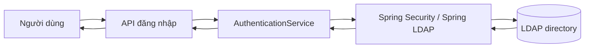
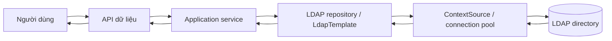

# Thiết kế cảnh báo theo tác động đến đăng nhập và truy cập dữ liệu

Một cụm LDAP có thể trả lời truy vấn kiểm tra sức khỏe nhưng người dùng vẫn không đăng nhập được. Ngược lại, một số lần đăng nhập thất bại có thể chỉ do người dùng nhập sai mật khẩu trong khi directory hoàn toàn khỏe mạnh. Nếu cảnh báo chỉ dựa vào số exception hoặc trạng thái kết nối LDAP, đội vận hành sẽ khó phân biệt hai tình huống này.

Với ứng dụng Spring Data LDAP, cảnh báo cần bắt đầu từ hành trình nghiệp vụ mà người dùng đang thực hiện: đăng nhập, tìm hồ sơ, đọc nhóm, tra cứu quyền hoặc cập nhật thuộc tính. Sau đó, metric, log, trace và health check giúp xác định nguyên nhân ở tầng ứng dụng, Spring LDAP, connection pool, mạng hay directory server.

Sau bài học, bạn có thể:

- Xác định các hành trình đăng nhập và truy cập dữ liệu quan trọng cần theo dõi.
- Phân biệt kết quả nghiệp vụ bình thường với lỗi hạ tầng LDAP.
- Thiết kế SLI, SLO và metric có nhãn giới hạn, không làm lộ danh tính người dùng.
- Viết cảnh báo Prometheus theo tỷ lệ lỗi, độ trễ và lưu lượng thực tế.
- Kết hợp health check, log và trace để chẩn đoán mà không tạo cảnh báo nhiễu.

## 1. Bắt đầu từ hành trình người dùng

Một request đăng nhập thường đi qua nhiều thành phần. Tùy cách xác thực, ứng dụng có thể bind bằng thông tin đăng nhập của người dùng, tìm entry trước rồi bind, hoặc xác thực qua một provider chuyên biệt. Sau khi đăng nhập, các request nghiệp vụ tiếp tục dùng repository hoặc `LdapTemplate` để tìm và đọc entry.



Đường truy cập dữ liệu có thể đi qua repository hoặc `LdapTemplate`:



Mỗi tầng có một kiểu lỗi riêng. API có thể từ chối request vì dữ liệu đầu vào không hợp lệ; chính sách ứng dụng có thể từ chối một tài khoản; Spring LDAP có thể ném exception khi bind hoặc search; pool có thể hết context; directory có thể chậm hoặc không truy cập được. Cảnh báo cấp dịch vụ nên phản ánh kết quả cuối cùng của hành trình, còn metric ở tầng thấp giúp tìm nguyên nhân.

Hãy lập danh sách các hành trình thật sự quan trọng. Ví dụ:

| Hành trình | Thao tác LDAP thường gặp | Tác động khi lỗi |
|---|---|---|
| Đăng nhập | Bind, tìm entry, đọc thuộc tính cần thiết | Người dùng không thể vào ứng dụng |
| Tải hồ sơ sau đăng nhập | Search theo định danh, đọc entry | Trang chính hoặc hồ sơ không hiển thị |
| Kiểm tra thành viên nhóm | Search/read group membership | Quyền truy cập bị xác định sai hoặc không thể hoàn tất |
| Tra cứu danh bạ | Search theo bộ lọc | Chức năng tìm kiếm chậm hoặc không dùng được |
| Cập nhật thuộc tính | Modify hoặc rename entry | Thay đổi không được lưu hoặc trạng thái không rõ ràng |

Không phải mọi ứng dụng đều cần cảnh báo riêng cho tất cả thao tác. Ưu tiên hành trình ảnh hưởng nhiều người dùng, chặn luồng đăng nhập, hoặc làm sai lệch quyền truy cập.

## 2. Phân loại kết quả trước khi đếm lỗi

Một tỷ lệ exception cao chưa chắc đồng nghĩa directory đang gặp sự cố. Hãy chuẩn hóa kết quả thành một tập giá trị nhỏ và ổn định. Ví dụ:

| Nhóm kết quả | Giá trị metric gợi ý | Cách diễn giải |
|---|---|---|
| Hoàn tất | `success` | LDAP operation hoàn tất và ứng dụng nhận được kết quả hợp lệ |
| Thông tin xác thực sai | `invalid_credentials` | Người dùng cung cấp mật khẩu hoặc thông tin xác thực không đúng |
| Tài khoản bị khóa / chính sách từ chối | `account_locked`, `policy_denied` | Quyết định nghiệp vụ hoặc chính sách bảo mật |
| Không tìm thấy | `not_found` | Search hợp lệ nhưng không có entry phù hợp |
| Bị từ chối quyền directory | `directory_denied` | ACL từ chối thao tác của người dùng; lỗi quyền của service identity nên phân loại riêng thành lỗi cấu hình |
| Quá thời gian | `timeout` | Kết nối hoặc thao tác không hoàn tất trong giới hạn thời gian |
| Directory không khả dụng | `unavailable` | Không kết nối được, server đóng kết nối hoặc lỗi dịch vụ tương đương |
| Lỗi TLS | `tls_error` | Bắt tay TLS, chứng thư hoặc xác minh danh tính máy chủ thất bại |
| Service account không bind được | `bind_service_error` | Danh tính ứng dụng dùng để truy cập directory không thể xác thực |
| Pool cạn tài nguyên | `pool_exhausted` | Không lấy được context trong thời gian chờ |
| Lỗi chưa phân loại | `error` | Lỗi kỹ thuật chưa thuộc nhóm đã định nghĩa |

Các giá trị trên là từ điển của ứng dụng; hãy ánh xạ exception thực tế của Spring LDAP, JNDI và thư viện pool vào từ điển đó tại một điểm tập trung. Không dựa vào chuỗi thông báo exception để tạo nhãn động.

Phân biệt ba trường hợp sau:

1. Người dùng nhập sai mật khẩu là một kết quả xác thực dự kiến. Ghi nhận nó để theo dõi trải nghiệm và dấu hiệu tấn công, nhưng không tính trực tiếp vào tỷ lệ lỗi hạ tầng LDAP.
2. Tài khoản không có quyền đọc một entry có thể là kết quả chính sách bình thường. Theo dõi riêng để phát hiện thay đổi ACL hoặc lỗi cấu hình bind identity.
3. Service account không bind được, TLS thất bại hoặc directory timeout là lỗi kỹ thuật có thể làm gián đoạn nhiều người dùng. Những trường hợp này cần đi vào chỉ số khả dụng của dependency.

Không gộp mọi kết quả `false`, `null`, empty result hoặc exception vào một nhãn `failure`. Với mỗi luồng, xác định rõ kết quả nào là hợp lệ theo nghiệp vụ, kết quả nào làm request không thể hoàn tất và kết quả nào cần đội vận hành can thiệp.

## 3. Xác định SLI và SLO theo tác động

SLI (Service Level Indicator) là phép đo chất lượng dịch vụ; SLO (Service Level Objective) là mục tiêu cho phép đo đó trong một khoảng thời gian. Với Spring Data LDAP, nên có ít nhất các nhóm chỉ số sau:

| SLI | Công thức khái niệm | Ý nghĩa |
|---|---|---|
| Khả dụng đăng nhập do LDAP hỗ trợ | Số lần xác thực hợp lệ hoàn tất / tổng số lần xác thực đủ điều kiện | Người dùng có thể đăng nhập khi cung cấp thông tin hợp lệ |
| Khả dụng truy cập dữ liệu | Số thao tác đọc/ghi đủ điều kiện hoàn tất / tổng thao tác đủ điều kiện | Chức năng phụ thuộc LDAP có thể phục vụ request |
| Độ trễ đăng nhập | p95 hoặc p99 thời gian hoàn tất luồng xác thực | Phát hiện trải nghiệm chậm trước khi request timeout |
| Độ trễ truy cập dữ liệu | p95 hoặc p99 theo nhóm thao tác | Phân biệt search chậm với login chậm |
| Tỷ lệ lỗi kỹ thuật | Số outcome kỹ thuật lỗi / tổng thao tác đủ điều kiện | Đo mức độ gián đoạn do dependency |
| Mức sử dụng tài nguyên | Context đang dùng, context chờ, thời gian chờ pool và timeout | Nhận biết nghẽn pool hoặc quá tải |

Định nghĩa mẫu cho một SLI:

\[
SLI_{availability}=\frac{good\ events}{eligible\ events}\times 100\%
\]

`eligible events` cần có quy tắc rõ ràng. Với đăng nhập, có thể loại `invalid_credentials`, `account_locked` và `policy_denied` khỏi mẫu số của SLI khả dụng LDAP, vì directory đã phản hồi và ứng dụng đã đưa ra quyết định xác thực. Với truy cập dữ liệu, `not_found` hoặc `directory_denied` có thể là kết quả nghiệp vụ hợp lệ; theo dõi chúng bằng chỉ số riêng. Nếu sản phẩm định nghĩa các trường hợp này là lỗi trải nghiệm, hãy tạo SLI nghiệp vụ riêng thay vì làm sai lệch SLI kỹ thuật.

SLO cần dựa trên mức dịch vụ đã cam kết và dữ liệu vận hành. Ví dụ, một đội có thể đặt mục tiêu 99,9% thao tác LDAP đủ điều kiện hoàn tất trong 30 ngày và mục tiêu p95 đăng nhập dưới một giây. Đây chỉ là ví dụ để minh họa cách viết mục tiêu; không sao chép ngưỡng này vào production nếu chưa đo baseline, thỏa thuận với chủ dịch vụ và xem xét thời gian directory bảo trì.

Hãy đặt SLO theo từng hành trình nếu mức độ quan trọng khác nhau. Lỗi bind làm toàn bộ người dùng không thể đăng nhập thường nghiêm trọng hơn một search danh bạ ít được dùng. Một thao tác ghi có thể có yêu cầu nhất quán và khôi phục khác với một thao tác đọc có thể retry.

## 4. Thu thập metric ở ranh giới nghiệp vụ

Spring Data LDAP cung cấp abstraction để thao tác với directory; việc có repository hoặc `LdapTemplate` không tự động tạo ra metric thể hiện tác động đến đăng nhập và truy cập dữ liệu của sản phẩm. Ứng dụng cần đo tại service hoặc adapter bao quanh thao tác LDAP.

Micrometer `MeterRegistry` và `Timer` là lựa chọn phù hợp trong ứng dụng Spring Boot. `Timer` ghi cả thời gian và số lần thực hiện, vì vậy có thể dùng để tính latency và request rate. Ví dụ dưới đây minh họa một bộ đo dùng chung:

```java
import java.util.function.Supplier;

import io.micrometer.core.instrument.MeterRegistry;
import io.micrometer.core.instrument.Timer;
import org.springframework.stereotype.Component;

@Component
public class LdapOperationMetrics {

    private final MeterRegistry registry;
    private final LdapFailureClassifier failureClassifier;

    public LdapOperationMetrics(
            MeterRegistry registry,
            LdapFailureClassifier failureClassifier) {
        this.registry = registry;
        this.failureClassifier = failureClassifier;
    }

    public <T> T record(
            String metricName,
            String operation,
            Supplier<T> action) {

        Timer.Sample sample = Timer.start(registry);
        String outcome = "success";

        try {
            return action.get();
        } catch (RuntimeException exception) {
            outcome = failureClassifier.classify(exception);
            throw exception;
        } finally {
            sample.stop(registry.timer(
                    metricName,
                    "operation", operation,
                    "outcome", outcome));
        }
    }
}
```

`LdapFailureClassifier` là thành phần do ứng dụng định nghĩa. Nó chuyển exception của các lớp Spring LDAP/JNDI và lỗi pool sang một trong các giá trị cố định ở phần trước. Ví dụ, lỗi xác thực thông tin người dùng được ánh xạ thành `invalid_credentials`; lỗi bind của service account được ánh xạ thành `error` hoặc một nhóm riêng như `bind_service_error`; timeout được ánh xạ thành `timeout`. Giữ logic này tập trung để các service không tự phân loại theo những cách khác nhau.

Gọi bộ đo ở đúng ranh giới của thao tác:

```java
public Person loadPerson(String uid) {
    return metrics.record(
            "app.ldap.data.duration",
            "search",
            () -> personRepository.findByUid(uid)
                    .orElseThrow(PersonNotFoundException::new));
}
```

Trong ví dụ này, `PersonNotFoundException` đang được coi là lỗi của hàm `loadPerson`. Nếu mục tiêu quan sát là khả dụng kỹ thuật LDAP, hãy xử lý kết quả không tìm thấy ở tầng nghiệp vụ hoặc điều chỉnh bộ đo để phân loại `not_found` riêng. Không để cách viết ví dụ quyết định thay cho định nghĩa SLI của sản phẩm.

Đối với đăng nhập, nên đo cả kết quả ở authentication provider hoặc service chịu trách nhiệm xác thực. Nếu thư viện trả về kết quả từ chối thay vì ném exception, bộ đo phải ghi nhận kết quả từ chối đó rõ ràng. Nếu không, một lần đăng nhập thất bại có thể bị đếm nhầm là `success` chỉ vì thao tác bind/search không ném exception.

Ví dụ tên metric:

| Metric Micrometer | Loại | Tags giới hạn | Dùng cho |
|---|---|---|---|
| `app.auth.login.duration` | Timer | `operation`, `outcome` | Số lần và thời gian của luồng đăng nhập |
| `app.ldap.data.duration` | Timer | `operation`, `outcome` | Số lần và thời gian của search/read/write |
| `app.ldap.pool.wait` | Timer | `pool`, `outcome` | Thời gian chờ lấy context nếu pool hỗ trợ đo |
| `app.ldap.pool.active` | Gauge | `pool` | Số context đang được mượn |
| `app.ldap.pool.idle` | Gauge | `pool` | Số context đang rảnh |

Tên metric và tag phải ổn định qua các phiên bản triển khai. Với pool, chỉ thêm metric nếu thư viện pool đang dùng có API hoặc binder phù hợp; đừng tạo số liệu giả từ giá trị cấu hình. Nếu không thể đo pool trực tiếp, có thể bắt đầu bằng thời gian chờ context và số lần timeout ở adapter.

### 4.1. Giới hạn cardinality và bảo vệ dữ liệu

Tag của metric được dùng để tạo chuỗi thời gian. Nếu gắn `username`, DN, địa chỉ email, group DN, raw LDAP filter, request ID hoặc thông báo exception vào tag, số chuỗi thời gian có thể tăng theo số người dùng và gây áp lực lớn lên hệ thống metrics. Những giá trị này còn có thể làm lộ dữ liệu định danh.

Nên dùng các chiều có tập giá trị nhỏ:

- `operation`: `bind`, `search`, `read`, `write`, `rename`.
- `outcome`: tập kết quả đã chuẩn hóa.
- `service`: tên service ổn định nếu nền tảng metrics chưa tự gắn.
- `environment`: `dev`, `staging`, `prod`.
- `pool`: tên pool cấu hình, không phải connection ID.

Không đưa DN, username, mật khẩu, filter đầy đủ, giá trị thuộc tính LDAP hoặc stack trace vào metric. Log và trace cũng phải áp dụng chính sách che dữ liệu tương ứng; việc chuyển dữ liệu nhạy cảm từ metric sang log không làm nó an toàn hơn.

### 4.2. Bật histogram cho latency

Để truy vấn p95/p99 bằng Prometheus, cần bật histogram cho các `Timer` tương ứng. Ví dụ cấu hình Spring Boot bằng `application.properties`:

```properties
management.metrics.distribution.percentiles-histogram.app.auth.login.duration=true
management.metrics.distribution.percentiles-histogram.app.ldap.data.duration=true
management.endpoints.web.exposure.include=health,prometheus
```

Endpoint Prometheus chỉ nên được expose trên mạng quản trị hoặc qua cơ chế xác thực phù hợp. Không mở endpoint metrics cho Internet công cộng. Nếu nền tảng dùng exporter hoặc registry khác, cấu hình histogram theo cơ chế của registry đó.

## 5. Viết cảnh báo dựa trên tỷ lệ lỗi và latency

Với Prometheus registry, `Timer` có tên `app.auth.login.duration` thường được xuất thành các chuỗi thời gian như `app_auth_login_duration_seconds_count`, `app_auth_login_duration_seconds_sum` và `app_auth_login_duration_seconds_bucket` khi histogram được bật. Tên thực tế cần được xác nhận trên endpoint `/actuator/prometheus` của ứng dụng.

### 5.1. Cảnh báo lỗi đăng nhập do dependency

Ví dụ rule sau phát cảnh báo khi tỷ lệ lỗi kỹ thuật trong luồng đăng nhập vượt ngưỡng liên tục và có đủ lưu lượng. Ngưỡng 2% và 20 sự kiện chỉ là số minh họa:

```yaml
groups:
  - name: ldap-user-impact
    rules:
      - alert: LdapLoginDependencyErrorsHigh
        expr: |
          (
            sum(rate(app_auth_login_duration_seconds_count{
              outcome=~"timeout|unavailable|tls_error|pool_exhausted|bind_service_error|error"
            }[5m]))
            /
            clamp_min(sum(rate(app_auth_login_duration_seconds_count{
              outcome!~"invalid_credentials|account_locked|policy_denied|directory_denied"
            }[5m])), 0.001)
          ) > 0.02
          and
          sum(increase(app_auth_login_duration_seconds_count{
            outcome!~"invalid_credentials|account_locked|policy_denied|directory_denied"
          }[5m])) > 20
        for: 5m
        labels:
          severity: page
        annotations:
          summary: "Đăng nhập đang bị ảnh hưởng bởi lỗi LDAP"
          description: "Tỷ lệ lỗi kỹ thuật của luồng đăng nhập vượt ngưỡng trong 5 phút. Kiểm tra directory, bind, TLS và connection pool."
```

Mẫu số và điều kiện lưu lượng ở đây cùng loại `invalid_credentials`, `account_locked`, `policy_denied` và `directory_denied` vì các kết quả từ chối theo ACL của người dùng không chứng minh dependency bị gián đoạn. Nếu ứng dụng dùng thêm outcome nghiệp vụ khác, hãy quyết định rõ có loại chúng khỏi mẫu số hay không. Lỗi quyền của service identity cần được phân loại thành lỗi cấu hình như `bind_service_error` để vẫn kích hoạt cảnh báo. Bộ lọc outcome phải khớp với từ điển thực tế của classifier.

Điều kiện lưu lượng tối thiểu giảm cảnh báo do vài request lẻ. Với hệ thống ít người dùng, hãy chọn ngưỡng dựa trên lưu lượng bình thường hoặc dùng synthetic check để bổ sung bằng chứng. Không đặt mẫu số tối thiểu quá cao khiến sự cố vào thời điểm ít người dùng bị bỏ qua.

### 5.2. Cảnh báo truy cập dữ liệu chậm

Nếu thêm vào cùng nhóm `rules` ở ví dụ trước, rule sau cảnh báo khi p95 của các thao tác LDAP dữ liệu vượt 800 ms và có request đang diễn ra:

```yaml
      - alert: LdapDataAccessLatencyHigh
        expr: |
          histogram_quantile(
            0.95,
            sum by (le) (
              rate(app_ldap_data_duration_seconds_bucket[5m])
            )
          ) > 0.8
          and
          sum(rate(app_ldap_data_duration_seconds_count[5m])) > 0.2
        for: 10m
        labels:
          severity: ticket
        annotations:
          summary: "Truy cập dữ liệu LDAP đang chậm"
          description: "p95 thao tác LDAP vượt 800 ms trong 10 phút. Phân tích theo operation và kiểm tra search, pool, mạng và tải directory."
```

Ngưỡng 800 ms và 0,2 request/giây cần được thay bằng mục tiêu latency và baseline của hệ thống. Nếu mỗi operation có đặc tính khác nhau, tạo histogram hoặc rule theo nhóm `operation` thay vì gộp search, bind và write vào cùng một ngưỡng.

### 5.3. Theo dõi lỗi truy cập dữ liệu

Tỷ lệ lỗi kỹ thuật của data access có thể tính tương tự:

```promql
sum(rate(app_ldap_data_duration_seconds_count{
  outcome=~"timeout|unavailable|tls_error|bind_service_error|pool_exhausted|error"
}[5m]))
/
clamp_min(sum(rate(app_ldap_data_duration_seconds_count{
  outcome!~"not_found|directory_denied|policy_denied"
}[5m])), 0.001)
```

Đây là biểu thức để đưa lên dashboard hoặc dùng làm phần điều kiện của alert. Nếu `directory_denied` là kết quả hợp lệ theo ACL, theo dõi nó riêng. Nếu số lần bị từ chối tăng đột ngột, có thể tạo cảnh báo điều tra cấu hình quyền, nhưng không nhất thiết page như một outage.

### 5.4. Cảnh báo theo SLO và error budget

Khi đã có SLO, có thể dùng burn rate để phát hiện tốc độ tiêu thụ error budget. Nếu SLO khả dụng là 99,9%, error budget của chu kỳ tương ứng là 0,1%. Burn rate bằng tỷ lệ lỗi quan sát được chia cho tỷ lệ lỗi cho phép. Ví dụ, tỷ lệ lỗi 5% tương đương burn rate 50 lần so với ngân sách của SLO đó.

Một thiết kế thực tế thường kết hợp cửa sổ ngắn và dài: cửa sổ ngắn phát hiện sự cố nghiêm trọng đang diễn ra; cửa sổ dài xác nhận lỗi kéo dài và tránh page do một đợt tăng đột biến ngắn. Hãy nhóm alert theo service, environment và hành trình để nhiều instance cùng gặp một lỗi không tạo hàng loạt trang cảnh báo giống nhau.

Không cần page cho mọi metric vượt ngưỡng. Có thể chia mức độ:

- **Page:** đăng nhập diện rộng thất bại, luồng truy cập cốt lõi không hoạt động, hoặc error budget bị tiêu thụ nhanh.
- **Ticket:** latency tăng kéo dài, pool thường xuyên gần ngưỡng, hoặc lỗi một nhóm chức năng ít quan trọng.
- **Dashboard:** thay đổi nhẹ trong số lần `invalid_credentials`, `not_found` hoặc một biến động chưa đủ bằng chứng tác động.

## 6. Kết hợp health check và synthetic check

Health check trả lời câu hỏi về trạng thái thành phần; SLI nghiệp vụ trả lời câu hỏi người dùng có hoàn thành công việc hay không. Hai tín hiệu bổ sung cho nhau.

Spring Boot Actuator có endpoint health và các nhóm trạng thái liveness/readiness. Có thể bật probe trong cấu hình:

```properties
management.endpoint.health.probes.enabled=true
management.endpoints.web.exposure.include=health,prometheus
```

Một số nguyên tắc quan trọng:

- Liveness nên phản ánh tiến trình ứng dụng có còn hoạt động hay không. Không gắn liveness trực tiếp với LDAP, vì một sự cố directory có thể làm mọi pod bị khởi động lại liên tục mà không sửa được nguyên nhân.
- Readiness có thể xét khả năng phục vụ request phụ thuộc LDAP, nhưng cần quyết định theo kiến trúc. Nếu mọi pod đồng loạt bị đánh dấu unready khi LDAP chập chờn, hệ thống có thể mất toàn bộ endpoint phục vụ. Đặt timeout ngắn, giới hạn tần suất probe và đánh giá hành vi khi directory mất kết nối.
- Một health indicator riêng cho LDAP giúp dashboard thấy trạng thái dependency. Nó không thay thế phép đo login và data access thực tế.
- Probe không nên thực hiện search sâu, quét cây directory hoặc bind bằng tài khoản người dùng thật. Dùng một thao tác nhẹ, có timeout rõ ràng và identity kiểm tra có quyền tối thiểu.

Synthetic check mô phỏng một hành trình nhỏ bằng tài khoản kiểm thử chuyên dụng. Ví dụ, định kỳ xác thực tài khoản canary rồi đọc một entry kiểm thử đã chuẩn bị. Kết quả canary có thể phát hiện lỗi khi không có traffic người dùng. Tài khoản canary cần được quản lý vòng đời, mật khẩu và quyền như một credential vận hành; không dùng tài khoản của nhân viên.

Nếu synthetic check ghi hoặc sửa dữ liệu, thiết kế dữ liệu kiểm thử có thể khôi phục an toàn và đảm bảo thao tác lặp lại không làm thay đổi dữ liệu nghiệp vụ. Ưu tiên một hành trình đọc hoặc xác thực ít tác động.

## 7. Dùng log và trace để tìm nguyên nhân

Metric báo hiệu có vấn đề; log và trace giúp xác định request nào đi qua tầng nào và bị chậm ở đâu. Nên tạo log có cấu trúc với các trường như:

```json
{
  "event": "ldap_operation_completed",
  "operation": "search",
  "outcome": "timeout",
  "duration_ms": 1200,
  "service": "identity-api",
  "trace_id": "4bf92f3577b34da6a3ce929d0e0e4736"
}
```

Đây là ví dụ cấu trúc, không phải giá trị cần cố định. Log có thể chứa trace ID để tìm trace tương ứng. Trace nên có span cho authentication, lấy context từ pool, bind và search/read quan trọng nếu hệ thống có thể instrument các đoạn đó.

Không ghi password, bind credential, raw filter chứa giá trị đầu vào, DN đầy đủ, email, số điện thoại hoặc thuộc tính cá nhân vào log/span. Khi cần liên kết sự kiện với một đối tượng, dùng mã tương quan đã được phê duyệt và có kiểm soát truy cập; không đưa mã định danh có cardinality cao vào tag metric.

Khi log lỗi, lưu mã lỗi đã chuẩn hóa và loại exception ở mức cần thiết. Thông báo exception từ LDAP có thể chứa DN, filter hoặc dữ liệu đầu vào. Trước khi log message hoặc stack trace, kiểm tra cách thư viện tạo nội dung và chính sách che dữ liệu của ứng dụng.

## 8. Dashboard cho người vận hành

Một dashboard hữu ích nên dẫn từ tác động đến nguyên nhân. Có thể chia thành các hàng sau:

| Hàng dashboard | Panel đề xuất | Câu hỏi cần trả lời |
|---|---|---|
| Tác động | Tỷ lệ login đủ điều kiện thành công, tỷ lệ data access thành công | Người dùng đang bị ảnh hưởng ở hành trình nào? |
| Lưu lượng | Số login và số operation theo phút | Lỗi xuất hiện khi lưu lượng tăng hay cả lúc tải thấp? |
| Latency | p50/p95/p99 login, search, read, write | Hành trình nào chậm và chậm từ khi nào? |
| Outcome | Success, timeout, unavailable, invalid credentials, denied | Lỗi kỹ thuật hay kết quả nghiệp vụ đang tăng? |
| Pool | Active, idle, pending/wait, timeout và thời gian mượn context | Ứng dụng đang thiếu context hay directory phản hồi chậm? |
| Dependency | Health check, canary, kết nối/TLS và lỗi server | Directory, mạng hay cấu hình kết nối có dấu hiệu bất thường? |

Đặt bộ lọc theo environment, service và operation. Các panel phải dùng cùng định nghĩa outcome và cùng khoảng thời gian để người trực không phải so sánh các số liệu có mẫu số khác nhau.

Đừng chỉ hiển thị số lượng exception. Một hệ thống có thể có nhiều `invalid_credentials` vào đầu ngày nhưng vẫn khỏe; ngược lại, một tỷ lệ timeout nhỏ ở luồng đăng nhập có lưu lượng lớn có thể ảnh hưởng hàng trăm người dùng. Hãy hiển thị đồng thời tỷ lệ, số tuyệt đối, latency và lưu lượng.

## 9. Quy trình xử lý khi cảnh báo kích hoạt

Khi nhận cảnh báo đăng nhập hoặc data access, người trực có thể đi theo trình tự sau:

1. **Xác nhận tác động.** Kiểm tra SLI, số request bị ảnh hưởng, thời điểm bắt đầu và phạm vi instance/region. Đối chiếu synthetic check nếu traffic người dùng thấp.
2. **Phân loại outcome.** Xem timeout, unavailable, TLS, pool exhaustion, bind service account hay lỗi nghiệp vụ đang tăng. Kiểm tra xem `invalid_credentials` hoặc `policy_denied` có bị gộp nhầm vào lỗi kỹ thuật không.
3. **Xác định tầng chậm.** Dùng trace để so sánh thời gian ở API, authentication provider, chờ pool, bind và LDAP search. Nếu chỉ có tổng thời gian, bổ sung span hoặc timer ở tầng đang thiếu.
4. **Kiểm tra pool và kết nối.** Xem active/idle/pending, thời gian chờ context, timeout, lỗi đóng kết nối và xu hướng tạo kết nối mới. Đối chiếu cấu hình pool với concurrency thực tế.
5. **Kiểm tra TLS và danh tính bind.** Xem thời điểm rotate chứng thư/secret, truststore, hostname verification, quyền của service account và thay đổi cấu hình gần đây. Không in secret ra log để chẩn đoán.
6. **Kiểm tra directory và mạng.** Đối chiếu latency/error của LDAP server, DNS, firewall, load balancer, referral và topology. Kiểm tra server-side limit hoặc thay đổi schema/ACL nếu lỗi chỉ xảy ra với một nhóm operation.
7. **Giảm tác động và xác minh.** Thực hiện biện pháp đã được runbook phê duyệt, theo dõi lại SLI và canary, sau đó ghi nhận nguyên nhân gốc và hành động ngăn tái diễn.

Không retry mọi lỗi LDAP theo cùng một cách. Retry một thao tác đọc có thể an toàn trong một số trường hợp; retry bind hoặc ghi có thể gây tải thêm, kéo dài thời gian request hoặc tạo kết quả không rõ ràng nếu lần ghi trước đã được server áp dụng. Chính sách retry phải dựa trên loại operation, tính idempotent, timeout tổng và khả năng phục hồi.

## 10. Những lỗi thiết kế cảnh báo thường gặp

| Thiết kế chưa tốt | Hệ quả | Cách cải thiện |
|---|---|---|
| Page cho mọi lần đăng nhập sai | Cảnh báo nhiễu khi người dùng gõ sai hoặc có password spray | Tách `invalid_credentials` khỏi lỗi dependency; tạo phát hiện bảo mật riêng nếu cần |
| Chỉ kiểm tra TCP port LDAP | Port mở nhưng bind, TLS hoặc search vẫn lỗi | Dùng health indicator nhẹ và synthetic journey |
| Chỉ đo tổng thời gian API | Không biết chậm ở ứng dụng, pool hay directory | Thêm timer/span ở các ranh giới cần chẩn đoán |
| Đặt username hoặc DN làm tag | Cardinality tăng mạnh và rò rỉ dữ liệu | Dùng operation/outcome có tập giá trị cố định |
| Alert trên một spike đơn lẻ | Page do nhiễu hoặc vài request hiếm | Kết hợp `for`, volume floor và cửa sổ ngắn/dài |
| Health check LDAP nằm trong liveness | Pod restart hàng loạt khi dependency lỗi | Tách liveness, readiness và dependency health |
| Dùng một ngưỡng latency cho mọi operation | Search, bind và write có phân bố khác nhau | Đặt mục tiêu theo hành trình hoặc operation |
| Alert không có runbook | Người trực mất thời gian tìm dashboard và owner | Gắn dashboard, bước kiểm tra và nhóm chịu trách nhiệm vào annotation |

## 11. Bài tập thực hành

Một ứng dụng Spring Data LDAP có các số liệu trong 5 phút:

| Outcome đăng nhập | Số lần |
|---|---:|
| `success` | 4.700 |
| `invalid_credentials` | 250 |
| `timeout` | 35 |
| `unavailable` | 15 |

Và 10.000 thao tác đọc dữ liệu, trong đó 9.850 thành công, 100 `not_found`, 30 `directory_denied` và 20 `timeout`.

Hãy thực hiện các yêu cầu:

1. Tính tỷ lệ lỗi kỹ thuật đăng nhập nếu loại `invalid_credentials` khỏi mẫu số. Nêu rõ mẫu số bạn sử dụng.
2. Xác định những outcome của data access cần được đưa vào SLI khả dụng kỹ thuật và những outcome cần theo dõi riêng.
3. Viết một alert cho tỷ lệ timeout của search vượt ngưỡng trong 10 phút, có điều kiện lưu lượng tối thiểu.
4. Đề xuất hai metric pool giúp phân biệt directory chậm với ứng dụng không lấy được context.
5. Giải thích vì sao không dùng username, DN hoặc raw filter làm label.

### Gợi ý đáp án

Với đăng nhập, mẫu số đủ điều kiện là `4.700 + 35 + 15 = 4.750`; số lỗi kỹ thuật là `50`, do đó tỷ lệ lỗi là khoảng `1,05%`. `invalid_credentials` được theo dõi riêng vì nó không cho thấy directory mất khả dụng.

Với data access, `timeout` là lỗi kỹ thuật. `not_found` thường là kết quả nghiệp vụ hợp lệ; `directory_denied` cần được phân tích theo chính sách ACL và có thể có metric riêng. Nếu SLI của sản phẩm coi việc bị từ chối quyền là tác động dịch vụ, hãy định nghĩa một SLI nghiệp vụ khác.

Một alert search cần lọc `operation="search"`, tính tỷ lệ outcome `timeout` trên tổng search đủ điều kiện, đặt `for: 10m` và thêm điều kiện số search trong cửa sổ. Ngưỡng và volume floor phải dựa trên SLO, baseline và mức lưu lượng thấp nhất cần bảo vệ.

Hai metric pool hữu ích là số context đang được mượn (`active`) và thời gian chờ lấy context (`wait`); có thể bổ sung số context rảnh (`idle`), số waiter hoặc timeout. Nếu thời gian chờ pool tăng trong khi latency LDAP server ổn định, điểm nghẽn có thể nằm ở pool hoặc vòng đời context. Nếu pool không chờ nhưng thời gian search tăng, cần kiểm tra directory, mạng và bộ lọc truy vấn.

Username, DN và raw filter có số lượng giá trị lớn, thay đổi liên tục và có thể chứa dữ liệu nhạy cảm. Chúng làm tăng cardinality và gây rủi ro lộ thông tin. Dùng `operation`, `outcome`, `service` và `environment` để phân tích metric.

## 12. Checklist trước khi đưa cảnh báo vào production

- [ ] Đã xác định các hành trình đăng nhập và truy cập dữ liệu quan trọng.
- [ ] Đã thống nhất từ điển outcome giữa authentication service, Spring LDAP và dashboard.
- [ ] Đã tách lỗi thông tin xác thực/chính sách khỏi lỗi kỹ thuật dependency.
- [ ] Đã định nghĩa SLI, mẫu số, cửa sổ đo và SLO với chủ dịch vụ.
- [ ] Metric có tag giới hạn; không chứa username, DN, mật khẩu hoặc raw filter.
- [ ] Histogram được bật cho timer cần tính p95/p99 và endpoint metrics được bảo vệ.
- [ ] Alert có ngưỡng dựa trên baseline, thời gian duy trì và điều kiện lưu lượng phù hợp.
- [ ] Liveness không phụ thuộc trực tiếp vào LDAP; readiness và dependency health có chính sách rõ ràng.
- [ ] Có synthetic check an toàn cho thời điểm ít hoặc không có traffic.
- [ ] Dashboard hiển thị tác động, lưu lượng, latency, outcome và tình trạng pool.
- [ ] Mỗi alert quan trọng có owner, runbook và hướng dẫn xác minh phục hồi.
- [ ] Đã thử nghiệm alert bằng cách mô phỏng timeout, lỗi bind, TLS và pool exhaustion trong môi trường kiểm thử.

## Tài liệu nên tra cứu

- Spring Boot Actuator: Health, liveness/readiness probes, metrics và Prometheus endpoint.
- Micrometer: `MeterRegistry`, `Timer`, histogram và naming convention của registry.
- Spring LDAP: `LdapTemplate`, `ContextSource` và cấu hình connection pooling.
- Prometheus: histogram quantile, alerting rules, `rate`, `increase` và error budget/burn rate.

