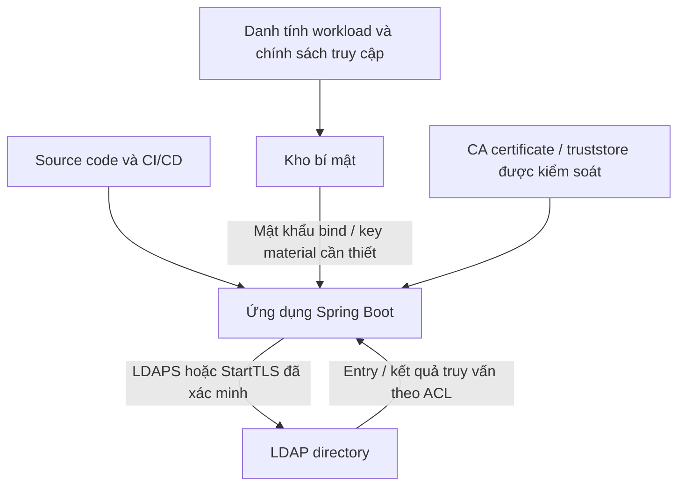

# Bảo vệ mật khẩu và chứng chỉ bằng kho bí mật trong Spring Data LDAP

Một ứng dụng **Spring Data LDAP** thường kết nối đến directory bằng `LdapTemplate` hoặc `LdapRepository`. Để đọc hoặc cập nhật entry, ứng dụng có thể cần **mật khẩu của tài khoản dịch vụ**; để bảo vệ kết nối LDAPS/StartTLS, nó cần **tin đúng chứng chỉ của LDAP server**. Một số hệ thống còn có **private key** khi sử dụng xác thực TLS hai chiều. Các tài sản này có vai trò khác nhau, nhưng đều cần một quy trình quản lý vòng đời rõ ràng.

Nếu đưa mật khẩu bind vào `application.yml` rồi commit, người có quyền đọc source code, bản build hay log cấu hình có thể lấy credential và truy cập directory. Nếu bỏ qua xác minh chứng chỉ TLS, mật khẩu vẫn có thể bị gửi đến **máy chủ giả mạo** qua một kết nối trông như đã mã hóa. Một **kho bí mật (secret manager)** giúp hạn chế nơi lưu, quyền đọc, khả năng kiểm toán và việc xoay vòng bí mật; tuy nhiên nó **không thay thế** TLS, phân quyền LDAP và kiểm soát rò rỉ tại runtime.

Bài học xây dựng một thiết kế thực tế cho Spring Boot + Spring Data LDAP: nhận mật khẩu từ nguồn bí mật tại lúc triển khai, phân biệt CA/truststore với keystore chứa private key, kết nối LDAPS an toàn, vận hành vòng đời rotation và kiểm thử tình huống thất bại.

## 1. Mục tiêu học tập

Sau bài này, bạn có thể:

- Phân loại **LDAP service-account password**, password người dùng cuối, TLS server certificate, CA certificate, truststore và private key theo mức nhạy cảm.
- Giải thích vì sao **kho bí mật** hữu ích nhưng không bảo vệ được một simple bind gửi trên LDAP plaintext.
- Tách cấu hình không nhạy cảm khỏi secret; dùng `spring.ldap.*` với biến môi trường, **Spring Boot config tree** hoặc giải pháp như Vault.
- Cấu hình quyền truy cập bí mật theo danh tính **workload** thay vì nhúng token truy cập kho vào code.
- Quản lý truststore/keystore và TLS hostname verification mà không dùng cơ chế “trust all”.
- Lập quy trình **xoay vòng mật khẩu và chứng chỉ** có kiểm tra tác động tới `ContextSource`, connection pool và những instance ứng dụng đang chạy.
- Kiểm thử cả kết nối thành công lẫn sai password, chứng chỉ sai và secret không sẵn sàng; xử lý lỗi theo nguyên tắc **fail closed**.

## 2. Những tài sản cần bảo vệ

Trước khi chọn Vault hoặc một secret store khác, hãy xác định **cái gì là bí mật** và **ai sở hữu nó**.

| Tài sản | Ví dụ | Mức độ nhạy cảm và nơi quản lý |
| --- | --- | --- |
| **Mật khẩu LDAP service account** | Password của `cn=svc-directory-reader,ou=services,...` | **Bí mật**. Lưu trong secret manager, cấp cho đúng workload; không commit vào Git. |
| **Mật khẩu người dùng cuối** | Password Alice nhập khi đăng nhập | **Bí mật phiên ngắn hạn**. Chỉ xử lý để xác thực, không lưu bản rõ vào Vault/log/cache. |
| **TLS server certificate** | Chứng chỉ X.509 của `ldap.example.org` | Phần chứng chỉ công khai **không phải private key**; cần phân phối đáng tin và kiểm tra hiệu lực. |
| **Chứng chỉ CA tin cậy** | CA nội bộ ký certificate LDAP | Thông thường là **vật liệu công khai**, nhưng cần bảo vệ tính toàn vẹn của danh sách CA được tin. |
| **Truststore** | File PKCS#12/JKS chứa CA certificate | Có thể không chứa private key; nội dung cần được kiểm soát **toàn vẹn và nguồn gốc**. Password truststore, nếu được dùng, vẫn phải quản lý phù hợp. |
| **Client private key** (nếu mTLS) | Khóa riêng đi cùng client certificate | **Bí mật rất nhạy cảm**, cần giới hạn quyền đọc, lưu trữ và xoay vòng. |
| **LDAP server private key** | Khóa riêng TLS của directory server | Thuộc trách nhiệm của **directory/server operator**; ứng dụng LDAP client không cần nhận nó. |
| **Secret-store credential** | Token Vault, cloud access key | **Bí mật cấp cao**; ưu tiên danh tính workload tạm thời thay vì static token khác. |

**Ba phân biệt quan trọng:**

1. **Public certificate không đồng nghĩa private key.** CA certificate dùng để kiểm tra máy chủ có thể được phân phối đến client; private key của máy chủ **không được** gửi cho Spring LDAP client chỉ để nó tin chứng chỉ.
2. **Truststore không giống keystore chứa private key.** Truststore dành cho các trust anchors; một keystore cho mTLS có thể chứa khóa riêng và certificate chain. File PKCS#12 có thể dùng cho cả hai mục đích, nên phải kiểm tra **nội dung và quyền**, không chỉ tên đuôi.
3. **Password người dùng cuối không phải service-account password.** Ứng dụng có thể giữ credential của service account trong kho bí mật, nhưng password người dùng khi gọi `LdapTemplate.authenticate(...)` cần đi qua kênh TLS và được xử lý như dữ liệu nhạy cảm tạm thời; không “lưu lại để tiện xác thực lần sau”.

## 3. Mô hình rủi ro trong ứng dụng LDAP



Những rủi ro thường gặp:

- **Rò rỉ repository:** `application.yml`, test fixtures hoặc file `.env` chứa mật khẩu thật bị commit.
- **Rò rỉ pipeline:** secret bị in trong output build/deploy, test report hoặc tham số command line.
- **Lộ từ runtime:** endpoint cấu hình, actuator, heap dump, process diagnostics hoặc log exception làm lộ credential.
- **Đọc vượt quyền:** một service có quyền đọc secret của ứng dụng khác; một tài khoản LDAP có quyền sửa cả nhánh quản trị không cần thiết.
- **Giả mạo endpoint LDAP:** vô hiệu hóa kiểm tra certificate/hostname khiến password bị gửi cho server không đáng tin.
- **Secret hết hạn hoặc xoay vòng sai:** một instance dùng password cũ, connection pool giữ context cũ hoặc truststore không được nạp lại.
- **Kết nối thiếu bảo mật:** password lấy từ Vault nhưng lại được gửi qua `ldap://` không StartTLS.

Một secret store xử lý **lưu giữ, phân phối và kiểm toán bí mật**; TLS bảo vệ **truyền tải và xác minh peer**; ACL của directory bảo vệ **dữ liệu và thao tác LDAP**. Cần cả ba lớp.

## 4. Nguyên tắc thiết kế kho bí mật

### 4.1. Một danh tính workload cho một phạm vi quyền

Thay vì cấu hình `VAULT_TOKEN=...` cố định trong source code, workload nên chứng minh danh tính với secret manager qua cơ chế nền tảng hỗ trợ, ví dụ:

- Service account của Kubernetes được ràng buộc với một role trên secret manager.
- IAM role/managed identity của cloud runtime.
- Cơ chế xác thực workload identity hoặc chứng chỉ máy khách được cấp và kiểm soát riêng.

Vai trò của ứng dụng chỉ cần quyền **đọc đúng secret** chứa LDAP bind password, không cần quyền liệt kê toàn bộ kho, đọc credential production khác, sửa policy hoặc quản trị hệ thống.

Ví dụ phân chia quyền:

| Workload | Quyền kho bí mật | Quyền LDAP tương ứng |
| --- | --- | --- |
| `directory-reader` | Đọc mật khẩu `ldap/reader` | Chỉ tìm entry và một số thuộc tính dưới `ou=people`. |
| `directory-writer` | Đọc mật khẩu `ldap/writer` | Chỉ cập nhật những nhánh/attribute được phép. |
| `directory-admin-job` | Đọc credential admin trong một job có kiểm soát | Chỉ chạy tác vụ quản trị đã được phê duyệt. |
| `directory-test` | Đọc **secret test riêng** | Chỉ kết nối và sửa directory test. |

Không tái sử dụng một tài khoản quản trị LDAP cho mọi application chỉ vì tiện vận hành. Nếu credential bị lộ, **phạm vi quyền nhỏ** giúp giảm tác động.

### 4.2. Phân tách môi trường và đường dẫn

Ví dụ quy ước logic, **không phải đường dẫn chuẩn bắt buộc của một sản phẩm**:

```text
directory/dev/reader/password
directory/test/reader/password
directory/prod/reader/password

directory/prod/tls/trusted-ca-bundle
directory/prod/mtls/client-key-and-cert  (chỉ nếu có mTLS)
```

Một deployment production không được có quyền đọc secret test theo mặc định nếu không cần, và ngược lại. CI chạy unit tests thường **không cần** secret production. Integration tests có thể nhận secret của directory test riêng, ngắn hạn và có lifecycle/cleanup rõ ràng.

### 4.3. Mã hóa, kiểm toán và quyền thay đổi

Secret manager nên cung cấp hoặc được triển khai với:

- Mã hóa dữ liệu khi lưu và khi truyền; quản lý khóa mã hóa theo chính sách của tổ chức.
- Phân quyền **đọc**, **tạo**, **cập nhật**, **xóa** tách biệt khi có thể.
- Nhật ký truy cập cho biết **ai/đơn vị nào** lấy secret và lúc nào, nhưng **không ghi chính nội dung bí mật**.
- Version/rotation/rollback policy, cơ chế thu hồi khi credential nghi lộ.
- Tính sẵn sàng và kế hoạch phục hồi: ứng dụng phải biết xử lý thế nào nếu kho bí mật không truy cập được.

**Cấm vòng lặp bí mật:** không “bảo mật password LDAP bằng Vault” rồi nhúng **Vault admin token không hết hạn** trong chính `application.yml`. Khi có thể, sử dụng danh tính workload với TTL và quyền tối thiểu.

## 5. Kết nối LDAP an toàn: kho bí mật chỉ giải một nửa bài toán

Ví dụ LDAP simple bind dùng DN và password:

```text
DN: cn=svc-directory-reader,ou=services,dc=example,dc=org
Password: <được cung cấp an toàn từ secret manager>
Endpoint: ldaps://ldap.example.org:636
```

Luồng yêu cầu đúng:

1. Ứng dụng lấy credential từ secret manager thông qua danh tính workload đã được phép.
2. JVM thiết lập kết nối TLS với `ldap.example.org`.
3. Client kiểm tra trust chain, thời hạn và hostname của TLS server certificate.
4. **Chỉ sau khi TLS thành công**, LDAP simple bind mới gửi DN/mật khẩu.
5. Directory xác thực service account và thực hiện search/modify theo **LDAP ACL**, không theo quyền đọc secret trong Vault.

Với **StartTLS**, thứ tự phải là kết nối LDAP → yêu cầu StartTLS → xác minh TLS → **mới** simple bind. Nếu StartTLS không thành công, không được tiếp tục gửi password trên plaintext.

Không dùng `TrustManager` chấp nhận mọi certificate, không tắt hostname verification và không tự fallback sang `ldap://` chỉ để tránh lỗi môi trường. Một kho bí mật không thể bảo vệ mật khẩu sau khi ứng dụng chủ động gửi nó đến server giả mạo.

## 6. Cách 1 — Spring Boot nhận secret từ biến môi trường

Cấu hình dễ hiểu cho service nhỏ:

```yaml
# application.yml: chỉ chứa thông số không bí mật và placeholder.
spring:
  ldap:
    urls: ldaps://ldap.example.org:636
    base: dc=example,dc=org
    username: ${LDAP_BIND_DN}
    password: ${LDAP_BIND_PASSWORD}
```

`LDAP_BIND_DN` và `LDAP_BIND_PASSWORD` được **bộ triển khai** cấp từ kho bí mật. Thông tin bí mật không nằm trong file đã commit, nhưng **biến môi trường không tự biến thành một kho bí mật**:

- Giá trị env có thể xuất hiện trong diagnostics, process inspection, crash dumps hoặc trang cấu hình nếu quyền bị cấp quá rộng.
- Một biến môi trường thường được chụp khi process bắt đầu; việc cập nhật secret trong kho **không tự động thay đổi** process đang chạy.
- Khi deploy, tránh lệnh shell in secret, file `.env` chứa secret thật hoặc `--debug`/`set -x` trong script.
- Không đặt placeholder **có giá trị mặc định** chứa password thật, ví dụ `${LDAP_BIND_PASSWORD:actual-password}`.

Đây vẫn là phương án hợp lệ khi nền tảng có **cơ chế inject secret an toàn** và công cụ triển khai hạn chế truy cập env. Với môi trường hỗ trợ mount secret dạng file, cách `configtree` ở mục 7 thường giúp tránh truyền bí mật qua biến môi trường, dù ứng dụng vẫn phải bảo vệ file và runtime.

### 6.1. Tài khoản dịch vụ không phải đăng nhập người dùng cuối

`spring.ldap.username` và `spring.ldap.password` xác thực **LDAP connection context** cho hoạt động của ứng dụng. Chúng không tự chứng minh người gọi REST API hiện tại là Alice.

Nếu nghiệp vụ cần xác thực password Alice, ứng dụng phải dùng một quy trình user authentication riêng trên kênh TLS như `LdapTemplate.authenticate(...)` hoặc tích hợp Spring Security LDAP. Không dùng password service account như password người dùng; không lưu password người dùng cuối vào secret store để chạy những lần login sau.

## 7. Cách 2 — Spring Boot config tree đọc file bí mật

Spring Boot hỗ trợ nhập các key–value từ **tệp trong một thư mục** qua `configtree:`. Nền tảng triển khai chịu trách nhiệm gắn các tệp bí mật vào đúng đường dẫn và giới hạn quyền đọc.

Ví dụ `application.yml`:

```yaml
spring:
  config:
    import: "configtree:/run/secrets/directory/"
  ldap:
    urls: ldaps://ldap.example.org:636
    base: dc=example,dc=org
```

Giả sử nền tảng mount **hai tệp** dưới directory sau:

```text
/run/secrets/directory/
├── spring.ldap.username
└── spring.ldap.password
```

Nội dung tệp `spring.ldap.username` là **DN bind**; tệp `spring.ldap.password` chứa **password bind thực tế**. Tên tệp trở thành key cấu hình, nhờ đó Spring Boot có thể dùng `spring.ldap.username` và `spring.ldap.password` khi khởi tạo LDAP context.

**Đây là cơ chế đọc file cấu hình, không phải một secret manager tự thân.** Bảo mật phụ thuộc vào:

- Bộ quản lý secret cung cấp file từ nguồn nào và bằng danh tính nào.
- Quyền mount/volume; file chỉ nên đọc được bởi tiến trình hoặc identity cần dùng.
- Không xuất bản directory chứa secret dưới static web root, không đưa nó vào build artifact.
- File/volume được dọn theo lifecycle của workload, không bị sao chép vào backup thiếu bảo vệ.
- Cách xử lý refresh/rotation: **thay nội dung file trên volume không có nghĩa bean `ContextSource` đã tự nhận password mới**.

Nếu đường dẫn bắt buộc không tồn tại, cấu hình import không có `optional:` có thể giúp khởi động thất bại sớm thay vì lặng lẽ dùng password cũ từ một nguồn fallback. Với production, nên có kiểm tra riêng rằng nguồn secret có mặt, hợp lệ và được cấp từ đúng môi trường.

### 7.1. Chú ý quyền truy cập và precedence

Spring Boot có nhiều nguồn cấu hình với thứ tự ưu tiên (property source precedence). Một giá trị `spring.ldap.password` ở env, command line hoặc nguồn cấu hình khác có thể ghi đè giá trị từ `configtree` theo quy tắc của phiên bản Boot.

Vì vậy, trong kiểm thử/deployment cần:

1. Xác định **nguồn nào thật sự cấp** `spring.ldap.password`.
2. Không in giá trị khi debug precedence.
3. Không giữ password hardcoded ở một profile khác rồi vô tình kích hoạt profile đó.
4. Nếu có nhiều `ContextSource`, đảm bảo repository/`LdapTemplate` dùng đúng context bảo mật.

## 8. Cách 3 — Tích hợp một secret manager như Vault

Các nền tảng thường dùng Vault, các dịch vụ quản lý bí mật của cloud provider hoặc cơ chế tích hợp qua CSI/sidecar/operator. Chọn công cụ theo **hạ tầng và cơ chế cấp danh tính của tổ chức**, không theo tên sản phẩm.

Một hướng dùng **Spring Cloud Vault** là cung cấp property cho Spring Boot qua Config Data. Ví dụ minh họa cho ứng dụng chạy trên Kubernetes, sử dụng Vault KV (chi tiết phụ thuộc phiên bản Spring Boot/Spring Cloud Vault và backend được triển khai):

```yaml
spring:
  application:
    name: directory-service
  config:
    import: "vault://"
  cloud:
    vault:
      uri: https://vault.example.org:8200
      authentication: KUBERNETES
      kubernetes:
        role: directory-reader
      kv:
        enabled: true
        backend: secret
  ldap:
    urls: ldaps://ldap.example.org:636
    base: dc=example,dc=org
```

**Điều kiện để ví dụ có hiệu lực:**

- Dự án cài dependency Spring Cloud Vault **tương thích** với phiên bản Spring Boot và kích hoạt cơ chế config import.
- Vault server có **TLS được xác minh**, backend KV và policy tương ứng; ứng dụng không nhúng token Vault tĩnh.
- Kubernetes authentication role ràng buộc với đúng workload/service account và namespace cho phép.
- Secret ở context/path mà Spring Cloud Vault thực tế đọc chứa property **`spring.ldap.username`** và **`spring.ldap.password`**; cần kiểm tra quy tắc đường dẫn context, KV v1/v2 và profile theo phiên bản.
- Kiểm soát cache/refresh. Việc cập nhật secret trong Vault **không mặc định làm mọi `LdapContextSource` đang hoạt động dùng credential mới**.

Với **Vault KV v2**, một ví dụ policy chỉ cho đọc phiên bản dữ liệu của đúng ứng dụng có thể là:

```hcl
path "secret/data/directory-service" {
  capabilities = ["read"]
}
```

Đây là **policy minh họa theo đường dẫn KV v2**, không phải cấu hình dùng được nguyên xi cho mọi namespace/context. Không cấp quyền `list` toàn bộ secret store hoặc `sudo`/admin cho workload đọc directory. Việc viết/xoay vòng credential và cấp phát role là trách nhiệm của một tác nhân quản trị khác.

### 8.1. Static secret và dynamic credential

- **Static secret:** Vault lưu một password LDAP hiện có; rotate phải phối hợp cập nhật password trên directory và secret manager.
- **Dynamic credential:** một số secret manager/backend có thể cấp credential ngắn hạn với TTL hoặc lease. Khả năng này **phụ thuộc engine/provider và quyền của directory**, không mặc định có chỉ vì dùng Vault.
- Nếu dùng dynamic credential hoặc lease, ứng dụng phải biết **thời điểm hết hạn, renewal/revocation và tái tạo LDAP connection**. Một connection pool dùng credential đã hết hạn có thể hỏng khi tạo connection mới.

Không tự thiết kế mã đổi password người dùng trong directory chỉ để “mô phỏng dynamic secrets”. Cơ chế cấp danh tính, quyền thay đổi password và audit cần theo chính sách bảo mật thực tế.

## 9. Mã Java dùng Spring Data LDAP: không cần tự đọc password trong service

Khi `spring.ldap.*` đã nhận giá trị từ secret store, Spring Boot (với các dependency LDAP và auto-configuration phù hợp) có thể cấu hình `ContextSource`/`LdapTemplate`. Service nghiệp vụ **không cần** gọi Vault cho từng truy vấn LDAP hoặc tự xử lý password:

```java
package com.example.directory;

import java.util.List;

import org.springframework.ldap.core.AttributesMapper;
import org.springframework.ldap.core.LdapTemplate;
import org.springframework.ldap.query.LdapQuery;
import org.springframework.ldap.query.SearchScope;
import org.springframework.stereotype.Service;

import static org.springframework.ldap.query.LdapQueryBuilder.query;

@Service
public class DirectoryReader {
    private final LdapTemplate ldapTemplate;

    public DirectoryReader(LdapTemplate ldapTemplate) {
        this.ldapTemplate = ldapTemplate;
    }

    public List<String> readUserIds() {
        LdapQuery q = query()
                .base("ou=people")
                .searchScope(SearchScope.ONELEVEL)
                .attributes("uid")
                .where("objectClass").is("inetOrgPerson");

        return ldapTemplate.search(
                q,
                (AttributesMapper<String>) attrs ->
                        String.valueOf(attrs.get("uid").get()));
    }
}
```

Ở đây:

- `ContextSource` xác thực directory qua credential do config cung cấp; `LdapTemplate` dùng connection đó.
- Query builder tạo LDAP filter, hạn chế LDAP injection; điều này **độc lập** với bảo vệ mật khẩu.
- Tài khoản đọc nên chỉ có quyền `search/read` cần thiết trên `ou=people`. Nếu ứng dụng ghi entry, dùng account/quyền phù hợp và kiểm tra authorization ở tầng nghiệp vụ.
- Spring LDAP **không cần biết** secret nằm trong Vault, config tree hay biến môi trường, miễn cấu hình được cung cấp an toàn đúng lúc.

**Không viết code như sau:**

```java
// Phản ví dụ: tuyệt đối không log password/secret đã resolve.
// log.info("LDAP config user={} password={}", userDn, password);
// System.out.println(environment.getProperty("spring.ldap.password"));
```

Log chẩn đoán có thể ghi **nguồn cấu hình, thời điểm refresh, phiên bản secret không nhạy cảm và trạng thái TLS** nếu tổ chức cho phép, nhưng **không ghi giá trị bí mật**, không đưa credential vào exception message hoặc HTTP response.

## 10. Chứng chỉ TLS và kho bí mật: những trường hợp khác nhau

### 10.1. Client chỉ cần tin certificate của LDAP server

Với **simple bind qua LDAPS** thông thường, Spring LDAP là **TLS client**. Nó cần một tập **trust anchors** phù hợp để kiểm tra certificate của LDAP server; nó **không cần private key của server**.

Ví dụ một CA nội bộ ký chứng chỉ `ldap.example.org`. Đội vận hành phân phối **CA certificate công khai** qua một kênh cấu hình có kiểm soát, sau đó tạo truststore PKCS#12 (trên máy quản trị/build/test được bảo vệ):

```bash
keytool -importcert \
  -alias corporate-ldap-ca \
  -file ./corporate-ldap-ca.pem \
  -keystore ./ldap-truststore.p12 \
  -storetype PKCS12
```

File này chỉ phục vụ **tin CA phù hợp**, không phải “mở khóa” LDAP account. Cần kiểm tra certificate server có SAN đúng hostname, chuỗi chứng chỉ hợp lệ và TLS được cấu hình đúng.

**Bảo vệ tính toàn vẹn truststore:** một attacker thay CA hợp lệ bằng CA của họ có thể khiến client tin LDAP giả mạo. Vì vậy dù truststore chỉ có public CA, đường cung cấp/mount file vẫn cần kiểm soát ghi và nguồn gốc. Không import tùy tiện certificate nhận được từ một kết nối TLS lỗi chỉ để hết lỗi.

### 10.2. Nếu ứng dụng có client certificate/mTLS

Một số hệ thống yêu cầu client cung cấp **client certificate và private key** để TLS server xác thực thêm danh tính của ứng dụng. Đây là trường hợp **khác** với simple bind thông thường:

- **Client private key** phải giữ bí mật, chỉ có ứng dụng/hạ tầng được phép sử dụng.
- **Certificate chain** đi cùng public certificate có thể phân phối công khai, nhưng phải đúng với private key và trust policy.
- Có thể lưu key pair trong secret store, sử dụng CSI/sidecar hoặc dịch vụ khóa phù hợp; khi có thể, ưu tiên cơ chế khóa không xuất được (*non-exportable keys*) theo năng lực nền tảng.
- Quyền đọc file keystore, password bảo vệ keystore và vòng đời nạp SSL context phải được kiểm soát.
- Nếu kết hợp mTLS và LDAP simple bind, **vẫn phải hiểu** app cần credential nào cho LDAP Bind: client certificate không tự thay thế password trong mọi directory; một số server có thể dùng SASL EXTERNAL theo chính sách riêng.

**Không copy private key của LDAP server** sang ứng dụng client. Server certificate/key thuộc trách nhiệm của phía directory; client thường chỉ cần CA/truststore để kiểm tra máy chủ.

### 10.3. Truststore password có bảo vệ certificate không?

Nếu truststore chỉ chứa CA public certificate, password bảo vệ store không làm nội dung CA trở thành một “bí mật như private key”. Nó có thể tham gia cơ chế kiểm tra tính toàn vẹn định dạng store, nên vẫn phải quản lý theo policy, nhưng **quyền sửa file và nguồn gốc CA** mới là các điểm quan trọng để chống cài trust anchor giả.

Không đặt password keystore/truststore thật trong:

```text
application.yml
Dockerfile
GitHub Actions log
JVM command line được công bố
README chứa credential thật
```

Đặc biệt, giá trị ở tham số JVM như `-Djavax.net.ssl.trustStorePassword=...` có thể bị quan sát qua danh sách process hoặc công cụ chẩn đoán tùy hệ điều hành/quyền. Cần chọn cách cấp secret được kiểm soát theo môi trường, hoặc khởi tạo SSL context theo cơ chế an toàn của framework/platform.

### 10.4. Xác minh TLS không thể bị bỏ qua vì đã dùng Vault

| Trường hợp | Kết quả nên có |
| --- | --- |
| Certificate do CA đáng tin ký và SAN khớp hostname | TLS handshake thành công nếu các yêu cầu khác đều đạt. |
| CA không được truststore tin | **Từ chối kết nối**, không gửi password. |
| Certificate sai hostname hoặc hết hạn | Từ chối kết nối; sửa server certificate/endpoint. |
| StartTLS server không hỗ trợ hoặc handshake lỗi | Không gửi password trên kết nối LDAP plaintext. |
| Secret store trả đúng password nhưng LDAP ACL từ chối đọc entry | Giữ nguyên ACL; không tự tăng quyền account. |
| Kho bí mật bị truy cập trái phép | Xử lý như sự cố: thu hồi/rotate credential, xem audit và giảm blast radius. |

## 11. Xoay vòng mật khẩu LDAP service account

**Rotation** là thay credential cũ bằng credential mới và thu hồi credential cũ mà không làm mất kết nối hoặc bỏ trống thời gian bảo vệ. Cần lập kế hoạch cụ thể vì **directory và secret manager là hai hệ thống khác nhau**.

### 11.1. Quy trình đề xuất cho static password

1. **Kiểm kê** tất cả workload đang dùng account, nơi lưu secret, các bean `ContextSource` và connection pool có liên quan.
2. **Đánh giá khả năng chuyển tiếp**: directory có hỗ trợ hai credential/account song song không? Nếu không, cần thiết kế maintenance window hoặc chuyển đổi có phối hợp, tránh giả định mật khẩu cũ/mới cùng hợp lệ.
3. **Chuẩn bị credential mới** qua cơ chế quản trị được kiểm soát; không phát tán plaintext qua email/chat/log.
4. **Cập nhật secret manager** đúng path/version và gắn quyền đọc đúng workload. Thứ tự cập nhật directory/secret store phải phù hợp khả năng song song của account.
5. **Làm mới ứng dụng**: restart/rolling deployment hoặc một cơ chế refresh được kiểm chứng để `LdapContextSource` và mọi connection mới nhận credential mới; không cho rằng cập nhật file/env/Vault làm bean tự đổi password.
6. **Kiểm tra bind/search/modify** trên kênh TLS với credential mới; theo dõi tỷ lệ lỗi `invalidCredentials`, timeout và thành công.
7. **Thu hồi credential/account cũ** sau khi mọi instance đã chuyển đổi thành công; đảm bảo rollback không phụ thuộc password đã bị thu hồi.
8. **Ghi audit** ngày đổi, người/phần mềm chịu trách nhiệm và sự kiện thành công, không lưu bản rõ password.

Trong trường hợp không có khả năng giữ hai credential cùng lúc, có thể phải chấp nhận một khoảng gián đoạn ngắn được lập kế hoạch. **Không** được khẳng định “zero downtime” chỉ vì secret manager hỗ trợ version.

### 11.2. Kết nối đang mở và connection pool

LDAP Bind xác thực **trên connection**. Khi password đã đổi:

- Một connection đã bind trước đó có thể vẫn hoạt động một thời gian theo chính sách server.
- Connection mới dùng **password cũ** có thể thất bại, tạo lỗi không đều giữa các request.
- Một pool có thể giữ lại context/connection cũ; cấu hình refresh secret có thể không tự đóng chúng.
- Nếu ứng dụng có nhiều replica, các replica chưa cập nhật secret sẽ gây lỗi gián đoạn.

Do đó, sau rotation cần có chiến lược **refresh/đóng pool hoặc rolling restart** để bảo đảm tất cả các connection mới dùng cấu hình nhất quán. Không tạo một vòng lặp retry đăng nhập vô hạn vì có thể gây khóa tài khoản.

### 11.3. Dynamic credential/lease

Với dynamic credential do platform hỗ trợ, cần xử lý:

```text
Issue credential → bind → renew hoặc rotate trước khi hết hạn
      ↓                     ↓
  giám sát lease      tái tạo/đổi connection
      ↓                     ↓
Revocation khi workload kết thúc hoặc bị thu hồi quyền
```

TTL của secret không tự bằng TTL của LDAP session, và một credential hết hạn không nhất thiết lập tức phá mọi connection đã xác thực. Hãy kiểm thử hành vi thực của directory/secret engine và đặt chỉ báo khi credential sắp hết hạn.

## 12. Xoay vòng chứng chỉ và CA trust

Đây là luồng **khác** với xoay vòng mật khẩu LDAP. Khi server TLS certificate sắp hết hạn:

1. Kiểm kê các endpoint `ldaps://...`, SAN, issuer, expiry và client truststore hiện tại.
2. Nếu **chỉ renew certificate** bằng cùng CA đáng tin, client có thể không cần thay trust anchor; vẫn phải xác minh hostname và chain.
3. Nếu **đổi CA**, thường cần phân phối **CA mới** tới client trong giai đoạn chuyển tiếp **trước** khi server chuyển chứng chỉ mới; chỉ giữ CA cũ trong phạm vi cần thiết và gỡ khi hoàn tất.
4. Nếu dùng mTLS, xử lý vòng đời **client certificate/private key** riêng, với quyền truy cập và thời điểm reload đúng.
5. Kiểm thử **TLS handshake từ chính JVM chạy ứng dụng**, không chỉ một lệnh CLI có truststore khác.
6. Triển khai refresh hoặc restart nếu SSL context/keystore không tự tải lại. Kiểm tra connection pool đang mở và dự phòng server.
7. Thu hồi trust anchor cũ và theo dõi tác động, tránh để CA hết hiệu lực vẫn được tin quá lâu.

### 12.1. Trường hợp sai phổ biến

- Một máy chủ có certificate mới nhưng client **chưa nhận CA mới** → Java báo `PKIX path building failed`.
- App kết nối bằng IP nhưng certificate chỉ có DNS SAN `ldap.example.org` → hostname verification từ chối.
- Thêm một “trust-all” SSL context để vượt lỗi → tạo nguy cơ giả mạo endpoint và lộ LDAP password.
- File truststore đã được cập nhật nhưng SSL context trong JVM chưa reload → một số connection mới vẫn dùng trust cũ.
- Kho bí mật lưu private key và policy cấp quyền đọc cho tất cả ứng dụng trong namespace → mở rộng đáng kể hậu quả khi một workload bị xâm nhập.

## 13. Triển khai trên Kubernetes và container

Nhiều ứng dụng Java chạy trong container. Cần phân biệt cơ chế **lưu trữ** của Kubernetes với một secret manager có kiểm toán và chính sách vòng đời:

| Phương án | Cách đưa secret vào app | Lưu ý |
| --- | --- | --- |
| Kubernetes Secret dùng `env` | Pod environment variables. | Không tự reload khi Secret thay đổi; hạn chế quyền đọc Pod spec/process diagnostics. |
| Kubernetes Secret volume | File mount trong Pod. | Quyền file/volume và lifecycle mount; app/bean chưa chắc tự reload. |
| CSI driver/external secret operator | Đồng bộ/mount từ secret manager bên ngoài. | Phụ thuộc operator, cấu hình đồng bộ và quyền workload; xác minh refresh thật. |
| Vault/Spring Cloud Vault | Config Data từ Vault hoặc SDK. | Cần workload authentication, policy path, TLS, lease/rotation và cấu hình refresh. |

**Kubernetes Secret không an toàn chỉ vì có trường `data` mã hóa base64**: base64 là biểu diễn dữ liệu, không phải mã hóa bí mật. Phải cấu hình RBAC, encryption at rest của datastore, quyền namespace, audit và hạn chế quyền tạo Pod có thể mount secret.

Đối với container image:

- Không dùng `COPY application-prod.yml` chứa password thật vào image.
- Không dùng `ARG LDAP_PASSWORD` hoặc đặt credential vào Dockerfile/build history.
- Không lưu truststore có private key hoặc secret test/production trong image dùng chung.
- Không in toàn bộ `env` ở startup và không mở actuator/config endpoint cho caller không được phép.
- Mount file secret dưới đường dẫn chỉ cần thiết cho ứng dụng; hạn chế quyền đọc và dọn khi Pod kết thúc.

### 13.1. Khi secret không có hoặc không hợp lệ

Với một ứng dụng bắt buộc truy cập directory để thực hiện nghiệp vụ, nên **khởi động thất bại có kiểm soát** nếu thiếu credential, truststore hoặc endpoint không đạt yêu cầu. Đừng dùng một password hardcoded “dự phòng” để ứng dụng vẫn start.

Ở API có cơ chế graceful degradation, có thể từ chối các chức năng LDAP phụ thuộc credential và trả lỗi dịch vụ phù hợp. Tuyệt đối không hạ cấp sang anonymous bind hoặc kênh plaintext nếu việc đó làm vượt qua cơ chế bảo vệ đã yêu cầu.

## 14. Quan sát và xử lý lỗi mà không lộ secret

| Dấu hiệu | Nguyên nhân có thể | Cách xử lý |
| --- | --- | --- |
| `invalidCredentials (49)` sau rotation | Instance mới/cũ dùng password khác nhau, account bị khóa hoặc secret chưa đồng bộ. | Kiểm tra version/rollout và trạng thái bind; không in password, không retry vô hạn. |
| `SSLHandshakeException`/`PKIX path building failed` | Truststore thiếu CA, certificate hết hạn hoặc chuỗi chứng chỉ sai. | Kiểm tra certificate chain/JVM truststore, không dùng trust-all. |
| Hostname mismatch | URL dùng tên/IP không khớp SAN. | Sửa endpoint hoặc certificate, giữ hostname verification. |
| `AccessDenied` khi lấy secret | Workload identity/policy sai path/namespace. | Chỉnh quyền đúng path; không cấp quyền admin cho nhanh. |
| `Secret not found` | Sai mount, backend/path hoặc thiếu provision. | Fail fast, kiểm tra deployment và đúng môi trường. |
| TLS thành công nhưng `insufficientAccessRights (50)` | LDAP account thiếu quyền ở DN/attribute. | Phân biệt quyền LDAP với quyền đọc secret. |
| Một số request thành công, số khác lỗi | Connection pool hoặc replica chưa refresh credential/truststore. | Kiểm tra rollout, drain/refresh pool, metadata phiên bản không nhạy cảm. |
| Vault trả lỗi mạng/timeout | Kho bí mật không sẵn sàng. | Áp dụng retry có giới hạn/backoff, cảnh báo và chính sách startup phù hợp. |
| Secret xuất hiện trong log | In property value, exception hoặc dump cấu hình. | Chặn log, thu hồi/rotate secret bị lộ và điều tra phạm vi truy cập. |

Khi phát hiện secret có thể đã lộ, **không chỉ xóa log hoặc commit** rồi coi như xong. Cần **thu hồi/đổi secret**, kiểm tra audit, xác định nơi bản sao tồn tại và giảm quyền của tài khoản nếu cần. Git history và artifact cũ có thể vẫn chứa dữ liệu.

### 14.1. Log nên chứa gì?

Có thể ghi các thông tin **không nhạy cảm và đã được phê duyệt**, ví dụ:

```text
LDAP connection established to configured endpoint
Credential source: mounted config tree
Secret rotation event applied at deployment revision 42
TLS peer verification: success
LDAP bind failed (sanitized code/category; no password)
```

Không in raw secret URI có embedded token, tên user nhạy cảm không cần thiết, cấu hình đầy đủ của `ContextSource` hoặc nội dung exception bao gồm credential.

## 15. Kiểm thử tích hợp kho bí mật và LDAP

Unit test không thể chứng minh secret store cấp đúng quyền, TLS kiểm tra certificate hay directory chấp nhận mật khẩu. Nên có một lớp **integration test với kho bí mật và directory dành riêng cho test**, ví dụ container LDAP dùng certificate do CA test ký và service account test có quyền đọc fixture `ou=people`.

### 15.1. Bảng kiểm thử tối thiểu

| Tình huống | Điều cần xác minh |
| --- | --- |
| Secret hợp lệ, endpoint TLS hợp lệ | Ứng dụng khởi động và truy vấn fixture đúng bằng `LdapTemplate`/repository. |
| Thiếu secret bind password | Startup hoặc nghiệp vụ phụ thuộc LDAP **thất bại rõ ràng**, không fallback password cứng. |
| Secret store từ chối quyền đọc | Workload báo lỗi quyền kho bí mật, không dùng account admin khác. |
| Password LDAP sai | Directory từ chối bind, không lộ password trong log/HTTP response. |
| Certificate LDAP do CA không tin ký | JVM từ chối TLS handshake; **không** gửi password qua LDAP plaintext. |
| Certificate sai hostname/hết hạn | TLS thất bại dù secret password đúng. |
| Xoay vòng password | Sau rollout/refresh, connection mới dùng credential mới; không bị khóa bởi retry. |
| Đổi CA hoặc client private key | Quy trình transition/reload hoạt động đúng theo policy, không trust-all. |
| Secret bị vô tình in log | Test/log scanning phát hiện mẫu test sentinel; xử lý fail build theo chính sách. |
| LDAP ACL hạn chế | Tài khoản reader không được sửa/xóa những entry ngoài quyền. |

### 15.2. Ví dụ JUnit 5 cho đường đọc LDAP

Giả sử **profile `integration-test`** được cấp thông tin test qua config tree hoặc secret store, `spring.ldap.urls` trỏ tới **LDAPS test** đã xác minh và directory có entry `uid=fixture-alice`:

```java
package com.example.directory;

import static org.junit.jupiter.api.Assertions.assertTrue;
import java.util.List;

import org.junit.jupiter.api.Test;
import org.springframework.beans.factory.annotation.Autowired;
import org.springframework.boot.test.context.SpringBootTest;
import org.springframework.test.context.ActiveProfiles;

@SpringBootTest
@ActiveProfiles("integration-test")
class DirectorySecretsIT {
    @Autowired DirectoryReader reader;

    @Test
    void readsFixtureWithInjectedCredentialOverTls() {
        List<String> ids = reader.readUserIds();
        assertTrue(ids.contains("fixture-alice"));
    }
}
```

**Giới hạn của test trên:** nó chứng minh đường đi từ cấu hình đã cấp secret tới bind/search thành công **trong môi trường test đã chuẩn bị**, nhưng **không đủ tự thân** để chứng minh CA/hostname verification đang bật. Cần có **test âm tính** riêng với certificate không được tin hoặc sai hostname. Đồng thời, test không ghi password vào source hoặc assert password bằng cách in nó ra log.

### 15.3. Kiểm thử rotation không dựa vào bí mật thật

Kịch bản có thể thực hiện bằng credential test riêng:

1. Khởi tạo directory test có password phiên bản A; cấp A qua secret store test.
2. Xác nhận ứng dụng bind/search thành công qua LDAPS.
3. Thay password ở directory test sang B và cập nhật secret B theo quy trình triển khai dự kiến.
4. Restart/refresh ứng dụng và connection pool đúng cơ chế được thiết kế.
5. Xác nhận kết nối **mới** thành công với B; xác minh đường sử dụng A đã không còn là đường vận hành.
6. Kiểm tra log không chứa A/B, lỗi được phân loại đúng và không có fallback plaintext.

Nếu hệ thống có nhiều instance, chạy thêm kịch bản rollout không đồng thời để phát hiện lỗi giai đoạn chuyển tiếp. Không thử rotation bằng credential production hoặc tài khoản quản trị directory thật.

## 16. Bài tập thực hành

**Bài 1.** Mật khẩu bind LDAP được lấy từ Vault, nhưng ứng dụng dùng `ldap://server:389` và gọi simple bind trước StartTLS. Có an toàn chưa?

**Đáp án:** Chưa. Kho bí mật bảo vệ quá trình lưu/cấp password, không mã hóa LDAP connection. Phải dùng LDAPS hoặc hoàn thành StartTLS **trước bind**, đồng thời xác minh chứng chỉ và hostname.

**Bài 2.** Một ứng dụng chỉ thực hiện simple bind qua LDAPS để đọc người dùng. Nó có cần được cấp **private key TLS của LDAP server** không?

**Đáp án:** Không. LDAP client thường chỉ cần CA/truststore và xác minh certificate server. Private key server thuộc phía directory; chỉ khi triển khai **client certificate/mTLS** mới cần quản lý private key **riêng của client**.

**Bài 3.** Mật khẩu được mount trong file `/run/secrets/directory/spring.ldap.password`. Vì sao cập nhật file chưa chắc làm ứng dụng dùng password mới?

**Đáp án:** Spring Boot thường bind cấu hình và khởi tạo `ContextSource` theo vòng đời ứng dụng. Thay file không mặc nhiên refresh bean hoặc các connection đang pooled; cần cơ chế refresh/restart và kiểm thử.

**Bài 4.** Kubernetes Secret được khai báo `data: ...` với nội dung base64. Có thể coi đó là mã hóa bí mật và bỏ RBAC không?

**Đáp án:** Không. Base64 là encoding, không phải encryption. Cần RBAC, encryption at rest, quyền truy cập Pod/volume và audit phù hợp.

**Bài 5.** Service reader chỉ cần đọc `ou=people`. Có nên cho role Vault đọc tất cả secret và tài khoản LDAP quyền admin để giảm công cấu hình?

**Đáp án:** Không. Tách quyền đọc secret theo path và quyền LDAP theo OU/attribute cần thiết. Việc cấp quyền quá rộng tăng hậu quả khi một service bị xâm nhập.

**Bài 6.** Certificate LDAP sắp hết hạn. Khi renew certificate với cùng CA đáng tin, có cần rotate mật khẩu bind LDAP không?

**Đáp án:** Hai vòng đời độc lập. Renew server certificate không mặc định buộc thay password bind. Phải kiểm tra certificate chain/SAN/expiry và reload TLS context khi cần; rotation password có quy trình riêng.

**Bài 7.** Khi Vault tạm thời không truy cập được, code lấy password mặc định từ `application.yml` có hardcoded credential. Tác hại?

**Đáp án:** Đây là đường fallback dễ gây rò rỉ/điều khiển truy cập sai và làm mất giá trị secret manager. Nên fail fast hoặc degrade có kiểm soát, không dùng password cứng.

**Bài 8.** Secret manager cấp password mới nhưng một số request LDAP vẫn nhận `invalidCredentials`. Bạn sẽ kiểm tra những gì?

**Đáp án:** Xem đồng bộ giữa directory và secret store, replica/app instance chưa refresh, `ContextSource`/pool còn dùng mật khẩu cũ, thời điểm thu hồi password cũ và số lần retry. Không in password ra log để debug.

## 17. Checklist trước khi đưa vào production

- [ ] Không có LDAP bind password, Vault token, private key hoặc keystore password thật trong repository, image hay log.
- [ ] Ứng dụng dùng **workload identity** có quyền đọc đúng secret và có audit; không dùng token admin lâu hạn.
- [ ] Các môi trường dev/test/prod có đường secret, tài khoản và quyền **tách biệt**.
- [ ] LDAP simple bind chỉ thực hiện qua **LDAPS hoặc StartTLS đã xác minh**, không có fallback plaintext.
- [ ] Truststore/CA đã được cấp qua nguồn đáng tin, hostname verification còn bật; không dùng trust-all.
- [ ] Client private key chỉ được cấp khi thật sự cần mTLS và có quyền đọc hạn chế.
- [ ] `LdapContextSource`/repository dùng đúng credential của service account quyền tối thiểu.
- [ ] Secret thiếu/hết hạn/không có quyền đọc gây lỗi kiểm soát được, không fallback mật khẩu cứng.
- [ ] Có lịch và runbook **rotation** cho password, truststore/CA và client key, kèm refresh pool/rollout.
- [ ] Có kiểm thử **đúng và sai password**, **sai CA/hostname**, mất secret store, ACL và rollout rotation.
- [ ] Log/metrics đủ chẩn đoán nhưng không lộ secret; sự cố lộ credential có quy trình thu hồi và điều tra.

## 18. Ghi nhớ

- **Kho bí mật bảo vệ lưu trữ, phân phối và vòng đời credential**, nhưng không thay TLS hay LDAP ACL.
- **Mật khẩu service account** và **client private key** là bí mật; **CA certificate/public certificate** không phải private key nhưng phải kiểm soát tính toàn vẹn.
- Spring Boot có thể nhận secret từ **biến môi trường**, **`configtree:`** hoặc **Spring Cloud Vault**, nhưng cơ chế cấp secret phải dùng danh tính workload và quyền tối thiểu.
- **Không gửi password qua LDAP plaintext** và không bỏ qua xác minh certificate/hostname chỉ vì secret được cất trong Vault.
- **Rotation không đồng nghĩa tự cập nhật runtime**: cần kiểm tra `ContextSource`, connection pool, TLS context và các instance đã rollout.
- Test bảo mật phải có cả **failure paths**: sai certificate, secret không có, password không đúng, ACL bị từ chối và rollout chưa đồng bộ.

## Tài liệu tham khảo

- [Spring Boot — Externalized Configuration](https://docs.spring.io/spring-boot/reference/features/external-config.html): property sources, biến môi trường và cấu hình `configtree:`.
- [Spring Cloud Vault — Reference](https://docs.spring.io/spring-cloud-vault/reference/): kết nối Vault, workload authentication và Config Data.
- [Spring LDAP — Reference](https://docs.spring.io/spring-ldap/reference/): `LdapContextSource`, `LdapTemplate`, xác thực và TLS.
- [RFC 4513 — LDAP Authentication Methods and Security Mechanisms](https://www.rfc-editor.org/rfc/rfc4513.html): simple bind, các điều kiện bảo vệ bằng TLS.
- [Kubernetes — Secrets](https://kubernetes.io/docs/concepts/configuration/secret/): hành vi Secret và khuyến nghị quản lý thông tin nhạy cảm.
