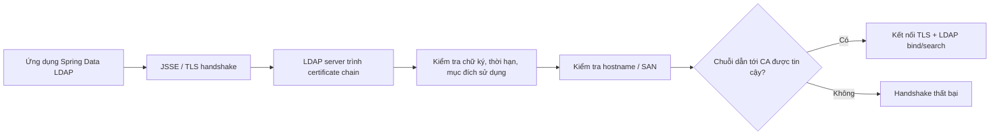
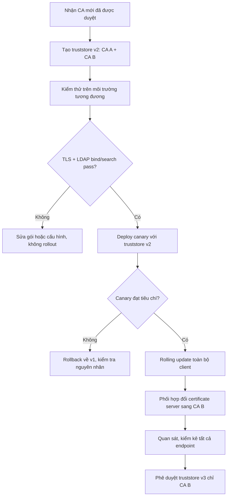

# Đóng gói chứng chỉ và cập nhật truststore có kiểm soát

## 1. Bối cảnh triển khai Spring Data LDAP qua TLS

Trong ứng dụng **Spring Data LDAP**, `LdapRepository` và `LdapTemplate` truy cập thư mục thông qua `ContextSource` của Spring LDAP/JNDI. Các thao tác như tìm `uid`, đọc `objectClass`, tra DN, kiểm tra nhóm và sửa entry đều có thể đi qua kết nối chứa thông tin nhạy cảm hoặc mật khẩu bind. Vì vậy, khi triển khai thực tế, ứng dụng cần **xác thực máy chủ LDAP bằng TLS**, đồng thời bảo vệ nội dung trao đổi.

Hai cách thiết lập kết nối mã hóa phổ biến:

- **LDAPS:** TLS được thiết lập ngay từ khi kết nối, thường qua `ldaps://ldap.example.org:636`.
- **StartTLS:** bắt đầu với kết nối LDAP thông thường (`ldap://...:389`), sau đó nâng cấp kết nối sang TLS **trước khi gửi thông tin xác thực hoặc dữ liệu nhạy cảm**. Đây là một cơ chế khác với LDAPS; chỉ đổi URL không tự bật StartTLS.

Để xác thực LDAP server, ứng dụng Java phải tin cậy một hoặc nhiều **CA/trust anchor** có thẩm quyền ký chuỗi chứng chỉ server. Một lỗi phổ biến khi di chuyển ứng dụng giữa laptop, container và production là: môi trường phát triển đã tin cậy CA nội bộ, nhưng Java runtime mới không có CA đó. Hậu quả là TLS handshake thất bại dù hostname, tài khoản bind và LDAP filter đều đúng.

**Mục tiêu của bài học:** biết phân biệt chứng chỉ và truststore, tạo truststore riêng cho ứng dụng Spring Data LDAP, phân phối nó an toàn khi deploy, lên kế hoạch luân chuyển CA/chứng chỉ mà không làm gián đoạn truy vấn LDAP, và xác minh/khôi phục khi rollout thất bại.

> **Nguyên tắc:** Chỉ thêm CA/chứng chỉ vào truststore sau khi xác minh nguồn gốc và fingerprint qua kênh độc lập đã được phê duyệt. Không tắt xác minh certificate chain hoặc hostname để làm ứng dụng “kết nối được”.

## 2. Truststore, keystore và chuỗi chứng chỉ khác nhau thế nào?

| Thành phần | Chứa dữ liệu gì? | Vai trò trong ứng dụng LDAP |
| --- | --- | --- |
| **Chứng chỉ server** | X.509 certificate với public key, tên DNS trong SAN, thời hạn, issuer và chữ ký | LDAP server trình bày cho client trong TLS handshake |
| **CA root / issuing CA** | Chứng chỉ của cơ quan cấp chứng chỉ, có public key và quyền ký phù hợp | Làm cơ sở xác thực chuỗi chứng chỉ server |
| **Truststore của client** | Danh sách chứng chỉ/CA được ứng dụng **chấp nhận làm tin cậy** | Java JSSE dùng để xây dựng/kiểm tra trust path cho server |
| **Keystore chứa private key** | Private key cùng certificate chain thuộc sở hữu bên kết nối | Cần khi ứng dụng thực hiện mutual TLS/client certificate; không cần cho bind LDAP bằng username/password qua LDAPS |
| **Bind credential** | DN/tài khoản cùng mật khẩu hoặc cơ chế xác thực khác | Được kiểm tra **sau khi** kết nối mã hóa và xác minh server thành công |

Một **truststore chỉ dùng để tin cậy** không cần chứa private key của LDAP server. Cấm sao chép private key của máy chủ vào ứng dụng client chỉ để “sửa lỗi TLS”.

Java JSSE thường dùng truststore theo định dạng **PKCS12** hoặc **JKS**. PKCS12 là lựa chọn phổ biến cho một truststore do dự án quản lý; loại thực tế phải khớp với cấu hình `trustStoreType` hoặc SSL bundle.

Đường đi xác minh có thể hình dung như sau:



Java không chỉ kiểm tra “có certificate trong file” mà còn cần kiểm tra **đường dẫn chứng thực (PKIX)** và **tên endpoint** theo cách TLS provider/JNDI áp dụng. Chứng chỉ có thể hợp lệ về chữ ký nhưng vẫn bị từ chối vì tên DNS trong `Subject Alternative Name` không khớp địa chỉ LDAP ứng dụng sử dụng.

### Chọn trust anchor với phạm vi phù hợp

Nếu directory dùng CA nội bộ, nên nhập **CA được đơn vị PKI phê duyệt** hoặc đúng trust anchor được quy định. Tránh thêm hàng loạt certificate tải từ mạng hoặc CA không liên quan vì điều đó mở rộng các chủ thể có thể được ứng dụng tin cậy. Nếu truststore riêng được cấu hình thay cho truststore JVM, đừng mặc định các CA trong `cacerts` cũng được cộng thêm: cấu hình truststore tùy chỉnh có thể **thay thế** tập CA mặc định, ảnh hưởng các kết nối TLS khác khi dùng cơ chế JSSE toàn JVM.

Đối với nhiều endpoint LDAP hoặc load balancer, xác minh **từng hostname thực tế** và chuỗi CA dự kiến. URL kết nối phải trùng tên có trong SAN của chứng chỉ. Nếu ứng dụng kết nối bằng IP thì certificate cần chứa SAN loại IP tương ứng.

## 3. Chuẩn bị chứng chỉ CA đáng tin cậy

### 3.1. Nhận chứng chỉ từ kênh chính thức

Quy trình chuẩn trước khi ghi vào truststore:

1. Nhận file PEM/DER CA từ nhóm quản trị PKI/LDAP hoặc kho chứng chỉ nội bộ có kiểm soát.
2. Đối chiếu **SHA-256 fingerprint**, subject, issuer, SAN/`Basic Constraints`, thời hạn và mục đích sử dụng với thông tin xác nhận qua kênh độc lập.
3. Xác minh đó là CA/trust anchor được chấp thuận dùng cho **LDAPS/StartTLS**, không phải một certificate ngẫu nhiên lấy từ kết nối chưa xác thực.
4. Lưu thông tin phê duyệt, fingerprint, môi trường được phép tin cậy, thời điểm hết hạn, người chịu trách nhiệm và phương án quay lui.

Ví dụ kiểm tra certificate đã được cung cấp bằng OpenSSL:

```bash
openssl x509 -in corporate-ldap-ca.pem -noout \
  -subject -issuer -dates -fingerprint -sha256
openssl x509 -in corporate-ldap-ca.pem -noout \
  -text
```

Phần `-text` giúp kiểm tra `Basic Constraints`, `Key Usage`, `Subject Key Identifier`, `Authority Key Identifier` khi cần. Không phải certificate nào tải được từ server cũng là CA phù hợp để đưa vào truststore.

Để **tham khảo** certificate mà endpoint đang trình bày:

```bash
openssl s_client \
  -connect ldap.prod.example.org:636 \
  -servername ldap.prod.example.org \
  -showcerts
```

Đây là bước **quan sát**, không phải bằng chứng certificate đáng tin. `-showcerts` chỉ in chuỗi được trình bày; cần so với CA/fingerprint đã được phê duyệt. Sau khi có CA đã xác minh, có thể kiểm tra đường kết nối và tên host:

```bash
openssl s_client \
  -connect ldap.prod.example.org:636 \
  -servername ldap.prod.example.org \
  -CAfile corporate-ldap-ca.pem \
  -verify_hostname ldap.prod.example.org \
  -verify_return_error
```

Các lệnh trên minh họa **LDAPS**. Đối với StartTLS, công cụ phải thực hiện **nâng cấp giao thức LDAP sang TLS**; không dùng nguyên lệnh LDAPS lên cổng 389 để suy ra StartTLS hoạt động.

### 3.2. Vì sao không nên import leaf certificate tùy tiện?

Nếu chỉ import certificate của **một LDAP server** làm trust anchor, lần đổi certificate ở server có thể khiến client mất khả năng xác thực, dù certificate mới vẫn do CA hợp lệ cấp. Cơ chế tin cậy dựa trên **CA phù hợp** thường hỗ trợ gia hạn leaf certificate mà không sửa truststore mỗi lần.

Có môi trường yêu cầu pinning hoặc chỉ cho phép một certificate/key cụ thể; đó là chính sách riêng, cần theo dõi lịch thay đổi và bảo đảm cơ chế quay vòng pin. Không được trộn khái niệm **tin cậy CA** với **pinning leaf certificate**.

## 4. Tạo truststore PKCS12 riêng cho ứng dụng

Ví dụ dưới đây dùng CA đã được xác minh, không chứa private key. Thực hiện ở môi trường phát hành có kiểm soát. Lệnh `keytool` **không có `-storepass`** để công cụ hỏi mật khẩu tương tác, tránh ghi bí mật trực tiếp vào lịch sử shell.

```bash
keytool -importcert \
  -alias corp-ldap-ca-2026 \
  -file corporate-ldap-ca.pem \
  -keystore ldap-truststore-v1.p12 \
  -storetype PKCS12
```

Khi nhập certificate từ bên ngoài, đọc thông tin mà `keytool` hiển thị, **đối chiếu fingerprint đã phê duyệt trước khi xác nhận**. Nếu `keytool` báo alias đã tồn tại, kiểm tra nội dung cũ và kế hoạch cập nhật; không ghi đè một trust anchor mà chưa xác minh.

Kiểm kê truststore vừa tạo:

```bash
keytool -list -v \
  -keystore ldap-truststore-v1.p12 \
  -storetype PKCS12
```

Xác nhận những điều sau:

- Alias `corp-ldap-ca-2026` trỏ đúng certificate đã được phê duyệt.
- Fingerprint SHA-256 trùng thông tin quản lý PKI.
- Kiểu entry thường là `trustedCertEntry`, không có private key ngoài ý muốn.
- Truststore không chứa certificate không cần thiết.

Đừng chỉnh sửa trực tiếp truststore mặc định của JRE (`$JAVA_HOME/lib/security/cacerts`) trong image hoặc ở máy chủ production. Việc nâng cấp JDK hay thay image có thể làm mất thay đổi, khó kiểm toán và ảnh hưởng mọi ứng dụng dùng cùng JRE.

### Đặt tên và phiên bản bất biến

Một cách tổ chức gói chứng chỉ:

```text
ldap-trust/
├── v1/
│   ├── corporate-ldap-ca.pem
│   ├── ldap-truststore.p12
│   └── manifest.txt
└── v2/
    ├── corporate-ldap-ca-old.pem
    ├── corporate-ldap-ca-new.pem
    ├── ldap-truststore.p12
    └── manifest.txt
```

`manifest.txt` có thể chứa fingerprint, alias, thời hạn, người duyệt, ID thay đổi và checksum của file `.p12`; nó **không** chứa mật khẩu. Các thư mục này là minh họa cho **artifact phát hành đã quản lý**; không tự động đưa truststore có mật khẩu hoặc cấu hình production vào Git công khai.

Bảo vệ tính toàn vẹn của truststore khi lưu trữ và phân phối: phiên bản bất biến, checksum, quyền sửa hạn chế, nhật ký phê duyệt và nguồn artifact đã xác thực. Dù certificate CA bản thân là dữ liệu công khai, **khả năng thêm CA tin cậy vào truststore là quyền nhạy cảm**.

## 5. Nạp truststore vào ứng dụng Java/Spring Data LDAP

Việc Spring Data LDAP truy cập directory qua repository hay `LdapTemplate` **không quyết định truststore**. TLS được thực hiện ở tầng JSSE, JNDI và cấu hình `ContextSource`.

### 5.1. Cách ưu tiên nếu Spring Boot hỗ trợ LDAP SSL bundle

Một số phiên bản Spring Boot hiện đại cung cấp **SSL bundle** cho LDAP client tự cấu hình, cho phép chỉ rõ truststore theo **một kết nối LDAP** thay vì thay tập trust anchor mặc định của toàn JVM. Cấu hình minh họa:

```yaml
spring:
  ssl:
    bundle:
      jks:
        ldap:
          truststore:
            location: "file:/etc/ldap-tls/ldap-truststore.p12"
            password: "${LDAP_TRUSTSTORE_PASSWORD}"
            type: "PKCS12"
  ldap:
    urls: "ldaps://ldap.prod.example.org:636"
    base: "dc=example,dc=org"
    username: "${LDAP_BIND_DN}"
    password: "${LDAP_BIND_PASSWORD}"
    ssl:
      bundle: "ldap"
```

Đặc điểm:

- `spring.ssl.bundle.jks.ldap.truststore.*` định nghĩa một bundle tên `ldap`, dù file lưu ở **định dạng PKCS12**.
- `spring.ldap.ssl.bundle=ldap` áp dụng bundle cho **LDAP ContextSource do Spring Boot tự cấu hình**, khi phiên bản hỗ trợ tính năng này.
- File được mount vào container tại đường dẫn chỉ đọc; mật khẩu truststore và bind password đến từ nguồn secret được kiểm soát, không hardcode.
- SSL bundle kiểu này dùng cho **`ldaps://`**. Nếu dùng `ldap://` với **StartTLS**, cần cấu hình `DirContextAuthenticationStrategy` như `DefaultTlsDirContextAuthenticationStrategy` và SSL socket factory tương thích.
- Nếu ứng dụng đã tự tạo bean `ContextSource`/`LdapContextSource` hoặc dùng phiên bản Spring Boot không có `spring.ldap.ssl.bundle`, cấu hình trên **không tự động áp dụng**. Cần kiểm tra dependency thực tế và cơ chế cấu hình thủ công.

Đây là ví dụ cho các bản Spring Boot có hỗ trợ mục cấu hình LDAP SSL bundle; hãy đối chiếu reference của **phiên bản đang triển khai** trước khi copy.

### 5.2. Cách dựa trên JSSE của JVM

Trong môi trường không dùng SSL bundle, JDK hỗ trợ các system property:

| System property | Mục đích |
| --- | --- |
| `javax.net.ssl.trustStore` | Đường dẫn truststore (ví dụ `/etc/ldap-tls/ldap-truststore.p12`) |
| `javax.net.ssl.trustStoreType` | Loại file, ví dụ `PKCS12` |
| `javax.net.ssl.trustStorePassword` | Mật khẩu mở/kiểm tra tính toàn vẹn truststore |
| `javax.net.debug` | Ghi log chẩn đoán TLS khi điều tra lỗi trong môi trường kiểm soát |

Ví dụ minh họa **hai thuộc tính không chứa bí mật**:

```bash
java \
  -Djavax.net.ssl.trustStore=/etc/ldap-tls/ldap-truststore.p12 \
  -Djavax.net.ssl.trustStoreType=PKCS12 \
  -jar ldap-client-app.jar
```

Cần cung cấp `javax.net.ssl.trustStorePassword` bằng cơ chế được bảo vệ tương ứng với runtime/truststore; đoạn lệnh trên không tự giải quyết việc cấp mật khẩu. **Không đặt mật khẩu thật vào câu lệnh, Git, image, Helm values công khai hay log**, vì command line và JVM argument có thể bị người khác đọc. Trong một số hệ thống, launcher dùng tệp option chỉ người chạy có quyền đọc hoặc ứng dụng đọc secret qua API bí mật; đánh giá khả năng lộ secret theo nền tảng đang dùng.

Thiết lập JSSE ở mức JVM có thể ảnh hưởng **mọi TLS client** trong cùng tiến trình. Nếu ứng dụng còn gọi API HTTPS, cơ sở dữ liệu TLS hoặc dịch vụ khác, hãy kiểm tra tất cả sau khi thay truststore; có thể cân nhắc SSL bundle/`SSLContext` riêng cho LDAP khi được hỗ trợ.

### 5.3. Đảm bảo cấu hình TLS áp dụng trước khi tạo kết nối

Các `SSLContext`/`TrustManager` hoặc connection pool có thể được khởi tạo từ cấu hình tại thời điểm khởi động. **Không mặc định** rằng ghi đè file `.p12` hoặc đổi system property trong lúc chạy sẽ tự cập nhật các kết nối đã mở.

Một quy trình an toàn là **khởi động instance mới** với truststore phiên bản mới, kiểm tra kết nối và chỉ sau đó đưa nó vào phục vụ. Với StartTLS, ngoài truststore còn phải xác thực rằng thao tác StartTLS hoàn tất **trước bind SIMPLE**, và tránh bật JNDI native pooling không tương thích với cơ chế TLS authentication strategy của Spring LDAP.

## 6. Đóng gói chứng chỉ trong container và Kubernetes

Có hai cách triển khai chính:

| Cách đóng gói | Ưu điểm | Hạn chế cần kiểm soát |
| --- | --- | --- |
| Đóng gói truststore trong image/container immutable | Đúng nội dung theo digest image, dễ kiểm soát phiên bản | Mỗi lần đổi CA phải build và phát hành image mới; tránh đưa secret/private key vào layer |
| Mount truststore qua Secret/volume hoặc hệ thống quản lý secret | Tách artifact chứng chỉ khỏi image ứng dụng, có thể cấp riêng theo môi trường | Cần quản lý version, RBAC, integrity, quyền đọc và **rollout để nạp lại** |

Trong Kubernetes, có thể tạo Secret có **tên gắn phiên bản** từ file truststore đã kiểm tra:

```bash
kubectl -n production create secret generic ldap-trust-v2 \
  --from-file=ldap-truststore.p12=./ldap-truststore-v2.p12
```

Đây chỉ là ví dụ thao tác tạo resource; bí mật `LDAP_TRUSTSTORE_PASSWORD` và `LDAP_BIND_PASSWORD` được cấp qua Secret manager/Secret khác theo quy trình tổ chức. Kubernetes Secret không mặc định thay thế quản lý quyền truy cập, encryption-at-rest và audit của cluster.

Phần Deployment minh họa cách mount:

```yaml
spec:
  template:
    spec:
      volumes:
        - name: ldap-trust
          secret:
            secretName: ldap-trust-v2
      containers:
        - name: ldap-client
          image: registry.example.org/ldap-client:2.3.0
          volumeMounts:
            - name: ldap-trust
              mountPath: /etc/ldap-tls
              readOnly: true
          env:
            - name: LDAP_TRUSTSTORE_PASSWORD
              valueFrom:
                secretKeyRef:
                  name: ldap-runtime-secrets
                  key: truststore-password
            - name: LDAP_BIND_DN
              valueFrom:
                secretKeyRef:
                  name: ldap-runtime-secrets
                  key: bind-dn
            - name: LDAP_BIND_PASSWORD
              valueFrom:
                secretKeyRef:
                  name: ldap-runtime-secrets
                  key: bind-password
```

Đây là **đoạn trích** từ Deployment, cần ghép với manifest đầy đủ (`apiVersion`, `kind`, `metadata`, `selector`, `template.metadata.labels`, probes và resources).

Tên Secret `ldap-trust-v2` giúp thay đổi rõ ràng, có thể kiểm toán. Khi chỉ cập nhật file trong Secret cũ, Kubernetes có thể cập nhật dữ liệu trên volume, nhưng **ứng dụng Java không mặc định reload** SSL context/truststore. Rollout các pod mới là lựa chọn dễ xác minh và khôi phục hơn.

Trong image/container, giảm quyền truy cập file truststore và secret bằng user không có đặc quyền, read-only mount và phân quyền cần thiết. Không copy password vào Dockerfile (`ARG`, `ENV`) hay log quy trình build.

## 7. Quy trình thay CA/truststore có kiểm soát

Giả sử directory đang dùng **CA A**, sắp chuyển sang **CA B**. Nếu LDAP server đổi certificate/chain trước khi các client được bổ sung CA B, nhiều kết nối có thể cùng lúc lỗi TLS. Ngược lại, xóa CA A khỏi truststore quá sớm có thể làm các LDAP node chưa đổi certificate bị từ chối.

Phương án thường dùng là **giai đoạn chồng lấn tin cậy** (*overlap*):

| Giai đoạn | Certificate chain trên LDAP server | Truststore phía ứng dụng | Mục tiêu |
| --- | --- | --- | --- |
| 0. Hiện tại | Được CA A ký | Tin CA A | Trạng thái ổn định |
| 1. Chuẩn bị | Vẫn CA A | Tin **CA A + CA B** | Client đã sẵn sàng chấp nhận CA mới |
| 2. Chuyển server | Dần dùng CA B; có thể còn node CA A | Tin **CA A + CA B** | Đảm bảo cả hai nhóm server đều truy cập được |
| 3. Ổn định | Tất cả endpoint dùng CA B | Tin **CA A + CA B** | Theo dõi, xác nhận không còn phụ thuộc CA A |
| 4. Thu hẹp | Dùng CA B | Chỉ tin CA B | Loại bỏ trust anchor cũ sau khi được phê duyệt |

Nếu CA A bị xâm phạm, không được kéo dài giai đoạn chồng lấn theo lịch thông thường; cần áp dụng quy trình xử lý sự cố PKI và loại bỏ CA không còn đáng tin.

### 7.1. Chuẩn bị gói truststore mới

Không sửa trực tiếp `ldap-truststore-v1.p12`. Sao chép bản v1 thành phiên bản mới rồi thêm CA đã duyệt:

```bash
cp ldap-truststore-v1.p12 ldap-truststore-v2.p12

keytool -importcert \
  -alias corp-ldap-ca-2027 \
  -file corporate-ldap-ca-new.pem \
  -keystore ldap-truststore-v2.p12 \
  -storetype PKCS12

keytool -list -v \
  -keystore ldap-truststore-v2.p12 \
  -storetype PKCS12
```

Trong ví dụ, mật khẩu được `keytool` hỏi tương tác. Bản v2 phải có cả **CA A và CA B** nếu mục tiêu là giai đoạn chồng lấn. Ghi nhận fingerprint của cả hai, tổng số entry và checksum của artifact v2. Kiểm tra certificate mới phù hợp thời hạn, extension `Basic Constraints/Key Usage` và chính sách CA.

Không xóa trust anchor cũ theo suy đoán “mọi node đã chuyển”; cần kiểm tra thực tế toàn bộ LDAP endpoint, referral, load balancer, môi trường DR và các đường kết nối dự phòng.

### 7.2. Chuỗi rollout/rollback



Các bước vận hành cần kiểm soát:

1. **Thông báo thay đổi:** phạm vi ứng dụng/LDAP endpoint ảnh hưởng, người phê duyệt, thời gian thực hiện, thời gian quan sát, điều kiện quay lui.
2. **Preflight:** so fingerprint, validity, SAN, CA chain; thử trên tất cả loại image/JDK và môi trường tương đương.
3. **Canary:** khởi động một instance dùng v2; thực hiện LDAP bind và truy vấn nhỏ đã biết DN/filter.
4. **Rollout:** cập nhật Deployment/image/Secret reference theo phiên bản, giới hạn tỷ lệ pod thay và theo dõi readiness.
5. **Hậu kiểm:** xác minh TLS handshake trên **kết nối mới**, bind, tìm kiếm `LdapTemplate`/repository và các luồng chức năng quan trọng.
6. **Rollback:** nếu phát hiện lỗi, chuyển về artifact/manifest v1 còn tin cậy **khi server vẫn sử dụng CA A**; nếu server đã chỉ dùng CA B, phải phối hợp quay lại certificate của server hoặc dùng một truststore đã kiểm thử hỗ trợ chain thực tế.

Trong Kubernetes, sau khi cập nhật Deployment theo quy trình phát hành, có thể theo dõi:

```bash
kubectl -n production rollout status deployment/ldap-client
```

Nếu rollback được cho phép và phiên bản cũ vẫn tương thích với certificate LDAP hiện tại:

```bash
kubectl -n production rollout undo deployment/ldap-client
```

**Rollback deployment không đảm bảo kết nối thành công** nếu phía LDAP server đã chuyển sang CA B mà truststore v1 chỉ chứa CA A. Điều kiện rollback cần được kiểm tra trong từng giai đoạn.

## 8. Kiểm thử truststore trước và sau deploy

Một phép kiểm thử đúng cần quan sát **đường kết nối từ chính runtime ứng dụng**, không chỉ chạy `openssl` từ laptop.

### 8.1. Bộ kiểm thử tối thiểu

| Kiểm tra | Kỳ vọng |
| --- | --- |
| Truststore mở thành công | Đúng định dạng PKCS12/mật khẩu, alias/fingerprint chính xác |
| Certificate server hợp lệ | Chain về CA đã tin, trong thời hạn, SAN khớp hostname LDAP |
| LDAPS/StartTLS handshake | Không có lỗi TLS với JDK và mạng production |
| Bind bằng service account | Thành công với quyền tối thiểu; không lộ mật khẩu |
| Đọc entry đã biết | `LdapTemplate`/repository đọc một entry hoặc thuộc tính dự kiến |
| Search theo DN/filter | Đúng base/scope, trả thuộc tính được ACL cho phép |
| Thử server CA A và CA B trong giai đoạn overlap | Truststore v2 chấp nhận cả hai |
| Thử sai CA / sai hostname | TLS từ chối như mong đợi |
| Scale/rolling restart | Pod mới tạo kết nối TLS thành công; pod cũ rút khỏi traffic có kiểm soát |
| Khôi phục | Rollback có thể thực hiện theo trạng thái CA server và tài nguyên hiện có |

Ví dụ một health check Java đơn giản tại tầng ứng dụng có thể đọc đúng entry cấu hình, tránh truy vấn cả directory:

```java
import javax.naming.directory.SearchControls;
import org.springframework.ldap.core.LdapTemplate;

public class LdapConnectivityCheck {
    private final LdapTemplate ldapTemplate;

    public LdapConnectivityCheck(LdapTemplate ldapTemplate) {
        this.ldapTemplate = ldapTemplate;
    }

    public boolean check() {
        SearchControls controls = new SearchControls();
        controls.setSearchScope(SearchControls.OBJECT_SCOPE);
        controls.setReturningAttributes(new String[] { "objectClass" });
        controls.setCountLimit(1);
        controls.setTimeLimit(2000);

        // ContextSource được cấu hình base=dc=example,dc=org.
        // ou=people phải tồn tại và service account được quyền tìm kiếm.
        return !ldapTemplate.search(
            "ou=people",
            "(objectClass=organizationalUnit)",
            controls,
            attrs -> Boolean.TRUE
        ).isEmpty();
    }
}
```

Đây là ví dụ **kiểm tra chức năng**, không phải lời khuyên chạy một truy vấn LDAP cho từng HTTP request hoặc trong readiness probe quá dày đặc. Thời gian kết nối/bind có thể vượt thời gian `SearchControls`; phải cấu hình thêm **connect timeout/read timeout** ở JNDI/ContextSource phù hợp. Một lần check có kết quả `false` không phân biệt được lỗi TLS với entry không tồn tại; trong hệ thống production cần phân loại exception và giám sát.

### 8.2. Khi nào một gói truststore đã sẵn sàng?

Một gói đáng phát hành phải có:

- Danh sách certificate dự kiến với fingerprint và ngày hết hạn.
- Chứng cứ nguồn gốc/duyệt và checksum của artifact.
- Thử thành công trên image/JDK tương đương production.
- Thử **không thành công** với CA không được tin cậy và hostname sai.
- Kế hoạch rollout, rollback, người chịu trách nhiệm và tiêu chí dừng.
- Kiểm kê các LDAP endpoint, bao gồm node sau load balancer, referral và phương án dự phòng.

Tập kiểm thử này đặc biệt cần khi ứng dụng Spring Data LDAP kết nối nhiều directory với schema, ACL hoặc CA khác nhau.

## 9. Chẩn đoán lỗi TLS và LDAP sau cập nhật

| Triệu chứng | Nguyên nhân phổ biến | Cách xử lý đúng |
| --- | --- | --- |
| `PKIX path building failed` / `unable to find valid certification path` | Thiếu trust anchor phù hợp, chain từ server thiếu hoặc truststore nạp sai | Kiểm tra chain, alias/fingerprint, file thực được JVM tải và nguồn CA đã duyệt |
| `No subject alternative DNS name matching ...` | Hostname dùng kết nối không nằm trong SAN server certificate | Dùng hostname đúng hoặc cấp lại certificate có SAN phù hợp |
| `Keystore was tampered with, or password was incorrect` / lỗi load keystore | Sai password/định dạng/corrupt file | Kiểm tra file PKCS12, mật khẩu secret và tính toàn vẹn artifact |
| `Connection refused`, timeout, reset | DNS, mạng, firewall, cổng hoặc server không phục vụ | Kiểm tra đường mạng/port và tình trạng listener |
| `Invalid credentials` / LDAP result code `49` | Bind DN hoặc password bị từ chối **sau khi TLS đã hoạt động** | Kiểm tra secret và chính sách tài khoản, không tự chỉnh truststore |
| `Insufficient access rights` / LDAP result code `50` | ACL không cho phép thao tác | Cấp đúng quyền cần thiết, kiểm tra DN/schema |
| Chỉ instance cũ thành công, instance mới lỗi | Image/JDK, secret mount, SSL bundle hoặc config khác nhau | So cấu hình, version artifact, checksum và đường dẫn giữa pod |
| Đổi Secret rồi app vẫn dùng CA cũ | `SSLContext`/pool đã khởi tạo, ứng dụng không tự reload | Rolling restart hoặc cơ chế reload có xác nhận hỗ trợ |
| Chỉ fail sau đổi node/load balancer | Các node có SAN/CA chain khác nhau | Kiểm tra từng endpoint và cập nhật nhất quán |

Để chẩn đoán JSSE trong môi trường giới hạn quyền, có thể bật tạm thời thông tin TLS handshake/trust manager (ví dụ `javax.net.debug=ssl,handshake,trustmanager`) và **tắt sau khi xử lý**. Debug có thể tạo log rất lớn, phơi bày chi tiết kết nối và certificate; quản lý log như thông tin vận hành nhạy cảm.

Tuyệt đối không dùng `TrustManager` chấp nhận mọi certificate, không tắt endpoint identification, không bật lại TLS cũ/yếu chỉ để vượt qua lỗi triển khai. Những cách này làm mất mục tiêu xác thực LDAP server.

## 10. Các câu hỏi tự kiểm tra

1. Truststore của client có cần chứa private key LDAP server không? Trường hợp nào Java client mới cần keystore có private key riêng?
2. Vì sao tải certificate từ `openssl s_client -showcerts` rồi import ngay là một quy trình không đáng tin?
3. `javax.net.ssl.trustStore` ở mức JVM khác SSL bundle riêng cho LDAP như thế nào đối với các dịch vụ HTTPS khác của cùng ứng dụng?
4. Nếu LDAP certificate được thay mỗi 90 ngày nhưng cùng được CA nội bộ ký, có nhất thiết sửa truststore mỗi lần không?
5. Khi luân chuyển CA A sang B, vì sao cần giai đoạn truststore **A + B**? Khi nào cần rút ngắn giai đoạn này?
6. Vì sao thay file `.p12` được mount trong Kubernetes chưa chắc cập nhật được TLS connection đang mở?
7. Nếu canary fail vì SAN không khớp hostname, giải pháp là gì? Tại sao tắt hostname verification không phù hợp?
8. Khi server đã đổi sang CA B, rollout undo về phiên bản client chỉ tin CA A có thể xảy ra điều gì?
9. Hãy thiết kế kiểm thử chứng minh cả ca kết nối đúng CA và ca certificate bị ký bởi CA không được phép.
10. Nếu `LdapTemplate.search(...)` trả lỗi `Invalid credentials` sau rotation, bạn sẽ xác minh những gì trước khi kết luận lỗi do truststore?

## 11. Tổng kết

Trong Spring Data LDAP, **truststore quyết định CA/chứng chỉ nào Java tin khi thiết lập TLS với LDAP server**, còn repository và `LdapTemplate` sử dụng kết nối do `ContextSource` tạo ra. Quy trình triển khai tốt bắt đầu từ CA đã được xác minh, tạo **truststore PKCS12 có phiên bản**, nạp bằng SSL bundle hoặc JSSE theo runtime thực tế, phân phối qua artifact/secret có kiểm soát, kiểm thử trên kết nối mới và rollout từng bước.

Khi chuyển CA, ưu tiên giai đoạn chồng lấn tin cậy và chỉ loại bỏ CA cũ sau khi đã kiểm kê tất cả endpoint. **File đổi không đồng nghĩa trust manager tự reload**, và rollback chỉ an toàn khi client cũ vẫn tin certificate server hiện hành. Những chi tiết này quyết định tính ổn định của các thao tác truy vấn, CRUD và xác thực LDAP trong môi trường production.

### Tài liệu tham khảo

- [Java Secure Socket Extension (JSSE) Reference Guide — Java 21](https://docs.oracle.com/en/java/javase/21/security/java-secure-socket-extension-jsse-reference-guide.html).
- [Oracle `keytool` Command](https://docs.oracle.com/en/java/javase/21/docs/specs/man/keytool.html).
- [Spring Boot — SSL Bundles](https://docs.spring.io/spring-boot/reference/features/ssl.html).
- [Spring Boot — LDAP Configuration and SSL](https://docs.spring.io/spring-boot/reference/data/nosql.html).
- [Spring LDAP — Configuration / TLS Authentication Strategies](https://docs.spring.io/spring-ldap/reference/configuration.html).
- [Spring LDAP — `AbstractTlsDirContextAuthenticationStrategy`](https://docs.spring.io/spring-ldap/reference/api/java/org/springframework/ldap/core/support/AbstractTlsDirContextAuthenticationStrategy.html).
- [RFC 4513 — LDAP Authentication Methods and Security Mechanisms](https://www.rfc-editor.org/rfc/rfc4513).
