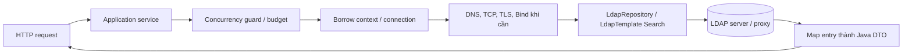

# Thiết lập timeout, pool và giới hạn đồng thời theo hạ tầng

Trong chương **Triển khai** của **SPRING_DATA_LDAP**, kết nối LDAP không chỉ cần đúng URL, DN và thông tin Bind. Một ứng dụng Java có thể hoạt động tốt khi thử với vài tài khoản, nhưng chậm hoặc ngừng đáp ứng khi triển khai nhiều replica, có hàng trăm request đồng thời, LDAP server quá tải hoặc đường truyền bị ngắt. Ba nhóm tham số cần phối hợp là:

1. **Timeout:** một thao tác được phép chờ đến mức nào ở từng bước kết nối, Bind, Search và tại API?
2. **Pool:** ứng dụng có thể tái sử dụng bao nhiêu kết nối/context, trong điều kiện an toàn nào?
3. **Giới hạn đồng thời:** tại một thời điểm có tối đa bao nhiêu thao tác được gửi tới directory để không vượt khả năng của cả client lẫn server?

Spring Data LDAP cung cấp mô hình `LdapRepository` và ánh xạ `@Entry`/`@Id`/`@Attribute`; Spring LDAP cung cấp `LdapTemplate` và `ContextSource`. Các API này sử dụng directory có DN phân cấp, `objectClass` và schema, nhưng **không tự biết** ngân sách CPU, số kết nối tối đa, timeout của load balancer hay số replica triển khai trong môi trường của bạn. Vì vậy phải thiết kế cấu hình theo dữ liệu đo thực tế và khả năng của hạ tầng.

**Mục tiêu:** phân biệt đúng các lớp timeout; nhận diện các lựa chọn pooling và trường hợp không nên pool; tính ngân sách đồng thời theo số replica; áp dụng backpressure, giới hạn Search và retry có kiểm soát; quan sát, kiểm thử và triển khai cấu hình an toàn.

## 1. Nhìn luồng một request LDAP trước khi chọn con số

Một request HTTP tra cứu nhân viên có thể đi qua các bước sau:



Không phải request nào cũng mở kết nối và Bind mới; khi tái sử dụng context, một số bước có thể được bỏ qua hoặc đã xảy ra trước đó. Tuy nhiên, các bước **tìm được context**, **gửi LDAP request** và **chờ phản hồi** vẫn tiêu tốn tài nguyên. Một request ở tầng HTTP có thể tạo **nhiều** LDAP operation, ví dụ tìm DN người dùng, tìm nhóm rồi đọc thuộc tính.

Các lớp giới hạn giải quyết các vấn đề khác nhau:

| Cơ chế | Chủ yếu kiểm soát | Không bảo đảm |
| --- | --- | --- |
| **Connect timeout** | Thời gian chờ thiết lập kết nối mạng tới endpoint | Giới hạn tổng thời gian cả request HTTP hoặc LDAP Search |
| **Read timeout** | Thời gian chờ dữ liệu/phản hồi từ socket theo provider | Server hoàn tất toàn bộ Search trước deadline nghiệp vụ |
| **Search time limit** | Giới hạn thời gian được yêu cầu cho thao tác Search | DNS, bắt tay TLS, mượn context và bước xử lý sau Search |
| **Pool size** | Số connection/context có thể duy trì và tái sử dụng trong một phạm vi pool | Số LDAP operation đang chạy đồng thời trên toàn bộ cluster |
| **Concurrency limit** | Số công việc LDAP ứng dụng cho phép thực thi đồng thời | Một kết nối đã mượn sẽ không chậm, hoặc directory sẽ không từ chối query |
| **Request deadline** | Ngân sách thời gian hoàn tất một use case/application request | Hủy được tức thì mọi thao tác JNDI đang chờ I/O |

**Không có một con số timeout duy nhất cho toàn hệ thống.** Một call có thể chịu nhiều deadline, và một timeout ở tầng ngoài không tự cắt được socket đang treo ở tầng trong.

## 2. Phân biệt các loại timeout ở LDAP client

### 2.1. Timeout kết nối TCP và timeout chờ phản hồi

Với **LDAP provider của JNDI trong JDK**, các thuộc tính môi trường thường dùng là:

| Thuộc tính JNDI | Đơn vị | Ý nghĩa thực tế |
| --- | --- | --- |
| `com.sun.jndi.ldap.connect.timeout` | **Mili giây** | Giới hạn chờ tạo kết nối TCP mới tới LDAP endpoint theo khả năng của provider |
| `com.sun.jndi.ldap.read.timeout` | **Mili giây** | Giới hạn chờ đọc phản hồi LDAP trên kết nối theo cơ chế của provider |

Hai tên này là **thuộc tính của LDAP provider JNDI cụ thể**, không phải hằng số của giao thức LDAP hay cấu hình bắt buộc của mọi client. Chúng có hiệu lực theo cơ chế provider/JDK được sử dụng; với client hoặc provider khác phải xem tài liệu tương ứng.

Ví dụ đặt connect timeout là `2_000` ms và read timeout là `4_000` ms. Nếu endpoint không mở cổng, ứng dụng không nên treo quá lâu để chờ TCP. Nếu socket đã mở nhưng server ngừng gửi phản hồi, giới hạn đọc phải giúp application thread thoát khỏi chờ vô hạn.

**Điều quan trọng:** một giá trị read timeout không bảo đảm **toàn bộ** Search luôn kết thúc trong chừng đó thời gian. Search có nhiều entry có thể gửi dữ liệu thành các đợt; khoảng chờ của từng lần đọc và timeout tổng thể là hai khái niệm khác nhau. DNS, TLS handshake, xử lý referral và việc mượn context cũng có các đặc tính riêng. Đặt deadline ở tầng use case nếu cần giới hạn toàn bộ công việc.

### 2.2. Search time limit không phải socket timeout

JNDI `SearchControls` cho phép cấu hình giới hạn thời gian tìm kiếm:

```java
import javax.naming.directory.SearchControls;

SearchControls controls = new SearchControls();
controls.setSearchScope(SearchControls.SUBTREE_SCOPE);
controls.setCountLimit(100L);
controls.setTimeLimit(2_500); // 2500 ms cho Search, không phải 2500 giây
controls.setReturningAttributes(new String[]{"uid", "cn", "mail"});
```

Ở đây:

- `setTimeLimit(2_500)` đặt **2.500 mili giây** cho SearchControls; provider chuyển yêu cầu sang thao tác LDAP tương ứng.
- LDAP giao thức có trường `timeLimit` với đơn vị **giây**; cách làm tròn/chuyển đổi phụ thuộc provider. Không giả định độ chính xác tới từng mili giây của giới hạn phía server.
- Server có thể trả mã LDAP **`3 timeLimitExceeded`** nếu Search vượt giới hạn do server áp dụng.
- Socket timeout ở phía Java có thể xảy ra **mà không có** phản hồi LDAP, nên không được tự gắn mã `3` cho mọi lần timeout.
- `setCountLimit(100)` không phải phân trang và không có nghĩa toàn bộ directory chỉ có 100 entry.

Tương tự, `LdapQueryBuilder` có thể diễn đạt giới hạn ngay trong query:

```java
import org.springframework.ldap.query.LdapQuery;
import org.springframework.ldap.query.LdapQueryBuilder;
import org.springframework.ldap.query.SearchScope;

LdapQuery query = LdapQueryBuilder.query()
    .base("ou=people")
    .searchScope(SearchScope.SUBTREE)
    .countLimit(100)
    .timeLimit(2_500)
    .attributes("uid", "cn", "mail")
    .where("objectClass").is("inetOrgPerson")
    .and("uid").is(uid);
```

`uid` phải được đưa vào filter thông qua API builder/escape an toàn, thay vì nối chuỗi thô. Base `ou=people` là DN tương đối khi `ContextSource.base=dc=example,dc=org`. Cấu hình timeout **không thay** việc chọn base, scope và filter hiệu quả.

### 2.3. Timeout của pool và deadline ở tầng ứng dụng

Nếu sử dụng pool có giới hạn, ứng dụng cần đặt **thời gian chờ mượn connection/context**. Khi pool đã hết connection, chờ vô hạn làm backlog tăng và chiếm hết request thread. Pool-specific API thường có khái niệm `maxWait`/borrow wait nhưng **tên và đơn vị chính xác phụ thuộc implementation**; không thể dùng `SearchControls.setTimeLimit` để đặt timeout mượn pool.

Một request có thể còn các tầng timeout:

| Tầng | Ví dụ | Khi vượt giới hạn |
| --- | --- | --- |
| API gateway / reverse proxy | 8 giây cho một request | Client có thể nhận 504/timeout dù LDAP vẫn còn đang chạy |
| Application use case | Deadline 6 giây cho tra cứu | Service dừng chờ hoặc trả lỗi theo chính sách; cần phối hợp timeout tầng dưới |
| Chờ permit/backpressure | Tối đa 200 ms | Từ chối/đợi xử lý lại có kiểm soát nếu LDAP đang hết ngân sách |
| Mượn context từ pool | Tối đa 300 ms, nếu pool hỗ trợ | Báo pool exhausted hoặc timeout mượn |
| Kết nối mới | 2 giây | Báo transport/connect failure |
| Chờ phản hồi | 4 giây | Báo read timeout theo provider |
| Search server-side | Khoảng 2,5 giây yêu cầu | Có thể nhận `timeLimitExceeded` hoặc trả dữ liệu một phần |

**Các giá trị trong bảng chỉ là ví dụ thiết kế, không phải mặc định được đề xuất cho mọi hệ thống.** Các giới hạn có thể chồng lấn, không cộng máy móc thành một tổng chính xác. Với retry, failover hoặc nhiều LDAP operation trong một request, thời gian cộng dồn có thể vượt ngân sách dù mỗi thao tác riêng lẻ vẫn tuân thủ timeout.

## 3. Cấu hình JNDI timeout trong Spring LDAP

Giả sử ứng dụng Spring Boot dùng một directory với base DN `dc=example,dc=org` và kết nối qua LDAPS:

```yaml
# application.yml — ví dụ endpoint/credential, không phải cấu hình pool.
spring:
  ldap:
    urls: ldaps://directory.example.org:636
    base: dc=example,dc=org
    username: uid=app-reader,ou=services,dc=example,dc=org
    password: ${LDAP_BIND_PASSWORD}
```

`spring.ldap.urls` quyết định endpoint; `spring.ldap.base` là DN gốc; `spring.ldap.username` là danh tính Bind của tài khoản dịch vụ. Chúng **khác nhau** với timeout của JNDI và khác với base của từng query/repository. Cần dùng LDAPS hoặc StartTLS đã xác minh CA/hostname; không hạ cấp về simple Bind không mã hóa để vượt lỗi timeout/certificate.

Ví dụ cấu hình trực tiếp một `LdapContextSource` với các thuộc tính môi trường JNDI:

```java
import java.util.Map;
import org.springframework.ldap.core.support.LdapContextSource;

public final class DirectoryContextFactory {
    public static LdapContextSource create(
            String bindDn, String bindPassword) {

        LdapContextSource source = new LdapContextSource();
        source.setUrl("ldaps://directory.example.org:636");
        source.setBase("dc=example,dc=org");
        source.setUserDn(bindDn);
        source.setPassword(bindPassword);
        source.setBaseEnvironmentProperties(Map.of(
            "com.sun.jndi.ldap.connect.timeout", "2000",
            "com.sun.jndi.ldap.read.timeout", "4000"
        ));
        source.setPooled(false); // chưa bật JNDI pooling
        source.afterPropertiesSet();
        return source;
    }
}
```

Đây là ví dụ **tạo ContextSource để minh họa chính sách timeout**, không phải chỉ dẫn để tạo context mới mỗi khi request đến. Trong ứng dụng Spring, thông thường nên khai báo một bean `ContextSource` được container quản lý hoặc cấu hình properties của Boot khi phiên bản hỗ trợ, và **không** tạo nguồn kết nối mới ở từng request.

Nếu ứng dụng đã được Spring Boot tự cấu hình `ContextSource`, thêm bean tự định nghĩa có thể khiến auto-configuration thay đổi. Cần xác minh bean mà `LdapRepository`, `LdapTemplate` và thành phần xác thực đang dùng. Các tài khoản LDAP dùng để tra cứu và xác thực người dùng có thể cần **ContextSource và chính sách pooling khác nhau**.

**Lưu ý quan trọng với JNDI:** provider của JDK là phần hạ tầng thực thi; thuộc tính `com.sun.jndi.ldap.*` không phải chuẩn LDAP công bố cho mọi thư viện Java. Khi nâng JDK/provider, cần chạy thử timeout thật bằng cách chặn mạng hoặc làm server chậm, không chỉ kiểm tra biến cấu hình đã được nạp.

## 4. Pool thực chất tái sử dụng tài nguyên nào?

Khi kết nối LDAP, client thường phải thực hiện TCP, TLS, có thể Bind và tạo context. Với lưu lượng đều, mỗi request mở/đóng kết nối mới có thể tạo chi phí mạng, handshake TLS, CPU và giới hạn socket/file descriptor. Pool giúp **tái sử dụng** các kết nối hoặc context hợp lệ thay vì liên tục tạo chúng.

### 4.1. Pool connection/context khác một hàng đợi vô hạn

```text
Application threads       Pool / ContextSource       LDAP Directory
     request A  ────┐
     request B  ────┼─> borrow  [conn 1] ───────> Search/Modify
     request C  ────┘           [conn 2] ───────> Search
     request D  ────────> wait / reject when capacity exhausted
```

Một pool có thể giới hạn **connection được quản lý trong pool**, nhưng bản thân nó không bảo đảm toàn cluster chỉ có số connection đó:

- Một JVM có thể có nhiều `ContextSource`, nhiều pool, các connection tạo ngoài pool hoặc nhiều danh tính Bind.
- Một ứng dụng có nhiều replica; mỗi replica có pool riêng.
- Referral hoặc failover có thể mở connection tới endpoint khác.
- Health check, batch job, LDAP authentication theo người dùng và tác vụ quản trị có thể dùng connection riêng.

Do đó, **pool size và concurrency limit phải được xem xét cùng nhau**. Pool quá lớn dễ làm LDAP server cạn connection/thread; pool quá nhỏ tạo hàng đợi và tăng latency dù server vẫn còn năng lực.

### 4.2. Các lựa chọn pooling thường gặp

| Cách triển khai | Đặc điểm | Cần kiểm tra |
| --- | --- | --- |
| **Không dùng pool** | Mỗi context dùng vòng đời kết nối riêng; đơn giản về trạng thái | TCP/TLS/Bind overhead, lượng kết nối mới, latency |
| **JNDI LDAP connection pooling** | Khả năng tái sử dụng connection của JDK LDAP provider | Thuộc tính provider, phân nhóm theo connection identity, TLS/StartTLS, max size/idle timeout và điều kiện đủ để pool |
| **Spring LDAP pooling module** | Pool context ở tầng Spring LDAP, có thể hỗ trợ giới hạn borrow/validation theo phiên bản và module | Phiên bản dependency, cấu hình pool, validation, idle eviction, timeout mượn, TLS |
| **Pool do client thư viện khác cung cấp** | Thông số và kiểu connection riêng | Không dùng nhầm thuộc tính JNDI cho thư viện không dựa trên JNDI |

Không nên xếp **JNDI pool** chồng lên **Spring LDAP pool** khi chưa hiểu rõ vòng đời và cơ chế giới hạn. Hai tầng pool lồng nhau có thể khó dự đoán lượng connection, trạng thái Bind và cách phát hiện connection chết.

### 4.3. JNDI pooling và các thuộc tính dễ nhầm

Đối với JDK JNDI LDAP provider, việc yêu cầu dùng JNDI pool thường liên quan thuộc tính môi trường:

```java
// Minh họa thuộc tính môi trường của một LDAP Context.
env.put("com.sun.jndi.ldap.connect.pool", "true");
```

Một số thông số pool phía JNDI được thiết lập bằng **JVM system properties**, ví dụ:

```text
-Dcom.sun.jndi.ldap.connect.pool.maxsize=16
-Dcom.sun.jndi.ldap.connect.pool.prefsize=8
-Dcom.sun.jndi.ldap.connect.pool.timeout=60000
```

**Đừng nhầm `connect.pool.timeout` với connect timeout hay read timeout.** Nó liên quan thời gian tồn tại/nhàn rỗi trong pool của provider, không phải giới hạn một LDAP Search chạy bao lâu. Các cấu hình JNDI pool có phạm vi trong JVM và phân nhóm kết nối theo **connection identity** (địa chỉ, xác thực, thiết lập giao thức liên quan). Vì vậy `maxsize=16` **không nên được coi là trần 16 connection cho toàn bộ ứng dụng**, đặc biệt nếu có nhiều identity/endpoint. Chế độ pool của từng kiểu TLS hoặc authentication cũng có điều kiện riêng; không mặc định bật thuộc tính là mọi connection sẽ được pool.

Đặc biệt, khi dùng **LDAPS** và muốn pooling theo JNDI, phải xác minh JDK provider hỗ trợ protocol/authentication của connection đó và đã cấu hình lựa chọn protocol pool phù hợp. Đừng suy luận rằng một socket TLS được tái sử dụng chỉ vì URL bắt đầu bằng `ldaps://`.

### 4.4. StartTLS và connection state: không tái sử dụng tùy tiện

**StartTLS** bắt đầu từ một kết nối LDAP rồi nâng cấp **chính kết nối đó** sang TLS trước khi gửi thông tin xác thực. Kết nối LDAP còn có trạng thái Bind, controls, referral và có thể có các thao tác mở rộng. Pooling sai có nguy cơ tái sử dụng context không đúng trạng thái hoặc dùng lại một kết nối chưa được thiết lập TLS đúng quy trình.

Với Spring LDAP khi dùng chiến lược StartTLS, cần **tắt JNDI pooling** theo hướng dẫn của phiên bản thư viện/chiến lược và kiểm tra vòng đời TLS khi mượn/trả context. Ví dụ `source.setPooled(false)` là một biện pháp cần thiết ở mức `ContextSource`. Không bật pooling chỉ vì thấy throughput tăng trên máy phát triển.

Nếu có yêu cầu tái sử dụng connection StartTLS, chỉ áp dụng khi **pool implementation thực sự hỗ trợ, bảo đảm TLS và Bind state đúng**, có kiểm thử tương thích với JDK/server đang dùng. Nếu không, ưu tiên tính đúng và bảo mật thay vì giảm handshake.

### 4.5. Service Bind khác user Bind

Ứng dụng thường có một tài khoản `directory-reader` dùng tìm kiếm, nhưng quá trình đăng nhập của người dùng có thể thực hiện **Bind bằng credential của từng user**. Không được dùng một kết nối đã Bind với danh tính A để chạy truy vấn mang quyền của B chỉ vì chúng có cùng URL.

Đối với luồng xác thực, phải xét cách Spring Security LDAP tạo và đóng context, trạng thái authentication, TLS và quyền. Pool đọc danh bạ bằng **service account** không đương nhiên phù hợp với hàng nghìn danh tính user khác nhau. Nếu pool có identity riêng cho mỗi user, số connection có thể tăng mạnh hơn dự kiến.

## 5. Giới hạn đồng thời dựa trên ngân sách thực của directory

**Concurrency** là số công việc đang thực hiện đồng thời, không phải số request mỗi giây và cũng không hoàn toàn bằng số socket. Một LDAP server có thể giữ nhiều kết nối nhưng chỉ chịu tốt một số lượng Search phức tạp cùng lúc.

Một phép ước lượng ban đầu sử dụng **định luật Little**:

\[
L \approx \lambda \times W
\]

Trong đó:

- `L`: số LDAP operation **đang xử lý trung bình**.
- `λ`: tốc độ đến trung bình, đơn vị **operation/giây**.
- `W`: thời gian xử lý trung bình của một operation, đơn vị **giây**.

Ví dụ hệ thống dự kiến **300 LDAP operation/giây** được phân bố đều lên **4 replica**, và thời gian trung bình một operation ở trạng thái ổn định là **80 ms = 0,08 giây**:

```text
Trung bình mỗi replica:   300 / 4 = 75 operation/giây
Concurrent trung bình:    75 × 0,08 = 6 operation/replica

Giả sử đặt trần thử nghiệm 16 operation đồng thời/replica:
Giới hạn tổng do app kiểm soát: 4 × 16 = 64 in-flight operation
```

`6` là **mức trung bình**, không phải con số pool tối ưu hay đủ cho mọi burst. Trần 16 chỉ là **giả định thử nghiệm** để đo tải, không phải kết luận an toàn. Nếu directory chỉ chịu được 40 Search nặng đồng thời, 64 vẫn là quá cao. Nếu còn 20 instance từ một dịch vụ khác đang truy cập cùng LDAP cluster, ngân sách thực của ứng dụng này phải nhỏ hơn.

### 5.1. Những câu hỏi phải trả lời trước khi sizing

1. **Directory cho phép bao nhiêu connection và Search song song** theo tài liệu/đo tải? Có giới hạn riêng cho account Bind, IP, frontend, backend hoặc OU không?
2. **Bao nhiêu replica** có thể chạy tối đa khi autoscale, rollout chồng lấp hoặc chạy batch? Tính cả số pod tạm trong rolling deployment.
3. **Mỗi request HTTP phát sinh bao nhiêu LDAP operation?** Ví dụ một request tra user rồi tra 5 group không phải một operation.
4. **Tỉ lệ Search/Bind/Modify/Delete** ra sao? Search subtree rộng khác hẳn lookup theo DN hoặc Modify một attribute.
5. **Độ trễ trung bình và p95/p99** tại tải thực? Công thức Little dùng **thời gian trung bình**; p95/p99 dùng để đánh giá tail latency và chọn headroom, không thay trực tiếp vào công thức trung bình mà coi là kết quả chính xác.
6. **Còn những client nào khác dùng chung directory?** IAM, HR sync, Linux NSS/SSSD, monitoring, job provisioning, ứng dụng ngoài nhóm.
7. **Khi directory chậm 5–10 lần** vì replication hoặc tải, số in-flight sẽ tăng đến đâu nếu không có guard?

**Đặt trần theo ngân sách toàn hạ tầng, rồi chia cho các replica.** Không suy luận trần chỉ dựa trên số CPU của ứng dụng; điểm nghẽn có thể nằm ở LDAP server, mạng, TLS hoặc index của filter.

### 5.2. Không có một pool size chung cho mọi loại operation

| Operation | Đặc điểm tải | Cách đặt giới hạn |
| --- | --- | --- |
| `lookup` theo DN | Thường ngắn nếu server và index tốt | Có thể dùng luồng đọc chung với trần vừa phải |
| `search` theo thuộc tính | Phụ thuộc index, base/scope và số entry trả về | Giới hạn size/time và concurrency riêng cho truy vấn rộng |
| `bind` cho login | Có chi phí xác thực, dễ tạo burst vào giờ cao điểm | Quản lý rate limit/chính sách login độc lập với pool service account |
| `modify`/`add`/`delete` | Ghi, ảnh hưởng schema/ACL/replication | Giới hạn nhỏ hơn theo rủi ro và hạ tầng; xử lý retry an toàn |
| `modify_dn` rename/move | Có thể đổi DN của entry/subtree và ảnh hưởng tham chiếu | Tách luồng quản trị, giới hạn thấp, audit đầy đủ |
| Đồng bộ hàng loạt | Rất nhiều entry và có thể tạo backlog | Chia batch, checkpoint, backoff và ngân sách riêng với API tương tác |

Tránh để job đồng bộ chiếm hết pool khiến luồng đăng nhập và API tra cứu mất khả năng phản hồi. Khi cần, dùng **bulkhead** theo nhóm chức năng và giới hạn chung cho toàn bộ client LDAP trong replica.

## 6. Ví dụ giới hạn in-flight trong adapter Spring Data LDAP

Một cách dễ kiểm soát ở tầng Java là **`Semaphore`** để giới hạn số lời gọi LDAP đang thực thi. Ví dụ dưới đây dùng trần **16** và chỉ chờ **200 ms** để lấy permit; đây là giá trị minh họa, phải hiệu chỉnh theo năng lực hạ tầng.

```java
import java.util.concurrent.Semaphore;
import java.util.concurrent.TimeUnit;
import java.util.function.Supplier;
import org.springframework.stereotype.Component;

@Component
public final class LdapConcurrencyGuard {
    // Dùng một bean chung trong một JVM, không tạo mới mỗi request.
    private final Semaphore permits = new Semaphore(16, true);

    public <T> T execute(Supplier<T> ldapOperation) {
        boolean acquired;
        try {
            acquired = permits.tryAcquire(200, TimeUnit.MILLISECONDS);
        } catch (InterruptedException ex) {
            Thread.currentThread().interrupt();
            throw new DirectoryCapacityException(
                "Interrupted while waiting for LDAP capacity", ex);
        }

        if (!acquired) {
            throw new DirectoryCapacityException(
                "LDAP concurrency budget exhausted");
        }

        try {
            return ldapOperation.get();
        } finally {
            permits.release();
        }
    }
}

class DirectoryCapacityException extends RuntimeException {
    DirectoryCapacityException(String message) {
        super(message);
    }
    DirectoryCapacityException(String message, Throwable cause) {
        super(message, cause);
    }
}
```

Ví dụ sử dụng ở adapter gọi repository:

```java
import java.util.List;

// guard và repository được inject qua constructor của adapter.
List<PersonEntry> people = guard.execute(
    () -> personRepository.findByUid(uid)
);
```

Ý nghĩa và giới hạn:

- Mỗi lần `execute` **giữ một permit** trong suốt lời gọi đồng bộ, kể cả lúc chờ mượn context, chờ mạng và ánh xạ kết quả.
- `finally` trả permit ngay cả khi LDAP ném ngoại lệ; không để một exception làm giảm trần vĩnh viễn.
- `tryAcquire` giới hạn thời gian chờ, tạo **backpressure** thay vì xếp một hàng đợi vô hạn.
- Đây là **giới hạn trong một JVM/replica**, không phải distributed semaphore trên toàn cluster. Khi autoscale từ 4 lên 10 replica, trần lý thuyết tăng từ 64 lên 160 nếu cấu hình vẫn là 16.
- Guard chỉ có hiệu lực nếu **mọi đường gọi LDAP cần bảo vệ đều đi qua nó**. Truy vấn khác chạy trực tiếp trên `LdapTemplate`, Spring Security LDAP hay batch job ngoài guard vẫn có thể gây tải.
- `Semaphore` không ngắt một socket đang bị treo và không tự đặt connect/read timeout; phải phối hợp hai cơ chế.

Đối với hệ thống cần thống kê, khi không lấy được permit hãy tăng metric `directory.ldap.rejected{reason="capacity"}` với nhãn hữu hạn và trả lỗi dependency-overloaded theo hợp đồng API (ví dụ HTTP 503 hoặc 429 tùy chính sách). Không im lặng chuyển trường hợp quá tải thành “không tìm thấy entry”.

### 6.1. Những rủi ro của queue dài

Một pool có trần 16 nhưng 500 request đang chờ borrow có thể khiến ứng dụng giữ nhiều thread và RAM, sau đó **tất cả cùng timeout**. Đặt **hàng đợi chờ hữu hạn**, giới hạn thời gian chờ và cơ chế từ chối sớm. Với API có tần suất lớn, bulkhead + rate limit ở gateway thường bảo vệ tốt hơn chỉ tăng pool size.

Ngân sách tải phải tính cả thời gian xử lý request khi LDAP không sẵn sàng; nếu timeout quá dài, số request treo sẽ tăng rất nhanh. Đó là lý do connect/read timeout, pool wait và concurrency cap phải được thử trong **cùng kịch bản sự cố**.

## 7. Pool và guard phải phù hợp với topology triển khai

### 7.1. Nhiều replica: không quên autoscaling và rolling deployment

Ví dụ một cluster có:

```text
Đường API tra cứu:
  Replica hiện tại: 4
  Replica tối đa khi autoscale: 8
  Concurrency limit / replica: 12

Ngân sách tối đa khi chạy 8 replica:
  8 × 12 = 96 LDAP operation đồng thời do guard quản lý

Nếu rolling update cho phép thêm 2 pod tạm:
  10 × 12 = 120 operation đồng thời có thể xảy ra
```

Nếu directory chỉ được cấp ngân sách **80 operation đồng thời** cho ứng dụng này, cấu hình `12/replica` có thể vượt trần khi scale. Cần giảm trần theo số replica tối đa, dùng cơ chế điều phối hạn mức toàn cụm nếu yêu cầu nghiêm ngặt, hoặc điều chỉnh autoscaling và phân chia ngân sách với các client khác.

**Pool size không tự chia theo replica.** Nếu mỗi replica cho phép 32 connection, 8 replica có thể tạo nhiều connection hơn dự kiến; nếu còn connection cho health check và user Bind, số socket tiếp tục tăng. Mọi tính toán cần tính ở mức **toàn deployment** và ở mức **từng LDAP endpoint/identity**.

### 7.2. Replica dùng nhiều endpoint và failover

Với cấu hình `spring.ldap.urls` có nhiều LDAP URL, cách client chọn endpoint và hành vi failover phụ thuộc `ContextSource`/provider. Không mặc định:

- Mỗi server đều có capacity bằng nhau.
- Mọi endpoint cùng dữ liệu và cùng naming context.
- Referral sẽ tự đi qua TLS và credentials phù hợp.
- Một request Modify bị timeout chắc chắn chưa ghi.
- Connection pool sẽ tự phát hiện tất cả socket đã bị load balancer đóng khi idle.

Khi failover sang một node còn sống, **toàn bộ lưu lượng có thể dồn vào ít node hơn**. Một cụm hai server không có nghĩa có thể luôn dùng tối đa 2 lần ngân sách của một server: lúc một node lỗi, node còn lại phải chịu được lượng request sau khi áp backpressure.

Đối với thao tác ghi, cần phân biệt timeout trước khi gửi, timeout trong khi chờ response và lỗi server trả cụ thể. Nếu `modify`/`modify_dn` đã hoàn tất ở server rồi mất phản hồi, retry mù có thể ghi hai lần hoặc tạo xung đột. Hãy thiết kế idempotency, read-back, đối soát DN/thuộc tính và cơ chế retry theo từng loại thao tác.

### 7.3. Kubernetes và health probe

Một probe chỉ xác minh tiến trình web còn chạy **không chứng minh LDAP có thể phục vụ nghiệp vụ**. Ngược lại, đặt **mọi** liveness probe phải Bind/Search LDAP có thể khiến hàng loạt pod restart cùng lúc khi directory bị sự cố, làm outage nặng hơn.

Phân biệt:

- **Liveness:** tiến trình Java còn hoạt động; thường không nên phụ thuộc trực tiếp vào việc LDAP tạm chậm.
- **Readiness:** ứng dụng có sẵn sàng nhận request cần LDAP không, theo chính sách; có thể dùng tín hiệu dependency có cache ngắn và timeout chặt để tránh probe gây tải.
- **Startup:** cho ứng dụng thời gian khởi động/khởi tạo kết nối phù hợp, không biến sự cố LDAP thành vòng restart không kiểm soát.

Nếu dùng probe LDAP, sử dụng một truy vấn nhẹ, hạn chế tần suất, timeout ngắn và không lộ credential. Đồng thời có metric riêng cho dependency health thay vì dùng mỗi probe làm nguồn quan sát.

## 8. Tối ưu query trước khi tăng pool

Pool lớn không cứu được một Search quá rộng hoặc filter không có chỉ mục. Với mô hình LDAP phân cấp, nhiều sự cố hiệu năng xuất phát từ cấu trúc query:

| Chỗ tối ưu | Ví dụ | Tác động |
| --- | --- | --- |
| **Search base** | `ou=people` thay vì toàn bộ `dc=example,dc=org` khi chỉ tìm nhân viên | Giảm nhánh phải xét và rủi ro lấy nhầm entry |
| **Search scope** | `ONELEVEL` khi chỉ cần con trực tiếp; `SUBTREE` khi thực sự cần OU con | Tránh duyệt các cấp không cần |
| **Filter** | `(&(objectClass=inetOrgPerson)(uid=lan))` | Giới hạn entry theo schema và thuộc tính |
| **Chỉ mục phía directory** | `uid`, `mail` hoặc `memberUid` theo workload | Giảm số entry server cần duyệt, tùy LDAP server |
| **Projection** | Chỉ lấy `uid`, `cn`, `mail` | Giảm payload và mapper overhead |
| **Count/time limit** | `countLimit(100)`, `timeLimit(2500)` | Giới hạn một truy vấn nhưng **không** chứng minh danh sách đầy đủ |
| **Paged results** | LDAP paging khi server hỗ trợ | Giảm payload từng trang; cần xử lý cookie và kết quả cuối |
| **Cache phù hợp** | Cache hồ sơ hiếm đổi với TTL có kiểm soát | Giảm số operation, nhưng cần chính sách freshness và invalidation |

**Không dùng cache tùy tiện cho quyền truy cập** (group membership, trạng thái account) vì dữ liệu quyền đã thay đổi có thể cần có hiệu lực nhanh. Với đồng bộ số lượng lớn, phải xử lý đúng size/time limit, referral và partial result trước khi quyết định xóa/thu hồi dựa trên sự vắng mặt của entry.

### 8.1. Chống filter injection và DN injection ngay trong truy vấn hiệu năng

Một số tối ưu dựa vào filter động. Đừng nối chuỗi `"(uid=" + userInput + ")"` hoặc tạo DN bằng `"uid=" + userInput + ",ou=people"`. Dùng `LdapQueryBuilder`/filter builder cho giá trị filter, `LdapNameBuilder` cho DN, giới hạn tên thuộc tính được phép tìm và thực hiện phân quyền.

Một filter rộng do input bị khai thác có thể khiến server phải xử lý nhiều entry ngoài ý muốn. **An toàn truy vấn và capacity planning liên quan trực tiếp nhau.**

## 9. Retry, circuit breaker và bulkhead: chọn theo loại lỗi

Khi LDAP chậm hoặc ngừng hoạt động, retry không có kiểm soát có thể tạo **retry storm**: càng nhiều client thất bại lại càng tăng tải lên directory.

| Tình huống | Retry? | Lưu ý |
| --- | --- | --- |
| TCP connect timeout/connection refused | Có thể thử lại với giới hạn ngắn, backoff và jitter | Tôn trọng request deadline, tránh nhân tải ở mọi replica |
| LDAP mã `51 busy` hoặc `52 unavailable` | Có thể cân nhắc theo chính sách server và use case | Không retry vô hạn; nên kết hợp circuit breaker |
| LDAP mã `49 invalidCredentials` | **Không** retry tự động liên tiếp cùng credential | Có thể làm khóa account, tăng tải và che lỗi secret |
| LDAP mã `50 insufficientAccessRights` | Thường không retry | Phải xử lý ACL/quyền, không phải sự cố tạm thời |
| LDAP mã `32 noSuchObject` | Thường không retry ngay | Kiểm tra DN/base và dữ liệu, không biến thành lỗi network |
| LDAP mã `65 objectClassViolation` | Không retry mù | Sửa schema hoặc payload |
| LDAP mã `68 entryAlreadyExists` | Không retry tạo y hệt một cách mù quáng | Kiểm tra xung đột/định danh |
| Read-only Search bị lỗi mạng | Có thể retry có giới hạn khi an toàn | Vẫn cần kiểm tra giới hạn và completeness |
| Modify/Add/Delete/Modify DN mất phản hồi | **Không retry mù** | Có thể server đã thực hiện; đọc lại/đối soát hoặc dùng idempotency |

**Circuit breaker** giúp không tiếp tục gọi endpoint liên tục khi dependency đã lỗi; **bulkhead** giới hạn số công việc đang chạy; **retry** chỉ dùng với lỗi có khả năng tạm thời và còn ngân sách thời gian. Không có cơ chế nào trong ba cơ chế tự kiểm soát mọi vấn đề nếu số replica và pool chưa được tính toán.

## 10. Giám sát để biết cấu hình có phù hợp hay không

Đừng chỉ xem CPU của ứng dụng. Nên có **metrics, logs và traces** ở ranh giới LDAP adapter/`ContextSource` cùng số liệu từ directory:

| Tín hiệu | Cách nhóm | Cho biết điều gì? |
| --- | --- | --- |
| `ldap_operation_duration` | Operation, endpoint ID, outcome | p50/p95/p99 Search/Bind/Modify; độ trễ tăng theo tải |
| `ldap_operation_inflight` | Operation hoặc pool/endpoint ID | Số LDAP call đang chạy, đã gần concurrency cap chưa |
| `ldap_capacity_rejected_total` | Lý do `capacity`/`wait_timeout` | Lượng request bị từ chối sớm thay vì treo |
| `ldap_pool_active`, `idle`, `waiters` | Pool ID | Pool có hết context hoặc giữ quá nhiều connection nhàn rỗi không |
| `ldap_connect_errors_total` | Endpoint ID, error family | DNS/TCP/TLS/timeout, không gán bừa LDAP result code |
| `ldap_result_total` | Operation, **result code thật** nếu thu được | LDAP trả `0`/`3`/`4`/`49`/`50`/`51`/`52` ... |
| `ldap_retry_total` | Operation, error family | Retry storm hoặc thao tác failover quá nhiều |
| Số open connection / CPU / query latency của server | Theo node/cluster | Nút nghẽn tại LDAP backend thay vì Java client |

Nếu pool implementation không phát sẵn một gauge nào đó, phải instrument phù hợp hoặc **để trống**, không dựng con số từ giả định. Không phải mọi exception của Spring LDAP đều công bố một trường numeric LDAP result code; nếu không có LDAP response, ghi `error_family=transport` hoặc `tls` và `result_code=unavailable`.

**Cardinality phải hữu hạn:** không dùng UID, DN, email, chuỗi filter, password, raw exception message, trace ID hoặc referral URL làm metric label. Log chỉ nên chứa mã yêu cầu, endpoint ID, operation và nhóm lỗi đã chuẩn hóa. Với thao tác ghi nhạy cảm, audit có thể giữ thông tin DN trong kho được bảo vệ riêng theo chính sách dữ liệu.

### 10.1. Ví dụ metric và tiêu chí cảnh báo

Các ngưỡng sau **không phải SLO chung**, cần hiệu chỉnh sau load test:

- **Pool wait tăng liên tục** dù LDAP latency không tăng: kiểm tra pool/guard quá nhỏ hoặc backlog lớn.
- **p95/p99 LDAP Search tăng cùng CPU server:** kiểm tra filter, chỉ mục, Search scope và quá nhiều concurrency trước khi tăng pool.
- **Connection refused/TLS error tăng đột ngột:** kiểm tra listener, firewall, DNS, certificate rotation và truststore; không tắt TLS validation.
- **Tỉ lệ bị từ chối vì capacity tăng:** kiểm tra autoscale, các job đồng bộ đồng thời và ngân sách server.
- **`bind` mã 49 tăng:** kiểm tra secret rotation hoặc luồng xác thực, không nhầm là lỗi connection pool.
- **`search` mã 3/4 tăng:** giới hạn Search đang bị chạm; không được âm thầm xem danh sách bị cắt là đầy đủ.

Đặt dashboard riêng cho **tổng số replica thực tế** và **số request từ ứng dụng khác** nếu có dữ liệu; một replica đơn lẻ ổn không đồng nghĩa toàn cụm đang trong ngân sách LDAP.

## 11. Kịch bản lựa chọn cấu hình theo hạ tầng

### 11.1. Ứng dụng nhỏ, ít request, directory gần

Ứng dụng chỉ có 1–2 instance và vài request mỗi giây. Ưu tiên cấu hình TLS, connect/read timeout và SearchControls rõ ràng, **chưa cần pool phức tạp** nếu phép đo cho thấy chi phí tạo kết nối chấp nhận được. Giữ concurrency guard nhỏ để tránh sự cố khi job bất ngờ chạy nhiều. Đơn giản trong vận hành có thể giá trị hơn cải thiện vài mili giây.

### 11.2. API tra cứu lưu lượng lớn, service Bind cố định

Ứng dụng có nhiều replica, mỗi request thực hiện Search ngắn. Có thể cân nhắc một **pool đã được kiểm chứng tương thích với LDAPS**, đặt kích thước vừa đủ cho tải đỉnh và max borrow wait ngắn. Dùng guard để kiểm soát in-flight, tính tổng ngân sách theo replica tối đa, và đo active/idle pool cùng LDAP p99. Không để một tác vụ export toàn directory dùng cùng ngân sách với API tương tác.

### 11.3. Xác thực người dùng qua LDAP Bind

Trong luồng login, mỗi người dùng có credential và trạng thái Bind riêng. Ưu tiên phân tách chính sách khỏi pool dành cho service account. Cần bảo đảm không tái sử dụng context với danh tính sai, giới hạn rate login và số request xác thực đồng thời, TLS và timeout hợp lý. Chú ý chính sách account lockout: **retry liên tiếp mật khẩu sai có thể gây tác động bảo mật**.

### 11.4. StartTLS với LDAP directory nội bộ

Với StartTLS, không bật JNDI pool mặc định chỉ để tiết kiệm handshake. Xác minh chiến lược StartTLS khởi tạo TLS trước Bind và quản lý connection state đúng, rồi đo chi phí của cách không pool. Khi cần tối ưu, chỉ dùng pooling strategy có hỗ trợ StartTLS và kiểm thử an toàn đầy đủ, hoặc cân nhắc chuyển endpoint sang LDAPS nếu chính sách hạ tầng cho phép.

### 11.5. Batch đồng bộ hàng trăm nghìn entry

Tách hẳn ngân sách job với API, dùng Search base/filter có chỉ mục, paging khi hỗ trợ, checkpoint, giới hạn tốc độ và backoff. **Không** xử lý size/time limit, referral hoặc `PartialResultException` bằng cách bỏ qua rồi kết luận đã quét hết directory. Nếu dữ liệu chưa đầy đủ, không thực hiện bước xóa/thu hồi tài khoản dựa trên phép so sánh thiếu kết quả.

## 12. Kiểm thử trước khi đưa cấu hình lên production

Kiểm thử cần có cả **directory thử nghiệm** lẫn **đặc tính hạ tầng** tương tự môi trường thật. Mock repository giúp kiểm tra logic ứng dụng, nhưng không đo được handshake TLS, giới hạn kết nối phía server, độ trễ LDAP thật hay hành vi JNDI pool.

| Ca thử | Cách tạo điều kiện | Điều cần xác minh |
| --- | --- | --- |
| Kết nối TCP bị từ chối | Endpoint sai/cổng test đóng | Connect timeout/lỗi rõ ràng; request không treo quá lâu |
| TLS certificate/hostname lỗi | CA test không tin cậy hoặc hostname sai | Kết nối bị từ chối an toàn, không fallback sang plaintext |
| Server nhận kết nối nhưng không trả lời | Mô phỏng LDAP read bị chậm/treo | Read timeout và deadline phía application hoạt động |
| Search chạy chậm | Base rộng, nhiều entry hoặc áp server limit | Search time limit, code 3 (nếu có response) và xử lý partial đúng |
| Vượt count limit | Nhiều entry hơn `countLimit` | Không mặc định kết quả đã đầy đủ |
| Pool hết context | Nhiều request đồng thời hơn pool limit | Wait timeout/reject sớm, không làm thread queue vô hạn |
| Connection idle bị server/LB đóng | Đóng socket sau idle timeout | Pool validation/eviction xử lý connection chết, không tạo chuỗi lỗi kéo dài |
| Tăng số replica | Scale từ 2 lên 4, 8 pod | Tổng concurrent LDAP operation/socket không vượt ngân sách |
| Rolling deploy trùng replica | Cũ và mới chạy song song một khoảng | Headroom đủ cho số pod tăng tạm thời |
| LDAP node lỗi | Dừng một node, chuyển sang node khác | Không tạo failover/retry storm; phục hồi có kiểm soát |
| Nhiều Search và batch đồng thời | Bật job export lúc API có tải | Bulkhead bảo vệ API, pool/queue không bị job chiếm hết |
| Authentication user Bind | Nhiều user đăng nhập đồng thời | Không lẫn danh tính; bảo vệ mật khẩu, rate limit, pool đúng kiểu |
| StartTLS | Nâng cấp TLS rồi Bind | Không gửi credential trước TLS, không pool sai trạng thái |
| Modify/Modify DN timeout sau khi server nhận lệnh | Mô phỏng mất phản hồi | Không retry mù, có kiểm tra trạng thái entry sau đó |
| Referral sang server khác | Naming context phân bố ở hai endpoint | Không bypass TLS/ACL; timeout và completeness được kiểm soát |
| Lọc input đặc biệt | UID chứa ký tự filter đặc biệt theo schema cho phép | Filter builder escape an toàn; không gây Search toàn directory |

### 12.1. Thử tải theo từng bước

1. **Lấy baseline** với một replica và truy vấn đại diện: đo RPS, latency trung bình/p95/p99, Search count, connection mới/giây.
2. **Tăng concurrency từng mức** (ví dụ 2, 4, 8, 16, 32) trong điều kiện data set đã biết, không chỉnh đồng thời mọi biến.
3. **Quan sát điểm gãy**: p95 tăng mạnh, lỗi 51/52, pool waiters tăng, CPU server cao, timeout hoặc số response rỗng bất thường.
4. **Thử autoscale/failover và batch**: đảm bảo tổng mức tải dưới ngân sách, cả khi chỉ còn một LDAP node.
5. **Chọn headroom**: đặt guard và pool nhỏ hơn điểm gãy, tính thêm tải của client khác; cập nhật khi số replica hoặc workload đổi.
6. **Thử lại với TLS, account, schema và referral thực tế**: dữ liệu 10 người trên local không đại diện Search 100.000 entry hoặc topology nhiều domain.

Một kết quả load test chỉ có giá trị khi ghi rõ số replica, loại operation, kích thước dữ liệu, endpoint, tỉ lệ cache hit, timeout, pool policy và lỗi quan sát được. Không đưa một con số `maxPool=50` từ dự án khác sang ứng dụng mới mà không kiểm chứng.

### 12.2. Đơn vị đo và phạm vi áp dụng

Đây là những sai lầm dễ xuất hiện lúc triển khai:

| Nhầm lẫn | Cách hiểu đúng |
| --- | --- |
| `read.timeout=4000` nghĩa toàn HTTP request tối đa 4 giây | Đây là timeout đọc LDAP phía provider, không bao trùm queue, retry, TLS, mapper |
| `SearchControls.timeLimit(2500)` là 2.500 giây | Java API dùng **mili giây**, 2.500 ms = 2,5 giây |
| JNDI `connect.pool.timeout=60000` là connect timeout 60 giây | Đây là thuộc tính timeout/idle của **pool**, không phải `connect.timeout` |
| Pool tối đa 16 tức cluster chỉ có 16 connection | Pool có phạm vi JVM/connection identity; còn replica, endpoint và identity khác |
| Tăng pool sẽ giảm mọi lỗi `sizeLimitExceeded` | Size limit phụ thuộc query/server, không giải quyết bằng thêm socket |
| Semaphore 16 bảo đảm LDAP cluster chỉ có 16 operation | Semaphore ví dụ chỉ giới hạn trong **một replica** và các call đi qua nó |
| Search 0 entry tức directory đang lỗi | Search thành công không khớp filter có thể trả 0 entry; phải phân biệt mã LDAP |
| Timeout Modify nghĩa chắc chắn chưa ghi | Server có thể đã commit trước khi phản hồi bị mất; cần đối soát |
| Liveness phải thất bại khi LDAP tạm chậm | Điều này có thể tạo vòng restart hàng loạt, khiến sự cố nặng hơn |

## 13. Checklist triển khai

1. **Bảo mật kết nối:** LDAPS hoặc StartTLS bắt buộc, chứng chỉ/hostname được xác minh, secret không nằm trong repository/log.
2. **Phân biệt timeout:** đặt connect/read timeout của đúng provider, SearchControls limit, pool borrow wait và deadline ứng dụng; thử nghiệm chúng bằng lỗi thực.
3. **Chọn một mô hình pooling có chủ đích:** không lồng nhiều pool mà không hiểu; kiểm tra LDAPS, StartTLS, Bind identity, idle eviction và validation.
4. **Tính số replica tối đa:** kể cả autoscale, rolling deployment, batch, client khác và tình huống mất một LDAP node.
5. **Giới hạn in-flight/queue:** dùng bulkhead/guard và wait timeout; từ chối sớm thay vì chờ không giới hạn.
6. **Ưu tiên tối ưu query:** base, scope, filter đã escape, schema/index, projection, size/time limit, paging đúng hợp đồng.
7. **Retry theo operation và lỗi:** backoff/jitter/circuit breaker cho lỗi tạm thời; không retry mù với credential sai hoặc write không rõ outcome.
8. **Theo dõi thật:** latency p95/p99, pool active/idle/waiters, rejected, in-flight, TLS/connect/read errors và mã LDAP nếu có response.
9. **Đặt health probe đúng mục đích:** không khiến toàn bộ replica restart vì directory tạm quá tải.
10. **Load/failure test trước rollout:** kiểm chứng cấu hình dưới tải đỉnh, TLS, failover, pool exhaustion, referral và thao tác ghi.

## 14. Câu hỏi tự kiểm tra

1. **`com.sun.jndi.ldap.connect.timeout` và `read.timeout` giống nhau không?** Không. Một cái hạn chế chờ thiết lập kết nối, cái kia hạn chế chờ đọc phản hồi theo provider.
2. **`SearchControls.setTimeLimit(2500)` có giới hạn toàn request HTTP 2,5 giây không?** Không. Nó áp dụng cho phép Search; request còn các bước khác và có thể có retry.
3. **Vì sao `com.sun.jndi.ldap.connect.pool.timeout` không phải connect timeout?** Vì đó là cấu hình vòng đời/idle của pool JNDI, không phải giới hạn tạo TCP connection.
4. **Tại sao pool size 16 không đồng nghĩa toàn cluster có 16 kết nối?** Vì nhiều replica, endpoint, identity, pool và client khác nhau tạo connection riêng.
5. **Với 75 LDAP operation/giây và thời gian trung bình 80 ms, số in-flight trung bình gần bao nhiêu?** Khoảng 6 theo `L = λ × W`; vẫn cần headroom và kiểm thử peak.
6. **Có nên bật JNDI pooling mặc định khi sử dụng StartTLS?** Không. Cần quản lý trạng thái TLS/Bind và kiểm tra khả năng pooling phù hợp, thường phải tắt JNDI pooling với chiến lược StartTLS.
7. **Semaphore giới hạn điều gì?** Số lời gọi đi qua guard đang chạy đồng thời **trong replica đó**; không thay socket timeout và không tự chia ngân sách toàn cluster.
8. **Khi pool cạn, có nên cho mọi request chờ vô hạn không?** Không. Dùng timeout mượn/queue hữu hạn và backpressure để tránh sập ứng dụng.
9. **Tăng pool có giải quyết Search base quá rộng hay filter không có index không?** Không. Phải tối ưu query và cấu trúc directory trước.
10. **Vì sao không retry ngay Modify DN sau socket timeout?** Vì server có thể đã đổi DN thành công; cần tra cứu và đối soát trạng thái trước khi gửi lại.
11. **Vì sao tính thêm rolling deployment khi chia concurrency budget?** Vì pod cũ và mới có thể cùng chạy, làm tăng tổng số LDAP call đồng thời tạm thời.
12. **Một hệ thống có 8 replica, mỗi replica cap 12, có thể có tối đa bao nhiêu call qua guard đang chạy?** Tối đa 96, chưa tính client/call khác không qua guard.

**Ghi nhớ:** Thiết lập **timeout, pool và giới hạn đồng thời** cho SPRING_DATA_LDAP là bài toán của **cả hạ tầng**, không phải một tham số cấu hình đơn lẻ. Timeout chặn chờ quá lâu; pooling giảm chi phí tạo connection khi được dùng đúng với TLS/Bind; concurrency guard và backpressure bảo vệ LDAP server trước burst và số replica lớn. Hãy dựa trên đo tải, ngân sách toàn cluster, kiểm thử sự cố và ngữ nghĩa từng LDAP operation để chọn giới hạn an toàn, thay vì tăng pool hoặc retry vô hạn khi directory chậm.
