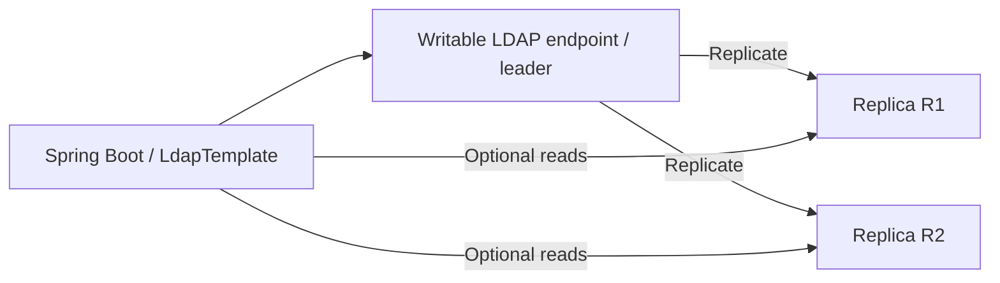
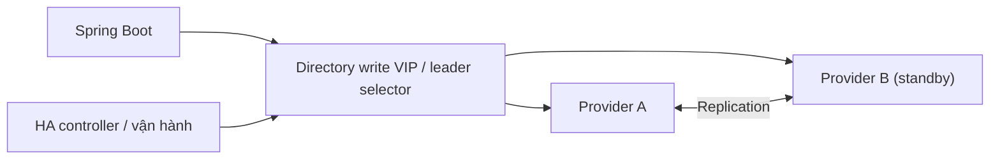
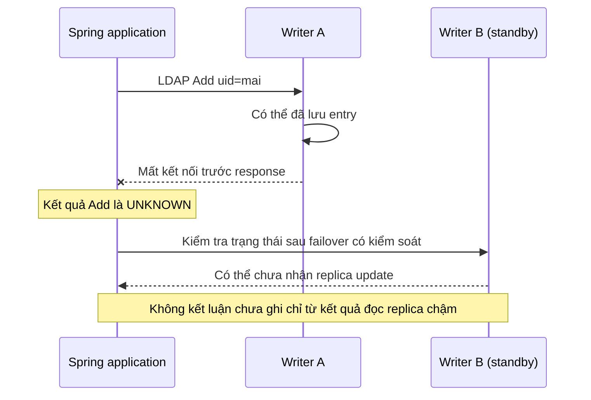

# Phối hợp ứng dụng với replication và failover của thư mục

> **Chương:** Triển khai  
> **Module:** SPRING_DATA_LDAP — truy cập dịch vụ thư mục LDAP từ Spring Data LDAP repository và Spring LDAP `LdapTemplate`, ánh xạ entry theo DN, `objectClass` và schema, triển khai CRUD và filter an toàn, bảo vệ kết nối và kiểm thử directory.

## Mục tiêu học tập

Sau bài này, bạn có thể:

1. Phân biệt **replication**, **failover**, **load balancing** và **high availability (HA)** của một LDAP directory; không xem chúng là một chức năng duy nhất.
2. Mô tả tác động của **độ trễ đồng bộ replica** đối với LDAP search, bind, group membership và tình huống **đọc ngay sau khi ghi**.
3. Hiểu cơ chế danh sách nhiều LDAP URL trong `LdapContextSource` và Java JNDI: **thử URL khác khi tạo context**, không hứa tự động retry an toàn một operation đang thực hiện.
4. Tổ chức ứng dụng Spring Boot dùng **read context** và **write context** theo topology thực tế; cấu hình `LdapTemplate`/repository không vô tình ghi vào replica chỉ đọc.
5. Xử lý tình huống LDAP Add/Modify bị mất response bằng **outcome unknown**, idempotency và đối soát trạng thái trên nguồn có thẩm quyền.
6. Thiết kế kết nối LDAPS, timeout, pooling, health checks, monitoring và quy trình diễn tập failover không làm rò dữ liệu hay mất consistency.
7. Xác định giới hạn của **LDAP paging cookie** và các LDAP controls khi kết nối chuyển sang server khác.

## 1. Replication và failover là hai vấn đề khác nhau

Một ứng dụng Java tìm `uid=linh` qua `LdapTemplate` hoặc `LdapRepository` có thể kết nối đến nhiều máy chủ directory. Tuy nhiên, “có nhiều LDAP server” **chưa đủ** để kết luận có HA.

| Khái niệm | Câu hỏi chính | Vai trò |
| --- | --- | --- |
| **Replication** | Dữ liệu thay đổi ở node A được truyền sang node B thế nào? | Giữ nhiều bản sao directory, phục vụ đọc/phục hồi |
| **Failover** | Khi endpoint/node hiện tại hỏng, client chuyển sang đâu? | Phục hồi khả năng phục vụ request |
| **Load balancing** | Phân bổ request/kết nối khỏe mạnh giữa nhiều node thế nào? | Tối ưu tải, tránh nghẽn một node |
| **Consistency** | Sau ghi trên A, B có nhìn thấy dữ liệu mới ngay không? | Xác định tính đúng đắn của đọc/ủy quyền |
| **High availability (HA)** | Dịch vụ có đáp ứng SLO khi có lỗi node/mạng không? | Tổng hợp topology, routing, monitoring, quy trình phục hồi |

Một hệ thống có replication nhưng **không có failover tự động**, hoặc có failover network nhưng **dữ liệu trên node dự phòng chưa bắt kịp**. Load balancer chuyển request không đồng nghĩa với đồng bộ dữ liệu; pool kết nối không thay thế replication.

### Hai topology thường gặp



**Một writer, nhiều reader:** ứng dụng gửi Add/Modify/Delete đến endpoint cho phép ghi và tìm kiếm thường đến replica. Ưu điểm là giảm tải đọc; hạn chế là kết quả đọc có thể chậm hơn write hiện hành.



**Leader/standby với failover:** một cơ chế ngoài ứng dụng chọn node được phép ghi. Dù hai server có dữ liệu replicated, **không nên cho cả hai nhận ghi đồng thời** nếu topology chưa được thiết kế để giải quyết xung đột, chia cắt mạng và fencing.

Ví dụ **OpenLDAP mirror mode** được hướng dẫn như giải pháp HA cho writes nhưng **không phải multi-provider ghi tự do**: cần một server/proxy/load balancer bên ngoài quyết định nơi nhận ghi tại một thời điểm. Các sản phẩm khác có thể hỗ trợ topology khác; cần đọc tài liệu của chính directory đang triển khai.

Nguồn: [OpenLDAP 2.6 Administrator's Guide — Replication](https://openldap.com/doc/admin26/replication.html).

## 2. Directory replication đồng bộ cái gì?

Một LDAP directory lưu **entry**, **DN**, **attributes**, **objectClass** và dữ liệu phụ trợ theo cơ chế riêng của server. Replication chuyển các thay đổi để một bản sao có thể trả kết quả tìm kiếm gần giống node nguồn.

Ví dụ ở node writer:

```ldif
dn: uid=linh,ou=people,dc=example,dc=org
objectClass: top
objectClass: person
objectClass: organizationalPerson
objectClass: inetOrgPerson
uid: linh
cn: Linh Nguyen
sn: Nguyen
mail: linh@example.org
description: Support
```

Ứng dụng gọi LDAP Modify để thay `description: Backend`. Một thời gian ngắn sau đó, node reader có thể vẫn trả `Support`.

```text
Thời điểm T0:  Writer  description=Support
               Replica description=Support

Thời điểm T1:  Writer  description=Backend  ← Modify thành công
               Replica description=Support  ← chưa bắt kịp

Thời điểm T2:  Writer  description=Backend
               Replica description=Backend  ← đồng bộ hoàn tất
```

**Read-after-write trên replica không tự được bảo đảm.** Nếu một HTTP request cập nhật thông tin thành công và request tiếp theo đọc ngay từ một replica chậm, giao diện có thể hiển thị lại giá trị cũ dù yêu cầu ghi đã thành công.

### Một số thuật ngữ replication trong OpenLDAP

OpenLDAP `syncrepl` triển khai cơ chế đồng bộ directory (LDAP Sync) với các chế độ:

- **`refreshOnly`:** consumer định kỳ yêu cầu đồng bộ; thời điểm dữ liệu đến phụ thuộc lịch đồng bộ và tải.
- **`refreshAndPersist`:** consumer đồng bộ ban đầu rồi duy trì stream cập nhật khi còn kết nối; vẫn cần xử lý lỗi, catch-up và điều kiện mạng.
- **Replication cookie** trong `syncrepl`/RFC 4533 mô tả tiến độ đồng bộ của consumer, **không phải** cookie của LDAP Simple Paged Results (RFC 2696).
- **Partial/fractional replication:** consumer có thể chỉ nhận một phần entry/attributes. Khi đó thiếu `mail` ở reader không nhất thiết là dữ liệu nguồn không có `mail`.

Với Active Directory, 389 Directory Server hoặc directory dịch vụ khác, cách chọn node, replication metadata, quyền và cơ chế conflict resolution **không hoàn toàn giống OpenLDAP**. Ứng dụng phải biết tính chất của **sản phẩm và topology thực tế** thay vì áp một giả định “mọi LDAP server đều eventual consistent theo cùng một cách”.

Nguồn: [OpenLDAP 2.5/2.6 — syncrepl và replication](https://www.openldap.org/doc/admin25/replication.html), [RFC 4533 — LDAP Content Synchronization Operation](https://www.rfc-editor.org/rfc/rfc4533.html).

## 3. Các loại đọc và yêu cầu consistency khác nhau

Không phải truy vấn LDAP nào cũng đòi cùng mức mới nhất.

| Tình huống | Đọc replica có thể phù hợp? | Hậu quả nếu dữ liệu stale |
| --- | --- | --- |
| Danh bạ tên/email phục vụ autocomplete | **Có thể** | Tên/email hiển thị cũ trong thời gian ngắn |
| Báo cáo số nhân viên, thống kê nhóm | **Tùy mục tiêu** | Số liệu trễ hoặc không nhất quán qua nhiều node |
| Hiển thị thông tin vừa được người dùng sửa | **Thường nên đọc nguồn vừa ghi** | Giao diện nói “đã lưu” nhưng vẫn trả giá trị cũ |
| Kiểm tra nhóm để cấp quyền truy cập | **Cần thận trọng cao** | Quyền đã thu hồi có thể còn hiệu lực trên replica chậm |
| Kiểm tra tài khoản bị khóa/vô hiệu hóa | **Cần chính sách bảo mật rõ** | Tài khoản bị khóa có thể vẫn được nhận biết là hoạt động |
| Đăng nhập/bind với mật khẩu vừa đổi | **Phụ thuộc kiến trúc identity** | Replica chưa nhận thay đổi password/policy |
| Xác minh Add/Modify vừa mất response | **Ưu tiên nguồn có thẩm quyền** | Replica chậm khiến client tưởng write chưa xảy ra |

Giải pháp thường gặp:

1. **Read-your-writes ở application layer:** sau thao tác ghi, thực hiện verify/đọc xác nhận qua **write endpoint có thẩm quyền** thay vì một replica bất kỳ.
2. **Sticky routing ngắn hạn:** một luồng nghiệp vụ được điều hướng về cùng node authoritative theo thiết kế của directory/load balancer.
3. **Chấp nhận eventual consistency có công bố:** với danh bạ phổ thông, UI có thể chấp nhận thông tin mới lan truyền chậm; cần thời gian chờ và cách diễn giải phù hợp.
4. **Cơ chế version/sync chuyên biệt:** khi cần so sánh tiến độ, sử dụng replication metadata/CSN/token được sản phẩm hỗ trợ; không tự so sánh timestamp của hai máy có đồng hồ khác nhau rồi kết luận chắc chắn.

**Lưu ý:** một URL load-balancer tên `ldap-write.example.org` vẫn có thể đổi backend khi failover. Việc gọi “cùng hostname” **không tuyệt đối bảo đảm cùng physical node** trước và sau chuyển leader. Trong thời điểm cutover, nên đối soát theo trạng thái nghiệp vụ, nhận diện node có thẩm quyền hoặc dùng cơ chế bảo đảm cụ thể của directory.

## 4. Nhiều LDAP URL trong Spring/JNDI thực sự làm gì?

Spring LDAP `LdapContextSource` kế thừa `AbstractContextSource`, có:

```java
LdapContextSource source = new LdapContextSource();
source.setUrls(new String[] {
    "ldaps://ldap-a.example.org:636",
    "ldaps://ldap-b.example.org:636"
});
source.setBase("dc=example,dc=org");
```

`setUrls(String[])` cho phép cấu hình **nhiều LDAP servers**. Nhà cung cấp LDAP của Java JNDI thử các URL **theo thứ tự trong lúc tạo initial context**; nếu kết nối tới server trước không thiết lập được, nó thử URL kế. Đây là **connection creation failover**, không phải thuật toán chia đều tải giữa các node.

**Không được suy ra rằng:**

- Một `SearchRequest` đang xử lý trên node A sẽ được di chuyển nguyên vẹn sang node B khi A mất kết nối.
- Một `ModifyRequest` lỗi do mất response chắc chắn chưa được ghi; server A có thể đã ghi xong.
- URL thứ hai là replica writable, có đủ schema/ACL/credentials, hoặc đã nhận toàn bộ dữ liệu mới.
- LDAP connection pool sẽ ngay lập tức vứt toàn bộ connection cũ và tạo connection mới ở node khỏe mạnh.
- DNS/VIP failover đảm bảo mọi request mới dùng node cùng trạng thái mà không cần kiểm tra.

Nguồn: [Spring LDAP — Configuration](https://docs.spring.io/spring-ldap/reference/configuration.html), [`AbstractContextSource.setUrls` API](https://docs.spring.io/spring-ldap/reference/api/java/org/springframework/ldap/core/support/AbstractContextSource.html), [Oracle JNDI — Connection Creation](https://docs.oracle.com/javase/jndi/tutorial/ldap/connect/create.html).

### Ví dụ Spring Boot dùng nhiều URL cho cùng một vai trò

Nếu hai node **tương đương về mục đích sử dụng** (ví dụ cùng nhóm read replicas):

```yaml
spring:
  ldap:
    urls:
      - "ldaps://ldap-read-a.example.org:636"
      - "ldaps://ldap-read-b.example.org:636"
    base: "dc=example,dc=org"
    username: "${LDAP_READ_BIND_DN}"
    password: "${LDAP_READ_BIND_PASSWORD}"
```

Spring Boot cấu hình `LdapContextSource` theo `spring.ldap.*` khi dependency/auto-configuration phù hợp. Danh sách URL trên **không** tạo hai bean template có tên khác nhau; vẫn là một source với danh sách URL dự phòng. Thứ tự URL và cơ chế thử lại được JNDI quyết định khi mở context.

**Không đặt reader chỉ đọc làm URL dự phòng cho writer** nếu service vẫn gọi `bind`/`modifyAttributes`. Việc TCP/LDAPS kết nối thành công với reader không có nghĩa request Add/Modify được phép; ứng dụng có thể nhận `unwillingToPerform`, `insufficientAccessRights` hoặc referral tùy server.

### Timeout khi có nhiều URL

Java JNDI có các thuộc tính môi trường:

| Thuộc tính | Ý nghĩa | Minh họa |
| --- | --- | --- |
| `com.sun.jndi.ldap.connect.timeout` | Giới hạn thiết lập một kết nối LDAP | `"2000"` (ms) |
| `com.sun.jndi.ldap.read.timeout` | Giới hạn chờ response LDAP | `"5000"` (ms) |

Nếu `connect.timeout=2000ms` và có 3 URL không thể kết nối, thời gian có thể lên đến khoảng **3 × 2 giây** cho bước thử từng URL, chưa tính bind, TLS, retry ở tầng ứng dụng và các yếu tố khác. Đây chỉ là ví dụ về **ngân sách timeout**, không cam kết thời gian thực tế tuyệt đối.

Trong Spring Boot, các giá trị có thể được đưa vào môi trường JNDI thông qua cấu hình tùy phiên bản; hoặc đặt khi tự cấu hình `LdapContextSource`:

```java
import java.util.Map;
import org.springframework.ldap.core.support.LdapContextSource;

LdapContextSource source = new LdapContextSource();
source.setUrl("ldaps://ldap-read-a.example.org:636");
source.setBase("dc=example,dc=org");
source.setBaseEnvironmentProperties(Map.of(
    "com.sun.jndi.ldap.connect.timeout", "2000",
    "com.sun.jndi.ldap.read.timeout", "5000"
));
```

Đây là đoạn minh họa cấu hình **trước khi source được khởi tạo**; ứng dụng vẫn cần cung cấp bind credentials, truststore, lifecycle bean và xử lý secret. Chọn connect/read timeout hữu hạn, và đặt **deadline toàn bộ HTTP/job** để tránh chuỗi nhiều retry làm request treo lâu.

Tài liệu: [Oracle — Creating LDAP Connections](https://docs.oracle.com/javase/jndi/tutorial/ldap/connect/create.html), [Oracle — LDAP Read Timeout](https://docs.oracle.com/javase/tutorial/jndi/newstuff/readtimeout.html).

## 5. Tách read/write endpoint ở Spring Boot khi topology yêu cầu

Với triển khai **một writer và nhiều reader**, một `ContextSource` mặc định không đủ để thể hiện chính sách: các thao tác ghi cần tới leader/writable endpoint, các search không nhạy cảm có thể đọc replica.

Có thể tạo **hai cặp `ContextSource` + `LdapTemplate`** để tầng service quyết định.

### 5.1. Cấu hình ngoài mã nguồn

Ví dụ `application.yml`:

```yaml
app:
  directory:
    base: "dc=example,dc=org"
    read-urls:
      - "ldaps://ldap-read-a.example.org:636"
      - "ldaps://ldap-read-b.example.org:636"
    write-urls:
      - "ldaps://ldap-write-vip.example.org:636"
    read-bind-dn: "${LDAP_READ_BIND_DN}"
    read-bind-password: "${LDAP_READ_BIND_PASSWORD}"
    write-bind-dn: "${LDAP_WRITE_BIND_DN}"
    write-bind-password: "${LDAP_WRITE_BIND_PASSWORD}"
```

Ý nghĩa:

- `read-urls`: các node có quyền truy cập danh bạ **chỉ đọc**.
- `write-urls`: endpoint được hệ thống directory/HA đảm bảo **trỏ tới node cho phép ghi**. Danh sách này có thể chỉ chứa một hostname VIP, hoặc nhiều URL **đều hợp lệ cho vai trò writer** theo chính sách.
- `read-bind-dn` và `write-bind-dn`: **hai tài khoản quyền tối thiểu riêng**, tránh cho mọi request search dùng quyền quản trị.
- Cấu hình secret bằng environment/secret manager. Không ghi mật khẩu thật trong YAML.
- Không khai báo `spring.ldap.base` trùng nếu bạn đã tự cấu hình source dựa trên `app.directory.base`; cần thống nhất một cơ chế để không ghép base DN hai lần.

Các hostname là ví dụ, không phải địa chỉ directory thực. Với các môi trường Kubernetes/VM, kiểm tra DNS, LB, firewall và chứng chỉ cho từng endpoint.

### 5.2. Bind properties với Spring Boot

Spring Boot 3.x hoặc phiên bản tương thích có thể bind `@ConfigurationProperties` vào Java record:

```java
package com.example.directory.config;

import java.util.List;
import org.springframework.boot.context.properties.ConfigurationProperties;

@ConfigurationProperties(prefix = "app.directory")
public record DirectoryTopologyProperties(
        String base,
        List<String> readUrls,
        List<String> writeUrls,
        String readBindDn,
        String readBindPassword,
        String writeBindDn,
        String writeBindPassword
) {}
```

Các cấu hình trên cần được kiểm tra **không rỗng** khi ứng dụng khởi động; có thể bổ sung Bean Validation cho `List` URLs, `base`, DN và thông tin bind. Dữ liệu nhận từ config là **danh sách URL** chứ không phải giá trị input HTTP của người dùng.

### 5.3. Tạo hai `LdapTemplate` rõ ràng

```java
package com.example.directory.config;

import java.util.List;
import java.util.Map;

import org.springframework.beans.factory.annotation.Qualifier;
import org.springframework.boot.context.properties.EnableConfigurationProperties;
import org.springframework.context.annotation.Bean;
import org.springframework.context.annotation.Configuration;
import org.springframework.ldap.core.ContextSource;
import org.springframework.ldap.core.LdapTemplate;
import org.springframework.ldap.core.support.LdapContextSource;

@Configuration(proxyBeanMethods = false)
@EnableConfigurationProperties(DirectoryTopologyProperties.class)
public class DirectoryTopologyConfiguration {

    @Bean("readContextSource")
    LdapContextSource readContextSource(DirectoryTopologyProperties p) {
        return createSource(
            p.readUrls(), p.base(), p.readBindDn(), p.readBindPassword()
        );
    }

    @Bean("writeContextSource")
    LdapContextSource writeContextSource(DirectoryTopologyProperties p) {
        return createSource(
            p.writeUrls(), p.base(), p.writeBindDn(), p.writeBindPassword()
        );
    }

    @Bean("readLdapTemplate")
    LdapTemplate readLdapTemplate(
            @Qualifier("readContextSource") ContextSource source) {
        return new LdapTemplate(source);
    }

    @Bean("writeLdapTemplate")
    LdapTemplate writeLdapTemplate(
            @Qualifier("writeContextSource") ContextSource source) {
        return new LdapTemplate(source);
    }

    private static LdapContextSource createSource(
            List<String> urls, String base, String bindDn, String password) {

        if (urls == null || urls.isEmpty()) {
            throw new IllegalArgumentException("LDAP URL list is empty");
        }

        LdapContextSource source = new LdapContextSource();
        source.setUrls(urls.toArray(String[]::new));
        source.setBase(base);
        source.setUserDn(bindDn);
        source.setPassword(password);
        source.setPooled(false); // Không chồng JNDI native pooling.
        source.setBaseEnvironmentProperties(Map.of(
            "com.sun.jndi.ldap.connect.timeout", "2000",
            "com.sun.jndi.ldap.read.timeout", "5000"
        ));
        return source; // Spring quản lý afterPropertiesSet của @Bean.
    }
}
```

**Cảnh báo wiring:** cấu hình này tự tạo hai `LdapContextSource` và hai `LdapTemplate` nên có thể khiến Spring Boot LDAP auto-configuration **back off** theo điều kiện bean. Không còn giả định `@Autowired LdapTemplate` không qualifier là duy nhất. Trong service, chọn rõ:

```java
import org.springframework.beans.factory.annotation.Qualifier;
import org.springframework.ldap.core.LdapTemplate;
import org.springframework.stereotype.Service;

@Service
public class DirectoryPeopleService {
    private final LdapTemplate reader;
    private final LdapTemplate writer;

    public DirectoryPeopleService(
            @Qualifier("readLdapTemplate") LdapTemplate reader,
            @Qualifier("writeLdapTemplate") LdapTemplate writer) {
        this.reader = reader;
        this.writer = writer;
    }

    // search danh bạ từ reader;
    // create/modify/verify quan trọng từ writer.
}
```

Khi dùng Spring Data LDAP repository, `@EnableLdapRepositories` có thuộc tính `ldapTemplateRef` để chọn **một template cụ thể**. Ví dụ, nếu repository vừa có method đọc vừa có method ghi và cần bảo đảm mọi request đi qua writable endpoint:

```java
import org.springframework.data.ldap.repository.config.EnableLdapRepositories;

@EnableLdapRepositories(
    basePackages = "com.example.directory.repository",
    ldapTemplateRef = "writeLdapTemplate"
)
class DirectoryRepositoryConfiguration {}
```

**Đừng nghĩ rằng repository sẽ tự chia `findByUid` cho reader và `save` cho writer.** Một repository được liên kết với **một template**. Muốn phân tuyến read/write, thiết kế service với template tách biệt hoặc các repository/adapter được cấu hình riêng; tránh kích hoạt quét repository hai lần gây duplicate bean.

Việc dùng `@EnableLdapRepositories` thủ công trong ứng dụng Spring Boot phải được đối chiếu với cơ chế auto-scan của phiên bản đang chạy. Nếu ứng dụng chỉ có một directory endpoint và không cần phân tuyến, giữ Spring Boot auto-configuration đơn giản sẽ dễ bảo trì hơn.

Nguồn: [Spring Boot — LDAP Configuration](https://docs.spring.io/spring-boot/reference/data/nosql.html#data.nosql.ldap), [Spring Data LDAP — `@EnableLdapRepositories.ldapTemplateRef` API](https://docs.spring.io/spring-data/ldap/reference/api/java/org/springframework/data/ldap/repository/config/EnableLdapRepositories.html).

## 6. Ví dụ nghiệp vụ: ghi rồi đọc bằng endpoint có thẩm quyền

Nếu ứng dụng vừa sửa `description` cho nhân viên, **đừng mặc định dùng reader replica để xác nhận ngay**.

```java
package com.example.directory.service;

import javax.naming.Name;
import javax.naming.directory.BasicAttribute;
import javax.naming.directory.DirContext;
import javax.naming.directory.ModificationItem;

import org.springframework.beans.factory.annotation.Qualifier;
import org.springframework.ldap.core.AttributesMapper;
import org.springframework.ldap.core.LdapTemplate;
import org.springframework.ldap.support.LdapNameBuilder;
import org.springframework.stereotype.Service;

@Service
public class DescriptionService {

    private final LdapTemplate writer;

    public DescriptionService(
            @Qualifier("writeLdapTemplate") LdapTemplate writer) {
        this.writer = writer;
    }

    public String setAndReadDescription(String uid, String description) {
        Name dn = LdapNameBuilder.newInstance("ou=people")
                .add("uid", uid)
                .build();

        writer.modifyAttributes(dn, new ModificationItem[] {
            new ModificationItem(
                DirContext.REPLACE_ATTRIBUTE,
                new BasicAttribute("description", description))
        });

        return writer.lookup(
            dn,
            (AttributesMapper<String>) attrs -> {
                var attr = attrs.get("description");
                return attr == null ? null : (String) attr.get();
            }
        );
    }
}
```

Lựa chọn trên giảm nguy cơ **đọc từ replica trễ**. Tuy nhiên, `setAndReadDescription` vẫn gồm **hai LDAP requests**. Nếu giữa hai lần gọi hệ thống write VIP chuyển leader, backend mới có thể chưa đồng bộ hoặc operation thứ hai lỗi. Không diễn giải phương thức này như một transaction ACID; với yêu cầu nhất quán nghiêm ngặt, cần contract rõ từ directory và HA layer.

**Chú ý input:** đoạn code minh họa giả định service đã kiểm tra `uid` và `description` theo quy tắc nghiệp vụ. `LdapNameBuilder` dùng để tạo DN an toàn khi `uid` chứa ký tự đặc biệt; filter search phải dùng escaping khác (`LdapQueryBuilder`). Không lấy trực tiếp tên attribute, DN base hoặc endpoint từ request người dùng.

## 7. Các thời điểm failover có ý nghĩa khác nhau

Giả sử ứng dụng muốn thực hiện `Add uid=mai`. Failover có thể xảy ra **trước**, **trong** hoặc **sau** request:



| Thời điểm lỗi | Trạng thái có thể biết | Hành vi đề nghị |
| --- | --- | --- |
| Không mở được kết nối đến A | `Add` chưa gửi qua context đó | Có thể thử mở kết nối đến URL B **nếu B hợp lệ để ghi** |
| Mở được context nhưng bind thất bại | Không đủ quyền/xác thực; không tự coi là lỗi failover | Xem credentials, certificate, policy, node role |
| Mất kết nối **trong khi** Add/Modify | **UNKNOWN**: request có thể đã áp dụng | Đọc lại authoritative state, xử lý idempotency |
| Nhận LDAPResult `success (0)` | Node nhận request báo đã hoàn tất operation | Không đồng nghĩa replica khác đã nhận thay đổi |
| Nhận LDAPResult code lỗi | Operation thất bại theo code trả về | Xử lý code cụ thể; không retry mọi lỗi |
| Chuyển writer lúc replication còn lag | Node mới có thể thiếu update cuối | Theo chính sách leader promotion, fencing và reconciliation |

**Phân biệt success với durability của HA cluster:** LDAPResult success xác nhận operation theo server trả lời. Mức dữ liệu được replicate/durable qua sự cố mất hẳn node phụ thuộc cơ chế directory và chính sách HA; **không suy rằng success từ một server đã được commit tới mọi replica**.

### Không retry ghi một cách mù quáng

Ví dụ lỗi sau Add:

```text
1. Writer A nhận Add uid=mai và ghi thành công.
2. TCP đứt trước khi A gửi Modify/Add response cho Java.
3. Java không biết kết quả.
4. Nếu retry Add trên B:
   - Có thể nhận entryAlreadyExists (68) nếu B đã thấy entry.
   - Có thể tạo tình huống xung đột nếu B chưa thấy dữ liệu và topology cho phép ghi.
   - Không thể phân biệt chỉ bằng transport exception.
```

Tương tự, thêm `member=<DN>` vào group hai lần có thể tạo LDAP error 20 (`attributeOrValueExists`). `Modify REPLACE` với cùng giá trị có vẻ idempotent về trạng thái cuối nhưng không chắc mọi audit/change log chỉ ghi một lần.

Đối với write quan trọng, ưu tiên trạng thái **`CONFIRMED / REJECTED / UNKNOWN`** thay vì nhị phân “thành công/thất bại” dựa trên exception. Với `UNKNOWN`, **không tự động bắn lại request theo một URL khác** khi chưa xác minh dữ liệu và role của writer hiện hành.

## 8. Java: biểu diễn kết quả UNKNOWN để đối soát sau lỗi mạng

Code sau minh họa việc phân loại outcome của một thao tác `ModifyRequest`. **Nó không cố cung cấp distributed transaction**.

```java
package com.example.directory.service;

import javax.naming.Name;
import javax.naming.directory.BasicAttribute;
import javax.naming.directory.DirContext;
import javax.naming.directory.ModificationItem;

import org.springframework.beans.factory.annotation.Qualifier;
import org.springframework.ldap.CommunicationException;
import org.springframework.ldap.core.LdapTemplate;
import org.springframework.ldap.support.LdapNameBuilder;
import org.springframework.stereotype.Service;

@Service
public class SafeDescriptionWriter {

    public enum Status { CONFIRMED, UNKNOWN }

    private final LdapTemplate writer;

    public SafeDescriptionWriter(
            @Qualifier("writeLdapTemplate") LdapTemplate writer) {
        this.writer = writer;
    }

    public Status replaceDescription(String uid, String target) {
        if (uid == null || uid.isBlank()
                || target == null || target.isBlank()) {
            throw new IllegalArgumentException(
                "uid và description phải có giá trị");
        }

        Name dn = LdapNameBuilder.newInstance("ou=people")
                .add("uid", uid)
                .build();

        try {
            writer.modifyAttributes(dn, new ModificationItem[] {
                new ModificationItem(
                    DirContext.REPLACE_ATTRIBUTE,
                    new BasicAttribute("description", target))
            });

            return Status.CONFIRMED; // Server đã trả LDAP success.
        } catch (CommunicationException ex) {
            // Mất response: không suy ra update đã rollback.
            // Hệ thống thực nên ghi nhận workflow để đối soát lại.
            return Status.UNKNOWN;
        }
    }
}
```

`CommunicationException` là một lỗi truyền thông điển hình. Trong sản phẩm thực, cũng cần xem timeout và các exception được bọc ngoài từ pool/network; **không** bắt tất cả `RuntimeException` rồi coi là lỗi mạng có thể retry. `SchemaViolationException`, `NoPermissionException`, `NameAlreadyBoundException`… có nguyên nhân và cách xử lý riêng.

Tại tầng nghiệp vụ, khi trả `UNKNOWN`:

1. Lưu mã workflow, DN đích, giá trị mong muốn và trạng thái cần đối soát ở hệ thống bền vững theo chính sách riêng tư; không lưu password/secret.
2. Xác định endpoint writer **đang được fencing và phép ghi hợp lệ**, không chọn reader bất kỳ làm nguồn kiểm tra.
3. Đọc entry theo DN/ID ổn định và so với mục tiêu. Nếu node vừa promote còn lag, chờ/kiểm tra trạng thái replication trước khi quyết định.
4. Nếu mục tiêu đã đạt, đánh dấu hoàn tất; nếu xung đột với người khác, không tự ghi đè.
5. Nếu cần thử lại, dùng operation có điều kiện phù hợp (ví dụ LDAP Assertion Control nếu được hỗ trợ), giới hạn retry/backoff và ghi audit.
6. Nếu không xác định được outcome, chuyển trạng thái **cần xử lý thủ công** thay vì tạo thêm account/member trùng.

**Không dùng replica đọc ngay sau failover để kết luận một Add không xảy ra**, vì replication có thể chưa bắt kịp. Khi leader A mất hẳn và chưa rõ có replicate update không, cần chính sách RPO, audit và đồng bộ từ directory/HA platform.

## 9. Replication không giải quyết giao dịch nhiều entry

Giả sử một yêu cầu Java:

1. Tạo entry `uid=mai,ou=people,...`.
2. Thêm `uid=mai` vào `member` của `cn=developers,ou=groups,...`.
3. Ghi bản ghi audit vào PostgreSQL.

Mỗi LDAP operation có kết quả riêng. Nếu bước 1 thành công nhưng bước 2 lỗi sau failover, **user đã tạo vẫn có thể tồn tại**. Replication sẽ truyền trạng thái các thao tác đã thành công, **không tự thực hiện rollback cả workflow**.

- Theo RFC 4511, **các thay đổi thuộc tính trong một `ModifyRequest` trên một entry được áp dụng nguyên tử**.
- Các Add/Modify trên nhiều entry **không có atomicity chung** theo LDAPv3 nền tảng.
- Spring LDAP có cơ chế **compensating transactions** tùy cấu hình nhưng đây là **thao tác bù phía client**, không tương đương transaction ACID của RDBMS, nhất là khi server/mạng lỗi.
- RFC 5805 cung cấp LDAP transaction extension Experimental, chỉ dùng khi server và client hỗ trợ. Không mặc định `@Transactional` JPA bao phủ LDAP.

Trong triển khai, thiết kế **workflow nhiều bước** với idempotency key, checkpoint, retry an toàn và bù trừ có điều kiện. Nếu workflow tạo người dùng rồi liên kết nhóm thất bại, có thể cần thao tác khôi phục nhưng không xóa bừa entry vì một quy trình khác đã có thể dùng account đó.

## 10. Connection pool có thể che giấu failover

`LdapTemplate` thường mượn context từ `ContextSource` cho mỗi operation. Nếu `PooledContextSource` bọc source, một số kết nối vật lý có thể vẫn nối tới node A dù routing/DNS/VIP đã đổi.

Sơ đồ:

```text
Service
  └── LdapTemplate
        └── PooledContextSource
              ├── Connection #1 → node A (idle, vừa mất)
              ├── Connection #2 → node A (đang chạy)
              └── Connection #3 → node B (mới tạo)
```

Khi node A hỏng:

- Context đang chạy có thể ném `CommunicationException`; nếu là operation ghi, outcome **không chắc chắn**.
- Context nhàn rỗi trên node A có thể trở thành stale. Chỉ vì pool có `idle > 0` không có nghĩa chúng còn dùng được.
- Pool cần **validation trên borrow/idle** và invalidation khi gặp lỗi non-transient.
- Việc hồi phục cần tạo **kết nối mới tới endpoint đúng**, nhưng nếu write VIP chuyển leader chưa xong, pool không thể tự suy được node nào có quyền ghi.

Spring LDAP có `org.springframework.ldap.pool2.factory.PooledContextSource` dựa trên **Apache Commons Pool 2** và `DefaultDirContextValidator`. Ví dụ cấu hình **Spring LDAP 4.1 trở lên**:

```java
import org.springframework.ldap.core.ContextSource;
import org.springframework.ldap.pool2.factory.PoolConfig;
import org.springframework.ldap.pool2.factory.PooledContextSource;
import org.springframework.ldap.pool2.validation.DefaultDirContextValidator;

public PooledContextSource createPool(ContextSource target) {
    PoolConfig poolConfig = new PoolConfig();
    poolConfig.setMaxTotal(12);
    poolConfig.setMaxTotalPerKey(6);
    poolConfig.setMaxWaitMillis(2_000L);
    poolConfig.setBlockWhenExhausted(true);
    poolConfig.setTestOnBorrow(true);
    poolConfig.setTestWhileIdle(true);
    poolConfig.setTimeBetweenEvictionRunsMillis(60_000L);

    PooledContextSource pool =
            new PooledContextSource(target, poolConfig);
    pool.setDirContextValidator(new DefaultDirContextValidator());
    return pool;
}
```

**Tương thích phiên bản:** với Spring LDAP 3.3/4.0, constructor thường là `new PooledContextSource(poolConfig)` sau đó `setContextSource(target)`. Không copy constructor `(ContextSource, PoolConfig)` của nhánh 4.1 vào bản cũ. Cần dependency `org.apache.commons:commons-pool2` trong classpath để dùng Pool 2.

Ví dụ có giới hạn minh họa, cần điều chỉnh theo số instance ứng dụng, directory connection quota, số connection reader/writer và tải thực tế. `DefaultDirContextValidator` thực hiện search nhẹ; phải kiểm tra bind identity có thể đọc base mà validator sử dụng.

**Không pooling bừa per-user bind:** pool service-account search và context xác thực bằng DN/password thay đổi theo từng người có rủi ro bảo mật khác nhau. Native JNDI `setPooled(true)` cũng có giới hạn với **StartTLS** và trạng thái bảo mật của connection. Luôn giữ LDAPS/StartTLS theo chính sách, kiểm tra chứng chỉ và theo dõi connection lifecycle.

Nguồn: [Spring LDAP — Pooling Support](https://docs.spring.io/spring-ldap/reference/pooling.html), [`PooledContextSource` API](https://docs.spring.io/spring-ldap/reference/api/java/org/springframework/ldap/pool2/factory/PooledContextSource.html), [Oracle — JNDI Pooling Caveats](https://docs.oracle.com/javase/tutorial/jndi/ldap/pool.html).

## 11. Paged search và controls khi chuyển node

Ứng dụng cần đọc nhiều entry có thể dùng RFC 2696 **Simple Paged Results Control**. Server cấp một **cookie** để client yêu cầu trang kế. Spring LDAP nêu rõ rằng cookie cần các search tiếp theo **giữ cùng underlying connection**.

Ví dụ:

```text
Page #1: Connection A → Replica R1 → cookie-1
Page #2: Connection A → Replica R1 → cookie-2
Page #3: Node R1 chết, connection A mất
           └── Không thể mặc định dùng cookie-2 trên Replica R2
```

Chú ý:

- `PagedResultsControlExchangeDirContextProcessor` (Spring LDAP 4.1+) hoặc `PagedResultsDirContextProcessor` (nhánh cũ) quản lý request/response control.
- `SingleContextSource.doWithSingleContext(...)` giữ cùng physical connection qua toàn bộ chuỗi paging.
- Nếu kết nối hỏng giữa chuỗi, **không giữ cookie cũ và chuyển qua URL khác như một offset số học**. Theo chính sách ứng dụng, có thể khởi động search mới từ đầu với dedup theo DN/ID ổn định và xử lý thay đổi dữ liệu concurrent.
- Nếu dùng Pool 2 cùng request controls, cần xem `MutablePooledContextSource` để context wrapper hỗ trợ set request controls. **Mutable pool không thay thế SingleContextSource**.
- Duyệt nhiều trang không phải transaction snapshot; dữ liệu có thể thay đổi trong lúc scan và replica khác có thể stale hoặc chứa tập entry khác.

Vì vậy, **failover của một chuỗi phân trang là tình huống cần restart/reconciliation**, không đơn thuần đổi URL. Không giữ raw paging cookie trong HTTP session lâu dài rồi hy vọng request tiếp theo mượn đúng LDAP connection từ pool.

Tài liệu: [RFC 2696 — Simple Paged Results Control](https://www.rfc-editor.org/rfc/rfc2696.html), [Spring LDAP — Processing the DirContext](https://docs.spring.io/spring-ldap/reference/processing-the-dircontext.html).

## 12. TLS, DNS, referral và identity nhất quán giữa các endpoint

Một cấu hình có nhiều LDAP URL chỉ an toàn khi mọi endpoint được vận hành theo cùng chuẩn:

### Kết nối mã hóa

- **LDAPS `ldaps://...:636`** hoặc StartTLS tùy môi trường; không gửi bind password qua LDAP plaintext trên mạng không tin cậy.
- Chứng chỉ phải được xác minh bằng **hostname thực được client dùng**, chain CA và policy TLS tương ứng. Khi LB/VIP thay backend, chứng chỉ trình ra phải hợp lệ cho endpoint đó.
- Nếu DNS có nhiều bản ghi, đừng coi việc đổi IP nhanh là bảo đảm hết connection cũ: pool, JVM DNS cache và idle connections có vòng đời riêng.
- Tài khoản bind, mật khẩu và ACL phải phù hợp **tất cả endpoint có thể được chọn**. Việc reader thiếu quyền search không tự được sửa bằng retry.
- Nếu có TLS termination ở load balancer, cần xác định ai nhìn thấy plaintext ở đâu, có mTLS hoặc mã hóa lại tới backend không; không tự suy kết nối end-to-end vẫn mã hóa.

### Schema và DIT

Một entry `inetOrgPerson` có `cn` và `sn` bắt buộc theo `person`. Tất cả node mà ứng dụng dùng phải có schema/DIT và chính sách phù hợp; nếu một node thiếu custom attribute type hoặc auxiliary class, hành vi `@Entry`/`LdapTemplate.bind`/`repository.save` có thể khác nhau sau failover.

Khác biệt về **base DN** cũng quan trọng. Với `spring.ldap.base=dc=example,dc=org`, các DN mà template nhận thường tương đối:

```java
Name dn = LdapNameBuilder.newInstance("ou=people")
        .add("uid", "linh")
        .build();
```

Nếu node B đang chứa dữ liệu dưới hậu tố khác, đổi URL đơn thuần không làm DN tự đúng. Tương tự, một server có thể chỉ replicate một subtree hoặc một phần attributes.

### Referral

LDAP referral có thể chỉ client sang server khác/naming context khác. Đây là **cơ chế tên/phân vùng directory**, không tương đương chuyển node HA. Khi bật xử lý referral tự động, cần xem cách chuyển credentials, trust và domain boundary; **không cho ứng dụng tự động gửi bind secret đến endpoint lạ** do một response referral không được tin cậy. Cấu hình `java.naming.referral`/Spring LDAP phải phù hợp chính sách tổ chức.

## 13. Liveness, readiness và topology-aware health checks

Một kiểm tra “mở TCP port 636 thành công” **không đủ** chứng minh node LDAP có thể phục vụ đúng nghiệp vụ.

| Kiểm tra | Có thể phát hiện | Không thể chứng minh |
| --- | --- | --- |
| TCP/TLS handshake | Port reachable, một phần cấu hình TLS | Schema, ACL, replication và quyền ghi |
| Bind service account | Danh tính và password được chấp nhận | Reader không stale, writer đúng leader |
| Search nhẹ theo base DN | Đọc được subtree/attribute cần thiết | Có thể ghi, dữ liệu đã đồng bộ hết |
| Kiểm tra role writable | Node có khả năng nhận ghi theo sản phẩm | Không có split-brain nếu HA layer sai |
| Replication health/lag | Consumer có đang bắt kịp? | Tính đúng đắn mọi dữ liệu nghiệp vụ |
| LDAP paging thử trên test server | Server chấp nhận control và kết nối | Tất cả chuỗi survive failover |
| Đối soát entry vừa ghi | Phát hiện read-after-write bất thường | Không có cập nhật cạnh tranh/đổi node |

### Khuyến nghị trong môi trường container/Kubernetes

- **Liveness** của ứng dụng không nên phụ thuộc chặt vào LDAP ngoài: nếu directory tạm lỗi, liên tục restart toàn bộ application có thể làm bão hòa LDAP khi khởi động lại.
- **Readiness** có thể phản ánh khả năng phục vụ endpoint phụ thuộc directory: bind/search/role check **nhẹ, có timeout** và dùng cache/interval hợp lý để tránh health check biến thành tải lớn.
- Nếu API có chức năng **chỉ đọc** và **ghi quan trọng**, có thể phân biệt tình trạng “read degraded” và “write unavailable” thay vì báo toàn bộ dịch vụ khỏe mạnh khi writer bị mất.
- Không dùng một **write probe** tạo/xóa entry thật ở mỗi health request. Với production, cần cơ chế kiểm tra role/health chính thức từ directory hoặc HA controller.
- Load balancer/leader selector cần health check phân biệt **writable leader** và **read replica**, không chọn server chỉ vì TCP reachable.

**Không cần mọi dịch vụ tiếp tục hoạt động không giới hạn khi directory mất:** đặt thời gian chờ hữu hạn, circuit breaker nếu phù hợp, giới hạn concurrent reconnect, thông báo lỗi nghiệp vụ rõ ràng và backpressure.

## 14. Những chỉ số cần quan sát trong production

Một ứng dụng dùng Spring Data LDAP nên theo dõi:

| Nhóm | Chỉ số hoặc tín hiệu | Vì sao quan trọng |
| --- | --- | --- |
| **Kết nối** | Thành công/thất bại bind, TLS handshake, connect timeout | Phát hiện endpoint hỏng |
| **Latency** | P50/P95/P99 `search`, `bind`, `modifyAttributes` | Nhận diện chậm do mạng/server/index |
| **Kết quả** | LDAP result code `32`, `49`, `50`, `51`, `52`, `65`, `68` | Phân biệt lỗi dữ liệu, credentials, ACL và overload |
| **Pool** | `getNumActive()`, `getNumIdle()`, `getNumWaiters()`, borrow timeout | Phát hiện leak/bão hòa sau failover |
| **Replication** | Replication lag/age, health stream, backlog/CSN theo sản phẩm | Đánh giá reader stale và RPO |
| **Failover** | Thời gian phát hiện lỗi, thời gian promote writer, tần suất đổi leader | Đo khả năng đáp ứng SLO |
| **Consistency** | Read-after-write mismatch, unknown outcome, reconciliation backlog | Không chỉ đo network mà còn đo đúng nghiệp vụ |
| **Security** | Bất thường ACL, failed bind, certificate expiration | Ngăn hạ cấp bảo mật lúc sự cố |

**Đừng log mật khẩu, giá trị token/cookie, full user DN hoặc group membership nhạy cảm một cách tùy tiện.** Nên log correlation ID, loại operation, tên endpoint/role phù hợp, mã lỗi, thời lượng và metadata đã mask. Tài khoản giám sát phải có quyền tối thiểu.

### RTO và RPO

- **RTO (Recovery Time Objective):** mức thời gian dịch vụ có thể chấp nhận để phục hồi sau lỗi.
- **RPO (Recovery Point Objective):** mức mất mát hoặc thiếu cập nhật gần nhất mà hệ thống có thể chấp nhận khi phục hồi.

Trong failover directory, **RTO nhỏ không đồng nghĩa RPO bằng 0**. Một writer dự phòng được promote nhanh có thể vẫn thiếu thay đổi mới nhất nếu cơ chế replication không đảm bảo đồng bộ trước success. Các giá trị phải được xác nhận từ cấu hình và diễn tập thật; không gắn nhãn “zero data loss” chỉ vì có hai server.

## 15. Runbook khi mất LDAP writer

Một runbook nên phân biệt các bước kỹ thuật và quyết định nghiệp vụ:

1. **Xác định phạm vi:** node writer A hỏng hay chỉ mạng ứng dụng đến A, reader vẫn hoạt động không, TLS/cert có sự cố không?
2. **Ngừng retry write vô điều kiện:** ghi nhận các request chưa nhận response là `UNKNOWN`; ưu tiên giữ thông tin workflow.
3. **Đánh giá replication state:** standby B có bắt kịp A không; nếu không, còn bản ghi chênh lệch nào cần đối soát?
4. **Fencing/quorum:** đảm bảo node A cũ **không tiếp tục nhận write** trong khi B đã được promote. Tránh split-brain và xung đột DN/attribute.
5. **Chuyển writable endpoint:** cập nhật VIP/DNS/proxy hoặc chính sách của directory. Kiểm tra LDAPS certificate, quyền bind, schema, base DN và test nhẹ trên B.
6. **Phục hồi kết nối ứng dụng:** loại bỏ context stale hoặc kích hoạt validation, theo dõi pool/readiness, giữ giới hạn reconnect và timeout.
7. **Đối soát UNKNOWN writes:** kiểm tra bằng định danh ổn định trên authoritative node, không chỉ qua replica chậm; xác minh nhóm, OU, các thuộc tính `MUST`/`MAY`.
8. **Mở lại traffic dần:** test read/write có kiểm soát trên dữ liệu test, theo dõi error codes và lag; không bật toàn bộ batch jobs đồng thời nếu replica chưa ổn.
9. **Failback có kế hoạch:** khi A hồi phục, không đưa A trở lại làm writer ngay nếu chưa resync và chưa kiểm tra điều kiện fencing.
10. **Ghi nhận hậu sự cố:** thời gian gián đoạn, mất hay không mất write, mức replication lag, hiệu quả health checks, vấn đề pooling và điểm cần cải thiện.

**Runbook không thay thế thiết kế HA phía directory.** Chọn leader, replicate schema, xử lý xung đột, fencing và bảo đảm RPO là công việc chung giữa đội ứng dụng và đội vận hành dịch vụ danh tính.

## 16. Ma trận kiểm thử trước khi triển khai

Không kiểm thử bằng cách tắt LDAP server đang phục vụ người dùng thật. Dùng directory test có ít nhất hai node và replication topology giống môi trường mục tiêu; tạo dữ liệu `inetOrgPerson` với đúng `cn`/`sn`/`uid` và OU cha.

| Ca | Thực hiện | Kỳ vọng / điều cần đo |
| --- | --- | --- |
| **T1 — Baseline** | Đọc/ghi trên writer/reader khỏe mạnh | DN, schema, ACL đúng; record được replicate |
| **T2 — Writer unreachable trước connect** | Tắt endpoint đầu trong danh sách **writable** hợp lệ | JNDI thử URL tiếp khi tạo context; không chọn read-only replica |
| **T3 — Writer mất trong Modify** | Ngắt mạng sau khi server có thể đã xử lý | Application đánh dấu `UNKNOWN`; không retry mù |
| **T4 — Replication lag** | Ghi vào writer, lập tức đọc reader trước sync | Quan sát dữ liệu stale; route verify qua authoritative |
| **T5 — Promotion** | Chuyển leader từ A sang B | B đúng role writable, A được fenced, không split-brain |
| **T6 — Failback** | Khôi phục node A sau khi B đã ghi | A bắt kịp B trước khi được chọn theo role |
| **T7 — Pool stale** | Kill node đang có idle connections | Validation/invalidation phát hiện context hỏng |
| **T8 — LDAP paging** | Giết node ở giữa chuỗi cookie RFC 2696 | Dừng chuỗi, restart/reconcile; không dùng cookie cũ trên node khác |
| **T9 — TLS/CA** | Cấu hình cert hostname sai trên node dự phòng | Fail rõ ràng, không tắt hostname verification |
| **T10 — Permission/schema drift** | Replica thiếu attribute type/ACL tương đương | Health/smoke test phát hiện khác biệt |
| **T11 — Bind/auth** | Đổi mật khẩu/thu hồi quyền, đo lag và cache | Có chính sách xử lý stale authentication/authorization |
| **T12 — Concurrency** | Nhiều client tạo cùng DN gần lúc failover | Tránh tạo tài khoản xung đột, đối soát theo identity |
| **T13 — Timeout budget** | Giả lập 3 URL không kết nối + pool hết | HTTP/job có deadline, không chờ vô hạn |
| **T14 — Observability** | Diễn tập failover và lưu metrics | Có RTO/RPO quan sát được, biết request nào `UNKNOWN` |

Các ca kiểm thử cần **trạng thái cuối thực tế**, không chỉ assert Java exception. Unit test bằng mock `LdapOperations` có thể kiểm tra logic routing/exception, nhưng không kiểm chứng replication delay, TLS handshake, physical connection failover hoặc leader promotion; bắt buộc có integration/fault-injection test nếu dự án phụ thuộc HA.

### Xác minh một entry trên từng node test

Dùng OpenLDAP client để đọc từng replica, với tài khoản **read-only** riêng:

```bash
ldapsearch -x -H ldaps://ldap-read-a.example.org:636 \
  -D "cn=test-reader,ou=services,dc=example,dc=org" -W \
  -b "uid=linh,ou=people,dc=example,dc=org" -s base \
  "(objectClass=*)" dn uid cn sn description
```

Lặp với `ldaps://ldap-read-b.example.org:636` sau khi thay hostname. `-W` nhập password tương tác; xác thực certificate/trust trước khi test. **Không coi hai kết quả đồng nhất ở một thời điểm là bằng chứng replication sẽ không bao giờ trễ**; cần test khi hệ thống đang ghi, khi node down và trong quá trình catch-up.

### Xác minh khả năng phục vụ trên Root DSE

`supportedControl`, `supportedExtension`, `namingContexts` có thể được công bố ở Root DSE:

```bash
ldapsearch -x -H ldaps://ldap-read-a.example.org:636 \
  -D "cn=test-reader,ou=services,dc=example,dc=org" -W \
  -b "" -s base supportedControl supportedExtension namingContexts
```

Kết quả giúp so sánh capability giữa các node; **không bảo đảm node là writable leader**. Để kiểm tra role writer, dùng interface quản trị/monitoring của directory hoặc thao tác kiểm chứng an toàn được đội vận hành cho phép trên directory test. Thao tác `ldapsearch` không tự kiểm tra khả năng ghi.

## 17. Lỗi thường gặp khi vận hành

| Triệu chứng | Nguyên nhân có thể | Hướng xử lý |
| --- | --- | --- |
| Có hai LDAP URLs nhưng failover vẫn chậm | JNDI thử URL tuần tự và mỗi URL hết connect timeout | Đặt connect timeout, giảm endpoint hỏng trong cấu hình, đo toàn bộ deadline |
| App vẫn nối node A đã hỏng | Pool giữ context cũ, DNS/LB còn route A, connection chưa bị loại | Validation on borrow, kiểm tra LB/DNS/idle lifetime |
| Search sau Modify trả dữ liệu cũ | Request đọc vào replica chưa replicate | Read-after-write trên authoritative hoặc công bố consistency delay |
| `NoSuchObject (32)` khi failover | Replica chưa có entry, chỉ replicate một subtree, base khác | Kiểm tra replication scope/lag, DIT, ACL |
| `objectClassViolation (65)` chỉ xảy ra trên B | Schema hoặc custom attribute rules khác nhau | Đồng bộ schema/DIT content rules, kiểm thử trước promote |
| `insufficientAccessRights (50)` sau chuyển node | ACL, bind identity hoặc account replication khác | Kiểm tra quyền từng endpoint, không dùng admin account để chữa |
| `entryAlreadyExists (68)` sau retry Add | Request trước có thể đã thành công hoặc DN bị người khác chiếm | Đối soát identity, không tự rebind |
| `SSLHandshakeException` trên standby | Chain/hostname/trust sai | Sửa chứng chỉ, không hạ cấp TLS |
| Cookie paging thất bại sau chuyển node | Không giữ cùng connection/session | Restart paged sequence và deduplicate theo policy |
| Group membership/khóa account có hiệu lực chậm | Replica stale hoặc cache auth | Route security-sensitive reads/đổi chính sách cache |
| Pool active tăng mạnh trong sự cố | Retry storm, context leak hoặc LDAP search treo | Giới hạn retry/concurrency, timeout và pool validation |
| Writer B nhận request nhưng trả `unwillingToPerform` | B chưa được promote, vẫn chỉ đọc hoặc policy ngăn write | Kiểm tra leader role, không chuyển tới reader |
| Hai writer cùng chấp nhận ghi rồi xung đột | Failover không fencing, network split | Dừng ghi, điều tra topology/merge theo directory platform |
| Ứng dụng liên tục restart khi LDAP down | Liveness phụ thuộc endpoint ngoài | Điều chỉnh liveness/readiness và fallback hợp lệ |

## 18. Tình huống thực tế và câu hỏi tự đánh giá

### Tình huống A — Đã lưu nhưng giao diện vẫn hiển thị dữ liệu cũ

Ứng dụng gọi `writeLdapTemplate.modifyAttributes(...)`, nhận success, rồi gọi `readLdapTemplate.lookup(...)` và nhận `description` cũ. Có nên tự ghi lại?

**Hướng xử lý:** Không. Đây có thể là replication lag. Kiểm tra authoritative write endpoint, thời gian replication, bảo đảm service đọc đúng role và đánh giá read-after-write semantics. Retry ghi lại không giải quyết bản chất và có thể tạo thêm audit.

### Tình huống B — Writer chết khi thêm người dùng

Ứng dụng gửi `Add uid=mai`, TCP reset, không nhận LDAPResult. Reader B trả “không tìm thấy DN”. Có thể coi Add chưa xảy ra?

**Hướng xử lý:** Không thể kết luận. Request có thể đã thành công trên writer A nhưng chưa đến B; trạng thái `UNKNOWN` cần đối soát sau phục hồi/promote. Không tạo lại DN trên B mà chưa có chính sách leader, consistency và kiểm tra identity.

### Tình huống C — Spring LDAP cấu hình nhiều URL

Một service có `setUrls(["ldaps://a", "ldaps://b"])`. Khi A mất trong lúc query, API có tự di chuyển query đang chạy sang B không?

**Hướng xử lý:** Không có cam kết. URL list phục vụ lựa chọn endpoint lúc tạo connection; đang chạy thì operation có thể fail. Retry một search chỉ đọc có thể được phép với giới hạn/backoff; một write có outcome unknown thì phải xử lý riêng.

### Tình huống D — Dùng pool với paging

Sau trang #1, context trả pool. Trang #2 mượn kết nối khác và server từ chối cookie. Giải pháp?

**Hướng xử lý:** Dùng `SingleContextSource.doWithSingleContext` bao trùm toàn bộ vòng lặp paging; nếu dùng pooled request controls, cân nhắc `MutablePooledContextSource` phù hợp version. Nếu node chết giữa chuỗi, restart/reconcile chứ không dùng cookie trên node khác một cách tùy ý.

### Tình huống E — Có hai master, vậy đã an toàn?

Tổ chức triển khai hai node writer có replication qua lại nhưng không có cơ chế leader/fencing. Khi mất kết nối giữa chúng, mỗi node vẫn nhận `Add uid=linh`. Đây có phải HA đúng nghĩa không?

**Hướng xử lý:** Chưa đủ. Cần xem topology multi-provider có giải quyết conflict, quy tắc định danh, split-brain, vector/CSN và policy khôi phục hay không. Nếu mirror mode single-active, phải có selector/fencing để chỉ một writable node được sử dụng trong từng thời điểm.

## 19. Checklist production readiness

- [ ] Có sơ đồ **writer/reader/standby** và biết endpoint nào thực sự cho phép ghi.
- [ ] Phân biệt replication với failover và load balancing; đã xác định RTO/RPO.
- [ ] Đã biết cơ chế consistency/read-after-write thực tế của directory.
- [ ] Với nhiều LDAP URLs, hiểu JNDI thử URL khi tạo context, không tự bảo đảm retry an toàn operation đang chạy.
- [ ] Không cấu hình read-only replica làm writable fallback nếu không có promotion hợp lệ.
- [ ] `ContextSource`/`LdapTemplate` cho read và write có qualifier hoặc repository `ldapTemplateRef` rõ ràng.
- [ ] Không giả định Spring Data LDAP repository tự định tuyến read/write theo method.
- [ ] Có connect/read timeout, deadline tổng, retry/backoff hữu hạn, quota kết nối và chống retry storm.
- [ ] Ghi LDAP timeout/mất response được đánh dấu `UNKNOWN`, có đối soát/idempotency trước retry.
- [ ] Đã kiểm tra schema, parent DN, objectClasses, ACL, bind account và base DN trên mọi node.
- [ ] LDAPS/StartTLS, certificate/trust chain, hostname verification và policy referral được cấu hình đúng.
- [ ] Pool có validation/invalidation; không dùng per-user bind sai cách hoặc pooling native cho StartTLS.
- [ ] Paging cookie RFC 2696 được giữ trên cùng connection; failover giữa trang có kế hoạch restart/reconcile.
- [ ] Phân loại liveness/readiness/role health; tránh dùng write probe gây dữ liệu rác.
- [ ] Có metrics LDAP latency, pool, replication lag, unknown outcome, leader switching và audit an toàn.
- [ ] Đã diễn tập writer chết trước/trong/sau request, standby promotion, failback và split-brain trên **directory test**.
- [ ] Đã định nghĩa ai xử lý reconciliation và incident escalation khi RPO không đạt.

## Tài liệu tham khảo

- [Spring LDAP — Configuration và nhiều LDAP URLs](https://docs.spring.io/spring-ldap/reference/configuration.html)
- [Spring LDAP — `AbstractContextSource` API (setUrls, base, pooling)](https://docs.spring.io/spring-ldap/reference/api/java/org/springframework/ldap/core/support/AbstractContextSource.html)
- [Spring Boot — LDAP Auto-configuration](https://docs.spring.io/spring-boot/reference/data/nosql.html#data.nosql.ldap)
- [Spring Data LDAP — @EnableLdapRepositories.ldapTemplateRef](https://docs.spring.io/spring-data/ldap/reference/api/java/org/springframework/data/ldap/repository/config/EnableLdapRepositories.html)
- [Spring LDAP — Pooling Support](https://docs.spring.io/spring-ldap/reference/pooling.html)
- [Spring LDAP — Processing DirContext và paging](https://docs.spring.io/spring-ldap/reference/processing-the-dircontext.html)
- [Spring LDAP — SingleContextSource API](https://docs.spring.io/spring-ldap/reference/api/java/org/springframework/ldap/core/support/SingleContextSource.html)
- [Oracle JNDI — Connection Creation, URL failover và connect timeout](https://docs.oracle.com/javase/jndi/tutorial/ldap/connect/create.html)
- [Oracle JNDI — LDAP Read Timeout](https://docs.oracle.com/javase/tutorial/jndi/newstuff/readtimeout.html)
- [Oracle JNDI — Pooling và StartTLS](https://docs.oracle.com/javase/tutorial/jndi/ldap/pool.html)
- [OpenLDAP Software 2.6 Administrator's Guide — Replication/Mirror Mode](https://openldap.com/doc/admin26/replication.html)
- [OpenLDAP Software — syncrepl (refreshOnly, refreshAndPersist)](https://www.openldap.org/doc/admin25/replication.html)
- [RFC 4511 — LDAPv3 Protocol, LDAPResult và atomic Modify](https://www.rfc-editor.org/rfc/rfc4511.html)
- [RFC 4512 — LDAP Directory Information Models](https://www.rfc-editor.org/rfc/rfc4512.html)
- [RFC 4513 — LDAP Authentication and Security](https://www.rfc-editor.org/rfc/rfc4513.html)
- [RFC 4533 — LDAP Content Synchronization Operation](https://www.rfc-editor.org/rfc/rfc4533.html)
- [RFC 2696 — LDAP Simple Paged Results Control](https://www.rfc-editor.org/rfc/rfc2696.html)

