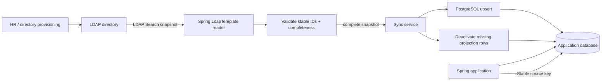
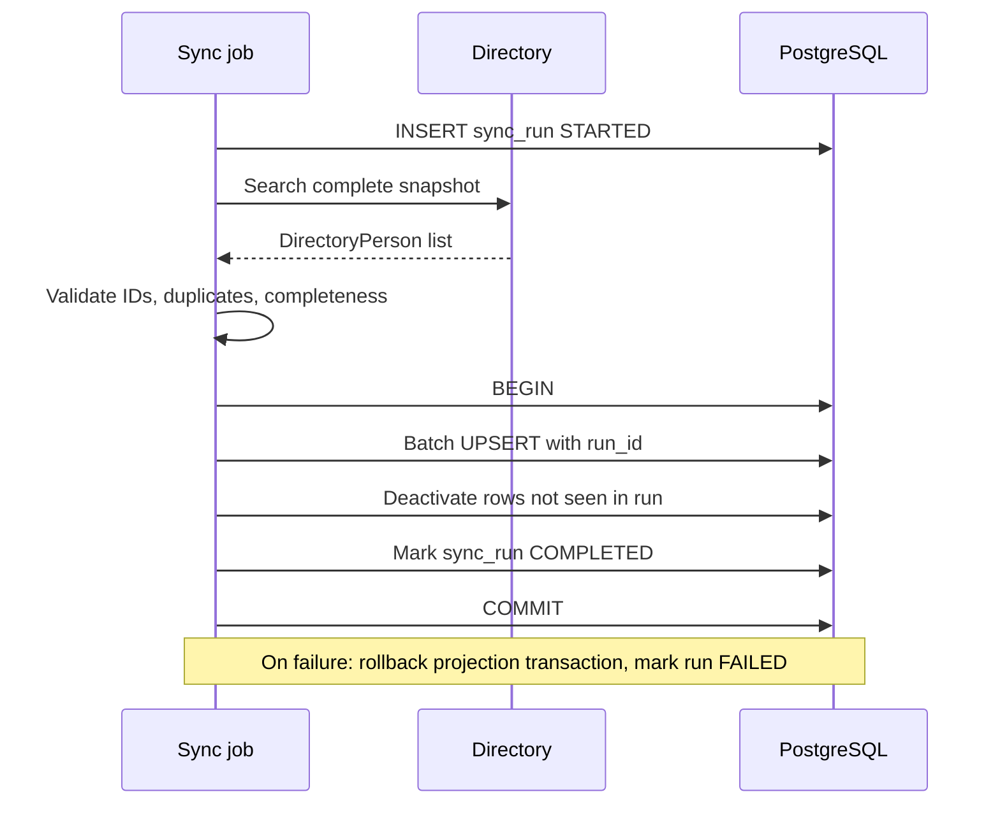

# Đồng bộ dữ liệu vào ứng dụng bằng định danh ổn định

> **Chương:** Thực hành  
> **Module:** SPRING_DATA_LDAP — truy cập dịch vụ thư mục LDAP qua Spring Data LDAP repository và Spring LDAP `LdapTemplate`, ánh xạ entry phân cấp sang Java; hiểu DN, `objectClass`, schema, truy vấn repository/LdapTemplate, CRUD, filter an toàn, bảo mật kết nối và kiểm thử với directory.

## Mục tiêu thực hành

Trong bài lab này, bạn sẽ xây dựng luồng đồng bộ danh bạ nhân viên từ LDAP vào bảng dữ liệu mà ứng dụng Spring Boot quản lý. Sau khi hoàn thành, bạn có thể:

1. Chọn một **định danh ổn định** để liên kết một người giữa LDAP và database ứng dụng.
2. Giải thích vì sao DN, `uid` và email thường là locator/attribute có thể đổi, không phải khóa liên kết lâu dài.
3. Đọc snapshot nhân viên bằng `LdapTemplate` và map LDAP entries sang DTO.
4. Kiểm tra dữ liệu đầu vào, phát hiện thiếu/trùng stable ID trước khi ghi.
5. Dùng PostgreSQL upsert để cập nhật projection mà không tạo bản ghi mới khi DN/email thay đổi.
6. Chỉ vô hiệu hóa bản ghi vắng mặt sau khi xác nhận snapshot LDAP đầy đủ.
7. Giữ cập nhật database trong một transaction cục bộ và hiểu LDAP + SQL không có transaction phân tán tự động.
8. Kiểm thử đồng bộ lần đầu, chạy lặp, rename/move, đổi email, thiếu ID, duplicate ID, lỗi đọc và xóa entry.

## 1. Bài toán: cùng một người nhưng DN và email có thể thay đổi

Một ứng dụng nội bộ cần hiển thị tên và email nhân viên trong màn hình phê duyệt. Hồ sơ gốc nằm trong LDAP; thông tin nghiệp vụ như yêu cầu mua sắm và lịch sử phê duyệt nằm trong PostgreSQL.

Ban đầu, entry của một nhân viên có thể là:

```ldif
dn: uid=linh,ou=people,dc=example,dc=org
objectClass: top
objectClass: person
objectClass: organizationalPerson
objectClass: inetOrgPerson
uid: linh
employeeNumber: EMP-1001
cn: Linh Nguyen
sn: Nguyen
mail: linh@example.org
```

Bảng ứng dụng cần giữ liên kết tới nhân viên này ngay cả khi IT đổi login name, email hoặc chuyển người đó sang OU khác.

Sau vài tháng, entry có thể được đổi thành:

```ldif
dn: uid=linh.nguyen,ou=engineering,dc=example,dc=org
objectClass: top
objectClass: person
objectClass: organizationalPerson
objectClass: inetOrgPerson
uid: linh.nguyen
employeeNumber: EMP-1001
cn: Linh Nguyen
sn: Nguyen
mail: linh.nguyen@example.org
```

Đây vẫn là nhân viên có mã `EMP-1001`. Nếu database dùng DN hoặc email làm khóa chính, ứng dụng có thể tạo một người thứ hai, làm đứt lịch sử phê duyệt hoặc gán nhầm đơn hàng.

**Mục tiêu của lab:** dùng `employeeNumber` làm stable subject ID theo chính sách giả định của doanh nghiệp: được HR cấp, duy nhất trong nguồn, không đổi trong vòng đời nhân viên và không tái sử dụng cho người khác.

> `employeeNumber` không tự nhiên trở thành bất biến chỉ vì nó có trong schema. Tổ chức phải cam kết ownership, uniqueness, không tái sử dụng và quy trình sửa sai. Nếu không có cam kết đó, hãy chọn một identifier khác đã được quản trị.

## 2. Chọn stable ID đúng cách

| Giá trị | Có thể đổi? | Dùng làm khóa liên kết lâu dài? | Ghi chú |
| --- | --- | --- | --- |
| **DN** | Có, khi rename hoặc move entry | Không nên | Định vị entry trong DIT; là locator |
| **`uid`** | Có thể đổi theo login policy | Chỉ khi có hợp đồng bất biến rõ ràng | Thường là login name |
| **`mail`** | Có thể đổi, có thể tái sử dụng | Không nên | Attribute liên hệ, có thể thiếu hoặc đổi |
| **`cn` / tên hiển thị** | Có thể đổi | Không | Không unique và không phải identity key |
| **`employeeNumber`** | Phụ thuộc chính sách HR | Có thể, nếu immutable/non-recycled | Phù hợp ví dụ lab khi HR quản trị |
| **`entryUUID`** | Ổn định trong vòng đời entry theo server hỗ trợ | Tốt cho identity của entry trong directory | Operational attribute; migration/copy behavior tùy server |
| **`objectGUID`** | Ổn định trong Active Directory | Tốt cho identity của AD object | Attribute đặc thù AD, dạng binary |
| **OIDC `iss + sub`** | Theo contract của IdP | Tốt trong phạm vi issuer | Dùng cặp issuer + subject; không giả định `sub` duy nhất giữa các issuer |

### 2.1. Stable business identity và directory object identity

Có hai khái niệm cần tách:

- **Business subject ID:** nhận diện một nhân viên trong nghiệp vụ, ví dụ mã nhân viên do HR quản trị. Có thể tồn tại qua việc chuyển OU, thay login hoặc di chuyển directory.
- **Directory object ID:** nhận diện một entry cụ thể trong một directory server, ví dụ `entryUUID` hoặc `objectGUID`. Nó gắn với vòng đời object của sản phẩm directory.

Nếu ứng dụng chỉ cần theo dõi cùng một entry trong một directory, `entryUUID` hoặc `objectGUID` có thể phù hợp. Nếu cần liên kết nhân viên xuyên hệ thống HR, LDAP, IdP và ứng dụng, một business ID có hợp đồng ổn định thường dễ quản trị hơn.

`entryUUID` là operational attribute theo RFC 4530 ở những server hỗ trợ; client thường phải yêu cầu tường minh khi search. Không giả định mọi LDAP server đều cung cấp cùng attribute. `objectGUID` của Active Directory có representation binary; cần chuyển đổi theo quy tắc của AD, không tùy tiện dùng `byte[].toString()`.

### 2.2. Đặt namespace cho ID

Một mã có thể trùng giữa hai directory. Vì vậy khóa liên kết của lab dùng cặp:

```text
(source_system, source_subject_id)

("CORP_LDAP", "EMP-1001")
("PARTNER_LDAP", "EMP-1001")
```

Đây là hai subject khác nhau vì đến từ hai nguồn. Nếu dùng OIDC, cặp `issuer + sub` có vai trò tương tự.

**Không fallback sang email hoặc DN khi stable ID thiếu.** Nếu entry không có `employeeNumber`, đồng bộ phải dừng và báo dữ liệu không hợp lệ; tự dùng email làm ID sẽ tạo một quy tắc identity khác mà không ai kiểm soát.

## 3. Kiến trúc lab



Các thành phần:

- **LDAP directory:** nguồn dữ liệu có thẩm quyền cho các thuộc tính nhân viên được lab đồng bộ.
- **Snapshot reader:** tìm entries trong một base DN đã cấu hình và map thành DTO.
- **Validator:** kiểm tra ID bắt buộc, trùng ID và số lượng tối thiểu.
- **Sync service:** tạo run ID, điều phối upsert và reconciliation.
- **PostgreSQL projection:** bản sao phục vụ truy vấn ứng dụng; không sở hữu identity gốc.
- **Application:** liên kết dữ liệu nghiệp vụ bằng `(source_system, source_subject_id)`.

Luồng đọc LDAP chạy **trước** transaction PostgreSQL. Chỉ khi đã có snapshot hợp lệ mới mở transaction database để upsert và đánh dấu những projection không còn xuất hiện. Nhờ đó không giữ SQL transaction/connection trong lúc chờ LDAP.

**Ranh giới transaction:** transaction PostgreSQL chỉ bảo đảm các thay đổi trong PostgreSQL cùng commit/rollback. Nó không rollback LDAP, HR, IdP hoặc email service.

## 4. Chuẩn bị môi trường

Lab dùng Java 17+, Spring Boot, Spring LDAP và PostgreSQL. Bạn cần:

- Một LDAP test server có schema hỗ trợ `inetOrgPerson` và attribute `employeeNumber`.
- Một base DN test: `dc=example,dc=org`.
- OU `ou=people` chứa những nhân viên được đồng bộ.
- Một PostgreSQL database riêng cho lab.
- Một bind account chỉ có quyền đọc các attributes cần thiết trong OU đó.

Không chạy thử nghiệm xóa/đổi dữ liệu trên directory production. Dùng dữ liệu giả, endpoint test và credentials có quyền tối thiểu.

### 4.1. Dependency

Ví dụ Maven:

```xml
<dependencies>
    <dependency>
        <groupId>org.springframework.boot</groupId>
        <artifactId>spring-boot-starter-data-ldap</artifactId>
    </dependency>

    <dependency>
        <groupId>org.springframework.boot</groupId>
        <artifactId>spring-boot-starter-jdbc</artifactId>
    </dependency>

    <dependency>
        <groupId>org.postgresql</groupId>
        <artifactId>postgresql</artifactId>
        <scope>runtime</scope>
    </dependency>

    <dependency>
        <groupId>org.springframework.boot</groupId>
        <artifactId>spring-boot-starter-test</artifactId>
        <scope>test</scope>
    </dependency>
</dependencies>
```

Dùng Spring Boot dependency management để chọn version tương thích; không nâng riêng Spring LDAP hoặc JDBC driver ngoài BOM mà chưa kiểm tra dependency tree.

### 4.2. Cấu hình kết nối

Ví dụ `application.yml`:

```yaml
spring:
  ldap:
    urls: "${LDAP_URL}"
    base: "${LDAP_BASE_DN}"
    username: "${LDAP_READ_BIND_DN}"
    password: "${LDAP_READ_BIND_PASSWORD}"

  datasource:
    url: "${APP_DB_URL}"
    username: "${APP_DB_USERNAME}"
    password: "${APP_DB_PASSWORD}"
    driver-class-name: org.postgresql.Driver

sync:
  directory:
    source-system: "CORP_LDAP"
    people-base: "ou=people"
    max-entries: 5000
    minimum-records: 1
```

Biến môi trường chỉ là ví dụ. Dùng LDAPS hoặc StartTLS theo chính sách tổ chức, cấu hình truststore/CA và hostname verification. Không tắt kiểm tra chứng chỉ để “sửa nhanh” lỗi TLS. Bind account chỉ cần đọc `employeeNumber`, `uid`, `cn` và `mail`; không cấp quyền sửa/xóa nếu job chỉ đọc.

`people-base` là DN tương đối với `spring.ldap.base`. Nếu base là `dc=example,dc=org` thì search base hiệu lực là `ou=people,dc=example,dc=org`.

### 4.3. Nạp dữ liệu thử bằng LDIF

Tạo hai entry fixture trong directory test:

```ldif
dn: uid=linh,ou=people,dc=example,dc=org
objectClass: top
objectClass: person
objectClass: organizationalPerson
objectClass: inetOrgPerson
uid: linh
employeeNumber: EMP-1001
cn: Linh Nguyen
sn: Nguyen
mail: linh@example.org

dn: uid=mai,ou=people,dc=example,dc=org
objectClass: top
objectClass: person
objectClass: organizationalPerson
objectClass: inetOrgPerson
uid: mai
employeeNumber: EMP-1002
cn: Mai Tran
sn: Tran
mail: mai@example.org
```

Đảm bảo OU `ou=people` đã tồn tại. `employeeNumber` được định nghĩa trong schema `inetOrgPerson`, nhưng vẫn cần kiểm tra server test có schema tương ứng và ACL cho phép đọc attribute đó.

## 5. Tạo bảng projection và bảng sync run

Bảng projection giữ dữ liệu nhân viên mà ứng dụng cần đọc. Bảng sync run ghi lại mỗi lần đồng bộ.

```sql
CREATE TABLE directory_person_projection (
    source_system       VARCHAR(80)  NOT NULL,
    source_subject_id   VARCHAR(160) NOT NULL,
    uid                 VARCHAR(160) NOT NULL,
    relative_dn         TEXT         NOT NULL,
    display_name        VARCHAR(300) NOT NULL,
    email               VARCHAR(320),
    active              BOOLEAN      NOT NULL DEFAULT TRUE,
    last_seen_run_id    UUID         NOT NULL,
    first_seen_at       TIMESTAMPTZ  NOT NULL DEFAULT CURRENT_TIMESTAMP,
    last_synced_at      TIMESTAMPTZ  NOT NULL DEFAULT CURRENT_TIMESTAMP,
    deactivated_at      TIMESTAMPTZ,

    PRIMARY KEY (source_system, source_subject_id)
);

CREATE INDEX idx_directory_person_active
    ON directory_person_projection (source_system, active);

CREATE INDEX idx_directory_person_uid
    ON directory_person_projection (source_system, uid);

CREATE TABLE directory_sync_run (
    run_id              UUID         PRIMARY KEY,
    source_system       VARCHAR(80)  NOT NULL,
    status              VARCHAR(20)  NOT NULL,
    started_at          TIMESTAMPTZ  NOT NULL DEFAULT CURRENT_TIMESTAMP,
    completed_at        TIMESTAMPTZ,
    record_count        INTEGER,
    deactivated_count   INTEGER,
    error_code          VARCHAR(80),

    CONSTRAINT ck_directory_sync_run_status
        CHECK (status IN ('STARTED', 'COMPLETED', 'FAILED'))
);
```

### Vì sao không đặt unique constraint trên email hoặc DN?

- Email có thể đổi và đôi khi được tái sử dụng.
- DN có thể đổi khi rename/move entry.
- `uid` cũng có thể đổi theo policy đăng nhập; index giúp tra cứu, nhưng không làm nó trở thành khóa identity.
- Khóa chính là cặp `source_system` + `source_subject_id`.

`relative_dn` chỉ lưu DN tương đối được dùng để định vị entry trong directory hiện tại. Trong ví dụ, giá trị được biểu diễn tương đối với `spring.ldap.base`; nó là locator để hỗ trợ tra cứu/đối soát, không phải foreign key của bảng nghiệp vụ.

Nếu một nguồn thực sự cam kết `uid` duy nhất và bất biến, có thể thêm constraint phù hợp sau khi có dữ liệu và migration plan. Không thêm unique constraint chỉ vì fixture hiện tại không có duplicate.

## 6. Tạo DTO và đọc LDAP snapshot

Không đưa JNDI `Attributes` hoặc `DirContextOperations` ra ngoài adapter. Hãy map thành DTO Java chỉ chứa các trường ứng dụng cần.

```java
package com.example.directory.sync;

public record DirectoryPerson(
    String sourceSubjectId,
    String uid,
    String relativeDn,
    String displayName,
    String email
) {}
```

Reader:

```java
package com.example.directory.sync;

import static org.springframework.ldap.query.LdapQueryBuilder.query;

import java.util.List;

import org.springframework.ldap.core.ContextMapper;
import org.springframework.ldap.core.DirContextOperations;
import org.springframework.ldap.core.LdapOperations;
import org.springframework.ldap.query.SearchScope;
import org.springframework.stereotype.Component;

@Component
public class DirectorySnapshotReader {

    private final LdapOperations ldap;
    private final DirectorySyncProperties properties;

    public DirectorySnapshotReader(
            LdapOperations ldap,
            DirectorySyncProperties properties) {
        this.ldap = ldap;
        this.properties = properties;
    }

    public List<DirectoryPerson> readSnapshot() {
        return ldap.search(
            query()
                .base(properties.peopleBase())
                .searchScope(SearchScope.SUBTREE)
                .attributes(
                    "employeeNumber", "uid", "cn", "mail"
                )
                .countLimit(properties.maxEntries())
                .timeLimit(5000)
                .where("objectClass").is("inetOrgPerson"),
            (ContextMapper<DirectoryPerson>) context -> {
                DirContextOperations entry =
                    (DirContextOperations) context;

                return new DirectoryPerson(
                    required(entry.getStringAttribute("employeeNumber"),
                        "employeeNumber"),
                    required(entry.getStringAttribute("uid"), "uid"),
                    entry.getDn().toString(),
                    required(entry.getStringAttribute("cn"), "cn"),
                    entry.getStringAttribute("mail")
                );
            }
        );
    }

    private static String required(String value, String attribute) {
        if (value == null || value.isBlank()) {
            throw new IllegalStateException(
                "Directory entry is missing required attribute: "
                    + attribute);
        }
        // Giữ nguyên quy tắc viết hoa/thường của nguồn; không tự lowercase ID.
        return value.strip();
    }
}
```

`DirectorySyncProperties` là cấu hình typed của ứng dụng, ví dụ dùng `@ConfigurationProperties(prefix = "sync.directory")`. Có thể tạo record:

```java
package com.example.directory.sync;

import org.springframework.boot.context.properties.ConfigurationProperties;

@ConfigurationProperties(prefix = "sync.directory")
public record DirectorySyncProperties(
    String sourceSystem,
    String peopleBase,
    int maxEntries,
    int minimumRecords
) {}
```

Bật configuration properties bằng `@ConfigurationPropertiesScan` trên application class hoặc `@EnableConfigurationProperties`.

### Những điểm cần hiểu trong reader

- `LdapOperations` là abstraction; Spring Boot có thể cung cấp `LdapTemplate` làm implementation.
- `base(properties.peopleBase())` giới hạn search vào OU nhân viên.
- Filter `objectClass=inetOrgPerson` chọn đúng loại entry.
- `attributes(...)` yêu cầu đúng bốn attributes cần thiết, không tải toàn bộ directory entry.
- `employeeNumber`, `uid` và `cn` là bắt buộc trong lab; `mail` là tùy chọn.
- `entry.getDn()` lưu locator hiện tại. Khi entry được move/rename, giá trị này thay đổi trong lần sync kế tiếp.
- `countLimit` và `timeLimit` đặt giới hạn cho search của lab. Nếu dataset vượt giới hạn hoặc server trả partial/limit error, snapshot phải bị coi là thất bại, không được dùng để deactivate dữ liệu cũ.

**Không bật `ignorePartialResultException` để job tiếp tục như thể đã đọc đủ dữ liệu.** Nếu directory dùng referrals, hãy xác định rõ naming contexts được phép và bảo đảm snapshot bao gồm đúng phạm vi. Nếu có paging, chỉ đánh dấu snapshot hoàn tất sau khi tất cả page/cookie được xử lý thành công.

## 7. Validate snapshot trước khi ghi database

Trước khi upsert, cần kiểm tra:

1. Snapshot không rỗng theo policy của lab.
2. Số record không thấp hơn ngưỡng tối thiểu được cấu hình.
3. Mỗi entry có stable ID, `uid`, DN và display name hợp lệ.
4. Stable ID không trùng trong cùng source.
5. Không có lỗi mapping, size/time limit, referral hoặc partial result chưa xử lý.

Ví dụ validator:

```java
package com.example.directory.sync;

import java.util.HashSet;
import java.util.List;
import java.util.Set;

import org.springframework.stereotype.Component;

@Component
public class DirectorySnapshotValidator {

    private final DirectorySyncProperties properties;

    public DirectorySnapshotValidator(
            DirectorySyncProperties properties) {
        this.properties = properties;
    }

    public void validate(List<DirectoryPerson> people) {
        if (people.isEmpty()) {
            throw new IllegalStateException(
                "Empty directory snapshot; reconciliation refused");
        }

        if (people.size() < properties.minimumRecords()) {
            throw new IllegalStateException(
                "Snapshot is below the configured minimum record count");
        }

        Set<String> seen = new HashSet<>();

        for (DirectoryPerson person : people) {
            requireValue(person.sourceSubjectId(), "stable ID");
            requireValue(person.uid(), "uid");
            requireValue(person.relativeDn(), "DN");
            requireValue(person.displayName(), "display name");

            if (!seen.add(person.sourceSubjectId())) {
                throw new IllegalStateException(
                    "Duplicate stable ID in directory snapshot");
            }
        }
    }

    private static void requireValue(String value, String field) {
        if (value == null || value.isBlank()) {
            throw new IllegalStateException(
                "Missing required field: " + field);
        }
    }
}
```

Validator dừng toàn bộ run nếu có một entry thiếu hoặc trùng stable ID. Đây là chủ ý: nếu bỏ qua entry lỗi rồi đánh dấu những bản ghi khác là snapshot đầy đủ, một nhân viên hợp lệ có thể bị vô hiệu hóa nhầm.

### Ngưỡng số lượng không phải chứng minh snapshot đầy đủ

`minimumRecords` chỉ là guard chống trường hợp đột ngột đọc được 0 hoặc quá ít entries. Nó **không chứng minh** không có partial result, replica lag hoặc ACL thay đổi. Cần cả trạng thái hoàn tất của search/paging, đúng endpoint, đúng base/scope và quyền đọc đầy đủ.

Nếu tổ chức có biến động nhân sự lớn, chọn ngưỡng theo policy có giám sát; không hardcode một số lượng bất biến theo ví dụ lab.

## 8. Viết upsert theo stable key

Repository JDBC đơn giản dùng `JdbcTemplate`:

```java
package com.example.directory.sync;

import java.sql.PreparedStatement;
import java.sql.SQLException;
import java.util.List;
import java.util.UUID;

import org.springframework.jdbc.core.JdbcTemplate;
import org.springframework.stereotype.Repository;

@Repository
public class DirectoryProjectionRepository {

    private static final String UPSERT_SQL = """
        INSERT INTO directory_person_projection (
            source_system,
            source_subject_id,
            uid,
            relative_dn,
            display_name,
            email,
            active,
            last_seen_run_id,
            last_synced_at,
            deactivated_at
        )
        VALUES (?, ?, ?, ?, ?, ?, TRUE, ?, CURRENT_TIMESTAMP, NULL)
        ON CONFLICT (source_system, source_subject_id)
        DO UPDATE SET
            uid = EXCLUDED.uid,
            relative_dn = EXCLUDED.relative_dn,
            display_name = EXCLUDED.display_name,
            email = EXCLUDED.email,
            active = TRUE,
            last_seen_run_id = EXCLUDED.last_seen_run_id,
            last_synced_at = CURRENT_TIMESTAMP,
            deactivated_at = NULL
        """;

    private final JdbcTemplate jdbc;

    public DirectoryProjectionRepository(JdbcTemplate jdbc) {
        this.jdbc = jdbc;
    }

    public void upsert(
            String sourceSystem,
            List<DirectoryPerson> people,
            UUID runId) {

        jdbc.batchUpdate(
            UPSERT_SQL,
            people,
            200,
            (PreparedStatement ps, DirectoryPerson person)
                    -> bind(ps, sourceSystem, person, runId)
        );
    }

    private static void bind(
            PreparedStatement ps,
            String sourceSystem,
            DirectoryPerson person,
            UUID runId) throws SQLException {

        ps.setString(1, sourceSystem);
        ps.setString(2, person.sourceSubjectId());
        ps.setString(3, person.uid());
        ps.setString(4, person.relativeDn());
        ps.setString(5, person.displayName());
        ps.setString(6, person.email());
        ps.setObject(7, runId);
    }
}
```

Cú pháp `ON CONFLICT` là của PostgreSQL. Với database khác, dùng cơ chế upsert/merge tương ứng và kiểm tra isolation/locking.

**Điểm mấu chốt:** conflict target là `(source_system, source_subject_id)`. Khi `uid`, `relative_dn` hoặc `email` đổi, database cập nhật cùng một row vì stable key không đổi.

Không dùng `INSERT ... ON CONFLICT(email)` hoặc `ON CONFLICT(dn)` làm identity link.

## 9. Chỉ đánh dấu vắng mặt sau một snapshot đầy đủ

Nếu một nhân viên không xuất hiện trong snapshot, có thể họ đã rời tổ chức, nhưng cũng có thể:

- LDAP search bị partial result;
- Referral bị ignore;
- Bind account mất quyền đọc một OU;
- Job chạm read replica đang lag;
- Search bị size/time limit;
- Một page của paged search bị lỗi;
- Cấu hình base DN bị thay đổi;
- Mạng bị ngắt giữa quá trình đọc.

Vì vậy, **vắng mặt trong một lần đọc chưa đủ để kết luận đã nghỉ việc**.

Trong lab, ta dùng một quy tắc rõ: OU `ou=people` là snapshot đầy đủ của các nhân viên đang được ứng dụng quản lý. Chỉ khi reader trả về hoàn chỉnh và validator pass mới dùng nó để reconciliation. Trong production, nguồn có thể cần thêm trạng thái employment/account riêng thay vì suy ra active chỉ từ việc entry còn trong OU.

### SQL đánh dấu những row không còn xuất hiện

```sql
UPDATE directory_person_projection
SET active = FALSE,
    deactivated_at = CURRENT_TIMESTAMP,
    last_synced_at = CURRENT_TIMESTAMP
WHERE source_system = ?
  AND active = TRUE
  AND last_seen_run_id <> ?;
```

Câu lệnh này chỉ chạy **sau khi toàn bộ snapshot đã được upsert thành công** và trong cùng transaction PostgreSQL. Những row được nhìn thấy trong run hiện tại có `last_seen_run_id` bằng run ID hiện tại nên vẫn active.

Không xóa vật lý dữ liệu nghiệp vụ. `active=false` là trạng thái projection; đơn hàng, phê duyệt và audit cần giữ theo retention policy.

### Trường hợp snapshot rỗng

Trong lab, snapshot rỗng bị từ chối. Trong một hệ thống thực, một OU có thể hợp lệ khi rỗng sau đợt tái cơ cấu. Khi đó cần một quy trình được phê duyệt riêng, xác nhận endpoint/base/scope và số lượng dự kiến trước khi deactivate toàn bộ projection. Không biến empty snapshot thành mass deactivation tự động.

## 10. Điều phối sync run và transaction PostgreSQL

Mỗi lần đồng bộ có một UUID riêng. Bảng `directory_sync_run` giúp phân biệt run đang chạy, hoàn tất hoặc thất bại.

Luồng:

1. Ghi run `STARTED`.
2. Đọc snapshot LDAP ngoài SQL transaction.
3. Validate snapshot và completeness.
4. Mở transaction PostgreSQL.
5. Upsert toàn bộ entries với run ID.
6. Deactivate projection không được nhìn thấy trong run.
7. Đánh dấu run `COMPLETED` và lưu record count.
8. Commit.
9. Nếu có lỗi, rollback các thay đổi projection; cập nhật run thành `FAILED` sau rollback.



Ví dụ service:

```java
package com.example.directory.sync;

import java.util.List;
import java.util.UUID;

import org.springframework.jdbc.core.JdbcTemplate;
import org.springframework.stereotype.Service;
import org.springframework.transaction.support.TransactionTemplate;

@Service
public class DirectorySyncService {

    private final DirectorySnapshotReader reader;
    private final DirectorySnapshotValidator validator;
    private final DirectoryProjectionRepository projection;
    private final DirectorySyncProperties properties;
    private final JdbcTemplate jdbc;
    private final TransactionTemplate transactionTemplate;

    public DirectorySyncService(
            DirectorySnapshotReader reader,
            DirectorySnapshotValidator validator,
            DirectoryProjectionRepository projection,
            DirectorySyncProperties properties,
            JdbcTemplate jdbc,
            TransactionTemplate transactionTemplate) {
        this.reader = reader;
        this.validator = validator;
        this.projection = projection;
        this.properties = properties;
        this.jdbc = jdbc;
        this.transactionTemplate = transactionTemplate;
    }

    public SyncResult synchronize() {
        UUID runId = UUID.randomUUID();
        String source = properties.sourceSystem();

        jdbc.update("""
            INSERT INTO directory_sync_run
                (run_id, source_system, status)
            VALUES (?, ?, 'STARTED')
            """, runId, source);

        try {
            // Đọc LDAP trước khi mở transaction SQL.
            List<DirectoryPerson> snapshot = reader.readSnapshot();
            validator.validate(snapshot);

            transactionTemplate.executeWithoutResult(status -> {
                projection.upsert(source, snapshot, runId);

                int deactivated = jdbc.update("""
                    UPDATE directory_person_projection
                    SET active = FALSE,
                        deactivated_at = CURRENT_TIMESTAMP,
                        last_synced_at = CURRENT_TIMESTAMP
                    WHERE source_system = ?
                      AND active = TRUE
                      AND last_seen_run_id <> ?
                    """, source, runId);

                jdbc.update("""
                    UPDATE directory_sync_run
                    SET status = 'COMPLETED',
                        completed_at = CURRENT_TIMESTAMP,
                        record_count = ?,
                        deactivated_count = ?
                    WHERE run_id = ?
                    """, snapshot.size(), deactivated, runId);
            });

            return new SyncResult(runId, snapshot.size(), true);

        } catch (RuntimeException ex) {
            // TransactionTemplate đã rollback trước khi control về catch.
            // Chỉ lưu mã lỗi tổng quát; không ghi DN/attributes/secret.
            try {
                jdbc.update("""
                    UPDATE directory_sync_run
                    SET status = 'FAILED',
                        completed_at = CURRENT_TIMESTAMP,
                        error_code = 'DIRECTORY_SYNC_FAILED'
                    WHERE run_id = ?
                    """, runId);
            } catch (RuntimeException statusFailure) {
                ex.addSuppressed(statusFailure);
            }
            throw ex;
        }
    }

    public record SyncResult(
        UUID runId,
        int recordsSeen,
        boolean completed
    ) {}
}
```

`SOURCE` trong ví dụ được hardcode để bài lab ngắn. Trong ứng dụng thật, inject `sourceSystem` từ cấu hình; không cho HTTP caller tự chọn nguồn. Cũng cần cấu hình khóa chống hai sync run cùng source chạy đồng thời (scheduler lock, database advisory lock hoặc job coordinator) để tránh hai snapshot cũ/mới ghi đè nhau.

### Tại sao không đặt `@Transactional` cho cả phương thức rồi đọc LDAP?

Không nên giữ transaction SQL trong lúc gọi LDAP/network. Nếu LDAP mất 10 giây, connection PostgreSQL và transaction lock có thể bị giữ suốt 10 giây. Tách read snapshot khỏi transaction giúp giảm thời gian giữ tài nguyên database.

TransactionTemplate trong ví dụ chỉ bọc **upsert + deactivation + mark complete**. LDAP không tham gia transaction đó.

## 11. Chạy lab và kiểm tra kết quả

Sau khi cấu hình LDAP test và PostgreSQL:

1. Tạo bảng bằng migration SQL.
2. Import hai LDAP entries `EMP-1001` và `EMP-1002`.
3. Chạy ứng dụng với đúng environment variables.
4. Gọi job/service `synchronize()` một lần.
5. Kiểm tra bảng projection và sync run.

Ví dụ truy vấn:

```sql
SELECT
    source_system,
    source_subject_id,
    uid,
    relative_dn,
    display_name,
    email,
    active,
    last_seen_run_id
FROM directory_person_projection
ORDER BY source_subject_id;
```

Kết quả mong đợi:

| source_system | source_subject_id | uid | display_name | active |
| --- | --- | --- | --- | --- |
| CORP_LDAP | EMP-1001 | linh | Linh Nguyen | true |
| CORP_LDAP | EMP-1002 | mai | Mai Tran | true |

Kiểm tra run:

```sql
SELECT run_id, source_system, status, record_count,
       deactivated_count, started_at, completed_at
FROM directory_sync_run
ORDER BY started_at DESC;
```

Run thành công có `status=COMPLETED`, `record_count=2` và `deactivated_count=0`.

## 12. Thử nghiệm quan trọng: đổi DN, uid và email

Đây là bước chứng minh stable key hoạt động.

Sửa entry `EMP-1001` trong LDAP test để chuyển từ:

```text
dn: uid=linh,ou=people,dc=example,dc=org
uid: linh
mail: linh@example.org
employeeNumber: EMP-1001
```

thành:

```text
dn: uid=linh.nguyen,ou=people,dc=example,dc=org
uid: linh.nguyen
mail: linh.nguyen@example.org
employeeNumber: EMP-1001
```

Nếu RDN thay đổi, cần dùng LDAP ModifyDN để rename entry và đảm bảo entry cũ không còn; LDIF/command cụ thể tùy server test. Ví dụ này giữ entry trong subtree `ou=people` để search snapshot tiếp tục nhìn thấy nó. Nếu chuyển entry ra ngoài base/scope được đồng bộ, job sẽ coi nó là vắng mặt và có thể deactivate projection theo policy. Không tạo thêm entry thứ hai có cùng `employeeNumber` rồi kết luận rename thành công.

Chạy sync lần hai. Kết quả mong đợi:

| Trường | Trước | Sau |
| --- | --- | --- |
| `source_subject_id` | EMP-1001 | **EMP-1001** |
| `uid` | linh | linh.nguyen |
| `relative_dn` | uid=linh,ou=people | uid=linh.nguyen,ou=people |
| `email` | linh@example.org | linh.nguyen@example.org |
| Số row của EMP-1001 | 1 | **1** |

SQL kiểm tra:

```sql
SELECT COUNT(*)
FROM directory_person_projection
WHERE source_system = 'CORP_LDAP'
  AND source_subject_id = 'EMP-1001';
```

Kết quả phải là **1**. Nếu thành 2, ứng dụng có thể đang dùng DN/email làm khóa hoặc mapping stable ID chưa đúng.

Đây cũng là lý do không nên giữ DN cũ trong bảng như khóa liên kết. Nếu cần lịch sử rename, tạo bảng audit/event riêng; không biến lịch sử locator thành primary identity.

## 13. Thử nghiệm entry biến mất khỏi nguồn

Trong directory test, xóa entry `EMP-1002` khỏi OU nguồn hoặc chuyển nó sang một naming context không thuộc snapshot được định nghĩa. Chỉ làm trên dữ liệu lab.

Chạy sync lần ba. Vì snapshot hoàn chỉnh không còn `EMP-1002`, projection của nó chuyển sang `active=false`:

| source_subject_id | active | Ý nghĩa |
| --- | --- | --- |
| EMP-1001 | true | Vẫn xuất hiện trong snapshot |
| EMP-1002 | false | Không còn trong snapshot đầy đủ |

Kiểm tra:

```sql
SELECT source_subject_id, active, deactivated_at
FROM directory_person_projection
WHERE source_system = 'CORP_LDAP'
ORDER BY source_subject_id;
```

Không xóa row vật lý. Bảng đơn hàng/phê duyệt vẫn tham chiếu `source_system + source_subject_id`. Nếu ứng dụng cần hiển thị tên lịch sử, giữ snapshot tối thiểu theo retention policy.

**Trong production, “entry không còn trong OU” chỉ là tín hiệu theo policy của nguồn.** Nếu directory giữ entry nhưng khóa account bằng một attribute trạng thái, phải đọc trạng thái đó và áp dụng mapping riêng. Không suy diễn trạng thái nghỉ việc từ việc entry tồn tại hoặc biến mất nếu HR/IdP mới là nguồn authoritative.

## 14. Kiểm thử lỗi: không được deactivate nhầm

Đây là phần quan trọng nhất của lab. Cần chứng minh những lỗi sau **không** chạy bước reconciliation.

### 14.1. Snapshot rỗng

Giả lập reader trả list rỗng. Validator phải ném exception. Không có transaction upsert/deactivation; các projection hiện tại giữ nguyên trạng thái.

### 14.2. Thiếu stable ID

Một entry có `uid` và `mail` nhưng không có `employeeNumber`. Reader/validator phải fail toàn bộ run. Không fallback sang mail.

### 14.3. Stable ID trùng

Hai entries có cùng `employeeNumber=EMP-1001` trong một source. Validator phải fail trước DB transaction. Không chọn entry đầu và bỏ entry sau.

### 14.4. Search bị partial hoặc referral chưa xử lý

Nếu search có referral, ACL hạn chế, time/size limit hoặc một page bị lỗi, snapshot không được coi là đầy đủ. Không bật ignore partial exception để job tiếp tục và deactivate những người chưa được đọc.

### 14.5. Đọc từ replica lag

Nếu job dùng replica và replica chưa nhận thay đổi mới, snapshot có thể thiếu hoặc chứa trạng thái cũ. Chọn endpoint có semantics phù hợp, kiểm tra replication lag và có grace period/reconciliation trước khi deactivate.

### Ma trận kết quả

| Tình huống | Có upsert? | Có deactivate row vắng mặt? | Kết quả run |
| --- | --- | --- | --- |
| Snapshot đầy đủ, hợp lệ | Có | Có, trong cùng transaction | COMPLETED |
| Snapshot rỗng ngoài policy | Không | Không | FAILED |
| Thiếu stable ID | Không | Không | FAILED |
| Duplicate stable ID | Không | Không | FAILED |
| Search timeout/size limit | Không | Không | FAILED |
| Referral/partial result chưa xử lý | Không | Không | FAILED hoặc trạng thái partial riêng |
| PostgreSQL lỗi giữa batch | Rollback toàn transaction | Rollback | FAILED |
| LDAP mất kết nối trước snapshot | Không | Không | FAILED |
| Replica lag vượt ngưỡng | Không hoặc chờ đối soát | Không | FAILED/DEFERRED theo policy |

Trong code lab, `SyncResult` chỉ có completed true/false; production nên có trạng thái chi tiết hơn như `FAILED_SOURCE_READ`, `FAILED_VALIDATION`, `FAILED_DATABASE`, `PARTIAL` và `DEFERRED_REPLICA_LAG`.

## 15. Integration test với Spring Boot

Mock có ích để kiểm tra validator và orchestration, nhưng không chứng minh LDAP schema, base DN, ACL, DN mapping hoặc paging hoạt động. Nên có test directory riêng và PostgreSQL test database.

Ví dụ kiểm thử stable ID sau khi thay đổi thuộc tính locator:

```java
import static org.junit.jupiter.api.Assertions.assertEquals;

import org.junit.jupiter.api.Test;
import org.springframework.beans.factory.annotation.Autowired;
import org.springframework.boot.test.context.SpringBootTest;
import org.springframework.jdbc.core.JdbcTemplate;
import org.springframework.test.context.ActiveProfiles;

@SpringBootTest
@ActiveProfiles("test")
class DirectorySyncIntegrationTest {

    @Autowired
    DirectorySyncService syncService;

    @Autowired
    JdbcTemplate jdbc;

    @Test
    void repeatedSyncUsesStableIdentity() {
        syncService.synchronize();

        Integer firstCount = jdbc.queryForObject("""
            SELECT COUNT(*)
            FROM directory_person_projection
            WHERE source_system = 'CORP_LDAP'
              AND source_subject_id = 'EMP-1001'
            """, Integer.class);

        syncService.synchronize();

        Integer secondCount = jdbc.queryForObject("""
            SELECT COUNT(*)
            FROM directory_person_projection
            WHERE source_system = 'CORP_LDAP'
              AND source_subject_id = 'EMP-1001'
            """, Integer.class);

        assertEquals(1, firstCount);
        assertEquals(1, secondCount);
    }
}
```

Test này chứng minh chạy lặp không tạo duplicate row trong database. Để kiểm chứng rename/email change, test fixture cần cập nhật LDAP entry giữa hai lần gọi rồi assert primary key giữ nguyên, locator/email được cập nhật.

### Các test cần viết thêm

| Test | Thao tác | Kỳ vọng |
| --- | --- | --- |
| **T1 — Initial sync** | Nạp hai fixture và chạy sync | Tạo hai projection rows |
| **T2 — Idempotent rerun** | Chạy lại cùng snapshot | Không tạo thêm row |
| **T3 — Rename RDN** | Đổi `uid` và DN, giữ employeeNumber | Cùng row được update |
| **T4 — Move OU** | Chuyển entry vào OU con nằm trong subtree `ou=people` được đồng bộ | Stable key không đổi; locator cập nhật |
| **T5 — Email change** | Đổi `mail` | Cùng row được update, không tạo person mới |
| **T6 — Missing entry** | Xóa một fixture rồi đọc snapshot đầy đủ | Projection chuyển inactive |
| **T7 — Empty snapshot** | Reader trả 0 entries | Run failed; không deactivate |
| **T8 — Missing stable ID** | Bỏ `employeeNumber` | Run failed trước SQL transaction |
| **T9 — Duplicate ID** | Hai entries cùng stable ID | Run failed; không upsert/deactivate |
| **T10 — LDAP timeout** | Ngắt server trong lúc search | Run failed; projection giữ nguyên |
| **T11 — Partial/referral** | Search không đầy đủ | Không reconciliation |
| **T12 — SQL failure** | Gây lỗi trong batch upsert | Toàn transaction projection rollback |
| **T13 — Two sources** | Hai source có cùng employeeNumber | Hai row tách theo source_system |
| **T14 — Rehire policy** | Tái tuyển một nhân viên cũ | Stable identity theo policy; không tự tái sử dụng ID nếu nguồn cấm |
| **T15 — Concurrent runs** | Hai job cùng source chạy đồng thời | Lock ngăn snapshot cũ ghi đè run mới |
| **T16 — Disabled account** | Entry vẫn tồn tại nhưng account bị disable | Áp dụng status attribute/policy, không suy từ presence |

## 16. Mở rộng cho directory lớn: paging và staging

Bài lab dùng snapshot nhỏ và nạp vào List để dễ theo dõi. Với hàng chục nghìn hoặc hàng triệu entries, không nên mặc định giữ toàn bộ snapshot trong heap.

### Paging

Dùng LDAP Simple Paged Results Control (RFC 2696) nếu server hỗ trợ. Mỗi page lấy một nhóm entries cùng cookie để tiếp tục. Chuỗi paging có thể yêu cầu giữ cùng context/connection tùy server và provider; nếu connection mất, cookie có thể không dùng tiếp được.

Quy tắc quan trọng: **chưa đọc xong trang cuối thì chưa có complete snapshot**. Nếu page 7/10 lỗi, không deactivate các records không xuất hiện trong 6 page đầu. LDAP search qua nhiều page cũng không mặc định cung cấp snapshot isolation tại một thời điểm; nếu directory thay đổi trong lúc paging, cần change sequence/watermark theo khả năng server, grace period hoặc lần reconciliation tiếp theo trước khi thu hồi dữ liệu quan trọng.

### Staging table

Với dataset lớn, một thiết kế bền vững hơn:

1. Tạo `sync_run` ở trạng thái STARTED.
2. Đọc từng page LDAP.
3. Validate stable IDs trong từng page và trên toàn run (dùng unique constraint ở staging).
4. Batch insert/update vào bảng staging gắn `run_id`.
5. Khi cookie kết thúc và mọi page thành công, xác nhận snapshot complete.
6. Trong một transaction DB, merge staging vào projection.
7. Deactivate các row không có trong staging của run hiện tại.
8. Mark run COMPLETED và dọn staging theo retention.

Ví dụ staging key:

```sql
CREATE TABLE directory_person_stage (
    run_id             UUID         NOT NULL,
    source_system      VARCHAR(80)  NOT NULL,
    source_subject_id  VARCHAR(160) NOT NULL,
    uid                VARCHAR(160) NOT NULL,
    relative_dn        TEXT         NOT NULL,
    display_name       VARCHAR(300) NOT NULL,
    email              VARCHAR(320),
    PRIMARY KEY (run_id, source_system, source_subject_id)
);
```

Unique key trên staging giúp phát hiện stable ID trùng trong toàn bộ snapshot. Nếu insert duplicate, run phải thất bại; không dùng `ON CONFLICT DO NOTHING` để che duplicate source identity.

### Incremental sync

Một số directory có cơ chế change tracking riêng như Active Directory DirSync hoặc OpenLDAP syncrepl/accesslog tùy kiến trúc. Không có một API incremental change feed đồng nhất cho mọi LDAP server. Dù dùng incremental sync, vẫn nên có full reconciliation định kỳ để phát hiện missed changes và drift.

## 17. Ownership, bảo mật và dữ liệu cá nhân

Projection là **bản sao phục vụ ứng dụng**, không tự trở thành nguồn có thẩm quyền.

| Field | Nguồn có thẩm quyền ví dụ | Ứng dụng nên làm gì |
| --- | --- | --- |
| Stable employee ID | HR | Dùng làm liên kết, không tự sửa |
| Tên hiển thị | HR/directory theo governance | Cập nhật projection |
| Email | HR/IdP/directory theo policy | Coi là thuộc tính có thể đổi |
| DN | LDAP directory | Coi là locator hiện tại |
| Role/group membership | Directory/IdP hoặc policy service | Map theo authorization contract, có freshness policy |
| Đơn hàng/phê duyệt | Application database | Giữ theo domain và retention |

Các nguyên tắc:

- Chỉ sync attributes ứng dụng thực sự cần.
- Không đọc hoặc sao chép `userPassword`, token, secret hoặc credential.
- Bind account có quyền read-only trên OU cần thiết.
- TLS phải xác minh certificate/hostname.
- Không log toàn bộ LDAP entry, email hoặc DN nếu không cần; dùng source key đã mask khi phù hợp.
- Có retention và quy trình xóa/anonymize projection theo yêu cầu dữ liệu.
- Khi employee nghỉ việc, deactivation trong projection không thay thế revoke session/token hoặc cập nhật authorization ở IdP.
- Không cho ứng dụng sửa LDAP fields chỉ vì đã có projection table; mọi write-back phải có owner và API/policy riêng.

### Quyền và dữ liệu stale

Nếu LDAP là nguồn authoritative nhưng job chạy mỗi giờ, ứng dụng có thể thấy email hoặc trạng thái cũ tối đa gần một chu kỳ đồng bộ cộng thời gian xử lý. Với authorization, khoảng trễ đó có thể không chấp nhận được. Hãy xác định:
- Dữ liệu nào được cache/projection;
- Thời gian stale tối đa;
- Khi nào cần đọc trực tiếp authoritative endpoint;
- Cơ chế invalidation hoặc event;
- Cách xử lý khi LDAP không sẵn sàng.

Không dùng projection nhân viên cũ để cấp quyền nhạy cảm vô thời hạn.

## 18. Checklist hoàn thành lab

- [ ] LDAP test có OU và entries đúng schema `inetOrgPerson`.
- [ ] Stable ID được chọn theo contract immutable, unique và non-recycled của nguồn.
- [ ] Khóa database là `(source_system, source_subject_id)`.
- [ ] DN, `uid`, `mail` được lưu như locator/attributes có thể cập nhật.
- [ ] Reader chỉ lấy attributes cần thiết và dùng base DN hẹp.
- [ ] Thiếu/trùng stable ID làm snapshot fail; không fallback sang email/DN.
- [ ] Snapshot completeness được xác minh: không partial, không referral bị bỏ qua, paging hoàn tất, đúng endpoint.
- [ ] Upsert dùng stable key và chạy trong transaction PostgreSQL.
- [ ] Deactivation chỉ chạy sau snapshot complete và trong cùng transaction với upsert.
- [ ] Empty/too-small snapshot có guard/approval.
- [ ] Run history lưu STARTED/COMPLETED/FAILED và record counts.
- [ ] Rename, move, email change không tạo duplicate identity.
- [ ] Missing entry chỉ deactivate projection theo policy; không xóa lịch sử nghiệp vụ.
- [ ] Hai source có cùng ID không đụng nhau vì source namespace.
- [ ] Có lock ngăn sync runs cùng source chạy đồng thời.
- [ ] Có test LDAP + PostgreSQL, test failure và test partial/referral.
- [ ] Có metrics duration, count, deactivated count, failure reason và stale age.
- [ ] Credentials, PII và TLS được quản lý đúng chính sách.

## 19. Câu hỏi tự đánh giá

**Câu 1.** Vì sao không nên dùng DN làm primary key trong bảng đơn hàng?  
**Đáp án:** DN thay đổi khi entry rename hoặc move. Lịch sử nghiệp vụ cần liên kết bằng stable subject ID, không phụ thuộc vị trí hiện tại trong DIT.

**Câu 2.** Email đổi từ `linh@example.org` sang `linh.nguyen@example.org`. Ứng dụng nên tạo row mới hay cập nhật row cũ?  
**Đáp án:** Cập nhật row cũ vì `(source_system, source_subject_id)` không đổi; email chỉ là attribute liên hệ.

**Câu 3.** `employeeNumber` có chắc chắn bất biến trong mọi directory không?  
**Đáp án:** Không. Nó chỉ là stable ID nếu HR/organization có policy đảm bảo uniqueness, không thay đổi và không tái sử dụng.

**Câu 4.** Vì sao phải namespace ID bằng `source_system`?  
**Đáp án:** Hai directory/identity provider có thể cấp cùng một mã. Namespace ngăn collision giữa các nguồn.

**Câu 5.** Snapshot trả về rỗng sau khi LDAP bind account bị mất quyền đọc OU. Có nên deactivate toàn bộ projection không?  
**Đáp án:** Không. Đây là lỗi/partial visibility, không chứng minh mọi nhân viên đã biến mất. Run phải fail và không reconciliation.

**Câu 6.** Một page trong paged search lỗi sau khi đã ghi 6 page staging. Có được merge/deactivate không?  
**Đáp án:** Không. Snapshot chưa complete; giữ staging để điều tra/dọn sau, không áp dụng reconciliation.

**Câu 7.** Transaction PostgreSQL có rollback được LDAP search hoặc LDAP Modify không?  
**Đáp án:** Không. Đây là hai resource khác nhau. Lab chỉ bọc các thay đổi PostgreSQL trong transaction cục bộ.

**Câu 8.** Vì sao không fallback sang `mail` khi `employeeNumber` bị thiếu?  
**Đáp án:** Email có thể đổi hoặc tái sử dụng. Fallback tạo identity rule không ổn định và có thể gộp nhầm hai người.

**Câu 9.** Nếu nhân viên rời công ty nhưng entry vẫn tồn tại trong LDAP, projection có tự biết phải inactive không?  
**Đáp án:** Không, trừ khi nguồn cung cấp status attribute hoặc policy rõ ràng. Presence của entry không nhất thiết bằng employment status.

**Câu 10.** Nếu hai sync runs cùng source chạy đồng thời, rủi ro là gì?  
**Đáp án:** Snapshot cũ có thể ghi sau snapshot mới và deactivate nhầm. Cần scheduler/database lock hoặc cơ chế single-flight theo source.

## Tài liệu tham khảo

- [Spring LDAP — LdapOperations API](https://docs.spring.io/spring-ldap/reference/api/java/org/springframework/ldap/core/LdapOperations.html)
- [Spring LDAP — Query Builder](https://docs.spring.io/spring-ldap/reference/query-builder-advanced.html)
- [Spring LDAP — Object-Directory Mapping](https://docs.spring.io/spring-ldap/reference/odm.html)
- [Spring Data LDAP — Repository Configuration](https://docs.spring.io/spring-data/ldap/reference/ldap/configuration.html)
- [RFC 2798 — Definition of the inetOrgPerson LDAP Object Class](https://www.rfc-editor.org/rfc/rfc2798.html)
- [RFC 4530 — LDAP entryUUID Operational Attribute](https://www.rfc-editor.org/rfc/rfc4530.html)
- [RFC 4511 — LDAP Protocol and Search](https://www.rfc-editor.org/rfc/rfc4511.html)
- [RFC 2696 — LDAP Simple Paged Results Control](https://www.rfc-editor.org/rfc/rfc2696.html)
- [RFC 7644 — SCIM Protocol](https://www.rfc-editor.org/rfc/rfc7644.html)
- [Microsoft — objectGUID attribute](https://learn.microsoft.com/en-us/windows/win32/adschema/a-objectguid)
- [PostgreSQL — INSERT / ON CONFLICT](https://www.postgresql.org/docs/current/sql-insert.html)
- [Spring Framework — TransactionTemplate](https://docs.spring.io/spring-framework/reference/data-access/transaction/programmatic.html)


