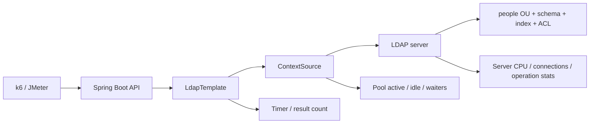

# Đo hiệu năng tìm kiếm và đánh giá cấu hình pool

> **Chương:** Thực hành  
> **Module:** SPRING_DATA_LDAP — truy cập dịch vụ thư mục LDAP qua Spring Data LDAP repository và Spring LDAP LdapTemplate; ánh xạ entry phân cấp sang Java, hiểu DN, objectClass, schema, truy vấn, CRUD, filter an toàn, bảo mật kết nối và kiểm thử với directory.

## Mục tiêu thực hành

Hoàn thành bài lab, bạn sẽ:

1. Chuẩn bị LDAP dataset có quy mô và phân bố đủ để đo search.
2. Đo baseline khi LdapTemplate dùng ContextSource không có pool.
3. Bật Spring LDAP context pool và kiểm tra maxTotalPerKey, maxIdlePerKey, maxWaitMillis.
4. So sánh exact lookup và subtree search dưới nhiều mức concurrency.
5. Đọc số context active/idle/waiter để xác định pool contention.
6. Phân biệt chi phí tạo kết nối, thời gian chờ pool và thời gian xử lý search.
7. Chọn cấu hình pool dựa trên p95/p99, throughput, error rate và giới hạn directory.
8. Viết báo cáo có thể tái lập, giữ nguyên kết quả và quyền truy cập của truy vấn.

**Kết quả cần nộp:** một bảng so sánh tối thiểu ba cấu hình pool, log/metrics của các lần chạy, cấu hình được chọn và giải thích vì sao cấu hình đó phù hợp với workload thử nghiệm.

## 1. Bối cảnh và sơ đồ lab

Bạn xây dựng một API danh bạ nhỏ. API nhận uid, tìm đúng LDAP entry trong ou=people, rồi trả về ba thuộc tính uid, cn, mail. Load generator gọi API với nhiều user khác nhau. Bạn chạy cùng workload trên hai profile:

- direct: LdapTemplate dùng trực tiếp LdapContextSource;
- pooled: LdapTemplate dùng PooledContextSource bọc cùng một LdapContextSource.

Giữ nguyên server, schema, index, dataset, ACL, TLS, filter và response mapping giữa hai profile. Chỉ thay đổi việc dùng pool và tham số pool. Nếu thay nhiều điều kiện cùng lúc, bạn sẽ không biết thay đổi nào làm kết quả khác đi.



### Phạm vi và điều kiện

- Chạy trên LDAP test hoặc staging được phép tạo fixture; không dùng production để stress test.
- Dùng cùng một service account read-only cho cả hai profile.
- Chỉ search trong OU của fixture.
- Không thay đổi schema, index hoặc ACL giữa các lần so sánh.
- Không log password, token, DN đầy đủ hoặc raw filter vào metrics.
- Đồng bộ đồng hồ của load generator, ứng dụng và directory server.

## 2. Chuẩn bị dữ liệu kiểm thử

### 2.1. Tạo fixture

Tạo naming context test và OU people. Ví dụ LDIF cho hai user đầu tiên:

```ldif
dn: ou=people,dc=example,dc=org
objectClass: top
objectClass: organizationalUnit
ou: people

dn: uid=user-000001,ou=people,dc=example,dc=org
objectClass: top
objectClass: person
objectClass: organizationalPerson
objectClass: inetOrgPerson
uid: user-000001
cn: Nguyen Thi Linh 000001
sn: Nguyen
givenName: Linh
mail: user-000001@example.org
departmentNumber: FIN-01

dn: uid=user-000002,ou=people,dc=example,dc=org
objectClass: top
objectClass: person
objectClass: organizationalPerson
objectClass: inetOrgPerson
uid: user-000002
cn: Tran Van Minh 000002
sn: Tran
givenName: Minh
mail: user-000002@example.org
departmentNumber: ENG-02
```

Tạo thêm ít nhất 10.000 entry cho dataset lab. Nếu cần kiểm tra độ chọn lọc và index ở quy mô lớn hơn, tạo thêm bộ 100.000 entry trên môi trường có tài nguyên phù hợp.

Dùng generator có seed cố định, ví dụ seed 42. Phân bố departmentNumber có cả nhóm lớn và nhóm nhỏ; một phần entry không có mail; một phần có nhiều giá trị telephoneNumber. Không lặp một record duy nhất rồi xem đó là dataset thực tế.

### 2.2. Nạp dữ liệu

Dùng công cụ LDAP phù hợp với directory server. Với ldapadd:

```bash
ldapadd -x \
  -H ldaps://localhost:636 \
  -D "cn=fixture-admin,dc=example,dc=org" \
  -W \
  -f people-fixture.ldif
```

Sau khi import, xác minh số entry bằng bind identity của ứng dụng:

```bash
ldapsearch -x -LLL \
  -H ldaps://localhost:636 \
  -D "cn=app-reader,ou=services,dc=example,dc=org" \
  -W \
  -b "ou=people,dc=example,dc=org" \
  "(objectClass=inetOrgPerson)" dn
```

Đếm kết quả dn: từ output và so với số entry generator dự kiến. Nếu ACL làm ẩn entry, phép xác minh phải ghi nhận đó là vấn đề quyền hoặc fixture; không được tiếp tục benchmark với số lượng chưa rõ.

### 2.3. Kiểm tra filter trước khi đo

Exact lookup:

```text
(&(objectClass=inetOrgPerson)(uid=user-000001))
```

Subtree search có nhiều kết quả:

```text
(&(objectClass=inetOrgPerson)(departmentNumber=FIN-01))
```

Chọn một UID chắc chắn tồn tại, một UID chắc chắn không tồn tại và một department có cardinality đã biết. Ghi expected result count của mỗi truy vấn. Dùng cùng tập input cho tất cả các profile.

## 3. Tạo API tìm kiếm có phép đo

### 3.1. DTO và service

Ví dụ dưới đây dùng Spring LDAP LdapOperations để tìm user theo uid và chỉ yêu cầu ba attribute:

```java
package com.example.directory;

public record PersonSummary(
    String uid,
    String commonName,
    String mail
) {}
```

Service:

```java
package com.example.directory;

import static org.springframework.ldap.query.LdapQueryBuilder.query;

import java.util.List;

import org.springframework.ldap.core.ContextMapper;
import org.springframework.ldap.core.DirContextOperations;
import org.springframework.ldap.core.LdapOperations;
import org.springframework.ldap.query.SearchScope;
import org.springframework.stereotype.Service;

@Service
public class PersonSearchService {

    private final LdapOperations ldap;

    public PersonSearchService(LdapOperations ldap) {
        this.ldap = ldap;
    }

    public PersonSummary findByUid(String uid) {
        List<PersonSummary> matches = ldap.search(
            query()
                .base("ou=people")
                .searchScope(SearchScope.SUBTREE)
                .attributes("uid", "cn", "mail")
                .where("objectClass").is("inetOrgPerson")
                .and("uid").is(uid),
            (ContextMapper<PersonSummary>) context -> {
                DirContextOperations entry =
                    (DirContextOperations) context;

                return new PersonSummary(
                    entry.getStringAttribute("uid"),
                    entry.getStringAttribute("cn"),
                    entry.getStringAttribute("mail")
                );
            }
        );

        if (matches.isEmpty()) {
            throw new PersonNotFoundException(uid);
        }
        if (matches.size() > 1) {
            throw new IllegalStateException(
                "uid lookup returned more than one entry");
        }
        return matches.get(0);
    }

    public List<PersonSummary> findByDepartment(String departmentNumber) {
        return ldap.search(
            query()
                .base("ou=people")
                .searchScope(SearchScope.SUBTREE)
                .attributes("uid", "cn", "mail")
                .where("objectClass").is("inetOrgPerson")
                .and("departmentNumber").is(departmentNumber),
            (ContextMapper<PersonSummary>) context -> {
                DirContextOperations entry =
                    (DirContextOperations) context;
                return new PersonSummary(
                    entry.getStringAttribute("uid"),
                    entry.getStringAttribute("cn"),
                    entry.getStringAttribute("mail")
                );
            }
        );
    }
}
```

PersonNotFoundException là exception ứng dụng định nghĩa; map exception này thành HTTP 404 trong controller advice. Có thể expose hai route test: GET /api/people/{uid} cho exact lookup và GET /api/people/search?department=FIN-01 cho subtree search. Route subtree nên trả result count hoặc projection giới hạn để response serialization không lấn át phép đo LDAP; vẫn ghi cardinality đầy đủ ở metric. Controller chỉ trả response cần thiết; không trả toàn bộ LDAP attributes. Nếu API public, bảo vệ endpoint bằng authentication phù hợp và không cho caller chọn base DN, filter hay attribute name.

### 3.2. Đo latency ở application boundary

Bọc operation bằng Micrometer Timer. Timer này đo thời gian từ trước khi gọi ldap.search tới khi mapping hoàn tất. Nó bao gồm thời gian lấy context từ ContextSource, network round-trip, directory processing và mapping.

```java
Timer.Sample sample = Timer.start(registry);
String outcome = "success";

try {
    PersonSummary result = searchService.findByUid(uid);
    return result;
} catch (PersonNotFoundException ex) {
    outcome = "not_found";
    throw ex;
} catch (RuntimeException ex) {
    outcome = "error";
    throw ex;
} finally {
    sample.stop(
        Timer.builder("directory.search")
            .tag("operation", "find_by_uid")
            .tag("outcome", outcome)
            .publishPercentileHistogram()
            .register(registry)
    );
}
```

Đây là mẫu instrumentation đặt quanh lời gọi service. Đưa nó vào controller/filter hoặc một wrapper phù hợp với cấu trúc ứng dụng. Tag chỉ dùng giá trị hữu hạn; không đưa UID, DN, email hoặc raw filter vào tag.

Ghi thêm số kết quả và expected count để phát hiện trường hợp latency thấp do query trả thiếu dữ liệu.

## 4. Cấu hình hai profile để so sánh

### 4.1. ContextSource cơ sở

Cấu hình một LdapContextSource dùng endpoint TLS và service account read-only. Mật khẩu lấy từ secret/environment của môi trường test:

```java
@Bean
LdapContextSource directoryTargetContextSource(
        DirectoryTestProperties properties) {

    LdapContextSource source = new LdapContextSource();
    source.setUrl(properties.url());
    source.setBase(properties.baseDn());
    source.setUserDn(properties.readerDn());
    source.setPassword(properties.readerPassword());
    source.setPooled(false); // Tắt native JNDI pool để baseline chỉ đo Spring ContextSource.
    source.afterPropertiesSet();
    return source;
}
```

Không ghi secret trực tiếp vào source code hoặc report. Base DN, URL và bind identity phải giống nhau giữa các profile.

### 4.2. Profile direct

Tạo LdapTemplate dùng thẳng context source:

```java
@Bean
@Profile("direct")
LdapTemplate directLdapTemplate(
        @Qualifier("directoryTargetContextSource")
        LdapContextSource source) {

    return new LdapTemplate(source);
}
```

Đây là baseline không dùng Spring LDAP pool. Mỗi operation lấy/đóng context theo lifecycle của ContextSource và LdapTemplate.

### 4.3. Profile pooled với Commons Pool 2

Với Spring LDAP có hỗ trợ package org.springframework.ldap.pool2, cấu hình PooledContextSource và PoolConfig:

```java
import org.springframework.beans.factory.annotation.Qualifier;
import org.springframework.context.annotation.Bean;
import org.springframework.context.annotation.Profile;
import org.springframework.ldap.core.LdapTemplate;
import org.springframework.ldap.core.support.LdapContextSource;
import org.springframework.ldap.pool2.factory.PoolConfig;
import org.springframework.ldap.pool2.factory.PooledContextSource;
import org.springframework.ldap.pool2.validation.DefaultDirContextValidator;

@Bean
@Profile("pooled")
PooledContextSource directoryPooledContextSource(
        @Qualifier("directoryTargetContextSource")
        LdapContextSource target) {

    PoolConfig config = new PoolConfig();
    config.setMaxTotalPerKey(16);
    config.setMaxIdlePerKey(8);
    config.setMinIdlePerKey(2);
    config.setMaxWaitMillis(1000);
    config.setBlockWhenExhausted(true);
    config.setTestOnBorrow(false);
    config.setTestWhileIdle(true);
    config.setTimeBetweenEvictionRunsMillis(30000);

    PooledContextSource pooled = new PooledContextSource(config);
    pooled.setContextSource(target);
    pooled.setDirContextValidator(new DefaultDirContextValidator());

    return pooled;
}

@Bean
@Profile("pooled")
LdapTemplate pooledLdapTemplate(
        @Qualifier("directoryPooledContextSource")
        PooledContextSource source) {

    return new LdapTemplate(source);
}
```

Cấu hình trên là điểm xuất phát cho lab, không phải giá trị tối ưu mặc định. Thử các giá trị maxTotalPerKey 8, 16 và 32, giữ các tham số khác cố định trong từng lượt so sánh.

maxTotalPerKey giới hạn số context cho mỗi loại key của pool; maxTotal giới hạn tổng pool. Pool có phân biệt read-only và read-write context. Trong lab chỉ chạy search, nên theo dõi số read context.

testOnBorrow=false tránh thêm một validation search vào mỗi lần lấy context trong lượt đo chính. testWhileIdle=true kiểm tra context idle theo chu kỳ. Chạy thêm một lượt riêng với testOnBorrow=true để đo chi phí validation trên đường request. Khi bật bất kỳ chế độ validation nào, phải cấu hình DirContextValidator.

DefaultDirContextValidator thực hiện một search kiểm tra trên context. Bind identity cần được phép thực hiện thao tác kiểm tra đó; nếu ACL chặn truy vấn validator, context có thể bị loại khỏi pool dù truy vấn nghiệp vụ có thể được phép. Xác minh validator trên directory test trước khi chạy tải.

### 4.4. Nếu module đang dùng API pooling Commons Pool 1

Một số phiên bản Spring LDAP cung cấp PoolingContextSource trong package org.springframework.ldap.pool.factory, cùng DefaultDirContextValidator trong org.springframework.ldap.pool.validation. API này dùng các thuộc tính như maxActive, maxIdle, minIdle, maxWait, testOnBorrow và testWhileIdle.

Không trộn hai API:
- Commons Pool 2: PooledContextSource, PoolConfig, package org.springframework.ldap.pool2;
- Commons Pool 1: PoolingContextSource, package org.springframework.ldap.pool.

Kiểm tra version Spring LDAP và tài liệu API đi kèm trước khi chọn cấu hình. Không copy package/import của một dòng version sang dòng khác.

Chạy đúng một profile tại một thời điểm. Nếu bật đồng thời direct và pooled, Spring sẽ có hai bean LdapOperations cùng loại và service cần qualifier rõ ràng; điều đó làm sai phép so sánh nếu vô tình gọi nhầm bean.

### 4.5. Giới hạn quan trọng về identity

Pool được thiết kế cho các context có cùng môi trường và credentials trong từng loại pool. Không bọc một ContextSource dùng AuthenticationSource thay đổi principal theo từng request rồi kỳ vọng pool tự cô lập user. Có nguy cơ context của user trước được tái sử dụng cho request sau.

Trong bài lab, tất cả request dùng cùng service account. Nếu cần bind theo từng người dùng, hãy kiểm tra cách ContextSource.getContext(principal, credentials) hoạt động ở version đang dùng; API này không lấy context từ native Java LDAP pool. Không dùng một pool service-account để giả lập user-bound authorization.

## 5. Đo baseline không pool

### 5.1. Khởi chạy profile

Chạy ứng dụng với profile direct, kết nối cùng LDAP test server và dataset. Xác minh endpoint trả đúng user fixture trước khi chạy tải.

Ví dụ khởi chạy jar, mỗi lần chỉ bật một profile:

```bash
java -jar app.jar --spring.profiles.active=direct
java -jar app.jar --spring.profiles.active=pooled
```

Thực hiện các bước:

1. Gửi 20 request tuần tự để kiểm tra correctness.
2. Warm-up 1–2 phút, không tính vào kết quả.
3. Chạy 5 virtual users trong 3 phút.
4. Chạy tiếp 10, 25 và 50 virtual users, mỗi mức 3 phút.
5. Giữ cùng tập UID và cùng tỷ lệ query hit/miss.
6. Nghỉ giữa các lượt để directory và app trở về trạng thái ổn định.
7. Ghi throughput, p50/p95/p99, error rate, result count và server connection count.

Không chạy dataset import, index rebuild hoặc backup trong thời gian benchmark.

### 5.2. Script k6 gọi endpoint

Ví dụ script tối giản:

```javascript
import http from "k6/http";
import { check } from "k6";

export const options = {
  scenarios: {
    ldap_search: {
      executor: "constant-vus",
      vus: 10,
      duration: "3m"
    }
  },
  thresholds: {
    http_req_failed: ["rate<0.01"],
    http_req_duration: ["p(95)<300", "p(99)<800"]
  }
};

export default function () {
  const headers = {};
  const useDepartmentSearch = Math.random() < 0.2;
  const isMissingLookup = !useDepartmentSearch && Math.random() < 0.1;
  const index = Math.floor(Math.random() * 10000) + 1;
  const uid = isMissingLookup
    ? "user-999999"
    : "user-" + String(index).padStart(6, "0");
  const url = useDepartmentSearch
    ? __ENV.BASE_URL + "/api/people/search?department=FIN-01"
    : __ENV.BASE_URL + "/api/people/" + uid;
  const operation = useDepartmentSearch
    ? "search_by_department"
    : (isMissingLookup ? "uid_not_found" : "find_by_uid");
  const expectedStatus = isMissingLookup ? 404 : 200;

  if (__ENV.TEST_TOKEN) {
    headers.Authorization = "Bearer " + __ENV.TEST_TOKEN;
  }

  const response = http.get(url, {
    headers: headers,
    tags: { name: operation }
  });

  check(response, {
    "lookup returned expected status": (r) => r.status === expectedStatus
  });
}
```

Chạy trên môi trường test:

```bash
BASE_URL=https://localhost:8443 TEST_TOKEN=... k6 run ldap-search.js
```

Token là tùy chọn tùy endpoint. Nếu dùng HTTPS với chứng thư test, cấu hình trust đúng cho load generator; không tắt TLS verification trong một benchmark dùng để đánh giá môi trường production-like.

Script này dùng constant-vus để tạo tải theo số virtual users cố định. Ngưỡng p95/p99 trong ví dụ chỉ là giá trị minh họa; thay bằng SLO của lab. Khi cần so sánh theo arrival rate, có thể đổi sang executor constant-arrival-rate; phải bảo đảm load generator đủ CPU để không trở thành bottleneck. Để đo subtree search, tạo một scenario riêng gọi route /api/people/search với department có cardinality đã biết; giữ riêng metrics cho hai operation.

### 5.3. Bảng ghi baseline

| Concurrency | Throughput (req/s) | p50 (ms) | p95 (ms) | p99 (ms) | Error (%) | Kết quả đúng |
| ---: | ---: | ---: | ---: | ---: | ---: | --- |
| 5 |  |  |  |  |  |  |
| 10 |  |  |  |  |  |  |
| 25 |  |  |  |  |  |  |
| 50 |  |  |  |  |  |  |

Không điền số dự đoán vào báo cáo. Chỉ ghi số đo thực tế của môi trường lab.

## 6. Đo profile có pool

Chạy lại đúng workload và thời lượng ở profile pooled.

Thử lần lượt:

| Run | maxTotalPerKey | maxIdlePerKey | minIdlePerKey | maxWaitMillis | Validation |
| --- | ---: | ---: | ---: | ---: | --- |
| P8 | 8 | 8 | 2 | 1000 | testWhileIdle |
| P16 | 16 | 8 | 2 | 1000 | testWhileIdle |
| P32 | 32 | 16 | 4 | 1000 | testWhileIdle |
| P16V | 16 | 8 | 2 | 1000 | testOnBorrow + testWhileIdle |

Thứ tự chạy đề xuất:

1. P8 ở concurrency 5, 10, 25, 50;
2. P16 với cùng các mức;
3. P32 với cùng các mức;
4. P16V để thấy chi phí validate khi borrow;
5. Chạy lại baseline direct một lần để kiểm tra biến động theo thời gian.

Giữa các lượt, chờ hệ thống ổn định. Không đổi đồng thời pool size, dataset, index, ACL, query hoặc JVM options.

### 6.1. Đọc trạng thái pool

PooledContextSource Commons Pool 2 cung cấp các số liệu hữu ích:

```java
int activeRead = pooled.getNumActiveRead();
int idleRead = pooled.getNumIdleRead();
int waiters = pooled.getNumWaiters();

log.info(
    "LDAP pool read active={}, idle={}, waiters={}",
    activeRead,
    idleRead,
    waiters
);
```

Thu thập định kỳ trong lúc chạy tải, không chỉ đọc một lần sau khi test kết thúc. Ý nghĩa:

- activeRead gần maxTotalPerKey liên tục: pool thường xuyên dùng hết context read.
- waiters tăng và kéo dài: request phải chờ context được trả lại.
- idleRead luôn bằng 0 khi tải cao: pool không có nhiều context rảnh.
- activeRead thấp nhưng latency cao: bottleneck có thể nằm ở LDAP server, network, index, ACL hoặc mapping.
- Pool có nhiều idle context nhưng throughput không tăng: mở rộng pool có thể không giải quyết đúng bottleneck.

Đối chiếu số liệu pool với server concurrent connections. Không suy ra rằng mỗi HTTP request luôn tương ứng một kết nối LDAP; LdapTemplate mượn context theo operation và pool tái sử dụng chúng.

### 6.2. Quan sát thời gian chờ pool

Nếu API metrics của pool hoặc instrumentation hiện có không cung cấp borrow wait time trực tiếp, ghi nhận ở tầng ContextSource/pool wrapper phù hợp với version đang dùng. Không sửa Spring LDAP internals chỉ để lấy một metric.

Tối thiểu phải có:
- Số waiter;
- Active/idle read context;
- Số lần pool exhaustion hoặc borrow timeout;
- Tổng latency của LDAP operation;
- Error category.

Nếu waiters tăng cùng lúc p95 tăng nhưng server CPU vẫn thấp, kiểm tra pool limit và lifecycle trả context trước khi tăng concurrency.

## 7. So sánh search và pool

### 7.1. Kết quả tổng hợp

Điền bảng từ các lần chạy:

| Profile | Pool size | Concurrency | Throughput | p95 | p99 | Error rate | Waiters peak | Result count đúng |
| --- | ---: | ---: | ---: | ---: | ---: | ---: | ---: | --- |
| direct | — | 10 |  |  |  |  | — |  |
| P8 | 8 | 10 |  |  |  |  |  |  |
| P16 | 16 | 10 |  |  |  |  |  |  |
| P32 | 32 | 10 |  |  |  |  |  |  |
| P16V | 16 | 10 |  |  |  |  |  |  |

Lặp lại bảng cho concurrency 25 và 50 nếu cần đánh giá saturation.

### 7.2. Tính mức cải thiện

Dùng cùng đơn vị và cùng workload:

```text
p95 improvement (%) =
  (p95_direct - p95_pooled) / p95_direct * 100

throughput gain (%) =
  (throughput_pooled - throughput_direct)
  / throughput_direct * 100

error delta (percentage points) =
  error_pooled - error_direct
```

Nếu p95 giảm nhưng error rate tăng hoặc result count sai, cấu hình đó không đạt. Nếu throughput tăng nhưng p99 vượt SLO, không nên chọn chỉ dựa trên throughput.

### 7.3. Cách diễn giải

| Quan sát | Diễn giải có thể | Việc cần làm |
| --- | --- | --- |
| Pool cải thiện p95 ở tải thấp và vừa | Giảm chi phí tạo context/TLS connection | Kiểm tra connection count và p99 ở tải cao |
| P8 có waiter ở concurrency 25 | Pool nhỏ hơn nhu cầu đồng thời hoặc operation giữ context lâu | Đo borrow wait, context lifecycle và server capacity |
| P32 tăng server connection/CPU nhưng throughput không tăng | Pool đã vượt điểm hiệu quả | Giảm pool và kiểm tra server saturation |
| P16V chậm hơn P16 | Validation trên mỗi borrow thêm một LDAP search | Cân nhắc validation idle/return theo rủi ro và yêu cầu |
| Direct và pooled gần như nhau | Tạo connection không phải bottleneck chính hoặc connection đã được tối ưu ở tầng khác | Profile network, server search, index, ACL, mapping |
| p50 tốt nhưng p99 xấu | Queueing, GC, network spike hoặc server contention | Xem histogram và metrics đồng thời |
| Error tăng khi pool idle lâu | Context cũ bị server đóng hoặc validation chưa phù hợp | Kiểm tra idle validation và stale connection behavior |

## 8. Tìm cấu hình pool phù hợp

Không chọn pool size chỉ dựa trên số virtual users. Một request có thể gọi nhiều LDAP operation; nhiều request có thể không dùng LDAP; thời gian mỗi operation khác nhau. Pool size phải được chọn dựa trên concurrency thực tế của LDAP operations.

Thực hiện tinh chỉnh theo thứ tự:

1. Chọn một concurrency đại diện cho traffic dự kiến.
2. Tìm maxTotalPerKey nhỏ nhất vẫn đạt p95/p99 và throughput mục tiêu.
3. Kiểm tra server connection limit và tài nguyên directory.
4. Điều chỉnh maxIdlePerKey để giữ đủ context cho burst nhưng không giữ quá nhiều kết nối nhàn rỗi.
5. Chọn minIdlePerKey dựa trên cold-start/burst và chi phí duy trì idle connection.
6. Đặt maxWaitMillis hữu hạn để request không chờ vô hạn khi pool cạn.
7. Đánh giá validation theo yêu cầu phát hiện stale connection và chi phí thêm operation.
8. Chạy soak test để phát hiện connection leak và suy giảm theo thời gian.

### Câu hỏi ra quyết định

- Nếu tăng pool size mà throughput không tăng, server hay network đã bão hòa chưa?
- Nếu waiter tăng, context có bị giữ lâu bởi operation hoặc code không đóng resource không?
- Nếu testOnBorrow làm p95 tăng, rủi ro stale connection có đáng với chi phí validation không?
- Nếu maxWaitMillis quá ngắn, có xuất hiện lỗi pool exhaustion dù directory vẫn khỏe không?
- Nếu minIdlePerKey cao, số kết nối idle có vượt giới hạn server khi nhiều application replica cùng chạy không?

Tính tổng connection budget theo số instance ứng dụng. Ví dụ 4 replica, mỗi replica có maxTotalPerKey=16, có thể tạo đến khoảng 64 context cho cùng pool key khi tải đủ lớn. Phải cộng cả writer pool, background job và các ứng dụng khác dùng chung directory.

## 9. Kiểm tra correctness và quyền truy cập

Mỗi lượt benchmark phải xác minh:

- Exact lookup trả đúng một entry;
- UID không tồn tại trả trạng thái not-found dự kiến;
- Subtree search trả đúng số entry theo fixture;
- Attribute mail có thể vắng mặt và được xử lý đúng;
- Service account chỉ đọc được OU/attribute đã cấp;
- Không dùng administrator bind trong profile benchmark;
- Không có partial result hoặc server size/time limit bị bỏ qua;
- Pooled context không bị dùng nhầm giữa read/write hoặc giữa các bind identity;
- Sau khi server đóng idle connection, pool loại bỏ hoặc thay thế context hỏng theo cấu hình validation.

Pool không thay thế ACL. Giữ nguyên bind identity và ACL trong direct/pooled comparison. Không dùng pool có custom AuthenticationSource thay đổi user credentials cho mỗi request nếu chưa xử lý rõ giới hạn identity của pool.

## 10. Các lỗi thường gặp trong bài lab

| Lỗi | Nguyên nhân | Cách xử lý |
| --- | --- | --- |
| Pool bật nhưng không cải thiện latency | Bottleneck ở search/index/network/mapping | Đo thêm server operation time và app mapping |
| Pool size lớn làm hệ thống chậm hơn | Directory quá nhiều connection đồng thời | Giảm pool, theo dõi CPU/connection limit |
| waiters tăng liên tục | Pool cạn hoặc context không được trả | Kiểm tra close lifecycle, operation duration, max wait |
| Validation khiến request chậm | Test-on-borrow thực hiện thêm search | Đo riêng và chọn chính sách validation |
| Kết quả direct/pooled khác nhau | Dataset, ACL, filter hoặc replica khác nhau | Chuẩn hóa fixture và expected count |
| Lỗi sau thời gian idle | Server đóng connection cũ | Bật idle validation phù hợp, đo chi phí |
| User A/B dùng nhầm context | Pool bị dùng với credentials động | Chỉ pool context cùng identity hoặc tách pool theo principal có thiết kế rõ |
| Pool vượt connection budget | Nhân pool size với số replica bị bỏ sót | Tính tổng budget toàn hệ thống |
| Test chỉ chạy vài giây | Chưa thấy warm-up, queue và leak | Tách warm-up, steady-state và soak |

## 11. Ma trận thực hành và tiêu chí hoàn thành

| Bài tập | Việc cần làm | Tiêu chí đạt |
| --- | --- | --- |
| P1 — Fixture | Nạp ít nhất 10.000 people và xác minh số lượng | Expected/actual count khớp |
| P2 — Exact search | Đo lookup theo UID | Một kết quả cho UID tồn tại |
| P3 — Subtree search | Đo filter theo department | Cardinality được ghi rõ |
| P4 — Direct baseline | Chạy 5/10/25/50 VUs | Có p50/p95/p99 và error rate |
| P5 — Pool 8 | Chạy với maxTotalPerKey=8 | Có pool metrics |
| P6 — Pool 16 | Chạy với maxTotalPerKey=16 | Có so sánh cùng workload |
| P7 — Pool 32 | Chạy với maxTotalPerKey=32 | Có đánh giá server connection budget |
| P8 — Validation | Bật test-on-borrow | Ghi chi phí p95/p99 tăng thêm |
| P9 — Exhaustion | Tăng concurrency có kiểm soát đến khi pool cạn | Xác định wait/timeout behavior |
| P10 — Idle connection | Để pool idle rồi chạy lại sau khi server đóng idle context | Xác minh stale connection handling |
| P11 — Correctness | So expected và actual result ở mọi profile | Không có sai khác |
| P12 — Recommendation | Chọn cấu hình cuối cùng và giải thích | Có số liệu, SLO và connection budget |

Bài lab đạt khi có baseline direct, ít nhất ba pool size, một lượt validation, một lượt kiểm tra pool exhaustion, bảng kết quả có correctness và một quyết định cấu hình được giải thích bằng số đo.

## 12. Mẫu báo cáo kết quả

Sao chép bảng sau vào báo cáo thực hành:

| Trường | Giá trị |
| --- | --- |
| Directory product/version | |
| Spring LDAP version | |
| JDK / Spring Boot version | |
| Schema và index profile | |
| Dataset size / seed | |
| Bind identity / ACL profile | |
| TLS endpoint | |
| Search base / scope / filter | |
| Page/size/time limits | |
| Load generator/version | |
| Warm-up duration | |
| Test duration | |
| Concurrency / arrival rate | |
| Direct p95 / p99 | |
| Best pooled p95 / p99 | |
| Throughput direct / pooled | |
| Error rate direct / pooled | |
| Peak active/idle/waiters | |
| Directory connection count / CPU | |
| Expected/actual result count | |
| Chosen pool parameters | |
| Trade-off / remaining risk | |

Kết luận cần trả lời: pool cải thiện điều gì, điểm nghẽn còn lại ở đâu, cấu hình được chọn có nằm trong connection budget không và kết quả có đạt SLO không.

## 13. Câu hỏi tự đánh giá

**Câu 1.** Vì sao phải chạy direct baseline trước khi bật pool?  
**Đáp án:** Để biết chi phí hiện tại và có mốc so sánh. Nếu không có baseline cùng điều kiện, không thể xác định pool có tạo cải thiện hay không.

**Câu 2.** maxTotalPerKey quá nhỏ thể hiện qua chỉ số nào?  
**Đáp án:** Active context thường xuyên chạm giới hạn, waiter tăng, borrow wait/p95 tăng và có thể xuất hiện timeout khi pool cạn.

**Câu 3.** Tăng pool size có luôn làm throughput tăng không?  
**Đáp án:** Không. Directory server có thể bão hòa CPU, memory, disk hoặc connection limit; nhiều context hơn có thể làm tail latency xấu hơn.

**Câu 4.** testOnBorrow có thể làm tăng latency vì sao?  
**Đáp án:** Pool validation thực hiện một thao tác kiểm tra DirContext trước khi trả context cho ứng dụng, tạo thêm công việc và round-trip LDAP.

**Câu 5.** Vì sao phải dùng cùng bind identity và ACL trong hai profile?  
**Đáp án:** ACL ảnh hưởng quyền và số entry nhìn thấy. Dùng identity khác sẽ làm thay đổi semantics và khiến kết quả không còn so sánh công bằng.

**Câu 6.** Khi nào không nên dùng một pool chung cho nhiều user credentials?  
**Đáp án:** Khi principal/credentials thay đổi theo request mà pool không phân vùng theo identity. Context của user này có thể bị tái sử dụng sai cho user khác.

**Câu 7.** Nếu p95 giảm nhưng result count thiếu, cấu hình có được chấp nhận không?  
**Đáp án:** Không. Hiệu năng chỉ có ý nghĩa khi truy vấn vẫn trả đúng dữ liệu theo ACL và policy mong đợi.

**Câu 8.** Vì sao phải tính connection budget theo số replica ứng dụng?  
**Đáp án:** Mỗi replica có pool riêng. Tổng kết nối có thể bằng pool size nhân số replica, cộng thêm writer, sync job và client khác.

## Tài liệu tham khảo

- [Spring LDAP — Pooling Support](https://docs.spring.io/spring-ldap/reference/pooling.html)
- [Spring LDAP — PooledContextSource API (Commons Pool 2)](https://docs.spring.io/spring-ldap/reference/api/java/org/springframework/ldap/pool2/factory/PooledContextSource.html)
- [Spring LDAP — PoolConfig API](https://docs.spring.io/spring-ldap/reference/api/java/org/springframework/ldap/pool2/factory/PoolConfig.html)
- [Spring LDAP — DefaultDirContextValidator (Pool 2)](https://docs.spring.io/spring-ldap/reference/api/java/org/springframework/ldap/pool2/validation/DefaultDirContextValidator.html)
- [Spring LDAP — ContextSource Configuration](https://docs.spring.io/spring-ldap/reference/configuration.html)
- [Spring LDAP — LdapOperations API](https://docs.spring.io/spring-ldap/reference/api/java/org/springframework/ldap/core/LdapOperations.html)
- [Spring Boot — Metrics](https://docs.spring.io/spring-boot/reference/actuator/metrics.html)
- [Micrometer — Timers](https://docs.micrometer.io/micrometer/reference/concepts/timers.html)
- [k6 — Constant VUs executor](https://grafana.com/docs/k6/latest/using-k6/scenarios/executors/constant-vus/)

