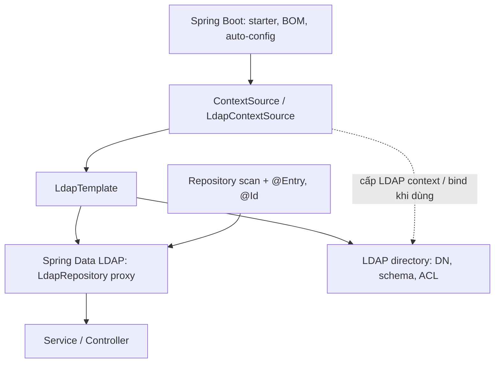
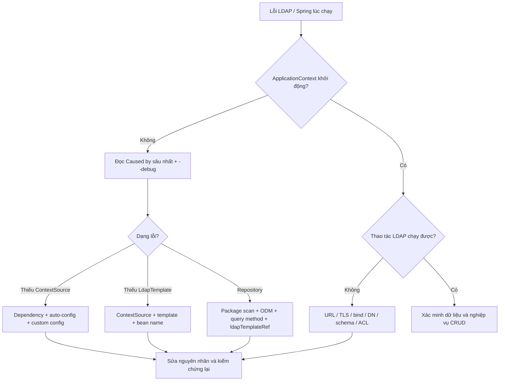

# Không tạo được ContextSource, LdapTemplate hoặc Repository

> **Chương:** Chẩn đoán  
> **Phạm vi:** SPRING_DATA_LDAP — truy cập directory LDAP qua repository Spring Data LDAP, ánh xạ entry thành đối tượng Java và thao tác mức thấp bằng Spring LDAP (`LdapTemplate`).

## Mục tiêu

Sau bài này, người học có thể:

1. Phân biệt lỗi **thiếu bean**, **bean khởi tạo thất bại**, **repository không được phát hiện** và **kết nối directory thất bại**.
2. Lần theo chuỗi phụ thuộc `ContextSource` → `LdapTemplate` → `LdapRepository` để tìm nguyên nhân gốc.
3. Kiểm tra starter, BOM, cấu hình `spring.ldap.*`, các điều kiện auto-configuration và phạm vi quét package.
4. Khắc phục lỗi mapping `@Entry`, `@Id`, DN, `objectClass`, method truy vấn và tên bean template.
5. Chẩn đoán LDAP server/bind/TLS/schema bằng thao tác read-only an toàn, đồng thời chuẩn bị kiểm thử tích hợp với directory.

## 1. Hiểu đường đi của một yêu cầu LDAP

Spring Boot hỗ trợ auto-configuration cho LDAP. Khi classpath và điều kiện phù hợp, Boot có thể tạo `LdapContextSource` từ thuộc tính `spring.ldap.*`, cùng `LdapTemplate`; Spring Data LDAP tạo repository proxy để làm việc với các đối tượng ODM.



- **`ContextSource`** chịu trách nhiệm cung cấp các LDAP context (thường là kết nối/bind). Nó chứa URL, base DN, danh tính bind và cấu hình xác thực.
- **`LdapTemplate`** gọi `ContextSource` để thực hiện search, lookup, bind, update, unbind và giải phóng tài nguyên.
- **`LdapRepository`** là interface Spring Data LDAP; Spring khởi tạo implementation/proxy cho CRUD và các method truy vấn dựa trên domain mapping.

**Điểm rất quan trọng:** bean `LdapContextSource` có thể được tạo thành công **trước khi** LDAP server thực sự được truy cập. Nếu app gọi `repository.findAll()` ngay trong `@PostConstruct`, lỗi mạng xuất hiện trong startup và có thể bị bao trong `BeanCreationException`; lúc này nguyên nhân thực sự vẫn là giao tiếp với directory.

## 2. Đọc stack trace đúng cách

Ví dụ:

```text
UnsatisfiedDependencyException: Error creating bean 'personService'
  Caused by: BeanCreationException: Error creating bean 'personRepository'
    Caused by: NoSuchBeanDefinitionException:
      No bean named 'ldapTemplate' available
```

Không bắt đầu bằng cách sửa constructor `PersonService`. Đây là lớp ngoài cùng của một chuỗi lỗi: repository cần template tên `ldapTemplate` nhưng Spring chưa cung cấp. Hãy lấy **`Caused by` sâu nhất, tên bean và thời điểm phát sinh**, sau đó kiểm tra từng lớp phụ thuộc.

| Dấu hiệu | Nhóm lỗi | Bước kiểm tra đầu tiên |
| --- | --- | --- |
| `ClassNotFoundException`, `NoClassDefFoundError`, `NoSuchMethodError` | Dependency thiếu hoặc không tương thích | Starter, runtime classpath, Spring Boot BOM |
| `No qualifying bean of type 'ContextSource'` | Bean nguồn chưa đăng ký | Auto-configuration, `@SpringBootApplication`, bean tự khai báo |
| `Error creating bean with name 'contextSource'` | Bean nguồn đăng ký nhưng khởi tạo lỗi | `Caused by`, binding thuộc tính, TLS/SSL bundle, lifecycle |
| `No qualifying bean of type 'LdapTemplate'` | Template vắng mặt | `ContextSource`, điều kiện auto-config, config thủ công |
| `NoUniqueBeanDefinitionException` | Nhiều bean cùng type | `@Primary`, `@Qualifier` và cấu hình chọn template |
| `No qualifying bean of type 'PersonRepository'` | Repository không được phát hiện | Package scan, interface và starter Spring Data LDAP |
| `Error creating bean with name 'personRepository'` | Proxy/ODM/truy vấn thất bại | `ldapTemplateRef`, `@Entry`, `@Id`, tên property |
| `CommunicationException`, `AuthenticationException` | Kết nối hoặc bind LDAP | URL/port, firewall, TLS, tài khoản bind |
| `NameNotFoundException`, `SchemaViolationException` | DN, entry hoặc schema | Base DN, objectClass, thuộc tính và ACL |

## 3. Thiết lập baseline tối thiểu để so sánh

Với dự án Spring Boot dùng Maven và parent/BOM Spring Boot, dependency thông thường:

```xml
<dependency>
    <groupId>org.springframework.boot</groupId>
    <artifactId>spring-boot-starter-data-ldap</artifactId>
</dependency>
```

Với Gradle:

```groovy
dependencies {
    implementation 'org.springframework.boot:spring-boot-starter-data-ldap'
}
```

Spring Boot quản lý phiên bản Spring Data LDAP và Spring LDAP bằng BOM. **Không tự ghép các bản Spring Data LDAP/Spring LDAP khác major version**. Có `spring-ldap-core` thì dùng được `LdapTemplate`, nhưng riêng nó chưa đủ để khai báo repository Spring Data LDAP nếu thiếu các module repository/ODM.

Cấu hình kết nối LDAP phát triển, ví dụ:

```yaml
spring:
  ldap:
    urls: "ldap://localhost:389"
    base: "dc=example,dc=org"
    username: "${LDAP_BIND_DN}"
    password: "${LDAP_BIND_PASSWORD}"
```

Các placeholder yêu cầu biến môi trường tương ứng. Không đưa mật khẩu production vào repository, tham số command line hoặc nhật ký. Khi cấu hình profile, phải xác nhận `application-dev.yml`/`application-test.yml` thực sự được nạp và không bị environment variable khác ghi đè.

Ý nghĩa các property:

- `spring.ldap.urls` là URL kết nối đến directory, cần đúng scheme, hostname, port và mạng.
- `spring.ldap.base` là hậu tố DN cho thao tác LDAP tương đối. Nếu đã đặt `dc=example,dc=org` thì search base `ou=people` sẽ tương ứng `ou=people,dc=example,dc=org`.
- `spring.ldap.username` là danh tính bind, nhiều directory dùng full DN nhưng Active Directory có thể hỗ trợ định dạng khác.
- `spring.ldap.password` cung cấp bí mật của tài khoản bind.
- `spring.ldap.ssl.*` trên các nhánh Spring Boot hỗ trợ dùng cho LDAPS và cần được cấu hình theo đúng phiên bản đang chạy.

### Kiểm tra phiên bản trong runtime

```bash
mvn dependency:tree
```

Hoặc:

```bash
./gradlew dependencyInsight --dependency spring-data-ldap --configuration runtimeClasspath
./gradlew dependencyInsight --dependency spring-ldap-core --configuration runtimeClasspath
```

Kiểm tra rằng starter có hiệu lực ở runtime, không chỉ được khai báo `testImplementation`, và phiên bản được resolve phù hợp với BOM. Với ứng dụng Windows, dùng `gradlew.bat` thay `./gradlew`.

## 4. Không tạo được `ContextSource`

Thông báo điển hình:

```text
Parameter 0 of constructor in ...PersonService
required a bean of type 'org.springframework.ldap.core.ContextSource'
that could not be found.
```

Thông báo **thiếu bean** này không đồng nghĩa LDAP server đang tắt. Spring đang không tìm được đối tượng Java tương ứng trong application context.

### Nguyên nhân có thể gặp

1. **Thiếu starter:** chưa đưa `spring-boot-starter-data-ldap` hoặc `spring-ldap-core` vào runtime classpath.
2. **Auto-configuration không chạy:** thiếu `@SpringBootApplication`/`@EnableAutoConfiguration`, classpath không đạt điều kiện, hoặc có cấu hình exclude LDAP auto-configuration.
3. **Custom `ContextSource` bị bỏ ngoài component scan:** class `@Configuration` không được scan/import.
4. **Có bean tùy chỉnh làm cấu hình mặc định lùi lại:** một custom source nhưng sai dependency, lifecycle hoặc điều kiện tạo.
5. **Nhiều bean nguồn:** lỗi thực tế là `NoUniqueBeanDefinitionException` thay vì thiếu bean; kiểm tra tên và kiểu các candidate.

### Chẩn đoán các điều kiện auto-configuration

Khởi động với `--debug`:

```bash
mvn spring-boot:run -Dspring-boot.run.arguments=--debug
```

Hoặc:

```bash
java -jar app.jar --debug
```

Trong **Condition Evaluation Report**, tìm các cấu hình liên quan LDAP, xem chúng là positive matches hay negative matches. Các lý do thường có: thiếu class, bean tương ứng đã tồn tại, hoặc auto-configuration bị loại. Đây là cách xác định **vì sao Spring không tạo bean** thay vì thử thêm `@Bean` liên tiếp.

`--debug` chỉ hỗ trợ quan sát ứng dụng Spring; nó không kiểm tra kết nối mạng LDAP. Giữ log ở mức cần thiết, không ghi credentials hoặc filter chứa dữ liệu nhạy cảm.

## 5. Không tạo được `LdapTemplate`

Ví dụ:

```text
No qualifying bean of type 'org.springframework.ldap.core.LdapTemplate'
available: expected at least 1 bean
```

Đi theo thứ tự:

1. `ContextSource` đã có bean hợp lệ chưa?
2. Spring Boot có đang chạy LDAP template auto-configuration không?
3. `LdapTemplate` có bị định nghĩa bằng config thủ công nằm ngoài package scan không?
4. Có nhiều `ContextSource` và tham số constructor template đang nhận nhầm bean không?
5. Repository có đang tìm template tên mặc định `ldapTemplate` trong khi bạn tạo một template tên khác không?

Nếu cần tự khai báo cả hai bean vì dự án không sử dụng auto-configuration, ví dụ JavaConfig một LDAP endpoint:

```java
import org.springframework.beans.factory.annotation.Value;
import org.springframework.context.annotation.Bean;
import org.springframework.context.annotation.Configuration;
import org.springframework.ldap.core.ContextSource;
import org.springframework.ldap.core.LdapTemplate;
import org.springframework.ldap.core.support.LdapContextSource;

@Configuration(proxyBeanMethods = false)
public class ManualLdapConfiguration {

    @Bean
    ContextSource contextSource(
            @Value("${spring.ldap.urls}") String url,
            @Value("${spring.ldap.base}") String base,
            @Value("${spring.ldap.username}") String bindDn,
            @Value("${spring.ldap.password}") String password) {

        LdapContextSource source = new LdapContextSource();
        source.setUrl(url);
        source.setBase(base);
        source.setUserDn(bindDn);
        source.setPassword(password);
        return source;
    }

    @Bean(name = "ldapTemplate")
    LdapTemplate ldapTemplate(ContextSource contextSource) {
        return new LdapTemplate(contextSource);
    }
}
```

Đây là ví dụ cho **một LDAP URL và simple bind**. Khi bean `LdapContextSource` do Spring quản lý, Spring thực hiện lifecycle initialization cho nó; không cần gọi `afterPropertiesSet()` thủ công. Muốn dùng LDAPS/StartTLS, referral hoặc nhiều endpoints phải bổ sung cấu hình thích hợp.

Trong ứng dụng Boot bình thường, ưu tiên để auto-configuration tạo bean. Việc thêm đồng thời các bean tùy chỉnh không có kế hoạch dễ dẫn đến trùng bean, chọn sai bean hoặc mất cấu hình SSL vốn chỉ áp dụng cho auto-configured source.

## 6. Không tạo được Spring Data LDAP Repository

Có hai tình huống hoàn toàn khác nhau.

### 6.1. Spring không tìm thấy repository bean

```text
No qualifying bean of type
'com.example.directory.ldap.PersonRepository' available
```

Kiểm tra phạm vi quét package. Ví dụ cấu trúc hợp lệ:

```text
com.example.directory
├── DirectoryApplication.java      # @SpringBootApplication
├── ldap
│   ├── Person.java                # @Entry
│   └── PersonRepository.java      # LdapRepository<Person>
└── service
    └── PersonService.java
```

`@SpringBootApplication` ở package gốc `com.example.directory` giúp auto-configuration quét repositories và domain trong vùng mặc định. Khi repository ở ngoài cây package này, chỉ định vị trí đúng bằng `@EnableLdapRepositories`:

```java
package com.example.directory;

import org.springframework.boot.SpringApplication;
import org.springframework.boot.autoconfigure.SpringBootApplication;
import org.springframework.data.ldap.repository.config.EnableLdapRepositories;

@SpringBootApplication
@EnableLdapRepositories(basePackages = "com.acme.identity.ldap.repo")
public class DirectoryApplication {
    public static void main(String[] args) {
        SpringApplication.run(DirectoryApplication.class, args);
    }
}
```

`com.acme.identity.ldap.repo` là tên ví dụ phải thay cho đường dẫn package thực tế. Tránh khai báo trùng phạm vi qua nhiều `@EnableLdapRepositories`; nếu domain ở ngoài vùng scan có thể cần điều chỉnh package/domain scan như `@EntityScan` tương ứng.

Một repository Spring Data LDAP phải được khai báo bằng interface thuộc cơ chế này:

```java
package com.example.directory.ldap;

import org.springframework.data.ldap.repository.LdapRepository;

public interface PersonRepository extends LdapRepository<Person> {
    Person findByUid(String uid);
}
```

Với Spring Data LDAP, `LdapRepository` **chỉ nhận một type parameter** là entity LDAP; ID mặc định là `javax.naming.Name`. Không sử dụng nhầm `JpaRepository<Person, Long>`.

### 6.2. Repository được phát hiện nhưng proxy tạo thất bại

Ví dụ:

```text
Error creating bean with name 'personRepository'
Caused by: PropertyReferenceException:
No property 'surnamee' found for type 'Person'
```

Ở đây sửa package scan không giải quyết được vì Spring đã tìm thấy interface. Cần soát:

- **Tên property trong method:** `findBySurnamee` không khớp property `surname` của Java class.
- **Annotation ODM:** `@Entry`, `@Id`, `@Attribute` phải import từ `org.springframework.ldap.odm.annotations`. `@Id` của JPA/Spring Data Commons không thay thế LDAP ODM `@Id`.
- **DN/ID:** trường ID kiểu `javax.naming.Name`, không dùng mặc định một numeric primary key như database quan hệ.
- **`objectClass` và schema:** thuộc tính bắt buộc như `cn`, `sn` của `inetOrgPerson` và DN hợp lệ phải phù hợp directory.
- **Kết nối template:** repository tìm bean template đúng tên và kiểu chưa? Xem mục 6.3.
- **Hỗ trợ API repository:** một số mẫu `Pageable`, `Sort` của JPA không được Spring Data LDAP hỗ trợ.

Ví dụ entity ánh xạ:

```java
package com.example.directory.ldap;

import javax.naming.Name;
import org.springframework.ldap.odm.annotations.Attribute;
import org.springframework.ldap.odm.annotations.Entry;
import org.springframework.ldap.odm.annotations.Id;

@Entry(
    base = "ou=people",
    objectClasses = {"top", "person", "organizationalPerson", "inetOrgPerson"}
)
public class Person {
    @Id
    private Name dn;

    @Attribute(name = "uid")
    private String uid;

    @Attribute(name = "cn")
    private String commonName;

    @Attribute(name = "sn")
    private String surname;

    public Person() {}

    public Name getDn() { return dn; }
    public void setDn(Name dn) { this.dn = dn; }

    public String getUid() { return uid; }
    public void setUid(String uid) { this.uid = uid; }

    public String getCommonName() { return commonName; }
    public void setCommonName(String commonName) { this.commonName = commonName; }

    public String getSurname() { return surname; }
    public void setSurname(String surname) { this.surname = surname; }
}
```

`@Entry(base="ou=people")` ở đây là đường dẫn tương đối với base `dc=example,dc=org`. Tên `cn`, `sn`, `uid` cần tồn tại trong schema. Khai báo class Java không tạo tự động entry `ou=people` ở server; bạn vẫn cần dữ liệu LDAP hợp lệ.

### 6.3. Repository sử dụng sai template

Spring Data LDAP mặc định chọn bean template tên **`ldapTemplate`**. Khi bạn dùng template tên khác hoặc nhiều directory, có thể cấu hình chính xác:

```java
import org.springframework.context.annotation.Configuration;
import org.springframework.data.ldap.repository.config.EnableLdapRepositories;

@Configuration(proxyBeanMethods = false)
@EnableLdapRepositories(
    basePackages = "com.example.directory.ldap",
    ldapTemplateRef = "peopleLdapTemplate"
)
public class PeopleRepositoryConfiguration {
    // Bean tên peopleLdapTemplate phải tồn tại trong context.
}
```

Cần bảo đảm cùng một repository không bị đăng ký thêm lần nữa qua cấu hình scan khác. Khi inject nhiều source/template theo type, dùng `@Qualifier` hoặc `@Primary` một cách rõ ràng; `ldapTemplateRef` là cách chọn bean **theo tên** cho repository.

## 7. Bean có mặt nhưng kết nối/bind với directory thất bại

Các lỗi dưới đây thường xuất hiện khi chạy `LdapTemplate.search(...)` hoặc `repository.findByUid(...)`. Nếu ứng dụng truy vấn directory ngay lúc khởi động, chúng cũng có thể xuất hiện trong `BeanCreationException`.

| Lỗi từ Java/LDAP | Nghi vấn ưu tiên | Cách kiểm tra |
| --- | --- | --- |
| `ConnectException: Connection refused`, `CommunicationException` | Server không chạy, host/port sai | DNS, TCP port, service LDAP |
| Timeout | Firewall, route, server chậm | Mạng giữa app host và directory |
| `AuthenticationException`, LDAP result code 49 | Bind DN/password, tài khoản hoặc policy | Xác minh danh tính bind bằng công cụ LDAP |
| `SSLHandshakeException`, `PKIX path building failed` | Chứng chỉ/CA/hostname không được tin cậy | Chuỗi chứng chỉ và trust material của JVM |
| `NameNotFoundException`, code 32 | Search base hoặc entry DN không tồn tại | Soát `spring.ldap.base` và DN tương đối |
| `NoPermissionException`, code 50 | ACL không cho phép thao tác | Tài khoản đang bind, quyền đọc/ghi |
| `SchemaViolationException`, code 65 | `objectClass`/thuộc tính thiếu hoặc sai | LDIF, schema và mapping `@Entry` |
| `PartialResultException` | Referral hoặc đặc thù Active Directory | Cấu hình referral, cây dữ liệu thực |

**Không đổi version Spring chỉ vì lỗi bind, DN hoặc schema.** Đó là phản hồi từ LDAP server, cần chẩn đoán ở lớp directory.

### Đối chiếu bằng một truy vấn LDAP độc lập

Với `ldapsearch` (OpenLDAP client) và **directory thử nghiệm**:

```bash
ldapsearch -x \
  -H ldap://localhost:389 \
  -D "cn=app-reader,ou=services,dc=example,dc=org" \
  -W \
  -b "ou=people,dc=example,dc=org" \
  "(uid=lan)" dn cn sn objectClass
```

`-W` yêu cầu nhập mật khẩu tương tác, không hiển thị mật khẩu trực tiếp trong câu lệnh. Nếu lệnh ngoài Java cũng không kết nối hoặc bind được thì cần xử lý server, mạng, tài khoản, ACL. Nếu LDAP client hoạt động mà Java lỗi, soát SSL trust material, cấu hình profile, base DN và implementation `ContextSource`.

Với LDAPS, dùng `-H ldaps://host:636` và thiết lập CA/trust tin cậy đúng cách. StartTLS thường dùng `ldap://` kết hợp `-ZZ` khi server hỗ trợ. Không tắt kiểm tra chứng chỉ để xử lý tạm lỗi production.

### Phân biệt LDAPS và StartTLS trong Spring Boot 4.2

Spring Boot 4.2 hỗ trợ `spring.ldap.ssl.bundle` hoặc `spring.ldap.ssl.enabled` cho **auto-configured LDAPS context source**:

```yaml
spring:
  ldap:
    urls: "ldaps://ldap.example.org:636"
    ssl:
      bundle: "directory"
```

Bean SSL bundle tên `directory` phải được cấu hình trust material phù hợp ở nơi khác. Đoạn YAML này chỉ minh họa cấu hình tham chiếu; chưa phải cấu hình TLS hoàn chỉnh.

- Nếu bật SSL bundle cùng URL `ldap://`, Spring Boot 4.2 **báo lỗi khi khởi động**: bundle áp dụng cho `ldaps://`.
- StartTLS nâng cấp một kết nối `ldap://` và **không được thiết lập bằng các property SSL bundle**. Cần authentication strategy thích hợp, ví dụ `DefaultTlsDirContextAuthenticationStrategy`.
- Nếu tự tạo `ContextSource`, thuộc tính `spring.ldap.ssl.*` dành cho auto-configured source **không tự áp dụng**; phải cấu hình TLS cho bean tùy chỉnh.
- Kiểm tra chứng chỉ máy chủ/hostname/trust chain và mức bảo mật phù hợp; không dùng LDAP không mã hóa cho secret bind trong môi trường sản xuất.

Với Spring Boot 3.x, xem đúng trang tham khảo của nhánh đang dùng trước khi áp dụng các property mới của 4.x.

## 8. Quan sát danh sách bean trong ứng dụng chạy được

Nếu context **khởi động thành công**, có thể sử dụng một `ApplicationRunner` chẩn đoán tạm thời:

```java
import java.util.Arrays;
import org.springframework.boot.ApplicationRunner;
import org.springframework.context.ApplicationContext;
import org.springframework.context.annotation.Bean;
import org.springframework.context.annotation.Configuration;
import org.springframework.ldap.core.ContextSource;
import org.springframework.ldap.core.LdapTemplate;

@Configuration(proxyBeanMethods = false)
public class LdapBeansProbe {

    @Bean
    ApplicationRunner inspectLdapBeans(ApplicationContext context) {
        return args -> {
            System.out.println("ContextSource = " +
                Arrays.toString(context.getBeanNamesForType(ContextSource.class)));
            System.out.println("LdapTemplate = " +
                Arrays.toString(context.getBeanNamesForType(LdapTemplate.class)));
        };
    }
}
```

Probe này giúp quan sát tên/type bean và không tự truy vấn directory hoặc in credentials. Nếu startup đã lỗi, `ApplicationRunner` chưa được gọi; dùng stack trace và `--debug` ở mục 4. Khi hoàn tất sửa lỗi, hãy loại bỏ probe tạm thời.

Ở môi trường có Spring Boot Actuator, các endpoint `/actuator/beans` và `/actuator/conditions` cũng hỗ trợ quan sát. Bảo vệ endpoint và giới hạn khả năng truy cập vì chúng tiết lộ cấu trúc nội bộ ứng dụng.

## 9. Phương pháp sửa lỗi theo thứ tự



Quy trình thực tế:

1. **Ghi nhận lỗi đầu tiên:** tên bean, class, cause sâu nhất, điểm khởi tạo hay thao tác search/bind.
2. **Kiểm tra dependency:** starter/BOM, không trộn major version, kiểm tra classpath runtime.
3. **Kiểm tra auto-configuration:** `@SpringBootApplication`, active profile, điều kiện report và exclusion.
4. **Kiểm tra bean chain:** `ContextSource` rồi `LdapTemplate` rồi repository; giải quyết missing/duplicate trước khi đụng LDAP server.
5. **Nếu repository lỗi:** kiểm tra đúng package, `LdapRepository<Person>`, `@Entry`/`@Id` ODM, `ldapTemplateRef` và thuộc tính trong derived query.
6. **Nếu bean đã hoạt động:** kiểm tra directory với `ldapsearch`, base DN, filter, bind, chứng chỉ, ACL/schema.
7. **Kiểm chứng sau sửa:** chạy truy vấn read-only tối thiểu, theo dõi lỗi thực tế, xóa probe tạm và giữ bí mật khỏi log.

Truy vấn Java dùng filter an toàn:

```java
import static org.springframework.ldap.query.LdapQueryBuilder.query;

import java.util.List;
import org.springframework.ldap.core.AttributesMapper;
import org.springframework.ldap.core.LdapTemplate;

public final class LdapSmokeCheck {

    public static List<String> findUid(LdapTemplate template, String uid) {
        return template.search(
            query().base("ou=people").where("uid").is(uid),
            (AttributesMapper<String>) attrs -> (String) attrs.get("uid").get()
        );
    }
}
```

`where("uid").is(uid)` giúp xây giá trị filter an toàn; tránh ghép chuỗi `"(uid=" + uid + ")"` với input người dùng. Search base `ou=people` giả định `spring.ldap.base=dc=example,dc=org`. Nếu kết quả rỗng, rà lại search base, phạm vi, filter, quyền đọc và dữ liệu mẫu.

## 10. Ba ca lỗi thực tế để luyện chẩn đoán

### Ca A — Chuyển package khiến repository biến mất

`PersonService` vẫn ở `com.example.app` nhưng `PersonRepository` được chuyển sang `com.acme.identity.repo`. Ứng dụng báo thiếu `PersonRepository`, trong khi `LdapTemplate` vẫn có.

**Cách xử lý:** chỉnh phạm vi `@EnableLdapRepositories` hoặc chuyển repository về vùng được scan. Nếu domain entity cũng nằm ngoài vùng quét, điều chỉnh quét model. Không sửa password LDAP: chưa có thao tác LDAP nào diễn ra.

### Ca B — Hai LDAP server, nhiều `ContextSource`

Ứng dụng thêm source thứ hai cho directory khác; constructor template hoặc service báo nhiều candidate. Có thể repository đã khởi tạo nhưng truy vấn nhầm server.

**Cách xử lý:** dùng tên bean rõ nghĩa, `@Qualifier`/`@Primary` cho injection theo type và `ldapTemplateRef` cho repository; bảo đảm mỗi package repository chỉ được đăng ký một lần.

### Ca C — Startup thành công, `findByUid` trả lỗi khi gọi

`ContextSource`, `LdapTemplate`, `PersonRepository` đều tồn tại. Lần gọi đầu gặp `AuthenticationException` hoặc `NameNotFoundException`.

**Cách xử lý:** xác minh bind DN/password hoặc DN tìm kiếm; nếu đặt `spring.ldap.base` rồi lại đưa full base vào `@Entry`/query, hãy sửa DN tương đối để tránh nhân đôi base. So sánh cùng truy vấn bằng `ldapsearch` và kiểm tra ACL/schema trước khi thay đổi dependency.

## 11. Kiểm thử với LDAP nhúng và directory thật

Để kiểm tra wiring/mapping mà không ảnh hưởng LDAP doanh nghiệp, Spring Boot có thể chạy UnboundID embedded LDAP cho integration test. Ví dụ Maven (scope test):

```xml
<dependency>
    <groupId>com.unboundid</groupId>
    <artifactId>unboundid-ldapsdk</artifactId>
    <scope>test</scope>
</dependency>
```

Ví dụ `application-test.yml`:

```yaml
spring:
  ldap:
    embedded:
      base-dn: "dc=example,dc=org"
      ldif: "classpath:test-users.ldif"
    base: "dc=example,dc=org"
```

File `test-users.ldif` phải được chuẩn bị riêng trong **dự án test** với entry gốc/OU và các entry `inetOrgPerson` hợp lệ. Đây là minh họa cấu hình, chưa đủ để chạy test nếu file LDIF chưa có.

Hãy kiểm chứng hai tầng:

- **Tầng Spring:** có thể inject `ContextSource`, `LdapTemplate` và `PersonRepository`; method query compile và tạo proxy đúng.
- **Tầng directory:** tìm được `uid` mẫu; DN, `objectClass` và các thuộc tính phù hợp schema; test CRUD bằng tài khoản có quyền trong directory test.

Với LDAP nhúng, Spring Boot có thể cấp port ngẫu nhiên và ghi đè URL/credential client bằng thông tin embedded server; do đó kết quả test nhúng **không thay thế** kiểm tra LDAPS, TLS, ACL, referral và schema của LDAP thật.

## 12. Checklist hoàn tất chẩn đoán

- [ ] Đã đọc `Caused by` cuối cùng, xác định lỗi thiếu bean, trùng bean, tạo bean hay giao tiếp directory.
- [ ] Đã kiểm tra `spring-boot-starter-data-ldap`, BOM và runtime classpath.
- [ ] Đã kiểm tra auto-configuration, active profile và exclusions bằng `--debug`.
- [ ] Đã thấy `ContextSource` và `LdapTemplate` đúng số lượng/loại/tên; nếu nhiều bean, chọn rõ bean phù hợp.
- [ ] Đã xác minh package repository, `LdapRepository<Entity>`, `@Entry`, ODM `@Id` kiểu `javax.naming.Name` và `ldapTemplateRef`.
- [ ] Đã kiểm tra tên method query, DN tương đối/base, `objectClass`, schema và quyền LDAP.
- [ ] Đã xác minh URL/bind/TLS bằng truy vấn read-only an toàn.
- [ ] Không lưu credentials hoặc dữ liệu directory nhạy cảm trong log; xóa probe debug sau khi sửa.
- [ ] Đã kiểm thử wiring và hành vi LDAP độc lập với directory dùng cho test.

## Tài liệu chính thức

- [Spring Boot — LDAP: kết nối, ContextSource, LdapTemplate, repositories và LDAPS](https://docs.spring.io/spring-boot/reference/data/nosql.html#data.nosql.ldap)
- [Spring Boot — Auto-configuration và Condition Evaluation Report](https://docs.spring.io/spring-boot/reference/using/auto-configuration.html)
- [Spring Boot — Common Application Properties](https://docs.spring.io/spring-boot/appendix/application-properties/index.html)
- [Spring Data LDAP — Configuration và ODM](https://docs.spring.io/spring-data/ldap/reference/ldap/configuration.html)
- [Spring Data LDAP — EnableLdapRepositories API](https://docs.spring.io/spring-data/ldap/reference/api/java/org/springframework/data/ldap/repository/config/EnableLdapRepositories.html)
- [Spring LDAP — ContextSource / LdapTemplate Configuration](https://docs.spring.io/spring-ldap/reference/configuration.html)
- [Spring LDAP — Object-Directory Mapping](https://docs.spring.io/spring-ldap/reference/odm.html)
- [Spring LDAP — LdapTemplate API](https://docs.spring.io/spring-ldap/reference/api/java/org/springframework/ldap/core/LdapTemplate.html)

