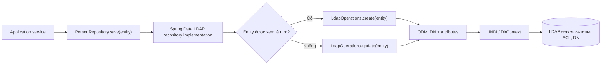
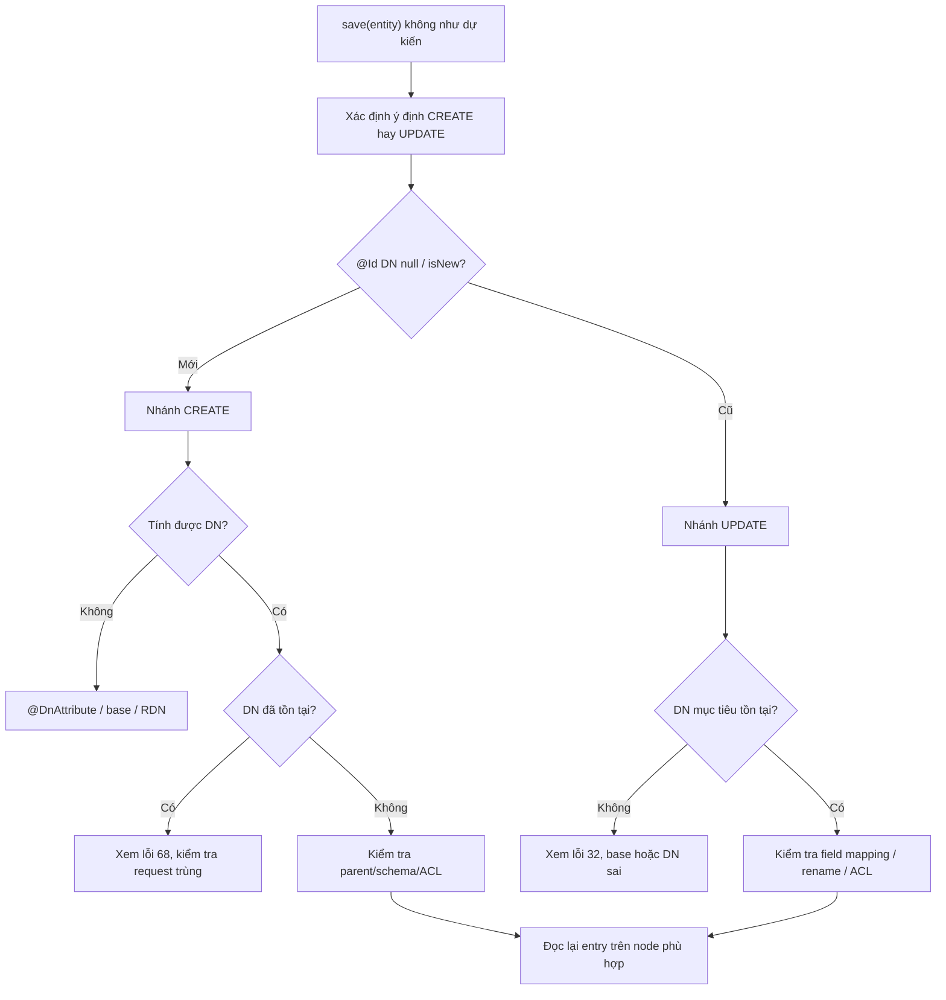
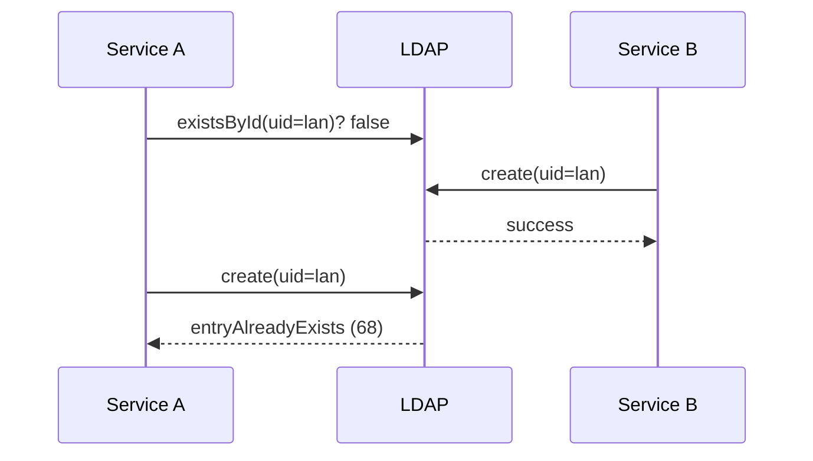

# Chẩn đoán khi save tạo entry mới hoặc cập nhật khác dự kiến trong Spring Data LDAP

Một lỗi khó phát hiện khi học Spring Data LDAP là gọi `personRepository.save(person)` với mục đích **tạo một nhân viên mới**, nhưng chương trình lại chạy nhánh **cập nhật** và báo không tìm thấy DN. Ngược lại, một thao tác tưởng như **chỉnh sửa nhân viên hiện có** có thể đi theo nhánh **tạo entry mới**, rồi báo DN đã tồn tại hoặc vô tình tạo một entry tại vị trí khác.

Nguyên nhân thường không nằm ở riêng phương thức `save`, mà ở cách Spring Data LDAP xác định entity **mới hay đã tồn tại**, cách ánh xạ `@Id` thành Distinguished Name (DN), cách tính DN từ `@DnAttribute`, cũng như schema, ACL và trạng thái thực tế của directory.

Bài thuộc chương **Chẩn đoán** của module `SPRING_DATA_LDAP`: truy cập LDAP bằng repository và `LdapTemplate`, ánh xạ entry phân cấp thành Java object, thực hiện CRUD, tìm kiếm an toàn và kiểm thử directory. Nội dung tập trung vào cách tìm đúng nguyên nhân khi **`save` tạo hoặc cập nhật không như dự kiến**, thay vì thử sửa dữ liệu hoặc retry một cách mù quáng.

## 1. Mục tiêu học tập

Sau bài này, người học có thể:

- Giải thích con đường `LdapRepository.save(...)` chọn **`create` hay `update`** theo trạng thái của entity.
- Phân biệt **DN của entry** với thuộc tính nghiệp vụ như `uid`, `cn`, `mail` và với base DN của `ContextSource`.
- Hiểu vai trò của `@Entry`, `@Id`, `@DnAttribute`, `@Attribute` và `@Transient` trong LDAP Object-Directory Mapping (ODM).
- Nhận biết các triệu chứng: tạo mới nhưng bị update; update nhưng bị create; DN bị đổi/move; thuộc tính cập nhật sai hoặc không đổi.
- Đọc exception và LDAP result code theo lớp nguyên nhân: DN không có, DN trùng, schema vi phạm, quyền không đủ, bind/TLS gặp lỗi.
- Sử dụng `LdapTemplate.create(...)` và `LdapTemplate.update(...)` khi cần thể hiện **ý định thao tác tường minh**.
- Viết unit test và integration test xác nhận cả **đường create/update** lẫn **trạng thái entry trên directory**.
- Tránh thiết kế `save` như một “upsert không điều kiện” hoặc một transaction ACID có thể tự bảo vệ khỏi race.

## 2. Một cây LDAP để phân tích kết quả save

Dữ liệu minh họa được lưu dưới naming context `dc=example,dc=org`:

```text
dc=example,dc=org
├── ou=people
│   ├── uid=lan
│   └── uid=minh
└── ou=groups
    └── cn=developers
```

Entry người Lan:

```ldif
dn: uid=lan,ou=people,dc=example,dc=org
objectClass: top
objectClass: person
objectClass: organizationalPerson
objectClass: inetOrgPerson
uid: lan
cn: Lan Nguyen
sn: Nguyen
mail: lan@example.org
```

Có bốn khái niệm dễ bị lẫn:

| Khái niệm | Ví dụ | Ý nghĩa |
|---|---|---|
| **DN đầy đủ** | `uid=lan,ou=people,dc=example,dc=org` | Vị trí và định danh của entry tại thời điểm hiện tại. |
| **RDN** | `uid=lan` | Phần tên phân biệt entry với anh em cùng parent. |
| **Connection base** | `dc=example,dc=org` | Gốc thao tác do Spring LDAP `ContextSource` cấu hình. |
| **Thuộc tính nghiệp vụ** | `uid=lan`, `cn=Lan Nguyen` | Các giá trị trong entry, dùng cho tìm kiếm và ứng dụng. |

Trong Spring LDAP, `@Id` thường ánh xạ **DN** qua một field kiểu `javax.naming.Name`, chứ không phải chỉ là `uid` hoặc một khóa số tự tăng kiểu cơ sở dữ liệu quan hệ.

Ví dụ một ứng dụng cấu hình:

```yaml
spring:
  ldap:
    urls: ldaps://ldap.example.org:636
    base: dc=example,dc=org
    username: uid=svc-directory,ou=service-accounts,dc=example,dc=org
    password: ${LDAP_BIND_PASSWORD}
```

Với connection base đó, DN tương đối của Lan thường là `uid=lan,ou=people`. Khi đọc và sửa bằng `LdapTemplate`, phải nhất quán hệ quy chiếu DN với cách `ContextSource` xử lý base. Không tự ghép lặp `dc=example,dc=org` vào một DN đã được định nghĩa tương đối với connection base.

**Lưu ý:** DN có thể thay đổi khi entry bị đổi RDN hoặc move sang OU khác. Nó không có cùng ý nghĩa với một khóa bất biến tự động của JPA.

## 3. Luồng kỹ thuật từ save đến LDAP server

Một lời gọi repository đi qua các tầng:



Với **`SimpleLdapRepository` mặc định**, ý tưởng cốt lõi của `save` là:

```java
// Pseudocode diễn giải cơ chế, không phải mã nguồn nguyên văn.
public <S extends T> S save(S entity) {
    Name id = odm.getId(entity);

    boolean newEntity = entity instanceof Persistable<?>
        ? ((Persistable<?>) entity).isNew()
        : id == null;

    if (newEntity) {
        ldapOperations.create(entity);
    } else {
        ldapOperations.update(entity);
    }

    return entity;
}
```

Đoạn này mô tả cách phân nhánh phổ biến của `SimpleLdapRepository`. **Mã thực tế phải đối chiếu phiên bản Spring Data LDAP, các repository fragment tùy chỉnh và cách entity implements `Persistable`**. Nó không phải cam kết cho mọi repository có cùng tên `save`.

### 3.1. Ma trận quyết định

| Trạng thái entity khi gọi save | Cách phân nhánh thường gặp | Tác động nếu trạng thái thực tế không khớp |
|---|---|---|
| `@Id dn == null`, không dùng `Persistable` | `create` | Nếu DN được tính ra đã tồn tại → lỗi trùng DN. |
| `@Id dn != null`, không dùng `Persistable` | `update` | Nếu DN đó chưa tồn tại → lỗi không tìm thấy entry. |
| `Persistable.isNew() == true` | `create` theo logic tùy chỉnh | Dù DN đã có, vẫn có thể đi vào create và gặp trùng. |
| `Persistable.isNew() == false` | `update` theo logic tùy chỉnh | Dù entry chưa tồn tại, vẫn có thể cập nhật vào DN không có. |

**Chốt:** `save` không tự search theo `uid`, `mail` hoặc `cn` để suy ra người đó đã tồn tại. Cũng không nên mặc định `save` là “upsert an toàn” kiểu *nếu chưa có thì insert, có rồi thì update*.

### 3.2. `@Id` không phải `@Attribute(name="uid")`

Nếu entity có:

```java
@Id
private Name dn;

@Attribute(name = "uid")
private String uid;
```

thì `dn` dùng cho định danh entry và trạng thái mới; `uid` là thuộc tính dữ liệu. Điền `uid="lan"` nhưng quên DN **không** khiến Spring Data LDAP tự nhận diện “đang cập nhật Lan”. Ngược lại, điền một DN mới khác null vào entity chưa từng được lưu có thể khiến `save` chọn `update`.

Spring Data LDAP ODM yêu cầu sử dụng `org.springframework.ldap.odm.annotations.Id`, **không phải** `org.springframework.data.annotation.Id`. Cần kiểm tra import khi ánh xạ không hoạt động.

## 4. Ví dụ entity ODM đúng cơ sở để chẩn đoán

Entity sau cho phép tạo DN từ giá trị `uid` khi chưa cung cấp DN tường minh:

```java
import javax.naming.Name;

import org.springframework.ldap.odm.annotations.Attribute;
import org.springframework.ldap.odm.annotations.DnAttribute;
import org.springframework.ldap.odm.annotations.Entry;
import org.springframework.ldap.odm.annotations.Id;

@Entry(
    base = "ou=people",
    objectClasses = {
        "top", "person", "organizationalPerson", "inetOrgPerson"
    }
)
public class PersonEntry {

    @Id
    private Name dn;

    @Attribute(name = "uid")
    @DnAttribute(value = "uid", index = 0)
    private String uid;

    @Attribute(name = "cn")
    private String fullName;

    @Attribute(name = "sn")
    private String surname;

    @Attribute(name = "mail")
    private String email;

    public PersonEntry() {
    }

    public PersonEntry(
            String uid, String fullName,
            String surname, String email) {
        this.uid = uid;
        this.fullName = fullName;
        this.surname = surname;
        this.email = email;
    }

    public Name getDn() {
        return dn;
    }

    public void setDn(Name dn) {
        this.dn = dn;
    }

    public String getUid() {
        return uid;
    }

    public void setUid(String uid) {
        this.uid = uid;
    }

    public String getFullName() {
        return fullName;
    }

    public void setFullName(String fullName) {
        this.fullName = fullName;
    }

    public String getSurname() {
        return surname;
    }

    public void setSurname(String surname) {
        this.surname = surname;
    }

    public String getEmail() {
        return email;
    }

    public void setEmail(String email) {
        this.email = email;
    }
}
```

Repository:

```java
import org.springframework.data.ldap.repository.LdapRepository;

public interface PersonRepository extends LdapRepository<PersonEntry> {
}
```

Đọc đúng các annotation:

- `@Entry` nêu các `objectClass` của entity và nhánh tương đối `ou=people`.
- `@Id` ánh xạ **DN hiện tại**; field phải có kiểu là `Name` hoặc kiểu tương thích mà ODM yêu cầu.
- `@DnAttribute(value="uid", index=0)` giúp lấy `uid` từ thành phần DN và **tính DN cho create/update** dựa trên field theo quy tắc ODM. Tác dụng chính xác của index và các thành phần DN phụ thuộc cấu hình `@Entry`/base.
- `@Attribute(name="uid")` bảo đảm `uid` cũng được ánh xạ thành thuộc tính entry, không chỉ được xem là thành phần tên.
- `@Attribute(name="cn")` và `@Attribute(name="sn")` ánh xạ thuộc tính schema bắt buộc của `person`.
- `email` ánh xạ `mail`; đổi tên property Java không đổi tên attribute trên LDAP server.

**Quan trọng:** `@DnAttribute` có thể dẫn đến **đổi vị trí entry** khi field tham gia DN bị thay đổi ở đường update. Đừng dùng nó tùy tiện cho trường mà nghiệp vụ muốn thay đổi mà không đổi DN.

### 4.1. Spring LDAP ODM và Spring Data repository phối hợp thế nào?

ODM cung cấp khả năng tính DN và ánh xạ Java fields ↔ LDAP attributes. Repository sử dụng ODM và các `LdapOperations` để thực hiện create/update. Ba câu hỏi khác nhau cần trả lời:

1. **Chọn nhánh nào?** Repository quyết định entity là mới hay cũ.
2. **Định danh entry nào?** ODM xác định DN từ `@Id` hoặc `@DnAttribute`.
3. **Thao tác có hợp lệ không?** LDAP server kiểm tra DN, parent, schema, quyền và trạng thái hiện có.

Nhầm một trong ba tầng sẽ khiến `save` có vẻ “hành động bất thường”, dù mỗi tầng đang làm đúng logic riêng.

## 5. Trường hợp A: muốn tạo mới nhưng save lại cập nhật

### 5.1. Tình huống

Ứng dụng tạo object Lan mới và tự gắn DN ngay trước khi lưu:

```java
import javax.naming.Name;
import org.springframework.ldap.support.LdapNameBuilder;

PersonEntry person = new PersonEntry(
    "lan", "Lan Nguyen", "Nguyen", "lan@example.org"
);

Name dn = LdapNameBuilder.newInstance("ou=people")
    .add("uid", "lan")
    .build();

person.setDn(dn);               // DN không null
personRepository.save(person);  // Thường đi nhánh UPDATE
```

Nếu DN `uid=lan,ou=people` **chưa tồn tại**, kết quả thường là lỗi `NameNotFoundException` hoặc LDAP result code **32 (noSuchObject)**, chứ không tự động tạo entry.

Căn nguyên: `@Id dn` đã khác `null`, nên repository mặc định hiểu entity **không mới**. Việc ứng dụng chủ động gán DN là một quyết định về **trạng thái entity**, không chỉ là bổ sung dữ liệu.

### 5.2. Khắc phục khi DN có thể tính được từ @DnAttribute

Nếu entity mapping hỗ trợ tính DN từ `uid` như ở mục 4, khi tạo mới hãy để `@Id` là `null`:

```java
PersonEntry fresh = new PersonEntry(
    "it-lan", "Lan Nguyen", "Nguyen", "lan@example.org"
);

assert fresh.getDn() == null;   // Trạng thái trước create.

PersonEntry created = personRepository.save(fresh);

// ODM có thể tính và gán DN cho entity khi create.
Name createdDn = created.getDn();
```

Cách làm này chỉ đúng khi có đủ trường `@DnAttribute`/`@Entry` cần thiết và parent `ou=people` tồn tại. Nếu ODM **không thể tính được DN** từ mapping, create sẽ thất bại trước hoặc trong lúc xử lý request; không được khắc phục bằng cách tùy ý gán non-null DN rồi gọi `save` như một update.

Nếu buộc phải tạo mới với DN đã biết, cân nhắc `LdapTemplate.create(entity)` hoặc thiết kế `Persistable` chính xác, thay vì trông chờ `save` tự suy luận ý định.

### 5.3. Nếu DN đã tồn tại thì sao?

Khi entity được xem là mới, nhánh create sẽ cố tạo entry tại DN được tính ra. Nếu DN đã tồn tại, LDAP thường trả mã **68 (entryAlreadyExists)** và Spring LDAP có thể chuyển thành `NameAlreadyBoundException`.

Đây là **đụng độ định danh**, không phải tín hiệu để lập tức đổi sang update. Cần xem liệu request là create thật, retry từ client đã tạo trước đó, hay cùng `uid` được gửi đồng thời từ nhiều nguồn. Không nên tự ghi đè entry cũ khi chưa kiểm tra quyền và nội dung.

## 6. Trường hợp B: muốn cập nhật nhưng save lại tạo mới

### 6.1. Tình huống

Một API đọc dữ liệu từ JSON rồi tự dựng một entity mới:

```java
// Lấy từ request PATCH /people/lan, nhưng object mới chưa có DN.
PersonEntry incoming = new PersonEntry(
    "lan", "Lan Nguyen", "Nguyen", "new@example.org"
);

personRepository.save(incoming); // DN null: nhánh CREATE
```

Nếu `uid=lan` đã tồn tại dưới `ou=people`, nhánh create có thể trả `NameAlreadyBoundException`. Nếu request vô tình đổi `uid` hoặc base/mapping thay đổi, ứng dụng có thể tạo **một entry mới ở DN khác**, khiến người học tưởng thao tác “sửa mail” lại “tạo thêm người”.

**Sai lầm:** cho rằng chỉ cần payload chứa `uid=lan` thì repository hiểu đang chỉnh sửa Lan. `uid` là thuộc tính nghiệp vụ; `save` mặc định không dùng `uid` như một khóa tìm trước khi quyết định.

### 6.2. Cách an toàn: tải entry hiện có theo DN rồi sửa

Nếu nghiệp vụ là cập nhật **một người đã tồn tại**, lấy entity bằng DN đáng tin cậy:

```java
import javax.naming.Name;
import org.springframework.ldap.support.LdapNameBuilder;

Name existingDn = LdapNameBuilder.newInstance("ou=people")
    .add("uid", "lan")
    .build();

PersonEntry existing = personRepository.findById(existingDn)
    .orElseThrow(() -> new IllegalArgumentException(
        "Entry does not exist"
    ));

existing.setEmail("new@example.org");
personRepository.save(existing); // @Id DN đã có: nhánh UPDATE
```

Trong trường hợp này:

- `findById` xác minh entry cụ thể mà service định sửa (cùng connection base/nguồn dữ liệu).
- Entity được load có `@Id` phù hợp nên repository đi đường update.
- Chỉ thay `email`, không vô tình thay `uid`/RDN.
- LDAP update vẫn phải được server chấp nhận theo schema và ACL.

**Lưu ý đồng thời:** `findById → save` là hai thao tác tách rời. Writer khác có thể thay đổi hoặc xóa entry giữa chúng. Đây không phải compare-and-set hay transaction ACID tự động.

### 6.3. Đặt DN tường minh cho update có hợp lý không?

Có thể, khi DN mục tiêu đã được xác minh, thay vì dùng một object “giả định tồn tại”. Nhưng không nên thiết kế một update API cho phép người dùng tự gửi DN tùy ý rồi `setDn` mà không kiểm soát quyền. Nên lấy DN từ đường dẫn và dữ liệu mapping đáng tin, kiểm tra nó thuộc OU/bộ phận được phép, và áp dụng authorization riêng.

Khi chỉ thay một thuộc tính, `LdapTemplate.modifyAttributes(...)` có thể giúp biểu đạt một update chọn lọc rõ ràng hơn so với tạo lại toàn bộ entity từ payload.

## 7. Trường hợp C: save làm đổi DN hoặc chuyển entry sang nhánh khác

Một loại sự cố nguy hiểm hơn là **entry dường như biến mất khỏi DN cũ sau update**.

Ví dụ entity được ánh xạ:

```java
@DnAttribute(value = "uid", index = 0)
private String uid;
```

Giả sử ứng dụng tải Lan:

```text
@id: uid=lan,ou=people,dc=example,dc=org
uid: lan
```

Sau đó cập nhật cả field tham gia DN:

```java
PersonEntry existing = personRepository.findById(existingDn)
    .orElseThrow();

existing.setUid("lan-new");
personRepository.save(existing);
```

Với ODM có `@DnAttribute(index=...)`, API `LdapOperations.update(entity)` có thể phát hiện **DN tính từ các field không còn bằng DN trong `@Id`** và thực hiện di chuyển/đổi tên entry. Javadoc Spring LDAP mô tả một đường xử lý có thể dùng **unbind/bind** thay vì chỉ `modifyAttributes`.

Hệ quả cần kiểm tra:

- Entry không còn tại `uid=lan,ou=people`; có thể tồn tại tại `uid=lan-new,ou=people`.
- Field `@Id` của entity có thể được cập nhật thành DN mới.
- Các entry khác lưu `manager` hoặc `member` tham chiếu DN cũ **không mặc nhiên được cập nhật trên mọi LDAP server**.
- Thao tác đổi DN có thể thất bại do ACL, parent không tồn tại, schema, DN mới trùng, hoặc restriction của server.
- Với luồng triển khai gồm nhiều LDAP operations, không được suy ra toàn bộ quá trình là atomic như một câu SQL UPDATE.

### 7.1. Tại sao đây không chỉ là sửa thuộc tính?

DN là **định danh theo vị trí trong cây**. Trong directory, đổi RDN hoặc move entry không tương đương sửa thuộc tính văn bản tùy ý. Do đó, nếu nghiệp vụ xem `uid` là bất biến, cần **không cho phép đổi `uid`** trong API cập nhật hồ sơ.

Nếu nghiệp vụ thực sự cần rename/move:

1. Xác định rõ DN cũ, DN mới và lý do thay đổi.
2. Kiểm tra ACL và schema của vị trí đích.
3. Kiểm tra quan hệ DN như group `member`, `manager`, `owner`.
4. Xác nhận directory có hỗ trợ referential integrity/link maintenance hay không.
5. Dùng một workflow rename được kiểm thử, có audit/khả năng đối soát; không “lén” đổi field tham gia DN trong một update email.

### 7.2. Khi @DnAttribute không đủ để tính DN

Ví dụ entity khai báo `@Id` nhưng không có `@DnAttribute` phù hợp với RDN và vị trí cần tính:

- Với entity mới `dn=null`, ODM không có đủ thông tin để tạo tên entry.
- Đường create có thể ném `IllegalArgumentException` về DN không xác định, trước khi gửi LDAP request.
- Nếu lập trình viên “sửa nhanh” bằng `setDn(...)` rồi gọi `save`, repository chuyển sang **update**, có thể sinh lỗi khác.

Cách xử lý: hoàn thiện mô hình DN rõ ràng, chỉ định `@Entry(base)`, các thành phần `@DnAttribute` thích hợp, và kiểm thử tên tạo ra. Nếu cần DN gán thủ công, chọn API `create` tường minh.

## 8. Trường hợp D: update thành công nhưng thuộc tính không đúng mong đợi

Đôi khi `save` không báo lỗi và entry vẫn ở đúng DN, nhưng mail, tên, nhóm hoặc những thuộc tính khác có giá trị sai.

### 8.1. Sai tên LDAP attribute trong mapping

Ví dụ:

```java
// Sai nếu directory thực sự dùng thuộc tính "sn":
@Attribute(name = "surname")
private String surname;
```

Khi schema định nghĩa `sn` thay vì `surname`, mapping không nhắm vào dữ liệu cần sửa. Nó có thể gây lỗi schema hoặc tạo một thuộc tính khác nếu server cho phép, không phải “đã sửa họ như mong muốn”.

Đúng với fixture:

```java
@Attribute(name = "sn")
private String surname;
```

### 8.2. @Transient và field không được quản lý

`org.springframework.ldap.odm.annotations.Transient` cho biết một field **không được ODM persist**. Nếu field mong muốn sửa bị đánh dấu `@Transient`, thay đổi Java field đó không trở thành LDAP attribute update.

Ngược lại, một field **không có `@Attribute`** cũng không nhất thiết bị bỏ qua: ODM có thể map mặc định theo tên field. Khi entity có helper field không nên lưu, cần đánh dấu `@Transient` thích hợp.

### 8.3. Thuộc tính vắng mặt không phải lúc nào là “giá trị null”

Một entity load về có thể thiếu `mail` vì:

- Dữ liệu LDAP chưa có `mail`.
- Account bind không được đọc `mail` theo ACL.
- Cách query hoặc mapper chỉ chọn một tập thuộc tính trả về.
- Schema/thuộc tính sử dụng ở server khác với dự kiến.

Nếu lưu lại một entity có field `mail=null` mà không hiểu nguồn gốc, ứng dụng có thể tạo tác dụng phụ không mong muốn tùy thuật toán diff/update và mapping. Cần kiểm tra dữ liệu thật trước khi cho phép ghi hàng loạt từ object thiếu thông tin.

### 8.4. Update ODM có thể dùng read/diff thay vì sửa một field “mù”

Javadoc của `LdapOperations.update(Object)` mô tả: nếu DN không cần thay đổi, framework đọc trạng thái hiện tại và tính các `ModificationItem` cần thiết từ sự khác biệt giữa entity và entry hiện hữu, rồi thực hiện `modifyAttributes`.

Do đó, không nên nhầm:

```java
personRepository.save(existing);
```

với:

```java
// Chỉ thay đúng attribute mail của đúng DN.
ldapTemplate.modifyAttributes(dn, oneModification);
```

Đường ORM/ODM update có thể quản lý **nhiều field được ánh xạ**, phụ thuộc dữ liệu trong entity. Khi chỉ muốn thay một giá trị `member` đa trị hoặc một thuộc tính nhạy cảm, thao tác modify chọn lọc thường rõ ý định hơn và giảm nguy cơ ghi đè từ snapshot cũ.

## 9. Các mã LDAP và exception thường gặp khi save

Bảng sau giúp tách lỗi **chọn nhánh create/update**, **tính DN**, **schema/quyền** và **giao tiếp**:

| Triệu chứng / LDAP code | Ý nghĩa thường gặp | Hướng điều tra |
|---|---|---|
| **32 – noSuchObject** / `NameNotFoundException` | Update hoặc thao tác dưới DN không tồn tại; đôi khi parent DN sai | In DN đã chuẩn hóa an toàn, kiểm tra base/parent, tồn tại tại node ghi |
| **68 – entryAlreadyExists** / `NameAlreadyBoundException` | Create nhắm DN đã có | Kiểm tra `@Id`, `isNew`, RDN, request trùng |
| **34 – invalidDNSyntax** / `InvalidNameException` | DN sai cú pháp | Dùng `LdapNameBuilder`; không nối RDN tùy ý |
| **65 – objectClassViolation** / `SchemaViolationException` | Thiếu thuộc tính bắt buộc hoặc thao tác vi phạm schema | Đối chiếu `objectClass`, `cn`, `sn`, thuộc tính được phép |
| **50 – insufficientAccessRights** / `NoPermissionException` | Bind account không có quyền tạo/sửa ở DN/attribute | Kiểm tra ACL của OU, entry và thuộc tính |
| **49 – invalidCredentials** / `AuthenticationException` | Service account không bind được | Kiểm tra bind DN, secret và trạng thái account |
| Mất TCP / TLS / timeout | Không thể đến bước create/update hoặc không nhận response | Phân tích `CommunicationException` và root cause TLS/socket |
| Không xác định được DN tại ODM | `@Id=null` và thiếu cấu hình tính RDN hợp lệ | Kiểm tra `@DnAttribute`, `@Entry(base)`, fields cần thiết |
| Không tìm thấy attribute sau update | Mapping, ACL, schema, search base hoặc replica trễ | Lookup theo đúng DN ở writable node và inspect attribute |

Tên exception trên là **mapping thường gặp**, không phải bảo đảm mọi LDAP server, JDK và phiên bản Spring LDAP luôn có cùng lớp exception bên ngoài. Đọc cả **root cause, LDAP result code và giai đoạn thao tác**.

**Không xem mọi `NameNotFoundException` là “người dùng chưa tồn tại nên tạo ngay”.** Base hoặc parent OU có thể sai, account có thể nhìn thấy dữ liệu khác theo ACL, hoặc ứng dụng đang kết nối nhầm directory.

### 9.1. Chẩn đoán lỗi 32 và lỗi 68 khác nhau

Ví dụ sau khi gọi `save`:

```text
Case A:
  entity.@Id = uid=lan,ou=people
  repository chọn UPDATE
  LDAP code 32
  -> kiểm tra entry DN đó có thật không

Case B:
  entity.@Id = null
  @DnAttribute tính DN uid=lan,ou=people
  repository chọn CREATE
  LDAP code 68
  -> kiểm tra DN đã có, request trùng hoặc isNew sai
```

Nhìn mã lỗi để khoanh vùng, nhưng vẫn cần xác nhận **chính xác nhánh repository đã chọn**. Một class exception duy nhất không đủ để khẳng định phần ứng dụng có lỗi ở đâu.

## 10. Quy trình chẩn đoán từ request đến LDAP entry



Các bước thực tế:

1. **Ghi nhận ý định:** API đang thực hiện create hay update? Một tên method `save` chung không nói lên ý định nghiệp vụ.
2. **Ghi nhận entity state trước lời gọi:** `getDn()==null` hay không; có implements `Persistable` và `isNew()` là gì?
3. **Tính DN mục tiêu:** đối chiếu `ContextSource.base`, `@Entry.base` và các `@DnAttribute`. Không ghi credential vào log.
4. **Kiểm tra route:** repository có thật là `SimpleLdapRepository` mặc định? Có custom repository fragment override `save` không?
5. **Kiểm tra directory:** dùng lookup/findById ở **đúng endpoint và DN**, đồng thời kiểm tra parent OU.
6. **Đọc exception chain:** LDAP result code, tên attribute/entry và lỗi nguồn.
7. **Kiểm tra mapping:** các field được lưu, `@Transient`, `objectClass` và DN field có bị thay đổi không.
8. **Đọc lại trạng thái sau thao tác:** ưu tiên writable server hoặc node có cơ chế read-after-write phù hợp; không kết luận từ replica còn trễ.
9. **Viết integration test tái hiện:** test cả nhánh thành công và nhánh sai trước khi sửa code.

### 10.1. Log nào nên bổ sung?

Một log vận hành an toàn có thể chứa:

```text
level=INFO operation=ldap.person.save
requestId=2af30a entityType=PersonEntry
intent=UPDATE idPresent=true
targetOu=people expectedUid=lan
outcome=FAILED reason=entry_not_found
```

Không ghi password bind, toàn bộ payload nhân sự, raw TLS secret hay diagnostic nhạy cảm. DN hoặc `uid` vẫn có thể là dữ liệu cá nhân; chỉ log khi chính sách cho phép và hạn chế thời gian lưu, quyền truy cập.

Với môi trường kiểm thử, có thể tạm bật log ở các package `org.springframework.data.ldap` và `org.springframework.ldap` hoặc quan sát thao tác LDAP bằng test double/instrumentation. Không nên phụ thuộc **một câu log ở một version** để quyết định nhánh; xác minh từ hành vi và API.

## 11. Khi cần thao tác rõ ý định: LdapTemplate.create và update

Nếu API của hệ thống phân biệt rất rõ `POST /employees` và `PATCH /employees/{uid}`, cách an toàn là gọi **API tường minh** thay vì để `save` suy ra từ trạng thái object nhập vào.

`LdapTemplate` có các phương thức ODM:

```java
ldapTemplate.create(entity);  // Bắt buộc tạo entry mới.
ldapTemplate.update(entity);  // Bắt buộc cập nhật entry đã tồn tại.
```

Chúng có quy tắc rõ hơn:

- `create` yêu cầu entry chưa tồn tại; nếu field `@Id` được gán thì dùng DN đó, nếu chưa được gán có thể tính DN từ `@DnAttribute` khi metadata đủ.
- `update` yêu cầu entry đã tồn tại; nếu DN được tính ra thay đổi theo `@DnAttribute`, có thể dẫn đến move/rename theo mô hình ODM.
- Không có API nào tự biến LDAP thành transaction ACID hoặc bỏ qua schema/ACL.
- Với thay đổi chọn lọc một thuộc tính hay một giá trị đa trị, cân nhắc `modifyAttributes`.

### 11.1. Service với hai method có hợp đồng rõ ràng

```java
import javax.naming.Name;

import org.springframework.ldap.core.LdapTemplate;
import org.springframework.ldap.support.LdapNameBuilder;
import org.springframework.stereotype.Service;

@Service
public class PersonDirectoryService {

    private final PersonRepository repository;
    private final LdapTemplate ldapTemplate;

    public PersonDirectoryService(
            PersonRepository repository,
            LdapTemplate ldapTemplate) {
        this.repository = repository;
        this.ldapTemplate = ldapTemplate;
    }

    public void createPerson(
            String uid,
            String fullName,
            String surname,
            String email) {

        PersonEntry person = new PersonEntry(
            uid, fullName, surname, email
        );

        // DN sẽ được ODM tính từ @DnAttribute + @Entry.
        // Không tự đánh dấu đã tồn tại bằng một @Id giả.
        ldapTemplate.create(person);
    }

    public void changeEmail(String uid, String newEmail) {
        Name dn = LdapNameBuilder
            .newInstance("ou=people")
            .add("uid", uid)
            .build();

        PersonEntry person = repository.findById(dn)
            .orElseThrow(() -> new PersonMissingException(
                "Person entry not found"
            ));

        person.setEmail(newEmail);
        ldapTemplate.update(person);
    }
}

class PersonMissingException extends RuntimeException {
    PersonMissingException(String message) {
        super(message);
    }
}
```

Mã là ví dụ về **điều phối create/update**, không phải endpoint production hoàn chỉnh. Cần validate `uid`/email, giới hạn OU, phân quyền người gọi, có chính sách trường bất biến và xử lý duplicate/race.

**DN builder** bảo vệ cấu trúc DN khỏi chuỗi RDN sai cú pháp. Nhưng một UID hợp lệ về cú pháp vẫn có thể không được phép tạo/sửa theo nghiệp vụ. Không cho phép người dùng tùy ý chọn DN của entry khác.

### 11.2. Khi chỉ cập nhật mail, dùng ModificationItem có thể rõ hơn

```java
import javax.naming.Name;
import javax.naming.directory.BasicAttribute;
import javax.naming.directory.DirContext;
import javax.naming.directory.ModificationItem;

import org.springframework.ldap.core.LdapTemplate;

public void replaceEmail(
        LdapTemplate template,
        Name personRelativeDn,
        String newEmail) {

    ModificationItem change = new ModificationItem(
        DirContext.REPLACE_ATTRIBUTE,
        new BasicAttribute("mail", newEmail)
    );

    template.modifyAttributes(
        personRelativeDn, new ModificationItem[] {change}
    );
}
```

Method này gửi thao tác thay đúng thuộc tính `mail`, không xây lại toàn bộ entity và không động tới `uid`/DN. Tuy nhiên, **đây vẫn là một LDAP Modify request có thể lỗi**, và không ngăn một writer khác sửa mail ngay trước/sau nó. Nếu yêu cầu update có điều kiện phiên bản, cần cơ chế kiểm tra tại server như LDAP Assertion Control khi hỗ trợ.

## 12. Không dùng read-before-save như upsert nguyên tử

Một cách xử lý tưởng hợp lý:

```java
if (repository.existsById(dn)) {
    repository.save(existing);
} else {
    repository.save(newPerson);
}
```

Tuy nhiên, **kiểm tra tồn tại** và **save** là hai thao tác độc lập:



Do đó, `existsById` có thể giúp trả lỗi nghiệp vụ dễ hiểu, nhưng **không khóa DN**. LDAP server mới là nơi quyết định request tạo có hợp lệ không. Khi hai writer cùng create:

- Một request có thể thành công.
- Request còn lại nhận lỗi trùng DN.
- Không nên tự động chuyển lỗi trùng thành overwrite nếu chưa có chính sách rõ.

Nếu mục tiêu là “đảm bảo entry có trạng thái X”, cần thiết kế quy tắc đối soát, retry có giới hạn và kiểm tra xung đột. Với nghiệp vụ đòi điều kiện chặt, LDAP Assertion Control (RFC 4528) có thể áp dụng cho một số operation nếu directory hỗ trợ; nó không phải transaction đa entry.

## 13. Concurrency và stale entity khi update

Giả sử hai dịch vụ đọc Lan:

```text
Ban đầu:
  mail = lan@example.org
  description = Developer
```

Writer A đổi `mail`, writer B đổi `description` dựa trên snapshot trước đó. Nếu hai bên cùng lưu entity với các field được quản lý theo dữ liệu cũ, tùy chiến lược diff và trạng thái LDAP, một cập nhật có thể làm mất kết quả của cập nhật kia.

Không thể mặc định `save` tự bảo vệ khỏi **lost update** như một câu update có điều kiện version. LDAP không tự có optimistic locking giống JPA chỉ vì Spring Data có cùng interface repository.

Các cách giảm rủi ro:

- **Tối thiểu hóa phạm vi update:** dùng `modifyAttributes` cho đúng attribute hoặc giá trị.
- **Thiết kế field tham gia DN là bất biến** khi không có workflow rename.
- **Dùng điều kiện tại server** nếu LDAP hỗ trợ Assertion Control (RFC 4528).
- **Giới hạn writer và xác định conflict policy**, đặc biệt với nhóm và thuộc tính đa trị.
- **Đọc lại sau update** từ node phù hợp và có đối soát khi request mất response.
- **Không retry write vô hạn** khi chưa biết server đã áp dụng request hay chưa.

Một transaction bù trừ Spring LDAP cũng không đem lại snapshot isolation hay ACID xuyên nhiều entry. Kết quả sau lỗi mạng có thể chưa xác định với client.

## 14. Kiểm thử unit: chứng minh ý định service

Unit test phù hợp để chứng minh **service gọi đúng API** và không chọn nhánh do payload tự đoán. Ví dụ với Mockito:

```java
import static org.mockito.Mockito.*;

import org.junit.jupiter.api.BeforeEach;
import org.junit.jupiter.api.Test;
import org.springframework.ldap.core.LdapTemplate;

class PersonDirectoryServiceTest {

    private PersonRepository repository;
    private LdapTemplate template;
    private PersonDirectoryService service;

    @BeforeEach
    void setUp() {
        repository = mock(PersonRepository.class);
        template = mock(LdapTemplate.class);
        service = new PersonDirectoryService(repository, template);
    }

    @Test
    void createUsesExplicitCreateOperation() {
        service.createPerson(
            "it-new", "New Employee", "Employee", "it-new@example.org"
        );

        verify(template).create(any(PersonEntry.class));
        verify(template, never()).update(any(PersonEntry.class));
        verifyNoInteractions(repository);
    }
}
```

Test này chứng minh luồng service **có gọi `LdapTemplate.create`**, nhưng **không kiểm tra** DN ODM tạo ra có đúng, schema có chấp nhận entry, hoặc server có thật sự tạo entry hay không.

Để kiểm tra `changeEmail`, có thể mock `findById` trả về entity có `dn`, rồi verify `template.update` và email mới. Tuy nhiên, thử nghiệm nhánh create/update của **`SimpleLdapRepository.save`** cần kiểm thử repository với cấu hình thật, không chỉ mock chính repository.

## 15. Kiểm thử tích hợp: phân biệt create/update và kiểm tra entry thật

Một integration test nên dùng LDAP server riêng (nhúng hoặc container), schema chấp nhận `inetOrgPerson`, account test có quyền CRUD và dữ liệu tách khỏi production.

### 15.1. Fixture LDIF

```ldif
dn: dc=example,dc=org
objectClass: top
objectClass: domain
dc: example

dn: ou=people,dc=example,dc=org
objectClass: top
objectClass: organizationalUnit
ou: people

dn: uid=lan,ou=people,dc=example,dc=org
objectClass: top
objectClass: person
objectClass: organizationalPerson
objectClass: inetOrgPerson
uid: lan
cn: Lan Nguyen
sn: Nguyen
mail: lan@example.org
```

Nếu test directory đã có base DN hoặc OU tương ứng, không nạp trùng. Mỗi test tạo thêm entry với UID **duy nhất** để tránh tác động lẫn nhau và dọn entry sau khi test.

### 15.2. Test create khi DN ban đầu null

```java
import static org.assertj.core.api.Assertions.assertThat;

import java.util.UUID;
import javax.naming.Name;

import org.junit.jupiter.api.Test;
import org.springframework.beans.factory.annotation.Autowired;
import org.springframework.boot.test.context.SpringBootTest;
import org.springframework.test.context.ActiveProfiles;

@SpringBootTest
@ActiveProfiles("ldap-test")
class PersonSaveIntegrationTest {

    @Autowired
    private PersonRepository repository;

    @Test
    void nullDnCreatesEntryAndPopulatesId() {
        String uid = "it-" + UUID.randomUUID().toString().substring(0, 8);
        PersonEntry person = new PersonEntry(
            uid, "Integration Test", "Test", uid + "@example.org"
        );

        assertThat(person.getDn()).isNull();

        PersonEntry saved = repository.save(person);
        Name savedDn = saved.getDn();

        assertThat(savedDn).isNotNull();

        try {
            PersonEntry fromLdap = repository.findById(savedDn)
                .orElseThrow();

            assertThat(fromLdap.getUid()).isEqualTo(uid);
            assertThat(fromLdap.getEmail())
                .isEqualTo(uid + "@example.org");
        } finally {
            repository.deleteById(savedDn);
        }
    }
}
```

Bài test xác nhận **kết quả thực tế** thay vì chỉ xem `save` không ném exception. Với Spring Data LDAP/ODM phù hợp, `@DnAttribute` giúp tính DN khi create; `@Id` được gán sau khi tạo. Test cần profile `ldap-test` đúng endpoint, schema và bean repository.

### 15.3. Test update từ entry đã được load

Có thể bổ sung trong cùng test class một phương thức:

```java
@Test
void loadedEntryIsUpdatedRatherThanCreatedAgain() {
    String uid = "it-" + UUID.randomUUID().toString().substring(0, 8);
    PersonEntry initial = repository.save(new PersonEntry(
        uid, "Integration Test", "Test", "old@example.org"
    ));

    Name dn = initial.getDn();

    try {
        PersonEntry existing = repository.findById(dn).orElseThrow();
        assertThat(existing.getDn()).isNotNull();

        existing.setEmail("new@example.org");
        repository.save(existing);

        PersonEntry actual = repository.findById(dn).orElseThrow();
        assertThat(actual.getEmail()).isEqualTo("new@example.org");
        assertThat(actual.getDn()).isEqualTo(dn);
    } finally {
        repository.deleteById(dn);
    }
}
```

Ở đây, load từ directory bảo đảm entity có DN. Test cho thấy trường hợp **update thuộc tính nhưng giữ nguyên DN**. Muốn kiểm tra rename, cần tạo test riêng thay đổi `uid` và quan sát cả DN cũ/mới.

**Điều kiện:** hai test được đặt trong cùng class `PersonSaveIntegrationTest`, sử dụng cùng field `repository`. Chỉ dùng thư mục test riêng; không chạy thao tác tạo/xóa trên directory production.

### 15.4. Các ca âm bản không được bỏ qua

| Ca kiểm thử | Thiết lập | Kỳ vọng |
|---|---|---|
| Non-null DN nhưng entry chưa tồn tại | Gán DN của `it-unknown` rồi `save` | Nhánh update; lỗi không tìm thấy theo triển khai. |
| Null DN nhưng UID đã có | Dựng entity mới với UID trùng `lan` | Nhánh create; lỗi trùng DN (thường mã 68). |
| Không có cấu hình tính DN | `dn=null`, `@DnAttribute` thiếu hoặc sai | Không thể tạo tên entry; exception mapping/argument. |
| Thay field tham gia DN | Tải entry rồi đổi `uid` | Kiểm tra có move/rename, DN cũ/mới và tham chiếu. |
| Schema thiếu `sn` | Create `inetOrgPerson` không có required attribute | Server từ chối do schema (thường mã 65). |
| Reader account thử modify | Account chỉ có quyền đọc | Server từ chối theo ACL (thường mã 50). |
| Wrong base DN | Cấu hình base và `@Entry(base)` không khớp | Không tạo/cập nhật đúng cây hoặc báo DN không tồn tại. |
| Mất kết nối sau khi gửi create/update | Mô phỏng network fault trên directory test | Outcome có thể chưa rõ; đọc lại trước khi retry. |
| Dữ liệu không có `mail` | Mapper/ACL không trả thuộc tính | Không tự coi thành công là đã có email đúng. |
| Hai request cùng create một UID | Gửi đồng thời tới cùng directory | Chỉ một DN có thể tồn tại; xác minh cách xử lý lỗi trùng. |

**Test kết nối/credential/sửa entry phải chạy trong môi trường cô lập.** Không dùng directory production để tạo entry có UID thử nghiệm hoặc mô phỏng race.

## 16. Case study: API “cập nhật email” lại tạo người khác

### 16.1. Mô tả sự cố

API nhận JSON:

```json
{
  "uid": "lan-new",
  "email": "lan.new@example.org"
}
```

Nhưng nghiệp vụ nói “cập nhật email của Lan” tại DN `uid=lan,ou=people`. Service sai thiết kế dựng một `PersonEntry` mới từ JSON, để `dn=null` và gọi `repository.save(incoming)`.

Nếu mapping tính DN từ `uid=lan-new`, repository xem entity **mới** và có thể **tạo entry mới** ở `uid=lan-new,ou=people` — miễn là schema, các required attributes và ACL cho phép.

Vấn đề không phải “save tự nhân bản người”; vấn đề là service đã **mất DN của resource mục tiêu** và cho phép input ngoài thay đổi thuộc tính tạo DN.

### 16.2. Thiết kế sửa

- Lấy `uid` mục tiêu từ đường dẫn/identity đã xác minh, không dùng field định danh tùy ý trong PATCH body.
- Dựng DN mục tiêu an toàn bằng `LdapNameBuilder`, hoặc lookup theo danh tính thật được ứng dụng kiểm soát.
- Dùng `repository.findById(dn)` rồi chỉ cập nhật `mail`; hoặc dùng `modifyAttributes` trên đúng DN.
- Khóa khả năng đổi `uid` trong endpoint sửa email. Nếu cần rename, thiết kế một nghiệp vụ độc lập có kiểm soát liên kết group/manager.
- Ghi audit `intent=UPDATE_MAIL`, DN mục tiêu theo chính sách log và kết quả xác minh.
- Viết regression test xác nhận **không có entry mới** và chỉ `mail` của Lan đổi.

Trường hợp này minh họa rõ rằng lỗi “create thay vì update” thường xuất phát từ **hợp đồng API và mapping entity**, không chỉ từ framework.

## 17. Những nhận định sai thường gặp

**“`save` là upsert nên ID có hay không không quan trọng.”** Sai. Repository có logic xác định entity mới; create và update có yêu cầu khác nhau.

**“Đã có `uid` thì Spring biết entry tồn tại.”** Sai. `uid` là LDAP attribute, còn `@Id` ánh xạ DN. Nếu không có cơ chế tìm/đối chiếu riêng, `save` không tự tra `uid`.

**“Gán DN cho entity mới giúp create an toàn hơn.”** Chưa chắc. Với repository mặc định, DN khác null có thể khiến `save` đi nhánh update.

**“Không gán DN khi update thì framework biết người theo uid.”** Sai. Entity mới với DN null có thể bị tạo tại DN tính được, rồi gặp trùng hoặc tạo entry khác.

**“`@DnAttribute` chỉ là tiện ích đọc tên.”** Không đầy đủ. Với `index` thích hợp, nó còn tham gia tính DN và có thể làm update đổi vị trí entry.

**“Thay email bằng repository.save chắc chắn chỉ gửi một ModificationItem mail.”** Không thể bảo đảm như vậy cho mọi entity; ODM update có thể đọc/diff nhiều thuộc tính mapping.

**“Update trả thành công nghĩa là mọi replica đã thấy ngay.”** Sai. Replication lag và cache có thể khiến search sau đó đọc dữ liệu cũ.

**“Exception 32 nghĩa là người không tồn tại nên gọi create.”** Không đủ căn cứ. DN/base/parent hoặc endpoint có thể sai.

**“Gặp exception mạng thì cứ gọi lại save.”** Nguy hiểm. Request trước có thể đã được áp dụng; retry cần xác định trạng thái sau lỗi.

**“@Transactional giúp rollback mọi thao tác LDAP như JPA.”** Sai. Spring LDAP có cơ chế giao dịch bù trừ với giới hạn riêng, không phải transaction ACID đa entry.

## 18. Bài tập thực hành

### Bài 1 – Dự đoán nhánh save

Với `SimpleLdapRepository` mặc định và entity không implement `Persistable`, hãy dự đoán create hay update cho bốn tình huống: `dn=null`/`uid=lan`; `dn=uid=lan,ou=people`/entry không tồn tại; `dn` có nhưng entry thực tế tồn tại; `dn=null`/`uid` trùng DN đã có. Nêu LDAP error code có thể gặp.

### Bài 2 – Sửa entity ODM

Một entity có `@Id Name dn` và `@Attribute(name="uid") String uid`, nhưng `save` với `dn=null` báo không tính được DN. Hãy bổ sung `@DnAttribute` phù hợp với `@Entry(base="ou=people")` và giải thích cách tính tên cho một entry mới.

### Bài 3 – Chẩn đoán rename ngoài ý muốn

Một service load Lan, thay cả `uid` và `mail`, rồi `save`. Sau đó tìm `uid=lan` tại DN cũ không thấy. Hãy giải thích vai trò của `@DnAttribute(index=...)`, cách tìm DN mới, và tại sao group `member=LanDNCũ` cần được kiểm tra.

### Bài 4 – Phân biệt create/update tường minh

Thiết kế `POST /employees` và `PATCH /employees/{uid}/email` dùng `LdapTemplate.create`, `LdapTemplate.update` hoặc `modifyAttributes` phù hợp. Nêu các validation và authorization bắt buộc.

### Bài 5 – Kiểm thử trạng thái thực

Viết hai integration test: tạo entry mới từ `dn=null` với UID duy nhất và xác minh DN được gán; load entry đó, đổi `mail`, `save` và xác minh DN không đổi. Bổ sung test lỗi duplicate và non-null DN không tồn tại.

### Bài 6 – Tình huống đồng thời

Hai request cùng tạo `uid=hoa` trên một directory. Vì sao `existsById` trước `save` không đủ? Cần xử lý response nào từ LDAP server, và khi nào có thể coi request thứ hai đã đạt trạng thái mong muốn?

### Bài 7 – Sửa API tạo entry ngoài ý muốn

Một PATCH body có cả `uid` và `email`; service dựng một entity mới, không gán DN, gọi `save`. Hãy đề xuất luồng dùng DN từ path và một chiến lược ngăn chỉnh sửa field RDN không mong muốn.

## 19. Checklist nhanh khi debug save

| Kiểm tra | Đã xác minh điều gì? |
|---|---|
| Ý định API là CREATE hay UPDATE? | Không để tên `save` che mất nghiệp vụ. |
| Entity có implements `Persistable`? | Nếu có, kiểm tra `isNew()` và cách quản lý trạng thái. |
| `@Id` có null hay không trước khi save? | Gợi ý nhánh create/update. |
| Đúng annotation `org.springframework.ldap.odm.annotations.Id`? | Tránh import nhầm annotation Spring Data/JPA. |
| `@Entry(base)` và `ContextSource.base` khớp? | DN mục tiêu không lệch nhánh. |
| `@DnAttribute(index)` có phù hợp? | DN tính ra đúng RDN/OU, không move ngoài ý muốn. |
| `objectClass`, `cn`, `sn` hợp schema? | Create/update được server chấp nhận. |
| Account bind có quyền tương ứng? | ACL có thể khác nhau cho add/modify/rename. |
| Có dùng endpoint LDAP đúng không? | Tránh đọc replica khác hoặc nhầm môi trường. |
| Có custom repository fragment override save không? | Không giả định repository luôn là bản mặc định. |
| Có thao tác với field đa trị không? | Tránh thay cả tập khi chỉ cần sửa một giá trị. |
| Có reader/writer khác cập nhật đồng thời? | Không bỏ qua race và mất response. |
| Có integration test đọc lại bằng DN thật? | Xác minh trạng thái directory thay vì tin object Java. |
| Log không lộ credential và dữ liệu nhạy cảm? | Đáp ứng yêu cầu bảo mật. |

## 20. Kết luận và tài liệu tham khảo

Điểm mấu chốt khi chẩn đoán **`save` tạo entry mới hoặc cập nhật khác dự kiến** là tách ba quyết định: **repository chọn create hay update**, **ODM xác định DN từ `@Id`/`@DnAttribute`**, và **LDAP server chấp nhận hay từ chối thao tác** dựa trên tồn tại, schema và ACL.

Với repository LDAP mặc định, DN null thường khiến `save` đi nhánh create, DN khác null thường khiến đi nhánh update, trừ khi logic xác định entity mới được tùy chỉnh (ví dụ `Persistable.isNew()`). `save` không tự trở thành upsert theo `uid`. Khi ý định nghiệp vụ rõ ràng, dùng `LdapTemplate.create`, `update` hoặc `modifyAttributes` có thể giảm nhầm lẫn; luôn kiểm thử trạng thái thật trên directory và có quy trình xử lý lỗi DN/trùng/sửa ngoài ý muốn.

Tài liệu đối chiếu theo phiên bản:

- [Spring Data LDAP – Repositories và cấu hình](https://docs.spring.io/spring-data/ldap/reference/ldap/configuration.html)
- [Spring Data LDAP – SimpleLdapRepository API](https://docs.spring.io/spring-data/ldap/docs/current/api/org/springframework/data/ldap/repository/support/SimpleLdapRepository.html)
- [Spring Data Commons – Entity State Detection Strategies](https://docs.spring.io/spring-data/ldap/reference/data-commons/is-new-state-detection.html)
- [Spring LDAP – Object-Directory Mapping](https://docs.spring.io/spring-ldap/reference/odm.html)
- [Spring LDAP – LdapOperations create/update API](https://docs.spring.io/spring-ldap/docs/current/api/org/springframework/ldap/core/LdapOperations.html)
- [Spring LDAP – LdapTemplate API](https://docs.spring.io/spring-ldap/docs/current/api/org/springframework/ldap/core/LdapTemplate.html)
- [RFC 4511 – LDAP Protocol, Add/Modify/Modify DN](https://www.rfc-editor.org/rfc/rfc4511)
- [RFC 4514 – LDAP Distinguished Names](https://www.rfc-editor.org/rfc/rfc4514)
- [RFC 4528 – LDAP Assertion Control](https://www.rfc-editor.org/rfc/rfc4528)
