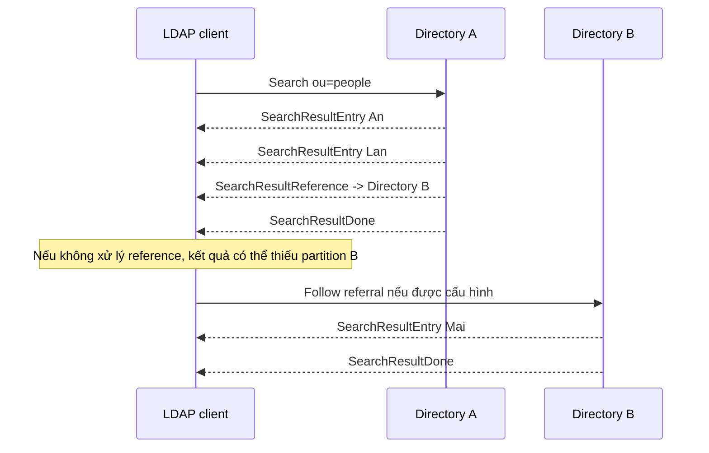
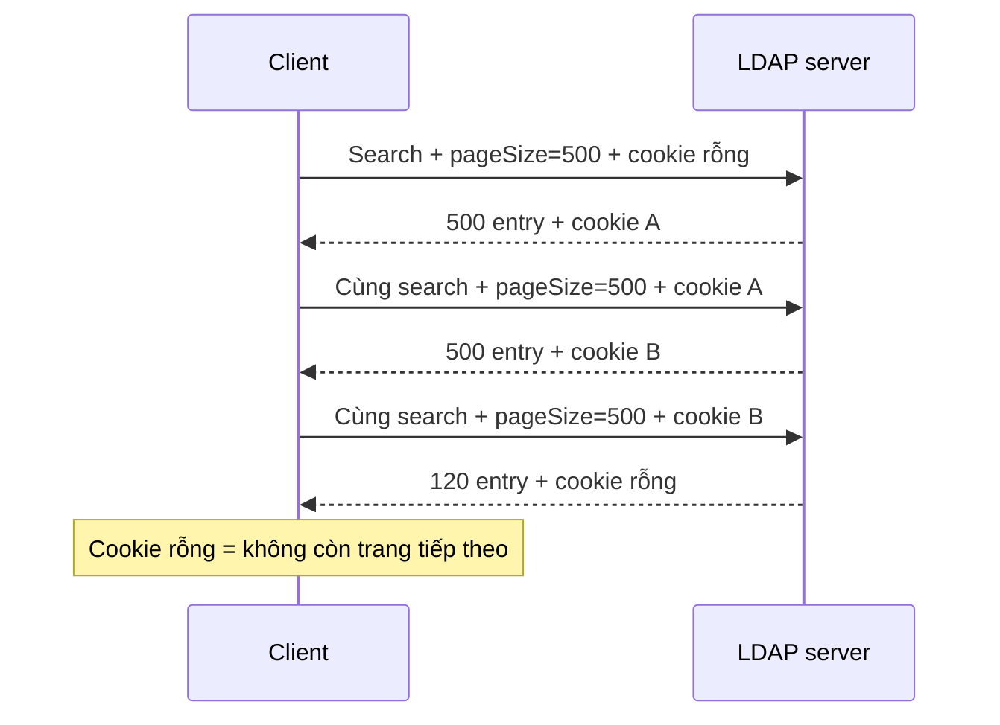

# Kết quả bị cắt do giới hạn, referral hoặc phân trang sai cookie

## Mục tiêu học tập

Sau bài học, bạn có thể:

1. Phân biệt một tập kết quả **thực sự đầy đủ** với kết quả bị giới hạn bởi client, LDAP server hoặc referral chưa được xử lý.
2. Nhận diện LDAP result code thường gặp: `timeLimitExceeded (3)`, `sizeLimitExceeded (4)`, `referral (10)` và `adminLimitExceeded (11)`.
3. Giải thích sự khác nhau giữa `SearchResultReference`, referral error response và `PartialResultException` trong JNDI.
4. Chọn chính sách referral `follow`, `ignore` hoặc `throw` phù hợp với topology, ACL và yêu cầu đầy đủ dữ liệu.
5. Dùng **RFC 2696 Paged Results Control** đúng cách: giữ nguyên search request, truyền cookie mới nhất và tiếp tục đến khi cookie rỗng.
6. Sử dụng `PagedResultsControlExchangeDirContextProcessor` và `SingleContextSource` trong Spring LDAP để giữ cùng kết nối qua các trang.
7. Cấu hình `LdapTemplate` để không âm thầm coi kết quả bị cắt là đầy đủ.
8. Chẩn đoán lỗi dựa trên search base, scope, filter, giới hạn, referral URL, control, cookie, endpoint và quyền đọc.
9. Viết integration test cho size/time limit, referral, paging, cookie hết hạn, replica và dữ liệu thay đổi trong lúc phân trang.

Bài thuộc chương **Chẩn đoán** của module `SPRING_DATA_LDAP`. Ứng dụng Java truy cập dịch vụ thư mục LDAP qua Spring Data LDAP repository, ánh xạ entry phân cấp sang object Java, hiểu DN, `objectClass`, schema, truy vấn repository/`LdapTemplate`, CRUD, filter an toàn, bảo mật kết nối và kiểm thử với directory. Khi một truy vấn trả ít entry hơn mong đợi, phải xác định đó là kết quả nghiệp vụ hay một search chưa hoàn tất.

## 1. “Search trả về danh sách” chưa có nghĩa là đã lấy đủ dữ liệu

Giả sử ứng dụng tìm tất cả user trong:

```text
ou=people,dc=example,dc=org
```

với filter:

```text
(objectClass=inetOrgPerson)
```

Ứng dụng nhận được 1.000 entry và không thấy exception. Có thể đó là:

- Directory thực sự chỉ có 1.000 entry phù hợp.
- Client yêu cầu giới hạn 1.000 entry.
- Server chỉ cho phép tối đa 1.000 entry trong một search.
- Server chỉ trả một trang đầu do client chưa tiếp tục cookie.
- Search bỏ qua referral sang partition/server khác.
- Search chạy hết thời gian cho phép và phần kết quả còn lại không được trả.
- Search base/scope/filter không bao phủ dữ liệu mà người phát triển kỳ vọng.

Vì vậy, **số entry nhận được không tự chứng minh tính đầy đủ**.

### 1.1. Ba khái niệm phải tách biệt

| Khái niệm | Ý nghĩa | Ví dụ |
| --- | --- | --- |
| Kết quả một search | Các entry server đã trả trong một lần thực hiện | 1.000 entry ở trang đầu |
| Kết quả đầy đủ của truy vấn | Tất cả entry phù hợp theo phạm vi và thời điểm truy vấn, theo semantics của server | Tất cả user trong nhánh được phép đọc |
| Kết quả đầy đủ trên nhiều partition | Tất cả entry phù hợp ở các naming context được referral/chaining bao phủ | User nằm ở nhiều domain controller/LDAP server |

Một search có thể thành công ở tầng protocol nhưng vẫn chưa bao phủ mọi partition nếu client không theo referral. Một trang có thể trả ít hơn page size nhưng vẫn còn trang tiếp theo. Một kết quả có thể bị cắt vì size limit dù ứng dụng nhận được nhiều entry.

### 1.2. Luồng kết quả LDAP có thể gồm entry, reference và kết thúc

LDAP Search không chỉ gửi một danh sách entry. Trong protocol, server có thể trả:

- `SearchResultEntry`: một entry phù hợp.
- `SearchResultReference`: continuation reference, chỉ nơi có thể tiếp tục tìm kết quả.
- `SearchResultDone`: thông điệp kết thúc operation với result code và thông tin liên quan.

`SearchResultReference` có thể xuất hiện xen kẽ với các entry trong một search. Vì thế, chỉ đếm `SearchResultEntry` trên server ban đầu mà bỏ qua reference có thể tạo ra danh sách **chỉ đầy đủ trong partition đó**.



Đây là sơ đồ khái niệm. Server và JNDI provider có thể xử lý referral tự động, trả exception hoặc bỏ qua theo policy.

## 2. Nhận diện các giới hạn của LDAP search

LDAP có nhiều lớp giới hạn. Đừng chỉ nhìn `pageSize` rồi kết luận server đang giới hạn số entry.

### 2.1. Các result code thường gặp

| Result code | Tên LDAP | Ý nghĩa chẩn đoán | JNDI exception thường gặp |
| --- | --- | --- | --- |
| 0 | `success` | Operation kết thúc thành công | Không có |
| 3 | `timeLimitExceeded` | Quá thời gian search cho phép | `TimeLimitExceededException` |
| 4 | `sizeLimitExceeded` | Vượt số entry được phép trả | `SizeLimitExceededException` |
| 9 | `partialResults` | Kết quả chỉ một phần | `PartialResultException` trong các trường hợp tương ứng |
| 10 | `referral` | Server yêu cầu client theo referral | `ReferralException` hoặc provider xử lý theo policy |
| 11 | `adminLimitExceeded` | Vượt giới hạn quản trị của server | `LimitExceededException` |
| 12 | `unavailableCriticalExtension` | Server không hỗ trợ control/extension bắt buộc | `OperationNotSupportedException` |

JNDI provider chuyển result code thành các exception thuộc `NamingException`. Tùy provider và policy, referral có thể được theo tự động, bị bỏ qua hoặc ném exception. Không chỉ dựa vào tên exception cấp cao; cần ghi nhận LDAP result code/cause và trạng thái referral.

### 2.2. Giới hạn do client yêu cầu

`SearchControls` của JNDI có hai thuộc tính quan trọng:

- `countLimit`: số entry tối đa mà client yêu cầu trong một search.
- `timeLimit`: thời gian tối đa client yêu cầu cho search, tính bằng **milliseconds**.

Ví dụ:

```java
import javax.naming.directory.SearchControls;

SearchControls controls = new SearchControls();
controls.setSearchScope(SearchControls.SUBTREE_SCOPE);
controls.setCountLimit(500);
controls.setTimeLimit(10_000);
controls.setReturningAttributes(new String[] {"uid", "cn", "mail"});
```

Trong ví dụ, client yêu cầu tối đa 500 entry và giới hạn thời gian 10 giây. Khi vượt giới hạn, kết quả có thể bị cắt và provider có thể ném exception.

Nếu muốn không đặt giới hạn ở client:

```java
controls.setCountLimit(0);
controls.setTimeLimit(0);
```

Giá trị 0 có nghĩa không đặt giới hạn tương ứng từ `SearchControls`. **Nó không vô hiệu hóa giới hạn do LDAP server quản trị**.

### 2.3. Giới hạn mặc định của LdapTemplate

`LdapTemplate` cũng có các giới hạn mặc định:

| Property | Giá trị mặc định | Ý nghĩa |
| --- | --- | --- |
| `defaultCountLimit` | 0 | Không đặt count limit mặc định từ template |
| `defaultTimeLimit` | 0 | Không đặt time limit mặc định từ template |
| `ignorePartialResultException` | false | Không âm thầm bỏ qua PartialResultException |
| `ignoreSizeLimitExceededException` | **true** | Mặc định bỏ qua SizeLimitExceededException trong search |

Điểm cuối rất quan trọng: nếu ứng dụng yêu cầu **toàn bộ kết quả** nhưng `ignoreSizeLimitExceededException` vẫn là true, danh sách trả về có thể chỉ là phần đã nhận trước khi server báo giới hạn.

Với tác vụ cần đầy đủ dữ liệu, cấu hình tường minh:

```java
import org.springframework.ldap.core.LdapTemplate;
import org.springframework.ldap.core.ContextSource;

public LdapTemplate createCompleteSearchTemplate(
        ContextSource contextSource) {

    LdapTemplate template = new LdapTemplate(contextSource);

    // Không biến kết quả bị cắt do size limit thành một danh sách bình thường.
    template.setIgnoreSizeLimitExceededException(false);

    // Không âm thầm bỏ qua phần kết quả có referral chưa được xử lý.
    template.setIgnorePartialResultException(false);

    return template;
}
```

Đây là cấu hình minh họa cho một `LdapTemplate` do ứng dụng tạo. Nếu Spring Boot/ứng dụng đã cung cấp bean, hãy cấu hình chính bean thực sự được repository/service sử dụng; tránh tạo một template riêng nhưng các truy vấn vẫn gọi bean cũ.

`ignoreSizeLimitExceededException` có thể được bật có chủ đích nếu client **cố ý** giới hạn số entry, ví dụ màn hình preview. Khi đó API cần biểu diễn rõ kết quả có thể bị cắt; đừng dùng cùng semantics cho export, đồng bộ hoặc kiểm kê cần đủ dữ liệu.

### 2.4. Giới hạn server có thể thấp hơn giới hạn client

Server thường áp dụng giới hạn theo:

- Bind identity hoặc nhóm quyền của caller.
- Naming context/backend.
- Cấu hình global hoặc per-database.
- Loại operation và mức tải.
- Search filter, index và chi phí xử lý.
- Chính sách sản phẩm (ví dụ giới hạn kích thước trang hoặc tổng kết quả paged search).

Ví dụ OpenLDAP phân biệt giới hạn trang `size.pr` và giới hạn tổng kết quả paged search `size.prtotal`. Vì vậy, **bật paged results không mặc định bỏ qua giới hạn tổng**. Nếu vượt `size.prtotal`, client vẫn cần xử lý kết quả giới hạn theo cấu hình server.

Với Active Directory, cần đối chiếu policy như `MaxPageSize` và các giới hạn truy vấn của domain controller. Không áp dụng cấu hình OpenLDAP trực tiếp cho AD hoặc LDAP appliance khác.

### 2.5. Tối ưu truy vấn trước khi tăng giới hạn

Trước khi yêu cầu administrator nâng limit, hãy giảm lượng công việc không cần thiết:

1. **Thu hẹp base DN:** search đúng OU/naming context.
2. **Chọn scope hợp lý:** `OBJECT`, `ONELEVEL` hoặc `SUBTREE`.
3. **Dùng filter cụ thể:** tránh filter quá rộng như `(objectClass=*)` nếu nghiệp vụ chỉ cần user.
4. **Chỉ trả attribute cần dùng:** không yêu cầu toàn bộ attribute nếu không cần.
5. **Kiểm tra index:** đặc biệt các attribute trong filter.
6. **Dùng paging:** khi server hỗ trợ và truy vấn cần đọc nhiều entry.
7. **Dùng streaming/batch processing:** tránh giữ toàn bộ kết quả lớn trong heap.
8. **Kiểm tra ACL:** search bị giới hạn bởi quyền nhìn thấy entry/attribute, không phải lúc nào cũng do size limit.

## 3. Phân biệt referral với partial result

Referral là một cơ chế LDAP cho biết client có thể cần truy cập server/partition khác để hoàn thành truy vấn.

### 3.1. Referral error và continuation reference

Hai dạng cần phân biệt:

| Dạng | Mô tả | Cách xuất hiện |
| --- | --- | --- |
| Referral result code 10 | Operation trả về kết quả referral | `SearchResultDone` mang result code `referral` và thông tin referral |
| SearchResultReference | Search trả continuation reference tới nơi có kết quả tiếp theo | Có thể xuất hiện xen kẽ với SearchResultEntry |

JNDI provider có thể xử lý cả referral error và continuation reference theo property `java.naming.referral`.

Một `PartialResultException` có thể báo rằng chỉ có kết quả một phần. Nó **không đồng nghĩa luôn luôn** với một referral URL hợp lệ; JNDI cũng có thể ném exception khi result code partial không chứa referral có thể theo.

### 3.2. Ba chế độ referral của JNDI

JNDI dùng property:

```text
java.naming.referral
```

Các giá trị:

| Giá trị | Hành vi | Khi nào cân nhắc |
| --- | --- | --- |
| `ignore` | Không theo referral; có thể bỏ phần tham chiếu hoặc ném PartialResultException tùy server/provider | Chỉ khi phạm vi dữ liệu được giới hạn rõ và chấp nhận không theo referral |
| `follow` | Provider tự động theo referral | Khi topology, DNS, TLS và credential tới server đích được cấu hình an toàn |
| `throw` | Ném `ReferralException` để ứng dụng tự quyết định theo hay bỏ qua | Khi cần kiểm soát đích referral, audit hoặc chính sách theo từng partition |

Mặc định của JNDI là `ignore` nếu không cấu hình.

### 3.3. Cấu hình referral trong Spring LDAP

`AbstractContextSource` cung cấp `setReferral`. Ví dụ:

```java
import org.springframework.ldap.core.support.LdapContextSource;

LdapContextSource contextSource = new LdapContextSource();
contextSource.setUrl("ldaps://ldap-root.example.org:636");
contextSource.setBase("dc=example,dc=org");
contextSource.setUserDn("uid=ldap-reader,ou=service,dc=example,dc=org");
contextSource.setPassword(readSecret("LDAP_BIND_PASSWORD"));

// Chỉ bật follow khi đã xác minh referral target và trust.
contextSource.setReferral("follow");

contextSource.afterPropertiesSet();
```

Trong Spring bean container, lifecycle callback thường gọi `afterPropertiesSet()` tự động. Ví dụ trên gọi trực tiếp để minh họa cách khởi tạo thủ công.

Cấu hình `follow` không tự bảo đảm referral sẽ thành công. Client vẫn cần DNS, network, TLS certificate, ACL trên target, referral limit và không có vòng lặp referral.

### 3.4. Theo referral có rủi ro credential và trust boundary

Referral có thể trỏ tới hostname/port khác. Nếu client tự động follow một referral không tin cậy, nó có thể kết nối đến server ngoài dự kiến.

Trước khi bật follow trên môi trường nhạy cảm:

1. Allowlist hostname/domain được phép làm referral target.
2. Chỉ chấp nhận endpoint có TLS certificate hợp lệ.
3. Xác định credential nào được dùng trên referral target; không giả định bind credential được chuyển an toàn trong mọi tình huống.
4. Không tắt hostname verification hoặc certificate validation để “làm referral chạy”.
5. Giới hạn số referral/độ sâu để tránh vòng lặp.
6. Audit target và kết quả, nhưng không log credential hoặc URL chứa dữ liệu nhạy cảm.

### 3.5. Xử lý thủ công với ReferralException

Khi cấu hình `throw`, JNDI ném `ReferralException`. Ứng dụng có thể đọc thông tin referral, lấy context được giới thiệu rồi gọi lại operation ban đầu với cùng tham số.

Phác thảo:

```java
import javax.naming.ReferralException;
import javax.naming.NamingException;
import javax.naming.directory.DirContext;

try {
    searchInitialDirectory();
} catch (ReferralException referral) {
    Object referralInfo = referral.getReferralInfo();

    if (isTrustedReferral(referralInfo)) {
        DirContext referredContext =
            (DirContext) referral.getReferralContext();

        searchReferredDirectory(referredContext);
    } else {
        boolean moreReferrals = referral.skipReferral();
        markSearchAsPartial();

        if (moreReferrals) {
            DirContext nextReferralContext =
                (DirContext) referral.getReferralContext();
            processRemainingReferrals(nextReferralContext);
        }
    }
} catch (NamingException failure) {
    throw failure;
}
```

Đây là **pseudocode**, không phải implementation đầy đủ cho nhiều referral trong một enumeration. Khi dùng API trả enumeration như `DirContext.search`, vùng `try/catch` phải bao quanh cả lời gọi search ban đầu và vòng lặp duyệt enumeration, vì `ReferralException` có thể xuất hiện khi đang duyệt kết quả. Sau `skipReferral()`, nếu còn referral khác thì gọi `getReferralContext()` để chuyển sang referral kế tiếp; tiếp tục xử lý trong vòng lặp ngoài. Cần giữ tham số search, quản lý context và đóng tài nguyên đúng cách.

Nếu bỏ qua một referral, trạng thái kết quả phải là **PARTIAL** hoặc một trạng thái tương đương; không trả một danh sách như thể đã quét toàn bộ directory.

### 3.6. Cảnh báo riêng với Active Directory và PartialResultException

Tài liệu API `LdapTemplate` hiện hành lưu ý Active Directory có trường hợp không xử lý referral tự động như JNDI kỳ vọng, khiến search ném `PartialResultException`.

Spring LDAP cho phép:

```java
ldapTemplate.setIgnorePartialResultException(true);
```

Đây có thể là workaround cho một số môi trường AD, nhưng **nó không chứng minh referral đã được theo và toàn bộ dữ liệu đã được thu thập**. Việc bỏ qua exception có thể khiến ứng dụng chỉ nhận các entry từ server ban đầu; Spring cũng lưu ý không có cách đơn giản để được thông báo rằng PartialResultException đã bị bỏ qua ngoài log.

Dùng cấu hình này chỉ khi đã biết rõ topology, ghi metric/log riêng cho partial result và có cơ chế kiểm chứng bổ sung.

## 4. Phân trang bằng RFC 2696 Paged Results Control

Khi directory có nhiều entry, phân trang ở server giúp client nhận dữ liệu theo từng trang thay vì yêu cầu toàn bộ một lần.

RFC 2696 định nghĩa Paged Results Control với OID:

```text
1.2.840.113556.1.4.319
```

Request control chứa `size` (số entry mong muốn trong một trang) và `cookie` (token server trả để tiếp tục search).

### 4.1. Cách hoạt động



Server có thể trả ít hơn page size mà vẫn còn cookie khác rỗng. Client phải tiếp tục dựa trên **cookie**, không dựa vào việc trang hiện tại có đủ 500 entry hay không.

### 4.2. Cookie là opaque token

RFC 2696 yêu cầu client coi cookie là **opaque structure**:

- Không giải mã hoặc tự tạo cookie.
- Không tăng/giảm byte hoặc sửa nội dung.
- Chỉ dùng cookie mới nhất do response gần nhất trả về.
- Không tái sử dụng cookie cũ hơn.
- Khi cookie rỗng, chuỗi phân trang đã hoàn tất; cookie cũ không còn hợp lệ.
- Cookie có thể gắn với trạng thái nội bộ của server, connection hoặc implementation cụ thể.

Không dùng cookie của một search cho search khác, kể cả khi hai truy vấn có vẻ giống nhau.

### 4.3. Các tham số search phải giữ nguyên

Theo RFC 2696, request tiếp theo phải giữ các giá trị giống request ban đầu, ngoại trừ `messageID`, `cookie` và có thể thay đổi `pageSize`.

Các tham số search cần giữ nhất quán:

| Thành phần | Ví dụ | Yêu cầu |
| --- | --- | --- |
| Base DN | `ou=people,dc=example,dc=org` | Giữ nguyên |
| Scope | `SUBTREE` | Giữ nguyên |
| Filter | `(objectClass=inetOrgPerson)` | Giữ nguyên |
| Dereference policy | `never/always` | Giữ nguyên |
| Size/time limit | Search request limits | Giữ nguyên |
| Attributes | `uid,cn,mail` | Giữ nguyên |
| Types only | true/false | Giữ nguyên |
| Các control khác | Sort/authorization control | Giữ cùng semantics và thứ tự cần thiết |
| Page cookie | Cookie response mới nhất | Thay bằng cookie mới nhất |
| Page size | 500 | Có thể điều chỉnh theo RFC và server |

Đổi base, filter, scope hoặc danh sách attribute giữa các trang có thể làm server từ chối cookie hoặc trả tập kết quả không đúng ý định.

### 4.4. Cookie rỗng là dấu hiệu kết thúc; result size chỉ là estimate

Server có thể trả estimate tổng số entry, nhưng RFC cho phép server không cung cấp estimate và trả `0`.

Vì vậy không dùng estimate để quyết định đã lấy đủ; không dừng khi trang trả ít entry hơn page size; chỉ dừng khi response cookie rỗng/null theo API đang dùng. Nếu response control không có hoặc control bị server bỏ qua, phải xác minh paging capability; không tự coi một trang là toàn bộ dữ liệu.

### 4.5. Server có thể không hỗ trợ paged results

Nếu client gửi control:

- Khi control được đánh dấu **critical** và server không hỗ trợ, server phải báo `unavailableCriticalExtension` (12).
- Nếu control không critical, server có thể bỏ qua control theo RFC; client có nguy cơ chỉ nhận một search bình thường.
- Server có thể áp dụng giới hạn page size hoặc tổng số entry riêng.
- Server có thể yêu cầu cùng connection hoặc session affinity cho cookie.

Hãy kiểm thử capability trên đúng sản phẩm/version server. Không giả định mọi LDAP server hỗ trợ RFC 2696 giống nhau.

### 4.6. Paging không tạo snapshot isolation

RFC 2696 giúp điều khiển tốc độ trả kết quả; nó **không phải** cơ chế snapshot/versioned result set đầy đủ.

Nếu entry được thêm, xóa hoặc thay đổi trong lúc client đi qua nhiều trang, kết quả có thể bị ảnh hưởng theo implementation. RFC 2696 không bảo đảm snapshot isolation hay watermark toàn cục.

Nếu cần export nhất quán cho kiểm toán hoặc đồng bộ, hãy xem xét cơ chế snapshot/change tracking chuyên biệt của directory, khóa/đóng băng nguồn dữ liệu trong thời gian export hoặc thiết kế reconciliation bằng stable ID và watermark.

## 5. Dùng Paged Results trong Spring LDAP

Spring LDAP hỗ trợ request/response control thông qua `DirContextProcessor`. Với Spring LDAP 4.1 trở lên, dùng `PagedResultsControlExchangeDirContextProcessor`. Class này quản lý Paged Results Control và cung cấp `hasMore()` để biết còn trang hay không.

### 5.1. Cùng một connection cho mọi trang

Điểm dễ sai là `LdapTemplate` thường lấy và đóng context sau mỗi lần gọi. RFC 2696 cookie có thể yêu cầu **cùng underlying LDAP connection** qua toàn bộ chuỗi trang.

Spring LDAP hướng dẫn dùng `SingleContextSource` hoặc `ContextSourceTransactionManager` cùng `TransactionAwareContextSourceProxy` để giữ context.

Không tạo processor mới cho mỗi trang. Hãy dùng **một processor cho toàn bộ chuỗi search**, và thực hiện mọi trang trên cùng context.

### 5.2. Ví dụ lấy toàn bộ UID theo từng trang

Giả sử `contextSource` là `LdapContextSource` (cần LdapContext cho LDAPv3 controls):

```java
import java.util.ArrayList;
import java.util.List;

import javax.naming.directory.SearchControls;

import org.springframework.ldap.control.PagedResultsControlExchangeDirContextProcessor;
import org.springframework.ldap.core.AttributesMapper;
import org.springframework.ldap.core.LdapOperations;
import org.springframework.ldap.core.LdapOperationsCallback;
import org.springframework.ldap.core.support.LdapContextSource;
import org.springframework.ldap.core.support.SingleContextSource;

public final class PagedPeopleSearch {

    private static final int PAGE_SIZE = 500;

    private final LdapContextSource contextSource;

    public PagedPeopleSearch(LdapContextSource contextSource) {
        this.contextSource = contextSource;
    }

    public List<String> findAllUserIds() {
        SearchControls controls = new SearchControls();
        controls.setSearchScope(SearchControls.SUBTREE_SCOPE);
        controls.setCountLimit(0);
        controls.setTimeLimit(10_000);
        controls.setReturningAttributes(new String[] {"uid"});

        PagedResultsControlExchangeDirContextProcessor processor =
            new PagedResultsControlExchangeDirContextProcessor(PAGE_SIZE);

        return SingleContextSource.doWithSingleContext(
            contextSource,
            new LdapOperationsCallback<List<String>>() {
                @Override
                public List<String> doWithLdapOperations(
                        LdapOperations operations) {

                    List<String> allUserIds = new ArrayList<>();

                    do {
                        List<String> page = operations.search(
                            "ou=people",
                            "(&(objectClass=inetOrgPerson)(uid=*))",
                            controls,
                            (AttributesMapper<String>) attributes ->
                                (String) attributes.get("uid").get(),
                            processor
                        );

                        allUserIds.addAll(page);
                    } while (processor.hasMore());

                    return allUserIds;
                }
            }
        );
    }
}
```

Giải thích:

1. `PAGE_SIZE` đặt số entry mong muốn mỗi trang.
2. `SearchControls.SUBTREE_SCOPE` tìm trong nhánh people và các OU con.
3. `countLimit(0)` không đặt giới hạn count ở phía client; server vẫn có thể giới hạn.
4. `timeLimit(10_000)` yêu cầu mỗi search/page có giới hạn 10 giây; hãy điều chỉnh theo SLA và server. Nếu cần giới hạn tổng thời gian của toàn bộ chuỗi paging, đặt thêm deadline ở tầng ứng dụng.
5. Processor nhận response cookie và chuẩn bị control cho trang tiếp theo.
6. `SingleContextSource.doWithSingleContext` giữ cùng connection cho tất cả trang.
7. Vòng lặp kết thúc khi `processor.hasMore()` trả false, nghĩa là response không còn cookie tiếp theo theo API.

**Lưu ý:** Ví dụ tích lũy toàn bộ UID vào một `List` để minh họa. Nếu directory có hàng triệu entry, hãy xử lý từng trang thành batch hoặc ghi ra sink/stream thay vì giữ tất cả trong heap.

### 5.3. Processor phải được dùng lại trong cùng chuỗi

Không làm:

```java
// SAI: mỗi vòng lặp tạo processor mới, làm mất trạng thái cookie.
while (morePages) {
    PagedResultsControlExchangeDirContextProcessor processor =
        new PagedResultsControlExchangeDirContextProcessor(500);

    // search...
}
```

Đúng là tạo một processor trước vòng lặp và truyền cùng instance cho mỗi search trên cùng connection.

### 5.4. Đừng dùng PagedResultsDirContextProcessor cũ trong code mới

Một số ví dụ cũ dùng `PagedResultsDirContextProcessor` hoặc `PagedResultsCookie`. Trong Spring LDAP hiện hành, API cũ này đã deprecated để chuyển sang `PagedResultsControlExchangeDirContextProcessor`.

Nếu dự án đang dùng Spring LDAP 3.x hoặc nhánh cũ hơn, kiểm tra API reference đúng phiên bản đang cài; không copy class 4.1+ vào một project chưa có artifact tương ứng.

### 5.5. Khi cần page size khác nhau

Có thể điều chỉnh page size giữa các request theo RFC, nhưng không nên đổi các tham số search khác. Hãy chọn page size dựa trên giới hạn tối đa của server, kích thước entry, bộ nhớ, timeout mạng, thời gian giữ connection và số worker đang đồng thời chạy paged search.

Page size lớn không nhất thiết nhanh hơn. Một trang quá lớn có thể làm tăng latency, heap usage và khả năng timeout; một trang quá nhỏ làm tăng số round-trip.

## 6. Cookie sai, cũ hoặc bị dùng sai connection

### 6.1. Các nguyên nhân thường gặp

| Triệu chứng | Nguyên nhân |
| --- | --- |
| Trang đầu có kết quả, trang sau lặp lại trang đầu | Cookie không được cập nhật hoặc processor bị tạo mới |
| Server báo cookie invalid | Dùng cookie cũ, cookie của search khác hoặc server state đã hết hạn |
| Chuyển sang connection khác thì paging hỏng | Server gắn cookie với underlying connection/session |
| Đổi filter giữa các trang | Search request không còn giống request ban đầu |
| Đổi base/scope | Cookie không còn thuộc cùng search |
| Dùng cookie của trang trước trang gần nhất | RFC yêu cầu cookie mới nhất |
| Trang trả ít entry nhưng client dừng | Client kiểm tra số entry thay vì cookie |
| Một trang có 0 entry nhưng cookie còn | Client dừng sai; cần tiếp tục nếu cookie còn |
| Response control không được trả | Server không hỗ trợ/đã bỏ qua control hoặc client không đọc đúng response |
| Server restart giữa các trang | Trạng thái cookie phía server có thể mất |
| Hai worker dùng chung cookie | Chuỗi trang bị trộn hoặc cookie bị tiêu thụ sai |
| Referral sang server khác | Cookie của server ban đầu không phải cookie của server đích |

### 6.2. Cookie không phải cursor stateless để lưu vô thời hạn

Không nên lấy cookie từ response rồi lưu lâu trong database, chia sẻ cho nhiều worker, truyền cho client khác hoặc dùng lại sau khi chuỗi paging đã hoàn tất.

Cookie là token opaque do server tạo, có thể phụ thuộc state và vòng đời của server. Khi client ngắt kết nối, server restart hoặc sequence hết hạn, cookie cũ có thể không dùng được.

Nếu API web cần nút “Trang tiếp theo”, không nên mặc định chỉ serialize cookie ra client rồi mở một LDAP connection mới ở request kế tiếp. Cần một thiết kế cursor/session phía server giữ đúng context/connection hoặc dùng cơ chế phân trang khác phù hợp với directory. Bảo vệ cookie như dữ liệu nội bộ, không log hoặc expose tùy tiện.

### 6.3. Hủy một paged search chưa hoàn tất

RFC 2696 mô tả cách client bỏ chuỗi paging bằng cách gửi request paged-results với page size bằng 0 và cookie mới nhất. Hành vi hỗ trợ cụ thể cần kiểm tra theo server/provider.

Trong ứng dụng dùng Spring processor, ưu tiên quản lý lifecycle qua API Spring LDAP thay vì tự thao tác byte cookie. Nếu worker bị hủy giữa chừng, đóng context/connection đúng cách và không tiếp tục dùng processor/cookie của sequence cũ.

## 7. Referral và paging cùng xuất hiện

Một directory có thể trả SearchResultReference trong khi client cũng đang dùng Paged Results Control.

Đây là hai cơ chế khác nhau:

- **Referral:** chỉ ra nơi cần truy cập để lấy thêm kết quả.
- **Paging:** chia kết quả của một search thành các trang.

Không suy ra rằng một cookie duy nhất bao phủ mọi server được referral tới. Mỗi referral target có thể có policy, paging support, page size và cookie state riêng.

### 7.1. Cách chẩn đoán khi chỉ thiếu một OU/domain

Nếu kết quả thiếu một OU hoặc domain:

1. Xác định OU đó nằm trên cùng server/naming context hay được referral sang server khác.
2. Kiểm tra SearchResultReference hoặc referral URL.
3. Kiểm tra `java.naming.referral`/`setReferral`.
4. Kiểm tra referral target có kết nối được và TLS hợp lệ không.
5. Xác minh account bind có quyền trên target.
6. Nếu target cũng dùng paging, kiểm tra control/cookie riêng theo server.
7. Không gộp cookie từ server gốc với cookie của server referral.

### 7.2. Không coi ignore referral là paging

Nếu client dùng `PagedResultsControl` đúng nhưng đặt referral policy thành `ignore`, nó vẫn có thể bỏ sót partition khác. Ngược lại, bật `follow` không tự phân trang kết quả lớn trên từng referral target.

Để kết quả đầy đủ, phải xác minh **cả hai chiều**: paging sequence hoàn tất trên mỗi search server cần thiết và referral scope được bao phủ.

## 8. Chẩn đoán theo từng bước

Khi người dùng báo “search thiếu kết quả”, hãy đi theo thứ tự sau để không sửa nhầm giới hạn thành vấn đề dữ liệu.

### Bước 1: Ghi lại định nghĩa search

| Thuộc tính | Ví dụ |
| --- | --- |
| LDAP endpoint | `ldaps://ldap.example.org:636` |
| Bind identity | Service account đã ẩn danh tính nhạy cảm trong log |
| Base DN | `ou=people,dc=example,dc=org` |
| Scope | `SUBTREE` |
| Filter | `(objectClass=inetOrgPerson)` |
| Returning attributes | `uid,cn,mail` |
| Client count limit | `0` hoặc giá trị cụ thể |
| Client time limit | `10.000 ms` |
| Server limit | Global/per-user/per-OU nếu biết |
| Referral policy | `follow`, `ignore` hoặc `throw` |
| Paging | Có/không, page size |
| Page sequence | Số trang, cookie còn hay rỗng |
| Kết quả | Entry count, result code, elapsed time |

Không ghi password, cookie, full filter chứa dữ liệu cá nhân hoặc toàn bộ DN người dùng vào log production nếu không có lý do và quyền phù hợp.

### Bước 2: Xác minh search base và scope

Kiểm tra base DN, ContextSource base, scope OBJECT/ONELEVEL/SUBTREE và referral boundary. Một scope sai có thể trả ít kết quả mà không phát sinh exception nào.

### Bước 3: Xác minh filter và attribute

Kiểm tra objectClass, attribute, matching rule, filter escaping, returning attributes và ACL. Search trả đúng entry count nhưng mapper không thấy field có thể là lỗi attribute/ACL, không phải paging.

### Bước 4: Kiểm tra client và server limit

- `SearchControls.countLimit` đang là bao nhiêu?
- `SearchControls.timeLimit` đang là bao nhiêu?
- `LdapTemplate.ignoreSizeLimitExceededException` có đang true không?
- LDAP result code có phải 3, 4 hoặc 11 không?
- Server có giới hạn riêng theo bind identity/database không?
- Có size limit cho paged results tổng thể không?

Nếu server báo limit, tối ưu query hoặc trao đổi với administrator; không tăng limit tùy tiện.

### Bước 5: Kiểm tra referral

Kiểm tra referral policy, PartialResultException, referral URL, target DNS/network/TLS/ACL, referral loop và referral limit.

### Bước 6: Kiểm tra paging

Xác minh server hỗ trợ OID `1.2.840.113556.1.4.319`, request/response control, processor instance, connection continuity, cookie mới nhất và search parameters không đổi.

### Bước 7: Đối chiếu với một công cụ độc lập

Dùng `ldapsearch` hoặc client LDAP khác có hỗ trợ paged results/referral để so sánh. Đảm bảo cùng bind identity, base, scope, filter và server endpoint.

## 9. Kiểm tra bằng ldapsearch

### 9.1. Search thông thường có giới hạn rõ

```bash
ldapsearch -LLL -x \
  -H "ldaps://ldap.example.org:636" \
  -D "uid=ldap-reader,ou=service,dc=example,dc=org" -W \
  -b "ou=people,dc=example,dc=org" \
  -s sub -z 1000 -l 10 \
  "(objectClass=inetOrgPerson)" uid cn
```

Trong OpenLDAP CLI, `-z` đặt size limit phía client, `-l` đặt time limit tính bằng giây và `-s sub` yêu cầu subtree search.

### 9.2. Thử paged results

OpenLDAP `ldapsearch` hỗ trợ extension RFC 2696 qua `-E pr=<size>/noprompt`:

```bash
ldapsearch -LLL -x \
  -H "ldaps://ldap.example.org:636" \
  -D "uid=ldap-reader,ou=service,dc=example,dc=org" -W \
  -b "ou=people,dc=example,dc=org" \
  -s sub -E pr=500/noprompt \
  "(objectClass=inetOrgPerson)" uid cn
```

Lệnh này yêu cầu page size 500 và để client tiếp tục các trang mà không dừng ở prompt. Cú pháp extension có thể khác giữa phiên bản/vendor client; kiểm tra man page của bản đang cài.

**Paged control không tự gỡ bỏ total administrative limit** của server. Nếu server có `size.prtotal` hoặc một giới hạn tương tự, kết quả vẫn có thể bị cắt dù client đã dùng paging.

### 9.3. Kiểm tra referral

Với OpenLDAP CLI, có thể thử chế độ chase referral bằng option hỗ trợ của phiên bản client (thường là `-C`). Trước khi dùng, hãy kiểm tra referral target, certificate và quyền truy cập; không chase referral từ nguồn không tin cậy.

## 10. Kiểm thử tích hợp

Mock `LdapTemplate` không thể xác minh server thực sự gửi paging control, referral hoặc result code. Cần LDAP server test có cấu hình limit/referral phù hợp.

### 10.1. Fixture dữ liệu

Tạo một nhánh có nhiều user test:

```ldif
dn: dc=example,dc=org
objectClass: top
objectClass: domain
dc: example

dn: ou=people,dc=example,dc=org
objectClass: top
objectClass: organizationalUnit
ou: people

dn: uid=user0001,ou=people,dc=example,dc=org
objectClass: top
objectClass: person
objectClass: organizationalPerson
objectClass: inetOrgPerson
uid: user0001
cn: User 0001
sn: 0001

dn: uid=user0002,ou=people,dc=example,dc=org
objectClass: top
objectClass: person
objectClass: organizationalPerson
objectClass: inetOrgPerson
uid: user0002
cn: User 0002
sn: 0002

dn: uid=user0003,ou=people,dc=example,dc=org
objectClass: top
objectClass: person
objectClass: organizationalPerson
objectClass: inetOrgPerson
uid: user0003
cn: User 0003
sn: 0003
```

Trong integration test thực tế, sinh đủ số entry vượt qua page size và test limit. Không cần hardcode hàng nghìn block LDIF trong source; có thể tạo fixture bằng test helper với dữ liệu giả.

### 10.2. Ma trận kiểm thử

| Tình huống | Cách tạo | Kết quả mong đợi |
| --- | --- | --- |
| Dưới size limit | Seed 100, limit 500 | Search hoàn tất |
| Vượt client count limit | Seed 600, countLimit 500 | Exception/partial theo cấu hình; không báo complete |
| Vượt server size limit | Đặt limit server thấp hơn kết quả | Result code 4 hoặc hành vi sản phẩm tương ứng |
| Vượt time limit | Query chậm hoặc server test giới hạn thời gian | Result code 3/exception phù hợp |
| Admin limit | Cấu hình server giới hạn operation | Result code 11 hoặc thông báo server |
| Một trang | Tổng kết quả nhỏ hơn page size | Cookie rỗng, dừng đúng |
| Nhiều trang | Tổng kết quả lớn hơn page size | Đọc đủ tất cả trang |
| Trang cuối ít entry | Trang cuối có ít hơn page size | Vẫn đọc trang cuối và dừng theo cookie |
| Control không hỗ trợ | Dùng server không hỗ trợ RFC 2696 | Critical extension error hoặc control bị ignore theo criticality |
| Cookie cũ | Cố dùng cookie trước response gần nhất | Không tiếp tục sequence như bình thường |
| Đổi filter giữa trang | Thay filter khi dùng cookie cũ | Client không làm vậy |
| Đổi connection | Mỗi trang lấy connection mới | Kiểm tra server có từ chối/mất sequence |
| Referral bị ignore | Search có continuation reference | Kết quả partial hoặc thiếu partition theo policy |
| Referral follow | Target khả dụng và tin cậy | Kết quả từ target được thu thập |
| Referral target lỗi TLS | Target có cert không hợp lệ | Client từ chối kết nối |
| Referral loop | Cấu hình referral vòng | Bị chặn bởi referral limit/policy |
| AD PartialResultException | Dùng topology có referral | Ghi nhận partial; không mặc định complete |
| ACL khác nhau | Bind account chỉ đọc một OU | Không kết luận các OU khác không có dữ liệu |
| Thay đổi trong lúc paging | Thêm/xóa entry giữa hai trang | Ghi nhận semantics server, không giả định snapshot |
| Server restart | Restart giữa trang | Cookie có thể hết hiệu lực; xử lý restart sequence |
| Hai worker dùng cookie | Cố chia sẻ cùng cookie | Test phải ngăn việc chia sẻ sequence |
| Tổng limit của paged search | OpenLDAP `size.prtotal` thấp | Paging vẫn có thể kết thúc bằng limit |

### 10.3. Kiểm thử completeness bằng tập ID kỳ vọng

Nếu fixture chứa user0001 đến user1200, hãy tạo expected set độc lập rồi so sánh:

```java
Set<String> expected = generatedExpectedUserIds();

List<String> actual = pagedPeopleSearch.findAllUserIds();

assertEquals(expected.size(), actual.size());
assertEquals(expected, new HashSet<>(actual));
```

Kiểm tra số lượng, tập ID duy nhất, không thiếu ID, không có ID ngoài fixture, không duplicate và không dừng sớm khi trang có ít entry.

### 10.4. Fault injection và quan sát

Thử ngắt kết nối sau trang đầu, restart LDAP server trước cookie tiếp theo, làm referral target không khả dụng, thay truststore khiến TLS target thất bại, giảm server size/time limit, đổi bind identity và tạo/xóa entry giữa hai trang.

Mỗi test cần kiểm tra **trạng thái completeness** và error classification, không chỉ kiểm tra exception có được ném hay không.

## 11. Quan sát trong production

Một search quan trọng nên phát ra metric/log cho phép trả lời: **đã lấy hết chưa?**

### 11.1. Các trường nên quan sát

| Trường | Mục đích |
| --- | --- |
| Endpoint/partition | Biết search chạy trên server nào |
| Search base và scope | Xác định phạm vi thực tế |
| Filter template/ID | Nhận diện loại truy vấn mà không log PII |
| Bind identity category | Phân biệt service account/reader role |
| Requested page size | Kiểm tra paging policy |
| Pages completed | Số trang đã nhận |
| Entries received | Số entry client đã map |
| Paging control response | Control có được trả về hay không |
| Cookie present | Trang tiếp theo có tồn tại không; không log cookie bytes |
| Referral count | Số continuation/referral được xử lý |
| Partial result count | Số lần có kết quả một phần |
| LDAP result code | Phân biệt success, limit, referral và lỗi khác |
| Elapsed time | Phát hiện query chậm |
| Read endpoint consistency | Writer/replica và độ trễ nếu có |
| Completion status | COMPLETE, PARTIAL, LIMIT_EXCEEDED, FAILED |

### 11.2. Completion status nên tường minh

Thay vì chỉ trả `List<Entry>`, một service export/sync có thể trả cấu trúc:

```java
public record SearchOutcome<T>(
    List<T> entries,
    boolean complete,
    String completionReason,
    int pagesRead,
    int referralsFollowed
) {}
```

Ví dụ trạng thái: `COMPLETE`, `PARTIAL_REFERRAL`, `SIZE_LIMIT_EXCEEDED`, `TIME_LIMIT_EXCEEDED`, `ADMIN_LIMIT_EXCEEDED`, `PAGING_UNSUPPORTED`, `COOKIE_INVALID` và `FAILED`.

Không trả `COMPLETE` chỉ vì method `search()` trả về một List. Hãy chỉ đánh dấu complete sau khi có bằng chứng từ toàn bộ paging/referral flow.

### 11.3. Logging an toàn

Không ghi password/bind credential, raw paging cookie, referral URL đầy đủ nếu chứa thông tin nhạy cảm, raw filter chứa username/email hoặc full DN nếu chính sách phân loại DN là dữ liệu cá nhân.

Có thể ghi host/partition đã chuẩn hóa, OID control, page size, số trang, result code, exception class và correlation ID.

## 12. Các lỗi thường gặp và cách xử lý

| Triệu chứng | Nguyên nhân khả dĩ | Hướng xử lý |
| --- | --- | --- |
| Kết quả luôn dừng ở 1.000 | Server size/page limit hoặc client countLimit | Kiểm tra result code và server policy; dùng paging đúng |
| Search trả list không exception dù bị cắt | `ignoreSizeLimitExceededException=true` | Đặt false cho tác vụ cần đầy đủ |
| Chỉ thiếu một domain/OU | Referral bị ignore hoặc target lỗi | Kiểm tra continuation reference và referral policy |
| `PartialResultException` | Referral/partial results không được xử lý | Phân loại provider/server; không nuốt exception mù |
| Bật follow nhưng vẫn thiếu | Referral target không reachable/ACL/TLS hoặc AD behavior | Kiểm tra target và policy, dùng test topology |
| Trang thứ hai lặp trang đầu | Processor/cookie không được cập nhật | Giữ processor, dùng cookie response gần nhất |
| Cookie invalid sau mỗi trang | Connection thay đổi hoặc search params đổi | Dùng SingleContextSource, giữ request ổn định |
| Trang cuối có ít entry hơn page size | Đây có thể là trang cuối bình thường | Tiếp tục/đóng theo cookie, không theo count |
| Trang có 0 entry nhưng cookie còn | Server có thể vẫn có trang tiếp theo | Tiếp tục khi cookie chưa rỗng |
| Paging control bị ignore | Server không hỗ trợ hoặc control không critical | Kiểm tra response control/capability |
| Paging vẫn bị total size limit | Server áp dụng giới hạn tổng paged search | Kiểm tra size.prtotal hoặc policy tương đương |
| Search timeout khi subtree lớn | Filter/index/scope hoặc server load | Tối ưu truy vấn và giới hạn theo SLA |
| Entry tồn tại nhưng mapper thiếu attribute | Không yêu cầu attribute hoặc ACL | Kiểm tra returning attributes và quyền |
| Export có duplicate | Cookie/sequence trộn, thay đổi directory, nhiều referral | Dedupe theo stable ID và kiểm tra sequence |
| Export thiếu entry dù paging hết | Dữ liệu thay đổi trong lúc search hoặc referral thiếu | Xác định consistency model, snapshot/change tracking |
| `LimitExceededException` không rõ nguồn | Admin limit hoặc referral limit exceeded | Kiểm tra nested cause/result code và log referral count |
| Bật ignorePartial để “fix AD” | Exception bị che, referral vẫn chưa được lấy | Gắn PARTIAL status/metric và kiểm chứng scope |

## 13. Bài thực hành

Một ứng dụng đồng bộ user từ LDAP mỗi đêm. Directory có 18.000 user ở ba OU. Ứng dụng chỉ ghi nhận 1.000 user nhưng không báo lỗi.

**Câu A.** Có thể kết luận server chỉ có 1.000 user không?

**Câu B.** Những giới hạn nào ở client và server cần kiểm tra?

**Câu C.** Nếu `LdapTemplate` đang dùng `ignoreSizeLimitExceededException=true`, điều gì có thể xảy ra?

**Câu D.** Search trả SearchResultReference tới domain controller khác nhưng referral policy là `ignore`. Dữ liệu nào có thể bị thiếu?

**Câu E.** Khi dùng RFC 2696, tại sao không thể dừng chỉ vì trang hiện tại trả 300 entry trong khi page size là 500?

**Câu F.** Vì sao cookie của trang thứ nhất không được dùng lại sau khi đã nhận cookie trang thứ hai?

**Câu G.** Vì sao phải giữ cùng connection qua các trang trong Spring LDAP?

**Câu H.** OpenLDAP có `size.prtotal` thấp hơn tổng số user. Paging có bảo đảm lấy đủ 18.000 user không?

**Câu I.** Nếu directory thay đổi trong lúc phân trang, RFC 2696 có bảo đảm snapshot nhất quán không?

**Câu J.** Khi một referral target không kết nối được, API đồng bộ nên báo trạng thái gì?

### Gợi ý đáp án

- **A:** Không. 1.000 có thể là size limit, page đầu, client countLimit hoặc kết quả của một scope/filter cụ thể.
- **B:** Kiểm tra `SearchControls.countLimit/timeLimit`, LdapTemplate defaults, server size/time/admin limit, ACL và paging control.
- **C:** Template có thể bỏ qua SizeLimitExceededException và trả phần entry đã nhận; tác vụ có nguy cơ báo hoàn tất sai.
- **D:** Entry nằm trong naming context/domain được referral trỏ tới.
- **E:** Cookie có thể vẫn khác rỗng, cho biết server còn trang tiếp theo.
- **F:** RFC yêu cầu dùng cookie mới nhất từ response gần nhất; dùng cookie cũ là hành vi không xác định.
- **G:** Spring LDAP docs yêu cầu cùng underlying connection để cookie paging tiếp tục hợp lệ.
- **H:** Không. Paging không mặc định bỏ total administrative limit; cần kiểm tra `size.prtotal` và policy.
- **I:** Không. RFC 2696 không phải snapshot/result-set management đầy đủ; dữ liệu thay đổi có thể ảnh hưởng tập kết quả theo server implementation.
- **J:** PARTIAL/REFERRAL_FAILED hoặc trạng thái tương đương; không đánh dấu COMPLETE.

## 14. Ghi nhớ cốt lõi

- **Một List trả về không chứng minh search đầy đủ.** Phải kiểm tra result code, exception, referral và paging cookie.
- Phân biệt `sizeLimitExceeded` (4), `timeLimitExceeded` (3), `adminLimitExceeded` (11), referral (10) và `partialResults` (9).
- `LdapTemplate` mặc định bỏ qua `SizeLimitExceededException`; tác vụ cần đủ dữ liệu phải cấu hình rõ ràng và không nuốt partial results.
- Referral có thể là `SearchResultReference` xen giữa kết quả hoặc referral result code; chọn `follow`, `ignore`, `throw` theo topology và trust policy.
- `PartialResultException` không phải bằng chứng referral đã được xử lý. Bỏ qua exception có thể làm danh sách thiếu.
- RFC 2696 dùng cookie **opaque**, chỉ dùng cookie mới nhất và giữ nguyên search request; cookie rỗng mới là dấu hiệu kết thúc.
- Spring LDAP cần **cùng underlying connection** qua các trang; dùng `SingleContextSource` hoặc transaction-aware context.
- Paging không vượt mọi server limit và không tạo snapshot isolation; kiểm tra total limit, referral và thay đổi dữ liệu trong lúc đọc.
- Với export/sync quan trọng, biểu diễn rõ COMPLETE/PARTIAL/LIMIT/FAILED và đối soát theo stable identity.

## Tài liệu tham khảo

1. [RFC 4511 — Lightweight Directory Access Protocol: The Protocol](https://www.rfc-editor.org/rfc/rfc4511.html) — SearchResultEntry, SearchResultReference, SearchResultDone, referral và result codes.
2. [RFC 2696 — LDAP Control Extension for Simple Paged Results Manipulation](https://www.rfc-editor.org/rfc/rfc2696.html) — Paged Results Control, cookie opaque và request sequence.
3. [RFC 3296 — Named Subordinate References in LDAP Directories](https://www.rfc-editor.org/rfc/rfc3296.html) — ManageDsaIT và referral handling.
4. [Oracle Java Tutorial — How LDAP Error Codes Map to JNDI Exceptions](https://docs.oracle.com/javase/tutorial/jndi/ldap/exceptions.html) — mapping result code sang NamingException.
5. [Oracle Java Tutorial — Referrals in the JNDI](https://docs.oracle.com/javase/jndi/tutorial/ldap/referral/jndi.html) — `ignore`, `follow`, `throw` và continuation references.
6. [Spring LDAP — Processing the DirContext](https://docs.spring.io/spring-ldap/reference/processing-the-dircontext.html) — DirContextProcessor và paged search.
7. [Spring LDAP — PagedResultsControlExchangeDirContextProcessor API](https://docs.spring.io/spring-ldap/reference/api/java/org/springframework/ldap/control/PagedResultsControlExchangeDirContextProcessor.html) — API paging hiện đại.
8. [Spring LDAP — SingleContextSource API](https://docs.spring.io/spring-ldap/reference/api/java/org/springframework/ldap/core/support/SingleContextSource.html) — giữ cùng connection qua nhiều thao tác.
9. [Spring LDAP — LdapTemplate API](https://docs.spring.io/spring-ldap/reference/api/java/org/springframework/ldap/core/LdapTemplate.html) — size limit, partial result và search controls.
10. [Spring LDAP — Configuration](https://docs.spring.io/spring-ldap/reference/configuration.html) — referral policy và LdapTemplate limits.
11. [OpenLDAP Administrator's Guide — Limits](https://www.openldap.org/doc/admin25/limits.html) — giới hạn thường và paged search (`size.pr`, `size.prtotal`).
12. [OpenLDAP ldapsearch(1)](https://www.man7.org/linux/man-pages/man1/ldapsearch.1.html) — option `-E pr=<size>/noprompt` cho RFC 2696.
13. [RFC 4514 — Distinguished Names](https://www.rfc-editor.org/rfc/rfc4514.html) và [RFC 4515 — Search Filters](https://www.rfc-editor.org/rfc/rfc4515.html) — DN/filter syntax khi xác minh base và filter.
