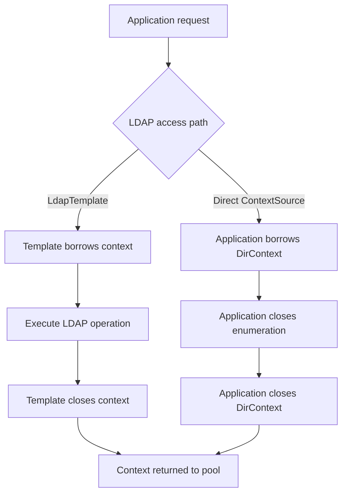
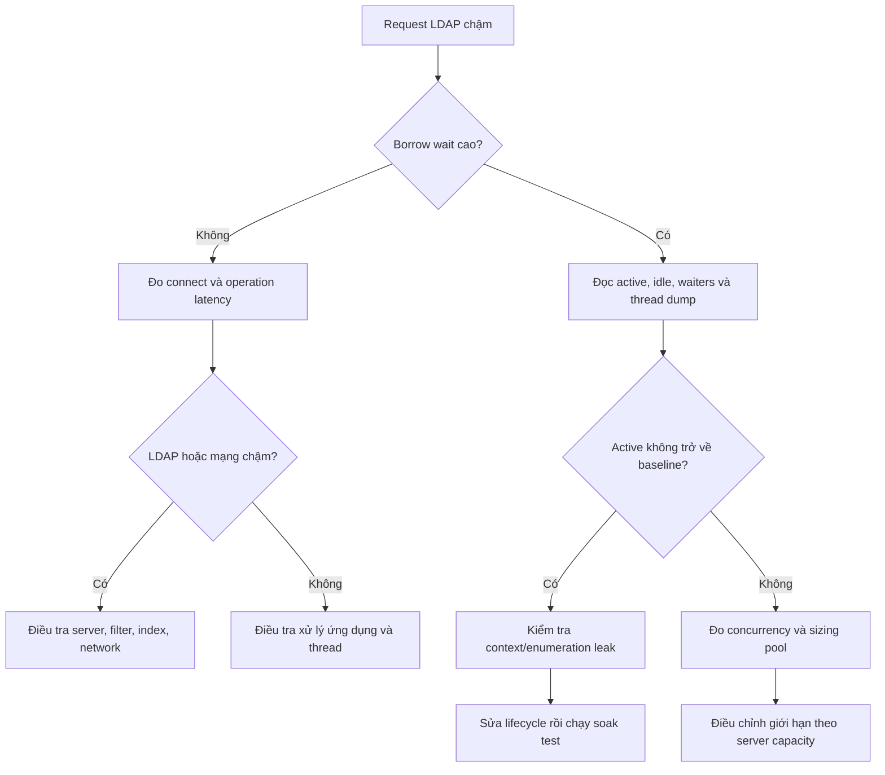

# Cạn pool, context không được đóng hoặc thời gian chờ tăng

Khi ứng dụng Spring Data LDAP bắt đầu chậm, request có thể phải chờ lâu trước khi truy vấn directory được thực hiện. Một nguyên nhân thường gặp là connection pool không còn context khả dụng. Tình trạng này có thể xuất phát từ việc code mượn `DirContext` nhưng không đóng, truy vấn LDAP kéo dài, pool quá nhỏ so với tải hoặc máy chủ LDAP phản hồi chậm.

Các nguyên nhân trên tạo ra biểu hiện gần giống nhau: số context đang được mượn tăng, số context rảnh giảm và request chờ lâu hơn. Cách xử lý đúng bắt đầu từ việc xác định context đang bị giữ ở đâu và trong bao lâu. Tăng giới hạn pool khi chưa hiểu nguyên nhân có thể chỉ chuyển áp lực sang LDAP server hoặc che giấu lỗi vòng đời tài nguyên.

## ContextSource, DirContext và pool

Trong Spring LDAP, `ContextSource` là factory cung cấp LDAP context. Ứng dụng thường khai báo một bean `ContextSource` dùng chung; bean này không phải một kết nối đang được giữ. Mỗi lần gọi `getReadOnlyContext()` hoặc `getReadWriteContext()`, ứng dụng nhận một `DirContext` để thực hiện thao tác LDAP. Khi dùng pooling, context được mượn từ pool và `close()` trên context wrapper sẽ trả nó về pool.

`DirContext` là tài nguyên có vòng đời. Mọi context được lấy trực tiếp từ `ContextSource` phải được đóng trong mọi nhánh thực thi, kể cả khi truy vấn ném exception hoặc code dừng duyệt kết quả sớm. Không lưu context vào field singleton, không chia sẻ một context đang được mượn giữa nhiều thread và không giả định garbage collector sẽ trả context về pool đúng lúc.

`LdapTemplate` quản lý việc lấy và giải phóng context cho các thao tác thông thường của nó. Khi dùng API tìm kiếm trả về danh sách hoặc mapper, template xử lý enumeration trong phạm vi thao tác. Rủi ro tăng lên khi ứng dụng tự lấy `DirContext`, tự gọi JNDI, hoặc giữ tài nguyên trong callback quá lâu. Không lấy context trực tiếp nếu thao tác tương đương đã được `LdapTemplate` hỗ trợ.



Pool thường quản lý các context theo nhóm truy cập hoặc thông tin xác thực. Một số cấu hình có pool riêng cho thao tác đọc và ghi. Vì vậy, hãy đo và chẩn đoán từng pool riêng; pool đọc còn chỗ không có nghĩa pool ghi cũng còn chỗ.

## Nhận diện dấu hiệu cạn pool

Các triệu chứng thường thấy gồm:

- Request LDAP tăng latency hoặc timeout trong khi các request không dùng LDAP vẫn bình thường.
- Số context đang mượn (`active`) tiến sát giới hạn tối đa (`maxTotal` hoặc giới hạn tương đương).
- Số context rảnh (`idle`) về 0 và số thread đang chờ mượn context (`waiters`) tăng.
- Thời gian chờ mượn context tăng trước khi thời gian thực hiện truy vấn LDAP bắt đầu.
- Khi tải giảm, pool không trở lại trạng thái nền nếu context bị giữ hoặc bị rò rỉ.

Tên metric và API đọc số liệu phụ thuộc phiên bản Spring LDAP và thư viện pool nền. Hãy bọc pool bằng metric adapter hoặc dùng JMX/Micrometer mà phiên bản hiện tại hỗ trợ; đừng giả định mọi bản đều có cùng tên getter. Tối thiểu cần thu thập:

| Nhóm | Số liệu | Ý nghĩa |
|---|---|---|
| Pool | Active, idle, max, waiters | Cho biết pool có đang chạm giới hạn hay không. |
| Mượn/trả | Borrow count, return count, borrow wait duration | Phân biệt thời gian chờ lấy context với thời gian thao tác. |
| Vòng đời | Create/destroy count, validation failure | Phát hiện connection churn hoặc context không còn hợp lệ. |
| LDAP operation | Latency theo loại thao tác, timeout, result code | Cho biết truy vấn hoặc server đang chậm ở đâu. |
| Ứng dụng | Request concurrency, thread pool, queue depth | Đối chiếu lượng công việc đang tạo nhu cầu context. |

Không gắn DN, username, email hoặc filter LDAP vào metric label. Những nhãn có cardinality cao vừa làm hệ thống metric phình to vừa có thể tiết lộ dữ liệu cá nhân.

## Phân biệt context leak, pool nhỏ và LDAP chậm

Không thể kết luận có rò rỉ chỉ từ một ảnh chụp `active = max`. Cần xem diễn biến theo thời gian, thời gian giữ context và stack trace của thread.

| Dấu hiệu | Context leak | Pool quá nhỏ | LDAP hoặc mạng chậm |
|---|---|---|---|
| Active context | Tăng dần và không giảm về mức nền sau khi tải dừng | Chạm trần trong giờ cao điểm, sau đó giảm khi request hoàn tất | Cao trong lúc thao tác bị giữ lâu; thường giảm khi server hồi phục |
| Idle context | Thường giảm về 0 và duy trì thấp | Giảm về 0 trong đợt tải, tăng lại sau đợt tải | Có thể giảm khi nhiều truy vấn cùng chờ server |
| Waiters | Tăng dần, có thể kéo dài ngay cả sau khi tải giảm | Tăng theo đỉnh concurrency | Tăng đồng thời với latency LDAP hoặc timeout |
| Thời gian giữ context | Có context tồn tại lâu bất thường hoặc không có đường trả về | Từng thao tác ngắn nhưng tổng concurrency vượt dung lượng | Thời gian operation cao, có thể kèm socket read/connect wait |
| Bằng chứng chính | Đường code mượn không đóng; active không trở về baseline | Tải đo được vượt mức pool đã cấu hình | Thread chờ I/O, server metric hoặc network latency tăng |

Một phép kiểm tra hữu ích là quan sát pool sau khi ngừng tạo request mới. Nếu active vẫn cao trong thời gian dài và không có thao tác LDAP đang chạy tương ứng, hãy ưu tiên tìm context bị giữ. Nếu active trở về baseline, xem xét pool sizing hoặc thời gian truy vấn. Nếu active chỉ giảm sau khi LDAP server phục hồi, điều tra latency phía server và mạng.

## Kiểm tra vòng đời trong code

Với các thao tác chuẩn, ưu tiên `LdapTemplate` và để template quản lý context:

```java
List<Person> people = ldapTemplate.search(
        query().where("objectClass").is("person"),
        (AttributesMapper<Person>) attributes -> new Person(
                (String) attributes.get("uid").get(),
                (String) attributes.get("cn").get()));
```

Ví dụ minh họa việc dùng search API để nhận kết quả đã ánh xạ. Tên import và kiểu query builder cần khớp phiên bản Spring LDAP trong dự án. Không giữ một `DirContext` chỉ để thực hiện một thao tác mà `LdapTemplate` đã hỗ trợ.

Nếu cần gọi JNDI trực tiếp, đóng cả `NamingEnumeration` và `DirContext`. Đóng enumeration quan trọng vì nó có thể giữ tài nguyên tìm kiếm cho tới khi duyệt xong hoặc đóng rõ ràng:

```java
DirContext context = contextSource.getReadOnlyContext();
try {
    NamingEnumeration<SearchResult> results = null;
    try {
        results = context.search(baseDn, filter, searchControls);
        while (results.hasMore()) {
            SearchResult result = results.next();
            process(result);
        }
    } finally {
        if (results != null) {
            results.close();
        }
    }
} finally {
    context.close();
}
```

Đoạn code cho thấy thứ tự đóng tài nguyên. Trong code production, cần giữ nguyên exception chính và gắn lỗi khi đóng enumeration/context dưới dạng suppressed exception hoặc ghi nhận theo chính sách lỗi tài nguyên; không để lỗi cleanup vô tình che mất nguyên nhân truy vấn thất bại. Nếu vòng lặp dừng sớm, `finally` vẫn phải đóng enumeration và context.

Các lỗi vòng đời thường gặp:

- Gọi `ContextSource.getReadOnlyContext()` nhưng chỉ đóng context khi thành công.
- Không đóng `NamingEnumeration` khi chỉ đọc một phần kết quả hoặc khi mapper ném exception.
- Tạo `DirContext` trong field để tái sử dụng giữa nhiều request.
- Truyền context ra ngoài callback rồi sử dụng sau khi callback kết thúc.
- Mở context thứ hai bên trong khi vẫn giữ context thứ nhất, khiến pool nhỏ bị cạn do mượn lồng nhau.
- Bắt `NamingException` rồi bỏ qua mà không đóng tài nguyên.
- Đóng `ContextSource` hoặc pool dùng chung sau từng request thay vì để Spring quản lý lifecycle của bean.

## Phân tích thread dump và thời gian chờ

Khi pool cạn, lấy nhiều thread dump cách nhau vài giây trong cùng khoảng sự cố. Một thread dump đơn lẻ chỉ là ảnh chụp và có thể bỏ lỡ vị trí đang chờ.

- Thread nằm trong đường gọi mượn object từ pool thường đang chờ một context được trả về hoặc chờ tới `maxWait`.
- Thread đang ở socket read hoặc LDAP client I/O có thể đang giữ context trong khi server phản hồi chậm.
- Thread giữ một context rồi chờ mượn context thứ hai có thể tạo starvation hoặc deadlock khi pool quá nhỏ.
- Thread bị chặn bởi application lock hoặc xử lý nghiệp vụ dài trong lúc giữ context cho thấy phạm vi mượn context rộng hơn cần thiết.

Đối chiếu stack trace với metric active/idle/waiters và operation latency. Nếu có thể, instrument thời điểm borrow và return cùng một operation ID ngẫu nhiên, tên pool và thời lượng lease. Không log DN hoặc credential trong thông tin lease. Các lease vượt ngưỡng có thể được cảnh báo và điều tra theo thread name hoặc trace ID.

## Phân biệt các loại timeout

Không phải mọi timeout đều có cùng nguyên nhân. Một request có thể chờ ở nhiều tầng:

| Timeout | Thời điểm xảy ra | Câu hỏi chẩn đoán |
|---|---|---|
| Pool borrow wait | Trước khi có context | Pool đã hết context hay context chưa được trả? |
| Connect timeout | Khi mở kết nối tới LDAP server | DNS, route, TLS handshake hoặc server accept có chậm không? |
| Read/socket timeout | Trong lúc chờ LDAP server trả dữ liệu | Server có đang xử lý truy vấn lâu hoặc mạng bị gián đoạn? |
| Search time limit | Server giới hạn thời gian xử lý search | Filter có chọn lọc, index và scope có phù hợp không? |
| Application deadline | Request tổng thể vượt thời gian cho phép | Tổng thời gian pool wait, kết nối, LDAP và xử lý ứng dụng là bao nhiêu? |

Đặt timeout hữu hạn và nhất quán. Pool wait không nên dài hơn deadline còn lại của request. Connect/read/search timeout cần được lựa chọn theo SLA và đặc tính truy vấn. Khi một request retry, tổng thời gian của các lần retry phải nằm trong deadline; retry dồn dập khi pool đã cạn sẽ làm tăng thêm contention.

## Định cỡ pool theo tải thực tế

Pool cần đủ cho concurrency thực tế nhưng vẫn nằm trong giới hạn mà LDAP server chịu được. Một ước lượng ban đầu có thể dùng định luật Little: số context đang được giữ trung bình xấp xỉ throughput thao tác mỗi giây nhân với thời gian giữ context trung bình tính bằng giây.

Ví dụ, nếu một directory xử lý trung bình 40 thao tác mỗi giây và mỗi thao tác giữ context khoảng 0,1 giây, nhu cầu trung bình khoảng 4 context. Đỉnh tải, phân bố latency, thao tác dài và headroom cần được đo bằng load test trước khi chọn giới hạn tối đa. Giá trị trung bình không đủ để quyết định max pool.

Khi điều chỉnh, hãy cân nhắc:

- Giới hạn kết nối và tài nguyên của LDAP server, proxy hoặc load balancer.
- Số instance ứng dụng nhân với kích thước pool trên mỗi instance; tổng kết nối mới là áp lực thực lên directory.
- Pool đọc và ghi riêng nếu cấu hình sử dụng hai loại context.
- Tài khoản bind và chính sách quyền; không dùng context đã xác thực cho một principal khác.
- Thời gian giữ context, số request đồng thời, burst traffic và các thao tác search dài.
- Số kết nối dự phòng cho health check, quản trị và dịch vụ khác.

Không tăng `maxTotal` chỉ vì `waiters` tăng. Nếu context bị rò rỉ, giới hạn lớn hơn chỉ trì hoãn thời điểm cạn pool. Nếu server đã đạt giới hạn connection hoặc CPU, pool lớn hơn có thể làm latency và lỗi nặng hơn.

## Validation và connection churn

Pool có thể kiểm tra context trước hoặc sau khi mượn để phát hiện kết nối đã chết. Validation quá thường xuyên làm tăng round trip tới LDAP server; validation quá lỏng có thể khiến request nhận context đã mất kết nối. Cần theo dõi validation failure, số context tạo/hủy, idle eviction và lỗi bind.

Nếu số context tạo/hủy tăng mạnh trong khi active không ổn định, kiểm tra:

- LDAP server hoặc load balancer đóng connection sau idle timeout.
- Idle eviction và validation interval không phù hợp với timeout của hạ tầng.
- Test-on-borrow hoặc test-while-idle tạo thêm tải đáng kể.
- Context bị hủy sau lỗi mạng nhưng pool liên tục tạo context mới.
- Thông tin xác thực thay đổi hoặc bind thất bại khiến pool không thể duy trì context.

Điều chỉnh validator và eviction theo phiên bản pool thực tế. Đừng sao chép cấu hình property từ một thế hệ Apache Commons Pool sang thế hệ khác mà không kiểm tra API đang dùng.

## Quy trình chẩn đoán khi request bắt đầu chậm

Thực hiện theo thứ tự để khoanh vùng nguyên nhân:

1. Ghi lại thời điểm, correlation ID đã làm sạch, tên directory logic và loại thao tác gặp chậm.
2. Chụp active, idle, max, waiters và borrow wait duration cho từng pool.
3. Tách thời gian chờ mượn context khỏi thời gian connect, search và xử lý kết quả.
4. Lấy nhiều thread dump; phân loại thread đang chờ pool, chờ socket, xử lý kết quả hay giữ lock ứng dụng.
5. Tìm đường code gọi trực tiếp `ContextSource`, JNDI hoặc callback có thời gian sống dài; xác minh mọi enumeration và context được đóng ở `finally`.
6. Kiểm tra LDAP server: connection count, bind/search latency, CPU, giới hạn kết nối, index và lỗi backend.
7. Giảm hoặc dừng tải thử nghiệm rồi quan sát active có trở về baseline hay không.
8. Chỉ sau khi xác nhận không có leak mới thử điều chỉnh pool size, validation hoặc timeout bằng load test có kiểm soát.



## Kiểm thử và xác nhận bản sửa

Kiểm thử cần bao phủ cả việc giải phóng context và hành vi pool dưới tải:

| Kiểm thử | Cách thực hiện | Kết quả mong đợi |
|---|---|---|
| Đóng context khi thành công | Thực hiện thao tác LDAP bình thường | Active giảm sau khi thao tác hoàn tất. |
| Đóng context khi lỗi | Cho mapper hoặc callback ném exception | Context và enumeration vẫn được đóng. |
| Dừng search sớm | Chỉ đọc một phần kết quả rồi thoát | Enumeration được đóng và context được trả về. |
| Pool exhaustion có kiểm soát | Giữ context tới giới hạn rồi tạo request khác | Request chờ không vượt max wait; metric waiters tăng và trở lại bình thường sau khi trả context. |
| Soak test | Chạy tải ổn định đủ lâu và theo dõi active/idle | Không có xu hướng active tăng dần; pool trở về baseline sau khi tải dừng. |
| LDAP server restart | Ngắt rồi khôi phục server trong môi trường test | Validator phát hiện context lỗi và pool phục hồi theo cấu hình. |
| Tải đọc/ghi hỗn hợp | Tạo concurrency trên cả hai loại thao tác | Không có một pool bị đói tài nguyên mà không được phát hiện. |

Một bài test leak không nên chỉ kiểm tra request trả về thành công. Hãy đo active trước và sau, lặp đủ nhiều lần để phát hiện xu hướng tăng, đồng thời xác minh pool có thể tiếp tục phục vụ request mới. Với test dùng context giả lập, đặt expectation rằng `close()` được gọi đúng một lần trong cả nhánh thành công và lỗi.

## Vận hành an toàn

- Cảnh báo khi active gần max trong một khoảng thời gian, waiters tăng hoặc borrow wait vượt ngưỡng SLA.
- Cảnh báo riêng cho pool đọc và ghi; hiển thị tên directory logic thay vì DN hoặc bind DN.
- Theo dõi lease duration và operation duration bằng histogram, không dùng giá trị cá nhân làm nhãn.
- Giới hạn timeout và retry để request không giữ thread chờ vô hạn.
- Có runbook thu thập metric, thread dump và server health trước khi tăng pool.
- Không log mật khẩu, access token, raw DN, filter hoặc toàn bộ exception message trong quá trình chẩn đoán.
- Khi cần restart pool hoặc ứng dụng, thực hiện theo quy trình vận hành có kiểm soát; restart chỉ giải phóng tình trạng tạm thời và không sửa được code đang rò rỉ context.

## Checklist kết thúc điều tra

- [ ] Đã đo active, idle, max, waiters và thời gian borrow cho từng pool.
- [ ] Đã tách borrow wait khỏi connect, read và search latency.
- [ ] Đã lấy thread dump trong lúc sự cố và xác định nhóm thread đang chờ.
- [ ] Đã kiểm tra mọi `DirContext` và `NamingEnumeration` được tạo trực tiếp.
- [ ] Đã xác minh đường lỗi, dừng sớm và timeout vẫn đóng tài nguyên.
- [ ] Đã đối chiếu pool metrics với connection/latency phía LDAP server.
- [ ] Đã load test sau khi sửa lifecycle hoặc sizing.
- [ ] Active trở về baseline sau khi dừng tải và không có xu hướng tăng qua soak test.
- [ ] Log và metric không chứa DN, username, email hoặc credential.

Cạn pool là triệu chứng. Bằng chứng về thời gian borrow, thời gian giữ context, thread dump và sức khỏe LDAP server mới chỉ ra nguyên nhân. Khi vòng đời context được quản lý đúng và pool được định cỡ theo tải đo được, hệ thống sẽ tránh được cả rò rỉ tài nguyên lẫn việc mở quá nhiều kết nối gây áp lực lên directory.
