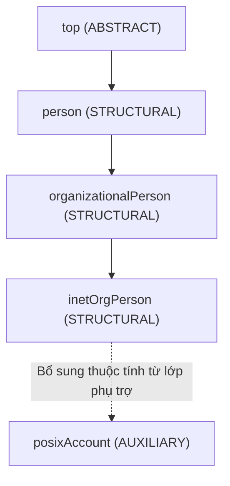

# Object class cấu trúc, phụ trợ và trừu tượng

## Mục tiêu bài học

Trong LDAP, một **entry** không phải tập thuộc tính tùy ý. Mỗi entry phải tuân theo **schema** của directory: những loại đối tượng nào được phép tồn tại, thuộc tính nào bắt buộc, thuộc tính nào tùy chọn và các lớp đối tượng liên hệ với nhau ra sao. **Object class** là thành phần quan trọng để mô tả những quy tắc đó.

Trong module **SPRING_DATA_LDAP**, Spring Data LDAP giúp ánh xạ entry phân cấp thành đối tượng Java và truy vấn bằng repository hoặc **LdapTemplate**. Tuy nhiên, lớp Java có hợp lệ đến đâu cũng không thay thế kiểm tra schema của LDAP server. Khi tạo hoặc cập nhật entry, server vẫn quyết định tổ hợp **objectClass** và thuộc tính có hợp lệ hay không.

Sau bài này, bạn có thể:

- Phân biệt ba loại object class: **ABSTRACT** (trừu tượng), **STRUCTURAL** (cấu trúc) và **AUXILIARY** (phụ trợ).
- Đọc sơ đồ kế thừa object class, hiểu quy tắc **một chuỗi lớp cấu trúc** cho mỗi entry.
- Phân biệt thuộc tính bắt buộc **MUST** và thuộc tính cho phép **MAY**, kể cả các thuộc tính kế thừa.
- Thiết kế entry LDAP hợp lệ, giải thích các lỗi schema điển hình.
- Ánh xạ object class sang Java bằng Spring Data LDAP, tạo entry qua LdapTemplate, và kiểm thử với directory có schema thật.

## 1. Object class là gì?

LDAP tổ chức dữ liệu thành cây entry, mỗi entry có **distinguished name (DN)** xác định vị trí của nó. Ví dụ, một nhân viên có DN:

```text
uid=an,ou=people,dc=example,dc=org
```

**objectClass** là một thuộc tính LDAP đa giá trị. Những giá trị của nó cho biết entry thuộc các lớp đối tượng nào. Schema mô tả từng lớp bằng tên/OID, lớp cha, loại lớp, tập thuộc tính **MUST** và **MAY**.

Một entry điển hình theo schema **inetOrgPerson**:

```ldif
dn: uid=an,ou=people,dc=example,dc=org
objectClass: top
objectClass: person
objectClass: organizationalPerson
objectClass: inetOrgPerson
uid: an
cn: An Tran
sn: Tran
mail: an@example.org
```

Ở đây:

- **dn** định danh và đặt entry tại nhánh **ou=people**.
- **objectClass** khai báo các lớp của entry.
- **cn** (common name), **sn** (surname), **uid** và **mail** là các thuộc tính dữ liệu, được schema của những lớp đã khai báo cho phép.
- **top**, **person**, **organizationalPerson**, **inetOrgPerson** cùng xuất hiện nhưng chúng **không** phải bốn cấu trúc độc lập; các lớp này tạo thành một chuỗi kế thừa hợp lệ.

Đừng nhầm lẫn **objectClass** với tên class Java. Ví dụ Java class `Employee` có thể ánh xạ sang LDAP object class `inetOrgPerson`; việc đặt tên `Employee` không tự tạo ra định nghĩa `employee` trong LDAP schema.

### Các thành phần của định nghĩa object class

Một khai báo schema có dạng khái niệm sau (lược bỏ một số chi tiết):

```text
objectClasses: (
  2.5.6.6
  NAME 'person'
  SUP top
  STRUCTURAL
  MUST ( sn $ cn )
  MAY ( userPassword $ telephoneNumber $ seeAlso $ description )
)
```

| Thành phần | Ý nghĩa |
| --- | --- |
| **OID** (`2.5.6.6`) | Định danh duy nhất của định nghĩa class trong schema |
| **NAME** (`person`) | Tên dễ đọc của object class |
| **SUP** (`top`) | Lớp cha, từ đó kế thừa quy tắc/thuộc tính |
| **ABSTRACT / STRUCTURAL / AUXILIARY** | Phân loại object class |
| **MUST** | Những thuộc tính bắt buộc để entry đáp ứng class đó |
| **MAY** | Những thuộc tính được phép có, nhưng không bắt buộc |

Một class có thể kế thừa các thuộc tính bắt buộc/tùy chọn của lớp cha. Schema cũng có **attribute type** quy định cú pháp, quy tắc so khớp, số lượng giá trị và các hạn chế khác: đưa thuộc tính vào `MAY` không có nghĩa mọi chuỗi bất kỳ đều là giá trị hợp lệ.

## 2. Ba loại object class

| Loại | Vai trò | Có thể làm lớp cấu trúc chính của entry? | Ví dụ |
| --- | --- | --- | --- |
| **ABSTRACT** | Cung cấp lớp nền và quy tắc chung cho lớp con | **Không**; chỉ có lớp trừu tượng không đủ tạo entry thông thường | `top` |
| **STRUCTURAL** | Xác định loại entry cốt lõi; các lớp cấu trúc trong một entry phải cùng chuỗi kế thừa | **Có** | `person`, `organizationalPerson`, `inetOrgPerson`, `organizationalUnit` |
| **AUXILIARY** | Bổ sung tập thuộc tính/chức năng cho một entry đã có lớp cấu trúc | **Không**; cần một lớp cấu trúc đi kèm | `posixAccount` khi directory có schema RFC 2307 |

### 2.1. ABSTRACT: nền tảng để kế thừa

**ABSTRACT** mô tả các đặc điểm chung mà các loại class khác kế thừa. Lớp trừu tượng nổi bật nhất là **`top`**, tổ tiên của nhiều class trong LDAP schema.

**`top` không đại diện cho một kiểu người, nhóm hay đơn vị tổ chức cụ thể.** Entry chỉ khai báo `objectClass: top` mà không có lớp cấu trúc phù hợp sẽ không đáp ứng yêu cầu schema thông thường.

Một số ý quan trọng:

- Class trừu tượng không phải đối tượng để khởi tạo độc lập như một loại entry cụ thể.
- ABSTRACT có thể là lớp cha của các loại class khác; ý nghĩa kế thừa được xác định bởi **SUP**.
- `top` thường xuất hiện trong danh sách `objectClass` của entry thực tế, nhưng class xác định loại entry cốt lõi vẫn là một **STRUCTURAL** class.

### 2.2. STRUCTURAL: xác định bản chất entry

**STRUCTURAL** cho biết entry là người, đơn vị tổ chức, nhóm hoặc một cấu trúc LDAP khác. Các class cấu trúc có thể kế thừa nhau:



Ví dụ:

- `person` là STRUCTURAL, kế thừa `top`.
- `organizationalPerson` là STRUCTURAL, kế thừa `person`.
- `inetOrgPerson` là STRUCTURAL, kế thừa `organizationalPerson`.

Một entry có thể liệt kê cả ba class STRUCTURAL trên vì **chúng cùng nằm trên một chuỗi kế thừa**. Trong ví dụ nhân viên An, class cấu trúc cụ thể nhất là **`inetOrgPerson`**.

**Quy tắc cốt lõi:** một entry phải có **một chuỗi kế thừa STRUCTURAL hợp lệ**. Điều này khác với câu nói thiếu chính xác “mỗi entry chỉ được có một giá trị objectClass thuộc loại STRUCTURAL”.

Ví dụ **không hợp lệ** là một entry đồng thời khai báo `person` và `organizationalUnit` nếu hai class này thuộc hai nhánh STRUCTURAL không có quan hệ cha–con. Chúng đại diện cho hai loại entry cốt lõi khác nhau.

Nhiều server quản lý thêm thuộc tính vận hành **`structuralObjectClass`** để lưu class cấu trúc cụ thể nhất. Thuộc tính đó thường được server tính và bảo vệ, không nên tự ghi như thuộc tính nghiệp vụ.

### 2.3. AUXILIARY: bổ sung thuộc tính/chức năng

**AUXILIARY** mở rộng khả năng của một entry đã có STRUCTURAL class. Ví dụ, tài khoản nhân viên dùng `inetOrgPerson` để lưu dữ liệu liên hệ, đồng thời dùng **`posixAccount`** để lưu thông tin tài khoản kiểu POSIX/Unix.

```ldif
dn: uid=an,ou=people,dc=example,dc=org
objectClass: top
objectClass: person
objectClass: organizationalPerson
objectClass: inetOrgPerson
objectClass: posixAccount
uid: an
cn: An Tran
sn: Tran
mail: an@example.org
uidNumber: 12001
gidNumber: 10001
homeDirectory: /home/an
```

Trong ví dụ này:

- **`inetOrgPerson`** vẫn là class STRUCTURAL cụ thể nhất.
- **`posixAccount`** là class AUXILIARY (theo schema RFC 2307 thông dụng), cung cấp thêm các thuộc tính cần cho tài khoản POSIX.
- **`cn`**, **`uid`**, **`uidNumber`**, **`gidNumber`**, **`homeDirectory`** là các thuộc tính bắt buộc của `posixAccount` theo định nghĩa đó; một số thuộc tính có thể đồng thời được các class khác cho phép.

Ví dụ chỉ chạy được nếu directory **đã nạp/cho phép schema chứa `posixAccount`**. Một số directory có schema khác hoặc chính sách **DIT content rule** giới hạn AUXILIARY class nào được gắn với STRUCTURAL class nào. Việc `posixAccount` là AUXILIARY không có nghĩa có thể gắn nó với mọi entry trên mọi server.

**AUXILIARY không thay thế STRUCTURAL.** Nếu một entry chỉ khai báo `top` và `posixAccount`, nó thiếu lớp cấu trúc thực sự và không phải mô hình hợp lệ cho tài khoản trong ví dụ này.

## 3. Đọc quy tắc kế thừa và MUST/MAY

Khi quyết định entry hợp lệ hay không, hãy bắt đầu từ **STRUCTURAL class cụ thể nhất**, đi ngược lên các lớp cha, rồi xét thêm toàn bộ **AUXILIARY class**.

| Class | Loại | Kế thừa | Ý nghĩa tiêu biểu |
| --- | --- | --- | --- |
| `top` | ABSTRACT | Không có lớp cha | Nền tảng của chuỗi object class |
| `person` | STRUCTURAL | `top` | Yêu cầu `cn` và `sn` |
| `organizationalPerson` | STRUCTURAL | `person` | Mở rộng thông tin người trong tổ chức |
| `inetOrgPerson` | STRUCTURAL | `organizationalPerson` | Bổ sung khả năng biểu diễn hồ sơ Internet, ví dụ `uid`, `mail` |
| `posixAccount` | AUXILIARY | `top` | Bổ sung thông tin tài khoản POSIX như `uidNumber`, `gidNumber`, `homeDirectory` |

Với entry `inetOrgPerson`:

1. Kế thừa từ `organizationalPerson` và `person`, do đó **`cn` và `sn` vẫn bắt buộc**.
2. Các thuộc tính như `mail` hoặc `uid` có thể dùng khi schema tương ứng cho phép, nhưng **không vì thế mà thành MUST của `inetOrgPerson`**.
3. Nếu thêm `posixAccount`, tập MUST được mở rộng. Ví dụ **`uidNumber`**, **`gidNumber`** và **`homeDirectory`** trở thành cần thiết dù trước đó chỉ có `inetOrgPerson` thì không.
4. Các quy định về cú pháp giá trị, tính duy nhất nếu có, RDN, DIT content rule và ACL vẫn có thể hạn chế thao tác.

**MUST** nghĩa là một entry có class đó phải có thuộc tính theo quy tắc schema. **MAY** nghĩa là schema cho phép thuộc tính, không phải người dùng được quyền sửa thuộc tính ấy. **ACL** là lớp kiểm soát quyền độc lập với định nghĩa object class.

Một số LDAP server áp dụng thêm chính sách riêng, chẳng hạn ràng buộc tên, uniqueness overlay hoặc matching rule; không suy ra những chính sách này chỉ từ `MUST/MAY`.

### 3.1. Ba entry để so sánh

<details>
<summary>Entry A — hợp lệ theo schema người dùng cơ bản</summary>

```ldif
dn: uid=an,ou=people,dc=example,dc=org
objectClass: top
objectClass: person
objectClass: organizationalPerson
objectClass: inetOrgPerson
uid: an
cn: An Tran
sn: Tran
```

Chuỗi STRUCTURAL hợp lệ; `cn` và `sn` có mặt. `mail` không bắt buộc.
</details>

<details>
<summary>Entry B — sai vì thiếu thuộc tính bắt buộc</summary>

```ldif
dn: cn=An Tran,ou=people,dc=example,dc=org
objectClass: top
objectClass: person
cn: An Tran
```

Entry có `person` nhưng thiếu **`sn`**; directory thường trả lỗi vi phạm object class.
</details>

<details>
<summary>Entry C — sai vì hai lớp cấu trúc không cùng nhánh</summary>

```ldif
dn: cn=An Tran,ou=people,dc=example,dc=org
objectClass: top
objectClass: person
objectClass: organizationalUnit
cn: An Tran
sn: Tran
ou: people
```

`person` và `organizationalUnit` đều là STRUCTURAL nhưng không thuộc cùng chuỗi kế thừa. Việc bổ sung đủ `cn`, `sn`, `ou` không làm tổ hợp class này trở thành hợp lệ.
</details>

> **Lưu ý:** Các ví dụ giả định nhánh `ou=people,dc=example,dc=org` tồn tại, server có schema chuẩn tương ứng và tài khoản thao tác đủ quyền. Nếu nhánh cha chưa tồn tại, bạn có thể gặp `noSuchObject` trước khi kiểm tra đến các vấn đề schema.

## 4. Quy tắc đặt tên DN, objectClass và attribute type

Để đọc một entry đúng, cần phân biệt ba nhóm thông tin:

| Thành phần | Ví dụ | Trả lời câu hỏi |
| --- | --- | --- |
| **DN / RDN** | `uid=an,ou=people,dc=example,dc=org` | Entry nằm ở đâu và có tên gì? |
| **objectClass** | `inetOrgPerson`, `posixAccount` | Entry thuộc loại nào, được yêu cầu/cho phép những thuộc tính gì? |
| **attribute type** | `uid`, `cn`, `sn`, `mail`, `uidNumber` | Thuộc tính có cú pháp, matching rule và số giá trị thế nào? |

Một DN đặt trong nhánh `ou=people` **không tự động biến entry thành `person`**. Tương tự, Java code có trường `mail` không bảo đảm server chấp nhận `mail`: class khai báo hoặc quy tắc schema liên quan phải cho phép thuộc tính đó.

RDN như `uid=an` còn phải phù hợp với thông tin entry và quy tắc đặt tên của directory. Tùy schema, object class và cấu hình server, RDN hoặc parent có thể bị ràng buộc bởi **name form** và **DIT structure rule**.

## 5. Liên hệ với Spring Data LDAP: ánh xạ entry sang đối tượng Java

Với **Spring Data LDAP**, một Java class có thể được ánh xạ bằng **`@Entry`**, **`@Id`**, **`@Attribute`**. Trong ví dụ dưới đây, người dùng có một chuỗi class STRUCTURAL hợp lệ:

```java
package org.example.directory;

import javax.naming.Name;

import org.springframework.ldap.odm.annotations.Attribute;
import org.springframework.ldap.odm.annotations.Entry;
import org.springframework.ldap.odm.annotations.Id;

@Entry(
    base = "ou=people",
    objectClasses = {
        "top", "person", "organizationalPerson", "inetOrgPerson"
    }
)
public class PersonEntry {
    @Id
    private Name dn;

    @Attribute(name = "uid")
    private String uid;

    @Attribute(name = "cn")
    private String fullName;

    @Attribute(name = "sn")
    private String surname;

    @Attribute(name = "mail")
    private String email;

    public PersonEntry() {}

    public Name getDn() { return dn; }
    public void setDn(Name dn) { this.dn = dn; }
    public String getUid() { return uid; }
    public void setUid(String uid) { this.uid = uid; }
    public String getFullName() { return fullName; }
    public void setFullName(String fullName) { this.fullName = fullName; }
    public String getSurname() { return surname; }
    public void setSurname(String surname) { this.surname = surname; }
    public String getEmail() { return email; }
    public void setEmail(String email) { this.email = email; }
}
```

Repository truy cập dữ liệu có thể khai báo:

```java
package org.example.directory;

import org.springframework.data.ldap.repository.LdapRepository;

public interface PersonRepository extends LdapRepository<PersonEntry> {
}
```

Giả sử Spring Boot đã cấu hình LDAP base `dc=example,dc=org`, trường `dn` cần được đặt đúng với cách ánh xạ DN của dự án. Ví dụ tạo DN bằng API cấu trúc:

```java
import javax.naming.Name;
import org.springframework.ldap.support.LdapNameBuilder;

Name dn = LdapNameBuilder.newInstance("ou=people")
    .add("uid", "an")
    .build();
```

Khi lưu, thư viện thực hiện ánh xạ Java ↔ LDAP theo annotation; **LDAP server** mới là nơi áp dụng schema. Nếu `surname` bị bỏ trống và dẫn đến thiếu `sn`, hoặc class không có trong schema server, thao tác ghi vẫn có thể bị từ chối.

Khi dùng thêm **AUXILIARY** class như `posixAccount`, phải điều chỉnh danh sách class, các thuộc tính ánh xạ và dữ liệu bắt buộc tương ứng. Không nên thêm `posixAccount` vào annotation chỉ để có thêm một thuộc tính nếu chưa hiểu yêu cầu `uidNumber/gidNumber/homeDirectory` và schema được cài trên server.

## 6. Tạo entry qua LdapTemplate và để schema kiểm tra

**LdapTemplate** thích hợp khi muốn điều khiển trực tiếp DN và các thuộc tính của entry, chẳng hạn nhập dữ liệu từ hệ thống khác. Đoạn service sau minh họa việc tạo entry `inetOrgPerson`:

```java
package org.example.directory;

import javax.naming.Name;
import javax.naming.directory.Attributes;
import javax.naming.directory.BasicAttribute;
import javax.naming.directory.BasicAttributes;

import org.springframework.ldap.core.LdapTemplate;
import org.springframework.ldap.support.LdapNameBuilder;
import org.springframework.stereotype.Service;

@Service
public class PersonWriter {
    private final LdapTemplate ldapTemplate;

    public PersonWriter(LdapTemplate ldapTemplate) {
        this.ldapTemplate = ldapTemplate;
    }

    public void createPerson(
            String uid, String commonName, String surname, String mail) {
        if (uid == null || !uid.matches("[a-zA-Z0-9._-]{1,64}")) {
            throw new IllegalArgumentException("uid không hợp lệ");
        }
        if (commonName == null || commonName.isBlank()
                || surname == null || surname.isBlank()) {
            throw new IllegalArgumentException("cn và sn là bắt buộc");
        }

        Name dn = LdapNameBuilder.newInstance("ou=people")
            .add("uid", uid)
            .build();

        Attributes attributes = new BasicAttributes(true);
        BasicAttribute classes = new BasicAttribute("objectClass");
        classes.add("top");
        classes.add("person");
        classes.add("organizationalPerson");
        classes.add("inetOrgPerson");
        attributes.put(classes);

        attributes.put("uid", uid);
        attributes.put("cn", commonName);
        attributes.put("sn", surname);
        if (mail != null && !mail.isBlank()) {
            attributes.put("mail", mail);
        }

        ldapTemplate.bind(dn, null, attributes);
    }
}
```

Đoạn code cho thấy hai mức kiểm tra:

1. **Ứng dụng** kiểm tra `uid`, `cn`, `sn` trước khi gửi để phản hồi lỗi đầu vào sớm. Dùng `LdapNameBuilder` để tạo RDN thay vì ghép chuỗi DN thủ công.
2. **LDAP server** kiểm tra class, cú pháp thuộc tính, quyền ghi, RDN và mọi quy tắc schema/ACL. Kiểm tra tại ứng dụng **không thể thay thế** bước này.

Nếu tạo nhóm kỹ thuật thay vì người dùng, nên chọn STRUCTURAL class phù hợp, chẳng hạn **`groupOfNames`** với `cn` và `member` bắt buộc (theo schema chuẩn), thay vì gắn thêm `groupOfNames` vào entry `inetOrgPerson`. Đây là hai loại entry cốt lõi khác nhau.

### 6.1. Truy vấn theo objectClass

Có thể dùng **LdapQueryBuilder** để tìm những entry được khai báo thuộc một class:

```java
import static org.springframework.ldap.query.LdapQueryBuilder.query;

import java.util.List;
import org.springframework.ldap.core.AttributesMapper;
import org.springframework.ldap.core.LdapTemplate;

List<String> fullNames = ldapTemplate.search(
    query().base("ou=people")
        .where("objectClass").is("inetOrgPerson"),
    (AttributesMapper<String>) attrs -> (String) attrs.get("cn").get()
);
```

Đoạn này được đặt trong nơi đã có biến `ldapTemplate`. Bộ lọc tương ứng với `(objectClass=inetOrgPerson)` và tìm dưới nhánh `ou=people`. Muốn tìm theo `uid` từ đầu vào người dùng, hãy dùng **`where("uid").is(uid)`** để framework escape giá trị filter đúng cách. Không ghép filter hoặc DN bằng chuỗi dữ liệu chưa kiểm soát.

Kết quả truy vấn theo objectClass phụ thuộc các class và quan hệ kế thừa thực tế trong schema; không nên suy ra rằng một filter bất kỳ có cùng cách xử lý trên mọi directory.

## 7. Thay đổi objectClass sau khi tạo entry

Các object class không phải nhãn tùy tiện có thể bật/tắt bất cứ lúc nào:

- **Bổ sung AUXILIARY:** có thể được phép nếu schema/DIT content rule chấp nhận và **tất cả MUST attribute mới** có mặt. Nên gửi bổ sung objectClass và các thuộc tính cần thiết trong cùng một LDAP Modify request khi phù hợp.
- **Bỏ AUXILIARY:** cần xét các thuộc tính chỉ được class đó cho phép. Giữ lại thuộc tính không còn được bất kỳ class nào cho phép có thể làm server từ chối.
- **Đổi STRUCTURAL class:** thường bị hạn chế rất chặt; một số server từ chối đổi loại structural của entry đã tồn tại, kể cả khi cố sửa `objectClass`. Không thiết kế chức năng “chuyển người thành organizationalUnit” chỉ bằng một lệnh modify.
- **ABSTRACT:** thường là thành phần của chuỗi kế thừa. Không có lý do nghiệp vụ để dùng `top` thay cho structural class thực.

Khi cần chuyển entry sang loại cấu trúc hoàn toàn khác, hãy thiết kế quy trình di chuyển/migrate có kiểm tra schema, dữ liệu, DN, tham chiếu và quyền truy cập. Rename DN không đồng nghĩa đổi structural object class.

Các thuộc tính vận hành như `structuralObjectClass` thường do server quản lý và có thể chỉ xuất hiện nếu yêu cầu đọc operational attributes; không cố ghi trực tiếp thuộc tính này.

## 8. Tra cứu schema thực tế trên LDAP server

Định nghĩa object class có thể khác nhau giữa OpenLDAP, Active Directory và các LDAP directory khác. Ngoài các class theo RFC, sản phẩm có thể có class riêng hoặc chính sách triển khai riêng. Khi gặp lỗi, ưu tiên xem **schema đang hoạt động trên server** thay vì chỉ xem một ví dụ trên Internet.

Nhiều directory công bố DN chứa schema qua thuộc tính vận hành **`subschemaSubentry`**. Ví dụ với công cụ `ldapsearch`:

```bash
# Truy vấn Root DSE để tìm DN chứa schema được công bố.
ldapsearch -LLL -x -H ldaps://ldap.example.org:636 \
  -D "uid=svc-read,ou=service-accounts,dc=example,dc=org" -W \
  -b "" -s base subschemaSubentry
```

Sau đó dùng chính DN trả về (ví dụ `cn=Subschema`, tùy server) để đọc định nghĩa:

```bash
ldapsearch -LLL -x -H ldaps://ldap.example.org:636 \
  -D "uid=svc-read,ou=service-accounts,dc=example,dc=org" -W \
  -b "cn=Subschema" -s base \
  "(objectClass=subschema)" objectClasses attributeTypes
```

Ở bước này cần chú ý:

- DN schema và quyền đọc operational attributes khác nhau giữa các server.
- **`objectClasses`** mô tả class; **`attributeTypes`** mô tả thuộc tính; có thể có thêm các quy tắc DIT liên quan.
- Server có thể không cho tài khoản ứng dụng đọc toàn bộ schema. Nhờ quản trị viên cung cấp định nghĩa đúng phiên bản nếu cần.
- Ví dụ dùng LDAPS; xác minh chứng chỉ/CA, không tắt TLS verification để chạy thử. Tham số `-W` yêu cầu nhập mật khẩu qua prompt.

Khi tích hợp với Active Directory, nhớ rằng **`objectCategory`** là khái niệm riêng của sản phẩm, không thể dùng như từ đồng nghĩa với ba loại `ABSTRACT/STRUCTURAL/AUXILIARY` của LDAP schema.

## 9. Lỗi schema thường gặp và cách chẩn đoán

| Hiện tượng | Nguyên nhân có thể | Cách kiểm tra |
| --- | --- | --- |
| `objectClassViolation (65)` khi thêm person | Thiếu `cn` hoặc `sn`; class/attribute không phù hợp | Tra `MUST/MAY` của class và các lớp cha |
| `objectClassViolation (65)` khi thêm `posixAccount` | Thiếu `uidNumber`, `gidNumber` hoặc `homeDirectory` | Xem `MUST` của AUXILIARY class và schema đã nạp |
| `objectClassViolation (65)` khi dùng hai STRUCTURAL class | Hai class cốt lõi không cùng chuỗi kế thừa | Kiểm tra `SUP` của từng class |
| `undefinedAttributeType (17)` | Thuộc tính chưa được định nghĩa trên server | Kiểm tra `attributeTypes` và cấu hình schema |
| `invalidAttributeSyntax (21)` hoặc `constraintViolation (19)` | Giá trị hoặc ràng buộc thuộc tính không hợp lệ | Xem cú pháp attribute type, kích thước và giới hạn server |
| `objectClassModsProhibited (69)` | Cố thay đổi structural object class theo cách server không cho phép | Tránh sửa loại entry trực tiếp; thiết kế migrate |
| `noSuchObject (32)` | DN hoặc nhánh cha chưa tồn tại | Kiểm tra DN, base DN và cấu trúc cây |
| `insufficientAccessRights (50)` | Bind account không được phép tạo/sửa entry | Kiểm tra ACL; không nhầm lỗi quyền với lỗi schema |

Mã lỗi là mã kết quả LDAP thường gặp; **message và thời điểm lỗi cụ thể tùy directory**. Cùng một payload có nhiều sai sót có thể bị từ chối bởi một quy tắc trước khi server kiểm tra đến quy tắc tiếp theo.

Ví dụ, nếu `objectClass: posixAccount` bị báo không tìm thấy, nguyên nhân có thể là **schema class chưa được cài đặt**, chứ không phải do `inetOrgPerson` luôn xung đột với `posixAccount`.

## 10. Kiểm thử class và schema trên directory

Thử với một directory riêng cho môi trường phát triển, có base **`dc=example,dc=org`**, nhánh **`ou=people`**, tài khoản được cấp đúng ACL và dữ liệu cô lập cho mỗi lần chạy. Với OpenLDAP, chỉ kiểm tra `posixAccount` sau khi xác định schema RFC 2307 đang được nạp. Nếu dùng directory nhúng, cần hiểu rằng schema và ACL của nó có thể khác server mục tiêu.

| Ca kiểm thử | Thao tác | Kỳ vọng |
| --- | --- | --- |
| **Chuỗi STRUCTURAL hợp lệ** | Tạo `top/person/organizationalPerson/inetOrgPerson` có `cn`, `sn`, `uid` | Entry được tạo nếu DN, schema và ACL hợp lệ |
| **Thiếu MUST** | Bỏ `sn` khỏi entry `person` | Server từ chối vì vi phạm schema |
| **Hai STRUCTURAL không cùng nhánh** | Gắn `person` và `organizationalUnit` | Server từ chối |
| **Thêm AUXILIARY hợp lệ** | Gắn `posixAccount`, thêm mọi thuộc tính bắt buộc | Được chấp nhận nếu server cho phép tổ hợp và class có trong schema |
| **AUXILIARY thiếu MUST** | Gắn `posixAccount` nhưng không có `homeDirectory` | Server từ chối |
| **Attribute type không tồn tại** | Ghi một thuộc tính chưa được định nghĩa | Thường báo `undefinedAttributeType` |
| **Đổi STRUCTURAL** | Thử chuyển class cốt lõi của entry đã tồn tại | Xác nhận chính sách server, không giả định lệnh sẽ thành công |
| **Đọc repository** | Lưu rồi truy vấn `PersonEntry` | Dữ liệu Java ánh xạ đúng từ các LDAP attributes |
| **Quyền ghi** | Thao tác bằng tài khoản chỉ có quyền đọc | Server từ chối ghi, kể cả payload hợp schema |

Nên viết integration test có fixture/LDIF và assertions rõ ràng cho từng trường hợp. Khi test thất bại, lưu lại **LDAP result code**, DN đích và class được gửi (không ghi mật khẩu/thuộc tính nhạy cảm). Dọn entry sau test và không chạy ca thử thay class trên directory sản xuất.

## 11. Những hiểu nhầm thường gặp

**“Có ba dòng STRUCTURAL là sai vì mỗi entry chỉ có một STRUCTURAL.”** Không chính xác. Một entry có thể liệt kê nhiều STRUCTURAL class **cùng một chuỗi kế thừa** như `person → organizationalPerson → inetOrgPerson`. Nó chỉ được có một **nhánh cấu trúc cốt lõi** hợp lệ.

**“AUXILIARY có thể dùng độc lập.”** Không. AUXILIARY bổ sung thuộc tính/chức năng cho entry vốn đã có STRUCTURAL class.

**“Khai báo thêm objectClass thì các thuộc tính đều tự sinh ra.”** Không. Object class quy định dữ liệu phải có hoặc được phép có; ứng dụng phải cung cấp các thuộc tính cần thiết, trừ khi server có quy tắc tự tạo riêng.

**“Có thuộc tính trong MAY nghĩa là người dùng có quyền sửa.”** Không. Schema xác định tính hợp lệ của dữ liệu; ACL và quyền ứng dụng xác định ai được đọc/ghi.

**“@Entry trong Spring Data LDAP tạo schema mới.”** Không. Annotation mô tả cách ánh xạ dữ liệu với schema **đã tồn tại trên directory**. Nếu object class/attribute type chưa được server định nghĩa, ánh xạ Java không giúp thao tác ghi hợp lệ.

**“Đổi tên DN đồng nghĩa đổi object class.”** Không. DN là định danh/vị trí; object class mô tả loại và ràng buộc dữ liệu của entry.

## 12. Tổng kết và bài tập tự luyện

Một entry LDAP có thể có nhiều giá trị `objectClass`, nhưng chúng phải tạo thành tổ hợp schema hợp lệ:

- **ABSTRACT** cung cấp nền tảng kế thừa, điển hình là `top`.
- **STRUCTURAL** xác định loại entry cốt lõi; các structural class hiện diện phải nằm trong **một chuỗi kế thừa hợp lệ**.
- **AUXILIARY** bổ sung thuộc tính/chức năng cho entry có structural class; yêu cầu **MUST/MAY** và chính sách server vẫn áp dụng.

Khi làm việc với **Spring Data LDAP repository** hoặc **LdapTemplate**, hãy xác định DN, chuỗi `objectClass`, tập thuộc tính bắt buộc và quyền của tài khoản kết nối **trước khi ghi**. Directory server là nơi kiểm tra schema cuối cùng; Java mapping và validation chỉ giúp phát hiện lỗi sớm.

**Bài tập:**

1. Giải thích vì sao `top + person + organizationalPerson + inetOrgPerson` là một tổ hợp hợp lệ nhưng `top + person + organizationalUnit` không hợp lệ.
2. Với entry `inetOrgPerson`, bỏ `sn` nhưng giữ `cn`. Dự đoán loại lỗi và giải thích quy tắc kế thừa nào bị vi phạm.
3. Bổ sung `posixAccount` vào entry người dùng. Liệt kê các thuộc tính `MUST` cần kiểm tra và giải thích vì sao chỉ thêm dòng `objectClass: posixAccount` là chưa đủ.
4. Dùng Spring Data LDAP ánh xạ `PersonEntry`, tạo một entry hợp lệ và đọc lại bằng repository. So sánh DN, objectClass và các attribute thực tế.
5. Tra `subschemaSubentry` trên directory thử nghiệm, tìm định nghĩa `person`, `inetOrgPerson` và `posixAccount` nếu có. Phân tích mọi khác biệt với ví dụ trong bài.

### Tài liệu tham khảo

- [RFC 4512 — Lightweight Directory Access Protocol (LDAP): Directory Information Models](https://www.rfc-editor.org/rfc/rfc4512) — định nghĩa object classes, schema và quy tắc structural/auxiliary/abstract.
- [RFC 4519 — LDAP: Schema for User Applications](https://www.rfc-editor.org/rfc/rfc4519) — các lớp/thuộc tính cơ bản như `person`, `organizationalPerson`.
- [RFC 2798 — Definition of the inetOrgPerson LDAP Object Class](https://www.rfc-editor.org/rfc/rfc2798) — định nghĩa `inetOrgPerson`.
- [RFC 2307 — Using LDAP as a Network Information Service](https://www.rfc-editor.org/rfc/rfc2307) — ví dụ schema `posixAccount`.
- [Spring Data LDAP Reference](https://docs.spring.io/spring-data/ldap/reference/) và [Spring LDAP Reference](https://docs.spring.io/spring-ldap/reference/) — ánh xạ entry, truy vấn và thao tác LDAP bằng Java.
