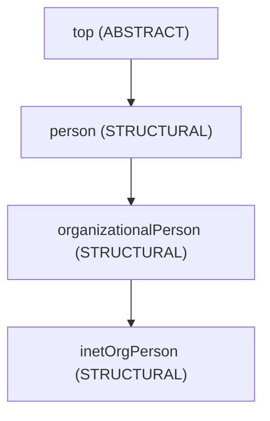

# Thuộc tính bắt buộc MUST và tùy chọn MAY trong schema LDAP

Trong LDAP, mỗi entry nằm tại một **Distinguished Name (DN)** và chứa các thuộc tính (*attributes*). Tuy nhiên, không phải entry nào cũng có thể lưu tùy ý mọi thuộc tính: **schema** của directory quy định entry thuộc loại đối tượng nào, thuộc tính nào phải có và thuộc tính nào được phép xuất hiện. Hai từ khóa quan trọng trong định nghĩa `objectClass` là **`MUST`** và **`MAY`**.

Khi dùng **Spring Data LDAP**, ứng dụng ánh xạ entry sang đối tượng Java thông qua `@Entry`, `@Id` và `@Attribute`, đồng thời dùng repository hoặc `LdapTemplate` để thực hiện CRUD. Hiểu `MUST`/`MAY` giúp dự đoán vì sao tạo entry bị từ chối khi thiếu một trường, vì sao trường Java có thể để trống nhưng directory không cho ghi, và vì sao thuộc tính không khai báo trong schema có thể gây lỗi dù Java chấp nhận.

## 1. Mục tiêu học tập

Sau bài này, bạn có thể:

- Giải thích ý nghĩa của `MUST` và `MAY` trong một định nghĩa LDAP `objectClass`.
- Phân biệt **bắt buộc theo schema**, **cho phép theo schema** và **bắt buộc theo nghiệp vụ**.
- Xác định tập thuộc tính hợp lệ khi entry có nhiều `objectClass`, kể cả các lớp được kế thừa.
- Phân tích ví dụ `person`, `organizationalPerson` và `inetOrgPerson` để hiểu vai trò của `cn`, `sn`, `uid` và `mail`.
- Tạo entry bằng `LdapTemplate.bind(...)` với tập thuộc tính phù hợp, ánh xạ qua Spring Data LDAP ODM và nhận diện lỗi khi thiếu `MUST`.
- Kiểm tra dữ liệu và schema trên directory thử nghiệm thay vì suy luận tính hợp lệ chỉ từ class Java.

## 2. Schema quyết định điều gì?

Một entry LDAP thường gồm DN, một hay nhiều giá trị `objectClass` và các thuộc tính khác. Ví dụ:

```ldif
dn: uid=alice,ou=people,dc=example,dc=com
objectClass: top
objectClass: person
objectClass: organizationalPerson
objectClass: inetOrgPerson
uid: alice
cn: Alice Nguyen
sn: Nguyen
mail: alice@example.com
```

Ở đây:

- **DN** định vị entry trong cây, với RDN `uid=alice` và entry cha `ou=people,dc=example,dc=com`.
- **`objectClass`** mô tả tập lớp đối tượng mà entry tuân theo; mỗi lớp mang theo các quy tắc schema.
- **Attribute type**, chẳng hạn `cn` hay `mail`, có định nghĩa riêng về cú pháp, matching rule, số lượng giá trị và các đặc tính khác.
- **Attribute value** là dữ liệu cụ thể được lưu trong entry, ví dụ `Nguyen`.

Schema có thể quy định **cấu trúc entry**, **thuộc tính được phép**, **thuộc tính bắt buộc**, **cú pháp giá trị** và **quy tắc so khớp**. Trong thực tế directory còn có ACL, giới hạn vận hành và chính sách bổ sung; vì vậy chỉ đúng `MUST`/`MAY` chưa đủ để bảo đảm mọi thao tác ghi sẽ thành công.

## 3. `MUST` và `MAY` trong định nghĩa objectClass

Xem định nghĩa giản lược gần với object class chuẩn `person`:

```text
( 2.5.6.6 NAME 'person'
  SUP top
  STRUCTURAL
  MUST ( sn $ cn )
  MAY ( userPassword $ telephoneNumber $ seeAlso $ description ) )
```

Ý nghĩa:

| Thành phần | Diễn giải |
| --- | --- |
| `NAME 'person'` | Tên của object class. |
| `SUP top` | `person` kế thừa từ `top`. |
| `STRUCTURAL` | Đây là một object class cấu trúc. |
| `MUST ( sn $ cn )` | Entry thuộc `person` bắt buộc có `sn` và `cn`, trừ trường hợp directory áp dụng quy tắc schema đặc thù ngoài ví dụ. |
| `MAY (...)` | Những thuộc tính trong danh sách được phép xuất hiện nhưng không bị yêu cầu chỉ vì lớp `person`. |
| `$` | Dấu phân cách **tên thuộc tính** trong danh sách schema, không phải dấu phân cách RDN của DN. |

**`MUST` nghĩa là bắt buộc có thuộc tính theo schema.** Nếu thiếu `cn` hoặc `sn` khi tạo một entry `person`, máy chủ tuân thủ schema có thể từ chối thao tác với lỗi *object class violation*.

**`MAY` nghĩa là thuộc tính được phép có mặt**, không có nghĩa entry bắt buộc phải chứa nó, và cũng không có nghĩa client luôn được quyền đọc hoặc ghi nó. Chẳng hạn `telephoneNumber` nằm trong `MAY` của `person` không đồng nghĩa mỗi người dùng phải có số điện thoại.

Danh sách `MUST`/`MAY` áp dụng cho **attribute type**, không áp đặt giá trị chuỗi cụ thể. Việc `cn` không rỗng, đúng định dạng tên hay dài bao nhiêu còn phụ thuộc cú pháp LDAP, ràng buộc server và validation nghiệp vụ.

### 3.1. `MAY` không phải “mọi thuộc tính còn lại”

Giả sử entry chỉ sử dụng các lớp trong ví dụ. Nếu ứng dụng cố thêm một thuộc tính không được `MUST` hay `MAY` của **bất kỳ object class hiệu lực nào** cho phép, server có thể trả lỗi schema. Vì thế quy tắc không phải “trường không bắt buộc thì có thể gửi tùy ý”.

Một số directory có object class mở rộng hoặc chính sách schema riêng; chỉ nên dùng chúng khi hiểu phạm vi cho phép. Không thêm lớp mở rộng như `extensibleObject` chỉ để bỏ qua lỗi schema trong ứng dụng thông thường: việc làm đó có thể khiến mô hình dữ liệu lỏng lẻo và khó kiểm soát.

### 3.2. `MUST` khác “mỗi thuộc tính chỉ có một giá trị”

`MUST` chỉ yêu cầu thuộc tính hiện diện theo schema. Thuộc tính có được **một** hay **nhiều** giá trị do định nghĩa **attribute type** quyết định, ví dụ cờ `SINGLE-VALUE` nếu có. `MAY` cũng không quyết định số lượng giá trị.

| Khái niệm | Ví dụ câu hỏi |
| --- | --- |
| `MUST` | Entry có buộc phải có thuộc tính `sn` không? |
| `MAY` | Entry có được phép lưu `telephoneNumber` không? |
| `SINGLE-VALUE` | Thuộc tính đó có thể có hơn một giá trị không? |
| Cú pháp/matching rule | Giá trị có hợp lệ và được so sánh thế nào? |
| ACL | Tài khoản ứng dụng được đọc hoặc cập nhật thuộc tính đó không? |

## 4. Kế thừa objectClass: MUST và MAY được cộng dồn

LDAP có hệ phân cấp object class. Một chuỗi quen thuộc khi quản lý người dùng là:



Entry thuộc `inetOrgPerson` kế thừa các ràng buộc của `organizationalPerson`, `person` và `top`. Đặc biệt, `person` yêu cầu `cn` và `sn`; các yêu cầu này **không biến mất** chỉ vì entry có thêm lớp con `inetOrgPerson`.

| Object class | Ý nghĩa tiêu biểu | Một số thuộc tính liên quan |
| --- | --- | --- |
| `top` | Lớp trừu tượng gốc trong hệ object class. | Định nghĩa thuộc tính `objectClass` bắt buộc. |
| `person` | Người ở mức schema cơ bản. | `MUST`: `cn`, `sn`; có thể cho phép `telephoneNumber`, `description`, ... |
| `organizationalPerson` | Mở rộng dữ liệu người dùng trong tổ chức. | Có thể cho phép thêm `title`, `ou`, `postalAddress`, ... |
| `inetOrgPerson` | Mở rộng cho danh bạ/người dùng Internet. | Có thể cho phép `uid`, `mail`, `givenName`, `displayName`, ... |

Các cột `MAY` trong bảng chỉ nêu **ví dụ**, không phải danh sách đầy đủ của RFC hay cấu hình từng directory. Hãy đối chiếu schema đang hoạt động khi cần xác nhận một thuộc tính cụ thể.

**Quy tắc cộng dồn:** nếu một thuộc tính là `MUST` ở lớp cha hoặc ở một lớp khác có hiệu lực, entry vẫn phải có thuộc tính đó dù lớp con không nhắc lại. Tập thuộc tính được phép là sự kết hợp các định nghĩa đang có hiệu lực, chịu thêm quy tắc của schema directory.

### 4.1. Ví dụ: vì sao `uid` có thể tùy chọn nhưng `sn` không?

Với schema `inetOrgPerson` thường gặp:

- `cn` và `sn` được yêu cầu bởi lớp `person` kế thừa.
- `uid` và `mail` thường là thuộc tính được cho phép (`MAY`) trong hệ lớp tương ứng.
- Ứng dụng có thể **yêu cầu `uid` theo nghiệp vụ** vì dùng `uid` làm mã tài khoản hoặc RDN, dù schema của `inetOrgPerson` không đòi mọi entry phải có `uid`.

Do đó, đừng kết luận “`uid` không cần kiểm tra” chỉ vì nó nằm trong `MAY`. Nếu endpoint tạo entry tại DN `uid=alice,ou=people,...`, quy tắc đặt tên của entry và chính sách tài khoản khiến `uid` trở thành dữ liệu phải có.

### 4.2. Nhiều objectClass trong cùng entry

Một entry thường khai báo cả các lớp tổ tiên như `top`, `person`, `organizationalPerson`, `inetOrgPerson`. Schema server có thể kiểm tra tập object class, phân biệt **structural** và **auxiliary**:

- **Structural object class** xác định loại cấu trúc chính của entry; không thể tùy ý kết hợp các lớp structural không cùng phân cấp nếu schema cấm.
- **Auxiliary object class** có thể bổ sung các thuộc tính `MUST`/`MAY` khi được phép áp dụng cho entry.
- Một thuộc tính được đánh dấu `MUST` trong auxiliary class được áp dụng vẫn phải thỏa mãn; không thể chỉ xem `MUST` từ lớp structural chính.

Ví dụ, nếu một auxiliary class tùy chỉnh yêu cầu `employeeNumber`, entry mang lớp đó có thể bị từ chối khi thiếu `employeeNumber`, ngay cả khi `inetOrgPerson` không yêu cầu thuộc tính này.

## 5. Ba entry: hợp lệ, thiếu MUST và thiếu MAY

Giả sử directory cho phép cấu trúc người dùng như ví dụ và entry cha đã tồn tại.

**Trường hợp A — có đủ MUST và một số MAY:**

```ldif
dn: uid=alice,ou=people,dc=example,dc=com
objectClass: top
objectClass: person
objectClass: organizationalPerson
objectClass: inetOrgPerson
uid: alice
cn: Alice Nguyen
sn: Nguyen
mail: alice@example.com
```

Với schema thông thường và quyền ghi phù hợp, entry trên thỏa các thuộc tính `cn` và `sn` bắt buộc theo `person`; `uid` và `mail` có mặt theo nhu cầu ứng dụng.

**Trường hợp B — thiếu `sn` là MUST:**

```ldif
dn: uid=bob,ou=people,dc=example,dc=com
objectClass: top
objectClass: person
objectClass: organizationalPerson
objectClass: inetOrgPerson
uid: bob
cn: Bob Tran
```

Máy chủ áp dụng schema chuẩn cho phân cấp này sẽ từ chối việc thêm entry vì thiếu `sn`, thường trả LDAP result code **65** (`objectClassViolation`). Lỗi có thể xuất hiện qua exception do Spring LDAP chuyển từ JNDI.

**Trường hợp C — không khai báo thuộc tính `mail` là MAY:**

```ldif
dn: uid=carol,ou=people,dc=example,dc=com
objectClass: top
objectClass: person
objectClass: organizationalPerson
objectClass: inetOrgPerson
uid: carol
cn: Carol Le
sn: Le
```

Việc không có `mail` **không tự nó** vi phạm schema `inetOrgPerson` thông thường. Dù vậy, nếu hệ thống yêu cầu email cho quy trình thông báo hoặc đăng nhập, API của **ứng dụng** phải kiểm tra điều kiện đó trước khi tạo entry.

## 6. Đối chiếu MUST/MAY với metadata ODM của Spring Data LDAP

Trong Spring Data LDAP, một entity có thể khai báo:

```java
package com.example.directory;

import javax.naming.Name;
import org.springframework.ldap.odm.annotations.Attribute;
import org.springframework.ldap.odm.annotations.Entry;
import org.springframework.ldap.odm.annotations.Id;

@Entry(
    base = "ou=people",
    objectClasses = {
        "top", "person", "organizationalPerson", "inetOrgPerson"
    }
)
public class DirectoryPerson {
    @Id
    private Name dn;

    @Attribute(name = "uid")
    private String uid;

    @Attribute(name = "cn")
    private String commonName;

    @Attribute(name = "sn")
    private String surname;

    @Attribute(name = "mail")
    private String email;

    protected DirectoryPerson() {
        // Phục vụ cơ chế ánh xạ ODM.
    }

    // Getter/setter theo cách tổ chức entity của ứng dụng.
}
```

**Điều cần hiểu khi nhìn vào Java:**

- `@Entry(objectClasses=...)` khai báo các lớp LDAP kỳ vọng; các định nghĩa `MUST`/`MAY` thực tế vẫn do schema phía server quyết định.
- `@Id` ánh xạ DN của entry, không phải một field dữ liệu “tùy chọn” chỉ vì `uid` có thể nằm trong `MAY`.
- `@Attribute(name="cn")` ánh xạ `commonName` sang `cn`. `commonName` là tên property Java; `cn` là attribute type LDAP.
- Việc field `surname` trong Java có thể bằng `null` **không thay đổi** việc LDAP `person` yêu cầu `sn`.
- Việc field `email` không có giá trị có thể phù hợp schema nhưng vẫn không phù hợp **quy tắc sản phẩm** nếu ứng dụng yêu cầu email.

**MUST trong LDAP không đồng nghĩa với `@NotNull` của Bean Validation.** Annotation Java giúp phát hiện vấn đề trước khi gửi LDAP, còn schema server là nơi từ chối entry nếu thiếu hoặc sai thuộc tính. Nếu chỉ dựa vào trường Java, dữ liệu tạo từ job, batch hoặc tool khác vẫn có thể vượt qua lớp validation của một controller.

### Khi đọc một entry thiếu MAY

Không phải mọi entry có `inetOrgPerson` đều sẽ có `mail`. Mã ánh xạ và UI phải chấp nhận giá trị vắng mặt của một thuộc tính tùy chọn, hoặc chủ động đánh dấu dữ liệu không đủ cho use case:

```java
String email = person.getEmail();
if (email == null || email.isBlank()) {
    // Ví dụ: cho phép hồ sơ không có email, hoặc yêu cầu bổ sung
    // trước khi dùng tính năng gửi thông báo.
}
```

Đừng tự chèn chuỗi rỗng cho mọi thuộc tính `MAY`; một số directory áp dụng ràng buộc cú pháp và có thể không chấp nhận giá trị như vậy. “Không cung cấp thuộc tính” khác với “gửi một thuộc tính có giá trị rỗng”.

## 7. Tạo entry bằng LdapTemplate: bắt buộc gửi đúng thuộc tính

Khi muốn kiểm soát trực tiếp tập thuộc tính, `LdapTemplate.bind(...)` là một cách tạo entry:

```java
package com.example.directory;

import javax.naming.Name;
import javax.naming.directory.BasicAttribute;
import javax.naming.directory.BasicAttributes;

import org.springframework.ldap.core.LdapTemplate;
import org.springframework.ldap.support.LdapNameBuilder;
import org.springframework.stereotype.Service;

@Service
public class PersonDirectoryWriter {
    private final LdapTemplate ldapTemplate;

    public PersonDirectoryWriter(LdapTemplate ldapTemplate) {
        this.ldapTemplate = ldapTemplate;
    }

    public Name create(String uid, String cn, String sn, String mail) {
        if (uid == null || uid.isBlank()
                || cn == null || cn.isBlank()
                || sn == null || sn.isBlank()) {
            throw new IllegalArgumentException(
                    "uid, cn và sn không được thiếu");
        }

        // Giả sử spring.ldap.base = dc=example,dc=com.
        // DN truyền cho LdapTemplate tương đối với context base.
        Name relativeDn = LdapNameBuilder.newInstance()
                .add("ou", "people")
                .add("uid", uid)
                .build();

        BasicAttributes attributes = new BasicAttributes(true);
        BasicAttribute objectClasses = new BasicAttribute("objectClass");
        objectClasses.add("top");
        objectClasses.add("person");
        objectClasses.add("organizationalPerson");
        objectClasses.add("inetOrgPerson");
        attributes.put(objectClasses);

        // Các giá trị uid, cn, sn đều được kiểm tra theo nghiệp vụ.
        attributes.put("uid", uid);
        attributes.put("cn", cn);  // MUST từ person.
        attributes.put("sn", sn);  // MUST từ person.

        // mail được phép nhưng không bắt buộc theo schema minh họa.
        if (mail != null && !mail.isBlank()) {
            attributes.put("mail", mail);
        }

        ldapTemplate.bind(relativeDn, null, attributes);
        return relativeDn;
    }
}
```

Ví dụ gọi:

```java
Name dn = personDirectoryWriter.create(
        "alice", "Alice Nguyen", "Nguyen", null);
// Entry vẫn có cn, sn và uid; mail được bỏ qua.
```

Lời gọi `bind` trong `LdapTemplate` là **thêm mới entry tại DN**, không phải phép LDAP Bind dùng để xác thực kết nối. Tài khoản kết nối phải có quyền tạo entry; parent `ou=people,dc=example,dc=com` phải tồn tại. Nếu DN đã tồn tại, server thường từ chối tạo trùng; không xem `bind` là thao tác cập nhật.

**Lưu ý về validation:** ví dụ chỉ kiểm tra `null`/chuỗi trắng để tập trung vào `MUST`. Ứng dụng thực tế phải kiểm tra định dạng, độ dài, tên thuộc tính/nhánh được phép và dữ liệu nhạy cảm. `LdapNameBuilder` giúp escape DN, không thay thế schema hoặc kiểm tra quyền ghi. Với truy vấn filter động, dùng `LdapQueryBuilder` để escape giá trị đúng ngữ cảnh.

### 7.1. Chẩn đoán khi thiếu MUST

Nếu xóa dòng:

```java
attributes.put("sn", sn);
```

entry `inetOrgPerson` có thể bị từ chối do thiếu `sn`. Để xác minh nguyên nhân, hãy kiểm tra:

1. `objectClass` của entry và chuỗi lớp cha mà schema áp dụng.
2. `MUST` được kế thừa từ từng lớp và auxiliary class được dùng.
3. Tên thuộc tính thực tế gửi đi, ví dụ `sn` chứ không phải tên property Java `surname`.
4. Thuộc tính có được đưa vào payload cuối trước khi `bind` không.
5. Exception/result code LDAP và phản hồi máy chủ; các hạn chế quyền/cha chưa tồn tại cũng có thể làm việc tạo thất bại theo nguyên nhân khác.

Không khắc phục bằng cách bỏ `objectClass` yêu cầu `sn` nếu mục tiêu là lưu một `inetOrgPerson` đúng schema.

## 8. Khi cập nhật entry: MUST vẫn phải được giữ

`MUST` được kiểm tra cả ở những thao tác **làm thay đổi entry**, không chỉ khi tạo mới. Nếu entry hiện tại cần `cn`, việc xóa giá trị `cn` cuối cùng có thể khiến directory từ chối lệnh thay đổi.

Ví dụ tình huống cần xử lý:

```text
Trước: objectClass=inetOrgPerson, cn=Alice Nguyen, sn=Nguyen
Yêu cầu xóa toàn bộ sn
Sau yêu cầu: objectClass=inetOrgPerson, cn=Alice Nguyen, không còn sn
Kết quả kỳ vọng: directory từ chối vì thiếu thuộc tính bắt buộc.
```

Ngược lại, nếu `mail` là thuộc tính chỉ nằm trong `MAY` và không có chính sách bổ sung, việc xóa `mail` khỏi entry thường không vi phạm ràng buộc `MUST`. Nhưng thao tác ghi có thể vẫn bị ACL hay quy tắc khác từ chối.

### 8.1. Đổi objectClass có thể đổi tập MUST/MAY

Nếu ứng dụng thêm một auxiliary class có `MUST` mới hoặc thay đổi cấu hình các lớp theo cách server cho phép, tập thuộc tính bắt buộc của entry có thể thay đổi. Phải kiểm tra **schema áp dụng sau thay đổi**, tránh gửi lệnh cập nhật mà chỉ xem schema cũ.

Đổi tên DN qua thao tác `Modify DN` cũng liên quan tới RDN. Giá trị thuộc tính định danh trong RDN thường phải có trong entry phù hợp với quy tắc đặt tên; thay đổi RDN có thể làm thay đổi các giá trị liên quan tùy lựa chọn giữ/xóa giá trị RDN cũ. Không giả định một thao tác thay `uid` trong object Java tự động đổi DN của entry.

## 9. MUST/MAY và quy tắc nghiệp vụ

Schema directory là ràng buộc chung cho các ứng dụng cùng dùng directory. Một ứng dụng riêng có thể muốn ràng buộc chặt hơn:

| Thuộc tính | Theo schema `inetOrgPerson` thông thường | Theo nghiệp vụ ví dụ | Kết luận |
| --- | --- | --- | --- |
| `cn` | `MUST` (qua `person`). | Bắt buộc để hiển thị danh bạ. | Bắt buộc ở cả hai tầng. |
| `sn` | `MUST` (qua `person`). | Bắt buộc khi tạo người dùng. | Bắt buộc ở cả hai tầng. |
| `uid` | Thường thuộc `MAY`. | Bắt buộc, duy nhất trong nhánh tài khoản. | Ứng dụng kiểm tra; directory kiểm soát DN và quy tắc duy nhất đã cấu hình. |
| `mail` | Thường thuộc `MAY`. | Có thể bắt buộc trước khi dùng tính năng gửi email. | Không phải mọi entry đều cần mail, nhưng quy trình cụ thể có thể yêu cầu. |
| `telephoneNumber` | Có thể được phép qua lớp cha. | Không yêu cầu. | Bỏ qua khi không có dữ liệu. |

**Phân biệt “được phép” và “được quyền”:** `MAY` chỉ nói về schema; một tài khoản không có quyền sửa `mail` vẫn bị từ chối khi cập nhật `mail` dù thuộc tính đó hợp lệ.

**Phân biệt “MUST có thuộc tính” và “giá trị đáp ứng nghiệp vụ”:** một entry có `cn` theo schema chưa chắc có tên hiển thị phù hợp quy định ứng dụng. Ngược lại, một giá trị đáp ứng validation ở Java vẫn có thể bị server từ chối nếu không hợp cú pháp LDAP hoặc chính sách directory.

## 10. Đọc và kiểm tra schema thực tế

Các ví dụ trong bài dùng schema phổ biến của LDAP. Directory thực tế có thể bật **schema mở rộng**, có object class riêng hoặc có quy tắc vận hành khác. Khi cần chắc chắn một thuộc tính đang là `MUST` hay `MAY`, hãy kiểm tra schema đang được server sử dụng, không chỉ dựa vào tên Java field hoặc bản tài liệu chung.

Cách tiếp cận có hệ thống:

1. Xác định `objectClass` thực sự có trong entry hoặc payload tạo mới.
2. Truy các định nghĩa object class và quan hệ `SUP` tới lớp cha.
3. Tập hợp các thuộc tính `MUST` và `MAY` có hiệu lực, kể cả auxiliary classes.
4. Kiểm tra thêm định nghĩa **attribute type**: cú pháp, `SINGLE-VALUE`, matching rule và các giới hạn tương ứng.
5. Kiểm tra quy tắc DIT/naming, ACL và chính sách riêng của directory.
6. Tạo/sửa entry trong **directory thử nghiệm** để xác minh hành vi thật và thông điệp lỗi.

### 10.1. Schema thường được công bố qua subschema entry

LDAP có cơ chế công bố schema: thuộc tính vận hành `subschemaSubentry` có thể chỉ ra DN của entry chứa các định nghĩa schema hiệu lực. Ở subschema entry, các thuộc tính như `objectClasses` và `attributeTypes` cung cấp mô tả cấu trúc schema. Quyền đọc và khả năng hỗ trợ phụ thuộc vào directory; không phải ứng dụng nào cũng được phép truy vấn schema.

Ví dụ ý tưởng truy vấn bằng công cụ dòng lệnh (DN, URL và tài khoản cần điều chỉnh):

```bash
# Xác định subschema entry theo thông tin server công bố.
ldapsearch -LLL -x -H ldaps://ldap.example.com:636 \
  -D "cn=readonly,dc=example,dc=com" -W \
  -b "dc=example,dc=com" -s base "(objectClass=*)" subschemaSubentry
```

Sau khi đã lấy được DN của subschema entry, có thể truy vấn đúng DN đó và yêu cầu `objectClasses`/`attributeTypes` để đọc định nghĩa. Không tự giả định subschema luôn là `cn=schema` hoặc toàn bộ máy chủ dùng cùng một subschema.

Đây là thao tác **đọc** để chẩn đoán; không chỉnh sửa schema trên directory thực tế nếu không có quy trình quản trị phù hợp.

## 11. Lỗi thường gặp và cách phân biệt

| Hiện tượng | Nguyên nhân khả dĩ | Cách xử lý |
| --- | --- | --- |
| Thêm `inetOrgPerson` chỉ có `uid` và `cn` bị từ chối. | Thiếu `sn` từ `MUST` của `person`. | Gửi `sn` hợp lệ; rà soát đầy đủ lớp cha. |
| Không có `mail` nhưng ứng dụng báo lỗi từ trước. | `mail` bắt buộc theo nghiệp vụ, không nhất thiết do LDAP schema. | Tách lỗi validation nghiệp vụ khỏi lỗi server. |
| Thêm một thuộc tính tùy ý bị từ chối. | Thuộc tính không nằm trong `MUST`/`MAY` hợp lệ của các object class. | Kiểm tra schema; chỉ dùng thuộc tính cho phép. |
| Xóa `cn` khỏi entry cũ thất bại. | Tạo trạng thái thiếu thuộc tính `MUST`. | Không xóa giá trị cuối cùng của `cn` nếu lớp vẫn yêu cầu. |
| Thêm `objectClass` tùy chỉnh khiến bắt buộc thêm trường mới. | Auxiliary/structural class mới thêm `MUST`. | Xem định nghĩa lớp mới và kiểm tra payload. |
| Trường Java có giá trị nhưng server báo schema. | `@Attribute` sai tên, cú pháp/số giá trị sai, hoặc object class không cho phép thuộc tính. | Đối chiếu payload LDAP thực tế và `attributeTypes` của schema. |
| Thêm entry thất bại dù `MUST` đã đủ. | Parent không tồn tại, DN/RDN sai, quyền ghi thiếu hoặc chính sách khác. | Kiểm tra result code, DN, ACL và trạng thái directory. |
| Dùng `null`/chuỗi rỗng như nhau cho thuộc tính tùy chọn. | Payload có thể khác giữa thiếu thuộc tính và giá trị rỗng. | Bỏ qua thuộc tính không có dữ liệu; validation theo cú pháp thực tế. |

LDAP result code **65** thường chỉ **objectClassViolation**. Nhưng một lỗi ghi không phải lúc nào cũng có mã 65: các lỗi `noSuchObject` (32), `invalidDNSyntax` (34), `insufficientAccessRights` (50) hoặc các ràng buộc khác cũng cần được xét theo tình huống. Spring LDAP thường chuyển exception từ JNDI sang hệ ngoại lệ của Spring, nên thông tin chẩn đoán nên ghi ở log kỹ thuật phù hợp, không trả nguyên văn thông tin nội bộ cho client.

## 12. Kiểm thử schema bằng directory riêng

Một unit test chỉ kiểm tra lớp Java có `cn`/`sn` không chứng minh server chấp nhận entry. Cách tốt hơn là integration test với một LDAP directory thử nghiệm có schema giống môi trường mục tiêu:

- **Thành công:** tạo `inetOrgPerson` có `cn`, `sn` và `uid`; xác nhận entry tồn tại và có các thuộc tính mong muốn.
- **Thiếu MUST:** thử tạo với `cn` nhưng thiếu `sn`; dự kiến máy chủ từ chối theo schema.
- **Thiếu MAY:** tạo không có `mail`; xác nhận schema cho phép trong cấu hình đang thử.
- **Cập nhật vi phạm MUST:** thử xóa `sn` cuối cùng của một entry; dự kiến không được phép khi object class vẫn yêu cầu.
- **Thuộc tính lạ:** thử thêm thuộc tính không được schema cho phép; xác định lỗi thực tế và cách xử lý.
- **Kế thừa và auxiliary:** với schema tùy chỉnh, kiểm tra các `MUST` mới khi thêm lớp.

Ví dụ khung kiểm thử JUnit 5 khi ứng dụng có `PersonDirectoryWriter` ở mục trên và directory test đã có `ou=people`:

```java
import static org.junit.jupiter.api.Assertions.assertNotNull;

import javax.naming.Name;
import org.junit.jupiter.api.Test;
import org.springframework.beans.factory.annotation.Autowired;
import org.springframework.boot.test.context.SpringBootTest;
import org.springframework.ldap.core.AttributesMapper;
import org.springframework.ldap.core.LdapTemplate;

@SpringBootTest
class PersonSchemaIT {
    @Autowired PersonDirectoryWriter writer;
    @Autowired LdapTemplate ldapTemplate;

    @Test
    void createsPersonWithoutOptionalMail() {
        Name dn = writer.create(
                "schema-example", "Schema Example", "Example", null);

        try {
            String surname = ldapTemplate.lookup(
                    dn,
                    (AttributesMapper<String>) attrs ->
                            attrs.get("sn").get().toString());
            assertNotNull(surname);
        } finally {
            ldapTemplate.unbind(dn);
        }
    }
}
```

Đoạn test dùng UID cố định để dễ đọc; khi chạy lặp hoặc song song trên directory dùng chung cho test, nên cấp phát UID riêng, giới hạn quyền/xóa đúng entry do test tạo và dọn dữ liệu test có chủ đích. Không chạy test tạo/xóa trên directory production.

Để kiểm tra **thiếu MUST**, không dùng phương thức `writer.create(...)` đã chủ động kiểm tra `sn`, vì validation Java sẽ chặn trước khi đến server. Hãy tạo payload test riêng cố ý thiếu `sn`, gửi tới directory thử nghiệm, rồi kiểm tra lỗi LDAP thực tế. Điều đó chứng minh server thực thi ràng buộc, khác với việc chỉ chứng minh validator của ứng dụng hoạt động.

## 13. Bài thực hành

**Bài 1.** `inetOrgPerson` kế thừa `person`. Lớp `person` có `MUST (sn $ cn)`. Entry có `uid` và `cn` nhưng không có `sn` có hợp lệ không?

**Đáp án:** Không, nếu directory áp dụng phân cấp schema chuẩn. `sn` vẫn là bắt buộc do được kế thừa từ `person`.

**Bài 2.** `mail` là thuộc tính `MAY`. Người dùng không có `mail`; có nhất thiết phải thêm `mail: ""` để entry hợp lệ không?

**Đáp án:** Không. Thuộc tính tùy chọn có thể **vắng mặt**. Gửi giá trị rỗng không tương đương với bỏ qua thuộc tính và có thể không hợp lệ theo cú pháp/policy.

**Bài 3.** Vì sao có thể cần kiểm tra `uid` trong API dù `uid` không phải `MUST` của `inetOrgPerson`?

**Đáp án:** API dùng `uid` làm định danh và RDN `uid=...`, nên đó là dữ liệu bắt buộc theo nghiệp vụ và cách đặt tên. `MAY` không loại bỏ yêu cầu riêng của ứng dụng.

**Bài 4.** Một entry có đủ `cn`, `sn`, nhưng vẫn bị từ chối khi thêm thuộc tính `favoriteColor` tự nghĩ ra. Vì sao?

**Đáp án:** Schema có thể không cho phép thuộc tính `favoriteColor` trong các object class hiệu lực, hoặc chưa định nghĩa attribute type này. Phải kiểm tra schema, không thể xem `MAY` là “cho phép mọi thuộc tính khác”.

**Bài 5.** Một auxiliary class mới có `MUST employeeNumber`. Entry `inetOrgPerson` trước đó hợp lệ nhưng sau khi thêm lớp mới bị từ chối. Giải thích.

**Đáp án:** Khi auxiliary class được áp dụng, `MUST` của nó bổ sung vào các yêu cầu đã có. Entry cần `employeeNumber` hợp lệ theo định nghĩa và quyền/policy tương ứng.

**Bài 6.** Một form có `@NotNull` cho `surname`. Vì sao vẫn nên kiểm tra trực tiếp thao tác ghi trên directory test?

**Đáp án:** Bean Validation chỉ kiểm tra dữ liệu đi qua đường code sử dụng nó. Directory có schema, ACL, syntax, naming rules riêng và các ứng dụng khác có thể ghi dữ liệu; integration test xác nhận ràng buộc server thực sự áp dụng.

## 14. Ghi nhớ

- `MUST` là **thuộc tính bắt buộc** theo `objectClass`; `MAY` là **thuộc tính được phép nhưng không bắt buộc chỉ vì lớp đó**.
- Quy tắc `MUST`/`MAY` được **kế thừa** qua `SUP` và có thể được bổ sung bởi object class khác có hiệu lực, kể cả auxiliary class.
- Với `inetOrgPerson` thông thường, `cn` và `sn` bắt buộc qua `person`; `uid` và `mail` có thể tùy chọn theo schema nhưng trở thành bắt buộc ở **nghiệp vụ**.
- `MUST`/`MAY` khác với `SINGLE-VALUE`, cú pháp thuộc tính, matching rule và quyền ACL; tất cả vẫn ảnh hưởng đến việc ghi.
- `@Entry`, `@Attribute` và các trường Java chỉ mô tả **ánh xạ ODM**. Directory là nơi thực thi schema; ứng dụng nên kiểm tra sớm để đưa ra lỗi dễ hiểu.
- Tạo, cập nhật và xóa giá trị thuộc tính đều phải giữ entry phù hợp schema. Khi cần chắc chắn, hãy kiểm tra định nghĩa schema và thử nghiệm trên directory riêng.
