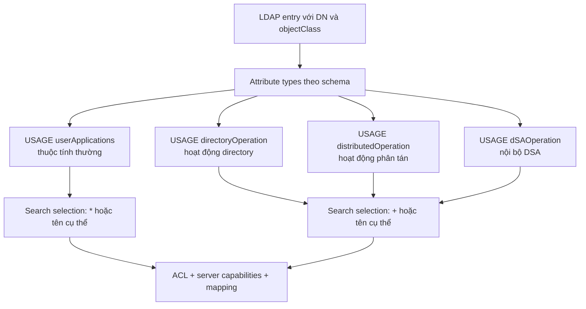
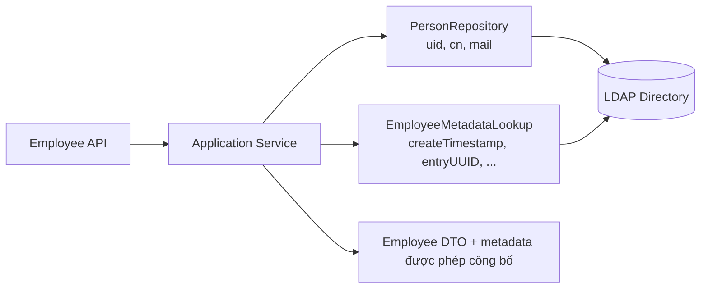

# Phân biệt thuộc tính thường với thuộc tính vận hành

Trong chương **Schema** của **SPRING_DATA_LDAP**, một entry LDAP không chỉ có `uid`, `cn`, `mail`, `sn` hay `objectClass` do ứng dụng sử dụng. Directory còn có thể cung cấp những thông tin như **ai đã tạo entry**, **entry được sửa lần cuối khi nào**, **định danh ổn định của entry** hoặc **schema nào điều khiển entry**. Những thuộc tính sau thường thuộc nhóm **operational attributes** (*thuộc tính vận hành*), và cách server trả về, cho phép tìm kiếm hoặc chỉnh sửa chúng khác với thuộc tính thông thường.

Một câu lệnh `ldapsearch` có thể trả `cn` và `mail` nhưng không hiển thị `modifyTimestamp`, dù thuộc tính thời gian thực sự tồn tại. Một repository `findByUid("lan")` có thể đọc thành công hồ sơ nhân viên nhưng chưa cho phép ứng dụng kết luận ai đã sửa hồ sơ hoặc khi nào. Nguyên nhân không nhất thiết là schema sai hay server thiếu dữ liệu: **LDAP phân biệt thuộc tính dành cho dữ liệu ứng dụng với thuộc tính phục vụ vận hành directory**, trong đó nhiều thuộc tính vận hành không được trả khi chỉ yêu cầu tập thuộc tính mặc định.

Bài học này giải thích cách xác định loại thuộc tính dựa trên **`USAGE` trong LDAP schema**, cơ chế chọn thuộc tính bằng `*`, `+` hoặc tên tường minh, cách truy cập qua JNDI/`LdapTemplate`, mối quan hệ với Spring Data LDAP `@Entry`/`@Attribute`/`LdapRepository`, giới hạn CRUD, ACL và những khác biệt giữa directory server.

**Mục tiêu:** đọc đúng thuộc tính vận hành mà không phụ thuộc vào giả định; không sửa nhầm metadata do server quản lý; không coi timestamp hay `memberOf` là quyền hoặc bằng chứng audit hoàn chỉnh; và kiểm thử chính xác với directory đang triển khai.

## 1. Một LDAP entry có cả dữ liệu nghiệp vụ và metadata vận hành

Xét entry nhân viên:

```ldif
dn: uid=lan,ou=people,dc=example,dc=org
objectClass: top
objectClass: person
objectClass: organizationalPerson
objectClass: inetOrgPerson
uid: lan
cn: Lan Nguyen
sn: Nguyen
mail: lan@example.org
```

Đây là những thuộc tính **thông thường** trong một LDAP schema điển hình: ứng dụng dùng để tìm, hiển thị, đồng bộ hoặc chỉnh sửa hồ sơ theo quyền. Khi yêu cầu thêm metadata được server hỗ trợ, kết quả có thể có:

```ldif
dn: uid=lan,ou=people,dc=example,dc=org
uid: lan
cn: Lan Nguyen
sn: Nguyen
mail: lan@example.org
createTimestamp: 20260112083015Z
modifyTimestamp: 20260819114530Z
creatorsName: uid=provisioner,ou=services,dc=example,dc=org
modifiersName: uid=hr-writer,ou=services,dc=example,dc=org
entryUUID: 91c1a756-3d7f-4ac2-a38a-03d6de825b35
```

Khối LDIF thứ hai là **ví dụ kết quả đọc có chọn thuộc tính**, không phải một change record để nạp những thuộc tính operational bằng tay. Server có thể sinh hoặc quản lý các giá trị này; không phải server nào cũng hỗ trợ `entryUUID` hoặc công bố mọi trường theo cùng cách.

### 1.1. So sánh nhanh

| Tiêu chí | Thuộc tính thường (*user attributes*) | Thuộc tính vận hành (*operational attributes*) |
| --- | --- | --- |
| Mục đích chủ yếu | Mô tả dữ liệu entry phục vụ ứng dụng | Hỗ trợ directory quản trị, trạng thái, định danh, schema, đồng bộ hoặc hoạt động nội bộ |
| Phân loại theo chuẩn | `USAGE userApplications` hoặc mặc định | `USAGE directoryOperation`, `distributedOperation` hoặc `dSAOperation` |
| Ví dụ thường gặp | `uid`, `cn`, `sn`, `mail`, `objectClass` | `createTimestamp`, `modifyTimestamp`, `creatorsName`, `modifiersName`, `entryUUID`, `subschemaSubentry` |
| Yêu cầu `*` khi Search | Thường thuộc tập được chọn | Không mặc nhiên thuộc tập `*` |
| Yêu cầu `+` khi Search | Không phải mục đích của `+` | Có thể được chọn khi server hỗ trợ RFC 3673 và ACL cho phép |
| Chỉnh sửa | Tùy schema/ACL và chính sách | Thường do server quản lý; quyền/chế độ sửa tùy loại và server |
| Có phải bí mật không? | Không mặc định | Cũng không mặc định; **cả hai** có thể nhạy cảm |
| Có luôn tồn tại không? | Không; thuộc tính MAY có thể vắng | Không; phụ thuộc server, schema, trạng thái và tính năng đã bật |

**Không dùng tiêu chí “đọc được hay không”, “có thể sửa hay không” hoặc “tên bắt đầu bằng dấu gì” để xác định loại thuộc tính.** Cách phân loại chuẩn xuất phát từ định nghĩa **attribute type trong schema**; quyền và cách server trả dữ liệu là những vấn đề bổ sung.



## 2. Căn cứ trong schema: thuộc tính có USAGE gì?

LDAP schema (theo mô hình RFC 4512) định nghĩa **attribute types**, **object classes**, matching rules và syntax. Một attribute type có thể có các thành phần như:

| Thành phần | Ý nghĩa |
| --- | --- |
| `NAME` và OID | Tên và mã định danh loại thuộc tính |
| `SYNTAX` | Kiểu giá trị, ví dụ Directory String, Generalized Time, DN, UUID theo định nghĩa liên quan |
| `EQUALITY` / `ORDERING` / `SUBSTR` | Quy tắc so sánh bằng, thứ tự, chuỗi con nếu được khai báo |
| `SINGLE-VALUE` | Thuộc tính chỉ có tối đa một giá trị |
| `NO-USER-MODIFICATION` | Client không được phép sửa thuộc tính theo định nghĩa schema |
| **`USAGE`** | **Phân loại mục đích sử dụng**: `userApplications` hoặc một loại operational |
| `SUP` | Kế thừa từ attribute type khác; cần kiểm tra thông tin liên quan của loại cha |

**Điểm then chốt:** nếu không khai báo `USAGE`, giá trị mặc định là **`userApplications`**. Vì vậy một thuộc tính do server tự điền **không nhất thiết** được phân loại operational nếu schema không nói như vậy; ngược lại, một thuộc tính có `USAGE directoryOperation` vẫn là operational dù tên không giống timestamp.

### 2.1. Bốn giá trị USAGE

| Giá trị `USAGE` | Phân loại | Mục đích khái quát |
| --- | --- | --- |
| `userApplications` | **Thông thường** | Dữ liệu mà ứng dụng và người dùng lưu trong directory |
| `directoryOperation` | **Vận hành** | Thông tin directory sử dụng để thực thi/quản lý các thao tác |
| `distributedOperation` | **Vận hành** | Thông tin hỗ trợ hoạt động phân tán giữa các thành phần directory |
| `dSAOperation` | **Vận hành** | Thông tin vận hành của Directory System Agent (DSA) |

Đây là **phân loại ở mức schema**, không phải bốn quyền ACL hay bốn loại Java annotation. Một ứng dụng thông thường chủ yếu thấy user attributes và một số directory operational attributes; các operational attributes nội bộ hoặc phân tán có thể không được server cho đọc.

### 2.2. Ví dụ mô tả attribute type đã rút gọn

```text
uid:
    SYNTAX Directory String
    EQUALITY caseIgnoreMatch
    USAGE userApplications  (mặc định nếu không khai báo)

modifyTimestamp:
    SYNTAX Generalized Time
    EQUALITY generalizedTimeMatch
    ORDERING generalizedTimeOrderingMatch
    SINGLE-VALUE
    NO-USER-MODIFICATION
    USAGE directoryOperation
```

Đây là **sơ đồ giải thích thuộc tính**, không phải các dòng schema LDAP có thể nạp nguyên văn. Để xác minh thuộc tính thật, đọc `attributeTypes` từ **subschema** của directory và xem OID/`USAGE`/matching rules được công bố.

### 2.3. USAGE khác NO-USER-MODIFICATION

Hai khái niệm thường bị gộp:

- **`USAGE`** nói thuộc tính được thiết kế để phục vụ mục đích nào.
- **`NO-USER-MODIFICATION`** nói client không được phép sửa giá trị thông qua những thao tác người dùng thông thường theo schema.

Nhiều metadata do server tạo vừa là operational vừa có `NO-USER-MODIFICATION`. Nhưng không được dùng một trường đơn lẻ để suy luận **mọi operational attribute đều không thể sửa trong mọi tình huống**: một số có thể được thay đổi qua thao tác quản trị đặc biệt hoặc cơ chế khác của server. Ứng dụng quản trị không được tìm cách sửa một thuộc tính chỉ vì Bind account có quyền đọc nó.

## 3. Những thuộc tính vận hành nên biết

| Tên thuộc tính | Vai trò thông thường | Điều cần thận trọng |
| --- | --- | --- |
| `createTimestamp` | Thời điểm entry được tạo | Không phải thời điểm nhân viên gia nhập công ty |
| `modifyTimestamp` | Thời điểm server ghi nhận sửa đổi entry | Không phải nhật ký đầy đủ mọi lần sửa hay cursor CDC hoàn chỉnh |
| `creatorsName` | DN của danh tính được ghi nhận là tác nhân tạo entry | Có thể là service account, không phải người phê duyệt nghiệp vụ |
| `modifiersName` | DN của danh tính được ghi nhận ở lần sửa cuối | Có thể bị thay đổi bởi provisioning/sync; có thể nhạy cảm |
| `entryUUID` | Định danh entry kiểu UUID trên server hỗ trợ chuẩn tương ứng | Không dùng thay thế `objectGUID` của AD theo kiểu dữ liệu chuỗi |
| `subschemaSubentry` | DN của subschema áp dụng cho entry | Có thể cần request tường minh; không phải group/user DN |
| `structuralObjectClass` | Thông tin về structural class của entry trên server hỗ trợ | Không mặc định thay `objectClass` để phân loại mọi entry |
| `hasSubordinates` | Thông tin entry có con hay không, nếu được hỗ trợ | Không phải bằng chứng người gọi được phép xem mọi con |
| `entryDN` | DN của entry dưới dạng operational attribute trên server hỗ trợ RFC 5020 | Không phải server nào cũng có; DN vẫn có ở kết quả Search |

**Không đồng nhất operational metadata với audit log:** `modifiersName` thường cho biết danh tính liên quan đến **lần thay đổi cuối** theo logic server, chứ không có lịch sử từng thuộc tính, giá trị trước/sau, người duyệt hoặc hành vi phía ứng dụng. Muốn kiểm toán đầy đủ cần hệ thống audit có bảo vệ riêng.

### 3.1. Operational attributes không nhất thiết được trả mặc định

Ngay cả khi entry thật sự có `modifyTimestamp`, một Search chỉ yêu cầu `*` có thể bỏ nó khỏi response. Khi đó ứng dụng cần **yêu cầu cụ thể** `modifyTimestamp` hoặc **`+`** để lấy các operational attributes mà server cho phép.

Vắng trong response có thể do:

1. Thuộc tính không được yêu cầu.
2. Server không hỗ trợ hoặc không duy trì thuộc tính này.
3. ACL không cho account Bind đọc.
4. Directory yêu cầu dạng truy vấn/controls riêng.
5. Entry, replica hoặc schema khác với nơi bạn kiểm tra.
6. Mapper ở Java chỉ ánh xạ một tập thuộc tính hoặc đã bỏ trường thiếu.

Do đó, `attrs.get("modifyTimestamp") == null` **không chứng minh** entry chưa từng được sửa.

## 4. Cách chọn thuộc tính khi Search: *, +, tên tường minh và 1.1

LDAP Search có thành phần **attribute selection**: client nêu những loại thuộc tính muốn nhận. Các selector quan trọng:

| Selector | Ý nghĩa | Dùng khi nào? |
| --- | --- | --- |
| **`*`** | Yêu cầu **tất cả user attributes** được phép trả | Đọc dữ liệu entry thông thường |
| **`+`** | Yêu cầu **tất cả operational attributes** theo RFC 3673 khi server hỗ trợ | Chẩn đoán metadata, rà soát server capabilities |
| **`uid`, `cn`, `modifyTimestamp`...** | Yêu cầu **thuộc tính chỉ định**, bất kể nhóm user/operational | Ứng dụng production cần projection rõ ràng |
| **`1.1`** | Selector đặc biệt yêu cầu **không trả thuộc tính** khi dùng riêng | Kiểm tra có entry khớp mà không cần tải dữ liệu |

Khi không cung cấp danh sách attribute cụ thể, hành vi chuẩn thường tương đương yêu cầu **tập user attributes** (`*`), không phải tất cả metadata vận hành. Một số công cụ hiển thị mặc định khác nhau, nên muốn kiểm chứng phải nêu selector rõ.

**`+` không cấp quyền mới.** Nó chỉ đề nghị server trả các operational attributes đang có và được phép cung cấp. Server có thể không hỗ trợ toàn bộ quy tắc `+`, hoặc áp giới hạn riêng cho những thuộc tính nhạy cảm.

### 4.1. ldapsearch: so sánh ba kiểu projection

Giả sử đã có LDAP server dùng LDAPS, chứng chỉ hợp lệ và account service chỉ đọc:

```bash
# Chỉ user attributes
ldapsearch -LLL -x -H ldaps://directory.example.org:636 \
  -D "uid=app-reader,ou=services,dc=example,dc=org" -W \
  -b "uid=lan,ou=people,dc=example,dc=org" -s base \
  "(objectClass=*)" "*"
```

```bash
# Chỉ operational attributes được server cho phép
ldapsearch -LLL -x -H ldaps://directory.example.org:636 \
  -D "uid=app-reader,ou=services,dc=example,dc=org" -W \
  -b "uid=lan,ou=people,dc=example,dc=org" -s base \
  "(objectClass=*)" "+"
```

```bash
# Chỉ các trường cần dùng; có cả user và operational
ldapsearch -LLL -x -H ldaps://directory.example.org:636 \
  -D "uid=app-reader,ou=services,dc=example,dc=org" -W \
  -b "uid=lan,ou=people,dc=example,dc=org" -s base \
  "(objectClass=*)" uid cn mail createTimestamp modifyTimestamp entryUUID
```

Với `ldapsearch`, các selector nằm **sau filter**, và nên đặt `"*"` hoặc `"+"` trong dấu nháy để shell không diễn giải ký tự đặc biệt. Dấu `+` không có nghĩa mọi server đều trả `entryUUID`; nếu server không hỗ trợ một thuộc tính thì kết quả có thể thiếu nó.

Muốn xem cả hai loại, dùng `"*" "+"` trong cùng một Search:

```bash
ldapsearch -LLL -x -H ldaps://directory.example.org:636 \
  -D "uid=app-reader,ou=services,dc=example,dc=org" -W \
  -b "uid=lan,ou=people,dc=example,dc=org" -s base \
  "(objectClass=*)" "*" "+"
```

Đây là cách tiện để **chẩn đoán trong môi trường kiểm thử**. Với ứng dụng production, ưu tiên **liệt kê tên thuộc tính cụ thể** để giảm dữ liệu truyền, chi phí mapping và nguy cơ lộ metadata nội bộ.

### 4.2. Filter và attribute projection là hai việc độc lập

Ví dụ:

```text
Base:    ou=people,dc=example,dc=org
Scope:   SUBTREE
Filter:  (&(objectClass=inetOrgPerson)(uid=lan))
Attrs:   uid,cn,mail,modifyTimestamp
```

`Filter` quyết định entry nào thỏa điều kiện (theo base/scope, schema và ACL). `Attrs` quyết định những thuộc tính được đề nghị trả về cho **các entry đã khớp**. Thêm `modifyTimestamp` vào projection **không** khiến Search tự lọc theo thời gian hoặc tìm thêm entry ở OU khác.

## 5. Cách kiểm tra phân loại của một attribute type từ subschema

Khi không chắc `memberOf`, `entryUUID` hay một thuộc tính do nhà cung cấp thêm được phân loại ra sao, **đừng suy luận từ tên**. Hãy xem schema của directory.

Quy trình:

1. Xác định một **entry thực** sử dụng thuộc tính muốn kiểm tra.
2. Yêu cầu thuộc tính `subschemaSubentry` của entry, nếu directory công bố.
3. Dùng DN subschema được trả để đọc `attributeTypes`.
4. Tìm mô tả attribute type theo `NAME` hoặc OID; xem `USAGE`, `NO-USER-MODIFICATION`, `SYNTAX`, matching rules và `SUP`.
5. Nếu `USAGE` không được khai báo, theo chuẩn hiểu là **`userApplications`**; xác minh thêm tính năng ngoài chuẩn hoặc schema riêng của nhà cung cấp nếu có.
6. Thử Search với `*`, `+` và tên cụ thể, bằng **cùng Bind identity**, để phân biệt schema với quyền và projection.

### 5.1. Truy vấn subschemaSubentry của entry

```bash
ldapsearch -LLL -x -H ldaps://directory.example.org:636 \
  -D "uid=app-reader,ou=services,dc=example,dc=org" -W \
  -b "uid=lan,ou=people,dc=example,dc=org" -s base \
  "(objectClass=*)" subschemaSubentry
```

Nếu nhận:

```ldif
dn: uid=lan,ou=people,dc=example,dc=org
subschemaSubentry: cn=subschema
```

thì **với directory mẫu này** mới dùng `cn=subschema` làm DN tra schema:

```bash
ldapsearch -LLL -x -H ldaps://directory.example.org:636 \
  -D "uid=app-reader,ou=services,dc=example,dc=org" -W \
  -b "cn=subschema" -s base \
  "(objectClass=*)" attributeTypes
```

`cn=subschema` **không phải đường dẫn subschema mặc định của tất cả LDAP server**. Tên entry subschema, mức truy cập, định dạng schema và việc hỗ trợ đọc qua LDAP khác nhau theo sản phẩm. `attributeTypes` là tập nhiều mô tả và có thể rất lớn; không cần tải toàn bộ vào request web của người dùng chỉ để lấy một thông tin.

### 5.2. Đừng nhầm subschema với Root DSE

**Root DSE** là entry đặc biệt ở DN rỗng `""` thường chứa các thông tin về server như `namingContexts`, `supportedControl`, `supportedExtension` hoặc `subschemaSubentry` nếu được công bố. **Subschema entry** là nơi có thể tra định nghĩa `attributeTypes` và `objectClasses`.

```bash
ldapsearch -LLL -x -H ldaps://directory.example.org:636 \
  -b "" -s base "(objectClass=*)" \
  namingContexts subschemaSubentry supportedLDAPVersion
```

Lệnh trên có thể được thực hiện trước Bind tùy chính sách công bố Root DSE của server; nếu môi trường yêu cầu xác thực, dùng account phù hợp. Không mặc định Root DSE, subschema và một employee entry có **cùng** các thuộc tính, quyền hoặc cách chọn projection.

## 6. JNDI: yêu cầu operational attributes trong SearchControls

JNDI có `DirContext`, `SearchControls`, `Attributes` và `NamingEnumeration` để làm việc với LDAP. `SearchControls.setReturningAttributes(...)` cho phép client liệt kê những thuộc tính cần nhận.

Ví dụ đọc một entry theo DN, yêu cầu rõ cả dữ liệu thường và metadata vận hành:

```java
import java.util.Hashtable;
import javax.naming.Context;
import javax.naming.NamingEnumeration;
import javax.naming.directory.Attribute;
import javax.naming.directory.Attributes;
import javax.naming.directory.DirContext;
import javax.naming.directory.InitialDirContext;
import javax.naming.directory.SearchControls;
import javax.naming.directory.SearchResult;

public final class JndiOperationalAttributeReader {
    public void readPerson(String bindDn, String password)
            throws Exception {
        Hashtable<String, Object> env = new Hashtable<>();
        env.put(Context.INITIAL_CONTEXT_FACTORY,
            "com.sun.jndi.ldap.LdapCtxFactory");
        env.put(Context.PROVIDER_URL,
            "ldaps://directory.example.org:636");
        env.put(Context.SECURITY_AUTHENTICATION, "simple");
        env.put(Context.SECURITY_PRINCIPAL, bindDn);
        env.put(Context.SECURITY_CREDENTIALS, password);
        env.put("com.sun.jndi.ldap.connect.timeout", "2000");
        env.put("com.sun.jndi.ldap.read.timeout", "4000");

        DirContext context = new InitialDirContext(env);
        try {
            SearchControls controls = new SearchControls();
            controls.setSearchScope(SearchControls.OBJECT_SCOPE);
            controls.setReturningAttributes(new String[]{
                "uid", "cn", "mail", "createTimestamp",
                "modifyTimestamp", "entryUUID"
            });

            NamingEnumeration<SearchResult> entries = context.search(
                "uid=lan,ou=people,dc=example,dc=org",
                "(objectClass=*)",
                controls
            );
            try {
                while (entries.hasMore()) {
                    SearchResult result = entries.next();
                    Attributes attrs = result.getAttributes();

                    Attribute uid = attrs.get("uid");
                    Attribute changed = attrs.get("modifyTimestamp");

                    String uidValue = uid == null ? null :
                        String.valueOf(uid.get());
                    String changedAt = changed == null ? null :
                        String.valueOf(changed.get());

                    // Chuyển vào DTO/logic nghiệp vụ thích hợp.
                    // changedAt null KHÔNG chứng minh chưa từng sửa.
                }
            } finally {
                entries.close();
            }
        } finally {
            context.close();
        }
    }
}
```

Các điểm cần lưu ý:

- Mật khẩu **được truyền vào** từ nguồn secret an toàn, không viết cứng hoặc in log.
- `SearchControls.OBJECT_SCOPE` chỉ đọc đúng entry được chỉ định; `(objectClass=*)` là filter kiểm tra entry, **không** có nghĩa trả mọi loại thuộc tính.
- `setReturningAttributes(...)` yêu cầu **tên cụ thể**, không phụ thuộc tập mặc định `*`.
- `Attributes.get("modifyTimestamp")` có thể là `null` vì server, ACL, metadata hoặc projection, không nên ném `NullPointerException`.
- Nếu attribute có nhiều giá trị, `get()` chỉ lấy **một** giá trị; dùng `getAll()`/mapper phù hợp khi schema cho phép nhiều giá trị.
- Phải đóng `NamingEnumeration` và `DirContext` đúng vòng đời; trong Spring thông thường ưu tiên `LdapTemplate` để quản lý context.
- Những thuộc tính trả dưới dạng binary (ví dụ `objectGUID` của AD) phải được xử lý đúng kiểu `byte[]`, không dùng `String.valueOf(byteArray)` để tạo ID.

**Không dùng JNDI raw chỉ để lấy timestamp nếu `LdapTemplate` có thể thực hiện Search tương ứng.** Ví dụ JNDI giúp hiểu ranh giới giao thức và vì sao yêu cầu thuộc tính tường minh quan trọng.

## 7. Spring LDAP: LdapTemplate lấy metadata bằng projection

Trong Spring Boot, cấu hình nguồn LDAP có thể như sau:

```yaml
spring:
  ldap:
    urls: ldaps://directory.example.org:636
    base: dc=example,dc=org
    username: uid=app-reader,ou=services,dc=example,dc=org
    password: ${LDAP_BIND_PASSWORD}
```

Ở đây `spring.ldap.urls` là endpoint; `spring.ldap.base` xác định **DN gốc của `ContextSource`**; `username` là Bind identity dùng cho truy vấn dữ liệu. Với `ContextSource.base=dc=example,dc=org`, base tương đối `ou=people` có hiệu lực tại `ou=people,dc=example,dc=org`. LDAPS phải xác minh CA/hostname; không tắt TLS validation để vượt lỗi truy cập metadata.

### 7.1. LdapQueryBuilder với attributes(...) tường minh

```java
import java.util.List;
import javax.naming.NamingException;
import javax.naming.directory.Attribute;
import javax.naming.directory.Attributes;

import org.springframework.ldap.core.AttributesMapper;
import org.springframework.ldap.core.LdapTemplate;
import org.springframework.ldap.query.LdapQuery;
import org.springframework.ldap.query.LdapQueryBuilder;
import org.springframework.ldap.query.SearchScope;

public final class EmployeeMetadataLookup {
    private final LdapTemplate ldapTemplate;

    public EmployeeMetadataLookup(LdapTemplate ldapTemplate) {
        this.ldapTemplate = ldapTemplate;
    }

    public record EntryMetadata(
        String uid,
        String commonName,
        String createdAtRaw,
        String modifiedAtRaw,
        String entryUuid,
        String creatorDn,
        String modifierDn
    ) {}

    public List<EntryMetadata> findByUid(String uid) {
        LdapQuery query = LdapQueryBuilder.query()
            .base("ou=people")
            .searchScope(SearchScope.SUBTREE)
            .countLimit(10)
            .timeLimit(3_000)
            .attributes(
                "uid", "cn", "createTimestamp", "modifyTimestamp",
                "entryUUID", "creatorsName", "modifiersName")
            .where("objectClass").is("inetOrgPerson")
            .and("uid").is(uid);

        return ldapTemplate.search(query,
            (AttributesMapper<EntryMetadata>) attrs ->
                new EntryMetadata(
                    first(attrs, "uid"),
                    first(attrs, "cn"),
                    first(attrs, "createTimestamp"),
                    first(attrs, "modifyTimestamp"),
                    first(attrs, "entryUUID"),
                    first(attrs, "creatorsName"),
                    first(attrs, "modifiersName"))
        );
    }

    private static String first(Attributes attrs, String name)
            throws NamingException {
        Attribute attribute = attrs.get(name);
        return attribute == null || attribute.size() == 0
            ? null : String.valueOf(attribute.get());
    }
}
```

`LdapQueryBuilder` giúp xây điều kiện `uid` an toàn: giá trị đầu vào được escape theo filter LDAP thay vì nối `"(uid=" + uid + ")"`. Tên thuộc tính là **hằng số do adapter kiểm soát**, không chấp nhận client HTTP truyền một danh sách thuộc tính tùy ý nếu không có allowlist.

Điều mà ví dụ **không hứa hẹn**:

- Server nào cũng có `entryUUID`, `creatorsName` hay `modifiersName`.
- `String` timestamp đã tự được parse thành `Instant`; đó chỉ là giá trị raw cần xử lý chuẩn LDAP Generalized Time.
- Tập Search đã đầy đủ nếu chạm giới hạn `countLimit(10)` hoặc `timeLimit(3000)`.
- Caller được phép xem mọi metadata; ACL có thể ẩn một số field.
- `cn` hay `uid` luôn duy nhất toàn bộ directory; nhiều OU/naming context có thể tạo trùng.

Với một trang quản trị, **projection hữu hạn** là lựa chọn tốt hơn yêu cầu `*` và `+` một cách mù quáng: chỉ đọc metadata cần dùng cho chức năng được phê duyệt.

### 7.2. Khi cần tất cả operational attributes để chẩn đoán

Một adapter kiểm thử có thể đặt danh sách returning attributes là `{"*","+"}` với API cho phép truyền attribute selection. Tuy nhiên, kết quả phụ thuộc:

1. Server có hỗ trợ `+` theo RFC 3673 hay không.
2. ACL của Bind principal.
3. Loại entry và schema tương ứng.
4. Thuộc tính server thực sự duy trì.

Không nên biến lệnh chẩn đoán này thành API “dump mọi metadata của user”. Operational attributes có thể chứa DN của tài khoản quản trị, trạng thái đồng bộ hoặc thông tin tổ chức nhạy cảm.

## 8. Spring Data LDAP: @Entry, @Attribute và repository có giới hạn nào?

Spring Data LDAP mang đến mô hình repository và ánh xạ entry sang object Java. Ví dụ entity chứa dữ liệu nghiệp vụ:

```java
import javax.naming.Name;
import org.springframework.ldap.odm.annotations.Attribute;
import org.springframework.ldap.odm.annotations.Entry;
import org.springframework.ldap.odm.annotations.Id;
import org.springframework.data.ldap.repository.LdapRepository;
import java.util.List;

@Entry(
    base = "ou=people",
    objectClasses = {"top", "person", "organizationalPerson", "inetOrgPerson"}
)
public class PersonEntry {
    @Id
    private Name dn;

    @Attribute(name = "uid")
    private String uid;

    @Attribute(name = "cn")
    private String commonName;

    @Attribute(name = "mail")
    private String email;

    public PersonEntry() {}
    public Name getDn() { return dn; }
    public String getUid() { return uid; }
    public String getCommonName() { return commonName; }
    public String getEmail() { return email; }
}

interface PersonRepository extends LdapRepository<PersonEntry> {
    List<PersonEntry> findByUid(String uid);
}
```

Ba vai trò khác nhau:

- **`@Entry`** xác định objectClasses và base của entity; không mô tả quyền LDAP hoặc metadata vận hành.
- **`@Id Name dn`** là **DN của entry trong context mapping**, không phải giá trị `entryUUID` và không tự làm DN trở thành định danh bất biến.
- **`@Attribute`** ánh xạ tên thuộc tính sang property; **không thay đổi `USAGE`, matching rule hoặc ACL** của attribute type trong schema.

`personRepository.findByUid("lan")` chủ yếu phục vụ truy vấn entity nhân viên. Không nên mặc định mọi repository implementation tự yêu cầu toàn bộ operational attributes. Một thuộc tính chỉ có thể được map khi server thực sự trả nó và cơ chế ODM phiên bản sử dụng hỗ trợ ánh xạ phù hợp.

### 8.1. Có nên thêm @Attribute(name="modifyTimestamp") vào entity?

Điều đó có thể hữu ích cho một **read model** nếu ODM phiên bản hiện tại trả/ánh xạ đúng operational attribute. Nhưng cần lưu ý:

- Entity dùng cả `save` có thể khiến người viết code tưởng `modifyTimestamp` là field được phép cập nhật.
- Một số thao tác repository có thể truy xuất các thuộc tính khác với một Search có projection tường minh.
- Operational values có thể thiếu, bất biến đối với client hoặc có kiểu binary/đặc thù.
- Việc bổ sung annotation không buộc server trả thuộc tính operational bị ACL ẩn.

**Khuyến nghị về thiết kế:** giữ entity CRUD tập trung vào user attributes có quyền ghi rõ ràng; tạo **adapter chỉ đọc bằng `LdapTemplate`** để lấy audit metadata, trả DTO riêng. Nếu dự án có yêu cầu mapping operational fields trực tiếp, cần xác minh hành vi read/write qua integration test của đúng phiên bản thư viện.

### 8.2. Repository + metadata adapter trong một service



Với yêu cầu chỉ hiển thị hồ sơ, service có thể dùng repository. Khi người có quyền kiểm toán yêu cầu “lần sửa cuối”, service gọi adapter metadata dưới cùng chính sách Bind/ACL thích hợp, **không trả raw LDAP attributes** trực tiếp cho HTTP client.

Một luồng nghiệp vụ đồng bộ giữa hai nguồn dữ liệu cũng nên xác định metadata nào là **thông tin tham khảo** và metadata nào thực sự đủ mạnh để làm checkpoint hoặc khóa đối soát.

## 9. DN, entryUUID và objectGUID: khác nhau thế nào?

Một nhầm lẫn khác là coi DN và các định danh do server cung cấp như những cách viết khác nhau của một ID.

| Thuộc tính/khái niệm | Ví dụ | Ý nghĩa |
| --- | --- | --- |
| **DN** | `uid=lan,ou=people,dc=example,dc=org` | Tên/vị trí entry trong DIT; **có thể đổi** sau Modify DN |
| **`entryUUID`** | `91c1a756-...` | Định danh entry trên server triển khai đặc tả entryUUID; thường ổn định qua rename trong phạm vi hỗ trợ |
| **`objectGUID`** của AD | Binary GUID | Định danh AD theo cơ chế riêng, **không** phải một chuỗi `entryUUID` LDAP thay thế trực tiếp |
| **`uid`** | `lan` | Login/thuộc tính ứng dụng; có thể trùng giữa các namespace hoặc đổi theo quy trình |
| **`uidNumber`** | `11001` | Mã người dùng POSIX; không phải DN hoặc UUID |

Trên directory hỗ trợ `entryUUID` (RFC 4530), ứng dụng có thể dùng nó như một khóa tham chiếu ổn định hơn DN cho một số luồng đồng bộ. Nhưng:

1. Kiểm tra server có cấp đúng thuộc tính không.
2. Xác nhận sự ổn định khi rename/move/replication trong topology hiện tại.
3. Xác định hành vi **xóa rồi tạo lại entry**: dù DN hoặc `uid` giống trước, đó có thể là entry khác.
4. Nếu chuyển sang Active Directory, không coi `objectGUID` là chuỗi UUID đã sẵn cùng format; LDAP client có thể trả `byte[]` và cần decode đúng encoding AD.
5. Không dùng UUID/GUID làm bằng chứng authorization; identifier không cấp quyền đọc/ghi.

**`@Id` của Spring Data LDAP là DN**, không tự động là `entryUUID`. Muốn dùng ID ổn định xuyên move, thiết kế một field/read model riêng và xử lý mapping, sự thiếu dữ liệu và phạm vi uniqueness.

## 10. createTimestamp và modifyTimestamp: hiểu đúng mốc thời gian

Giá trị như:

```text
createTimestamp: 20260112083015Z
modifyTimestamp: 20260819114530Z
```

thường dùng **Generalized Time** theo LDAP schema, với hậu tố `Z` biểu diễn UTC. Một số server có thể dùng fractional seconds hoặc offset theo cú pháp được hỗ trợ. Không xem mọi Generalized Time là một số `long` hoặc gọi `LocalDateTime.parse(...)` theo định dạng ISO tùy ý.

### 10.1. Tìm entry được sửa sau một mốc

Ví dụ một Search với thuộc tính operational có matching rule phù hợp:

```text
(&(objectClass=inetOrgPerson)(modifyTimestamp>=20260101000000Z))
```

Với OpenLDAP CLI:

```bash
ldapsearch -LLL -x -H ldaps://directory.example.org:636 \
  -D "uid=app-reader,ou=services,dc=example,dc=org" -W \
  -b "ou=people,dc=example,dc=org" -s sub \
  "(&(objectClass=inetOrgPerson)(modifyTimestamp>=20260101000000Z))" \
  dn uid modifyTimestamp
```

**Lọc theo operational attribute không có nghĩa nó được server hỗ trợ hoặc index hiệu quả.** Cần kiểm tra schema `ORDERING` như `generalizedTimeOrderingMatch`, ACL, base/scope và server implementation. `modifyTimestamp` không bảo đảm ghi nhận mọi trạng thái quyền, metadata ngoài LDAP hoặc mọi biến động replication.

### 10.2. Vì sao modifyTimestamp chưa đủ làm cơ chế CDC?

Một job đồng bộ dùng “lần cuối chạy tới timestamp T, lần sau tìm `modifyTimestamp>=T`” có thể bỏ sót hoặc lặp entry:

- Nhiều entry được sửa **cùng một timestamp** ở cùng độ phân giải.
- Entry có thể đổi DN sang OU khác hoặc bị **xóa**, khiến Search theo thời gian hiện tại không trả một tombstone tương ứng.
- Trong lúc paging, dữ liệu thay đổi; không mặc định có snapshot ổn định.
- Các replica khác nhau có độ trễ đồng bộ.
- Server có thể áp size/time limit, trả referral hoặc kết quả một phần.
- Đồng hồ, semantics timestamp và thuộc tính thay thế có thể khác nhà cung cấp.

Muốn CDC tin cậy, cân nhắc cơ chế đồng bộ thay đổi được directory hỗ trợ (ví dụ LDAP Sync, DirSync đặc thù AD hoặc change log thích hợp), checkpoint có quy tắc, phát hiện xóa và đối soát. `modifyTimestamp` có thể hữu ích để **lọc ứng viên**, nhưng không tự thay một giao thức đồng bộ hoàn chỉnh.

### 10.3. creatorsName và modifiersName không phải danh tính nghiệp vụ

Ví dụ một HR user yêu cầu ứng dụng sửa email, nhưng LDAP Bind thực hiện dưới account `uid=hr-writer,ou=services,...`. Server có thể lưu:

```text
modifiersName: uid=hr-writer,ou=services,dc=example,dc=org
```

Giá trị này **không chứng minh HR user nào đã phê duyệt** thay đổi. Muốn audit nghiệp vụ cần log liên kết giữa caller HTTP đã xác thực, yêu cầu được phê duyệt, operation LDAP và kết quả, được bảo vệ khỏi chỉnh sửa theo policy.

## 11. Thuộc tính computed/vendor-specific không mặc định là operational chuẩn

Các LDAP server triển khai những thuộc tính mở rộng, virtual attributes hoặc computed attributes khác nhau. Hai ví dụ dễ nhầm:

### 11.1. memberOf

`memberOf` có thể được tính hoặc duy trì từ quan hệ nhóm (`member`) bởi directory hay plugin/overlay. Nhưng:

- Không phải mọi LDAP server có `memberOf`.
- Thuộc tính có thể chỉ biểu diễn **membership trực tiếp**, không tự suy ra toàn bộ nhóm lồng nhau.
- Có directory yêu cầu request tường minh hoặc coi đây là operational/computed attribute; server khác có cách phân loại/trả về khác.
- Mô hình POSIX `memberUid` chứa login name và primary group dựa trên `gidNumber`, không phải lúc nào cũng có backlink `memberOf`.
- Kể cả khi đọc `memberOf` thành công, đó **không phải** toàn bộ permission của ứng dụng.

Vì vậy **không gắn nhãn `memberOf` là operational trên mọi directory** chỉ vì nó thường do server tính. Xem định nghĩa schema và cách triển khai thực tế.

### 11.2. Các trường của OpenLDAP và Active Directory

OpenLDAP có thể cung cấp `entryUUID`, `entryCSN` và các trường liên quan đồng bộ tùy cấu hình. Active Directory có thể cung cấp `objectGUID`, `whenCreated`, `whenChanged`, `uSNChanged` và các thuộc tính hệ thống khác.

**Không suy loại thuộc tính từ tên:** `whenChanged` được server cập nhật không tự chứng minh nó có cùng `USAGE`, thuộc tính binary hay projection semantics với `modifyTimestamp` trong schema khác. Không thay `entryCSN` bằng `uSNChanged` trong checkpoint mà chưa kiểm tra topology và ý nghĩa tăng/giảm của chúng.

| Nhu cầu | Hướng tiếp cận an toàn |
| --- | --- |
| Lấy ID ổn định của entry | Chọn `entryUUID`/`objectGUID` theo đúng server; giải mã đúng syntax |
| Xem lần sửa cuối | Chọn thuộc tính thời gian được server hỗ trợ; hiểu timezone và quy tắc cập nhật |
| Truy vấn membership | Kiểm tra `member`, `memberUid`, `memberOf` và nested group theo schema |
| Theo dõi thay đổi | Dùng cơ chế sync/changelog được nhà cung cấp hỗ trợ; xử lý delete và replication |
| Biết ai thao tác | Phối hợp LDAP metadata với audit của ứng dụng/server, không chỉ nhìn `modifiersName` |

## 12. CRUD: thuộc tính vận hành thường không phải trường cho client ghi

Một ứng dụng muốn cập nhật email nhân viên:

```ldif
dn: uid=lan,ou=people,dc=example,dc=org
changetype: modify
replace: mail
mail: lan.new@example.org
```

Đây là thao tác Modify **thuộc tính thường** (nếu schema và ACL cho phép). Sau thay đổi, server **có thể cập nhật** `modifyTimestamp` và `modifiersName` theo chính sách của nó.

Ngược lại, không nên gửi:

```ldif
dn: uid=lan,ou=people,dc=example,dc=org
changetype: modify
replace: modifyTimestamp
modifyTimestamp: 20990101000000Z
```

với kỳ vọng application service tự “chỉnh thời gian sửa cuối”. Thuộc tính này thường có `NO-USER-MODIFICATION` hoặc quy tắc bảo vệ tương đương. Server có thể từ chối Modify dù Bind account có khả năng đọc nó.

### 12.1. Phân biệt lỗi do schema, ACL và thao tác

| Hiện tượng | Nhóm nguyên nhân có thể | Điều cần kiểm tra |
| --- | --- | --- |
| Search không trả `modifyTimestamp` | Không yêu cầu operational attr, ACL, server không hỗ trợ | Projection, `+`, tên tường minh và schema |
| Modify `modifyTimestamp` bị từ chối | `NO-USER-MODIFICATION`, ACL, chính sách server | Có đang cố ghi metadata server-managed không? |
| LDAP mã **16 `noSuchAttribute`** | Attribute/giá trị mục tiêu không hiện diện trong operation liên quan | DN, phép Modify/Compare và dữ liệu hiện tại |
| LDAP mã **17 `undefinedAttributeType`** | Server không biết tên loại thuộc tính | Đọc subschema và kiểm phiên bản/server |
| LDAP mã **21 `invalidAttributeSyntax`** | Giá trị không đúng syntax | Generalized Time, binary, DN, Integer... |
| LDAP mã **50 `insufficientAccessRights`** | Bind account không được phép thực hiện thao tác | ACL của đúng DN/thuộc tính/operation |
| LDAP mã **53 `unwillingToPerform`** | Server từ chối theo policy hoặc điều kiện | Server log/audit, quy tắc quản trị và loại operation |
| LDAP mã **65 `objectClassViolation`** | Entry hoặc thuộc tính không phù hợp schema/objectClass | MUST/MAY và loại structural/auxiliary |
| Search trả `0 success` với 0 entry | Không có entry khớp trong phạm vi được phép | Base/scope/filter, không quy thành lỗi metadata |
| Timeout/TLS error trước response | Client chưa nhận LDAP result code | Không gán bừa mã LDAP cho lỗi mạng |

Không xem mọi lỗi Modify operational attributes là “chỉ cần tăng quyền ACL”. Nếu thuộc tính **không dành cho thao tác ghi của client**, cấp admin toàn cục không giải quyết đúng thiết kế và có thể tạo lỗ hổng bảo mật.

### 12.2. Tách read model và write model

Một thiết kế thực tế:

```text
EmployeeWriteCommand:
    uid, mail
    -> validate + authorization
    -> LdapTemplate.modifyAttributes(mail) hoặc repository phù hợp

EmployeeMetadataRead:
    entryUUID, createTimestamp, modifyTimestamp
    -> Search với projection tường minh
    -> DTO chỉ đọc được phép công bố
```

Không để JSON HTTP nhận `modifyTimestamp` hoặc `creatorsName` tùy ý rồi tự map ngược vào entity `save`. Nếu API cho khách xem ngày cập nhật, nên đổi tên field DTO thành ý nghĩa nghiệp vụ rõ ràng như `directoryLastModifiedAt` thay vì khẳng định đó là lịch sử thay đổi đầy đủ.

## 13. Bảo mật và quyền riêng tư khi đọc operational attributes

Việc một trường là operational không làm nó “an toàn để công bố”. `creatorsName`, `modifiersName` hoặc các metadata vận hành có thể tiết lộ:

- DN của service account quản trị, automation hoặc tác nhân đồng bộ.
- Nhánh OU nội bộ và mô hình tổ chức.
- Thời điểm một tài khoản được tạo, đổi hoặc vô hiệu hóa theo cách triển khai.
- Identifier dùng để đối soát người dùng qua các dịch vụ.
- Thông tin topology hoặc replication mà client bên ngoài không cần biết.

Nguyên tắc:

1. **TLS bắt buộc:** dùng LDAPS hoặc StartTLS đã xác minh CA/hostname trước simple Bind; không fallback sang kết nối không mã hóa.
2. **Quyền tối thiểu:** tài khoản đọc hồ sơ không nhất thiết được đọc mọi metadata operational. Cấp ACL theo use case.
3. **Projection tối thiểu:** ưu tiên tên thuộc tính cụ thể, không trả `*`/`+` từ endpoint đại trà.
4. **Authorization ở API:** chỉ người có quyền mới được xem metadata quản trị; LDAP ACL và Spring Security authorization là hai lớp kiểm soát.
5. **Đúng ranh giới dữ liệu:** service chỉ được đọc nhánh/OU/tenant đã phê duyệt, không cho caller chọn base DN tùy ý.
6. **Chống filter injection:** dùng `LdapQueryBuilder`/filter builder; escaping filter khác escaping DN, không nối raw filter.
7. **Không log secret/metadata nhạy cảm:** mật khẩu, raw DN, toàn bộ filter và user identifiers không dùng làm metric labels có cardinality cao.
8. **Không suy ra quyền từ metadata:** `creatorsName`, `modifiersName` và `memberOf` không thay thế cơ chế kiểm tra role/ACL.

### 13.1. Metadata trong log và metrics

Một log vận hành có thể ghi:

```json
{
  "operation": "ldap_search",
  "resource_kind": "person",
  "endpoint_id": "directory-primary",
  "requested_attribute_class": "user_plus_selected_operational",
  "outcome": "success",
  "entry_count": 1,
  "duration_ms": 24
}
```

Không đưa raw `entryUUID`, `uid`, `creatorsName` hoặc `modifyTimestamp` của từng nhân viên vào metric tag. Nếu audit cần lưu danh tính liên quan đến entry, phải dùng kho audit có phân quyền, thời gian lưu và mục đích xử lý dữ liệu rõ ràng.

## 14. Các hiểu nhầm thường gặp

### 14.1. “Không thấy modifyTimestamp trong findByUid nghĩa là entry không có”

Không. Truy vấn mặc định/mapper có thể chưa yêu cầu operational attributes, hoặc ACL/implementation không cho trả. Dùng Search có projection tường minh, đối chiếu `ldapsearch ... "+"` và schema.

### 14.2. “Dùng dấu * sẽ lấy hết mọi thứ”

Không. `*` chọn user attributes, còn `+` được chuẩn hóa để chọn operational attributes trên server hỗ trợ. Muốn cả hai có thể yêu cầu `"*" "+"`; vẫn phải xét ACL và thuộc tính thực sự tồn tại.

### 14.3. “Thuộc tính server tự điền luôn là operational”

Không chắc. Phân loại theo `USAGE` của schema, không chỉ theo việc client hay server điền giá trị. Một số vendor-specific/computed attributes có cơ chế trả về khác nhau.

### 14.4. “Operational nghĩa là ai có quyền đọc cũng có thể cập nhật”

Không. Nhiều thuộc tính có `NO-USER-MODIFICATION` hoặc bảo vệ theo chính sách directory, và ACL luôn được kiểm tra riêng. Đọc được một timestamp không có nghĩa ghi lại timestamp.

### 14.5. “memberOf luôn là operational và chứa mọi nhóm lồng nhau”

Không. Phân loại và cách duy trì `memberOf` phụ thuộc server/plugin; thông tin có thể chỉ là membership trực tiếp, không bao gồm nhóm POSIX chính hoặc mọi nhóm lồng nhau. Không tự map mọi `memberOf` thành `ROLE_ADMIN`.

### 14.6. “entryUUID luôn tồn tại và giống objectGUID”

Không. `entryUUID` theo LDAP extension và `objectGUID` của AD có encoding/đặc tính cung cấp khác nhau; phải kiểm tra server và decode đúng.

### 14.7. “modifyTimestamp giúp đồng bộ không bao giờ bỏ sót”

Không. Nó không biểu diễn đầy đủ xóa entry, thay đổi trong lúc paging, độ trễ replication và mọi tính năng CDC. Cần checkpoint, tombstone/changelog hoặc cơ chế sync thích hợp khi bài toán yêu cầu nhất quán.

### 14.8. “Thêm @Attribute vào entity là server sẽ trả trường đó”

Không. `@Attribute` là mapping metadata phía Java, không cấp ACL, không thay schema, không bảo đảm projection của mọi repository method hoặc tính năng server. Test với LDAP thật và thiết kế read adapter tường minh khi cần.

## 15. Kiểm thử với directory có schema thực

Để kiểm chứng điểm khác biệt, chuẩn bị test directory có:

```text
dc=example,dc=org
└── ou=people
    ├── uid=lan   (inetOrgPerson, cn, sn, mail)
    ├── uid=nam   (inetOrgPerson, cn, sn)
    └── uid=mai   (inetOrgPerson, cn, sn, mail)

Account test:
    directory-reader: đọc user attributes
    metadata-reader:  có quyền xem một số operational attrs khi server hỗ trợ
    directory-writer: Modify mail trong nhánh được phép
```

Nếu test directory chỉ có một account admin, sẽ khó phân biệt **projection thiếu** với **ACL giới hạn**. Nên kiểm thử bằng account tương tự deployment thật, có các quyền tách biệt.

| Ca kiểm thử | Thao tác | Kỳ vọng cần xác minh |
| --- | --- | --- |
| Default Search | `ldapsearch` không liệt kê attribute selection | Nhận user attributes mặc định theo server; không mặc định có metadata |
| User selector | Search `"*"` | Có `uid`, `cn`, `mail` khi tồn tại/được phép |
| Operational selector | Search `"+"` | Có các operational attrs server hỗ trợ và account được xem |
| Kết hợp | Search `"*" "+"` | Có cả hai lớp được phép; không suy ra có mọi vendor field |
| Projection cụ thể | Search `uid cn modifyTimestamp` | Trả những trường được yêu cầu và server cho phép |
| Không trả attributes | Search chỉ `1.1` | Entry khớp được tìm nhưng không tải danh sách thuộc tính |
| Schema usage | Đọc `attributeTypes` từ subschema | `USAGE` và `NO-USER-MODIFICATION` phù hợp schema |
| ACL reader hạn chế | Tài khoản chỉ đọc user attrs | Không xem metadata bị ẩn là entry không tồn tại |
| JNDI SearchControls | Yêu cầu `modifyTimestamp` tường minh | Mapper xử lý null/giá trị hợp lệ |
| LdapTemplate projection | `findByUid` với `.attributes(...)` | Có DTO user + metadata theo khả năng server |
| Repository mặc định | `PersonRepository.findByUid` | Đúng dữ liệu người dùng, không giả định có toàn bộ metadata |
| Modify mail | Writer sửa `mail` trong test OU | Thành công nếu ACL/schema cho phép, kiểm tra metadata sau thao tác |
| Modify operational | Thử thay `modifyTimestamp` **chỉ trên test** | Server từ chối khi schema/policy quy định; không bypass |
| Rename/move entry | Đổi DN bằng Modify DN được phép | DN đổi, xem ID server-managed có được giữ ổn định không |
| Xóa/tạo lại DN cũ | Xóa entry test và tạo entry mới cùng DN | Phân biệt entry mới bằng ID khi có hỗ trợ |
| AD binary metadata | Truy vấn `objectGUID` trên test AD | Mapping `byte[]` và decode đúng, không dùng `String.valueOf` |
| Time filtering | Query `modifyTimestamp>=...` | Kiểm matching rule, UTC, ACL, index và kết quả biên |
| Partial Search | Tạo size/time limit/referral | Không coi danh sách chưa đủ là dữ liệu hoàn chỉnh |
| TLS lỗi | CA/hostname không hợp lệ | Từ chối kết nối, không downgrade |
| Audit separation | Request sửa mail qua API | LDAP `modifiersName` và audit nghiệp vụ được phân biệt |

**Unit test** có thể kiểm DTO mapping, parsing Generalized Time và logic khi metadata vắng mặt. Nhưng mock repository không chứng minh server có `entryUUID`, phân loại `USAGE`, cách xử lý `+` hay ACL đúng. **Integration test** phải dùng directory có schema và quyền giống môi trường triển khai, đồng thời đối chiếu được dữ liệu nhận qua JNDI/Spring LDAP.

### 15.1. Một test đối chứng tối thiểu

1. Đọc cùng entry bằng account đọc, Search chỉ `*`.
2. Đọc lại cùng DN, cùng account, yêu cầu `modifyTimestamp` tường minh.
3. Đọc lại bằng account khác có quyền metadata (nếu policy cho phép).
4. So giá trị và số thuộc tính trả; nếu khác, xác định **projection hay ACL** đang tạo khác biệt.
5. Đọc subschema để xác nhận `USAGE`; không suy luận loại thuộc tính từ output một lần Search.
6. Sửa `mail` trên **entry test** dưới account writer, đọc lại `modifyTimestamp`/`modifiersName` và ghi nhận semantics server.

Chỉ sử dụng bản ghi thử nghiệm hoặc một môi trường được ủy quyền. Những command `ldapmodify` hoặc API `save` thực sự tác động directory; không tự viết vào production chỉ để chứng minh metadata thay đổi.

## 16. Checklist triển khai

1. **Xác định attribute type** theo schema, không chỉ nhìn tên hoặc kiểu Java.
2. **Đọc `USAGE`:** `userApplications` là loại thông thường (mặc định); ba loại còn lại là operational.
3. **Phân biệt `NO-USER-MODIFICATION` và ACL:** đọc được không đồng nghĩa sửa được.
4. **Dùng projection đúng:** `*` cho user attrs, `+` cho operational attrs trên server hỗ trợ, tên tường minh cho API production.
5. **Chọn base/scope rõ ràng:** DN entry, Search scope và quyền Bind phải khớp use case.
6. **Tách entity CRUD và metadata DTO:** repository cho dữ liệu nghiệp vụ, `LdapTemplate` để đọc metadata theo nhu cầu.
7. **Không coi DN là ID bất biến:** xác minh `entryUUID`/`objectGUID` nếu cần đối soát qua move.
8. **Không dùng timestamp làm CDC duy nhất:** xử lý đổi DN, xóa, replication, paging và checkpoint.
9. **Không suy quyền từ `memberOf` hoặc modifiersName:** authorization ứng dụng và LDAP ACL luôn độc lập.
10. **Bảo vệ kết nối/secret:** LDAPS/StartTLS đã xác minh, credential không nằm trong code/log.
11. **Giới hạn dữ liệu được trả:** không công bố `*`/`+` ra HTTP khi không có lý do nghiệp vụ.
12. **Kiểm thử server thật:** schema `USAGE`, projection, ACL, mapping, lỗi Modify và khác biệt vendor.

## 17. Câu hỏi tự kiểm tra

1. **Thuộc tính operational được xác định bằng gì?** Bằng `USAGE` trong định nghĩa attribute type của schema, không phải chỉ tên hay khả năng sửa.
2. **Nếu `USAGE` bị bỏ qua, mặc định là gì?** `userApplications`, tức thuộc tính thường.
3. **Ba giá trị USAGE operational là gì?** `directoryOperation`, `distributedOperation` và `dSAOperation`.
4. **`NO-USER-MODIFICATION` có đồng nghĩa `USAGE directoryOperation` không?** Không. Một trường là hạn chế sửa, trường kia là phân loại mục đích.
5. **`*` và `+` khác nhau ra sao?** `*` chọn user attributes; `+` chọn operational attributes khi server hỗ trợ.
6. **Có thể yêu cầu `modifyTimestamp` bằng tên tường minh mà không dùng `+` không?** Có, nếu server cho phép và thuộc tính tồn tại.
7. **`1.1` dùng để làm gì?** Yêu cầu không trả thuộc tính khi dùng riêng, phù hợp phép kiểm tra có entry khớp.
8. **Vì sao `attrs.get("modifyTimestamp")` có thể null?** Do projection, ACL, schema, server support hoặc dữ liệu vắng, không nhất thiết là entry chưa sửa.
9. **`@Attribute(name="createTimestamp")` có tự cấp quyền đọc/sửa không?** Không. Nó chỉ mô tả mapping phía Java.
10. **DN và `entryUUID` khác gì?** DN là tên/vị trí có thể đổi; entryUUID là một định danh server-managed khi được hỗ trợ.
11. **`objectGUID` của AD có thể convert trực tiếp bằng `String.valueOf(byte[])` không?** Không. Phải decode đúng định dạng binary GUID.
12. **`modifiersName` có chứng minh HR user nào bấm nút sửa hồ sơ không?** Không. Nó có thể là DN của account dịch vụ thực hiện Bind.
13. **`modifyTimestamp` có đủ để phát hiện mọi lần xóa/đổi entry cho job CDC không?** Không. Cần cơ chế đồng bộ và đối soát phù hợp.
14. **`memberOf` có luôn là operational attribute không?** Không thể mặc định; xác minh schema và server/plugin.
15. **Vì sao không nên Modify `modifyTimestamp`?** Đây thường là metadata do server quản lý, có thể có `NO-USER-MODIFICATION` và bị từ chối theo policy.
16. **Muốn kiểm tra một thuộc tính có USAGE gì nên làm gì?** Đọc `subschemaSubentry`, tra `attributeTypes` và kiểm tra định nghĩa theo đúng directory.

**Ghi nhớ:** Thuộc tính **thường** và **vận hành** trong LDAP được phân biệt bằng **`USAGE` của schema**. `userApplications` là dữ liệu ứng dụng; `directoryOperation`, `distributedOperation` và `dSAOperation` là các nhóm operational. `*` thường chọn user attributes, `+` chọn operational attributes khi server hỗ trợ, còn tên tường minh giúp ứng dụng lấy đúng metadata cần thiết. Với Spring Data LDAP và `LdapTemplate`, hãy tách dữ liệu CRUD khỏi metadata chỉ đọc, không coi DN/timestamp/backlink là bằng chứng audit hoặc quyền tuyệt đối, và luôn kiểm tra schema, ACL, TLS cùng hành vi server thực tế trước khi sử dụng thuộc tính vận hành trong nghiệp vụ.
