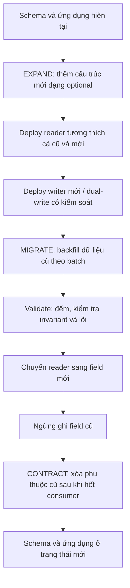

# Quản lý thay đổi schema và tương thích dữ liệu cũ

Trong **Spring Data LDAP**, entity Java, repository và filter đều dựa vào schema mà LDAP server đang áp dụng. Khi hệ thống cần thêm thuộc tính, thay đổi object class, chuẩn hóa dữ liệu hoặc ngừng dùng một attribute cũ, thay đổi đó tác động đồng thời đến **directory schema, dữ liệu hiện có và các phiên bản ứng dụng đang chạy**.

Một thay đổi schema có thể hợp lệ với entry mới nhưng làm hỏng entry cũ. Ví dụ, chuyển một thuộc tính từ tùy chọn (`MAY`) thành bắt buộc (`MUST`) sẽ khiến những entry chưa có giá trị không còn hợp lệ; đổi một attribute từ nhiều giá trị sang `SINGLE-VALUE` có thể làm dữ liệu hiện tại vi phạm schema; đổi tên hoặc xóa attribute có thể khiến phiên bản ứng dụng cũ không còn đọc được.

Vì thế, schema migration phải được lập kế hoạch như một thay đổi hợp đồng dữ liệu. Bài học trình bày chiến lược **expand–migrate–contract**: mở rộng schema theo hướng tương thích, chuyển đổi dữ liệu cũ có kiểm soát, chuyển ứng dụng sang mô hình mới, rồi mới thu hẹp hoặc loại bỏ cấu trúc cũ.

## 1. Mục tiêu học tập

Sau bài này, bạn có thể:

- Nhận diện thay đổi schema có tính tương thích ngược và thay đổi có nguy cơ phá vỡ ứng dụng.
- Phân biệt thay đổi attribute type, object class, cardinality, syntax và matching rule.
- Lập kế hoạch migration cho dữ liệu LDAP đang tồn tại, không chỉ cho entry mới.
- Áp dụng chiến lược **expand–migrate–contract** khi nhiều phiên bản ứng dụng cùng hoạt động.
- Thiết kế backfill có tính idempotent, có thể tiếp tục sau lỗi và giới hạn tải lên directory.
- Triển khai schema theo cơ chế của OpenLDAP hoặc Active Directory.
- Cập nhật entity ODM, repository và thao tác `LdapTemplate` theo từng giai đoạn.
- Xác minh dữ liệu, replication, quyền truy cập và khả năng rollback trước khi contract.
- Viết integration test chứng minh cả ứng dụng cũ lẫn ứng dụng mới tương thích trong giai đoạn chuyển tiếp.

## 2. Schema là hợp đồng giữa ứng dụng và directory

Một LDAP entry không chỉ là tập các cặp tên–giá trị. Server kiểm tra entry theo object class, attribute type, syntax, matching rule và các ràng buộc schema đang hoạt động.

Ví dụ entry người dùng:

```ldif
dn: uid=alice,ou=people,dc=example,dc=org
objectClass: top
objectClass: person
objectClass: organizationalPerson
objectClass: inetOrgPerson
uid: alice
cn: Alice Nguyen
sn: Nguyen
mail: alice@example.org
```

Giả sử ứng dụng cần thêm thuộc tính `employeeType` để phân biệt nhân viên chính thức và nhà thầu. Thay đổi này gồm nhiều phần:

1. Server phải biết attribute type `employeeType`.
2. Object class được gắn vào entry phải cho phép thuộc tính này, ví dụ qua `MAY` hoặc một auxiliary object class phù hợp.
3. Entry cũ cần được backfill nếu nghiệp vụ yêu cầu có giá trị.
4. Entity Java phải ánh xạ field mới.
5. Phiên bản ứng dụng cũ phải tiếp tục hoạt động trong lúc entry được cập nhật.

Nếu chỉ sửa Java entity rồi deploy, server có thể trả `undefinedAttributeType` hoặc `objectClassViolation`. Nếu chỉ thêm schema mà không migration dữ liệu, code mới có thể đọc giá trị rỗng ở những entry cũ.

### 2.1. Bốn lớp cần thay đổi đồng bộ

| Lớp | Thành phần | Câu hỏi phải trả lời |
| --- | --- | --- |
| Schema server | `attributeTypes`, `objectClasses`, syntax, matching rule | Server có chấp nhận entry và giá trị mới không? |
| Dữ liệu directory | Entry cũ, DN, thuộc tính và giá trị | Dữ liệu hiện có đã đáp ứng hợp đồng mới chưa? |
| Java model | ODM annotations, Java type, converter | Entity có đọc/ghi đúng dữ liệu mới và cũ không? |
| Ứng dụng | Repository, filter, API, batch/job | Các phiên bản đang chạy có thể cùng hoạt động không? |

Schema migration chỉ hoàn tất khi cả bốn lớp nhất quán.

## 3. Phân loại thay đổi schema theo mức độ tương thích

Không phải mọi thay đổi schema đều có cùng rủi ro. Trước khi triển khai, cần xác định thay đổi thuộc loại nào.

| Thay đổi | Tác động thường gặp | Đánh giá ban đầu |
| --- | --- | --- |
| Thêm attribute tùy chọn mới (`MAY`) | Entry cũ không có field vẫn hợp lệ; ứng dụng cũ thường bỏ qua field lạ. | Thường tương thích nếu schema mới được triển khai trước. |
| Thêm auxiliary object class có thuộc tính tùy chọn | Entry cũ giữ nguyên; entry mới có thể bổ sung class. | Thường tương thích nếu server cho phép class đó. |
| Thêm thuộc tính bắt buộc (`MUST`) | Entry cũ thiếu giá trị có thể không còn hợp lệ. | Phá vỡ nếu chưa backfill và mọi writer chưa cập nhật. |
| Đổi attribute từ multi-value sang `SINGLE-VALUE` | Entry đang có nhiều giá trị vi phạm schema. | Phá vỡ; cần chuẩn hóa dữ liệu trước. |
| Đổi attribute từ single-value sang multi-value | Model Java scalar và logic cũ có thể không xử lý nhiều giá trị. | Có thể phá vỡ ở tầng ứng dụng dù server chấp nhận. |
| Đổi syntax | Dữ liệu cũ có thể không hợp lệ hoặc converter không còn đúng. | Rủi ro cao; thường tạo attribute mới và migrate. |
| Đổi equality/substring matching rule | Kết quả search, compare, uniqueness và dedup có thể thay đổi. | Có thể thay đổi hành vi nghiệp vụ. |
| Đổi tên attribute hoặc object class | Reader/writer cũ có thể không nhận ra tên mới. | Phá vỡ nếu không duy trì alias hoặc chuyển tiếp. |
| Xóa attribute/object class | Dữ liệu và ứng dụng cũ có thể còn tham chiếu. | Chỉ thực hiện sau giai đoạn contract. |
| Đổi structural object class | Ảnh hưởng loại entry và chuỗi kế thừa hợp lệ. | Rất nhạy cảm; cần thiết kế và kiểm thử riêng. |

**Quy tắc an toàn:** ưu tiên thay đổi additive (thêm thành phần tùy chọn) trước; tránh sửa trực tiếp semantics của attribute đã được nhiều ứng dụng sử dụng.

### 3.1. Thêm `MAY` thường an toàn hơn thêm `MUST`

Nếu object class hiện tại:

```text
NAME 'appPerson'
STRUCTURAL
MUST ( cn $ sn )
MAY ( mail $ telephoneNumber )
```

thêm một thuộc tính mới vào `MAY` thường cho phép entry cũ tiếp tục hợp lệ:

```text
NAME 'appPerson'
STRUCTURAL
MUST ( cn $ sn )
MAY ( mail $ telephoneNumber $ employeeType )
```

Nhưng khi thêm `employeeType` vào `MUST`, tất cả entry thuộc class này cần có giá trị theo ràng buộc mới. Nếu entry cũ chưa được backfill, server có thể từ chối các thao tác sửa entry hoặc tạo entry không đáp ứng schema.

Một chiến lược phổ biến là:

1. Ban đầu khai báo `employeeType` là `MAY`.
2. Deploy ứng dụng có thể đọc field khi có, đồng thời ghi field cho entry mới/cập nhật.
3. Backfill entry cũ.
4. Xác minh toàn bộ entry mục tiêu có giá trị hợp lệ.
5. Chỉ khi thật sự cần ràng buộc server, mới cân nhắc chuyển thành `MUST` qua một thay đổi schema được hỗ trợ và đã kiểm thử.

Không phải nghiệp vụ nào cũng cần biến field thành `MUST` trong schema; có thể giữ `MAY` và áp dụng validation ở tầng ứng dụng nếu nhiều loại entry hợp lệ không có giá trị.

### 3.2. Thay đổi cardinality

Giả sử `mail` hiện có thể chứa nhiều giá trị:

```ldif
mail: alice@example.org
mail: alice@work.example.org
```

Nếu schema hoặc Java model chuyển sang một giá trị:

- Directory có thể từ chối entry đang có nhiều giá trị nếu schema mới đặt `SINGLE-VALUE`.
- Java field `String mail` không thể biểu diễn đầy đủ dữ liệu cũ.
- Cần quy định giá trị nào được giữ lại, giá trị nào được chuyển sang attribute khác và cách xử lý trùng lặp.

Ngược lại, khi chuyển từ scalar sang multi-value, server có thể chấp nhận thêm giá trị nhưng code cũ đọc `String` có thể không biết chọn giá trị nào. Đây vẫn là một breaking change ở tầng ứng dụng.

### 3.3. Không sửa syntax hoặc matching rule tùy tiện

Syntax quyết định dạng dữ liệu; matching rule quyết định cách so sánh. Thay đổi chúng có thể ảnh hưởng:

- Dữ liệu hiện có có còn hợp lệ không.
- Filter equality/substring có trả cùng tập kết quả không.
- Các giá trị trước đây được coi là trùng nhau có còn trùng không.
- Index của directory có cần xây dựng lại hoặc cập nhật không.
- Ứng dụng Java có cần converter/normalizer mới không.

Nếu semantics mới khác đáng kể, cách an toàn thường là **tạo attribute type mới với OID mới**, chuyển dữ liệu và duy trì field cũ trong giai đoạn chuyển tiếp.

## 4. Quy tắc đặt OID và thiết kế schema mở rộng

Attribute type và object class LDAP được định danh bằng OID. OID là định danh ổn định, không nên tái sử dụng cho một định nghĩa khác chỉ vì tên cũ đã bị ngừng dùng.

Khi tạo custom schema:

- Dùng OID arc thuộc quyền quản lý hợp lệ của tổ chức, thường dựa trên Private Enterprise Number.
- Ghi nhận OID, tên, mô tả, syntax, matching rule, cardinality và quan hệ kế thừa.
- Chọn tên attribute/object class ổn định, có quy ước namespace để tránh xung đột.
- Không lấy OID minh họa trên blog hoặc ví dụ của tổ chức khác làm OID nội bộ.
- Không đổi định nghĩa đã được phát hành theo cách làm các server/replica diễn giải cùng OID khác nhau.

Ví dụ minh họa, **OID dưới đây chỉ là placeholder và không được triển khai nguyên trạng**:

```text
attributeTypes: (
  1.3.6.1.4.1.<enterprise-number>.10.1
  NAME 'appEmployeeType'
  DESC 'Employment classification used by the application'
  EQUALITY caseIgnoreMatch
  SUBSTR caseIgnoreSubstringsMatch
  SYNTAX 1.3.6.1.4.1.1466.115.121.1.15
)
```

Object class bổ sung:

```text
objectClasses: (
  1.3.6.1.4.1.<enterprise-number>.10.2
  NAME 'appEmployeeAux'
  SUP top
  AUXILIARY
  MAY appEmployeeType
)
```

Việc dùng auxiliary class có thể phù hợp khi muốn bổ sung thuộc tính ứng dụng mà không thay đổi structural class hiện tại. Tuy nhiên, phải kiểm tra server có hỗ trợ class và quy tắc entry đó không; không gắn tùy tiện auxiliary class vào mọi entry.

## 5. Chiến lược expand–migrate–contract

Khi ứng dụng có rolling deployment, nhiều instance hoặc nhiều consumer cùng truy cập LDAP, không thể giả định tất cả code được nâng cấp cùng lúc. Một quy trình an toàn chia thay đổi thành ba giai đoạn.



### 5.1. Expand

Mục tiêu là tạo khả năng lưu trữ mới mà không làm entry cũ mất tính hợp lệ:

1. Thêm attribute type mới vào schema.
2. Nếu cần, thêm auxiliary object class hoặc thêm thuộc tính vào `MAY`.
3. Giữ nguyên attribute/object class cũ.
4. Triển khai schema tới các node/replica cần phục vụ ứng dụng.
5. Xác minh mọi server đã nhận schema mới trước khi deploy code ghi field mới.

Ứng dụng cũ thường bỏ qua attribute chưa biết, nhưng điều này phải được kiểm thử với ODM, converter và serializer thực tế. Một phiên bản cũ có thể đọc toàn bộ entry rồi ghi đè attribute set, vô tình xóa field mới nếu mapper hoặc logic update không bảo toàn thuộc tính không được ánh xạ.

### 5.2. Migrate

Chuyển đổi dữ liệu hiện có:

- Đọc theo paging/batch có giới hạn.
- Xử lý theo từng entry, không tải toàn bộ directory vào heap.
- Tạo giá trị mới từ dữ liệu cũ bằng quy tắc xác định.
- Ghi thay đổi idempotent để có thể chạy lại.
- Ghi nhận checkpoint, số lượng thành công, bỏ qua và lỗi.
- Giới hạn tốc độ để không làm quá tải LDAP server hoặc replication.
- Đối chiếu dữ liệu sau khi backfill.

### 5.3. Contract

Chỉ xóa cấu trúc cũ sau khi:

- Tất cả reader đã chuyển sang attribute mới.
- Tất cả writer không còn ghi attribute cũ.
- Batch/job/ứng dụng bên ngoài không còn tham chiếu tên cũ.
- Dữ liệu cũ đã được chuyển hoặc được lưu trữ theo chính sách.
- Có backup/khả năng phục hồi và kế hoạch rollback phù hợp.
- Schema mới đã ổn định trên các replica.

Contract là giai đoạn có rủi ro cao nhất vì nó loại bỏ khả năng tương thích với consumer cũ.

## 6. Ví dụ migration: từ `employeeNumber` sang `appEmployeeCode`

Giả sử ứng dụng cũ dùng:

```ldif
employeeNumber: E-10042
```

Nghiệp vụ muốn dùng attribute mới `appEmployeeCode` để tách mã nội bộ khỏi khái niệm employee number chung của directory.

**Không đổi OID của attribute cũ hoặc thay syntax của nó tại chỗ.** Tạo attribute mới với OID thuộc enterprise arc của tổ chức, giữ attribute cũ trong giai đoạn chuyển tiếp.

### 6.1. Trạng thái trước migration

```text
Schema:
  employeeNumber: đang được ứng dụng cũ sử dụng
  appEmployeeCode: chưa tồn tại

Entry:
  uid=alice
  employeeNumber=E-10042

Ứng dụng:
  v1 đọc/ghi employeeNumber
```

### 6.2. Expand schema

Sau khi định nghĩa attribute mới và triển khai tới các server:

```text
Schema:
  employeeNumber: giữ nguyên
  appEmployeeCode: mới, optional, cùng syntax tương thích dữ liệu
```

Nếu cần object class riêng, thêm auxiliary class có `MAY appEmployeeCode`. Entry cũ chưa cần gắn class mới cho đến khi bắt đầu migration hoặc ghi field mới, tùy thiết kế schema và quy trình quản trị.

### 6.3. Deploy ứng dụng tương thích chuyển tiếp

Reader mới có thể ưu tiên field mới, nhưng vẫn đọc field cũ khi dữ liệu chưa được backfill:

```java
public String resolveEmployeeCode(Person person) {
    if (person.getAppEmployeeCode() != null
            && !person.getAppEmployeeCode().isBlank()) {
        return person.getAppEmployeeCode();
    }
    return person.getEmployeeNumber();
}
```

Đây là logic tương thích tạm thời. Nhưng cần metric để biết fallback còn được sử dụng bao nhiêu lần. Khi fallback count về 0 ổn định và được xác minh trên toàn bộ replica/consumer, có thể lên kế hoạch bỏ đường đọc cũ.

Writer mới có thể ghi cả hai attribute trong một LDAP Modify operation để giữ consumer cũ hoạt động:

```java
import javax.naming.Name;
import javax.naming.directory.BasicAttribute;
import javax.naming.directory.DirContext;
import javax.naming.directory.ModificationItem;
import org.springframework.ldap.core.LdapTemplate;

public void updateEmployeeCode(
        LdapTemplate ldapTemplate,
        Name personDn,
        String employeeCode) {

    var oldValue = new BasicAttribute("employeeNumber");
    oldValue.add(employeeCode);

    var newValue = new BasicAttribute("appEmployeeCode");
    newValue.add(employeeCode);

    ModificationItem[] changes = {
        new ModificationItem(DirContext.REPLACE_ATTRIBUTE, oldValue),
        new ModificationItem(DirContext.REPLACE_ATTRIBUTE, newValue)
    };

    ldapTemplate.modifyAttributes(personDn, changes);
}
```

Ví dụ giả định hai attribute đều single-value và cùng chấp nhận giá trị. Nếu attribute cũ/new có semantics khác, không copy mù quáng. Một Modify request cập nhật một entry; migration hàng nghìn entry vẫn không phải transaction toàn directory.

### 6.4. Backfill entry cũ

LDIF minh họa:

```ldif
dn: uid=alice,ou=people,dc=example,dc=org
changetype: modify
add: appEmployeeCode
appEmployeeCode: E-10042
-
```

Khi chạy nhiều lần, `add` có thể thất bại nếu giá trị đã tồn tại. Job migration phải kiểm tra trạng thái hiện tại hoặc dùng chiến lược replace phù hợp với cardinality và quyền sở hữu dữ liệu. Không bỏ qua mọi lỗi `attributeOrValueExists`, vì có thể che giấu dữ liệu khác với giá trị mong muốn.

### 6.5. Validate và switch reader

Sau backfill, kiểm tra:

- Số entry có `employeeNumber` trong phạm vi migration.
- Số entry có `appEmployeeCode`.
- Số entry có cả hai giá trị nhưng khác nhau.
- Entry thiếu cả hai hoặc có giá trị không hợp lệ.
- Tính duy nhất nếu nghiệp vụ yêu cầu duy nhất.
- Kết quả truy vấn của ứng dụng mới và cũ.

Chỉ chuyển reader sang field mới khi các invariant đạt yêu cầu và mọi replica mà ứng dụng có thể đọc đều có dữ liệu đã migrate.

### 6.6. Contract

Khi không còn consumer cũ:

1. Ngừng dual-write attribute `employeeNumber`.
2. Theo dõi một khoảng thời gian để xác nhận không còn reader/writer cũ.
3. Sao lưu hoặc lưu trữ dữ liệu cũ theo yêu cầu kiểm toán.
4. Xóa attribute cũ khỏi entry nếu chính sách yêu cầu.
5. Chỉ loại bỏ định nghĩa cũ khỏi schema khi không còn entry, ứng dụng hay công cụ quản trị nào sử dụng.

Không xóa schema definition trước khi dọn dữ liệu và xác nhận không còn consumer.

## 7. Thiết kế backfill an toàn và có thể chạy lại

Một job migration tốt không phụ thuộc việc chạy đúng một lần. Nó phải có thể dừng giữa chừng, tiếp tục sau sự cố và không tạo dữ liệu sai khi chạy lặp.

### 7.1. Idempotency

Một migration idempotent có kết quả cuối giống nhau khi chạy một lần hoặc nhiều lần với cùng nguồn dữ liệu.

Ví dụ quy tắc:

```text
Nếu appEmployeeCode chưa có:
    lấy employeeNumber
    chuẩn hóa theo quy tắc đã duyệt
    ghi appEmployeeCode
Nếu appEmployeeCode đã có và bằng giá trị kỳ vọng:
    bỏ qua
Nếu appEmployeeCode đã có nhưng khác:
    ghi conflict để xử lý thủ công hoặc theo chính sách rõ ràng
```

Không tự ghi đè giá trị mới đã được người dùng cập nhật trong lúc job migration đang chạy. Trước khi replace, cần xác định nguồn dữ liệu có còn là source of truth hay không.

### 7.2. Paging và giới hạn tải

Directory lớn cần được đọc theo page:

- Dùng LDAP paged results control nếu server hỗ trợ.
- Giới hạn số entry mỗi page và số request đồng thời.
- Chỉ yêu cầu các attribute cần cho migration.
- Đặt timeout cho search và thao tác ghi.
- Có delay/backoff khi server quá tải hoặc trả lỗi tạm thời.
- Theo dõi latency, connection pool, replication lag và lỗi LDAP.

Không giả định `countLimit` tương đương paging. Count limit giới hạn kết quả; paged results control cho phép duyệt tập kết quả lớn theo nhiều trang.

### 7.3. Checkpoint và retry

Có thể lưu checkpoint ngoài LDAP theo cơ chế vận hành của ứng dụng:

| Trường | Mục đích |
| --- | --- |
| Migration ID/version | Xác định đợt chuyển đổi. |
| Last processed DN hoặc cursor | Tiếp tục từ vị trí phù hợp. |
| Processed count | Đếm entry đã xử lý. |
| Success/skipped/conflict/error count | Theo dõi kết quả. |
| Started/updated timestamp | Điều tra tiến trình và thời gian chạy. |
| Error sample/reference | Tra cứu entry lỗi mà không log dữ liệu nhạy cảm. |

DN có thể thay đổi nếu entry được rename/move; nếu server có immutable identifier phù hợp như `entryUUID` hoặc `objectGUID`, cân nhắc dùng nó làm định danh checkpoint. Không giả định mọi directory đều có cùng attribute định danh.

Retry chỉ nên áp dụng cho lỗi tạm thời như communication failure hoặc busy/unavailable theo chính sách. Lỗi schema, invalid syntax, constraint violation hoặc conflict dữ liệu cần được phân loại và xử lý riêng.

### 7.4. Ví dụ cập nhật một thuộc tính đơn trị

Ví dụ dưới đây chỉ dành cho attribute mới đã được schema xác nhận là single-value. `REPLACE_ATTRIBUTE` giúp chạy lại với cùng giá trị mà không tạo thêm giá trị trùng:

```java
import javax.naming.Name;
import javax.naming.directory.BasicAttribute;
import javax.naming.directory.DirContext;
import javax.naming.directory.ModificationItem;
import org.springframework.ldap.core.LdapTemplate;

public class EmployeeCodeMigration {
    private final LdapTemplate ldapTemplate;

    public EmployeeCodeMigration(LdapTemplate ldapTemplate) {
        this.ldapTemplate = ldapTemplate;
    }

    public void writeTargetValue(Name dn, String employeeCode) {
        if (employeeCode == null || employeeCode.isBlank()) {
            throw new IllegalArgumentException(
                    "employeeCode phải có giá trị");
        }

        var target = new BasicAttribute("appEmployeeCode");
        target.add(employeeCode);

        ldapTemplate.modifyAttributes(
                dn,
                new ModificationItem[]{
                    new ModificationItem(
                            DirContext.REPLACE_ATTRIBUTE, target)
                });
    }
}
```

Đây là helper ghi một entry, không phải migration runner hoàn chỉnh. Runner vẫn cần paging, checkpoint, kiểm tra giá trị nguồn, conflict policy, retry có giới hạn, logging an toàn và tổng hợp kết quả.

Với attribute multi-value, `REPLACE_ATTRIBUTE` thay toàn bộ tập giá trị; nếu chỉ muốn thêm một giá trị, dùng `ADD_ATTRIBUTE` sau khi đọc/kiểm tra membership hoặc dùng một quy trình reconcile rõ ràng. Đừng dùng replace cho attribute multi-value khi không sở hữu toàn bộ tập giá trị.

## 8. Tương thích giữa nhiều phiên bản ứng dụng

Trong rolling deployment, có thể cùng lúc tồn tại:

- Ứng dụng v1 chỉ biết attribute cũ.
- Ứng dụng v2 biết cả attribute cũ và mới.
- Job migration đang backfill.
- Một consumer khác chỉ đọc LDAP và chưa thể nâng cấp ngay.

Ma trận sau giúp đánh giá:

| Schema/data state | App v1 (cũ) | App v2 (tương thích chuyển tiếp) |
| --- | --- | --- |
| Chỉ có attribute cũ | Hoạt động | Đọc fallback từ attribute cũ. |
| Có schema mới, dữ liệu chưa backfill | Thường hoạt động nếu schema mới additive | Đọc fallback, ghi cả hai nếu cần. |
| Một phần entry có cả hai | Đọc field cũ | Ưu tiên field mới, đối chiếu khi cần. |
| Tất cả entry đã backfill | Đọc field cũ | Đọc field mới. |
| Đã ngừng ghi field cũ | Chỉ còn hoạt động nếu field cũ vẫn được duy trì | Hoạt động với field mới. |
| Field cũ bị xóa | Không còn tương thích | Hoạt động nếu đã bỏ mọi phụ thuộc cũ. |

**Không thực hiện contract khi còn App v1.** Một instance cũ có thể vẫn chạy trong autoscaling group, worker queue, batch job hoặc consumer bên ngoài mà nhóm triển khai không nhìn thấy.

### 8.1. Dual-read

Trong giai đoạn chuyển tiếp, reader mới có thể đọc field mới trước rồi fallback field cũ:

```java
public String employeeCode(Person person) {
    String current = person.getAppEmployeeCode();
    if (current != null && !current.isBlank()) {
        return current;
    }
    return person.getEmployeeNumber();
}
```

Dual-read hữu ích khi dữ liệu chưa backfill xong. Nhưng cần metric để biết fallback còn được sử dụng bao nhiêu lần. Khi fallback count về 0 ổn định và được xác minh trên toàn bộ replica/consumer, có thể lên kế hoạch bỏ đường đọc cũ.

### 8.2. Dual-write

Trong giai đoạn chuyển tiếp, writer mới có thể ghi cả field cũ và field mới:

- Giữ consumer cũ đọc được dữ liệu mới.
- Đảm bảo hai field có cùng giá trị theo quy tắc migration.
- Ghi trong một LDAP Modify operation trên cùng entry khi có thể.
- Ghi metric khi một trong hai cập nhật thất bại.

Không nên dual-write vô thời hạn. Hai bản dữ liệu tạo ra nguy cơ drift. Cần xác định ngày dừng ghi field cũ và một source of truth duy nhất sau migration.

### 8.3. Consumer cũ có thể xóa field mới ngoài ý muốn

Một rủi ro tinh vi là code cũ đọc entry rồi ghi lại toàn bộ attribute set. Nếu mapper không biết attribute mới, thao tác update có thể xóa field đó hoặc thay đổi object class.

Trước khi rollout, kiểm tra:

- Repository `save`/`update` có replace toàn bộ thuộc tính hay chỉ thay field được map?
- `LdapTemplate.update(...)`/`modifyAttributes(...)` đang thực hiện thao tác gì?
- Mapper có giữ lại attribute không được ánh xạ không?
- Có job nào ghi nguyên entry từ snapshot cũ không?

Thử nghiệm với một entry có field mới rồi chạy đường update của ứng dụng cũ. Xác nhận field mới vẫn còn nếu yêu cầu tương thích đòi hỏi điều đó.

## 9. Đổi tên hoặc thay thế attribute

LDAP schema không có thao tác rename attribute an toàn theo nghĩa đổi một tên và mọi client tự động hiểu. Một attribute type có thể có nhiều descriptor/alias trong schema, nhưng khả năng thêm alias và semantics của từng server cần được xác minh. Alias không thay thế việc cập nhật code và kiểm tra consumer.

Khi cần đổi tên hoặc thay semantics:

1. Tạo attribute mới với OID mới nếu đây là định nghĩa mới.
2. Giữ attribute cũ trong schema và dữ liệu.
3. Cho ứng dụng mới đọc cả hai, ưu tiên field mới.
4. Backfill từ attribute cũ sang attribute mới.
5. Dual-write trong giai đoạn consumer cũ còn tồn tại.
6. Theo dõi fallback và usage của field cũ.
7. Ngừng ghi field cũ, rồi ngừng đọc field cũ.
8. Dọn dữ liệu cũ và chỉ sau đó mới cân nhắc loại bỏ schema definition.

Không tái sử dụng OID của attribute cũ cho một ý nghĩa mới. Nếu tên cũ cần được giữ làm alias, phải xác nhận schema server hỗ trợ và các ứng dụng có xử lý tên đó đúng hay không.

## 10. Thay đổi object class

Thay đổi object class có thể ảnh hưởng tính hợp lệ của entry nhiều hơn thay đổi một attribute tùy chọn.

### 10.1. Thêm auxiliary class

Khi cần bổ sung các thuộc tính riêng của ứng dụng, có thể tạo auxiliary class với các thuộc tính `MAY`. Ví dụ:

```ldif
dn: uid=alice,ou=people,dc=example,dc=org
changetype: modify
add: objectClass
objectClass: appEmployeeAux
-
add: appEmployeeType
appEmployeeType: permanent
-
```

Phải triển khai schema định nghĩa `appEmployeeAux` trước khi gắn class vào entry. Nếu thêm class nhưng server chưa biết định nghĩa, thao tác có thể bị từ chối.

### 10.2. Thay structural class

Thay structural class cần kiểm tra:

- Chuỗi `SUP` và loại class (`STRUCTURAL`, `AUXILIARY`, `ABSTRACT`).
- Quy tắc structural object class của server.
- Các thuộc tính `MUST`/`MAY` được kế thừa.
- DN và naming attribute có còn hợp lệ không.
- Các ứng dụng có filter dựa vào `objectClass` cụ thể hay không.

Không chuyển structural class chỉ để “thêm một field”. Auxiliary class hoặc thêm attribute tùy chọn vào class hiện tại thường là hướng ít xáo trộn hơn, nếu schema/server cho phép.

## 11. Khác biệt quy trình giữa OpenLDAP và Active Directory

Schema migration phải theo cơ chế quản trị của từng directory vendor. Không dùng chung một file schema hoặc quy trình rollout cho mọi server.

| Chủ đề | OpenLDAP | Active Directory |
| --- | --- | --- |
| Cách lưu schema | Có thể dùng schema file hoặc dynamic configuration `cn=config`. | Schema được lưu trong schema naming context dưới dạng `classSchema` và `attributeSchema` objects. |
| Mở rộng schema | Nạp/đăng ký attribute type và object class theo cấu hình server. | Tạo schema objects theo quy trình AD, thường qua công cụ quản trị schema/LDAP phù hợp. |
| Phạm vi replication | Phụ thuộc topology và cấu hình replication của OpenLDAP. | Schema được replicate trong forest; thay đổi liên quan schema master và replication. |
| Quyền thay đổi | Cần quyền quản trị cấu hình/schema. | Cần quyền schema administration phù hợp và quy trình forest. |
| Kiểm tra trước rollout | Xác minh schema đã nạp trên từng server phục vụ ứng dụng. | Xác minh schema đã replicate tới các DC cần thiết. |
| Rollback | Tùy loại thay đổi và cách quản lý `cn=config`/schema files. | Thường khó đảo ngược schema object đã replicate; cần thiết kế tương thích và quy trình quản trị. |

### 11.1. OpenLDAP

OpenLDAP có thể quản lý schema theo hai cách phổ biến:

- **Static schema configuration:** schema được khai báo qua file cấu hình hoặc cơ chế include tùy cách triển khai.
- **Dynamic configuration (`cn=config`):** schema được quản lý bằng các entry cấu hình, thường dùng thuộc tính `olcAttributeTypes` và `olcObjectClasses`.

Ví dụ LDIF minh họa thêm schema vào `cn=config`:

```ldif
dn: cn=appEmployee,cn=schema,cn=config
objectClass: olcSchemaConfig
cn: appEmployee
olcAttributeTypes: ( 1.3.6.1.4.1.<enterprise-number>.10.1
  NAME 'appEmployeeType'
  DESC 'Application employee type'
  EQUALITY caseIgnoreMatch
  SUBSTR caseIgnoreSubstringsMatch
  SYNTAX 1.3.6.1.4.1.1466.115.121.1.15 )
olcObjectClasses: ( 1.3.6.1.4.1.<enterprise-number>.10.2
  NAME 'appEmployeeAux'
  SUP top AUXILIARY
  MAY appEmployeeType )
```

Đây là cấu trúc minh họa. OID phải được thay bằng OID hợp lệ của tổ chức; cú pháp và cách nạp phụ thuộc phiên bản/cấu hình. Việc cập nhật `cn=config` cần quyền quản trị và nên có backup cấu hình.

Không giả định thay đổi schema trên một node đã được replicate tới mọi node. Kiểm tra topology, syncrepl và trạng thái từng consumer endpoint.

### 11.2. Active Directory

Trong Active Directory, schema là thành phần cấp forest. Các schema objects được quản lý trong schema naming context và replication tới domain controller trong forest.

Trước khi mở rộng schema:

- Xác định Schema Master role holder và quy trình thay đổi.
- Dùng OID hợp lệ và kiểm tra `lDAPDisplayName` không xung đột.
- Xem xét `attributeSyntax`, `oMSyntax`, `isSingleValued`, `systemOnly`, `mustContain` và `mayContain`.
- Kiểm tra quyền Schema Admins/ủy quyền theo chính sách tổ chức.
- Xác minh replication và khả năng truy vấn schema trên các DC liên quan.
- Đánh giá tác động tới ứng dụng dùng `sAMAccountName`, `userPrincipalName`, `objectGUID`, `objectSid`, `member` và các attribute AD-specific.

Không nên giả định schema AD có thể rollback bằng cách xóa object schema đã tạo. Một số schema changes được thiết kế để tồn tại lâu dài hoặc bị giới hạn khả năng đảo ngược. Vì vậy, hãy ưu tiên thay đổi additive và kiểm thử trước khi phát hành.

## 12. Cập nhật Spring Data LDAP ODM

Sau khi schema được mở rộng, Java entity có thể thêm field mới. Nhưng thời điểm deploy phụ thuộc giai đoạn migration.

### 12.1. Entity tương thích cả dữ liệu cũ và mới

Ví dụ:

```java
package com.example.directory;

import javax.naming.Name;
import org.springframework.ldap.odm.annotations.Attribute;
import org.springframework.ldap.odm.annotations.Entry;
import org.springframework.ldap.odm.annotations.Id;

@Entry(
    base = "ou=people",
    objectClasses = {
        "top", "person", "organizationalPerson", "inetOrgPerson",
        "appEmployeeAux"
    }
)
public class Person {
    @Id
    private Name dn;

    @Attribute(name = "employeeNumber")
    private String employeeNumber;

    @Attribute(name = "appEmployeeCode")
    private String appEmployeeCode;

    protected Person() { }

    public String getEmployeeNumber() { return employeeNumber; }
    public String getAppEmployeeCode() { return appEmployeeCode; }
}
```

Field mới có thể `null` đối với entry cũ chưa được backfill. Code nghiệp vụ cần xử lý trạng thái đó có chủ đích; không giả định ODM tự điền giá trị mặc định khi LDAP attribute vắng mặt.

Nếu `appEmployeeAux` chỉ được gắn vào entry sau migration, hãy xác minh ODM có thể đọc entry cũ thiếu auxiliary class trong cùng repository/entity mapping hay không. Nếu mapping yêu cầu class đó trên mọi entry, có thể cần chia profile/entity hoặc thực hiện rollout theo cách không khiến reader mới từ chối entry cũ.

### 12.2. Không tự biến field tùy chọn thành bắt buộc trong Java

Nếu dữ liệu cũ chưa có attribute, Java model nên thể hiện khả năng vắng mặt:

```java
@Attribute(name = "appEmployeeCode")
private String appEmployeeCode; // Có thể null trong giai đoạn chuyển tiếp.
```

Không viết constructor/getter mặc định trả một giá trị giả rồi vô tình ghi nó vào directory. Nếu có default, cần xác định đó là default nghiệp vụ, default migration hay chỉ là giá trị hiển thị.

### 12.3. Khi field cũ được ngừng sử dụng

Sau khi contract hoàn tất:

- Bỏ field cũ khỏi entity nếu không còn consumer.
- Bỏ fallback trong service.
- Bỏ query/filter tham chiếu attribute cũ.
- Xóa dual-write.
- Cập nhật test fixture và tài liệu API.
- Chỉ loại bỏ schema definition sau khi kiểm tra toàn bộ directory và consumer.

Không xóa field Java trước khi xác minh mọi code path, batch job và integration bên ngoài đã chuyển đổi.

## 13. Cập nhật dữ liệu bằng Spring LDAP

Spring Data LDAP repository tiện cho thao tác entity; với migration cần kiểm soát từng attribute, `LdapTemplate.modifyAttributes(...)` thường thể hiện rõ hơn.

### 13.1. Thêm giá trị vào attribute mới

Ví dụ cho attribute single-value:

```java
import javax.naming.Name;
import javax.naming.directory.BasicAttribute;
import javax.naming.directory.DirContext;
import javax.naming.directory.ModificationItem;
import org.springframework.ldap.core.LdapTemplate;

public void setEmployeeCode(
        LdapTemplate ldapTemplate,
        Name dn,
        String employeeCode) {

    var attribute = new BasicAttribute("appEmployeeCode");
    attribute.add(employeeCode);

    ldapTemplate.modifyAttributes(
            dn,
            new ModificationItem[]{
                new ModificationItem(
                        DirContext.REPLACE_ATTRIBUTE, attribute)
            });
}
```

`REPLACE_ATTRIBUTE` thay giá trị hiện tại của attribute. Ví dụ này an toàn cho migration khi attribute đích là single-value và migration sở hữu giá trị đó. Với multi-value, replace có thể xóa các giá trị khác; hãy đọc/merge/reconcile hoặc dùng `ADD_ATTRIBUTE` khi đúng mục đích.

### 13.2. Xóa giá trị cũ sau khi chuyển đổi

Chỉ sau khi xác nhận attribute mới đã có dữ liệu đúng:

```java
var oldAttribute = new BasicAttribute("employeeNumber");
ldapTemplate.modifyAttributes(
        dn,
        new ModificationItem[]{
            new ModificationItem(
                    DirContext.REMOVE_ATTRIBUTE, oldAttribute)
        });
```

Đây là thao tác phá hủy dữ liệu cũ. Không chạy trong giai đoạn backfill ban đầu. Trước khi remove, xác nhận giá trị đã được chuyển, backup đáp ứng yêu cầu và không còn consumer cũ.

### 13.3. Một Modify request có thể chứa nhiều thay đổi

Có thể gom thao tác thêm field mới và cập nhật field cũ vào cùng một `ModificationItem[]` cho một entry. LDAP Modify request áp dụng các modification theo thứ tự trong request và được xử lý như một thao tác trên entry; nhưng một batch gồm hàng nghìn entry không trở thành một transaction toàn cục.

Nếu một entry thất bại, job cần ghi nhận riêng entry đó và tiếp tục theo chính sách. Không giả định nhiều lần gọi `modifyAttributes` trên nhiều DN được commit/rollback cùng nhau.

## 14. Kiểm tra tính toàn vẹn sau migration

Backfill thành công không đồng nghĩa dữ liệu đã tương thích. Cần xác minh các invariant của nghiệp vụ.

Ví dụ với `employeeNumber` và `appEmployeeCode`:

| Kiểm tra | Điều kiện mong đợi |
| --- | --- |
| Entry có giá trị cũ | Có giá trị mới tương ứng hoặc được phân loại ngoại lệ. |
| Cả hai field đều có | Giá trị bằng nhau theo quy tắc chuẩn hóa đã định nghĩa. |
| Entry thiếu cả hai | Có danh sách xử lý; không âm thầm bỏ qua. |
| Giá trị mới trùng lặp | Được xử lý theo quy tắc uniqueness của nghiệp vụ/schema. |
| Giá trị sai syntax/format | Không được ghi; có error record để xử lý. |
| Entry không thuộc phạm vi | Không bị migration sửa ngoài ý muốn. |
| Replica khác nhau | Đọc từ các endpoint cần thiết cho kết quả nhất quán theo mức replication cho phép. |

### 14.1. Đếm và đối chiếu

Nên ghi lại:

- Tổng số entry trong phạm vi.
- Số entry có field cũ.
- Số entry có field mới.
- Số entry có cả hai và khớp nhau.
- Số entry conflict hoặc không đủ dữ liệu.
- Số entry bị từ chối bởi schema/ACL.
- Thời điểm và checkpoint cuối cùng.

Sử dụng cùng filter, base DN, scope và quyền đọc khi so sánh trước/sau; nếu thay đổi phạm vi tìm kiếm giữa hai lần đếm, số liệu không thể đối chiếu trực tiếp.

### 14.2. Kiểm tra replication

Với directory có replication, schema và dữ liệu có thể đến replica ở thời điểm khác nhau. Nếu ứng dụng đọc luân phiên nhiều endpoint:

- Không chuyển traffic sang replica chưa có schema mới.
- Theo dõi replication lag và lỗi schema replication.
- Tránh backfill đồng thời trên nhiều replica writable nếu topology không hỗ trợ multi-master theo cách an toàn.
- Chọn một writer/leader hoặc quy trình điều phối theo kiến trúc directory.
- Sau migration, xác minh các read endpoint nhìn thấy dữ liệu mới trước khi bỏ fallback.

Không giả định mọi LDAP replication topology có consistency tức thời.

## 15. Rollback và phục hồi

Schema migration thường không có rollback đơn giản như rollback một bản deploy Java. Dữ liệu đã backfill hoặc schema đã replicate có thể không thể đảo ngược an toàn.

### 15.1. Rollback theo từng giai đoạn

| Giai đoạn | Cách xử lý khi có lỗi |
| --- | --- |
| Trước expand | Không có thay đổi directory; sửa kế hoạch. |
| Sau expand, trước backfill | Có thể rollback ứng dụng; schema additive thường có thể giữ lại mà không gây hại. |
| Trong backfill | Dừng job, giữ checkpoint, phân loại lỗi; không xóa field mới hàng loạt. |
| Sau backfill, trước switch reader | Có thể tiếp tục dùng reader cũ; dữ liệu mới có thể giữ lại để điều tra. |
| Sau switch reader, còn dual-write | Rollback app về reader cũ nếu field cũ vẫn được ghi và đồng bộ. |
| Sau ngừng ghi field cũ | Rollback về app cũ có thể cần khôi phục dual-write hoặc backfill ngược. |
| Sau contract/xóa field cũ | Rollback phức tạp; cần restore từ backup hoặc migration ngược đã kiểm chứng. |

### 15.2. Schema additive có thể giữ lại

Nếu đã thêm một attribute tùy chọn nhưng rollout ứng dụng thất bại, thường có thể giữ định nghĩa schema mới trong khi rollback code, miễn schema không làm thay đổi validity của entry cũ và không có rủi ro khác. Không nhất thiết phải xóa schema ngay.

Việc xóa schema definition có thể bị server hạn chế nếu attribute/object class đã được sử dụng trong entry. Trước khi xóa, cần dọn mọi reference và xác minh hành vi server.

### 15.3. Backup trước thay đổi phá hủy

Trước khi:

- Xóa attribute khỏi nhiều entry.
- Đổi cardinality.
- Loại bỏ object class.
- Thay structural class.
- Contract attribute cũ.

cần có backup/LDIF export hoặc cơ chế phục hồi tương đương, được kiểm thử khôi phục. Backup phải bao gồm dữ liệu và metadata cần thiết; một bản dump không được kiểm tra restore chưa phải kế hoạch phục hồi hoàn chỉnh.

## 16. Kiểm thử schema migration

Kiểm thử phải bao phủ cả dữ liệu cũ và mới. Chỉ tạo entry mới theo schema mới sẽ bỏ sót lỗi tương thích.

### 16.1. Ma trận kiểm thử

| Trường hợp | Điều cần xác minh |
| --- | --- |
| Entry cũ thiếu attribute mới | App mới đọc được và xử lý `null`/fallback đúng. |
| Entry mới có attribute mới | ODM map đúng kiểu và repository truy vấn đúng. |
| Entry có cả attribute cũ và mới | Quy tắc ưu tiên/conflict rõ ràng. |
| Backfill chạy hai lần | Không tạo giá trị trùng hoặc ghi đè dữ liệu mới ngoài ý muốn. |
| Backfill dừng giữa batch | Có thể tiếp tục từ checkpoint. |
| Attribute đích multi-value | Không vô tình xóa các giá trị khác khi replace. |
| Entry vi phạm schema | Job phân loại lỗi, không đánh dấu thành công. |
| App cũ đọc entry đã migrate | Field cũ còn tương thích trong giai đoạn chuyển tiếp. |
| App cũ update entry có field mới | Field mới không bị xóa ngoài ý muốn. |
| Replication trễ | Reader không switch trước khi replica đạt điều kiện. |
| Rollback app | Reader cũ vẫn hoạt động với dữ liệu trong giai đoạn hiện tại. |
| Contract | Không còn consumer tham chiếu attribute/object class cũ. |

### 16.2. Unit test cho reader tương thích

Ví dụ kiểm tra logic fallback:

```java
import static org.junit.jupiter.api.Assertions.assertEquals;

import org.junit.jupiter.api.Test;

class EmployeeCodeResolverTest {
    private final EmployeeCodeResolver resolver =
            new EmployeeCodeResolver();

    @Test
    void readsLegacyValueWhenNewAttributeIsAbsent() {
        var person = new PersonFixture()
                .employeeNumber("E-10042")
                .appEmployeeCode(null)
                .build();

        assertEquals("E-10042", resolver.resolve(person));
    }

    @Test
    void prefersNewValueAfterMigration() {
        var person = new PersonFixture()
                .employeeNumber("E-10042")
                .appEmployeeCode("E-10042")
                .build();

        assertEquals("E-10042", resolver.resolve(person));
    }
}
```

Đây là unit test cho quy tắc fallback. Cần thêm integration test với directory thật để xác minh ODM đọc đúng entry có/không có attribute.

### 16.3. Integration test cho schema validation

Với directory test:

1. Tạo entry theo schema cũ.
2. Cài schema mở rộng.
3. Đọc entry cũ bằng entity mới.
4. Thêm attribute mới và đọc lại.
5. Chạy backfill lần hai để xác minh idempotency.
6. Thử entry thiếu `MUST` hoặc sai syntax để xác minh server từ chối.
7. Chạy reader cũ trên entry đã migrate.
8. Chạy đường update của app cũ và kiểm tra field mới không bị xóa.

Các LDAP result code có thể khác nhau theo server/provider; test nên xác minh nhóm lỗi/schema semantics cần thiết và chỉ assert mã cụ thể khi môi trường đã cố định.

## 17. Checklist trước khi triển khai

### Thiết kế schema

- [ ] Có inventory các attribute/object class và consumer hiện tại.
- [ ] OID mới thuộc enterprise arc hợp lệ và không tái sử dụng OID cũ.
- [ ] Syntax, matching rule, cardinality và `MUST`/`MAY` đã được xác nhận.
- [ ] Đã đánh giá structural class và auxiliary class.
- [ ] Thay đổi additive được ưu tiên trước thay đổi phá vỡ.

### Dữ liệu

- [ ] Có số liệu baseline về entry và giá trị hiện tại.
- [ ] Quy tắc chuyển đổi, default và conflict được phê duyệt.
- [ ] Backfill có paging, checkpoint, retry giới hạn và idempotency.
- [ ] Có metric thành công/bỏ qua/conflict/lỗi.
- [ ] Có quy trình xử lý entry sai hoặc thiếu dữ liệu.

### Ứng dụng

- [ ] Entity ODM đọc được entry cũ và mới.
- [ ] Reader fallback có metric và thời điểm loại bỏ.
- [ ] Dual-write chỉ tồn tại trong thời gian cần thiết.
- [ ] Code cũ không xóa field mới khi update entry.
- [ ] Repository/filter/API đã được kiểm tra trên schema mới.

### Vận hành

- [ ] Schema đã triển khai trên các server/replica cần thiết.
- [ ] Có backup và đã kiểm tra restore.
- [ ] Có lịch rollout, checkpoint và điều kiện dừng.
- [ ] Có rollback plan riêng cho từng giai đoạn.
- [ ] Contract chỉ bắt đầu sau khi mọi consumer cũ đã được loại bỏ.

## 18. Bài tập thực hành

**Bài 1.** Ứng dụng cần thêm `employeeType` cho entry người dùng. Vì sao thêm attribute vào `MAY` thường an toàn hơn thêm vào `MUST` ngay?

**Đáp án:** Entry cũ có thể không có thuộc tính mới nhưng vẫn hợp lệ khi thuộc tính là `MAY`. Nếu chuyển thành `MUST`, entry cũ thiếu giá trị có thể vi phạm schema và gây lỗi khi sửa/ghi.

**Bài 2.** Một attribute đang có nhiều giá trị. Có thể đặt `SINGLE-VALUE` ngay sau khi đổi Java field từ `Set<String>` sang `String` không?

**Đáp án:** Không. Phải thống kê và chuẩn hóa các entry đang có nhiều giá trị, xác định giá trị giữ lại và kiểm tra mọi consumer cũ trước khi đổi cardinality.

**Bài 3.** Vì sao đổi syntax của attribute đang sử dụng thường nên tạo attribute mới?

**Đáp án:** Giá trị cũ có thể không còn hợp lệ, matching/filter semantics thay đổi và converter Java cũ có thể hỏng. Attribute mới cho phép chuyển đổi dữ liệu và duy trì reader cũ trong giai đoạn chuyển tiếp.

**Bài 4.** Backfill đã xử lý 60% entry rồi bị dừng do network. Có nên xóa toàn bộ field mới và chạy lại từ đầu không?

**Đáp án:** Không mặc định. Dùng checkpoint và migration idempotent để tiếp tục; kiểm tra trạng thái từng entry, phân loại lỗi và không xóa dữ liệu hợp lệ đã được cập nhật.

**Bài 5.** Ứng dụng v1 chỉ đọc `employeeNumber`, ứng dụng v2 đọc `appEmployeeCode` trước rồi fallback. Khi nào được xóa field cũ?

**Đáp án:** Sau khi tất cả reader/writer/batch/consumer đã chuyển, fallback không còn được dùng, dữ liệu mới đã xác minh và có kế hoạch phục hồi. Không contract khi còn instance v1.

**Bài 6.** Một app cũ đọc entry rồi replace toàn bộ attribute set. Điều gì có thể xảy ra sau khi app mới thêm attribute?

**Đáp án:** App cũ có thể vô tình xóa attribute mới mà nó không biết. Phải kiểm thử đường update của app cũ hoặc bảo đảm writer chỉ sửa attribute thuộc quyền sở hữu của nó.

**Bài 7.** Schema OpenLDAP đã thay đổi trên một node. Có thể chuyển toàn bộ traffic sang node đó và coi migration xong không?

**Đáp án:** Không. Cần xác minh schema/data replication và trạng thái mọi replica mà ứng dụng có thể đọc/ghi; topology có thể có replication lag.

**Bài 8.** Sau khi contract đã xóa attribute cũ, có thể rollback đơn giản bằng cách rollback binary ứng dụng không?

**Đáp án:** Không. Binary cũ cần dữ liệu cũ; có thể phải khôi phục backup hoặc chạy migration ngược. Đây là lý do contract phải là bước cuối sau khi xác minh consumer và khả năng phục hồi.

## 19. Ghi nhớ

- **Schema migration là thay đổi hợp đồng dữ liệu**, không chỉ là thêm field trong Java.
- Thêm attribute tùy chọn (`MAY`) thường dễ tương thích hơn thêm `MUST`; cardinality, syntax và matching rule có thể làm thay đổi hành vi dữ liệu cũ.
- Không tái sử dụng OID và không đổi semantics của attribute đã phát hành một cách tùy tiện.
- Dùng **expand–migrate–contract**: mở rộng schema, triển khai reader/writer tương thích, backfill và xác minh dữ liệu, rồi mới loại bỏ cấu trúc cũ.
- Backfill cần idempotency, paging, checkpoint, retry có phân loại, rate limit và conflict handling.
- Dual-read/dual-write chỉ là cơ chế chuyển tiếp; cần metric và điều kiện kết thúc để tránh drift lâu dài.
- Kiểm tra writer cũ có thể xóa attribute mới ngoài ý muốn khi replace toàn bộ entry.
- OpenLDAP và Active Directory có quy trình schema/replication khác nhau; phải triển khai theo vendor và topology thực tế.
- Spring Data LDAP ODM cần đọc được entry cũ lẫn mới trong giai đoạn chuyển tiếp; field mới có thể vắng mặt và phải được xử lý rõ ràng.
- Chỉ contract sau khi không còn consumer cũ, dữ liệu đã xác minh và backup/restore được kiểm chứng.

## Tài liệu tham khảo

- [RFC 4512 — LDAP: Directory Information Models](https://www.rfc-editor.org/rfc/rfc4512.html): attribute type, object class, schema và quy tắc định nghĩa.
- [RFC 4511 — LDAP: The Protocol](https://www.rfc-editor.org/rfc/rfc4511.html): Modify operation và semantics cập nhật entry.
- [RFC 4517 — LDAP: Syntaxes and Matching Rules](https://www.rfc-editor.org/rfc/rfc4517.html): syntax và matching rule.
- [Spring LDAP — Object-Directory Mapping](https://docs.spring.io/spring-ldap/reference/3.3/odm.html): mapping entity và thuộc tính với ODM.
- [Spring LDAP — LdapTemplate API](https://docs.spring.io/spring-ldap/reference/api/java/org/springframework/ldap/core/LdapTemplate.html): các thao tác modify và truy cập directory.
- [OpenLDAP Administrator's Guide — Schema Specification](https://www.openldap.org/doc/admin26/schema.html): định nghĩa schema và cách quản lý schema trong OpenLDAP.
- [OpenLDAP Administrator's Guide — Configuration](https://www.openldap.org/doc/admin26/slapdconf2.html): cấu hình động và `cn=config`.
- [Microsoft Learn — Active Directory Schema](https://learn.microsoft.com/en-us/windows/win32/ad/active-directory-schema): schema objects, attribute và class trong AD.
- [Microsoft Learn — Schema Master](https://learn.microsoft.com/en-us/windows-server/identity/ad-ds/manage/understand-the-active-directory-schema): quản lý schema và vai trò Schema Master trong Active Directory.
