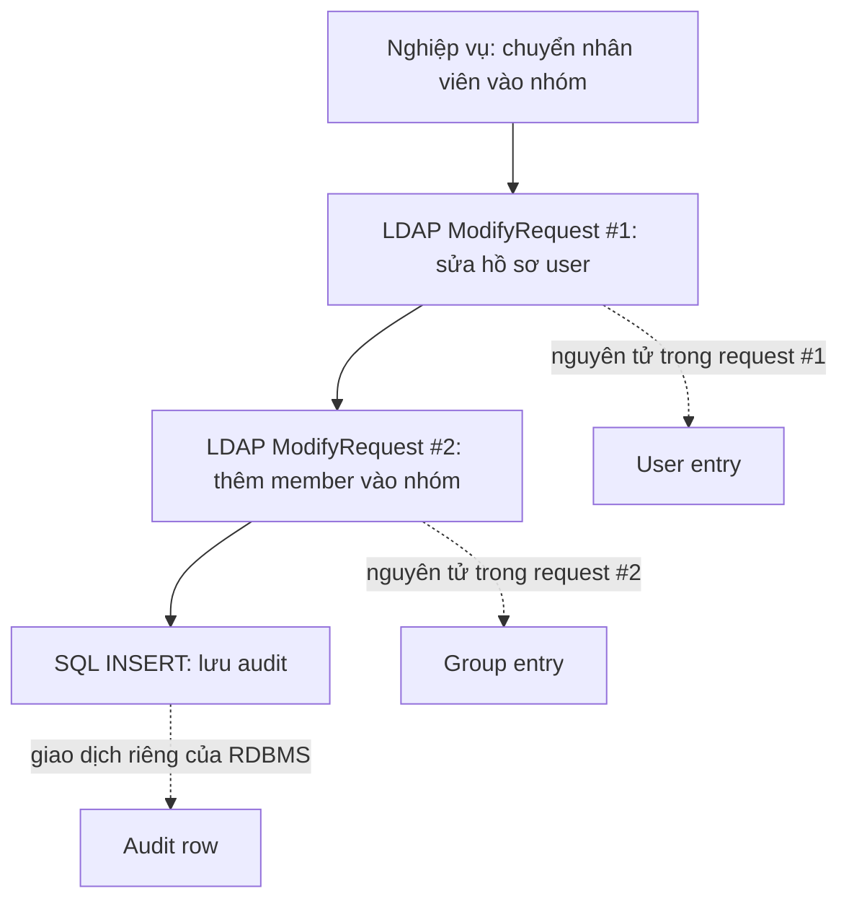
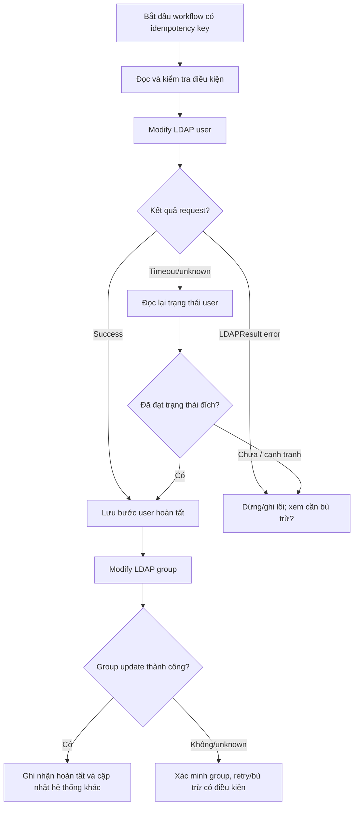

# Tính nguyên tử của một yêu cầu và giới hạn chuỗi nhiều yêu cầu

> **Chương:** Thao tác LDAP  
> **Module:** SPRING_DATA_LDAP — truy cập directory LDAP bằng Spring Data LDAP repository và Spring LDAP `LdapTemplate`, thao tác entry theo DN, `objectClass`, schema, filter và quyền truy cập.

## Mục tiêu học tập

Sau bài này, bạn có thể:

1. Phân biệt **một LDAP operation/request** với **nhiều operation/request** do ứng dụng Java gọi liên tiếp.
2. Giải thích vì sao **nhiều thay đổi thuộc tính trong cùng một `ModifyRequest` được áp dụng nguyên tử**, trong khi chuỗi `ModifyRequest` độc lập **không mặc nhiên có rollback chung**.
3. Phân tích các kết quả **success**, **LDAPResult báo lỗi** và **mất kết nối trước khi nhận response**; chọn cách khôi phục an toàn.
4. Dùng `LdapTemplate.modifyAttributes(...)` để gửi nhiều thay đổi cho **cùng một entry** trong một request, đồng thời nhận biết `LdapRepository.save(...)` hoặc `LdapTemplate.update(...)` có thể thực hiện thêm các bước bên trong.
5. Lựa chọn giữa thao tác đơn, **LDAP Assertion Control**, **giao dịch mở rộng RFC 5805 (nếu server hỗ trợ)** và **cơ chế bù trừ của Spring LDAP** khi nhiều bước liên quan nhau.
6. Viết ca kiểm thử về atomicity, lỗi giữa chừng, cạnh tranh cập nhật và retry với directory test.

## 1. Một nghiệp vụ Java không đồng nghĩa một yêu cầu LDAP

Giả sử ứng dụng quản trị nhân sự cần thực hiện quy trình:

1. Đổi số điện thoại và mô tả của người dùng `uid=linh,ou=people,dc=example,dc=org`.
2. Thêm người đó vào nhóm `cn=developers,ou=groups,dc=example,dc=org`.
3. Ghi lịch sử thay đổi vào một cơ sở dữ liệu quan hệ.

Ba bước này có vẻ là **một nghiệp vụ** từ góc nhìn service Java, nhưng chúng liên quan **hai LDAP entry và một hệ lưu trữ khác**. Thậm chí cập nhật hai thuộc tính của **cùng một entry** cũng có thể được ứng dụng gửi bằng **một** hoặc **hai** LDAP requests — tùy API được sử dụng.



Nếu request #1 thành công nhưng request #2 thất bại, LDAP không tự đảo ngược request #1 theo giao thức cơ bản. Nếu request #2 thành công nhưng ghi audit lỗi, thay đổi nhóm vẫn có thể tồn tại.

**Đơn vị cần xét đầu tiên là request giao thức thật sự**, không phải số dòng Java, tên method service, annotation `@Transactional` hay việc các lệnh dùng cùng một TCP connection.

## 2. LDAPv3 định nghĩa những operation nào?

Theo [RFC 4511](https://www.rfc-editor.org/rfc/rfc4511.html), một ứng dụng có thể gửi nhiều loại LDAP protocol operation:

| Operation | Mục đích | Đơn vị tác động | Điều cần nhớ |
| --- | --- | --- | --- |
| `Add` | Tạo entry tại DN | Entry mới | Kiểm tra DN cha, `objectClass`, `MUST`/`MAY` và quyền |
| `Modify` | Thay đổi một hoặc nhiều attribute của **một entry** | **Một entry** | Danh sách `add`/`delete`/`replace` bên trong **cùng ModifyRequest** phải nguyên tử |
| `Delete` | Xóa entry | Entry đích | Theo LDAPv3 cơ bản, chỉ xóa được leaf entry |
| `ModifyDN` | Đổi RDN hoặc chuyển entry/subtree | Thao tác rename/move riêng | Không tự biến các request trước/sau thành một transaction |
| `Compare` | Kiểm tra entry có giá trị attribute cho trước | Đọc/so sánh | Compare rồi Modify là **hai request** độc lập |
| `Search` | Tìm entry theo base, scope, filter | Đọc | Nhiều entry trong kết quả **không phải snapshot giao dịch** |
| `Bind` | Xác thực danh tính cho kết nối | Security context | Không phải thao tác cập nhật hồ sơ |
| `Unbind` | Đóng phiên LDAP | Kết nối | Không phải `COMMIT` |

**Một request** có thể chứa nhiều chi tiết nội bộ. Đặc biệt, một `ModifyRequest` chứa **danh sách thay đổi** cho một entry: thay `telephoneNumber`, thay `description`, thêm `mobile`... đều có thể nằm trong **cùng một request**, thay vì phải gửi từng thuộc tính.

Nhưng `Add` tạo user, `Modify` nhóm và `ModifyDN` chuyển OU thường là **nhiều requests**. Không có bảo đảm “cả chuỗi thành công hoặc cả chuỗi bị hủy” chỉ vì tất cả lệnh chạy trong cùng method hoặc trên cùng LDAP connection.

## 3. Atomicity của một `ModifyRequest` theo RFC 4511

Mục 4.6 của RFC 4511 quy định rằng **toàn bộ danh sách thay đổi trong một ModifyRequest phải được áp dụng theo thứ tự và như một thao tác nguyên tử**. Nếu LDAP server trả `ModifyResponse` với kết quả thành công, các thay đổi trong request đó đã được áp dụng. Nếu server trả LDAPResult báo lỗi, client có thể kỳ vọng **không thay đổi nào của request được áp dụng**.

Xét yêu cầu cập nhật một entry:

```text
Target DN: uid=linh,ou=people,dc=example,dc=org

ModifyRequest:
  1) REPLACE telephoneNumber = "+84 28 5555 0101"
  2) REPLACE description     = "Support team"
```

Giả sử cả hai attribute được schema cho phép và tài khoản bind có quyền ghi. Hai thay đổi thuộc **một request** nên server thực hiện như một đơn vị nguyên tử: người đọc không quan sát trạng thái chỉ áp dụng thay đổi thứ nhất do request này mà chưa có thay đổi thứ hai.

Thử tình huống thứ hai, giả sử entry có `objectClass=inetOrgPerson` và `sn` là thuộc tính bắt buộc:

```text
ModifyRequest:
  1) REPLACE telephoneNumber = "+84 28 5555 0101"
  2) REPLACE sn              = []   # Bỏ sn, vi phạm MUST của person
```

Vì kết quả cuối cùng thiếu `sn`, server tuân thủ schema có thể trả `objectClassViolation (65)`. **Thay đổi `telephoneNumber` cũng không được áp dụng** trong cùng request thất bại.

Điều này cho thấy:

- **Một request có nhiều modification** khác với **nhiều request, mỗi request một modification**.
- Các thay đổi trong `ModifyRequest` được áp dụng **đúng thứ tự**. Trạng thái trung gian của quá trình xử lý được server kiểm soát; **trạng thái sau toàn bộ danh sách** phải thỏa schema.
- Không thể lấy ví dụ trên rồi kết luận hai entry khác nhau cũng có atomicity chung theo LDAPv3 cơ bản.

### Bảng trạng thái quan sát được

| Trường hợp | Khẳng định an toàn từ client |
| --- | --- |
| Nhận `ModifyResponse success (0)` | Toàn bộ thay đổi trong **request đó** hoàn tất |
| Nhận `ModifyResponse` với LDAP result code lỗi | Các thay đổi của **request đó** không được áp dụng theo bảo đảm atomicity |
| TCP timeout, connection reset, mất response | **Không biết chắc** server đã áp dụng request hay chưa |
| Request #1 success; request #2 nhận lỗi | #1 đã thành công; #2 lỗi; **không có rollback chung** |
| Client đóng connection sau nhiều request | Đóng connection **không đảo ngược** các request đã hoàn tất |

Với trường hợp **mất response**, không thể kết luận rằng “có exception thì chắc chắn server chưa ghi”. RFC 4511 nêu rõ nếu client không nhận được ModifyResponse (ví dụ phiên LDAP bị hủy hoặc operation bị abandon), client không thể xác định chắc thao tác đã được áp dụng hay chưa. Cần đọc lại trạng thái hiện tại hoặc dùng cơ chế idempotency/kiểm soát đồng thời phù hợp.

## 4. LDIF chứng minh một request gồm nhiều thay đổi

Đối với directory **thử nghiệm**, tạo file `update-contact.ldif`:

```ldif
dn: uid=linh,ou=people,dc=example,dc=org
changetype: modify
replace: telephoneNumber
telephoneNumber: +84 28 5555 0101
-
replace: description
description: Support team
```

Một **LDIF change record** ở trên mô tả **một Modify operation** với hai phần `replace`, phân cách bằng `-`. Với OpenLDAP CLI, có thể gửi:

```bash
ldapmodify -x \
  -H ldaps://ldap.example.org:636 \
  -D "cn=app-writer,ou=services,dc=example,dc=org" \
  -W -f update-contact.ldif
```

`-W` nhắc nhập mật khẩu tương tác; không đưa mật khẩu vào script. `ldap.example.org` chỉ là hostname minh họa, cần server kiểm thử, CA tin cậy và quyền ghi phù hợp.

Để quan sát tính nguyên tử, dùng một **change record khác** trong directory thử nghiệm:

```ldif
dn: uid=linh,ou=people,dc=example,dc=org
changetype: modify
replace: telephoneNumber
telephoneNumber: +84 28 5555 0202
-
replace: sn
```

`replace: sn` không có dòng giá trị `sn:` tương ứng nghĩa là thay bằng tập rỗng, thực chất loại thuộc tính đó. Với `inetOrgPerson` chuẩn, `sn` là `MUST` được kế thừa từ `person`. Khi server từ chối request, `telephoneNumber` cũng phải giữ giá trị cũ vì cả danh sách nằm trong một ModifyRequest.

**Cẩn thận với nhiều record trong một tệp LDIF:** nếu tệp `changes.ldif` chứa hai khối bắt đầu bằng hai dòng `dn:` khác nhau, công cụ `ldapmodify` sẽ gửi **hai LDAP requests**. Chạy một lệnh CLI hoặc dùng một file **không biến nhiều record thành transaction nguyên tử**. Đây là lỗi suy luận rất thường gặp.

## 5. Java: gửi hai thay đổi trong một request bằng `LdapTemplate`

Spring LDAP `LdapTemplate.modifyAttributes(Name, ModificationItem[])` gửi một `ModifyRequest` chứa **mảng `ModificationItem`** cho **cùng một DN**.

```java
import javax.naming.Name;
import javax.naming.directory.BasicAttribute;
import javax.naming.directory.DirContext;
import javax.naming.directory.ModificationItem;

import org.springframework.ldap.core.LdapTemplate;
import org.springframework.ldap.support.LdapNameBuilder;

public final class ContactUpdater {
    private final LdapTemplate ldapTemplate;

    public ContactUpdater(LdapTemplate ldapTemplate) {
        this.ldapTemplate = ldapTemplate;
    }

    public void updateBoth(String uid, String phone, String description) {
        if (uid == null || uid.isBlank()
                || phone == null || phone.isBlank()
                || description == null || description.isBlank()) {
            throw new IllegalArgumentException(
                    "uid, phone và description phải có giá trị");
        }

        // DN tương đối với spring.ldap.base = dc=example,dc=org
        Name userDn = LdapNameBuilder.newInstance("ou=people")
                .add("uid", uid)
                .build();

        ModificationItem[] changes = {
                new ModificationItem(
                        DirContext.REPLACE_ATTRIBUTE,
                        new BasicAttribute("telephoneNumber", phone)),
                new ModificationItem(
                        DirContext.REPLACE_ATTRIBUTE,
                        new BasicAttribute("description", description))
        };

        // Một lần gọi thực thi một LDAP Modify operation.
        ldapTemplate.modifyAttributes(userDn, changes);
    }
}
```

Cách gọi minh họa:

```java
ContactUpdater updater = new ContactUpdater(ldapTemplate);

updater.updateBoth(
        "linh",
        "+84 28 5555 0101",
        "Support team"
);
```

Trong ví dụ:

- `LdapNameBuilder` hỗ trợ tạo DN với RDN được escape; không nối trực tiếp input vào chuỗi DN.
- Các thuộc tính `telephoneNumber` và `description` được schema chuẩn `person` cho phép, nhưng server vẫn kiểm tra ACL và policy.
- Nếu cả hai thay đổi hợp lệ thì cả hai được ghi. Nếu một thay đổi không hợp lệ và server phản hồi lỗi, cả request bị từ chối.
- `updateBoth` không cần một `@Transactional` mới có tính nguyên tử ở **mức một ModifyRequest**; đó là quy định của giao thức LDAP.
- Nếu việc xác thực TLS, kết nối hoặc đọc response thất bại, áp dụng quy tắc **outcome unknown** ở mục 3 thay vì tự khẳng định rollback.

### `DirContextAdapter` thực hiện thay đổi bằng cách nào?

Spring LDAP có thể đọc entry qua `ldapTemplate.lookupContext(dn)`, sửa nhiều thuộc tính trong `DirContextOperations` rồi gọi `ldapTemplate.modifyAttributes(context)`:

```java
import javax.naming.Name;

import org.springframework.ldap.core.DirContextOperations;
import org.springframework.ldap.core.LdapTemplate;

public void updateWithAdapter(LdapTemplate template, Name dn) {
    DirContextOperations ctx = template.lookupContext(dn);

    ctx.setAttributeValue("telephoneNumber", "+84 28 5555 0101");
    ctx.setAttributeValue("description", "Support team");

    // Các modification được gom từ thay đổi trong ctx.
    template.modifyAttributes(ctx);
}
```

**Giới hạn quan trọng:** `lookupContext(dn)` là **một request đọc trước**, còn `modifyAttributes(ctx)` là **request ghi sau**. Danh sách thay đổi trong request ghi là nguyên tử, nhưng **cặp đọc rồi ghi không phải transaction có isolation**. Client khác có thể sửa entry ở giữa hai thao tác; các giá trị mà bạn đọc được có thể đã lỗi thời.

Nếu có yêu cầu phát hiện cập nhật cạnh tranh, cần xem **Assertion Control** (`RFC 4528`) hoặc cơ chế version/check-and-set thực sự được server hỗ trợ. `LdapTemplate` không tự biến mọi lần đọc/sửa thành một giao dịch kiểm soát xung đột.

## 6. Hai request riêng biệt: khác biệt dù cùng một entry

Đoạn sau gửi **hai** `ModifyRequest`:

```java
Name dn = LdapNameBuilder.newInstance("ou=people")
        .add("uid", "linh")
        .build();

ldapTemplate.modifyAttributes(dn, new ModificationItem[] {
    new ModificationItem(DirContext.REPLACE_ATTRIBUTE,
            new BasicAttribute("telephoneNumber", "+84 28 5555 0101"))
});

// Đây là request thứ hai, độc lập với request trước.
ldapTemplate.modifyAttributes(dn, new ModificationItem[] {
    new ModificationItem(DirContext.REPLACE_ATTRIBUTE,
            new BasicAttribute("description", "Support team"))
});
```

Nếu request thứ nhất thành công mà request thứ hai bị từ chối, **`telephoneNumber` vẫn đã thay đổi**. Đặt hai dòng trong một `try`, trong một method, hoặc dùng cùng `LdapTemplate` chỉ là tổ chức mã Java; **không làm hai LDAP requests thành một**.

Với các thay đổi thuộc tính của cùng một entry có thể gộp, hãy **gộp vào một `ModificationItem[]`** như mục 5. Đây thường là cách đơn giản, hiệu quả và có bảo đảm rõ nhất.

## 7. Hai entry khác nhau: không có rollback toàn cục mặc định

Giả sử cần cập nhật mô tả user và thêm user vào nhóm. Đây phải là **hai thay đổi trên hai entry**:

```java
import javax.naming.Name;
import javax.naming.directory.BasicAttribute;
import javax.naming.directory.DirContext;
import javax.naming.directory.ModificationItem;

import org.springframework.ldap.core.LdapTemplate;
import org.springframework.ldap.support.LdapNameBuilder;

public final class TeamMembershipService {

    private final LdapTemplate ldapTemplate;

    public TeamMembershipService(LdapTemplate ldapTemplate) {
        this.ldapTemplate = ldapTemplate;
    }

    public void moveIntoDevelopers(String uid) {
        Name relativeUserDn = LdapNameBuilder.newInstance("ou=people")
                .add("uid", uid)
                .build();

        Name relativeGroupDn = LdapNameBuilder.newInstance("ou=groups")
                .add("cn", "developers")
                .build();

        // Giá trị attribute member thường cần DN đầy đủ.
        Name absoluteUserDn =
                LdapNameBuilder.newInstance("dc=example,dc=org")
                        .add("ou", "people")
                        .add("uid", uid)
                        .build();

        // Request 1: thay đổi user entry.
        ldapTemplate.modifyAttributes(relativeUserDn, new ModificationItem[] {
                new ModificationItem(DirContext.REPLACE_ATTRIBUTE,
                        new BasicAttribute("description", "Developer"))
        });

        // Request 2: thay đổi group entry.
        ldapTemplate.modifyAttributes(relativeGroupDn, new ModificationItem[] {
                new ModificationItem(DirContext.ADD_ATTRIBUTE,
                        new BasicAttribute("member",
                                absoluteUserDn.toString()))
        });
    }
}
```

Lưu ý:

- `relativeUserDn` và `relativeGroupDn` là DN **tương đối** với `spring.ldap.base=dc=example,dc=org`, còn giá trị thuộc tính `member` thường là **DN đầy đủ**.
- Mỗi lần gọi `modifyAttributes` chỉ có atomicity cho **request đó**. Nếu group không tồn tại, quyền thêm `member` không đủ hoặc giá trị đã có, request 2 lỗi nhưng request 1 vẫn đã được áp dụng.
- `ADD_ATTRIBUTE` với `member` đã tồn tại có thể trả `attributeOrValueExists (20)`. **Không retry mù quáng** mà cần đọc lại membership để xác định trạng thái thực.
- Cùng một kết nối LDAP không tự tạo transaction đa entry. Một method Java trả exception cũng không đảo ngược thay đổi trước đó.

```mermaid
sequenceDiagram
    participant J as Java service
    participant L as LDAP directory
    J->>L: Modify user.description
    L-->>J: success (0)
    J->>L: Modify group.member
    L-->>J: error: insufficientAccessRights (50)
    Note over J,L: User đã đổi; group chưa đổi
    J->>J: Ghi nhận bước đã xong, xử lý bù trừ/retry nếu cần
```

Đây là lý do nên thiết kế quy trình nhiều entry với **trạng thái từng bước** và phương án phục hồi, thay vì chỉ bắt exception rồi giả định mọi thứ nguyên vẹn.

## 8. Dùng Spring Data LDAP repository có bảo đảm nguyên tử không?

Spring Data LDAP repository giúp ánh xạ entry LDAP thành Java object:

```java
import org.springframework.data.ldap.repository.LdapRepository;

public interface PersonRepository extends LdapRepository<DirectoryPerson> {
    DirectoryPerson findByUid(String uid);
}
```

Entity `DirectoryPerson` có thể dùng `@Entry`, `@Id` kiểu `javax.naming.Name` và các `@Attribute` tương ứng. Repository thực hiện CRUD nhưng **method Java không nhất thiết đồng nhất 1–1 với một request LDAP**.

Ví dụ:

- `repository.save(person)` có thể chọn đường tạo mới hoặc cập nhật dựa trên trạng thái entity; cần hiểu semantics của Spring Data LDAP đang dùng.
- `LdapTemplate.update(odmEntity)` có thể **đọc trước rồi sửa**. Theo Javadoc Spring LDAP, khi DN tính lại khác DN hiện tại, một số đường xử lý có thể **unbind entry cũ rồi bind entry mới**. Vì vậy **không mặc định toàn bộ method `update` là một ModifyRequest**.
- `repository.delete(...)` thao tác với một hoặc nhiều entry phụ thuộc method/triển khai và dữ liệu; không suy rằng xóa cả cây hay hàng loạt entry là một transaction nguyên tử.
- `@Transactional` của Spring không tự động làm mọi LDAP operation chịu chung **ACID transaction**. Cần kiểm tra transaction manager thật sự, phạm vi tài nguyên và cơ chế nó dùng.

**Khi cần bảo đảm hai thay đổi thuộc tính của cùng entry là một operation**, `LdapTemplate.modifyAttributes(dn, ModificationItem[])` là cách dễ nhìn thấy ranh giới nhất. Khi cần viết nhiều entry, phải thiết kế ở tầng nghiệp vụ hoặc dùng một cơ chế transaction được directory và client hỗ trợ rõ ràng.

Nguồn: [Spring LDAP — LdapTemplate API](https://docs.spring.io/spring-ldap/reference/api/java/org/springframework/ldap/core/LdapTemplate.html).

## 9. Spring LDAP có cơ chế transaction, nhưng cần hiểu giới hạn

### 9.1. LDAPv3 cơ bản không cung cấp transaction ACID đa entry

Giao thức LDAPv3 nền tảng, theo RFC 4511, **không cung cấp lệnh `BEGIN`/`COMMIT`/`ROLLBACK` phổ quát** cho chuỗi `Add`, `Modify`, `Delete` hay `ModifyDN`.

Vì vậy, nếu một service Java gọi:

```java
updateUser();
updateGroup();
updateManagerReference();
```

và lời gọi thứ ba thất bại, **không có cơ chế rollback mọi lời gọi trước đó theo mặc định**.

### 9.2. Transaction mở rộng theo RFC 5805 là tùy chọn

[RFC 5805 — LDAP Transactions](https://www.rfc-editor.org/rfc/rfc5805.html) định nghĩa một **giao thức mở rộng có trạng thái Experimental** cho phép gắn nhiều update operations vào một transaction khi **server triển khai và cho phép sử dụng**. Nó bao gồm:

- **Start Transaction** extended operation (OID `1.3.6.1.1.21.1`).
- **Transaction Specification Control** (OID `1.3.6.1.1.21.2`), gắn transaction identifier vào từng update.
- **End Transaction** extended operation (OID `1.3.6.1.1.21.3`) để kết thúc và quyết định commit/abort.

Không phải mọi LDAP server đều hỗ trợ RFC 5805; đây **không phải bảo đảm mặc định** chỉ vì máy chủ nói chuyện bằng LDAPv3. Tài liệu RFC 5805 nêu rằng server có thể quảng bá các OID thông qua `supportedExtension` và `supportedControl` của Root DSE khi được phép.

Ví dụ kiểm tra khả năng được server quảng bá:

```bash
ldapsearch -x \
  -H ldaps://ldap.example.org:636 \
  -D "cn=app-reader,ou=services,dc=example,dc=org" \
  -W -s base -b "" supportedExtension supportedControl
```

Kiểm tra liệu Root DSE có OID liên quan đến RFC 5805 hay không; kết quả còn phụ thuộc danh tính bind. **Có quảng bá OID chưa đủ chứng minh Spring LDAP repository hoặc `@Transactional` tự sử dụng extension**. Muốn transaction thực sự, client/SDK và tất cả operation cần được viết để dùng đúng protocol extension; kiểm thử trên chính directory server mục tiêu.

### 9.3. Spring LDAP compensating transaction là cơ chế client-side

Spring LDAP có `ContextSourceTransactionManager` và các thành phần transaction **bù trừ** (`compensating transactions`). Khi được cấu hình, Spring LDAP có thể ghi nhận trạng thái trước những LDAP update operation và cố gắng thực hiện thao tác bù ngược nếu transaction cần rollback.

Ví dụ: tạo một entry (`bind`) thì thao tác bù có thể là xóa entry (`unbind`). Nhưng cập nhật/xóa entry phức tạp cần ghi lại dữ liệu cũ, có thể gặp ACL, concurrent update và nhiều lỗi khó đảo ngược.

**Giới hạn được Spring LDAP mô tả rõ:**

- Bù trừ là **các thao tác LDAP mới từ client**, không phải transaction server-side ACID.
- Nếu mạng/LDAP server hỏng, client có thể **không thể chạy thao tác khôi phục**.
- **Không có isolation** như transaction cơ sở dữ liệu: client khác vẫn có thể thay đổi entry giữa lúc ghi và bù trừ.
- Nếu một attribute chỉ đọc được một phần do ACL, việc phục hồi **không chắc đầy đủ**.
- Một LDAP transaction manager không tự đồng bộ **cả RDBMS, directory và hệ thống ngoài** thành giao dịch phân tán.

Do đó, đừng cho rằng chỉ cần viết `@Transactional` lên service là LDAP sẽ có cùng tính chất với JDBC/JPA. Trước hết phải xác định **transaction manager cụ thể** (ví dụ manager cho RDBMS hay manager bù trừ của Spring LDAP), các operation mà nó hỗ trợ, và hậu quả khi rollback không hoàn tất.

Tài liệu: [Spring LDAP — Transaction Support](https://docs.spring.io/spring-ldap/reference/transaction-support.html), [`ContextSourceTransactionManager` API](https://docs.spring.io/spring-ldap/reference/api/java/org/springframework/ldap/transaction/compensating/manager/ContextSourceTransactionManager.html).

### Bảng so sánh các mức bảo đảm

| Cơ chế | Phạm vi | Đặc điểm | Giới hạn |
| --- | --- | --- | --- |
| **Một `ModifyRequest`** | Nhiều thay đổi của **một entry** | Atomicity bắt buộc theo RFC 4511 | Không bao trùm entry khác; mất response gây kết quả chưa biết |
| **Nhiều LDAP requests thông thường** | Nhiều bước/entry | Mỗi request có kết quả riêng | Có thể thành công một phần |
| **RFC 5805** | Nhiều update requests trong một transaction | Hỗ trợ ACID nếu server/client thực thi extension | Experimental, tùy directory và client |
| **Spring LDAP compensating transaction** | Chuỗi thao tác qua manager hỗ trợ | Cố khôi phục bằng thao tác bù ở client | Không bảo đảm isolation hoặc rollback khi lỗi mạng |
| **JDBC/JPA transaction** | Các thao tác SQL trong phạm vi DB manager | ACID theo cấu hình RDBMS | Không tự bao phủ LDAP |
| **Saga/compensation nghiệp vụ** | Chuỗi LDAP + DB + dịch vụ khác | Ghi trạng thái bước, retry/bù trừ | Nhất quán cuối cùng; cần xử lý thất bại kéo dài |

## 10. Dùng Assertion Control để tránh sửa trên dữ liệu đã thay đổi

**Atomicity không tự ngăn lost update.** Hai người quản trị có thể cùng đọc `description=Support` rồi mỗi người thay bằng một giá trị khác. Từng ModifyRequest riêng lẻ vẫn nguyên tử, nhưng kết quả có thể ghi đè công việc của nhau.

Nếu directory hỗ trợ, [RFC 4528 — LDAP Assertion Control](https://www.rfc-editor.org/rfc/rfc4528.html) cho phép thêm điều kiện vào **chính request ghi**. Ví dụ logic:

```text
Modify entry uid=linh,...
  Assertion: (description=Support)
  Replace:   description = "Backend team"
```

Server chỉ thực hiện thay đổi nếu điều kiện trên target entry đúng tại thời điểm xử lý. Nếu điều kiện không đúng, server trả `assertionFailed (122)` và **không thực hiện update**. Đây là cơ chế phù hợp kiểu **compare-and-set** khi có thể biểu diễn điều kiện bằng LDAP filter và server hỗ trợ control OID `1.3.6.1.1.12`.

Khác biệt với hai request rời:

```text
Search description=Support
Modify description=Backend team
```

Giữa Search và Modify có khoảng thời gian để một client khác sửa entry. Vì vậy **đọc rồi tự kiểm tra trong Java trước khi ghi** không thay thế được server-side assertion control.

**Lưu ý về Spring:** không phải mọi method của `LdapRepository` đều có tham số assertion control. Khi cần control mức giao thức, xem `LdapTemplate`/`LdapContext` hoặc LDAP SDK phù hợp phiên bản, kiểm tra directory hỗ trợ OID đó và kết nối TLS/quyền truy cập. Không tự diễn giải rằng `@Version` của JPA sẽ hoạt động tương đương trên Spring Data LDAP.

## 11. Khi mất response: xử lý retry và idempotency

Tình huống nguy hiểm:

1. Java gửi `ModifyRequest` để đặt `description="Backend team"`.
2. LDAP server đã ghi thành công.
3. Đường mạng đứt trước khi client nhận `ModifyResponse`.
4. Java chỉ nhìn thấy `CommunicationException` hoặc timeout.

Nếu ứng dụng ngay lập tức gửi lại mọi thao tác mà không kiểm tra, nó có thể gây:

- Lặp việc thêm `member`, dẫn đến `attributeOrValueExists (20)`;
- Lặp việc tạo entry cùng DN, dẫn đến `entryAlreadyExists (68)`;
- Chạy lại cập nhật dựa trên giá trị cũ, gây lost update;
- Kích hoạt lại audit/provisioning bên ngoài dù trạng thái LDAP cuối cùng giống nhau.

### Quy trình khôi phục đề nghị

1. **Phân loại response:** có LDAPResult success, LDAPResult error, hay chỉ có transport error/timeout?
2. **Kiểm tra trạng thái hiện tại** bằng một truy vấn theo DN hoặc bộ lọc an toàn với tài khoản có quyền đọc.
3. **So với trạng thái mong muốn:** số điện thoại/mô tả đã được đặt chưa, DN đã tồn tại chưa, thành viên đã nằm trong nhóm chưa?
4. Nếu kết quả đã đúng, đánh dấu bước **hoàn tất**; nếu chưa đúng, quyết định retry dựa trên loại operation, ACL và khả năng có cập nhật cạnh tranh.
5. Với quy trình nhiều entry, lưu **mã nghiệp vụ hoặc idempotency key** và trạng thái từng bước ở hệ thống có lưu trữ bền vững. Không chỉ giữ trong RAM nếu tiến trình có thể restart.
6. Với xung đột, sử dụng assertion/server-supported control hoặc báo người quản trị xử lý thay vì ép ghi đè.

**Replace cùng một giá trị** thường là thao tác mang tính idempotent về **trạng thái cuối**, nhưng không có nghĩa mọi tác dụng phụ (changelog, replication event, audit, trigger của sản phẩm) cũng chắc chắn chỉ xuất hiện một lần. Còn `ADD_ATTRIBUTE` với value đã tồn tại không phải thao tác retry vô điều kiện an toàn.

### Bảng quyết định retry

| Operation | Nếu response thất lạc | Hướng khôi phục |
| --- | --- | --- |
| `Modify REPLACE mail=...` | Có thể đã ghi | Đọc `mail` hiện tại; retry nếu còn thiếu và không vi phạm concurrency policy |
| `Add entry DN=...` | Có thể đã tạo | Lookup DN, xác minh đúng identity/objectClass, tránh tạo trùng |
| `Add member=<DN>` | Có thể đã thêm | Đọc tập `member`; không thêm lại mù quáng |
| `Delete entry` | Có thể đã xóa | Kiểm tra DN và policy; phân biệt đã xóa với lỗi tìm kiếm/quyền |
| `ModifyDN` | Có thể đã rename/move | Kiểm tra cả DN cũ và mới cùng định danh ổn định trước khi quyết định |
| `Modify với nhiều modifications` | Cả request có thể đã xong hoặc chưa | Đọc **tất cả** thuộc tính liên quan, không suy từ một field duy nhất |

Việc đọc lại chỉ cho biết **trạng thái đang quan sát**, không cung cấp snapshot lịch sử hoặc chắc chắn tác nhân nào đã tạo ra trạng thái. Với nghiệp vụ quan trọng, dùng mã nghiệp vụ/idempotency key, audit và cơ chế đồng bộ thích hợp.

## 12. Nhiều entry hoặc nhiều hệ thống: thiết kế theo bước có thể phục hồi

Khi cần cập nhật LDAP user, LDAP group và database:

- **Xác định nguồn dữ liệu có thẩm quyền** cho mỗi trường (directory cho group, DB cho audit/đơn hàng...), tránh ghi cùng một sự thật ở nhiều nơi không có quy tắc đồng bộ.
- **Mỗi bước có điều kiện trước và kết quả sau** rõ ràng: ví dụ “user đã có `description` mong muốn”, “nhóm đã chứa DN thành viên”.
- **Ghi trạng thái bền vững** cho workflow có thể retry (job ID, bước đã xong, lỗi, số lần thử, bản ghi cần xử lý thủ công), không ghi password LDAP hay dữ liệu nhạy cảm vào log.
- **Dùng bù trừ có kiểm soát** khi thật sự cần: nếu thêm nhóm lỗi sau khi update user, có thể cố phục hồi mô tả cũ, nhưng chỉ khi không có concurrent update làm mô tả đó lạc hậu.
- Với thông điệp giữa DB và LDAP, cân nhắc **outbox/queue và worker có idempotency** để giảm việc mất sự kiện; chấp nhận trạng thái nhất quán cuối cùng khi quy trình kéo dài.
- Tránh đặt workflow dài trong một request HTTP và giả định rollback tự động khi trình duyệt đóng kết nối.



**Rollback bù trừ không tuyệt đối:** nếu giá trị mô tả cũ đã bị người khác cập nhật trong lúc workflow chạy, thao tác “khôi phục giá trị cũ” có thể vô tình ghi đè thông tin mới. Vì thế cần kiểm soát cạnh tranh và log đủ thông tin nghiệp vụ để quyết định.

## 13. Kiểm thử tính nguyên tử với directory dành riêng cho test

Dùng directory thử nghiệm có schema `inetOrgPerson` (chẳng hạn OpenLDAP hoặc LDAP embedded có hỗ trợ kiểm thử tương ứng), đặt dữ liệu:

```ldif
dn: uid=linh,ou=people,dc=example,dc=org
objectClass: top
objectClass: person
objectClass: organizationalPerson
objectClass: inetOrgPerson
uid: linh
cn: Linh Nguyen
sn: Nguyen
telephoneNumber: +84 28 5555 0000
description: Support
```

Parent `dc=example,dc=org` và `ou=people` phải tồn tại. Tài khoản bind test cần có quyền sửa những thuộc tính dùng trong bài, kết nối nên dùng LDAPS hoặc StartTLS với xác thực chứng chỉ khi môi trường hỗ trợ.

### Bộ ca kiểm thử

| Ca | Thao tác | Kỳ vọng |
| --- | --- | --- |
| **T1 — Một request hợp lệ** | `ModifyRequest` replace `telephoneNumber` và `description` | Cả hai giá trị mới xuất hiện |
| **T2 — Một request lỗi schema** | Replace `telephoneNumber`, đồng thời xóa `sn` bắt buộc | LDAPResult lỗi; **không thay đổi** `telephoneNumber` |
| **T3 — Hai requests riêng** | Request A đổi `description` hợp lệ; request B xóa `sn` bắt buộc | A thành công, B lỗi; description **vẫn đổi** |
| **T4 — Nhiều entry** | Update user rồi cố update group mà bind identity không có quyền | User đã đổi; group chưa đổi; xử lý workflow |
| **T5 — Thất lạc response** | Mô phỏng lỗi mạng sau khi gửi update | Không suy rollback; đọc lại state và xử lý unknown |
| **T6 — Ghi cạnh tranh** | Hai client đọc cùng mô tả rồi ghi giá trị khác | Quan sát lost update; thử Assertion Control nếu hỗ trợ |
| **T7 — Retry add member** | Add cùng `member` hai lần | Lần sau có thể gặp code 20; xử lý dựa trên current state |
| **T8 — Tùy chọn transaction** | Kiểm tra `supportedExtension` và dùng RFC 5805 nếu server/client hỗ trợ | Thử commit/abort theo đúng extension; không giả định mọi server hỗ trợ |

### Đọc lại entry sau test

```bash
ldapsearch -x \
  -H ldaps://ldap.example.org:636 \
  -D "cn=app-reader,ou=services,dc=example,dc=org" \
  -W -s base \
  -b "uid=linh,ou=people,dc=example,dc=org" \
  "(objectClass=*)" telephoneNumber description sn
```

So sánh trạng thái **trước và sau**, đặc biệt ở T2 và T3. Khi cần kiểm tra group, đọc đúng entry `cn=developers,ou=groups,dc=example,dc=org` và thuộc tính `member`.

Thử nghiệm timeout nên thực hiện với proxy/network fault trong môi trường test. Không cắt kết nối LDAP sản xuất hoặc tạo lỗi có chủ đích trên directory thật.

## 14. Các lỗi suy luận cần tránh

| Hiểu nhầm | Điều đúng |
| --- | --- |
| “Hai dòng `LdapTemplate` trong một method là một transaction.” | Mỗi lời gọi có thể gửi **một hoặc nhiều LDAP operations** riêng; cần xem API thực tế |
| “Tôi dùng một TCP connection nên có rollback chung.” | Connection là phiên trao đổi; **không phải transaction** |
| “Một `ModifyRequest` có 4 thay đổi sẽ ghi dở nếu thay đổi thứ 4 lỗi.” | Theo RFC 4511, cả danh sách được áp dụng nguyên tử |
| “Timeout nghĩa là update chưa xảy ra.” | Mất response để lại **trạng thái chưa biết** |
| “`@Transactional` JPA rollback cả LDAP.” | JDBC/JPA transaction manager không tự điều phối LDAP |
| “Spring LDAP compensating transaction giống SQL ACID.” | Bù trừ phía client, không có isolation và có thể không thể phục hồi |
| “Bất kỳ LDAP server nào cũng hỗ trợ RFC 5805.” | RFC 5805 là extension Experimental và **phụ thuộc server/client** |
| “Read rồi Modify là compare-and-set.” | Cần **Assertion Control** hoặc cơ chế tương ứng gắn vào request update |
| “Retry Add member hoặc Add DN luôn vô hại.” | Có thể gây lỗi duplicate hoặc hệ quả khác; phải kiểm tra current state |
| “Repository `save` chỉ luôn gửi một LDAP ModifyRequest.” | Tùy đường tạo/update/move, một method có thể thực hiện nhiều operations |

## 15. Bài tập tự đánh giá

**Câu 1.** Một `ModifyRequest` chứa hai thay đổi: đổi `telephoneNumber` hợp lệ, xóa `sn` là `MUST` của `person`. Server trả lỗi 65. `telephoneNumber` đã được đổi chưa?

**Đáp án:** Chưa. RFC 4511 yêu cầu toàn bộ danh sách trong request nguyên tử; response lỗi nghĩa là không áp dụng phần nào của request.

**Câu 2.** Java gọi `modifyAttributes(dn, modsA)` rồi `modifyAttributes(dn, modsB)`. Nếu A thành công và B lỗi thì A có tự rollback không?

**Đáp án:** Không. Đây là hai requests độc lập, ngay cả khi cùng DN và cùng Java method.

**Câu 3.** Client gửi update, server có thể đã xử lý nhưng kết nối mất trước khi Java đọc response. Có thể kết luận update chưa được lưu không?

**Đáp án:** Không. Cần xem đây là **unknown outcome**, đọc lại trạng thái và quyết định retry/khôi phục an toàn.

**Câu 4.** Trong quy trình đổi hồ sơ người dùng và thêm group membership, `@Transactional` của JDBC có bảo đảm cả hai LDAP entry rollback không?

**Đáp án:** Không. LDAP không tự tham gia transaction của RDBMS; cần lựa chọn cơ chế riêng, hỗ trợ server hoặc workflow bù trừ, và hiểu giới hạn của từng lựa chọn.

**Câu 5.** Một directory hỗ trợ RFC 4528 Assertion Control nhưng không có RFC 5805. Có thể làm điều kiện “chỉ sửa `description` nếu giá trị hiện tại vẫn là `Support`” nguyên tử không?

**Đáp án:** Có thể, nếu client đính kèm Assertion Control đúng vào ModifyRequest và server xử lý nó. Điều này giải quyết check-and-set cho **một operation**, không tạo transaction đa entry.

## 16. Checklist vận dụng

- [ ] Xác định **ranh giới request LDAP** cho từng thao tác Java; không đồng nhất method Java với transaction.
- [ ] Gom các thay đổi attribute của **cùng một entry** vào **một `ModifyRequest`** khi có thể.
- [ ] Đọc và xử lý chính xác LDAPResult; nếu không nhận response, đánh dấu **outcome unknown**.
- [ ] Không giả định một kết nối, một method, một tệp LDIF hoặc `@Transactional` có rollback đa request.
- [ ] Với nhiều entry, có trạng thái từng bước, idempotency/retry và kế hoạch bù trừ rõ ràng.
- [ ] Khi cần chống lost update, xem Assertion Control và khả năng hỗ trợ của server.
- [ ] Chỉ sử dụng RFC 5805 khi directory **và** client hỗ trợ, đã kiểm thử commit/abort.
- [ ] Phân biệt Spring LDAP compensating transaction với server-side ACID transaction và với JDBC transaction.
- [ ] Không retry mù quáng `Add`, `Delete`, `ModifyDN`, thêm group member khi response bị thất lạc.
- [ ] Bảo vệ kết nối bằng LDAPS/StartTLS khi phù hợp; dùng DN/filter được tạo an toàn và quyền bind tối thiểu.
- [ ] Kiểm thử cả thành công, thất bại schema, thất bại bước sau, timeout và cập nhật cạnh tranh trên **directory test**.

## Tài liệu chuẩn và Spring

- [RFC 4511 — LDAPv3 Protocol, mục 4.6: Atomic Modify](https://www.rfc-editor.org/rfc/rfc4511.html)
- [RFC 4512 — LDAP Directory Information Models và schema](https://www.rfc-editor.org/rfc/rfc4512.html)
- [RFC 5805 — LDAP Transactions (Experimental extension)](https://www.rfc-editor.org/rfc/rfc5805.html)
- [RFC 4528 — LDAP Assertion Control (conditional updates)](https://www.rfc-editor.org/rfc/rfc4528.html)
- [RFC 2849 — LDAP Data Interchange Format (LDIF)](https://www.rfc-editor.org/rfc/rfc2849.html)
- [Spring LDAP — `LdapTemplate` API, `modifyAttributes` và `update`](https://docs.spring.io/spring-ldap/reference/api/java/org/springframework/ldap/core/LdapTemplate.html)
- [Spring LDAP — `DirContextAdapter` API](https://docs.spring.io/spring-ldap/reference/api/java/org/springframework/ldap/core/DirContextAdapter.html)
- [Spring LDAP — Transaction Support / Compensating Transactions](https://docs.spring.io/spring-ldap/reference/transaction-support.html)
- [Spring LDAP — `ContextSourceTransactionManager` API](https://docs.spring.io/spring-ldap/reference/api/java/org/springframework/ldap/transaction/compensating/manager/ContextSourceTransactionManager.html)
- [Spring Data LDAP — Repository Configuration](https://docs.spring.io/spring-data/ldap/reference/ldap/configuration.html)

