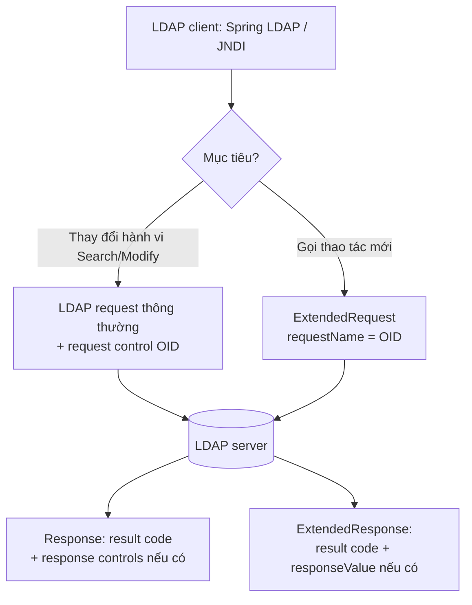
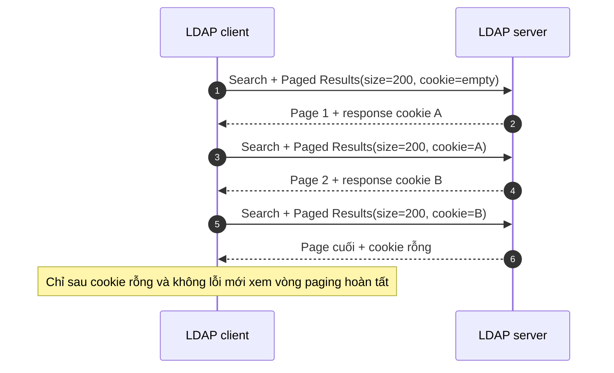
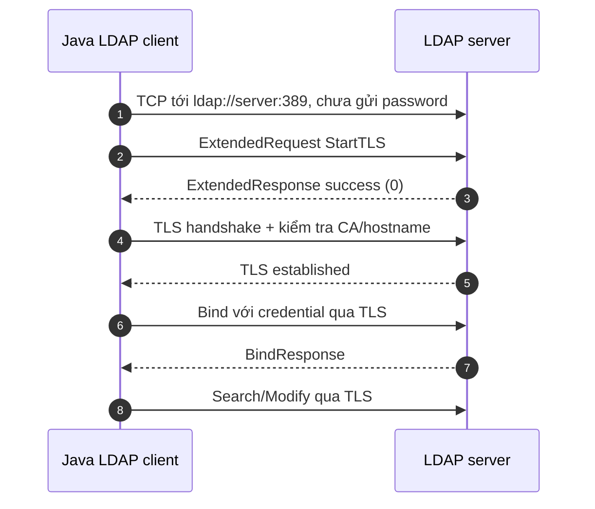
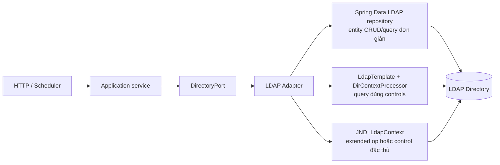

# Controls và extended operations

Trong chương **Thao tác LDAP** của **SPRING_DATA_LDAP**, người học đã có thể hình dung việc dùng `LdapRepository` hoặc `LdapTemplate` để tìm, thêm, sửa và xóa entry. Tuy nhiên, các thao tác cơ bản chưa đủ cho mọi nhu cầu: làm sao lấy danh sách nhân viên theo từng trang, yêu cầu server sắp xếp kết quả, kiểm tra một điều kiện ngay lúc ghi, xác định danh tính đã Bind hoặc nâng cấp kết nối sang TLS?

LDAPv3 có hai cơ chế mở rộng quan trọng:

- **LDAP controls:** gắn thêm yêu cầu hoặc thông tin điều khiển vào một thao tác LDAP, chẳng hạn **Search với phân trang**.
- **LDAP extended operations:** tạo **một loại thao tác LDAP mở rộng riêng**, chẳng hạn **StartTLS** hoặc **Who Am I?**.

Chúng thường được nhận diện bởi **OID** (*Object Identifier*) và có thể mang dữ liệu được mã hóa ASN.1/BER. Trong Java, **JNDI `LdapContext`** cung cấp API cấp thấp để thao tác với controls và extended requests; Spring LDAP bổ sung các processor và abstraction phù hợp với `LdapTemplate`. Spring Data LDAP repository giúp làm việc với entity nhưng không mặc nhiên triển khai mọi control hay extended operation của từng directory.

**Mục tiêu:** phân biệt hai cơ chế ở mức protocol, giải thích OID và `criticality`, đọc khả năng hỗ trợ qua Root DSE, thực hiện phân trang có kiểm tra kết quả, hiểu StartTLS/Who Am I/Password Modify, tích hợp có kiểm soát với Spring LDAP và kiểm thử an toàn trên directory thực.

## 1. Phân biệt nhanh: controls và extended operations

| Tiêu chí | LDAP control | LDAP extended operation |
| --- | --- | --- |
| Vị trí trong giao thức | Phần `controls` tùy chọn gắn với một **LDAPMessage** | Một lựa chọn `protocolOp`: `ExtendedRequest` |
| Chức năng | Điều chỉnh hoặc bổ sung ngữ nghĩa của thao tác đang thực hiện | Gọi một thao tác mở rộng với ngữ nghĩa riêng |
| Thông tin nhận diện | `controlType` là OID | `requestName` là OID |
| Dữ liệu tùy chọn | `controlValue` | `requestValue`; phản hồi có thể có `responseName`, `responseValue` |
| Có `criticality` không? | **Có**, áp dụng ở request control | **Không** có trường `criticality` chung tương tự control |
| Ví dụ | Paged Results, Server-Side Sort, Assertion Control | StartTLS, Who Am I, Password Modify |
| JNDI | `Control`, `LdapContext.setRequestControls(...)`, `getResponseControls()` | `ExtendedRequest`, `ExtendedResponse`, `LdapContext.extendedOperation(...)` |
| Bản chất | Không phải một kiểu LDAP operation mới | Chính là một kiểu request/response mở rộng |

Ví dụ: tìm 200 nhân viên bằng `SearchRequest` có **Paged Results Control** vẫn là **Search**. Ngược lại, StartTLS được gửi dưới dạng **ExtendedRequest**; nó không phải một Search có gắn “TLS control”.



## 2. Tại sao LDAP cần OID và mã hóa BER?

LDAP cho phép định nghĩa tính năng mà không phải đổi toàn bộ cú pháp của giao thức. **OID** định danh một loại control, extended operation hay matching rule. Ví dụ `1.2.840.113556.1.4.319` là OID của **Simple Paged Results**.

Hai điều cần nhớ:

1. **OID là mã định danh, không phải số phiên bản hay cổng mạng.** Không tự thay một OID bằng tên Java class hoặc tên tiện ích dòng lệnh.
2. **Giá trị gửi trên wire được mã hóa theo đặc tả tương ứng**, thường dùng BER. Một control có `controlValue` kiểu byte array không có nghĩa client có thể ghi chuỗi JSON/UTF-8 tùy ý vào đó.

Các class JNDI như `PagedResultsControl` và `StartTlsRequest` đảm nhiệm một phần biểu diễn giao thức của tính năng đã biết. Với control mở rộng không có class sẵn, cần một implementation mã hóa/giải mã BER đúng chuẩn hoặc thư viện LDAP phù hợp; chỉ tạo `new BasicControl(oid, true, arbitraryBytes)` **không tự làm dữ liệu hợp lệ**.

### 2.1. Cấu trúc một request control

Trong LDAPv3, control có ý nghĩa khái quát:

```text
Control ::= SEQUENCE {
    controlType   LDAPOID,
    criticality   BOOLEAN DEFAULT FALSE,
    controlValue  OCTET STRING OPTIONAL
}
```

- **`controlType`:** OID nói cho server biết client muốn dùng control nào.
- **`criticality`:** client cho biết thao tác có phụ thuộc **bắt buộc** vào việc server hiểu và áp dụng control hay không.
- **`controlValue`:** dữ liệu tùy chọn, có thể bao gồm số phần tử/trạng thái/cookie, được mã hóa theo control.

Mỗi control có điều kiện áp dụng riêng: có thể dành cho Search, một nhóm thao tác ghi hoặc phản hồi. Không được gắn mọi control vào mọi operation rồi mong server xử lý.

### 2.2. Critical và noncritical không giống nhau

| `criticality` | Server không nhận diện/hỗ trợ control | Hệ quả đối với ứng dụng |
| --- | --- | --- |
| `true` | Thông thường từ chối thao tác với **`unavailableCriticalExtension` (LDAP result code 12)** theo quy tắc giao thức | Không được xử lý kết quả như thể control đã được thực hiện |
| `false` | Server có thể bỏ qua control không được hỗ trợ và tiếp tục xử lý request | Thao tác có thể thành công **nhưng thiếu tính năng client mong đợi** |

Ví dụ nếu client cần phân trang thật để đồng bộ 100.000 entry, việc gửi Paged Results **noncritical** rồi mặc định server sẽ chia trang là nguy hiểm. Server không hỗ trợ có thể bỏ qua control và thực hiện Search bình thường, khiến client gặp giới hạn kích thước hoặc tưởng một trang là toàn bộ dữ liệu.

**Criticality là yêu cầu về tính bắt buộc của control, không phải mức độ ưu tiên của request.** Đặt `critical=true` không biến thao tác thành “ưu tiên cao”, không tạo quyền mới và không tự buộc server triển khai tính năng chưa có.

## 3. Những control thường gặp khi truy cập LDAP

| Control | OID | Vai trò | Lưu ý |
| --- | --- | --- | --- |
| **Simple Paged Results** (RFC 2696) | `1.2.840.113556.1.4.319` | Chia kết quả Search thành nhiều trang với cookie | Phải đọc hết các trang, không suy ra snapshot nhất quán |
| **Server-Side Sorting — request** (RFC 2891) | `1.2.840.113556.1.4.473` | Đề nghị server sắp xếp kết quả Search theo thuộc tính | Cần matching rule, quyền và hỗ trợ phía server |
| **Server-Side Sorting — response** (RFC 2891) | `1.2.840.113556.1.4.474` | Báo trạng thái xử lý sort | Search success không chứng minh sort đã thành công |
| **Assertion Control** (RFC 4528) | `1.3.6.1.1.12` | Yêu cầu một điều kiện đúng tại server trước thao tác tương ứng | Hữu ích khi chống cập nhật dựa trên dữ liệu cũ |
| **Pre-Read Control** (RFC 4527) | `1.3.6.1.1.13.1` | Yêu cầu server trả một số thuộc tính **trước** thay đổi | Không phải transaction xuyên nhiều entry |
| **Post-Read Control** (RFC 4527) | `1.3.6.1.1.13.2` | Yêu cầu server trả một số thuộc tính **sau** thay đổi | Còn phụ thuộc ACL/quyền xem thuộc tính |
| **ManageDsaIT** (RFC 3296) | `2.16.840.1.113730.3.4.2` | Điều khiển xử lý referral entries như entry thông thường trong tình huống được hỗ trợ | Không tự động đi theo referral |
| **LDAP Content Synchronization** (RFC 4533) | `1.3.6.1.4.1.4203.1.9.1.1` | Hỗ trợ đồng bộ thay đổi theo cơ chế server | Không tương đương Paged Results và có yêu cầu server riêng |

Bảng liệt kê những control tiêu biểu, **không khẳng định mọi LDAP server đều hỗ trợ chúng**. Các extension dành riêng cho sản phẩm (ví dụ Active Directory DirSync) có OID/semantics khác; không sử dụng nhầm với chuẩn chung nếu chưa xác nhận nhà cung cấp.

### 3.1. Control không thay thế DN, filter hay schema

Paged Results giúp trả Search theo trang nhưng **không sửa** base DN, `SearchScope` hoặc filter. Sorting control không tự tạo chỉ mục. Assertion Control không cấp quyền Modify cho account Bind. Tất cả vẫn chịu schema (`objectClass`, các attribute types), ACL, TLS và giới hạn tài nguyên directory.

Ví dụ `(uidNumber>=10000)` vẫn phụ thuộc **ORDERING matching rule** trong schema, dù server đồng thời nhận Sorting Control trên `uidNumber`. Ngược lại, một Search có sort thành công cũng không chứng minh kết quả đã được chia trang hoặc đã đọc hết.

## 4. Kiểm tra server hỗ trợ control hoặc extended operation nào

Root DSE (DN rỗng `""`, Search scope `base`) thường công bố danh sách OID qua:

- **`supportedControl`:** những control server công bố hỗ trợ.
- **`supportedExtension`:** những extended operation server công bố hỗ trợ.
- **`supportedFeatures`:** một số tính năng LDAP khác.
- **`supportedLDAPVersion`:** các phiên bản LDAP server công bố.
- **`namingContexts`:** các naming context mà server công bố; không đồng nghĩa toàn bộ topology đều nằm trên node này.

Ví dụ:

```bash
ldapsearch -x -H ldaps://directory.example.org:636 \
  -b "" -s base "(objectClass=*)" \
  supportedControl supportedExtension supportedFeatures namingContexts
```

Nếu server cho phép đọc Root DSE, kết quả có thể chứa:

```ldif
dn:
supportedControl: 1.2.840.113556.1.4.319
supportedExtension: 1.3.6.1.4.1.1466.20037
supportedExtension: 1.3.6.1.4.1.4203.1.11.3
namingContexts: dc=example,dc=org
```

Đây là **dữ liệu minh họa**, không phải danh sách mặc định của bất kỳ sản phẩm LDAP nào. Một server có thể công bố tính năng nhưng vẫn hạn chế thao tác bằng ACL, trạng thái, phiên bản hoặc cấu hình. Một account có quyền hạn chế có thể không đọc được mọi thông tin Root DSE.

**Kiểm tra OID chỉ là bước đầu.** Vẫn phải thử end-to-end với đúng account, endpoint, TLS, base và dữ liệu để chứng minh thao tác thành công và đúng semantics. Cũng không được coi “OID không xuất hiện” là cơ sở duy nhất để tự động hạ cấp một tính năng bảo mật bắt buộc.

## 5. Paged Results Control: ví dụ thực tế quan trọng nhất

Giả sử `ou=people,dc=example,dc=org` chứa 50.000 nhân viên. Một Search nhận tất cả entry trong một lần có thể chạm giới hạn size/time của server hoặc tiêu tốn nhiều RAM. **Simple Paged Results Control** theo RFC 2696 cho phép client yêu cầu một số entry mỗi trang.

### 5.1. Vòng đời cookie



Luồng xử lý:

1. Gửi Search với page size, cookie ban đầu **rỗng**.
2. Duyệt **hết trang hiện tại**, xử lý các entry và đọc response control.
3. Lấy **cookie do server trả**; gửi request tiếp theo với **cùng** base, scope, filter và ngữ nghĩa các control liên quan.
4. Lặp lại đến khi server trả **cookie rỗng** và tất cả thao tác hoàn tất thành công.
5. Nếu bất kỳ trang nào lỗi, timeout hoặc không còn response control bắt buộc, **không** công bố kết quả là đầy đủ.

**Cookie là giá trị opaque**: không tự parse, sửa, đoán số trang hay coi nó là token được bảo vệ để gửi cho mọi client HTTP. Tùy server, nó có thể chứa trạng thái phiên, hết hạn hoặc gắn với server/query cụ thể.

### 5.2. Paged Results khác size limit và SearchControls

| Khái niệm | Tác dụng | Không được suy ra |
| --- | --- | --- |
| `pageSize=200` | Đề nghị trả từng trang khoảng 200 entry | Có đúng 200 entry ở mọi trang |
| `PagedResultsResponseControl.getResultSize()` | Có thể cung cấp ước lượng tổng số kết quả | Luôn là total count chính xác, ổn định |
| `SearchControls.countLimit` | Giới hạn số entry cần nhận trong Search theo cơ chế JNDI/server | Là một cookie hay cơ chế phân trang |
| Server size limit | Giới hạn quản trị về Search | Paged Results luôn được phép vượt mọi giới hạn |
| Cookie rỗng cuối vòng | Báo vòng paging kết thúc theo server | Cung cấp snapshot giao dịch của cây LDAP khi dữ liệu đổi liên tục |

**Paged Results không đảm bảo snapshot nhất quán.** Entry có thể được thêm, sửa, xóa hoặc di chuyển giữa các trang, gây trùng hoặc bỏ sót theo hành vi server. Nếu cần đồng bộ chính xác, phải xây chiến lược checkpoint, đối soát, nhận diện entry ổn định và cân nhắc cơ chế đồng bộ thay đổi chuyên dụng.

## 6. Ví dụ JNDI: phân trang Search bằng LdapContext

Ví dụ sau giả định caller đã có `LdapContext` **được Bind qua TLS đã xác minh** tới đúng directory. `LdapContext` **không được dùng chung đồng thời giữa các thread**, vì request controls và trạng thái Search/connection gắn với context.

```java
import java.io.IOException;
import java.util.ArrayList;
import java.util.List;

import javax.naming.NamingEnumeration;
import javax.naming.NamingException;
import javax.naming.directory.Attribute;
import javax.naming.directory.SearchControls;
import javax.naming.directory.SearchResult;
import javax.naming.ldap.Control;
import javax.naming.ldap.LdapContext;
import javax.naming.ldap.PagedResultsControl;
import javax.naming.ldap.PagedResultsResponseControl;

public final class PagedPersonReader {
    public List<String> readAllUids(LdapContext ctx)
            throws NamingException, IOException {

        final int pageSize = 200;
        byte[] cookie = null;
        List<String> uids = new ArrayList<>();

        SearchControls searchControls = new SearchControls();
        searchControls.setSearchScope(SearchControls.SUBTREE_SCOPE);
        searchControls.setCountLimit(0); // Không cắt riêng từng page ở client
        searchControls.setReturningAttributes(new String[]{"uid"});

        try {
            do {
                ctx.setRequestControls(new Control[]{
                    new PagedResultsControl(
                        pageSize, cookie, Control.CRITICAL)
                });

                NamingEnumeration<SearchResult> entries = ctx.search(
                    "ou=people,dc=example,dc=org",
                    "(objectClass=inetOrgPerson)",
                    searchControls);

                try {
                    while (entries.hasMore()) {
                        Attribute uid = entries.next()
                            .getAttributes().get("uid");
                        if (uid != null && uid.size() > 0) {
                            uids.add(String.valueOf(uid.get()));
                        }
                    }
                } finally {
                    entries.close();
                }

                PagedResultsResponseControl pageResponse = null;
                Control[] responseControls = ctx.getResponseControls();
                if (responseControls != null) {
                    for (Control control : responseControls) {
                        if (control instanceof PagedResultsResponseControl) {
                            pageResponse =
                                (PagedResultsResponseControl) control;
                            break;
                        }
                    }
                }

                if (pageResponse == null) {
                    throw new NamingException(
                        "Paged Results response control is missing");
                }

                cookie = pageResponse.getCookie();
            } while (cookie != null && cookie.length > 0);

            return uids;
        } finally {
            // Xóa control sau khi dùng; context được caller quản lý.
            ctx.setRequestControls(null);
        }
    }
}
```

Các điều kiện để đoạn code đáng tin:

- **Đầu vào tin cậy:** Search base và filter cố định; nếu cần lọc theo `uid` từ người dùng, dùng overload JNDI có filter arguments hoặc filter builder để tránh injection.
- **Critical control:** vì thuật toán cần phân trang, yêu cầu `Control.CRITICAL` để không âm thầm nhận Search thường.
- **Duyệt hết trang:** chỉ đọc cookie sau khi đã tiêu thụ kết quả, bởi kết quả cuối Search và response controls có thể đến sau các entry.
- **Không đánh dấu hoàn tất nếu trang lỗi:** ngoại lệ khi duyệt `NamingEnumeration` phải được đưa lên caller; danh sách `uids` đã thu được là **dữ liệu một phần**, không có nghĩa đủ.
- **Trạng thái context:** không sửa request controls trên một context đang được thread khác dùng. Với pool/context wrapper phải tuân thủ vòng đời borrow/return của implementation.
- **Trang cuối:** cookie rỗng hoặc không có giá trị báo kết thúc theo API; thiếu hẳn Paged Results response control trong một vòng bắt buộc là tình huống cần xử lý, không được suy diễn là trang cuối.
- **Dữ liệu nghiệp vụ:** chỉ đọc `uid` để đơn giản; trong đồng bộ thật phải kiểm tra thuộc tính bắt buộc, định danh ổn định, kết quả nhiều domain/referral và biến động giữa các trang.

Đây là ví dụ **JNDI cấp thấp**. Trong Spring LDAP, nên ưu tiên API processor có sẵn khi phiên bản và đường đi `LdapTemplate` hỗ trợ, thay vì tự tạo `LdapContext` ở mọi service.

## 7. Spring LDAP và Spring Data LDAP sử dụng controls thế nào?

### 7.1. Vai trò khác nhau giữa Repository và LdapTemplate

| Thành phần | Vai trò |
| --- | --- |
| `LdapRepository<PersonEntry>` | Tìm/lưu/xóa entry theo mô hình Java và derived queries |
| `LdapTemplate` | Thực hiện LDAP Search/Modify/Lookup rõ ràng, quản lý context và mapping |
| `DirContextProcessor` của Spring LDAP | Hook để xử lý context **trước/sau** thao tác theo overload hỗ trợ |
| `PagedResultsDirContextProcessor` | Hỗ trợ dùng Paged Results với `LdapTemplate` trong những phiên bản Spring LDAP có API tương ứng |
| `SortControlDirContextProcessor` | Hỗ trợ yêu cầu sort ở tầng LDAP khi thư viện/server hỗ trợ |
| `LdapContext` của JNDI | API cấp thấp cho request/response controls và extended operations |

Không có quy tắc rằng **`findAll()` của Spring Data LDAP tự phân trang ở mức LDAP server** chỉ vì một tên method nghe giống API database. Spring Data LDAP repository có các khả năng và giới hạn riêng; phải kiểm tra phiên bản, query và việc hỗ trợ controls thực tế.

Một service truy vấn vài entry bằng `findByUid` thường không cần Paged Results. Ngược lại, job xuất **toàn bộ** directory phải thiết kế vòng paging, giới hạn dữ liệu, lỗi và completeness rõ ràng thay vì mặc định gọi `repository.findAll()` rồi giữ mọi entry trong RAM.

### 7.2. PagedResultsDirContextProcessor

Spring LDAP có cơ chế dùng **`DirContextProcessor`** với `LdapTemplate`. Ví dụ hình thức:

```java
import org.springframework.ldap.control.PagedResultsDirContextProcessor;

// Bộ xử lý request/response control cho một vòng paging.
PagedResultsDirContextProcessor processor =
    new PagedResultsDirContextProcessor(200);

// Khi triển khai thật: dùng overload LdapTemplate.search có hỗ trợ
// DirContextProcessor tương ứng với phiên bản Spring LDAP đang chạy.
// Sau mỗi trang, kiểm tra cookie/hasMore theo API version,
// lặp đến khi hoàn tất và không còn lỗi.
```

**Đây là ví dụ cấu hình processor, không phải đoạn paging hoàn chỉnh.** Chữ ký overload `LdapTemplate.search(...)` và API cookie/hasMore cần đối chiếu dependency thực tế. Một ứng dụng dùng `PagedResultsDirContextProcessor` nhưng chỉ gọi Search **một lần** vẫn mới lấy **một trang**; không thể kết luận đã xuất toàn bộ dữ liệu. Nếu muốn có ví dụ thực thi ở mức JNDI, xem mục 6.

### 7.3. Ánh xạ entry không thay thế controls

Một entity Spring Data LDAP:

```java
import javax.naming.Name;
import org.springframework.ldap.odm.annotations.Entry;
import org.springframework.ldap.odm.annotations.Id;
import org.springframework.ldap.odm.annotations.Attribute;

@Entry(
    base = "ou=people",
    objectClasses = {"top", "person", "organizationalPerson", "inetOrgPerson"}
)
public class PersonEntry {
    @Id
    private Name dn;

    @Attribute(name = "uid")
    private String uid;

    @Attribute(name = "cn")
    private String name;

    public PersonEntry() {}
    public Name getDn() { return dn; }
    public String getUid() { return uid; }
    public String getName() { return name; }
}
```

`@Entry` mô tả base/`objectClass`, `@Id` ánh xạ DN, `@Attribute` ánh xạ dữ liệu. **Không annotation nào tự bật StartTLS, Paged Results, Assertion Control hay Server-Side Sorting.** Những tính năng đó thuộc cấu hình connection/operation, cần xử lý tại adapter Spring LDAP hoặc client LDAP phù hợp.

## 8. Server-Side Sorting: yêu cầu kết quả có thứ tự

**Server-Side Sorting Control** (RFC 2891) để client đề nghị server sắp xếp danh sách entry theo một hay nhiều thuộc tính. Nó khác với:

```text
(uidNumber>=10000)
```

vì filter phía trên chỉ **chọn entry**, không sắp xếp thứ tự.

Ở JNDI có class `SortControl`:

```java
import javax.naming.ldap.Control;
import javax.naming.ldap.SortControl;

Control sort = new SortControl(
    new String[]{"cn"},
    Control.CRITICAL
);

// Gắn sort cùng các request controls cần thiết trên LdapContext
// trước khi gọi Search, rồi kiểm tra response sort phía server.
```

Khi sort control là **critical**, phải kiểm tra thành công của request và **Sort Response Control**. Không chỉ dựa vào LDAP Search trả mã 0 để kết luận mọi yêu cầu sắp xếp đã được áp dụng; response sort có thể báo trạng thái riêng. Với noncritical control, server có thể bỏ qua tính năng.

### 8.1. Điều kiện để sort đáng tin

- Thuộc tính sort phải được server hỗ trợ và có **ORDERING matching rule** phù hợp; không mặc định `cn`, `mail` hay custom attribute đều được sắp xếp theo cách ứng dụng mong muốn.
- Server có thể giới hạn kích thước kết quả, bộ nhớ, chỉ mục và quyền truy cập khi sort.
- Khi kết hợp **sort + paging**, cần kiểm tra server hỗ trợ **cả hai control đồng thời**, xử lý hai response controls và độ ổn định khi dữ liệu thay đổi trong lúc lật trang.
- Nếu sort nhiều entry cùng một khóa, thứ tự giữa các entry bằng nhau có thể chưa ổn định; muốn trang nhất quán phải thiết kế tie-breaker/identifier phù hợp và kiểm tra hành vi server.
- Sort **ở client sau khi mới tải một trang** không tạo ra thứ tự toàn cục của tất cả kết quả Search.

## 9. Assertion Control và Pre/Post-Read: an toàn khi ghi

Một rủi ro khi dùng `LdapRepository.save()` hoặc `LdapTemplate.modifyAttributes(...)` là **đọc trước rồi ghi sau** trong lúc entry đã bị client khác thay đổi.

```text
T1: Service A đọc mail=lan@example.org
T2: Service B đổi mail=lan.new@example.org
T3: Service A ghi mail=lan.hr@example.org dựa trên dữ liệu cũ
```

Không phải directory nào cũng hỗ trợ transaction/locking giống SQL. **Assertion Control** (RFC 4528) có thể giúp yêu cầu một điều kiện LDAP đúng tại thời điểm server xử lý thao tác có hỗ trợ, ví dụ chỉ Modify nếu một thuộc tính vẫn mang giá trị kỳ vọng.

### 9.1. Ngữ nghĩa của Assertion Control

Giả định ứng dụng đã đọc `mail=lan@example.org` và muốn cập nhật chỉ nếu email chưa đổi:

```text
LDAP Modify DN: uid=lan,ou=people,dc=example,dc=org
Assertion filter: (mail=lan@example.org)
Operation: REPLACE mail: lan.hr@example.org
```

Nếu điều kiện assertion không đúng, server có thể trả **`assertionFailed` (LDAP result code 122)** theo RFC 4528. Điều này khác `noSuchObject` (32), `insufficientAccessRights` (50), `objectClassViolation` (65) hoặc timeout transport.

**Assertion Control không đảm bảo “giao dịch ACID trên toàn bộ hệ thống”**: nó ràng buộc một thao tác LDAP theo khả năng server. Nó không tự khóa bản ghi SQL, không cập nhật nhóm ở entry khác và không làm mọi API repository hỗ trợ optimistic locking.

### 9.2. Pre-Read và Post-Read

**Pre-Read Control** có thể yêu cầu server gửi một số thuộc tính **trước thao tác ghi**; **Post-Read Control** có thể gửi một số thuộc tính **sau thao tác ghi**. Cách sử dụng cần phù hợp loại operation, server hỗ trợ và ACL.

Ví dụ nghiệp vụ:

```text
Modify mail của Lan
  + Pre-Read: mail
  + Post-Read: mail

Kết quả dự kiến nếu server chấp nhận controls:
  Trước: mail=lan@example.org
  Sau:   mail=lan.new@example.org
```

Đây là công cụ hỗ trợ audit và đối soát cho **một operation**, không phải bằng chứng mọi thay đổi liên quan ở database/cache đã nhất quán. Ngoài ra, được quyền **ghi** không đồng nghĩa được quyền **đọc** mọi thuộc tính; server vẫn áp ACL cho dữ liệu trả về qua control.

### 9.3. Đừng giả định BasicControl tự mã hóa Assertion filter

Assertion Control có `controlValue` mã hóa một **LDAP filter theo BER**. Truyền nguyên chuỗi `"(mail=...)"` bằng `String.getBytes()` vào `BasicControl` không tạo ra một assertion control hợp lệ. Khi cần, dùng thư viện/cơ chế đã triển khai mã hóa đúng RFC 4528 và viết integration test với server đích.

## 10. Extended operations hoạt động ra sao?

LDAPv3 có một loại protocol operation mang tên `ExtendedRequest`. Request có:

```text
ExtendedRequest ::= SEQUENCE {
    requestName   LDAPOID,
    requestValue  OCTET STRING OPTIONAL
}
```

Phản hồi `ExtendedResponse` bao gồm **LDAPResult** (có result code và các trường liên quan), đồng thời có thể chứa `responseName` và `responseValue`. Ý nghĩa `requestValue`/`responseValue` được định nghĩa trong từng extended operation cụ thể; không được diễn giải mọi response như UTF-8 text tự do.

Trong JNDI:

```java
import javax.naming.ldap.ExtendedRequest;
import javax.naming.ldap.ExtendedResponse;
import javax.naming.ldap.LdapContext;

// Gọi một ExtendedRequest cụ thể đã được triển khai đúng OID/BER:
// ExtendedResponse response = ctx.extendedOperation(request);
```

`LdapContext.extendedOperation(...)` là API cấp thấp; `ExtendedRequest` và `ExtendedResponse` là interface, không thể tự gửi một OID bất kỳ mà không cung cấp triển khai encode/decode theo đặc tả.

### 10.1. Các extended operations tiêu biểu

| Extended operation | OID | Công dụng | Ghi chú |
| --- | --- | --- | --- |
| **StartTLS** (RFC 4511) | `1.3.6.1.4.1.1466.20037` | Yêu cầu nâng cấp kết nối LDAP hiện có sang TLS | Phải hoàn tất TLS và xác minh chứng chỉ **trước Bind simple** |
| **Password Modify** (RFC 3062) | `1.3.6.1.4.1.4203.1.11.1` | Yêu cầu đổi/đặt mật khẩu theo cơ chế server hỗ trợ | Phụ thuộc ACL, chính sách mật khẩu, TLS và implementation |
| **Who Am I?** (RFC 4532) | `1.3.6.1.4.1.4203.1.11.3` | Truy vấn authorization identity hiện tại của connection | Không chứng minh có quyền Modify hoặc Admin |
| **Cancel** (RFC 3909) | `1.3.6.1.1.8` | Đề nghị hủy một operation đang xử lý | Không bảo đảm mọi operation có thể hủy hoặc rollback |

Không phải server nào cũng hỗ trợ tất cả. **Abandon** là một loại LDAP request có sẵn của giao thức và không giống hoàn toàn Extended Cancel. Tương tự, Password Modify Extended Operation không phải lúc nào cũng tương đương sửa trực tiếp `userPassword` bằng LDAP Modify; một số directory có API/chính sách thay mật khẩu riêng.

## 11. StartTLS: extended operation liên quan trực tiếp bảo mật

StartTLS thường hoạt động trên kết nối `ldap://...:389` theo trình tự:

1. Thiết lập kết nối LDAP ban đầu.
2. Gửi **StartTLS ExtendedRequest** khi connection đang ở trạng thái cho phép.
3. Server chấp nhận StartTLS request.
4. Hai bên bắt tay **TLS trên chính kết nối đó**, xác minh CA/chứng chỉ/hostname.
5. **Chỉ sau khi TLS thành công**, tiến hành simple Bind bằng DN và password nếu cần.
6. Dùng LDAP Search/Modify trên kết nối đã bảo vệ, đóng đúng vòng đời.



**StartTLS và LDAPS khác cách thiết lập TLS**: LDAPS (`ldaps://...:636` trong cấu hình phổ biến) bắt tay TLS ngay từ đầu kết nối; StartTLS nâng cấp một kết nối LDAP hiện có bằng extended operation. Cả hai đều phải xác minh chứng chỉ. Việc endpoint là `ldap://` **không** tự có nghĩa StartTLS đã bật.

### 11.1. Ví dụ JNDI StartTLS ở mức cấu trúc

JNDI có `StartTlsRequest` và `StartTlsResponse`:

```java
import java.util.Hashtable;
import javax.naming.Context;
import javax.naming.ldap.InitialLdapContext;
import javax.naming.ldap.LdapContext;
import javax.naming.ldap.StartTlsRequest;
import javax.naming.ldap.StartTlsResponse;

public final class StartTlsExample {
    public void connectWithStartTls(String bindDn, String password)
            throws Exception {
        Hashtable<String, Object> env = new Hashtable<>();
        env.put(Context.INITIAL_CONTEXT_FACTORY,
                "com.sun.jndi.ldap.LdapCtxFactory");
        env.put(Context.PROVIDER_URL,
                "ldap://directory.example.org:389");
        env.put(Context.SECURITY_AUTHENTICATION, "none");

        LdapContext ctx = new InitialLdapContext(env, null);
        StartTlsResponse tls = null;
        try {
            tls = (StartTlsResponse)
                ctx.extendedOperation(new StartTlsRequest());

            // Phải cấu hình truststore và kiểm tra hostname/certificate
            // hợp lệ trước khi chấp nhận thành công TLS.
            tls.negotiate();

            // Chỉ Bind simple sau khi TLS được thiết lập thành công.
            ctx.addToEnvironment(Context.SECURITY_PRINCIPAL, bindDn);
            ctx.addToEnvironment(Context.SECURITY_CREDENTIALS, password);
            ctx.addToEnvironment(Context.SECURITY_AUTHENTICATION, "simple");
            ctx.reconnect(null);

            // Bây giờ mới thực hiện LDAP Search/Modify cần quyền Bind.
        } finally {
            try {
                if (tls != null) {
                    tls.close();
                }
            } finally {
                ctx.close();
            }
        }
    }
}
```

Đây là ví dụ **vòng đời StartTLS/JNDI**, không phải cấu hình TLS/secret production hoàn chỉnh. Bảo đảm JVM đã tin cậy đúng CA, xác minh hostname của từng endpoint, không ghi password ra log, và **không tự fallback sang simple Bind không mã hóa** khi StartTLS thất bại.

Khi dùng Spring LDAP, nên dùng **ContextSource/StartTLS strategy** được phiên bản thư viện hỗ trợ để quản lý lifecycle; không để controller tự gọi StartTLS trên một connection có trạng thái không rõ. **Không bật JNDI pooling tùy tiện cho connection StartTLS** vì trạng thái TLS, Bind và vòng đời context cần được bảo toàn chính xác.

## 12. Who Am I? và Password Modify

### 12.1. Who Am I? — xác định identity hiện tại

Sau khi Bind, **Who Am I? Extended Operation** có thể trả authorization identity mà server đang gán cho connection. Công cụ dòng lệnh:

```bash
ldapwhoami -x -H ldaps://directory.example.org:636 \
  -D "uid=directory-reader,ou=services,dc=example,dc=org" -W
```

Phản hồi có thể có dạng `dn:...`, `u:...` hoặc rỗng tùy danh tính/cơ chế Bind. Đây là công cụ chẩn đoán **Bind identity**, rất hữu ích khi ứng dụng được cấu hình nhiều `ContextSource` cho repository, đồng bộ và xác thực người dùng.

**Không suy luận quyền từ Who Am I?** Server nhận diện connection là `directory-reader` không có nghĩa account này được Modify `mail`, đổi RDN hay xóa entry. Phải kiểm tra ACL theo operation và DN/thuộc tính cụ thể.

### 12.2. Password Modify — thay mật khẩu theo chính sách

**Password Modify Extended Operation** (RFC 3062) có thể cho phép yêu cầu đổi mật khẩu qua giao diện chuẩn. Hành vi cụ thể phụ thuộc server, quyền, chính sách mật khẩu, cách xác thực và yêu cầu TLS. Một số directory có cơ chế riêng để đặt lại mật khẩu hoặc quản lý trạng thái account; không mặc định `Password Modify` được hỗ trợ.

Ví dụ với công cụ OpenLDAP trong môi trường test được phép:

```bash
ldappasswd -x -H ldaps://directory.example.org:636 \
  -D "uid=lan,ou=people,dc=example,dc=org" -W \
  -S "uid=lan,ou=people,dc=example,dc=org"
```

`-W` yêu cầu nhập password dùng Bind, còn `-S` yêu cầu nhập mật khẩu mới theo cơ chế của công cụ; tránh `-s` với giá trị mật khẩu trên command line vì có thể lộ qua shell history/process arguments. Lệnh **thực sự thay đổi credential** nếu server chấp nhận: chỉ thực hiện với tài khoản thử nghiệm và quyền được phê duyệt.

Ứng dụng **không** nên tự đọc `userPassword` rồi so sánh chuỗi để thay thế LDAP Bind authentication. Cũng không nên coi việc `LdapRepository.save(person)` cập nhật một field là tương đương thao tác Password Modify Extended Operation có kiểm soát. Chính sách password có thể gồm lockout, history, chất lượng mật khẩu và hạn chế của directory.

## 13. Extended operations và Spring Security LDAP

Spring Security LDAP có thể dùng LDAP Bind để xác thực người dùng; Spring Data LDAP/Spring LDAP xử lý directory data access. Cần phân biệt rõ:

- **StartTLS** bảo vệ kết nối trước khi gửi credential và dữ liệu nhạy cảm.
- **Bind** là operation xác thực danh tính, **không** phải extended operation.
- **Who Am I?** cho biết identity đang được server nhìn nhận, **không** tự tạo Spring Security `Authentication` cho HTTP request.
- **Password Modify** là yêu cầu thay đổi credential, **không** đồng nghĩa cấp quyền ở HTTP API.
- **Paged Results/Sort** liên quan kết quả Search, **không** xác thực password hay bypass ACL.

Một ứng dụng có thể dùng **service account** để tìm employee entry, nhưng Bind bằng tài khoản **người dùng** để xác thực login. Các connection/context phải giữ đúng danh tính, quyền và chính sách TLS; không tái sử dụng tùy tiện kết nối đã Bind bằng identity A cho các thao tác được kỳ vọng chạy dưới identity B.

## 14. Controls/extended operations trong kiến trúc ứng dụng

Ứng dụng thực nên giữ phần giao thức ở **adapter**, không để controller tự quản lý cookie BER, response controls hay TLS lifecycle.



Đề xuất hợp đồng ở tầng service:

| Use case | Adapter nên công bố | Điều cần bảo đảm |
| --- | --- | --- |
| Tìm employee theo UID | `findByUid(uid)` | Filter an toàn, base/scope/ACL đúng |
| Xuất tất cả employee | `streamAllPeople(...)` hoặc job paging | Đọc hết cookie, checkpoint, báo partial/unknown khi lỗi |
| Tìm danh sách đã sort | `searchSorted(criteria)` | Server hỗ trợ sort, kiểm response control, thứ tự đúng |
| Sửa email có điều kiện | `updateMailIfUnchanged(...)` | Assertion Control hoặc cơ chế concurrency tương đương được kiểm chứng |
| Xác nhận danh tính Bind | `whoAmI()` trong công cụ quản trị/chẩn đoán | Không suy ra quyền ghi từ identity |
| Thay mật khẩu | `changePassword(...)` qua dịch vụ IAM được phê duyệt | TLS, quyền, policy password, audit |

**Completeness là một phần của API contract**. Khi một trang Search bị giới hạn, referral chưa xử lý hoặc server trả lỗi, không được trả một `List` như thể đã đọc đủ để job xóa tài khoản vắng mặt. Với read model lớn có thể dùng trạng thái `COMPLETE`/`PARTIAL`/`UNKNOWN` của ứng dụng; không nhầm nó với một control có sẵn trong LDAP.

## 15. Bảo mật khi dùng controls và extended operations

### 15.1. Không tin cậy một OID hoặc response value chỉ vì đã nhận

Một OID hợp lệ không làm request an toàn nếu endpoint bị giả mạo, TLS không xác minh hoặc caller không được phép gọi chức năng. Hãy:

1. **Xác minh TLS và hostname**, không tắt certificate verification để StartTLS thành công.
2. **Giới hạn endpoint và referral**, không tự theo mọi referral URL với service credential.
3. **Phân quyền theo thao tác:** Search, Modify, Modify DN, Password Modify có yêu cầu khác nhau; dùng service account tối thiểu.
4. **Giới hạn tài nguyên:** page size, số trang, tổng entry, deadline, số request đồng thời và thời gian chờ.
5. **Không lộ dữ liệu:** raw control values, cookie, DN, password và diagnostic message có thể nhạy cảm.
6. **Kiểm tra hỗ trợ server:** Root DSE, phản hồi từng control và test với account thật; không fallback ngầm khi critical feature thiếu.
7. **Không viết decoder BER tùy tiện** cho control chưa biết; dùng thư viện được kiểm chứng hoặc đặc tả chính thức.

### 15.2. Lỗi phổ biến khi ghép nhiều control

Một Search có thể mang nhiều control, ví dụ Paged Results và Sorting. Nhưng **server có thể không hỗ trợ tổ hợp đó**, kể cả khi từng OID được công bố riêng lẻ. Cần:

- Đặt criticality theo yêu cầu nghiệp vụ từng control.
- Xác định thứ tự áp dụng có ý nghĩa và khả năng kết hợp theo đặc tả/server.
- Đọc response controls của **đúng operation**, không tái sử dụng kết quả của request trước.
- Bảo đảm mỗi page giữ cùng tiêu chí sort/filter và cookie.
- Giới hạn retry để tránh tiếp tục dùng cookie đã hết hạn hoặc trạng thái server không còn.

Không áp dụng một control vào `LdapContext` dùng chung trong pool rồi quên làm sạch: operation tiếp theo có thể vô tình mang theo yêu cầu phân trang/sort ngoài ý muốn.

## 16. Lỗi và mã kết quả cần phân biệt

| Tín hiệu | Ý nghĩa thường gặp | Cách xử lý |
| --- | --- | --- |
| `0 success` của Search | Search được thực hiện thành công | Chưa chứng minh đã lấy hết các trang hoặc sort control thành công |
| `12 unavailableCriticalExtension` | Server không thực hiện được critical control | Không hạ cấp im lặng; xác minh hỗ trợ OID/tổ hợp controls |
| `122 assertionFailed` | Assertion Control không thỏa | Đọc lại entry, báo xung đột thay đổi, không ghi đè mù |
| `3 timeLimitExceeded` | Search vượt giới hạn thời gian do server áp | Không coi kết quả đã hoàn chỉnh |
| `4 sizeLimitExceeded` | Vượt giới hạn số entry | Thu hẹp query, paging nếu phù hợp; không nuốt lỗi |
| `10 referral` hoặc continuation reference | Dữ liệu có thể nằm nơi khác | Quản lý referral an toàn và trạng thái completeness |
| `49 invalidCredentials` | Bind không thành công | Không retry liên tục cùng credential |
| `50 insufficientAccessRights` | Thiếu quyền LDAP cho operation | Kiểm tra Bind account, ACL, DN/thuộc tính |
| `53 unwillingToPerform` | Server từ chối theo điều kiện/chính sách | Kiểm tra server policy/audit, không quy chung về mạng |
| `51 busy`, `52 unavailable` | Server báo bận/không khả dụng | Retry hữu hạn, backoff/jitter, không tạo retry storm |
| TLS handshake/certificate failure | Bảo mật kết nối chưa thiết lập được | Không gửi mật khẩu/downgrade; kiểm tra truststore/hostname |
| Socket timeout sau thao tác ghi | Có thể không nhận LDAP result code | Đối soát entry trước khi retry, không mặc định chưa ghi |

**Không tự gán mã 12 cho mọi control không hoạt động.** Mã 12 có ý nghĩa khi server trả phản hồi tương ứng. Với một noncritical control bị bỏ qua, Search có thể trả 0; ứng dụng vẫn phải kiểm tra rằng control đã được áp dụng theo yêu cầu.

### 16.1. Telemetry có phân biệt thao tác và response control

Nên ghi:

```json
{
  "operation": "search",
  "resource_kind": "person",
  "endpoint_id": "ldap-primary",
  "controls_requested": ["paged_results"],
  "outcome": "success",
  "pages_completed": 5,
  "completeness": "complete",
  "duration_ms": 183
}
```

Đây là **sự kiện ứng dụng tự định nghĩa**; JNDI không tự sinh tất cả field trên. `completeness=complete` chỉ hợp lệ sau khi đã đọc hết các trang bắt buộc, không gặp lỗi/referral chưa xử lý và đáp ứng phạm vi đã thỏa thuận. Không ghi cookie raw, credential, DN cá nhân, filter chứa dữ liệu người dùng hay requestValue nhạy cảm vào metric label/log tập trung.

## 17. Kiểm thử controls và extended operations

Unit test có thể xác minh helper tạo request control, bộ lọc an toàn và logic vòng lặp cookie; **integration test** cần server thật hoặc test directory có hỗ trợ OID liên quan.

| Ca thử | Dữ liệu/điều kiện | Điều cần xác minh |
| --- | --- | --- |
| Root DSE | Server công bố supportedControl/Extension | Ghi nhận danh sách OID mà account đọc được |
| Paged Results nhiều trang | Seed nhiều entry hơn pageSize | Đọc hết trang, không trùng/bỏ sót trong bộ dữ liệu tĩnh |
| Trang cuối | Số entry không chia hết cho pageSize | Phản hồi cookie rỗng, thuật toán dừng đúng |
| Paged Results không hỗ trợ | Server test không nhận OID hoặc không hỗ trợ | Critical request thất bại đúng cách; không coi kết quả Search thường là đủ |
| Noncritical control | Server bỏ qua tính năng không hỗ trợ | Ứng dụng không giả định control đã thực hiện |
| Paging lỗi ở giữa | Dừng server/timeout sau trang 2 | Báo PARTIAL hoặc lỗi, không cập nhật checkpoint/xóa tài khoản |
| Cookie hết hạn/sai query | Giữ cookie cũ rồi thay base/filter | Xử lý lỗi; không “giải mã” cookie hoặc tiếp tục sai |
| Search + Sort | Server hỗ trợ sort/paging cùng lúc | Kiểm response sort, thứ tự và toàn bộ trang |
| Sort không hỗ trợ ORDERING | Dùng attribute không có rule phù hợp | Báo lỗi/thất bại đúng, không dùng thứ tự ngầm |
| Assertion đúng | Entry chưa đổi từ lúc đọc | Modify được thực hiện; kiểm tra trạng thái cuối |
| Assertion sai | Client khác sửa entry trước Modify | Assertion failed; không ghi đè ngoài ý muốn |
| StartTLS thành công | CA/hostname hợp lệ, endpoint hỗ trợ | TLS đã thiết lập **trước** khi simple Bind |
| StartTLS thất bại | Chứng chỉ không tin cậy/endpoint không hỗ trợ | Dừng kết nối; không fallback gửi password plaintext |
| Who Am I? | Bind service account test | Authorization identity tương ứng, không suy ra quyền Modify |
| Password Modify | Account test có quyền, TLS hợp lệ | Đổi password theo policy; audit, không log secret |
| LDAP account không có quyền | Bind read-only rồi yêu cầu Modify | Server từ chối; controls không bypass ACL |
| Referral đa naming context | Search gặp reference sang server khác | Không âm thầm coi dữ liệu một phần là đầy đủ |
| JNDI context tái sử dụng | Hai loại query chạy liên tiếp | Không còn request controls cũ trên query sau |

### 17.1. Kiểm thử đối chứng bằng ldapsearch

Với client OpenLDAP, Root DSE có thể đọc bằng `ldapsearch` như mục 4. Một số bản `ldapsearch` hỗ trợ yêu cầu Paged Results bằng tùy chọn `-E pr=...`, ví dụ:

```bash
ldapsearch -x -H ldaps://directory.example.org:636 \
  -D "uid=directory-reader,ou=services,dc=example,dc=org" -W \
  -b "ou=people,dc=example,dc=org" -s sub \
  -E pr=200/noprompt \
  "(objectClass=inetOrgPerson)" uid cn
```

Tên và hành vi tùy chọn phụ thuộc bản `ldapsearch`; kiểm tra `ldapsearch -E help`/tài liệu công cụ. Lệnh này **không chứng minh** ứng dụng Spring đã xử lý cookie đúng, vì client CLI và JNDI có vòng đời control khác nhau.

Với StartTLS, OpenLDAP CLI thường sử dụng `-ZZ` để yêu cầu StartTLS bắt buộc; chỉ dùng `ldap://` khi đã buộc nâng cấp và xác minh TLS:

```bash
ldapwhoami -x -H ldap://directory.example.org:389 \
  -ZZ -D "uid=directory-reader,ou=services,dc=example,dc=org" -W
```

Không dùng kiểu “thử StartTLS, nếu thất bại thì cứ Bind” trong script production. Nếu yêu cầu bảo vệ kết nối, thất bại TLS phải là thất bại yêu cầu.

## 18. Câu hỏi tự kiểm tra

1. **Control và extended operation khác nhau thế nào?** Control bổ sung hành vi cho LDAP operation; extended operation là một request riêng với `requestName` OID.
2. **`criticality=true` có làm LDAP request được ưu tiên xử lý không?** Không. Nó nói rằng client yêu cầu control phải được hỗ trợ/áp dụng để thao tác có ý nghĩa.
3. **Mã LDAP 12 xuất hiện khi nào?** Khi server không thể thực hiện critical control và trả `unavailableCriticalExtension` theo quy tắc giao thức.
4. **OID Paged Results là gì?** `1.2.840.113556.1.4.319`; nó liên quan phân trang Search, không phải StartTLS.
5. **Vì sao không thể lấy một trang rồi nói đã lấy hết?** Server có thể trả cookie cho trang tiếp; cần lặp đến cookie rỗng và không có lỗi.
6. **Paged Results có đảm bảo snapshot giao dịch trong khi dữ liệu thay đổi không?** Không. Cần chiến lược đối soát, checkpoint hoặc cơ chế đồng bộ khác nếu nghiệp vụ đòi hỏi.
7. **Search filter `(uidNumber>=10000)` có sắp xếp kết quả không?** Không. Muốn sort ở server cần control phù hợp và kiểm response.
8. **Assertion Control giúp giải quyết vấn đề nào?** Giảm nguy cơ ghi đè dựa trên dữ liệu cũ bằng điều kiện được kiểm tra lúc server xử lý.
9. **StartTLS là control hay extended operation?** Extended operation, OID `1.3.6.1.4.1.1466.20037`.
10. **Khi nào được gửi simple Bind password với StartTLS?** Chỉ sau khi StartTLS thành công, TLS handshake hoàn tất và chứng chỉ/hostname được xác minh.
11. **Who Am I? có chứng minh người dùng được sửa group không?** Không. Nó cho biết authorization identity, còn quyền Modify do LDAP ACL quyết định.
12. **Password Modify Extended Operation có giống viết thuộc tính `userPassword` qua repository không?** Không. Chính sách và API server có thể khác; phải dùng cơ chế được directory hỗ trợ và phê duyệt.
13. **Tại sao không tự ghi chuỗi filter vào BasicControl làm assertion control?** Vì controlValue phải mã hóa đúng BER/đặc tả, không phải chuỗi text tùy ý.
14. **Làm sao biết server hỗ trợ một OID?** Kiểm tra `supportedControl`/`supportedExtension` trên Root DSE khi có quyền, sau đó integration test với đúng endpoint và account.

**Ghi nhớ:** Trong LDAPv3, **controls** mở rộng hành vi của các thao tác như Search và Modify, còn **extended operations** là những request riêng như StartTLS, Who Am I và Password Modify. Khi triển khai SPRING_DATA_LDAP, hãy hiểu OID, criticality, response controls, cookie và quyền của từng thao tác; không nhầm một trang với toàn bộ kết quả, không nhầm sorting với filtering và tuyệt đối không hạ cấp TLS hay bỏ qua lỗi control bắt buộc. Dùng `LdapTemplate`/JNDI tại adapter thích hợp, kết hợp schema, ACL, filter an toàn và kiểm thử trên directory thật trước khi phụ thuộc các tính năng mở rộng trong nghiệp vụ.
