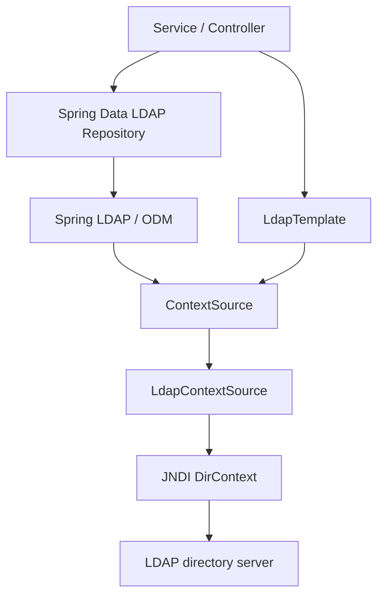

# ContextSource và LdapContextSource

## Mục tiêu học tập

Sau bài học, người học có thể:

1. Giải thích vai trò của `ContextSource` trong kiến trúc **Spring LDAP / Spring Data LDAP** và phân biệt nó với implementation `LdapContextSource`.
2. Mô tả đường đi từ service, repository/`LdapTemplate` tới JNDI và LDAP server.
3. Cấu hình URL, base DN, bind DN, mật khẩu, timeout và cơ chế bảo mật kết nối.
4. Phân biệt `getReadOnlyContext()`, `getReadWriteContext()` và `getContext(principal, credentials)`; biết khi nào phải đóng context.
5. Liên hệ nguồn context với DN/RDN, `objectClass`, ánh xạ entry thành Java object, CRUD và quyền LDAP.
6. Chẩn đoán các lỗi kết nối, xác thực, cấu hình và kiểm thử kết nối với directory thực.

Bài thuộc chương **Kiến trúc Spring** của module `SPRING_DATA_LDAP`, nơi ứng dụng Java làm việc với LDAP thông qua repository và Object-Directory Mapping (ODM), truy vấn `LdapTemplate`, CRUD, filter an toàn, kết nối bảo mật và kiểm thử với directory.

## 1. Vai trò của ContextSource trong kiến trúc Spring LDAP

Một ứng dụng cần tra cứu nhân viên từ LDAP directory phải biết:

- LDAP server ở địa chỉ nào?
- Ứng dụng kết nối và **bind** bằng danh tính nào?
- **Base DN** của vùng dữ liệu được dùng là gì?
- Ai quản lý `DirContext` được sử dụng để đọc, ghi và tìm kiếm?
- Làm thế nào để đóng hoặc trả tài nguyên kết nối về pool?

JNDI trong Java cung cấp interface `javax.naming.directory.DirContext` để tương tác với directory. Spring LDAP cung cấp abstraction `ContextSource` nhằm tập trung việc **cấp context** đã được cấu hình cho tầng cao hơn.



Sơ đồ nói về **trách nhiệm**. Nó không có nghĩa mỗi lời gọi repository tạo socket TCP mới; pooling hoặc JNDI provider có thể tái sử dụng kết nối.

| Thành phần | Trách nhiệm chính | Ví dụ |
| --- | --- | --- |
| Service | Logic nghiệp vụ, kiểm tra input | Tìm người dùng theo login ID |
| `LdapRepository` | Làm việc với entity LDAP qua repository | `findByLoginId`, `save` |
| ODM | Ánh xạ LDAP entry sang Java object | `@Entry`, `@Id`, `@Attribute` |
| `LdapTemplate` | Thực hiện search, lookup và CRUD, quản lý context | `search`, `lookup`, `bind` |
| `ContextSource` | Hợp đồng cấp phát `DirContext` | `getReadOnlyContext` |
| `LdapContextSource` | Implementation kết nối qua JNDI | Server URL, base DN, bind DN |
| LDAP server | Thực thi thao tác và kiểm tra schema/ACL | OpenLDAP, Active Directory... |

**Ghi nhớ:** `ContextSource` không chứa dữ liệu thư mục, không tạo entity Java và không thực thi logic nghiệp vụ. Nó là **nguồn cung cấp context** để các thành phần phía trên sử dụng.

## 2. ContextSource là interface gì?

`org.springframework.ldap.core.ContextSource` là interface của Spring LDAP. Các phương thức cốt lõi có thể diễn tả đơn giản:

```java
// Các chữ ký tiêu biểu; không cần tự khai báo interface này.
DirContext getReadOnlyContext() throws NamingException;
DirContext getReadWriteContext() throws NamingException;
DirContext getContext(String principal, String credentials)
        throws NamingException;
```

Trong đó `DirContext` thuộc JNDI (`javax.naming.directory`); `NamingException` được khai báo trong interface `ContextSource` là ngoại lệ runtime `org.springframework.ldap.NamingException` của Spring LDAP. Nó khác với ngoại lệ kiểm tra `javax.naming.NamingException` phát sinh khi tự gọi những phương thức JNDI như `DirContext.close()`. Các phương thức cấp context có ý định khác nhau:

| Phương thức | Mục đích | Điều không được suy ra |
| --- | --- | --- |
| `getReadOnlyContext()` | Cấp context phục vụ đọc và tìm kiếm | Không mặc định tài khoản bind chỉ có quyền đọc |
| `getReadWriteContext()` | Cấp context phục vụ thao tác có thể thay đổi entry | Không chứng minh tài khoản được quyền ghi/xóa trên LDAP server |
| `getContext(principal, credentials)` | Cấp context dùng principal/mật khẩu chỉ định, thường để kiểm tra bind | Không tương đương toàn bộ quá trình đăng nhập và phân quyền ứng dụng |

Quyền thực tế do **LDAP Access Control List (ACL)**, danh tính được bind và chính sách server quyết định. Với một cấu hình điển hình, context đọc và ghi có thể dùng **cùng tài khoản dịch vụ**. Tên phương thức ở phía client không phải biện pháp bảo vệ entry khỏi chỉnh sửa.

### 2.1. Tại sao Spring dùng interface?

Sử dụng interface giúp `LdapTemplate` và repository không phụ thuộc trực tiếp vào cách tạo JNDI context. Ứng dụng có thể thay implementation hoặc bổ sung pooling/proxy ở tầng nguồn mà không cần đưa mọi chi tiết kết nối vào service.

Trong unit test service, thường mock **repository hoặc cổng truy cập directory**. Không cần dựng toàn bộ `DirContext`/`NamingEnumeration` để kiểm thử một nhánh nghiệp vụ. Cấu hình kết nối và mapping thực tế được xác minh bằng integration test với LDAP directory.

## 3. LdapContextSource là implementation cụ thể

`org.springframework.ldap.core.support.LdapContextSource` là implementation `ContextSource` thường dùng của Spring LDAP, dựa trên JNDI LDAP provider.

Nó giữ các thông số:

- **Server URL**: `ldap://ldap.example.org:389` hoặc `ldaps://ldap.example.org:636`.
- **Base DN**: `dc=example,dc=org`, dùng làm gốc cho các DN tương đối trong API Spring LDAP.
- **User DN / bind DN**: ví dụ `uid=ldap-reader,ou=service,dc=example,dc=org`.
- **Password** của tài khoản bind.
- **Các thuộc tính JNDI provider**: connect/read timeout và các thiết lập phù hợp.
- **Các tùy chọn pooling / authentication** do ứng dụng cấu hình.

`LdapContextSource` **không** tạo LDAP schema, object class hoặc nhánh dữ liệu trong DIT. Nếu base DN không tồn tại hoặc bind account không có quyền, server vẫn từ chối thao tác hay trả kết quả theo chính sách.

### 3.1. Cấu hình bean bằng Java

Ví dụ Spring Framework dùng `@Configuration` và inject thông số từ cấu hình ứng dụng:

```java
import java.util.Map;
import org.springframework.beans.factory.annotation.Value;
import org.springframework.context.annotation.Bean;
import org.springframework.context.annotation.Configuration;
import org.springframework.ldap.core.LdapTemplate;
import org.springframework.ldap.core.support.LdapContextSource;

@Configuration
public class DirectoryConfig {

    @Bean
    public LdapContextSource ldapContextSource(
            @Value("${directory.ldap.url}") String url,
            @Value("${directory.ldap.base}") String base,
            @Value("${directory.ldap.user-dn}") String userDn,
            @Value("${directory.ldap.password}") String password) {

        LdapContextSource source = new LdapContextSource();
        source.setUrl(url);
        source.setBase(base);
        source.setUserDn(userDn);
        source.setPassword(password);

        source.setBaseEnvironmentProperties(Map.of(
            "com.sun.jndi.ldap.connect.timeout", "3000",
            "com.sun.jndi.ldap.read.timeout", "5000"
        ));
        return source;
    }

    @Bean
    public LdapTemplate ldapTemplate(
            LdapContextSource contextSource) {
        return new LdapTemplate(contextSource);
    }
}
```

Cấu hình tương ứng:

```yaml
directory:
  ldap:
    url: ldaps://ldap.example.org:636
    base: dc=example,dc=org
    user-dn: uid=ldap-reader,ou=service,dc=example,dc=org
    password: ${LDAP_BIND_PASSWORD}
```

Các điểm cần hiểu:

1. `setUrl(...)` xác định endpoint. `ldaps://` sử dụng TLS từ đầu; cần tin cậy CA và xác minh chứng chỉ server.
2. `setBase(...)` đặt gốc DN tương đối của Spring LDAP; **không phải** một filter.
3. `setUserDn(...)` và `setPassword(...)` cấu hình **tài khoản dịch vụ**, không phải tài khoản được tìm trong directory.
4. Hai thuộc tính timeout JNDI sử dụng giá trị millisecond đối với provider LDAP chuẩn của JDK. Connect timeout, read timeout và search time limit là những giới hạn khác nhau.
5. `LdapContextSource` là Spring bean nên framework thực hiện callback khởi tạo tương ứng; thông thường không cần gọi thủ công `afterPropertiesSet()` trong method `@Bean`.

**Bảo mật:** Mật khẩu phải đến từ cấu hình bảo vệ/secret manager, không đặt trực tiếp vào Git và không ghi ra log. Giá trị `LDAP_BIND_PASSWORD` ở ví dụ chỉ là tên biến môi trường.

### 3.2. Cấu hình qua Spring Boot

Nếu sử dụng Spring Boot với LDAP auto-configuration thích hợp, cấu hình thông thường:

```yaml
spring:
  ldap:
    urls: ldaps://ldap.example.org:636
    base: dc=example,dc=org
    username: uid=ldap-reader,ou=service,dc=example,dc=org
    password: ${LDAP_BIND_PASSWORD}
```

Các property chuẩn thường có tên `spring.ldap.urls`, `spring.ldap.base`, `spring.ldap.username` và `spring.ldap.password`. Khi đã dùng cấu hình tự động, chỉ tự khai báo thêm `LdapContextSource` nếu có lý do rõ ràng, để tránh vô tình có hai nguồn kết nối khác base hoặc credentials.

Các option và cách auto-configuration có thể thay đổi theo phiên bản Spring Boot/Spring LDAP. Cần đối chiếu **dependency và phiên bản thực tế của dự án**; không giả định mọi bản Spring đều tự tạo repository và template chỉ từ một file YAML.

## 4. Base DN, RDN và DN tương đối

Giả sử LDAP tree:

```text
dc=example,dc=org
└── ou=people
    └── uid=an.nguyen
```

DN đầy đủ của entry:

```text
uid=an.nguyen,ou=people,dc=example,dc=org
```

Nếu `ContextSource` có `base = "dc=example,dc=org"`, thì trong các API Spring LDAP xử lý **DN tương đối** bạn dùng:

```text
uid=an.nguyen,ou=people
```

Phân biệt:

| Thành phần | Giá trị | Ý nghĩa |
| --- | --- | --- |
| ContextSource base DN | `dc=example,dc=org` | Gốc thao tác của client |
| Relative DN | `uid=an.nguyen,ou=people` | Đường dẫn bên dưới gốc |
| Full DN | `uid=an.nguyen,ou=people,dc=example,dc=org` | Tên đầy đủ của entry trong directory |
| RDN | `uid=an.nguyen` | Thành phần định danh entry so với cha |
| Attribute `uid` | `an.nguyen` | Giá trị dữ liệu có thể dùng làm điều kiện filter |

Có thể tạo `Name` bằng API builder:

```java
import javax.naming.Name;
import org.springframework.ldap.support.LdapNameBuilder;

Name relativeDn = LdapNameBuilder.newInstance()
    .add("ou", "people")
    .add("uid", "an.nguyen")
    .build();
```

**Lỗi thường gặp:** Chuyển full DN vào API đang hiểu input là relative DN. Khi framework ghép thêm `base`, tên có thể bị lặp hoặc trỏ đến nhánh không tồn tại. Đọc hợp đồng API cụ thể về relative/absolute DN; không đoán chỉ từ hình dạng chuỗi.

### 4.1. Base DN và annotation @Entry

Ví dụ entry Java được ánh xạ bởi Spring LDAP ODM:

```java
import javax.naming.Name;
import org.springframework.ldap.odm.annotations.Attribute;
import org.springframework.ldap.odm.annotations.Entry;
import org.springframework.ldap.odm.annotations.Id;

@Entry(
    base = "ou=people",
    objectClasses = {
        "top", "person", "organizationalPerson", "inetOrgPerson"
    }
)
public class PersonEntry {

    @Id
    private Name dn;

    @Attribute(name = "uid")
    private String loginId;

    @Attribute(name = "cn")
    private String fullName;

    @Attribute(name = "sn")
    private String familyName;

    public PersonEntry() {}

    public Name getDn() { return dn; }
    public String getLoginId() { return loginId; }
    public String getFullName() { return fullName; }
}
```

Trong mô hình:

- `@Entry(base = "ou=people")` xác định vùng entry so với base DN của `ContextSource`.
- `@Id Name dn` là định danh DN, **không phải** attribute thông thường tên `dn`.
- `@Attribute(name = "uid")` ánh xạ property `loginId` sang LDAP attribute `uid`.
- `objectClasses` hướng dẫn ODM; không thay thế schema của directory.
- Với `inetOrgPerson` chuẩn, `cn` và `sn` được yêu cầu qua superclass `person`.

Các phương thức repository suy ra truy vấn từ **tên property Java**, như `findByLoginId(...)`. Định nghĩa `@Attribute` giúp ánh xạ nó sang LDAP attribute `uid`.

## 5. ContextSource được dùng bởi LdapTemplate và repository

### 5.1. Truy vấn qua LdapTemplate

```java
import java.util.List;
import org.springframework.ldap.core.AttributesMapper;
import org.springframework.ldap.core.LdapTemplate;
import static org.springframework.ldap.query.LdapQueryBuilder.query;

public final class UserLookupService {

    private final LdapTemplate ldapTemplate;

    public UserLookupService(LdapTemplate ldapTemplate) {
        this.ldapTemplate = ldapTemplate;
    }

    public List<String> findDisplayNames(String loginId) {
        return ldapTemplate.search(
            query()
                .base("ou=people")
                .attributes("cn")
                .where("uid").is(loginId),
            (AttributesMapper<String>) attributes ->
                (String) attributes.get("cn").get()
        );
    }
}
```

Luồng thực hiện:

1. `LdapTemplate` lấy context qua `ContextSource` cho thao tác đọc.
2. Nó xây dựng truy vấn với search base `ou=people` và điều kiện dựa trên attribute LDAP `uid`.
3. JNDI/provider gửi thao tác đến server; server áp dụng matching rule, search scope và ACL.
4. Dữ liệu được ánh xạ sang `String` qua `AttributesMapper`.
5. `LdapTemplate` xử lý việc giải phóng context theo vòng đời thao tác.

Ví dụ giả định kết quả có attribute `cn` và tài khoản có quyền đọc. Khi server ẩn attribute theo ACL hoặc dữ liệu không phù hợp, mapper cần xử lý đúng tình huống.

**Truy vấn an toàn:** `where("uid").is(loginId)` cho phép framework xử lý giá trị filter. Tránh ghép chuỗi `"(uid=" + loginId + ")"` trực tiếp từ input người dùng.

### 5.2. Truy vấn qua Spring Data LDAP Repository

```java
import java.util.List;
import org.springframework.data.ldap.repository.LdapRepository;

public interface PersonRepository
        extends LdapRepository<PersonEntry> {

    List<PersonEntry> findByLoginId(String loginId);
}
```

Lời gọi:

```java
List<PersonEntry> people =
    personRepository.findByLoginId("an.nguyen");
```

Repository dựa vào ODM để chuyển từ entry LDAP sang Java object. Phía dưới vẫn là các thành phần Spring LDAP và nguồn context được wiring trong ứng dụng. Cần chú ý nếu hệ thống có **nhiều context source hoặc nhiều cấu hình repository**: phải xác định repository thực sự dùng kết nối nào.

### 5.3. Khi thao tác CRUD

Với thao tác tạo/sửa/xóa:

- LDAP server kiểm tra quyền viết của bind account và schema của entry.
- DN/RDN xác định vị trí của entry, không giống ID số của JPA.
- Cập nhật `uid` dùng làm RDN có thể đòi hỏi **rename/ModifyDN**, không chỉ thay một attribute.
- Không mặc định nhiều thao tác LDAP liên tiếp là transaction ACID như database quan hệ.
- `LdapContextSource` không tự tạo object class hợp lệ hoặc cấp quyền cho account.

## 6. Ba phương thức cấp context trong thực tế

### 6.1. getReadOnlyContext()

```java
import javax.naming.NamingException;
import javax.naming.directory.DirContext;
import org.springframework.ldap.core.ContextSource;

public void inspect(ContextSource source)
        throws NamingException {

    DirContext context = source.getReadOnlyContext();
    try {
        // Khi thực sự cần thao tác JNDI trực tiếp.
    } finally {
        context.close();
    }
}
```

Nếu bạn tự lấy `DirContext`, phải đóng context để trả/giải phóng tài nguyên; `LdapTemplate` giúp quản lý điều này khi dùng template. Không lưu context vào singleton rồi chia sẻ bừa bãi cho nhiều thread, vì trạng thái và thread safety của JNDI context không có hợp đồng phù hợp cho mô hình đó.

### 6.2. getReadWriteContext()

```java
DirContext context = contextSource.getReadWriteContext();
try {
    // Thao tác ghi trực tiếp bằng JNDI nếu có lý do cụ thể.
} finally {
    context.close();
}
```

Có context ghi không đồng nghĩa có quyền thay đổi entry. Directory quyết định theo ACL, schema và DN mục tiêu. Trong code ứng dụng thông thường, ưu tiên repository/`LdapTemplate` thay vì tự thao tác `DirContext` nếu không cần hành vi đặc biệt.

### 6.3. getContext(principal, credentials)

```java
import javax.naming.NamingException;
import javax.naming.directory.DirContext;
import org.springframework.ldap.AuthenticationException;
import org.springframework.ldap.core.ContextSource;

public boolean authenticateByDn(
        ContextSource source,
        String userDn,
        String password) throws NamingException {

    DirContext context = null;
    try {
        context = source.getContext(userDn, password);
        return true;
    } catch (AuthenticationException invalidCredentials) {
        return false;
    } finally {
        if (context != null) {
            context.close();
        }
    }
}
```

Đây là **minh họa xác thực bind khi đã biết user DN**. Trong quy trình đăng nhập thực tế, client có thể cần tìm DN theo `uid` rồi mới bind; nên tận dụng Spring Security LDAP hoặc API `LdapTemplate.authenticate(...)` phù hợp thay vì tự xây hệ thống đăng nhập hoàn chỉnh từ ví dụ này.

Cần hiểu:

- Sai mật khẩu là một kết quả xác thực âm tính, khác lỗi kết nối/TLS/directory.
- `getContext(...)` sử dụng credentials được truyền vào, khác context mặc định của tài khoản dịch vụ.
- Một lần lấy context có thể gồm DNS/TCP/TLS/bind; không nên xem toàn bộ thời gian lời gọi là thời gian kiểm tra mật khẩu ở server.
- Khi JNDI/provider có hành vi lazy connection, cần xác minh rằng bind thực sự được thử trước khi đánh giá kết quả.
- Không ghi credentials, full DN nhạy cảm hoặc exception chứa dữ liệu riêng vào log/metric.
- Context xác thực user tùy chọn cần chính sách pooling phù hợp để tránh tái sử dụng ngữ cảnh xác thực sai.

## 7. LDAP, LDAPS, StartTLS và bảo mật kết nối

| Cách kết nối | Ví dụ | Ý nghĩa |
| --- | --- | --- |
| LDAP thường | `ldap://ldap.example.org:389` | Không tự bảo đảm mã hóa đường truyền |
| LDAPS | `ldaps://ldap.example.org:636` | Bắt đầu bằng TLS; chứng chỉ cần được xác minh |
| StartTLS | LDAP trên cổng thích hợp rồi thương lượng StartTLS | Cần cấu hình luồng StartTLS; chỉ đổi URL không tự khởi động StartTLS |

Cấu hình `setUrl("ldaps://...")` không đủ nếu JVM không tin cậy CA, tên server trong chứng chỉ không đúng hoặc chính sách TLS của client/server không khớp. Không tắt xác minh chứng chỉ để làm ứng dụng “kết nối được”.

**Nguyên tắc least privilege:** service account dùng cho tìm kiếm chỉ nên có quyền đọc nhánh và attribute cần thiết. Những thao tác sửa/xóa nhóm hoặc user phải đi qua tài khoản/quy trình được cấp quyền tương ứng, dựa vào ACL ở server.

### 7.1. Timeout có nhiều loại

| Timeout | Giới hạn điều gì |
| --- | --- |
| `com.sun.jndi.ldap.connect.timeout` | Thời gian chờ thiết lập kết nối đối với JNDI LDAP provider |
| `com.sun.jndi.ldap.read.timeout` | Thời gian chờ phản hồi từ directory trên kết nối |
| LDAP search time limit | Thời gian/giới hạn tìm kiếm do yêu cầu hoặc server quản lý |
| Timeout của API/service | Thời gian tối đa cho toàn bộ nghiệp vụ, có thể gồm nhiều lời gọi LDAP |

Các timeout này không thể thay thế cho nhau. Khi truy vấn chậm, phân biệt connect, bind, search, mapper và số entry trả về.

## 8. Pooling và vòng đời của context

`LdapContextSource` là **bean cấu hình dài hạn**, trong khi `DirContext` là tài nguyên tương ứng với một lượt sử dụng hoặc được tái sử dụng qua pool theo cấu hình.

```text
Spring ApplicationContext
└── LdapContextSource bean
    ├── DirContext A (lượt truy vấn 1)
    ├── DirContext B (lượt truy vấn 2)
    └── ... (có thể tái sử dụng thông qua pooling)
```

Pooling có thể giảm chi phí DNS/TCP/TLS/bind; nhưng nó cũng tạo hàng chờ khi cạn connection, cần giới hạn, validation và chính sách xử lý kết nối hỏng. Cần xét tách biệt pooling kết nối tài khoản dịch vụ với các thao tác bind user tạm thời.

**Lưu ý vòng đời:** `afterPropertiesSet()` xác minh/khởi tạo cấu hình nội bộ khi Spring dựng bean, nhưng **không bảo đảm** server đang kết nối được hoặc bind thành công. Một phần lỗi chỉ xảy ra khi context đầu tiên được sử dụng. Nếu cần kiểm tra sẵn sàng, xây health check thử một thao tác LDAP an toàn, có timeout và quyền phù hợp.

**Đo thời gian:** `getReadOnlyContext()` đo việc *lấy context* từ góc nhìn application; không chứng minh riêng thời gian TCP handshake. `LdapTemplate.search(...)` đo thao tác search đầu cuối từ phía client, có thể gồm lấy context, kết nối, network và mapping. Cần metric theo phase, error/timeout và trạng thái pool để điều tra p95/p99.

## 9. Chẩn đoán những lỗi cấu hình thường gặp

| Triệu chứng | Khả năng xảy ra | Hướng xử lý |
| --- | --- | --- |
| Không kết nối được server | URL/port/DNS/firewall sai hoặc server ngừng hoạt động | Kiểm tra endpoint, route, DNS và server logs |
| TLS handshake thất bại | CA/truststore, hostname hoặc protocol không phù hợp | Kiểm tra chuỗi chứng chỉ và chính sách TLS |
| `AuthenticationException` khi lấy context | User DN hoặc password của service account sai | Kiểm tra bind identity trong môi trường thử nghiệm |
| Search rỗng dù bind thành công | Base/scope sai, filter sai tên attribute, thiếu quyền đọc | Đối chiếu DN tương đối, mapping, ACL và dữ liệu |
| `NameNotFoundException` | DN mục tiêu hoặc phần base không tồn tại | Quan sát cây DIT trên server |
| `getReadOnlyContext` vẫn sửa được entry | Bind account có quyền ghi | Giảm quyền account trên LDAP server |
| `getReadWriteContext` bị từ chối modify | ACL không cấp quyền hoặc vi phạm schema | Kiểm tra bind DN, `objectClass`, attribute bắt buộc |
| Timeout hoặc search rất chậm | Network, TLS, pooling, filter hoặc index | Đo riêng context/search; xem server metrics và index |
| Repository dùng sai LDAP server | Có nhiều `ContextSource` / bean wiring nhầm | Kiểm tra bean và property nguồn thực tế |
| Truy vấn theo username không ổn định | `uid` trùng trong phạm vi hoặc search base quá rộng | Xác định uniqueness policy, base và kết quả nhiều entry |

### 9.1. Kết nối thành công chưa chứng minh mapping đúng

Kết nối và bind thành công chỉ cho biết client có thể liên lạc hoặc xác thực theo một danh tính. Nó **không** chứng minh:

- Entry mục tiêu tồn tại trong base DN.
- `uid`, `cn` và `sn` có mặt hoặc được phép đọc.
- `@Attribute(name = "...")` đúng với LDAP schema.
- Bộ lọc truy vấn đúng matching rule.
- Account có quyền tạo, sửa, xóa hoặc rename entry.

Cần kiểm thử repository và `LdapTemplate` trên directory có dữ liệu kiểm soát được.

## 10. Kiểm thử tích hợp với LDAP directory

Trong môi trường test, có thể dùng server LDAP riêng/container hoặc embedded LDAP thích hợp; tránh thao tác tạo/xóa trên production. Một fixture tối giản:

```ldif
dn: dc=example,dc=org
objectClass: top
objectClass: domain
dc: example

dn: ou=people,dc=example,dc=org
objectClass: top
objectClass: organizationalUnit
ou: people

dn: uid=an.nguyen,ou=people,dc=example,dc=org
objectClass: top
objectClass: person
objectClass: organizationalPerson
objectClass: inetOrgPerson
uid: an.nguyen
cn: An Nguyen
sn: Nguyen
mail: an.nguyen@example.org
```

Fixture giả định directory hỗ trợ các object class và schema thông thường, và tài khoản kiểm thử được cấu hình riêng.

### 10.1. Ma trận kiểm thử nên có

1. **Kết nối/bind:** `ContextSource` lấy context thành công với endpoint TLS và account thử nghiệm.
2. **Base DN:** Query trong `ou=people` thấy đúng entry; sai base được xử lý đúng.
3. **Mapping:** `PersonRepository.findByLoginId("an.nguyen")` trả về tên và DN chính xác.
4. **Filter:** Input chứa ký tự đặc biệt `*`, `(`, `)` được bind/escape an toàn.
5. **ACL:** Account chỉ đọc tìm kiếm được nhưng bị từ chối ghi.
6. **Auth:** Sai mật khẩu được phân loại khác lỗi network hoặc timeout.
7. **CRUD:** Entry thử nghiệm có `objectClass`, `cn`, `sn` hợp lệ; tạo/sửa/xóa theo DN đúng.
8. **Tài nguyên:** Nhiều request liên tiếp không làm cạn pool/context; cleanup dữ liệu test sau khi chạy.

Unit test có mock repository **không thể chứng minh** TLS, bind, ACL hay schema của server. Integration test là nơi xác minh hợp đồng đó.

### 10.2. Đối chiếu với ldapsearch

Nếu có LDAP client và tài khoản thử nghiệm:

```bash
ldapsearch -LLL -x \
  -H "ldaps://ldap.example.org:636" \
  -D "uid=ldap-reader,ou=service,dc=example,dc=org" -W \
  -b "ou=people,dc=example,dc=org" \
  "(uid=an.nguyen)" dn uid cn sn objectClass
```

`-W` yêu cầu nhập mật khẩu tương tác. Đây là endpoint và dữ liệu **minh họa**; không sử dụng credential thực trong tài liệu hay command history.

Nếu `ldapsearch` tìm được entry còn Spring không tìm thấy, kiểm tra `ContextSource.base`, `@Entry(base)`, bind identity, search scope, filter và mapping. Nếu CLI cũng không kết nối được, ưu tiên điều tra network/TLS/bind/server thay vì sửa repository.

## 11. Bài tập ứng dụng

Giả sử cấu hình:

```yaml
spring:
  ldap:
    urls: ldaps://ldap.lab.example.org:636
    base: dc=lab,dc=example,dc=org
    username: uid=reader,ou=services,dc=lab,dc=example,dc=org
    password: ${LDAP_BIND_PASSWORD}
```

Và DN đầy đủ của một user:

```text
uid=lan.tran,ou=people,dc=lab,dc=example,dc=org
```

**Câu hỏi A.** DN nào tương đối với base DN trong cấu hình?

**Câu hỏi B.** Nếu `getReadOnlyContext()` thành công, có thể khẳng định tài khoản bind không xóa được entry không?

**Câu hỏi C.** Tại sao service không thể dùng context đã bind bằng service account để kết luận mật khẩu của người dùng `lan.tran` đúng?

**Câu hỏi D.** Repository trả về 0 entry dù kết nối LDAPS và bind thành công: cần kiểm tra những yếu tố nào?

**Câu hỏi E.** Vì sao một phép đo `getReadOnlyContext()` 4 ms không chứng minh mỗi request tạo kết nối TLS trong 4 ms?

### Đáp án gợi ý

- **A:** `uid=lan.tran,ou=people`.
- **B:** Không. Quyền ghi/xóa do ACL và principal bind trên directory server quyết định.
- **C:** Context của service account chỉ kiểm tra credential của chính account đó; xác thực user cần thử bind bằng credential user hoặc luồng xác thực LDAP phù hợp.
- **D:** Base DN, `@Entry(base)`, search scope, filter/name attribute, matching rule, ACL và dữ liệu thực.
- **E:** Có thể đang dùng connection pool hoặc provider trì hoãn kết nối/TLS đến một thao tác sau; metric chỉ đo đúng khoảng đặt đồng hồ.

## 12. Ghi nhớ

- **`ContextSource`** là interface cấp `DirContext`; **`LdapContextSource`** là implementation thông dụng dựa trên JNDI.
- **`LdapTemplate`/repository** dùng context để thao tác LDAP và giúp ứng dụng tránh quản lý tài nguyên JNDI thủ công.
- **Base DN** ảnh hưởng các DN tương đối; cần phân biệt base, full DN, RDN và attribute của entry.
- **Read-only/read-write** trong tên API không thay ACL; **bind account và schema trên directory** mới quyết định quyền và dữ liệu hợp lệ.
- **TLS, timeout, pool và testing** cần kiểm tra trên directory thực; Spring bean khởi tạo thành công không tự chứng minh search và CRUD hoạt động.

## Tài liệu tham khảo

1. [Spring LDAP Reference](https://docs.spring.io/spring-ldap/reference/) — kiến trúc, cấu hình và thao tác qua Spring LDAP.
2. [Spring LDAP — ContextSource API](https://docs.spring.io/spring-ldap/reference/api/java/org/springframework/ldap/core/ContextSource.html).
3. [Spring LDAP — LdapContextSource API](https://docs.spring.io/spring-ldap/reference/api/java/org/springframework/ldap/core/support/LdapContextSource.html).
4. [Spring LDAP — LdapTemplate API](https://docs.spring.io/spring-ldap/reference/api/java/org/springframework/ldap/core/LdapTemplate.html).
5. [Spring Data LDAP Reference](https://docs.spring.io/spring-data/ldap/reference/) — repository và ODM.
6. [Spring Boot Reference — LDAP](https://docs.spring.io/spring-boot/reference/data/nosql.html#data.nosql.ldap).
7. [RFC 4511 — LDAP: The Protocol](https://www.rfc-editor.org/rfc/rfc4511.html) và [RFC 4513 — Authentication Methods and Security Mechanisms](https://www.rfc-editor.org/rfc/rfc4513.html).
