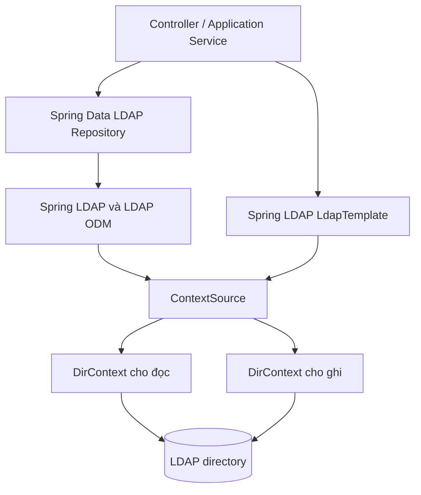
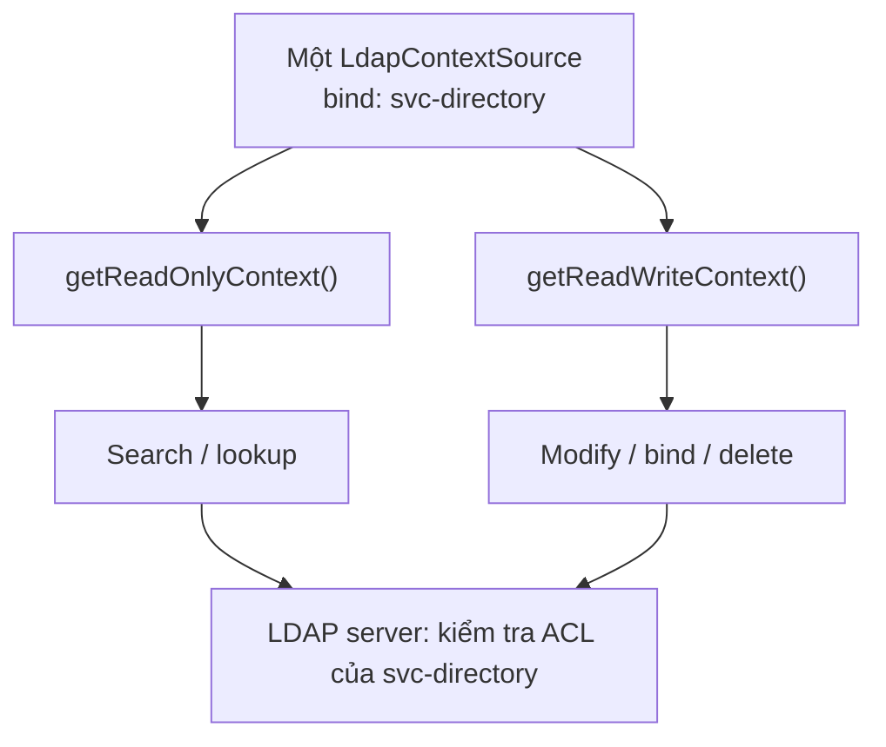
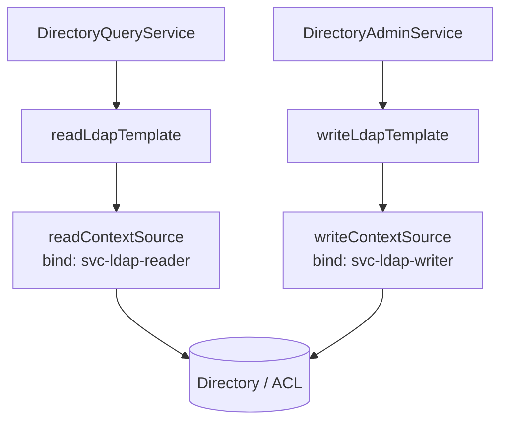
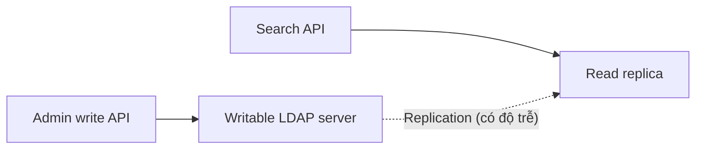

# Phân biệt context chỉ đọc với context đọc–ghi trong Spring LDAP

Khi một ứng dụng Java tra cứu thông tin nhân viên từ LDAP, nó cần **đọc** entry. Khi một dịch vụ quản trị cập nhật email hoặc thêm thành viên vào nhóm, nó cần **ghi** lên directory. Hai loại thao tác cùng đi qua LDAP nhưng có **mục đích, yêu cầu quyền và rủi ro khác nhau**.

Trong kiến trúc Spring LDAP, giao diện `ContextSource` cung cấp hai phương thức rõ ràng: `getReadOnlyContext()` và `getReadWriteContext()`. `LdapTemplate` khai thác sự phân biệt này để thực hiện search/lookup và những thao tác thay đổi directory. Tuy nhiên, tên “read-only” và “read-write” dễ gây hiểu nhầm: **đó trước hết là cách Spring yêu cầu một LDAP context phục vụ mục đích đọc hoặc ghi, không phải một cơ chế tự động cấp hoặc cấm quyền ở máy chủ**.

Bài thuộc chương **Kiến trúc Spring** trong module `SPRING_DATA_LDAP`. Ta sẽ tìm hiểu các context trong nền tảng Spring LDAP, cách chúng phục vụ repository/`LdapTemplate`, mối liên hệ với tài khoản bind, ACL, DN, schema, TLS và kiểm thử directory.

## 1. Mục tiêu học tập

Sau bài học, bạn có thể:

- Giải thích `ContextSource`, `DirContext`, `LdapContextSource`, `LdapTemplate` và vai trò của từng thành phần trong Spring Data LDAP.
- Phân biệt ý nghĩa `getReadOnlyContext()` và `getReadWriteContext()` mà không nhầm chúng với quyền do LDAP server thực thi.
- Biết khi nào context đọc và context ghi sử dụng **cùng bind identity**, và khi nào nên cấu hình **hai tài khoản có ACL khác nhau**.
- Nhận biết cách `LdapTemplate.search/lookup` sử dụng luồng đọc và `bind/modifyAttributes/unbind` sử dụng luồng ghi.
- Phân tích tùy chọn `anonymousReadOnly`, hệ quả bảo mật và nguy cơ trả kết quả không đủ do anonymous ACL.
- Thiết kế cấu hình Spring Boot an toàn, tránh nhập nhằng giữa read-only context, read-only replica và transaction read-only.
- Kiểm thử tích hợp quyền đọc/ghi thực tế với dữ liệu LDAP và các tài khoản riêng biệt.

## 2. Tổng quan kiến trúc: từ repository tới LDAP server

Xét một dịch vụ danh bạ có API tìm người theo `uid` và API quản trị đổi địa chỉ email. Cây LDAP minh họa:

```text
dc=example,dc=org
├── ou=people
│   ├── uid=lan
│   └── uid=minh
└── ou=groups
    └── cn=developers
```

Entry của Lan:

```ldif
dn: uid=lan,ou=people,dc=example,dc=org
objectClass: top
objectClass: person
objectClass: organizationalPerson
objectClass: inetOrgPerson
uid: lan
cn: Lan Nguyen
sn: Nguyen
mail: lan@example.org
```

Sơ đồ các tầng:



| Thành phần | Trách nhiệm | Có quyết định quyền đọc/ghi ở server không? |
|---|---|---|
| `LdapRepository<T>` | Truy vấn và CRUD theo entity ánh xạ LDAP. | Không; phải dùng kết nối và chịu ACL của directory. |
| `LdapTemplate` | Cung cấp API search, lookup, bind, unbind, modify, rename. | Không; chọn con đường thao tác phù hợp. |
| `ContextSource` | Cấp LDAP `DirContext` theo nhu cầu đọc/ghi hoặc danh tính xác thực riêng. | Không tự áp ACL ở directory. |
| `DirContext` | Đại diện một LDAP directory context qua JNDI, thực thi các request. | Server đánh giá quyền của danh tính bind. |
| LDAP server | Lưu entry, DN, objectClass, schema, đánh giá filter, kiểm tra ACL. | **Có**: là nơi xác thực và áp dụng quyền cuối cùng. |

`ContextSource` là **factory/quản lý nguồn context**, không phải bản thân một entry LDAP. `DirContext` (JNDI) là đối tượng dùng để giao tiếp với directory. Một context không đồng nghĩa một transaction; kết nối thật có thể được tạo hoặc tái sử dụng tùy cơ chế pooling và cấu hình.

## 3. API ContextSource: ba cách lấy context

Giao diện `org.springframework.ldap.core.ContextSource` công bố ba phương thức then chốt:

```java
import javax.naming.directory.DirContext;
import org.springframework.ldap.core.ContextSource;

DirContext reader = contextSource.getReadOnlyContext();
DirContext writer = contextSource.getReadWriteContext();
DirContext userContext =
    contextSource.getContext(userPrincipal, userPassword);
```

### 3.1. `getReadOnlyContext()`

Theo hợp đồng API, trả về một `DirContext` dùng được cho **các thao tác chỉ đọc**. Những ví dụ điển hình:

- `search` tìm entry theo base, scope và LDAP filter.
- `lookup` đọc thuộc tính của một DN.
- Liệt kê entry con trực tiếp, kiểm tra một thuộc tính được phép đọc.

Tùy `ContextSource` triển khai, context đọc có thể dùng **service account đã xác thực** hoặc **anonymous identity**. Không nên mặc định “read-only” nghĩa là kết nối vô danh.

### 3.2. `getReadWriteContext()`

Trả về một `DirContext` phục vụ **các thao tác cập nhật** như:

- `bind`: tạo entry mới trong directory.
- `modifyAttributes`: thay đổi thuộc tính của entry.
- `unbind`: xóa entry.
- `rename` hoặc chuyển DN theo khả năng server.

Lấy context này **không chứng minh** tài khoản đang bind có quyền ghi. Nếu bind identity chỉ được cấp quyền đọc, server vẫn có thể từ chối `modify` bằng `insufficientAccessRights`.

### 3.3. `getContext(principal, credentials)`

Phương thức thứ ba tạo context với **principal và credentials cụ thể**; thường được dùng cho hoạt động kiểm tra xác thực LDAP. Nó không phải “cách nâng cấp” quyền của `getReadOnlyContext()` hoặc `getReadWriteContext()`.

Ví dụ, đăng nhập bằng DN của người dùng là một nghiệp vụ riêng với việc ứng dụng tra cứu danh bạ bằng service account. Xác thực thành công không đồng nghĩa người dùng có quyền sửa mọi entry. API `getContext(principal, credentials)` cũng có những quy tắc riêng về pooling; cần dùng đúng hướng dẫn Spring LDAP cho luồng xác thực.

## 4. Read-only là mục đích sử dụng, không phải ACL

Đây là phân biệt quan trọng nhất của bài.

Theo mô tả của `AbstractContextSource`, **mặc định cả read-only và read-write context đều là context đã xác thực** với cấu hình bind identity của `ContextSource`. Nếu cùng một `LdapContextSource` có:

```text
userDn = uid=svc-directory,ou=service-accounts,dc=example,dc=org
password = ...
```

thì `getReadOnlyContext()` và `getReadWriteContext()` **thường mang cùng danh tính LDAP** đó. Khác biệt chủ yếu là mục đích mà client/framework yêu cầu, không tự động là hai bộ quyền.

Tại sao vẫn cần hai API? Vì thư viện và lớp quản lý kết nối có thể tối ưu cách tạo hoặc mượn context cho nhu cầu khác nhau; đồng thời mã dễ thể hiện ranh giới ý định. Tuy nhiên:

- **Không suy ra rằng Java tự cấm mọi phương thức ghi** trên object nhận từ `getReadOnlyContext()`.
- **Không suy ra rằng `getReadWriteContext()` cấp quyền ghi** nếu bind account không có ACL tương ứng.
- **Không tin vào tên biến `readOnly` để bảo vệ dữ liệu**. Khi cần bảo đảm chỉ đọc, phải cấu hình và kiểm thử **LDAP ACL**, hoặc dùng danh tính chỉ có quyền đọc.

Ví dụ:

| Danh tính bind / ACL ở server | `getReadOnlyContext()` | `getReadWriteContext()` |
|---|---|---|
| Service account chỉ đọc | Search được các entry được phép; không đủ quyền ghi | Trả về context nhưng modify có thể bị từ chối |
| Service account có quyền sửa `mail` trong `ou=people` | Search được những gì ACL cho phép | Có thể sửa `mail` được cấp phép, không mặc định sửa mọi thuộc tính |
| Anonymous account (nếu server cho phép search công khai) | Có thể đọc dữ liệu công khai | Không có quyền ghi, trừ khi ACL server sai hoặc cố ý cho phép |
| Account bị từ chối bind | Không thể tạo context đã xác thực thích hợp | Không thể tạo context đã xác thực thích hợp |

Sự khác biệt còn phụ thuộc server áp dụng ACL theo **DN, objectClass, thuộc tính, loại thao tác và danh tính**. Chẳng hạn, một tài khoản có quyền đọc `uid` và `cn` nhưng không được đọc `mail`; query có thể không trả `mail` mặc dù kết nối và LDAP search thành công.

## 5. LdapContextSource và cấu hình mặc định

`LdapContextSource` là một triển khai phổ biến của `ContextSource` trong Spring LDAP, kế thừa `AbstractContextSource`. Nó nắm thông tin kết nối như:

- URL/hostname/cổng directory.
- Base DN cho thao tác tương đối.
- Principal/bind DN và credential.
- Chiến lược xác thực và các thuộc tính môi trường JNDI.
- Tùy chọn read-only anonymous và cấu hình liên quan.

Ví dụ cấu hình Spring Boot với một service account dùng cho cả hai luồng:

```yaml
spring:
  ldap:
    urls: ldaps://ldap.example.org:636
    base: dc=example,dc=org
    username: uid=svc-directory,ou=service-accounts,dc=example,dc=org
    password: ${LDAP_BIND_PASSWORD}
```

**Chú ý:** `spring.ldap.base` là hậu tố DN mà `ContextSource` dùng làm gốc cho các thao tác. Với base đó, thao tác `search("ou=people", …)` nhắm tới `ou=people,dc=example,dc=org`; không nên tự thêm lại `dc=example,dc=org` vào mỗi search base.

Trên sơ đồ, một context source duy nhất có thể cấp cả context đọc và context ghi:



Nếu account được cấp quyền đọc mà không cấp quyền ghi, **cùng bean này vẫn có thể trả context cho cả hai method**, nhưng request sửa sẽ bị server từ chối. Đây là một cách bảo vệ hiệu quả ở mức server, với điều kiện ACL được quản trị đúng và được kiểm thử.

## 6. LdapTemplate chọn con đường đọc và ghi như thế nào?

`LdapTemplate` đóng gói việc lấy context, thực thi JNDI, chuyển đổi exception và đóng/trả context sau thao tác. Nó cung cấp:

```java
<T> T executeReadOnly(ContextExecutor<T> callback);

<T> T executeReadWrite(ContextExecutor<T> callback);
```

Hai method cho thấy ranh giới rõ ràng: callback đọc sử dụng `ContextSource.getReadOnlyContext()`; callback ghi sử dụng `ContextSource.getReadWriteContext()`.

`LdapTemplate` có các API cao hơn để bạn không cần trực tiếp quản lý `DirContext`:

| API thường dùng | Mục đích | Nhóm context |
|---|---|---|
| `search(...)` | Tìm entry theo base/filter/scope | Đọc |
| `lookup(...)` | Đọc entry theo DN | Đọc |
| `list(...)` / `listBindings(...)` | Liệt kê entry | Đọc |
| `find(...)` | Tìm và ánh xạ ODM entity | Đọc |
| `bind(...)` / `create(...)` | Tạo entry | Ghi |
| `modifyAttributes(...)` / `update(...)` | Sửa thuộc tính hoặc entity | Ghi |
| `unbind(...)` / `delete(...)` | Xóa entry | Ghi |
| `rename(...)` | Đổi hoặc chuyển DN theo quy tắc server | Ghi |

Đây là cách phân nhóm **theo bản chất thao tác** của `LdapTemplate`; ngoại lệ đặc thù, wrapper, pooling và transaction proxy có thể thay đổi việc dùng context trong những tình huống riêng.

### 6.1. Đọc dữ liệu bằng search

```java
import java.util.List;

import org.springframework.ldap.core.AttributesMapper;
import org.springframework.ldap.core.LdapTemplate;
import org.springframework.ldap.query.SearchScope;

import static org.springframework.ldap.query.LdapQueryBuilder.query;

public class PersonSearchService {

    private final LdapTemplate template;

    public PersonSearchService(LdapTemplate template) {
        this.template = template;
    }

    public List<String> findNames(String uid) {
        return template.search(
            query()
                .base("ou=people")
                .searchScope(SearchScope.SUBTREE)
                .where("uid").is(uid),
            (AttributesMapper<String>) attributes ->
                attributes.get("cn").get().toString()
        );
    }
}
```

Đây là thao tác đọc. Query builder tách tên thuộc tính `uid` cố định khỏi giá trị `uid` đầu vào, tránh tự nối filter dễ dẫn đến LDAP injection. Kết quả là danh sách các tên tìm thấy, không sửa directory.

Filter, scope và mapping vẫn phải đúng; có quyền đọc không có nghĩa query chắc chắn trả kết quả. Nếu `cn` không tồn tại hoặc bị ẩn bởi ACL, mapper ở trên cần được điều chỉnh để xử lý thuộc tính thiếu.

### 6.2. Ghi dữ liệu bằng modifyAttributes

Giả sử chỉ cho phép bộ phận quản trị cập nhật `mail` cho nhân viên Lan:

```java
import javax.naming.Name;
import javax.naming.directory.BasicAttribute;
import javax.naming.directory.DirContext;
import javax.naming.directory.ModificationItem;

import org.springframework.ldap.core.LdapTemplate;

public class PersonAdminWriter {

    private final LdapTemplate template;

    public PersonAdminWriter(LdapTemplate template) {
        this.template = template;
    }

    public void changeEmail(Name personDn, String newMail) {
        ModificationItem modification =
            new ModificationItem(
                DirContext.REPLACE_ATTRIBUTE,
                new BasicAttribute("mail", newMail)
            );

        template.modifyAttributes(
            personDn,
            new ModificationItem[] { modification }
        );
    }
}
```

Nếu `ContextSource` đặt base `dc=example,dc=org`, tham số `personDn` trong ví dụ thường là DN tương đối `uid=lan,ou=people`.

Khác biệt đáng chú ý:

- Lời gọi `modifyAttributes` là thao tác ghi và cần context phù hợp.
- Server áp dụng ACL trên attribute `mail` đối với bind identity thực tế.
- Không có quyền ghi thì việc “cố tình gọi API ghi” không làm vượt qua ACL.
- Thao tác `REPLACE_ATTRIBUTE` thay giá trị của `mail`. Với một thuộc tính đa trị như `member`, cần cân nhắc `ADD_ATTRIBUTE` hoặc `REMOVE_ATTRIBUTE` để không thay toàn bộ danh sách khi chỉ muốn sửa một phần.

### 6.3. Khi nào cần executeReadOnly / executeReadWrite?

Chỉ nên dùng callback `executeReadOnly(...)` hoặc `executeReadWrite(...)` khi những method của `LdapTemplate` chưa diễn đạt đủ yêu cầu, ví dụ cần nhiều lệnh JNDI trên một context theo cơ chế thấp hơn:

```java
import javax.naming.directory.Attributes;
import org.springframework.ldap.core.LdapTemplate;

Attributes attributes = ldapTemplate.executeReadOnly(
    ctx -> ctx.getAttributes("uid=lan,ou=people")
);
```

Ví dụ này để `LdapTemplate` cấp và giải phóng context. Không gọi `ctx.close()` bên trong callback khi template đang sở hữu vòng đời context.

Nếu tự lấy context trực tiếp từ `ContextSource`, bạn chịu trách nhiệm giải phóng sau khi sử dụng và xử lý JNDI checked exception:

```java
import javax.naming.directory.DirContext;

DirContext context = null;
try {
    context = contextSource.getReadOnlyContext();
    // Thao tác đọc đã được cho phép.
} finally {
    if (context != null) {
        context.close();
    }
}
```

Đây là ví dụ khái niệm về quản lý tài nguyên; trong code thật, `close()` và quá trình lấy context có thể ném `javax.naming.NamingException`, nên method phải khai báo `throws` hoặc xử lý phù hợp. **Ưu tiên `LdapTemplate`** để tránh tự quản lý vòng đời và bỏ sót chuyển đổi exception.

## 7. Anonymous read-only: khi nào dùng được?

`AbstractContextSource` cung cấp tùy chọn `setAnonymousReadOnly(true)`. Theo tài liệu Spring LDAP, **mặc định `anonymousReadOnly=false`**; cả context đọc và context ghi đều dùng identity đã cấu hình. Khi bật tùy chọn này, `getReadOnlyContext()` có thể được tạo với môi trường **anonymous**, trong khi `getReadWriteContext()` vẫn sử dụng tài khoản xác thực đã cấu hình.

Ví dụ khi chủ động tự cấu hình `LdapContextSource`:

```java
import org.springframework.ldap.core.support.LdapContextSource;

LdapContextSource source = new LdapContextSource();
source.setUrl("ldaps://ldap.example.org:636");
source.setBase("dc=example,dc=org");
source.setUserDn(
    "uid=svc-directory,ou=service-accounts,dc=example,dc=org"
);
source.setPassword(writerPassword);
source.setAnonymousReadOnly(true);
```

Đây là đoạn minh họa cấu hình object, chưa hoàn chỉnh như một bean Spring Boot. Không bật `anonymousReadOnly` chỉ vì mong tối ưu tốc độ; cần biết server có cho phép anonymous read hay không và dữ liệu nào được phép lộ.

| Cấu hình | Context đọc | Context ghi |
|---|---|---|
| `anonymousReadOnly=false` (mặc định) | Thường bind với identity cấu hình | Thường bind với identity cấu hình |
| `anonymousReadOnly=true` | Dùng môi trường anonymous cho đọc | Dùng identity xác thực được cấu hình |

Những hệ quả phải cân nhắc:

1. **Anonymous không chắc đọc được danh bạ**: directory có thể từ chối hoặc chỉ trả một phần entry/attribute. Search rỗng **không chứng minh** người dùng không tồn tại.
2. **Dữ liệu nhạy cảm**: bật anonymous read trên server nếu không có chính sách phù hợp có thể làm lộ thông tin nhân viên, nhóm và cấu trúc cây.
3. **Không phải tên gọi “chỉ đọc” tự áp ACL**: chính server quyết định anonymous được làm gì.
4. **Compensating transaction**: tài liệu Spring LDAP không hỗ trợ cấu hình `anonymous-read-only=true` đồng thời với compensating transaction support trong trường hợp mô tả, do khác biệt identity/context. Cần đối chiếu kiến trúc transaction và version cụ thể.

Trong ứng dụng nghiệp vụ doanh nghiệp, thường an toàn và dễ kiểm soát hơn khi dùng **read-only service account đã xác thực** thay vì cho phép anonymous đọc dữ liệu nội bộ.

## 8. Tách hẳn read context và write context bằng hai danh tính

Khi cần phân quyền mạnh, một kiến trúc thực tế là:

- `svc-ldap-reader`: tài khoản có ACL **chỉ đọc** các entry/attribute được chỉ định.
- `svc-ldap-writer`: tài khoản có quyền **sửa những thuộc tính và nhánh cần thiết**, không cấp quyền quản trị toàn cây.

Với Spring LDAP, cách đơn giản là tạo **hai `LdapContextSource`**, mỗi cái có identity và password riêng, rồi tạo **hai `LdapTemplate`** tương ứng:



Đây là cấu hình **chủ động tách danh tính ở tầng LDAP**, chứ không chỉ gọi hai tên method trên cùng một `ContextSource`.

### 8.1. Ví dụ cấu hình Spring

Ví dụ yêu cầu các property riêng cho hai account:

```yaml
app:
  directory:
    url: ldaps://ldap.example.org:636
    base: dc=example,dc=org
    reader-dn: uid=svc-ldap-reader,ou=service-accounts,dc=example,dc=org
    reader-password: ${LDAP_READER_PASSWORD}
    writer-dn: uid=svc-ldap-writer,ou=service-accounts,dc=example,dc=org
    writer-password: ${LDAP_WRITER_PASSWORD}
```

Và Java configuration:

```java
import org.springframework.beans.factory.annotation.Qualifier;
import org.springframework.beans.factory.annotation.Value;
import org.springframework.context.annotation.Bean;
import org.springframework.context.annotation.Configuration;
import org.springframework.ldap.core.ContextSource;
import org.springframework.ldap.core.LdapTemplate;
import org.springframework.ldap.core.support.LdapContextSource;

@Configuration
public class DirectoryContextsConfig {

    @Bean("readerContextSource")
    LdapContextSource readerContextSource(
            @Value("${app.directory.url}") String url,
            @Value("${app.directory.base}") String base,
            @Value("${app.directory.reader-dn}") String dn,
            @Value("${app.directory.reader-password}") String password) {
        return newSource(url, base, dn, password);
    }

    @Bean("writerContextSource")
    LdapContextSource writerContextSource(
            @Value("${app.directory.url}") String url,
            @Value("${app.directory.base}") String base,
            @Value("${app.directory.writer-dn}") String dn,
            @Value("${app.directory.writer-password}") String password) {
        return newSource(url, base, dn, password);
    }

    @Bean("readerLdapTemplate")
    LdapTemplate readerLdapTemplate(
            @Qualifier("readerContextSource") ContextSource source) {
        return new LdapTemplate(source);
    }

    @Bean("writerLdapTemplate")
    LdapTemplate writerLdapTemplate(
            @Qualifier("writerContextSource") ContextSource source) {
        return new LdapTemplate(source);
    }

    private static LdapContextSource newSource(
            String url, String base, String dn, String password) {
        LdapContextSource source = new LdapContextSource();
        source.setUrl(url);
        source.setBase(base);
        source.setUserDn(dn);
        source.setPassword(password);
        return source;
    }
}
```

Trong Spring, các `@Bean` là `LdapContextSource` được container gọi callback khởi tạo phù hợp (như `afterPropertiesSet`) sau khi inject property. Ví dụ này giả định ứng dụng có Spring LDAP và các property được cung cấp; không hardcode mật khẩu.

**Điều quan trọng:** hai `ContextSource` có thể làm Spring Boot/Spring Data LDAP không chọn được một bean duy nhất cho auto-configuration. Nếu bạn cũng dùng `LdapRepository`, cần cấu hình wiring repository về đúng nguồn/templates hoặc chọn `@Primary` **có chủ đích**, và xác nhận bằng integration test. Không mặc định tất cả repository tự chuyển qua reader context chỉ vì bean có tên “reader”.

### 8.2. Inject đúng template theo nghiệp vụ

```java
import java.util.List;
import javax.naming.Name;
import javax.naming.directory.BasicAttribute;
import javax.naming.directory.DirContext;
import javax.naming.directory.ModificationItem;

import org.springframework.beans.factory.annotation.Qualifier;
import org.springframework.ldap.core.AttributesMapper;
import org.springframework.ldap.core.LdapTemplate;
import org.springframework.stereotype.Service;

import static org.springframework.ldap.query.LdapQueryBuilder.query;

@Service
public class DirectoryAccessService {

    private final LdapTemplate reader;
    private final LdapTemplate writer;

    public DirectoryAccessService(
            @Qualifier("readerLdapTemplate") LdapTemplate reader,
            @Qualifier("writerLdapTemplate") LdapTemplate writer) {
        this.reader = reader;
        this.writer = writer;
    }

    public List<String> readEmployeeNames(String uid) {
        return reader.search(
            query().base("ou=people").where("uid").is(uid),
            (AttributesMapper<String>) attrs ->
                attrs.get("cn").get().toString()
        );
    }

    public void updateEmail(Name employeeRelativeDn, String email) {
        ModificationItem item = new ModificationItem(
            DirContext.REPLACE_ATTRIBUTE,
            new BasicAttribute("mail", email)
        );

        writer.modifyAttributes(
            employeeRelativeDn, new ModificationItem[] {item}
        );
    }
}
```

Đoạn mã thể hiện **đường đi chủ đích**; tại API thật, còn cần kiểm tra input, quyền người gọi, DN được phép thao tác, quy tắc email, audit log và xử lý lỗi. Việc thay đổi directory chỉ được bảo vệ vững chắc khi ACL của `svc-ldap-reader` thực sự **cấm ghi** và tài khoản writer chỉ có quyền hạn cần thiết.

### 8.3. Vì sao không dùng một account “admin” cho mọi thứ?

Một tài khoản LDAP có quyền rất rộng dùng cả cho search thường ngày làm tăng thiệt hại nếu ứng dụng bị khai thác. Cặp account reader/writer theo nguyên tắc quyền tối thiểu giảm phạm vi tác động và giúp giám sát thay đổi dễ hơn.

| Lựa chọn | Ưu điểm | Rủi ro / lưu ý |
|---|---|---|
| Một context source, một account chỉ đọc | Đơn giản, mọi thao tác ghi bị server từ chối | Không thể triển khai nghiệp vụ ghi bằng account đó |
| Một context source, một account có quyền ghi | Cấu hình gọn và hỗ trợ CRUD | Mọi nhánh xử lý dùng cùng identity có thể tiếp cận quyền ghi |
| Hai context source với reader/writer riêng | Phân tách quyền và audit rõ hơn | Phức tạp hơn về bean, secret, pool, repository wiring |
| Anonymous read-only + bind account cho ghi | Hữu ích với directory công khai hỗ trợ anonymous | Có thể không đọc đủ data; bảo mật anonymous phải được thẩm định |

## 9. Context chỉ đọc không giống replica chỉ đọc

Cần phân biệt ba khái niệm dễ bị trộn:

**1. Spring read-only context.** Là một đường lấy `DirContext` từ `ContextSource` dùng cho thao tác đọc, không nhất thiết có một tài khoản riêng.

**2. LDAP account chỉ đọc.** Là identity mà ACL server cho phép đọc và từ chối ghi. Đây là cơ chế quyền bảo mật.

**3. LDAP replica/server chỉ đọc.** Là một máy chủ hoặc node chỉ nhận truy vấn đọc, thường sao chép dữ liệu từ writer. Một read-only context **không tự chuyển traffic** sang replica và một read-write context **không tự động tìm được leader**.

Ví dụ topology:



Nếu kiến trúc thực sự cần read/write routing theo server, phải cấu hình URL, endpoint selection, referral, cơ chế failover và nguồn `ContextSource` riêng. Read-after-write trên replica có thể thấy dữ liệu cũ do replication lag. Việc ghi thành công vào writable server không đồng nghĩa tất cả các replica đã đồng bộ ngay.

Một `LdapContextSource` với nhiều URL có thể hỗ trợ các tình huống kết nối dự phòng, nhưng không nên suy ra đó là cơ chế tự chọn replica theo loại thao tác khi chưa kiểm chứng implementation, thứ tự URL và topology.

## 10. Context chỉ đọc không giống transaction readOnly

Spring cũng có khái niệm `@Transactional(readOnly = true)`. Đây là gợi ý/thuộc tính tại tầng transaction framework, không phải lệnh LDAP áp dụng ACL chỉ đọc.

Với Spring LDAP:

- `ContextSource.getReadOnlyContext()` diễn đạt kiểu context mong muốn.
- `@Transactional(readOnly=true)` **không tự động tạo LDAP account chỉ đọc**, không cấm người dùng gọi method ghi và không tự động thay cấu hình read/write identity.
- Giao thức LDAP Modify thông thường có tính nguyên tử trong **một request trên một entry**, không đồng nghĩa các thao tác LDAP trong một method Java có transaction ACID như JPA.
- Spring LDAP có các cơ chế transaction bù trừ (*compensating transactions*) riêng, với các giới hạn nhất định; cần hiểu rõ và kiểm thử trước khi áp dụng. Chúng không chuyển LDAP thành cơ sở dữ liệu có rollback tổng quát.

**Sai lầm thường gặp:** gắn `@Transactional(readOnly=true)` vào service rồi tin rằng account bind không thể sửa directory. Nếu ACL của account vẫn cho ghi, phải dựa vào quy tắc bảo mật thực tế thay vì annotation này.

## 11. Bảo mật: TLS, bind identity và quyền là ba lớp khác nhau

Cả đường đọc lẫn ghi đều cần bảo vệ kết nối và danh tính:

1. **TLS:** dùng LDAPS hoặc StartTLS với truststore được cấu hình đúng, xác minh chuỗi chứng chỉ/hostname; không để simple bind gửi mật khẩu qua kết nối không bảo vệ.
2. **Authentication:** LDAP bind xác định principal mà server ghi nhận (reader, writer hoặc người dùng).
3. **Authorization (ACL):** directory quyết định các thuộc tính và entry nào principal được phép đọc/sửa/xóa.
4. **Application authorization:** API ứng dụng xác minh người gọi có quyền xem hồ sơ hoặc thay đổi email; việc tài khoản writer LDAP có quyền không thay thế bước này.
5. **Audit:** ghi lại ai yêu cầu hành động và hệ thống đã dùng identity LDAP nào, tránh log password hoặc giá trị nhạy cảm.

Ví dụ:

| Tầng | Nếu lỗi | Dấu hiệu thường gặp |
|---|---|---|
| TCP/TLS | Không kết nối hoặc chứng chỉ không tin cậy | `CommunicationException`, `SSLHandshakeException` trong cause |
| LDAP bind | Reader/writer password sai | `AuthenticationException` hoặc mã LDAP 49 |
| ACL | Reader cố ghi `mail` | `NoPermissionException` / LDAP 50, tùy server |
| DN/schema | DN sai, thiếu thuộc tính bắt buộc | `NameNotFoundException`, `SchemaViolationException` |
| Query/mapping | Filter không khớp hoặc attribute bị thiếu | Search rỗng hoặc lỗi mapping, cần phân tích rõ |

**Không biến mọi trường hợp search rỗng thành “nhân viên không tồn tại”.** Một tài khoản read-only hoặc anonymous có thể không được nhìn thấy nhánh chứa entry. Khi nghi có ACL, cần xác nhận bằng tài khoản test có quyền phù hợp.

## 12. Vòng đời context và những lưu ý về pooling

`ContextSource` là nơi tạo hoặc cấp context, còn `LdapTemplate` quản lý thao tác. Với `LdapTemplate`, ưu tiên method cấp cao thay vì tự mở/đóng `DirContext` vì template giúp:

- Lấy đúng context theo loại thao tác.
- Thực thi callback/query, chuyển `javax.naming.NamingException` sang Spring LDAP exception thích hợp.
- Đóng hoặc trả context cho pool theo cơ chế được cấu hình.
- Giảm nguy cơ leak tài nguyên và nhầm vòng đời context giữa các luồng.

Khi sử dụng connection pooling, một số factory triển khai có thể quản lý context đọc/ghi thành các nhóm riêng, hoặc dùng wrapper để trả context về pool khi `close()` được gọi. Nhưng **pool không tạo thêm quyền** và không thay thế TLS/ACL. Việc cấu hình pooling phải tương thích với chiến lược xác thực và StartTLS.

Không chia sẻ một `DirContext` JNDI thô qua nhiều thread nếu không có tài liệu/hợp đồng của implementation bảo đảm điều đó. Thay vào đó, inject bean `LdapTemplate` đã được cấu hình và để nó lấy context cho mỗi thao tác. Điều phối connection pool nên được cấu hình ở tầng `ContextSource`, không bằng cách cache thủ công các context trong service.

### 12.1. Bảng chọn phương án

| Nhu cầu | Phương án phù hợp |
|---|---|
| Một ứng dụng chỉ đọc danh bạ | Một `ContextSource` với **LDAP ACL chỉ đọc**, một `LdapTemplate`/repository |
| Một ứng dụng đơn giản vừa search vừa CRUD | Một `ContextSource` với account được phân quyền đúng mức; rõ ràng luồng code |
| Phải phân tách nghiêm ngặt quyền query và quyền admin | Hai context source và hai LDAP bind identity riêng |
| Directory thực sự cho phép dữ liệu công khai | Cân nhắc `anonymousReadOnly` sau khi duyệt chính sách và test ACL |
| Tách read replica và writable server | Cấu hình connection routing theo topology, không chỉ chọn method trên cùng bean |
| Cần xác thực mật khẩu người dùng | API authentication riêng (`getContext` hoặc Spring Security LDAP), không dùng search như bằng chứng đăng nhập |

## 13. Kiểm thử tích hợp để chứng minh quyền đọc/ghi

Để kiểm tra đúng bản chất, cần **LDAP server thật** (nhúng hoặc container) với schema, fixture và ACL được thiết kế cho test. Mock `ContextSource` không chứng minh server từ chối một thao tác ghi.

### 13.1. Fixture LDIF

```ldif
dn: dc=example,dc=org
objectClass: top
objectClass: domain
dc: example

dn: ou=people,dc=example,dc=org
objectClass: top
objectClass: organizationalUnit
ou: people

dn: uid=lan,ou=people,dc=example,dc=org
objectClass: top
objectClass: person
objectClass: organizationalPerson
objectClass: inetOrgPerson
uid: lan
cn: Lan Nguyen
sn: Nguyen
mail: lan@example.org
```

Giả định server test có hai principal:

- `svc-ldap-reader` được phép search và đọc `uid`, `cn`, `mail` dưới `ou=people`; không có quyền ghi.
- `svc-ldap-writer` được phép đọc và đổi thuộc tính `mail` của entry test; không có quyền thay schema hoặc ghi ra toàn cây.

Lưu ý LDIF là dữ liệu; **ACL không được tạo chỉ bằng các entry này**. Cần cấu hình quyền trong directory test theo sản phẩm LDAP đang dùng. Nếu chỉ có account quản trị toàn quyền, bạn **không thể** dùng nó để chứng minh cơ chế tách quyền.

### 13.2. Những ca kiểm thử bắt buộc

| Ca kiểm thử | Kết quả mong đợi | Điều thực sự được chứng minh |
|---|---|---|
| Reader tìm `uid=lan` | Đọc được `cn=Lan Nguyen` | Search và quyền đọc hoạt động |
| Reader cố `modifyAttributes(mail)` | Server từ chối vì ACL | Account reader thực sự không có quyền ghi |
| Writer sửa `mail` của entry test | Thao tác thành công | Context và account writer có quyền cần thiết |
| Reader đọc lại từ cùng node | Thấy `mail` mới theo tính nhất quán của node | Write đã có hiệu lực và reader được phép nhìn thấy |
| Writer cố sửa nhánh ngoài phạm vi | Bị từ chối | Quyền writer được giới hạn |
| Anonymous read khi bật `anonymousReadOnly` | Chỉ thấy dữ liệu được ACL công khai cho phép | Hệ quả của anonymous identity |
| Đổi sai password của writer trong profile test | Bind không thành công | Phân biệt lỗi xác thực với lỗi ACL |
| TLS certificate không được tin cậy | Kết nối bị từ chối | Client có xác minh điểm cuối TLS |

Không nên chạy test sửa hoặc thử credential sai trên directory production; dùng tài khoản/nhánh cô lập và dọn dữ liệu. Nếu directory có replication bất đồng bộ, đọc lại nên thực hiện trên node phù hợp để tránh nhầm replication lag thành lỗi update.

### 13.3. Ví dụ kiểm thử luồng đọc và ghi

Một skeleton Spring Boot/JUnit 5 có thể inject hai template cấu hình ở mục 8:

```java
import static org.assertj.core.api.Assertions.assertThat;
import static org.assertj.core.api.Assertions.assertThatThrownBy;

import javax.naming.Name;
import javax.naming.directory.BasicAttribute;
import javax.naming.directory.DirContext;
import javax.naming.directory.ModificationItem;

import org.junit.jupiter.api.Test;
import org.springframework.beans.factory.annotation.Autowired;
import org.springframework.beans.factory.annotation.Qualifier;
import org.springframework.boot.test.context.SpringBootTest;
import org.springframework.ldap.core.AttributesMapper;
import org.springframework.ldap.core.LdapTemplate;
import org.springframework.ldap.support.LdapNameBuilder;
import org.springframework.test.context.ActiveProfiles;

import static org.springframework.ldap.query.LdapQueryBuilder.query;

@SpringBootTest
@ActiveProfiles("ldap-test")
class LdapContextPermissionsIT {

    @Autowired
    @Qualifier("readerLdapTemplate")
    private LdapTemplate reader;

    @Autowired
    @Qualifier("writerLdapTemplate")
    private LdapTemplate writer;

    @Test
    void readerCanSearchAndServerRefusesWrite() {
        assertThat(reader.search(
            query().base("ou=people").where("uid").is("lan"),
            (AttributesMapper<String>) a ->
                a.get("cn").get().toString()
        )).contains("Lan Nguyen");

        Name personDn = LdapNameBuilder
            .newInstance("ou=people")
            .add("uid", "lan")
            .build();

        ModificationItem change = new ModificationItem(
            DirContext.REPLACE_ATTRIBUTE,
            new BasicAttribute("mail", "not-allowed@example.org")
        );

        assertThatThrownBy(() ->
            reader.modifyAttributes(
                personDn, new ModificationItem[] {change}
            )
        ).isInstanceOf(org.springframework.ldap.NoPermissionException.class);
    }
}
```

Kiểm thử này chủ đích gọi **một API ghi bằng reader template**, để chứng minh sự bảo vệ **đến từ ACL của directory**, không phải tên `readerLdapTemplate`. Trên một số directory, mã lỗi và cách phân loại có thể khác; nếu test môi trường mục tiêu trả loại exception khác, hãy kiểm tra root cause/LDAP result code (đặc biệt code 50), không bỏ test quyền.

**Không cần thay email thật để kiểm tra writer**: nên tạo entry riêng cho test, cho writer đổi thuộc tính `mail` rồi đọc lại và dọn fixture trong `finally`. Điều đó cũng giúp bảo đảm kiểm thử lặp lại được.

## 14. Trục trặc thường gặp và cách chẩn đoán

| Triệu chứng | Nguyên nhân có thể | Hướng kiểm tra |
|---|---|---|
| Search bằng context đọc trả rỗng, nhưng admin thấy entry | Reader/anonymous ACL không cho xem, base/filter không đúng | Kiểm tra bind identity, ACL, search base và filter |
| `getReadWriteContext()` thành công nhưng modify bị cấm | Account thiếu quyền ghi thực tế | Xem ACL và LDAP result code 50 |
| Writer thực hiện được search nhưng không đổi `mail` | Quyền theo attribute khác quyền đọc | Kiểm tra ACL của `mail` trên DN mục tiêu |
| Bật `anonymousReadOnly` làm query thiếu kết quả | Anonymous chỉ thấy dữ liệu công khai | Tắt tùy chọn hoặc dùng reader account có quyền hợp lệ |
| Hai template nhưng repository dùng nhầm account | Multiple bean/auto-configuration chọn context khác dự kiến | Đối chiếu wiring, bean qualifier và integration test |
| Search ngay sau ghi ở replica không thấy thay đổi | Replication lag/cache | Kiểm tra node đọc, topology và độ trễ đồng bộ |
| `AuthenticationException` của writer | Sai bind DN/secret hoặc account bị khóa | Kiểm tra secret và trạng thái tài khoản |
| `CommunicationException` hoặc TLS handshake lỗi | DNS, port, truststore, SAN, timeout | Phân tích exception chain và cấu hình TLS |
| API có `@Transactional(readOnly=true)` vẫn ghi được | Annotation không phải LDAP ACL | Hạn chế quyền trên server, review luồng gọi |
| Pool cạn hoặc giữ context hỏng | Vòng đời context hoặc cấu hình pool | Kiểm tra close/return, timeout, TLS compatibility |

Khi chẩn đoán, hãy phân tách **khả năng kết nối**, **bind identity**, **quyền ACL**, **vị trí DN/base/filter** và **lỗi mapping**. Việc gọi context “đọc” hay “ghi” chỉ là một dữ kiện, không tự giải thích toàn bộ kết quả.

## 15. Bài tập tự luyện

### Bài 1 — Phân biệt hợp đồng và quyền

Một `LdapContextSource` cấu hình tài khoản chỉ có quyền đọc. Trả lời:

1. `getReadOnlyContext()` có thể đọc entry được phép không?
2. `getReadWriteContext()` có nhất thiết ném exception ngay khi được gọi không?
3. Nếu có được context ghi, thao tác `modifyAttributes` có chắc thành công không?

Giải thích trách nhiệm giữa Spring và LDAP server.

### Bài 2 — Cấu hình anonymous

Server cho phép người dùng anonymous xem `uid` và `cn` nhưng không cho xem `mail`. Ứng dụng đặt `anonymousReadOnly=true` và gọi `search` để trả email nhân viên. Dự đoán kết quả và cho biết tại sao “không có `mail`” chưa chứng minh email không được lưu.

### Bài 3 — Chọn context thích hợp

Phân loại các lời gọi thành read hoặc write: `search`, `lookup`, `bind`, `modifyAttributes`, `rename`, `unbind`. Chỉ ra vì sao phân loại này không tự cấp hoặc hạn chế quyền tại server.

### Bài 4 — Thiết kế hai tài khoản

Bạn cần cho phép API danh bạ đọc `uid`, `cn`, `mail`, còn API quản trị được phép sửa `mail` nhưng không xóa entry. Phác thảo ACL và sơ đồ hai `ContextSource`; giải thích tại sao không chỉ dùng một service account admin.

### Bài 5 — Đọc sau khi ghi

Ứng dụng ghi `mail` vào writable LDAP server, sau đó đọc bằng một read-only replica và nhận dữ liệu cũ. Tại sao đây không nhất thiết là lỗi `getReadOnlyContext()`? Nêu cách thiết kế yêu cầu read-after-write và kiểm thử.

### Bài 6 — Kiểm thử bảo mật

Viết test đọc entry thành công bằng reader account, thử sửa `mail` bằng reader account và kỳ vọng bị từ chối; sau đó thử cùng thao tác bằng writer account trên entry test. Nêu vì sao Mockito mock `LdapTemplate` không đủ để chứng minh ACL.

## 16. Tổng kết và tài liệu tham khảo

Trong Spring LDAP, `ContextSource.getReadOnlyContext()` và `getReadWriteContext()` là hai đường cung cấp `DirContext` để thực hiện thao tác đọc hoặc ghi. `LdapTemplate` sử dụng các đường này theo loại thao tác. **Mặc định, cả hai context có thể được xác thực với cùng bind identity**, nên sự khác biệt “read-only/read-write” ở API không phải ranh giới bảo mật tự động.

Để có **quyền chỉ đọc thực sự**, cần một tài khoản bị hạn chế ghi bởi **LDAP ACL**; khi cần tách trách nhiệm rõ ràng, cấu hình hai `ContextSource` với reader/writer principal riêng và kiểm chứng bằng integration test. Không nhầm Spring read-only context với read-only replica hoặc `@Transactional(readOnly=true)`. Truy vấn đúng DN/filter/schema, bảo mật LDAPS/StartTLS và xử lý tài khoản bind/quyền server vẫn là nền tảng của kiến trúc Spring Data LDAP an toàn.

Tài liệu đối chiếu:

- [Spring LDAP – ContextSource API](https://docs.spring.io/spring-ldap/docs/current/api/org/springframework/ldap/core/ContextSource.html)
- [Spring LDAP – AbstractContextSource API](https://docs.spring.io/spring-ldap/docs/current/api/org/springframework/ldap/core/support/AbstractContextSource.html)
- [Spring LDAP – Configuration, anonymous-read-only](https://docs.spring.io/spring-ldap/reference/configuration.html)
- [Spring LDAP – LdapTemplate API](https://docs.spring.io/spring-ldap/docs/current/api/org/springframework/ldap/core/LdapTemplate.html)
- [Spring Data LDAP – Reference](https://docs.spring.io/spring-data/ldap/reference/)
- [RFC 4511 – LDAP Protocol](https://www.rfc-editor.org/rfc/rfc4511)
- [RFC 4513 – LDAP Authentication Methods and Security Mechanisms](https://www.rfc-editor.org/rfc/rfc4513)
