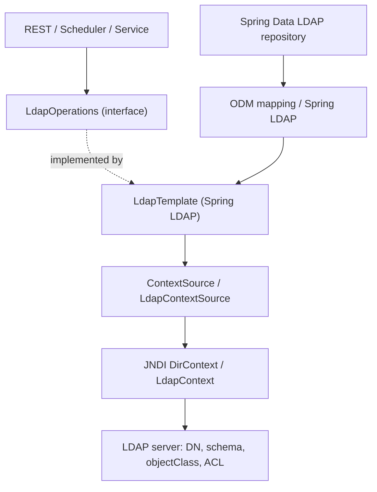
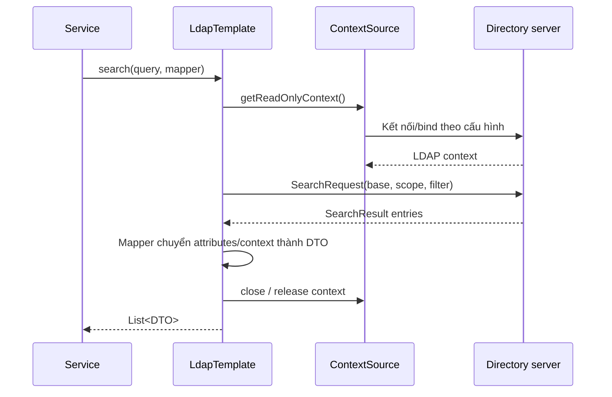
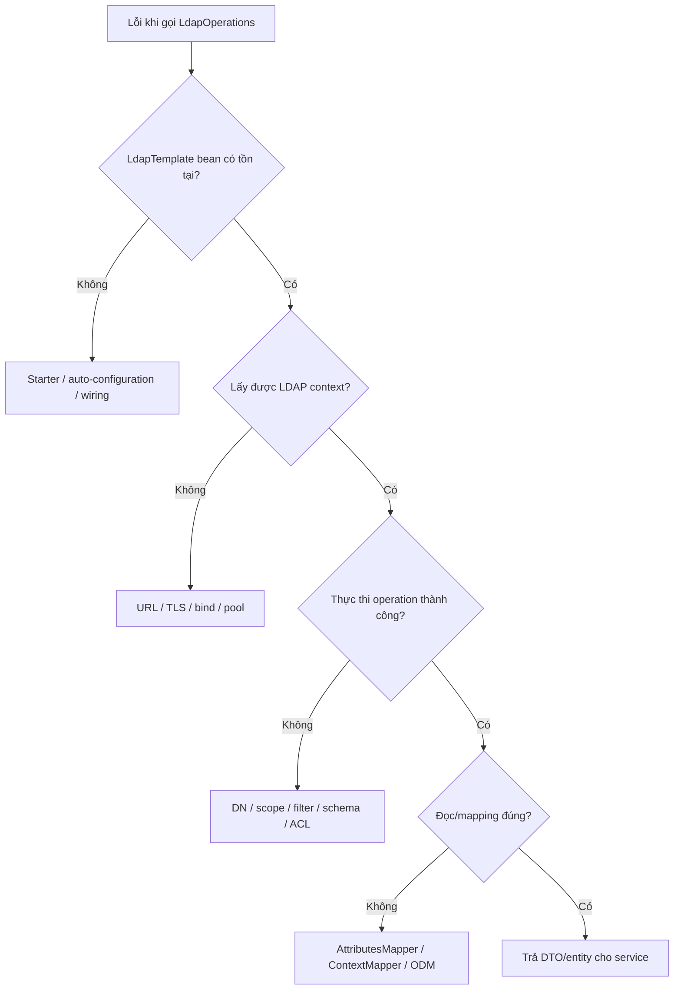

# LdapOperations và LdapTemplate

> **Chương:** Kiến trúc Spring  
> **Module:** SPRING_DATA_LDAP — truy cập directory LDAP bằng repository Spring Data LDAP và Spring LDAP, ánh xạ LDAP entry phân cấp thành đối tượng Java, tìm kiếm/CRUD theo DN, objectClass và schema, kết nối bảo mật và kiểm thử với directory.

## Mục tiêu học tập

Sau bài này, bạn có thể:

1. Phân biệt **`LdapOperations` là interface** với **`LdapTemplate` là implementation** và giải thích vì sao tầng service thường nên phụ thuộc vào abstraction.
2. Trình bày chuỗi **Spring service → `LdapOperations`/`LdapTemplate` → `ContextSource` → JNDI `DirContext` → LDAP server**.
3. Phân biệt `search`, `lookup`, `find` và cách chọn `AttributesMapper`, `ContextMapper` hoặc Object-Directory Mapping (ODM).
4. Viết code tra cứu, tạo mới và cập nhật entry với `LdapOperations`, tạo DN/filter an toàn và hiểu giới hạn nguyên tử của thao tác.
5. Cấu hình Spring Boot để nhận `LdapTemplate`, nhận diện lỗi bean và lỗi directory, đồng thời biết khi nào không nên thao tác `DirContext` thủ công.
6. Thiết kế unit test dùng mock `LdapOperations` và integration test dùng directory thực nghiệm.

## 1. Vị trí của hai API trong kiến trúc Spring LDAP

Trong một ứng dụng Java thuần sử dụng JNDI, lập trình viên cần tự lấy `DirContext`, gọi `search`/`lookup`/`modifyAttributes`, duyệt `NamingEnumeration`, đóng context và xử lý `NamingException`. Việc đó dễ dẫn đến mã lặp, quên giải phóng tài nguyên và khó kiểm thử.

Spring LDAP đưa vào hai khái niệm:

- **`LdapOperations`** — interface `org.springframework.ldap.core.LdapOperations` định nghĩa tập thao tác LDAP phổ biến. Nó mô tả **có thể làm gì** mà không bắt service phải biết cách mở/đóng context.
- **`LdapTemplate`** — class `org.springframework.ldap.core.LdapTemplate` **triển khai `LdapOperations`**. Nó thực thi thao tác bằng `ContextSource` và các callback/mapper, quản lý vòng đời context/enumeration khi dùng các API template.
- **`ContextSource`** — abstraction Spring LDAP cung cấp JNDI context với cấu hình URL, base DN, cách bind, TLS và các chiến lược liên quan. `LdapContextSource` là triển khai thường gặp.



**Spring LDAP và Spring Data LDAP không cùng một vai trò.** `LdapOperations`/`LdapTemplate` là API của **Spring LDAP**, còn `LdapRepository` và cơ chế repository proxy thuộc **Spring Data LDAP**. Repository giúp đơn giản hóa CRUD/truy vấn dựa trên ODM; template cho phép điều khiển base DN, scope, filter, attributes và LDAP controls chi tiết hơn.

**Không cần cài một LDAP server trong ứng dụng:** `LdapTemplate` là **client**, gửi LDAP requests đến một dịch vụ thư mục như OpenLDAP hoặc Active Directory Domain Services. LDAP server mới là nơi thực thi schema/ACL và lưu entry.

## 2. Interface và implementation: so sánh trực tiếp

| Khía cạnh | `LdapOperations` | `LdapTemplate` |
| --- | --- | --- |
| Loại Java | Interface | Class triển khai interface |
| Package | `org.springframework.ldap.core` | `org.springframework.ldap.core` |
| Vai trò | Định nghĩa contract cho thao tác LDAP | Thực hiện contract, đóng gói JNDI resource management |
| Có khởi tạo trực tiếp bằng `new`? | Không | Có thể tạo bằng `new LdapTemplate(contextSource)` |
| Có thể inject qua constructor? | Có, nếu Spring có bean implementation | Có |
| Dùng cho unit test | Dễ mock/replace abstraction | Có thể mock, nhưng service phụ thuộc implementation cụ thể |
| Thực thi `search`, `lookup`, `bind`, `modifyAttributes`? | Có, thông qua implementation | Có |
| Lưu kết quả thành ODM entity | Có API `find`/`create`/`update` trong interface | Hiện thực các API đó |
| Tạo LDAP connection? | Không, chỉ contract | Nhờ `ContextSource` cấp context khi gọi thao tác |

Nhiều ứng dụng chỉ cần autowire `LdapOperations` ở tầng service và để Spring Boot tạo `LdapTemplate`. Điều này tương tự nguyên tắc “lập trình theo interface”, nhưng **không bắt buộc** mọi service phải đổi từ `LdapTemplate` sang interface nếu ứng dụng cần gọi method chỉ có trên implementation.

Ví dụ constructor injection theo interface:

```java
package com.example.directory.service;

import org.springframework.ldap.core.LdapOperations;
import org.springframework.stereotype.Service;

@Service
public class DirectoryPeopleService {

    private final LdapOperations ldap;

    public DirectoryPeopleService(LdapOperations ldap) {
        this.ldap = ldap;
    }

    // Các method của service sẽ dùng ldap.search/lookup/modifyAttributes...
}
```

Nếu ứng dụng có **nhiều `LdapOperations`/`LdapTemplate` bean** vì kết nối nhiều directory, Spring sẽ không biết nên inject bean nào nếu không có `@Qualifier` hoặc `@Primary`. Đó là vấn đề **wiring Spring**, khác với lỗi kết nối/bind LDAP server.

## 3. Spring Boot tự cấu hình `LdapTemplate` như thế nào?

Với dự án Spring Boot có parent/BOM để quản lý dependency, thêm starter:

```xml
<dependency>
    <groupId>org.springframework.boot</groupId>
    <artifactId>spring-boot-starter-data-ldap</artifactId>
</dependency>
```

Hoặc Gradle:

```groovy
dependencies {
    implementation 'org.springframework.boot:spring-boot-starter-data-ldap'
}
```

Spring Boot có thể tạo `LdapContextSource` dựa trên `spring.ldap.*` và cung cấp `LdapTemplate` khi classpath, auto-configuration và bean conditions phù hợp.

Ví dụ `application.yml` cho **LDAP server thử nghiệm**:

```yaml
spring:
  ldap:
    urls: "ldap://localhost:389"
    base: "dc=example,dc=org"
    username: "${LDAP_BIND_DN}"
    password: "${LDAP_BIND_PASSWORD}"
```

Giải thích:

- `urls` là endpoint LDAP. `localhost` chỉ đúng nếu LDAP server nằm trong cùng môi trường mạng với tiến trình ứng dụng.
- `base` là **base DN** của `ContextSource`. Các DN truyền vào template thường được hiểu **tương đối với base này**.
- `username` là danh tính bind (có thể là full DN, tùy server); `password` lấy từ biến môi trường/secret manager.
- Với production, sử dụng **LDAPS hoặc StartTLS** theo directory, xác thực certificate/trust chain và giới hạn quyền tài khoản dịch vụ. Không gửi simple bind password qua kết nối không mã hóa trên mạng không tin cậy.

**Trong Boot thông thường, không cần khai báo thủ công `@Bean LdapTemplate`.** Hãy kiểm tra auto-configuration trước khi thêm bean, tránh tạo hai template hoặc làm template trỏ nhầm `ContextSource`.

### Khi không dùng auto-configuration

Ví dụ nếu một hệ thống Spring không dùng Boot hoặc có nhiều source cần điều khiển rõ:

```java
import org.springframework.context.annotation.Bean;
import org.springframework.context.annotation.Configuration;
import org.springframework.ldap.core.ContextSource;
import org.springframework.ldap.core.LdapOperations;
import org.springframework.ldap.core.LdapTemplate;

@Configuration(proxyBeanMethods = false)
public class LdapTemplateConfiguration {

    @Bean(name = "peopleLdapTemplate")
    LdapOperations peopleLdapOperations(ContextSource peopleContextSource) {
        return new LdapTemplate(peopleContextSource);
    }
}
```

Đoạn này **giả định** bean `peopleContextSource` đã tồn tại và được chọn đúng. Nếu có nhiều source, thêm `@Qualifier("peopleContextSource")` cho tham số hoặc đặt tên/`@Primary` phù hợp. Với ví dụ đơn giản chỉ một `ContextSource`, có thể inject trực tiếp.

Khi tạo bean có kiểu khai báo `LdapOperations`, code chỉ inject `LdapOperations` vẫn hoạt động. Nếu các thành phần khác yêu cầu đúng `LdapTemplate`, cần khai báo bean với type phù hợp và tránh các vấn đề bean discovery theo kiểu. Khi dùng Spring Data LDAP repository có nhiều template, chọn rõ `ldapTemplateRef` trong `@EnableLdapRepositories` theo tên bean thực tế.

## 4. `ContextSource` và vòng đời `DirContext`

Quy trình đơn giản của `ldap.search(...)`:



`LdapTemplate` quản lý phần “plumbing” thường gặp:

1. Mượn/tạo `DirContext` phù hợp từ `ContextSource`.
2. Gọi operation JNDI.
3. Duyệt và đóng `NamingEnumeration` sau search.
4. Ánh xạ dữ liệu bằng callback/mapper được truyền vào.
5. Giải phóng/đóng context trong luồng xử lý phù hợp.
6. Chuyển các lỗi JNDI `NamingException` sang hệ exception của Spring LDAP.

**Đóng context không nhất thiết đóng TCP socket vật lý.** Khi dùng `PooledContextSource`, `close()` trên context wrapper thường có ý nghĩa **trả context về pool**. Pooling, referral và TLS phải được cấu hình riêng; `LdapTemplate` không tự quyết định chính sách kết nối cho production.

Nếu bạn **tự lấy context** từ `ContextSource`, trách nhiệm đóng context thuộc về code của bạn:

```java
import javax.naming.NamingException;
import javax.naming.directory.DirContext;
import org.springframework.ldap.core.ContextSource;

public void doLowLevelRead(ContextSource contextSource) throws NamingException {
    DirContext context = contextSource.getReadOnlyContext();
    try {
        // Thực hiện thao tác JNDI thật sự khi cần API thấp hơn template.
    } finally {
        context.close();
    }
}
```

Đoạn trên chỉ minh họa lifecycle; không cần đi đường này để thực hiện một `search`/`lookup` thông thường. Đừng giữ `DirContext` trong field singleton hoặc chia sẻ giữa nhiều thread.

## 5. `search`, `lookup`, `find`: chọn đúng API theo mục tiêu

| Mục tiêu | API `LdapOperations` | Dữ liệu đầu vào | Kết quả |
| --- | --- | --- | --- |
| Tìm nhiều entry theo điều kiện | `search(LdapQuery, AttributesMapper<T>)` | Base, scope, filter, attribute list | `List<T>` từ attributes |
| Tìm nhiều entry và lấy thêm context/DN | `search(LdapQuery, ContextMapper<T>)` | `LdapQuery`, mapper | `List<T>` từ `DirContextOperations` |
| Biết DN chính xác, muốn đọc attribute | `lookup(dn, AttributesMapper<T>)` | DN tương đối, mapper | Một object |
| Biết DN, cần adapter để sửa | `lookupContext(dn)` | DN | `DirContextOperations` |
| Tìm và tự ánh xạ sang ODM entity | `find(LdapQuery, Class<T>)` | Query, entity class có `@Entry`/`@Id` | `List<T>` |
| Tìm **đúng một** ODM entity | `findOne(LdapQuery, Class<T>)` | Query, class entity | Entity hoặc exception nếu số match sai |
| Tạo ODM entity mới | `create(entity)` | Object có ODM annotations | Thao tác thêm entry |
| Cập nhật ODM entity | `update(entity)` | Object ánh xạ entry hiện có | Cập nhật; có thể gồm bước đọc/ghi |
| Đọc/ghi attribute trực tiếp | `bind(ctx)`, `modifyAttributes(...)` | DN, objectClasses/attributes hoặc change list | LDAP Add/Modify |
| Đổi tên/xóa | `rename(...)`, `unbind(...)` | DN | LDAP ModifyDN/Delete |

**`lookup` khác `search`:** `lookup` dùng **DN cụ thể**, không cần filter lựa chọn nhiều entry. `search` duyệt tập entry từ search base với phạm vi và điều kiện. Nếu bạn đã biết DN chính xác và chỉ cần đọc một entry, dùng `lookup` thường biểu đạt ý định rõ hơn.

**`find` khác `search`:** `find` cần entity class có metadata ODM, dùng annotations để map LDAP entry sang Java object. `search` với mapper phù hợp khi chỉ cần một vài attribute, dữ liệu trả về không nhất thiết là entity đầy đủ, hoặc bạn cần điều khiển kết quả khác với mapping ODM.

## 6. `AttributesMapper`: ánh xạ chỉ các thuộc tính cần đọc

Giả sử directory có cây:

```text
dc=example,dc=org
└── ou=people
    ├── uid=linh
    └── uid=mai
```

Entry mẫu:

```ldif
dn: uid=linh,ou=people,dc=example,dc=org
objectClass: top
objectClass: person
objectClass: organizationalPerson
objectClass: inetOrgPerson
uid: linh
cn: Linh Nguyen
sn: Nguyen
mail: linh@example.org
```

`inetOrgPerson` kế thừa `cn` và `sn` bắt buộc từ `person`; `uid` và `mail` là thuộc tính được phép, còn `uid` trong ví dụ cũng tham gia RDN.

Tầng service chỉ cần `uid` và `cn`, không cần toàn bộ entry:

```java
package com.example.directory.service;

import static org.springframework.ldap.query.LdapQueryBuilder.query;

import java.util.List;
import org.springframework.ldap.core.AttributesMapper;
import org.springframework.ldap.core.LdapOperations;
import org.springframework.stereotype.Service;

@Service
public class DirectoryLookupService {

    public record PersonSummary(String uid, String commonName) {}

    private final LdapOperations ldap;

    public DirectoryLookupService(LdapOperations ldap) {
        this.ldap = ldap;
    }

    public List<PersonSummary> findByUid(String uid) {
        if (uid == null || uid.isBlank()) {
            throw new IllegalArgumentException("uid không được rỗng");
        }

        return ldap.search(
            query()
                .base("ou=people")
                .attributes("uid", "cn")
                .countLimit(25)
                .where("objectClass").is("inetOrgPerson")
                .and("uid").is(uid),
            (AttributesMapper<PersonSummary>) attributes ->
                new PersonSummary(
                    (String) attributes.get("uid").get(),
                    (String) attributes.get("cn").get()
                )
        );
    }
}
```

Giải thích:

- `query().base("ou=people")` đặt search base **tương đối** với `spring.ldap.base=dc=example,dc=org`.
- `attributes("uid","cn")` yêu cầu server chỉ trả những attribute cần dùng, giúp giảm dữ liệu truyền và hạn chế việc xử lý thông tin không cần thiết.
- `where("uid").is(uid)` xây filter với giá trị được encode phù hợp, an toàn hơn nối `"(uid=" + uid + ")"` từ input.
- `countLimit(25)` giới hạn số kết quả **của một search**, không cung cấp cookie trang kế của LDAP paging.
- `AttributesMapper<T>` nhận `javax.naming.directory.Attributes` và trả một object Java. Khi field như `mail` là tùy chọn, phải kiểm tra `attributes.get("mail")` có null không trước khi gọi `get()`.

Các phép cast `(String)` giả định server trả giá trị attribute kiểu chuỗi. Với binary attribute hoặc kiểu khác, mapper cần xử lý đúng kiểu dữ liệu và schema thực tế.

### `ContextMapper` khác gì?

`ContextMapper<T>` nhận đối tượng context của entry được trả về, thường là `DirContextAdapter`/`DirContextOperations` dưới cấu hình mặc định. Nó có ích khi cần đọc thêm thông tin context, DN hoặc sử dụng các convenience methods:

```java
import org.springframework.ldap.core.ContextMapper;
import org.springframework.ldap.core.DirContextOperations;

List<String> names = ldap.search(
    query().base("ou=people").where("uid").is("linh"),
    (ContextMapper<String>) context -> {
        DirContextOperations entry = (DirContextOperations) context;
        return entry.getStringAttribute("cn");
    }
);
```

`AttributesMapper` phù hợp với DTO nhỏ chỉ dùng các attribute. `ContextMapper` phù hợp khi cần đối tượng context, DN và API của `DirContextOperations`. Tránh lưu `DirContextOperations` vừa nhận được vào một singleton để xử lý tùy ý sau này; ưu tiên chuyển đổi thành DTO bất biến.

Trong dự án có custom `DirObjectFactory`, object được truyền vào `ContextMapper` có thể khác `DirContextAdapter`; ví dụ trên dựa trên factory mặc định của Spring LDAP.

## 7. Dùng ODM với `find` khi cần entity hoàn chỉnh

`Spring LDAP ODM` ánh xạ entry theo annotations thay vì tự viết mapper cho từng query:

```java
package com.example.directory.ldap;

import javax.naming.Name;

import org.springframework.ldap.odm.annotations.Attribute;
import org.springframework.ldap.odm.annotations.Entry;
import org.springframework.ldap.odm.annotations.Id;

@Entry(
    base = "ou=people",
    objectClasses = {
        "top", "person", "organizationalPerson", "inetOrgPerson"
    }
)
public class DirectoryPerson {

    @Id
    private Name dn;

    @Attribute(name = "uid")
    private String uid;

    @Attribute(name = "cn")
    private String commonName;

    @Attribute(name = "sn")
    private String surname;

    @Attribute(name = "mail")
    private String email;

    public DirectoryPerson() {}

    public Name getDn() { return dn; }
    public void setDn(Name dn) { this.dn = dn; }

    public String getUid() { return uid; }
    public void setUid(String uid) { this.uid = uid; }

    public String getCommonName() { return commonName; }
    public void setCommonName(String commonName) {
        this.commonName = commonName;
    }

    public String getSurname() { return surname; }
    public void setSurname(String surname) {
        this.surname = surname;
    }

    public String getEmail() { return email; }
    public void setEmail(String email) { this.email = email; }
}
```

Dùng interface `LdapOperations` để truy vấn ODM:

```java
import static org.springframework.ldap.query.LdapQueryBuilder.query;
import java.util.List;
import org.springframework.ldap.core.LdapOperations;

public List<DirectoryPerson> findNguyen(LdapOperations ldap) {
    return ldap.find(
        query().base("ou=people").where("sn").is("Nguyen"),
        DirectoryPerson.class
    );
}
```

Phương thức `find` chỉ trả các entry vừa khớp điều kiện LDAP, vừa được ánh xạ đúng kiểu entity. **`@Entry` mô tả schema của entry**, không sinh ra `objectClass`/`cn`/`sn` khi dữ liệu LDAP đã thiếu. Khi tạo mới, directory server vẫn kiểm tra các thuộc tính `MUST` theo schema.

Nếu muốn mô hình repository:

```java
package com.example.directory.ldap;

import org.springframework.data.ldap.repository.LdapRepository;

public interface DirectoryPersonRepository
        extends LdapRepository<DirectoryPerson> {

    DirectoryPerson findByUid(String uid);
}
```

Repository là cách diễn đạt nghiệp vụ thuận tiện với truy vấn cố định và CRUD theo entity. Khi cần tùy chỉnh search scope, attributes, timeout, filter điều kiện phức tạp hoặc LDAP controls, `LdapOperations`/`LdapTemplate` là lựa chọn chủ động hơn.

**Không giả định repository LDAP có đầy đủ `JOIN`, `Pageable`, `Sort` hoặc transaction đa bảng như JPA**. LDAP thao tác trên cây entry và các search controls của giao thức.

## 8. Tạo entry mới bằng `bind(DirContextOperations)`

Một entry LDAP cần **DN**, `objectClass` và các thuộc tính `MUST` hợp lệ. Nếu chỉ dùng `person`/`inetOrgPerson` mà bỏ `sn` hoặc `cn`, directory có thể trả `objectClassViolation (65)`.

Mẫu tạo mới rõ ràng:

```java
import javax.naming.Name;

import org.springframework.ldap.core.DirContextAdapter;
import org.springframework.ldap.core.LdapOperations;
import org.springframework.ldap.support.LdapNameBuilder;

public final class DirectoryPersonWriter {

    private final LdapOperations ldap;

    public DirectoryPersonWriter(LdapOperations ldap) {
        this.ldap = ldap;
    }

    public void create(String uid, String cn, String sn) {
        if (uid == null || uid.isBlank()
                || cn == null || cn.isBlank()
                || sn == null || sn.isBlank()) {
            throw new IllegalArgumentException(
                "uid, cn, sn là bắt buộc");
        }

        Name dn = LdapNameBuilder.newInstance("ou=people")
                .add("uid", uid)
                .build();

        DirContextAdapter context = new DirContextAdapter(dn);
        context.setAttributeValues("objectClass", new String[] {
                "top", "person", "organizationalPerson", "inetOrgPerson"
        });
        context.setAttributeValue("uid", uid);
        context.setAttributeValue("cn", cn);
        context.setAttributeValue("sn", sn);

        ldap.bind(context);
    }
}
```

DN tạo ra là `uid=linh,ou=people` **tương đối với** `spring.ldap.base=dc=example,dc=org`. `LdapNameBuilder` escape giá trị RDN đúng cách; **escaping của DN khác với escaping LDAP search filter**.

**`bind` là tạo mới, không phải upsert.** Nếu DN đã tồn tại, máy chủ thường trả LDAP result code 68 (`entryAlreadyExists`), Spring LDAP có thể dịch sang `NameAlreadyBoundException`. Không dùng `rebind` để tự động ghi đè entry hiện hữu nếu chưa xác minh identity và chính sách cập nhật.

Cần tạo sẵn OU `ou=people,dc=example,dc=org` và có quyền ghi. Đoạn này không yêu cầu `@Entry` vì dùng `DirContextAdapter` để khai báo thuộc tính trực tiếp.

## 9. Cập nhật một entry: `lookupContext` và `modifyAttributes`

Có hai cách phổ biến.

### Cách A — Đọc adapter rồi chỉ sửa các thuộc tính thay đổi

```java
import javax.naming.Name;

import org.springframework.ldap.core.DirContextOperations;
import org.springframework.ldap.core.LdapOperations;
import org.springframework.ldap.support.LdapNameBuilder;

public void updatePhone(LdapOperations ldap, String uid, String phone) {
    Name dn = LdapNameBuilder.newInstance("ou=people")
            .add("uid", uid)
            .build();

    DirContextOperations context = ldap.lookupContext(dn);
    context.setAttributeValue("telephoneNumber", phone);

    ldap.modifyAttributes(context);
}
```

`lookupContext` **đọc entry trước**, `modifyAttributes` **ghi các modifications sau**. Đây là **hai LDAP operations**; client khác có thể sửa entry trong khoảng giữa. `DirContextOperations` theo dõi các thuộc tính đã thay đổi và truyền các `ModificationItem` tương ứng khi ghi.

### Cách B — Gửi một `ModifyRequest` tường minh

```java
import javax.naming.Name;
import javax.naming.directory.BasicAttribute;
import javax.naming.directory.DirContext;
import javax.naming.directory.ModificationItem;

import org.springframework.ldap.core.LdapOperations;

public void updateContact(LdapOperations ldap, Name dn,
                          String phone, String description) {

    ModificationItem[] modifications = {
        new ModificationItem(
            DirContext.REPLACE_ATTRIBUTE,
            new BasicAttribute("telephoneNumber", phone)),
        new ModificationItem(
            DirContext.REPLACE_ATTRIBUTE,
            new BasicAttribute("description", description))
    };

    ldap.modifyAttributes(dn, modifications);
}
```

Đây là **một ModifyRequest trên một entry** chứa hai modification. Theo LDAPv3 RFC 4511, các thay đổi trong **cùng một ModifyRequest** được áp dụng **nguyên tử**. Nhưng **hai lời gọi `modifyAttributes` riêng rẽ**, hoặc một lời gọi sửa user tiếp theo bằng lời gọi sửa group, **không tự tạo một transaction đa entry**.

Khi cần xác nhận dữ liệu không bị người khác sửa giữa lúc đọc và ghi, dùng cơ chế kiểm tra cạnh tranh được directory hỗ trợ (ví dụ LDAP Assertion Control RFC 4528), thay vì chỉ so sánh trong Java rồi gửi request độc lập.

**`rebind` khác `modifyAttributes`:** `rebind` thay thế entry và có thể làm mất dữ liệu không được ánh xạ; chỉ dùng khi có thiết kế thay thế hoàn chỉnh. Không dùng như một “cách sửa nhanh” cho duplicate DN.

## 10. Cách xử lý exception của `LdapTemplate`

JNDI có các exception checked như `javax.naming.NamingException` và các subtype. Template chuyển nhiều lỗi này thành exception **unchecked** của Spring LDAP thông qua cơ chế exception translation.

Bảng chẩn đoán:

| Triệu chứng LDAP | Exception Spring LDAP thường gặp | Xử lý ưu tiên |
| --- | --- | --- |
| DN chưa tồn tại (`noSuchObject=32`) | `NameNotFoundException` | Kiểm tra base DN, OU, quyền đọc |
| Tạo trùng DN (`entryAlreadyExists=68`) | `NameAlreadyBoundException` | Trả conflict/idempotency có xác minh |
| Vi phạm `objectClass`/`MUST` (`65`) | `SchemaViolationException` | Soát `@Entry`, `cn`/`sn`, schema |
| Quyền không đủ (`50`) | `NoPermissionException` | Kiểm tra bind identity và ACL |
| Bind sai (`49`) | `AuthenticationException` | Kiểm tra thông tin xác thực/policy |
| Mất mạng/LDAP server không sẵn sàng | `CommunicationException` hoặc lỗi kết nối liên quan | Kiểm tra DNS, port, TLS, timeout |

**Không dựa tuyệt đối vào một ánh xạ exception class ↔ LDAP result code**: cách JNDI và server diễn giải có thể khác theo sản phẩm; phải xem **`Caused by`**, LDAP result code và thời điểm lỗi.

Nếu request bị timeout hoặc connection reset **trước khi nhận response**, không thể luôn biết server đã ghi hay chưa. Với Add, hãy đọc lại DN và xác minh identity trước khi retry; với Modify, so sánh trạng thái mong muốn để tránh ghi đè/cộng dồn sai.

Ví dụ phân loại lỗi tạo entry:

```java
import org.springframework.ldap.NameAlreadyBoundException;
import org.springframework.ldap.SchemaViolationException;

public void register(DirectoryPersonWriter writer,
                     String uid, String cn, String sn) {
    try {
        writer.create(uid, cn, sn);
    } catch (NameAlreadyBoundException ex) {
        throw new IllegalStateException(
            "Định danh người dùng đã tồn tại", ex);
    } catch (SchemaViolationException ex) {
        throw new IllegalArgumentException(
            "Entry không đáp ứng objectClass/schema", ex);
    }
}
```

Code minh họa tầng service; với REST API, nên chuyển thành mã lỗi nghiệp vụ phù hợp thay vì trả toàn bộ exception/stack trace ra bên ngoài. Không log password, LDAP search filter chứa PII hoặc tên tài khoản bind nhạy cảm.

## 11. LdapTemplate có thread-safe không? Có transaction tự động không?

`LdapTemplate` thường được dùng như **Spring singleton bean** bởi nhiều service/request. Với cách dùng thông thường, mỗi lời gọi template lấy context riêng từ `ContextSource` hoặc pool và quản lý tài nguyên trong phạm vi lời gọi. **Đừng giữ state riêng của một request trong field của singleton**; mapper không có state hoặc chỉ giữ state bất biến sẽ dễ tái sử dụng an toàn hơn.

Nếu bạn tự duy trì một `DirContext` lấy từ pool rồi đưa cho nhiều thread, đây là lỗi quản lý tài nguyên — không phải yêu cầu của template. Pooling phải giới hạn kết nối, kiểm tra context hỏng và tránh tái sử dụng context bind bằng danh tính người dùng khác.

Về transaction:

- Một `ModifyRequest` có nhiều thay đổi thuộc tính **của một entry** được LDAP xử lý nguyên tử.
- Hai operation LDAP trên **hai entry** khác nhau không tự được rollback chung khi operation sau lỗi.
- `@Transactional` của JPA/JDBC không tự bao phủ LDAP. Spring LDAP có **compensating transaction** tùy cấu hình nhưng không tương đương server-side ACID đa entry.
- Một số directory hỗ trợ LDAP transaction extension RFC 5805, nhưng đây là tính năng **tùy chọn**, không phải `LdapTemplate` mặc định tự kích hoạt.

Khi cần paging LDAP theo RFC 2696, không dùng `countLimit` như một “trang tiếp” và không giả định mỗi lần `search` sẽ giữ cùng kết nối qua nhiều request. Có thể cần LDAP paged results controls và `SingleContextSource` tùy API/phiên bản, đồng thời kiểm tra server thực sự hỗ trợ.

## 12. Đơn vị kiểm thử: mock `LdapOperations` thay vì gọi directory thật

Vì service có constructor nhận interface, unit test có thể thay `LdapOperations` bằng mock. Điều này cho phép kiểm tra logic validation, mapping kết quả và cách xử lý lỗi **không phụ thuộc mạng LDAP**.

Ví dụ JUnit 5 + Mockito, với `DirectoryLookupService` ở mục 6:

```java
import static org.junit.jupiter.api.Assertions.*;
import static org.mockito.ArgumentMatchers.any;
import static org.mockito.Mockito.*;

import java.util.List;

import org.junit.jupiter.api.Test;
import org.springframework.ldap.core.AttributesMapper;
import org.springframework.ldap.core.LdapOperations;
import org.springframework.ldap.query.LdapQuery;

class DirectoryLookupServiceTest {

    @Test
    void returnsSummaryFromLdapOperations() {
        LdapOperations ldap = mock(LdapOperations.class);

        DirectoryLookupService.PersonSummary person =
            new DirectoryLookupService.PersonSummary(
                "linh", "Linh Nguyen");

        when(ldap.search(
            any(LdapQuery.class),
            org.mockito.ArgumentMatchers
                .<AttributesMapper<DirectoryLookupService.PersonSummary>>any()
        )).thenReturn(List.of(person));

        DirectoryLookupService service = new DirectoryLookupService(ldap);
        var actual = service.findByUid("linh");

        assertEquals(List.of(person), actual);

        verify(ldap).search(
            any(LdapQuery.class),
            org.mockito.ArgumentMatchers
                .<AttributesMapper<DirectoryLookupService.PersonSummary>>any()
        );
    }

    @Test
    void rejectsEmptyUidBeforeQuery() {
        LdapOperations ldap = mock(LdapOperations.class);
        DirectoryLookupService service = new DirectoryLookupService(ldap);

        assertThrows(
            IllegalArgumentException.class,
            () -> service.findByUid("  ")
        );

        verifyNoInteractions(ldap);
    }
}
```

Unit test mock **không chứng minh** rằng filter được LDAP server chấp nhận, DN được ghép đúng, schema `inetOrgPerson` tồn tại hay credentials có đủ quyền. Những phần đó cần **integration test** với directory.

### Kiểm thử tích hợp với LDAP server dành cho test

Spring Boot có hỗ trợ **UnboundID embedded LDAP** khi có dependency:

```xml
<dependency>
    <groupId>com.unboundid</groupId>
    <artifactId>unboundid-ldapsdk</artifactId>
    <scope>test</scope>
</dependency>
```

Ví dụ `application-test.yml` (đọc cùng cấu hình của nhánh Spring Boot đang dùng):

```yaml
spring:
  ldap:
    embedded:
      base-dn: "dc=example,dc=org"
      ldif: "classpath:test-users.ldif"
    base: "dc=example,dc=org"
```

Cần tạo **file `test-users.ldif`** hợp lệ trong test resources chứa OU, entry và các giá trị `objectClass`/`MUST` phù hợp; đây **không phải cấu hình có thể chạy độc lập** nếu file LDIF chưa được cung cấp.

Các test nên có:

1. Inject bean `LdapOperations` và xác minh nó do `LdapTemplate` thực thi khi sử dụng auto-configuration bình thường.
2. `search` theo `uid` trả đúng DTO và chỉ các attributes dự kiến.
3. `find` chuyển entry thành entity `@Entry`/`@Id` với DN và field đúng.
4. `bind` tạo entry có `cn`/`sn`; tạo trùng DN báo lỗi phù hợp và không tự ghi đè.
5. `modifyAttributes` thay `telephoneNumber` và `description`; kiểm tra đọc lại.
6. Khi thử thiếu thuộc tính `MUST`, directory từ chối và không tạo entry.
7. Thử query input có `*`, dấu ngoặc và backslash; bảo đảm filter không bị injection.
8. Xác minh base DN không bị cộng hai lần và kết nối LDAP server dùng quyền tối thiểu.

Với LDAPS, ACL, Active Directory referral hoặc timeout mạng, LDAP embedded chưa đủ; cần integration test với directory gần môi trường thật, không thử dữ liệu phá hoại trên production.

## 13. Chẩn đoán lỗi kiến trúc và chọn API

| Hiện tượng | Khả năng đầu tiên | Cách xử lý |
| --- | --- | --- |
| `No qualifying bean of type 'LdapOperations'` | Starter/auto-config thiếu hoặc bean template không được đăng ký | Kiểm tra `spring-boot-starter-data-ldap`, profile, Condition Evaluation Report |
| `No qualifying bean of type 'LdapTemplate'` | Bean tự khai báo chỉ expose interface hoặc auto-config không chạy | Kiểm tra type bean và configuration |
| `NoUniqueBeanDefinitionException` | Có nhiều template/source | `@Qualifier`, `@Primary`, repo `ldapTemplateRef` |
| `CommunicationException` | URL/port/DNS/firewall/server | Kiểm tra mạng, URL, LDAPS/TLS |
| `AuthenticationException` | Bind identity/password sai | Kiểm tra credentials, policy, không log secret |
| `NameNotFoundException` | Base DN/OU không tồn tại hoặc không thể truy cập | Soát `spring.ldap.base`, search base, quyền |
| `SchemaViolationException` | Thiếu `cn`/`sn`, objectClasses sai, attribute không được phép | Đọc LDAP schema, sửa payload/mapping |
| Search trả rỗng | Filter, scope, ACL hoặc base không đúng | Dùng `ldapsearch` với cùng base/scope/filter để đối chiếu |
| `lookupContext` sửa xong nhưng LDAP không đổi | Chưa gọi `modifyAttributes(ctx)` | Gọi thao tác ghi rõ ràng; đừng tưởng setter tự persist |
| `find(...)` không map được object | `@Entry`, `@Id`, `@Attribute` thiếu hoặc sai | Kiểm tra ODM class và result attributes |
| Lỗi filter hoặc trả quá nhiều entry | Nối chuỗi filter từ input, base quá rộng | `LdapQueryBuilder`, allowlist attribute, count/time limits |
| Đọc rồi ghi bị lost update | `lookupContext` và `modifyAttributes` là hai requests | Dùng assertion/server-side concurrency control khi cần |

### Quy trình điều tra từng lớp



Với ứng dụng Boot, chạy `--debug` để xem **Condition Evaluation Report** khi thiếu bean. Nếu context khởi động rồi mới lỗi trong `search` hoặc `bind`, tập trung vào **directory server, cấu hình, filter, schema hoặc ACL** thay vì tạo thêm template.

## 14. Tình huống chọn abstraction

**Tình huống A — API tra cứu hồ sơ nhanh:** bạn chỉ trả `uid` và `cn` cho autocomplete. Dùng `LdapOperations.search(LdapQuery, AttributesMapper)` để chọn hai attributes, giới hạn base/scope và số kết quả.

**Tình huống B — Domain model người dùng:** bạn có `DirectoryPerson` với `@Entry`/`@Id`/`@Attribute` và CRUD đơn giản. Dùng Spring Data LDAP repository; khi cần query ODM tùy chỉnh có thể dùng `LdapOperations.find(...)`.

**Tình huống C — Thay đúng hai attribute:** muốn sửa `telephoneNumber` và `description` trong **một ModifyRequest** để hưởng atomicity của LDAP. Dùng `modifyAttributes(dn, ModificationItem[])`, không gọi hai requests riêng nếu có thể gộp.

**Tình huống D — Đăng nhập người dùng:** đừng so sánh password bằng cách đọc `userPassword`. Dùng cơ chế xác thực phù hợp như Spring Security LDAP/bind và bảo vệ kết nối. Việc có `LdapOperations.authenticate(...)` không thay thế thiết kế authentication/authorization đầy đủ.

**Tình huống E — Kiểm thử service:** service phụ thuộc `LdapOperations` giúp mock dễ; integration test vẫn cần LDAP server để xác minh filters, DN, schema và TLS.

## 15. Câu hỏi tự đánh giá

**1. `LdapOperations` có phải một class tạo kết nối LDAP trực tiếp không?**  
**Đáp án:** Không. Nó là interface; `LdapTemplate` là implementation thường dùng, còn `ContextSource` cung cấp `DirContext`.

**2. Khi đã biết chính xác DN của người dùng, nên dùng `lookup` hay `search`?**  
**Đáp án:** `lookup` biểu đạt thao tác lấy một entry theo DN trực tiếp. `search` dùng khi cần base DN, scope và filter tìm tập entry.

**3. `AttributesMapper` khác `ContextMapper` ở điểm nào?**  
**Đáp án:** `AttributesMapper` nhận tập `Attributes`; `ContextMapper` nhận context của entry, thường là `DirContextOperations`/`DirContextAdapter` và có thể đọc thêm DN/metadata liên quan.

**4. Vì sao `ldap.lookupContext(dn).setAttributeValue("cn", ...)` chưa đủ để persist?**  
**Đáp án:** Setter chỉ thay đổi adapter trong Java; cần gọi `ldap.modifyAttributes(context)` để gửi LDAP ModifyRequest.

**5. Nếu muốn sửa hai thuộc tính một entry theo một request, nên dùng API nào?**  
**Đáp án:** `ldap.modifyAttributes(dn, ModificationItem[])` với cả hai phần tử thay đổi trong cùng mảng.

**6. `countLimit(50)` có tạo trang thứ hai không?**  
**Đáp án:** Không. Nó giới hạn số entry được trả về trong một search; LDAP paging cần RFC 2696 control/cookie nếu server hỗ trợ.

**7. Mock `LdapOperations` đã đủ chứng minh có thể kết nối LDAPS production chưa?**  
**Đáp án:** Chưa. Mock chỉ thử logic Java; kết nối, bind, schema, filter, ACL và TLS cần integration test.

## 16. Checklist triển khai

- [ ] Biết chính xác `LdapOperations` là interface và `LdapTemplate` là implementation của Spring LDAP.
- [ ] `ContextSource` được cấu hình đúng URL, base DN, TLS và bind account quyền tối thiểu.
- [ ] Không khai báo thêm bean `LdapTemplate` thủ công khi Boot đã auto-config, trừ khi có lý do rõ ràng.
- [ ] Inject interface ở service khi có ích cho testability, dùng `@Qualifier`/`@Primary` với nhiều directory.
- [ ] Chọn `search` cho filter/scope, `lookup` cho DN chính xác, `find` cho ODM entity.
- [ ] Dùng `AttributesMapper` cho DTO gọn; `ContextMapper` nếu cần context/DN; xử lý nullable attributes.
- [ ] Dùng `LdapQueryBuilder` để encode input filter; `LdapNameBuilder` cho DN, không ghép chuỗi từ input.
- [ ] Với create, gửi đúng `objectClass`/`cn`/`sn` và không tự `rebind` nếu DN trùng.
- [ ] Với update, phân biệt `lookupContext` và `modifyAttributes`; hiểu ranh giới LDAP requests.
- [ ] Không giả định `@Transactional` JPA bao phủ LDAP nhiều entry; có chiến lược idempotency/retry với timeout.
- [ ] Không chia sẻ `DirContext` giữa nhiều thread và đóng context khi tự làm JNDI mức thấp.
- [ ] Đã kiểm thử bằng mock interface **và** directory test; không dùng dữ liệu thật cho ca lỗi có chủ đích.

## Tài liệu chính thức

- [Spring LDAP — LdapOperations API](https://docs.spring.io/spring-ldap/reference/api/java/org/springframework/ldap/core/LdapOperations.html)
- [Spring LDAP — LdapTemplate API](https://docs.spring.io/spring-ldap/reference/api/java/org/springframework/ldap/core/LdapTemplate.html)
- [Spring LDAP — ContextMapper API](https://docs.spring.io/spring-ldap/reference/api/java/org/springframework/ldap/core/ContextMapper.html)
- [Spring LDAP — AttributesMapper API](https://docs.spring.io/spring-ldap/reference/api/java/org/springframework/ldap/core/AttributesMapper.html)
- [Spring LDAP — LdapQueryBuilder và Advanced Queries](https://docs.spring.io/spring-ldap/reference/query-builder-advanced.html)
- [Spring LDAP — Object-Directory Mapping (ODM)](https://docs.spring.io/spring-ldap/reference/odm.html)
- [Spring LDAP — DirContextAdapter](https://docs.spring.io/spring-ldap/reference/dirobjectfactory.html)
- [Spring Boot — LDAP auto-configuration / LdapTemplate](https://docs.spring.io/spring-boot/reference/data/nosql.html#data.nosql.ldap)
- [Spring Data LDAP — Repository Configuration](https://docs.spring.io/spring-data/ldap/reference/ldap/configuration.html)
- [RFC 4511 — LDAPv3 Protocol](https://www.rfc-editor.org/rfc/rfc4511.html)
- [RFC 4512 — LDAP Directory Information Models](https://www.rfc-editor.org/rfc/rfc4512.html)
- [RFC 4515 — LDAP Search Filters](https://www.rfc-editor.org/rfc/rfc4515.html)

