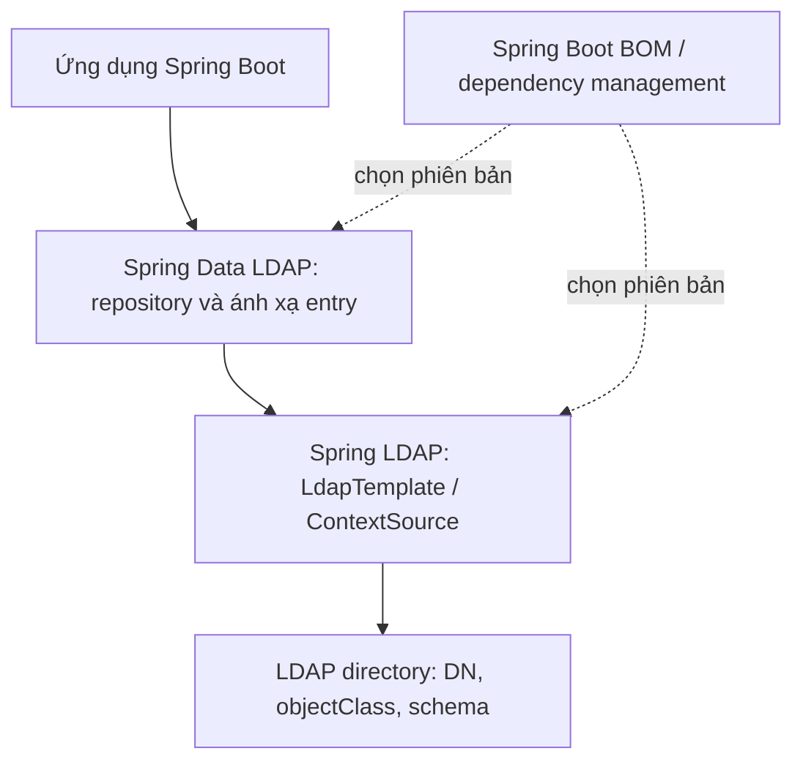

# Chọn phiên bản Spring Boot, Spring Data LDAP và Spring LDAP tương thích

> **Chương:** Khởi tạo  
> **Phạm vi:** SPRING_DATA_LDAP — truy cập dịch vụ thư mục LDAP bằng repository Spring Data LDAP, ánh xạ entry phân cấp thành đối tượng Java và dùng Spring LDAP khi cần thao tác ở mức thấp hơn.

## Mục tiêu học tập

Sau bài này, bạn có thể:

1. Phân biệt vai trò của **Spring Boot**, **Spring Data LDAP** và **Spring LDAP** trong ứng dụng Java.
2. Chọn một bộ phiên bản tương thích dựa vào **Spring Boot dependency management/BOM**, thay vì ghép thủ công các phiên bản độc lập.
3. Cấu hình Maven hoặc Gradle để sử dụng `spring-boot-starter-data-ldap` và kiểm tra phiên bản thực sự được tải.
4. Nhận biết rủi ro khi trộn các **major version**, chuẩn bị môi trường LDAP và phân biệt lỗi dependency với lỗi kết nối, bind hoặc schema.

## 1. Ba thành phần phối hợp như thế nào?

LDAP (Lightweight Directory Access Protocol) cho phép truy cập cây entry trong directory như OpenLDAP hoặc Active Directory. Mỗi entry được xác định bởi **DN** (*Distinguished Name*), chứa thuộc tính và được ràng buộc bởi `objectClass` cùng schema. Một ứng dụng thường cần tìm tài khoản theo `uid` hoặc `mail`, đọc DN, thay đổi thuộc tính và kiểm soát quyền truy cập.

| Thành phần | Trách nhiệm chính | API/khả năng thường gặp |
| --- | --- | --- |
| **Spring Boot** | Khởi động ứng dụng, tự cấu hình `ContextSource`, `LdapTemplate` và repository khi có dependency phù hợp; quản lý phiên bản thư viện qua BOM | `spring-boot-starter-data-ldap`, `spring.ldap.*` |
| **Spring Data LDAP** | Ánh xạ LDAP entry thành đối tượng Java và cung cấp mô hình repository để tìm kiếm, lưu, cập nhật, xóa | `@Entry`, `@Id`, `@Attribute`, `LdapRepository` |
| **Spring LDAP** | Cung cấp lớp thao tác LDAP ở mức thấp: kết nối/bind, tìm kiếm theo filter, đọc/ghi entry, xử lý DN | `LdapTemplate`, `LdapContextSource`, `LdapQuery` |

Luồng phụ thuộc điển hình:



**Điểm cốt lõi:** Spring Data LDAP dựa trên các cơ chế của Spring LDAP; Spring Boot lựa chọn phiên bản tương ứng cho cả hai. Phiên bản **LDAP server** và phiên bản **thư viện Spring LDAP** là hai khái niệm khác nhau: server phải hỗ trợ giao thức, schema, phương thức bảo mật cần dùng, nhưng không cần có “cùng số phiên bản” với thư viện Java.

## 2. Vì sao không nên tự chọn ba phiên bản một cách độc lập?

Mỗi nhánh Spring Boot được kiểm thử và phát hành với một tập phiên bản Spring Framework, Spring Data và Spring LDAP. Nếu bạn thêm `spring-data-ldap:4.x` vào dự án vẫn dùng Spring Boot 3.5 và Spring Framework 6.x, ứng dụng có thể gặp lỗi class/method không tồn tại do khác API nền tảng. Tương tự, việc ép riêng `spring-ldap-core` sang một major version khác có thể làm mất tính nhất quán của dependency tree.

Quy tắc thực hành:

- **Chọn phiên bản Spring Boot trước**, xét yêu cầu Java, thời gian bảo trì, plugin build và khả năng nâng cấp của dự án.
- Sử dụng **Spring Boot parent/BOM** để quản lý các dependency thuộc Spring Data và Spring LDAP. Khai báo starter **không gắn phiên bản riêng**.
- Khi cần xác minh bộ phiên bản, xem trang **Managed Dependency Coordinates** đúng nhánh Spring Boot và đầu ra dependency tree của chính dự án.
- Chỉ override BOM khi có yêu cầu cụ thể, đã đọc release notes và đã chạy kiểm thử tương thích. Ưu tiên nâng patch release của toàn nhánh Boot trước khi cân nhắc override từng thư viện.

### Bảng tham chiếu bộ phiên bản

Ví dụ các bộ phiên bản được công bố trong tài liệu quản lý dependency của Spring Boot tại thời điểm biên soạn (**26/11/2026**):

| Spring Boot | `org.springframework.data:spring-data-ldap` | `org.springframework.ldap:spring-ldap-core` | Ý nghĩa |
| --- | --- | --- | --- |
| **4.2.0** | **4.2.0** | **4.2.0** | Ví dụ cho dự án mới sử dụng nhánh Boot 4.2 |
| **4.1.3** | **4.1.3** | **4.1.3** | Một bộ đồng bộ khác thuộc Boot 4.x |
| **3.5.16** | **3.5.13** | **3.3.8** | Ví dụ cho ứng dụng tiếp tục dùng Boot 3.5 |

Các số trên là **ảnh chụp tại những bản vá cụ thể**, không phải quy tắc “mọi artifact luôn cùng version”. Chẳng hạn, với Boot 3.5.16, ba artifact có ba số phiên bản khác nhau và vẫn thuộc bộ được Boot quản lý. Khi đọc bài vào thời điểm khác, hãy tra lại đúng trang dependency của bản Boot bạn định cài.

Tài liệu đối chiếu: [Boot 4.2](https://docs.spring.io/spring-boot/4.2/appendix/dependency-versions/coordinates.html), [Boot 4.1](https://docs.spring.io/spring-boot/4.1/appendix/dependency-versions/coordinates.html), [Boot 3.5](https://docs.spring.io/spring-boot/3.5/appendix/dependency-versions/coordinates.html).

### Phân biệt “hợp major version” và “được BOM quản lý”

Một quy tắc gần đúng là:

- **Boot 3.5.x → Spring Data LDAP 3.5.x → Spring LDAP 3.3.x**.
- **Boot 4.1.x → Spring Data LDAP 4.1.x → Spring LDAP 4.1.x**.
- **Boot 4.2.x → Spring Data LDAP 4.2.x → Spring LDAP 4.2.x**.

Tuy nhiên, chỉ dựa trên số major/minor là chưa đủ để kết luận mọi tổ hợp patch đều đã được kiểm thử. **Nguồn xác nhận cuối cùng là BOM của đúng bản Boot và dependency tree đã resolve**, không phải suy đoán từ tên phiên bản.

## 3. Quy trình chọn phiên bản cho dự án

### Bước 1 — Xác định nền tảng hiện có

Hãy kiểm tra JDK, phiên bản Spring Boot hiện tại, hệ thống build (Maven/Gradle), các library Spring khác và yêu cầu triển khai. Spring Boot **4.2.0 yêu cầu tối thiểu Java 17**; ví dụ dưới đây sử dụng **Java 21** như lựa chọn dự án, không phải mức tối thiểu bắt buộc.

Nếu dự án đang vận hành ổn định trên Boot 3.5, bạn có thể thêm Spring Data LDAP cùng nhánh mà chưa cần nâng cấp toàn bộ ứng dụng sang Boot 4. Việc chuyển major version cần đánh giá thay đổi của Spring Framework, Spring Security, API và các thư viện liên quan.

### Bước 2 — Xác định mức API LDAP cần dùng

| Nhu cầu | Gợi ý |
| --- | --- |
| Ánh xạ entry thành đối tượng Java, CRUD bằng repository, tìm kiếm theo thuộc tính | Sử dụng `spring-boot-starter-data-ldap` |
| Cần query/filter phức tạp, thao tác DN hoặc API LDAP trực tiếp | Dùng `LdapTemplate` của Spring LDAP (starter Data LDAP cũng cung cấp nền tảng này) |
| Chỉ truy cập LDAP bằng Spring LDAP, không dùng repository | Có thể dùng dependency Spring LDAP tương ứng và cấu hình thích hợp; xem starter hỗ trợ của nhánh Boot đã chọn |
| Cần xác thực người dùng với LDAP qua Spring Security | Xem thêm dependency và cấu hình **Spring Security LDAP** phù hợp; chức năng này khác với repository dữ liệu |

`spring-boot-starter-data-ldap` là lựa chọn thông thường cho phạm vi bài học này vì người học sẽ thực hành cả **repository**, **mapping entry** và có thể gọi **`LdapTemplate`** khi cần.

### Bước 3 — Tra BOM, không đoán bản thư viện

Sau khi chọn Boot 4.2.0, tra trong trang Managed Dependency Coordinates của bản này các tọa độ:

- `org.springframework.data:spring-data-ldap`
- `org.springframework.data:spring-data-commons`
- `org.springframework.ldap:spring-ldap-core`
- `org.springframework.ldap:spring-ldap-odm` (nếu có sử dụng)

Đừng tự khai báo cả bốn chỉ vì chúng có mặt trong BOM. Starter sẽ kéo vào các module cần thiết thông qua phụ thuộc chuyển tiếp.

### Bước 4 — Xác minh trong dự án thật

Chạy lệnh xem dependency đã resolve và đối chiếu với BOM. Nếu có conflict hoặc phiên bản ngoài dự kiến, kiểm tra dependency trực tiếp, BOM khác, plugin quản lý dependency và các version override.

## 4. Ví dụ Maven: để Spring Boot chọn phiên bản

Mẫu sau tạo dự án **Spring Boot 4.2.0 + Java 21** dùng Spring Data LDAP. Phiên bản của Spring Data LDAP và Spring LDAP được quản lý bằng `spring-boot-starter-parent`.

```xml
<project xmlns="http://maven.apache.org/POM/4.0.0"
         xmlns:xsi="http://www.w3.org/2001/XMLSchema-instance"
         xsi:schemaLocation="http://maven.apache.org/POM/4.0.0
                             https://maven.apache.org/xsd/maven-4.0.0.xsd">
    <modelVersion>4.0.0</modelVersion>

    <parent>
        <groupId>org.springframework.boot</groupId>
        <artifactId>spring-boot-starter-parent</artifactId>
        <version>4.2.0</version>
        <relativePath/>
    </parent>

    <groupId>com.example</groupId>
    <artifactId>ldap-demo</artifactId>
    <version>0.0.1-SNAPSHOT</version>

    <properties>
        <java.version>21</java.version>
    </properties>

    <dependencies>
        <dependency>
            <groupId>org.springframework.boot</groupId>
            <artifactId>spring-boot-starter-data-ldap</artifactId>
        </dependency>
        <dependency>
            <groupId>org.springframework.boot</groupId>
            <artifactId>spring-boot-starter-test</artifactId>
            <scope>test</scope>
        </dependency>
    </dependencies>

    <build>
        <plugins>
            <plugin>
                <groupId>org.springframework.boot</groupId>
                <artifactId>spring-boot-maven-plugin</artifactId>
            </plugin>
        </plugins>
    </build>
</project>
```

**Vì sao không có `<version>` ở starter?** Parent của Spring Boot đã cung cấp cơ chế quản lý các phiên bản liên quan. Thêm phiên bản riêng cho `spring-data-ldap` hay `spring-ldap-core` vào đây sẽ làm mất lợi ích của việc đồng bộ dependency.

Nếu dự án không thể kế thừa `spring-boot-starter-parent`, có thể import `spring-boot-dependencies` BOM vào `<dependencyManagement>` của Maven; khi đó plugin build cần được cấu hình riêng. Đừng vừa dùng parent vừa import BOM một lần nữa nếu không có lý do.

### Kiểm tra Maven

```bash
mvn dependency:tree -Dincludes=org.springframework.data:spring-data-ldap,org.springframework.ldap:spring-ldap-core
```

Với POM ví dụ, bạn cần nhìn thấy `spring-data-ldap:4.2.0` và `spring-ldap-core:4.2.0` trong cây dependency. Nếu bản vá của Boot thay đổi, **kết quả cần khớp BOM của bản Boot đang chạy**, không nhất thiết là 4.2.0.

Khi muốn xem toàn bộ các module liên quan:

```bash
mvn dependency:tree
```

## 5. Ví dụ Gradle: cùng nguyên tắc, khác cú pháp

`build.gradle` (Groovy DSL), giả định dùng Gradle đáp ứng yêu cầu của Spring Boot 4.2:

```groovy
plugins {
    id 'java'
    id 'org.springframework.boot' version '4.2.0'
    id 'io.spring.dependency-management' version '1.1.7'
}

java {
    toolchain {
        languageVersion = JavaLanguageVersion.of(21)
    }
}

repositories {
    mavenCentral()
}

dependencies {
    implementation 'org.springframework.boot:spring-boot-starter-data-ldap'
    testImplementation 'org.springframework.boot:spring-boot-starter-test'
}
```

Plugin Spring Boot kết hợp với plugin dependency management sử dụng BOM tương ứng. Một cách khác là sử dụng khả năng `platform(...)` của Gradle để import BOM; trong cả hai cách, cần quản lý phiên bản tập trung và tránh khai báo lại version cho Spring Data LDAP/Spring LDAP.

Kiểm tra dependency resolution:

```bash
./gradlew dependencies --configuration runtimeClasspath
./gradlew dependencyInsight --dependency spring-data-ldap --configuration runtimeClasspath
./gradlew dependencyInsight --dependency spring-ldap-core --configuration runtimeClasspath
```

Trên Windows, có thể chạy `gradlew.bat` thay `./gradlew`. `dependencyInsight` hữu ích khi cần tìm nguyên nhân một bản thư viện được chọn hoặc bị thay thế bởi version constraint khác.

## 6. Kiểm tra kết nối LDAP sau khi chọn dependency

Chọn đúng phiên bản **chưa đủ để ứng dụng kết nối được directory**. Bạn còn cần URL, tài khoản bind (nếu directory yêu cầu), DN gốc, schema và quyền truy cập. Ví dụ cấu hình phát triển cho một directory riêng:

```yaml
spring:
  ldap:
    urls: "ldap://localhost:389"
    base: "dc=example,dc=org"
    username: "cn=app-reader,ou=service,dc=example,dc=org"
    password: "change-me-for-local-development-only"
```

Mẫu này chỉ minh họa tên property; `localhost:389` phải được thay bằng LDAP server thực tế. Không đưa mật khẩu vào repository hoặc file cấu hình production. Có thể dùng biến môi trường hoặc secret manager để cấp thông tin bind.

Trong môi trường thật, dùng **LDAPS hoặc StartTLS** theo khả năng của directory, xác thực chứng chỉ máy chủ và cấp quyền tối thiểu cho tài khoản bind. Số phiên bản Java/Spring không thay thế được kiểm tra TLS, phân quyền hoặc quy tắc schema.

Khi dùng Spring Boot và starter phù hợp, Boot có thể tự cấu hình `LdapContextSource` và `LdapTemplate`, đồng thời tìm các repository trong các package được scan. Các khái niệm sau là trọng tâm của những bài thực hành tiếp theo:

- **DN** xác định vị trí duy nhất của entry trong cây, ví dụ `uid=linh,ou=people,dc=example,dc=org`.
- **`objectClass` và schema** xác định các thuộc tính hợp lệ/bắt buộc; lỗi schema không phải lỗi không tương thích dependency.
- **Filter** phải được xây dựng hoặc escape an toàn thay vì ghép trực tiếp input người dùng vào chuỗi LDAP.

### Thử nhanh mà không phụ thuộc directory doanh nghiệp

Khi cần kiểm thử cô lập, Spring Boot hỗ trợ LDAP nhúng UnboundID. Thêm dependency sau vào Maven:

```xml
<dependency>
    <groupId>com.unboundid</groupId>
    <artifactId>unboundid-ldapsdk</artifactId>
    <scope>test</scope>
</dependency>
```

Rồi cấu hình profile kiểm thử với DN gốc, ví dụ:

```yaml
spring:
  ldap:
    embedded:
      base-dn: "dc=example,dc=org"
```

Thêm dữ liệu LDIF kiểm thử và `spring.ldap.embedded.ldif` khi test cần entry mẫu. Nếu muốn chạy server nhúng trong test, tránh giữ cấu hình URL LDAP thật ở cùng profile vì có thể khiến ứng dụng kết nối sai server. Kiểm thử CRUD còn phải bảo đảm entry mẫu phù hợp schema và test account có quyền ghi.

## 7. Nhận diện đúng loại lỗi trước khi đổi phiên bản

| Triệu chứng | Nguyên nhân nên kiểm tra trước | Cách chẩn đoán |
| --- | --- | --- |
| `NoSuchMethodError`, `ClassNotFoundException` hoặc lỗi tạo bean do API Spring | Trộn major version hoặc dependency bị override | Xem `dependency:tree` / `dependencyInsight` và đối chiếu BOM |
| Không tạo được repository hoặc không tìm thấy `LdapRepository` | Thiếu starter, sai package scan, cấu hình repository | Kiểm tra starter, `@EnableLdapRepositories` nếu cần |
| `CommunicationException`, kết nối bị từ chối hoặc timeout | URL/port, DNS, firewall, server chưa chạy, TLS | Kiểm tra endpoint, cổng và chứng chỉ |
| `AuthenticationException` khi bind | Sai DN/mật khẩu, cơ chế bind hoặc quyền | Kiểm tra tài khoản và cấu hình directory |
| `NameNotFoundException` hoặc kết quả tìm kiếm rỗng | Sai base DN, search base, filter hoặc cây entry | Kiểm tra DN đầy đủ và phạm vi tìm kiếm |
| Lỗi `objectClass`/schema hoặc không lưu được entry | Thiếu thuộc tính bắt buộc, vi phạm schema/quyền | Kiểm tra LDIF, schema và ACL của directory |

Một lỗi LDAP như “không tìm thấy DN” thường được xử lý bằng cách sửa cấu hình hoặc dữ liệu. **Không tự nâng Spring LDAP** nếu dependency tree đã khớp BOM mà lỗi thực sự là kết nối, tài khoản hoặc schema.

## 8. Tình huống ra quyết định

**Tình huống A — Ứng dụng đang chạy Boot 3.5.16, cần thêm repository LDAP.**  
Giữ parent/BOM của Boot 3.5.16, thêm `spring-boot-starter-data-ldap` không có version. Khi kiểm tra cây dependency, dự kiến nhận Spring Data LDAP 3.5.13 và Spring LDAP 3.3.8. Không thêm thẳng Spring Data LDAP 4.2 chỉ vì đó là phiên bản mới hơn.

**Tình huống B — Dự án mới với Java 21, nhóm chọn Boot 4.2.0.**  
Dùng starter tương ứng từ BOM Boot 4.2.0. Sau khi resolve, xác nhận Spring Data LDAP 4.2.0 và Spring LDAP 4.2.0. Tiếp theo mới cấu hình LDAP server, ánh xạ entry và repository.

**Tình huống C — Cần sửa lỗi bảo mật được khắc phục trong phiên bản Spring LDAP mới.**  
Kiểm tra trước xem bản vá Spring Boot cùng nhánh đã quản lý phiên bản đã sửa hay chưa. Nếu phải override trực tiếp, đọc release notes và kiểm tra toàn bộ API liên quan, dependency tree, kiểm thử tích hợp với directory và TLS trước khi triển khai. Không suy từ một số version đơn lẻ rằng cả bộ sẽ tương thích.

## 9. Bài thực hành tự kiểm tra

1. Với dự án dùng Spring Boot 3.5.16, bạn có nên đặt `spring-data-ldap:4.2.0` bằng tay không? Vì sao?
2. Trong Maven, lệnh nào cho biết `spring-ldap-core` được resolve thành phiên bản nào?
3. Nếu dependency tree khớp BOM nhưng ứng dụng báo `AuthenticationException`, bạn sẽ kiểm tra điều gì trước?
4. Khi chọn Boot 4.2.0 và Java 21, vì sao `spring-boot-starter-data-ldap` không cần khai báo version?

**Gợi ý đáp án:** (1) Không, hãy để BOM Boot 3.5 quyết định vì trộn major version dễ gây xung đột API. (2) Dùng `mvn dependency:tree`, có thể lọc theo `spring-ldap-core`. (3) Kiểm tra bind DN, mật khẩu, cơ chế xác thực, tài khoản và directory; đây chưa phải bằng chứng lỗi version. (4) Parent/BOM Boot quản lý version của starter cùng các dependency Spring Data/Spring LDAP.

## 10. Checklist trước khi bắt đầu viết repository

- [ ] Đã chọn một **phiên bản Spring Boot cụ thể** phù hợp JDK và build tool.
- [ ] Đã dùng `spring-boot-starter-data-ldap` và cấu hình parent/BOM hợp lệ.
- [ ] Không gắn version thủ công cho Spring Data LDAP/Spring LDAP nếu chưa có lý do được kiểm chứng.
- [ ] Đã kiểm tra dependency tree và đối chiếu phiên bản với **Managed Dependency Coordinates**.
- [ ] Đã xác định LDAP server, base DN, `objectClass`, schema, quyền bind và phương thức kết nối bảo mật.
- [ ] Đã chuẩn bị directory test hoặc LDAP nhúng để chạy kiểm thử độc lập.

## Tài liệu chính thức

- [Spring Boot 4.2 — LDAP, auto-configuration, repository và embedded LDAP](https://docs.spring.io/spring-boot/4.2/reference/data/nosql.html)
- [Spring Boot 4.2 — Managed Dependency Coordinates](https://docs.spring.io/spring-boot/4.2/appendix/dependency-versions/coordinates.html)
- [Spring Boot 4.1 — Managed Dependency Coordinates](https://docs.spring.io/spring-boot/4.1/appendix/dependency-versions/coordinates.html)
- [Spring Boot 3.5 — Managed Dependency Coordinates](https://docs.spring.io/spring-boot/3.5/appendix/dependency-versions/coordinates.html)
- [Spring Boot 4.2 — System Requirements](https://docs.spring.io/spring-boot/4.2/system-requirements.html)
- [Spring Data LDAP — Dependency Management with Spring Boot](https://docs.spring.io/spring-data/ldap/reference/data-commons/dependencies.html)
- [Spring LDAP — Getting Spring LDAP](https://docs.spring.io/spring-ldap/reference/getting-spring-ldap.html)

