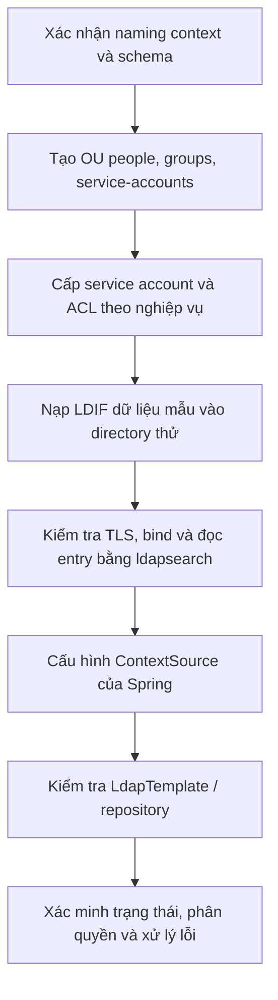

# Chuẩn bị base DN, tài khoản dịch vụ và dữ liệu LDIF cho Spring Data LDAP

## 1. Mục tiêu và bối cảnh

Trong **Spring Data LDAP**, ứng dụng Java truy cập directory qua `LdapRepository` hoặc `LdapTemplate` của Spring LDAP. Để repository ánh xạ entry sang đối tượng Java, thao tác tìm kiếm và CRUD hoạt động chính xác, trước tiên cần chuẩn bị **cấu trúc DN**, **tài khoản bind của ứng dụng** và **dữ liệu khởi tạo theo schema LDAP**.

Ba phần này liên quan nhưng không thay thế nhau:

- **Base DN** xác định một vị trí gốc trong cây thư mục để client truy vấn hoặc quản lý entry, chẳng hạn `dc=example,dc=org`.
- **Tài khoản dịch vụ** là danh tính được ứng dụng dùng để *bind* với directory; danh tính này cần được LDAP server xác thực và chỉ cấp quyền cần thiết.
- **LDIF** (*LDAP Data Interchange Format*) là định dạng văn bản chuẩn để mô tả entry hoặc thao tác thay đổi directory; nó có thể được dùng tạo dữ liệu mẫu và kiểm chứng schema.

Ví dụ, ứng dụng tra nhân viên theo `uid`, đọc `cn`/`mail`, kiểm tra thành viên nhóm và cập nhật một số thuộc tính. Nếu cấu hình base DN không đúng, nó sẽ tìm sai nhánh. Nếu tài khoản dịch vụ thiếu quyền, kết quả có thể rỗng hoặc phát sinh lỗi. Nếu LDIF thiếu thuộc tính bắt buộc của `objectClass`, server sẽ từ chối tạo entry.

Bài học hướng dẫn chuẩn bị ba thành phần theo một kịch bản nhất quán, kèm lệnh kiểm tra và ví dụ cấu hình Java. Tất cả tên miền, DN và mật khẩu thử bên dưới đều là **dữ liệu minh họa**, không phải thông tin production.

## 2. Hiểu đúng các lớp tên trong LDAP

### 2.1. Suffix/naming context, base DN, OU và DN của entry

Giả sử một directory dùng naming context `dc=example,dc=org`:

```text
dc=example,dc=org                <-- naming context / entry gốc
├── ou=people                     <-- nơi chứa người dùng
│   ├── uid=alice                 <-- một người dùng
│   └── uid=bob
├── ou=groups                     <-- nơi chứa nhóm
│   └── cn=reviewers              <-- một nhóm
└── ou=service-accounts           <-- nơi chứa tài khoản ứng dụng
    └── uid=ldap-reader           <-- tài khoản bind của ứng dụng
```

| Thành phần | Ví dụ | Ý nghĩa |
| --- | --- | --- |
| **Naming context / suffix** | `dc=example,dc=org` | Miền tên được một directory/server phục vụ; được quản trị ở phía server |
| **Base DN của client** | `dc=example,dc=org` | Gốc tương đối để `ContextSource` của Spring LDAP phân giải các DN |
| **Search base** | `ou=people` | Nhánh tìm kiếm tương đối với base DN của `ContextSource` |
| **RDN** | `uid=alice` | Thành phần phân biệt entry Alice dưới entry cha |
| **DN đầy đủ** | `uid=alice,ou=people,dc=example,dc=org` | Vị trí chính xác của entry trong directory |
| **Bind DN** | `uid=ldap-reader,ou=service-accounts,dc=example,dc=org` | Danh tính dùng để xác thực dịch vụ; khác search base |

Các phần tử trong DN gồm loại thuộc tính và giá trị, ví dụ `ou=people`, `uid=alice`. DN phân cấp từ entry đến tổ tiên, ngăn cách bằng dấu phẩy. **DN không phải đường dẫn file**, không phải chuỗi URL và không được tự ghép từ input chưa tin cậy.

**Phân biệt hai lần sử dụng từ “base”:**

1. LDAP server phải được cấu hình để phục vụ naming context/suffix, chẳng hạn `dc=example,dc=org`.
2. Thuộc tính `spring.ldap.base` của Spring Boot cấu hình **base DN phía client**. Nó **không tạo suffix hoặc OU trên server**.

Nếu LDAP server chưa có entry gốc hoặc nhánh `ou=people`, chỉ thiết lập `spring.ldap.base` sẽ không tự sinh các entry đó. Cần có quyền quản trị directory để provision cấu trúc cây trước.

### 2.2. Chọn base DN phù hợp với ứng dụng

Đặt `spring.ldap.base=dc=example,dc=org` khi ứng dụng cần truy cập nhiều nhánh như `ou=people` và `ou=groups`. Khi đó:

```text
ContextSource base: dc=example,dc=org
LdapTemplate search base: ou=people
DN thực tế trên server: ou=people,dc=example,dc=org
```

Nếu chỉ cho phép ứng dụng đọc nhân viên, có thể đặt base sâu hơn, ví dụ `ou=people,dc=example,dc=org`, và search với base rỗng `""`. Base hẹp giúp giảm phạm vi truy vấn nhưng **không thay thế** ACL của server; tài khoản bind vẫn cần được giới hạn quyền.

Không đưa DN đầy đủ vào API đang mong DN tương đối nếu `ContextSource` đã cấu hình base, vì dễ xảy ra **lặp suffix**. Ngược lại, giá trị thuộc tính LDAP có kiểu DN (như `uniqueMember`) thường cần **DN đầy đủ của đối tượng được tham chiếu**, không phải DN tương đối của client.

### 2.3. Kiểm tra naming context trước khi thiết kế fixture

Root DSE (entry có DN rỗng) thường công bố thông tin server như `namingContexts`, `supportedLDAPVersion` và các control hỗ trợ. Có thể thử:

```bash
ldapsearch -LLL -x \
  -H ldaps://ldap.example.org:636 \
  -b "" -s base "(objectClass=*)" \
  namingContexts supportedLDAPVersion
```

Một số server giới hạn việc đọc Root DSE khi chưa bind, hoặc dùng thuộc tính khác theo vendor (ví dụ `defaultNamingContext`). Nếu không đọc được, xác minh naming context bằng tài khoản quản trị qua tài liệu/server configuration, thay vì tự suy từ hostname.

Kiểm tra entry gốc sau khi được tạo:

```bash
ldapsearch -LLL -x \
  -H ldaps://ldap.example.org:636 \
  -D "uid=ldap-reader,ou=service-accounts,dc=example,dc=org" -W \
  -b "dc=example,dc=org" -s base "(objectClass=*)" \
  dn dc objectClass
```

Lệnh chỉ có thể thành công sau khi entry, service account, TLS và quyền đọc đã được thiết lập.

## 3. Chuẩn bị tài khoản dịch vụ để bind

### 3.1. Tách tài khoản quản trị và tài khoản ứng dụng

Một directory thường có **tài khoản quản trị** để tạo suffix, cấu hình schema/ACL, import dữ liệu và một **tài khoản dịch vụ** để ứng dụng sử dụng hàng ngày.

| Vai trò | Cần làm gì? | Không nên cấp quyền gì? |
| --- | --- | --- |
| Directory administrator | Provision naming context, OU, service account, schema, ACL | Không dùng tài khoản này làm bind mặc định của ứng dụng |
| LDAP read-only service | Bind, search/read các thuộc tính được phép; compare nếu nghiệp vụ cần | Không cấp quyền add/delete/modify toàn directory |
| LDAP writer service | Sửa các thuộc tính/entry cụ thể được giao, nếu ứng dụng có chức năng ghi | Không cấp quyền quản trị schema, suffix hay tất cả OU |
| LDAP test account | Thử kết nối trong môi trường kiểm thử cô lập | Không dùng chung với production |

Không phải mọi ứng dụng đều cần LDAP write access. Một ứng dụng đồng bộ danh bạ chỉ tìm và đọc nhân viên nên bắt đầu với **read-only account**, sau đó bổ sung quyền hẹp theo yêu cầu. Khi nghiệp vụ cần ghi, cân nhắc một danh tính ghi riêng và phân quyền theo OU/thuộc tính nếu LDAP server hỗ trợ.

Tài khoản `uid=ldap-reader,ou=service-accounts,dc=example,dc=org` chỉ là ví dụ về **Bind DN**. Một số hệ thống hỗ trợ bind bằng UPN, SASL/Kerberos hay cách xác thực khác; cách tạo và định danh tài khoản phải theo directory thực tế.

### 3.2. Cấp quyền theo thao tác và thuộc tính

Một bản phân quyền tối thiểu có thể được diễn giải như sau:

| Tài nguyên | Read-only service | Writer service |
| --- | --- | --- |
| `ou=people` | Search entry, read `uid`, `cn`, `sn`, `mail` theo nhu cầu | Chỉ sửa các thuộc tính nghiệp vụ đã được duyệt |
| `ou=groups` | Search/read `cn`, `uniqueMember` khi cần kiểm tra nhóm | Chỉ sửa `uniqueMember` tại nhóm được giao nếu nghiệp vụ yêu cầu |
| `ou=service-accounts` | Không cần quyền liệt kê các tài khoản khác | Không cần quyền tạo/sửa/xóa tài khoản dịch vụ |
| Schema/config/server internals | Không cấp | Không cấp |

**ACL do server quyết định.** Cú pháp và cách xử lý quyền khác giữa OpenLDAP, Active Directory và các directory khác. Tạo một entry tên `ldap-reader` **không tự động** biến account đó thành read-only; phải cấu hình ACL hoặc role tương ứng ở phía server.

Quyền **search**, **read**, **compare**, **add**, **modify**, **delete** có thể được kiểm soát riêng. Ví dụ một account bind thành công nhưng vẫn không nhìn thấy `mail` vì ACL không cho phép đọc thuộc tính đó.

### 3.3. Quản lý thông tin xác thực

Khi tạo tài khoản dịch vụ thật:

1. Dùng quy trình cấp phát chính thức của directory để đăng ký danh tính và chủ sở hữu.
2. Chọn phương thức xác thực được hỗ trợ; mật khẩu hoặc credential phải được cấp theo chính sách bảo mật.
3. Lưu secret trong hệ thống quản lý bí mật hoặc secret store của nền tảng, cấp cho tiến trình chạy ứng dụng khi khởi động.
4. Xác định chu kỳ rotation, cách thu hồi khi bị lộ, quyền giám sát và quy trình thay đổi không gián đoạn.
5. Kiểm tra bind bằng tài khoản **thực sự dùng khi deploy**, không chỉ bằng tài khoản admin.

Không ghi mật khẩu production vào LDIF trong Git, file cấu hình commit, Docker image, lịch sử lệnh hoặc log ứng dụng. Dùng `ldapwhoami -W` và `ldapsearch -W` để nhập mật khẩu tương tác khi kiểm tra thủ công.

## 4. Dữ liệu LDIF: cấu trúc và các quy tắc quan trọng

**LDIF (RFC 2849)** mô tả entry qua các dòng `dn:` và `attribute: value`, giữa hai entry có **một dòng trống**. Có hai nhóm dữ liệu:

- **Content records:** mô tả trạng thái của entry (thường dùng với `ldapadd` để tạo dữ liệu ban đầu).
- **Change records:** mô tả thao tác `changetype: add`, `modify`, `delete`, `modrdn`/`moddn` (thường dùng với `ldapmodify`).

Ví dụ một content record:

```ldif
dn: uid=alice,ou=people,dc=example,dc=org
objectClass: top
objectClass: person
objectClass: organizationalPerson
objectClass: inetOrgPerson
uid: alice
cn: Alice Nguyen
sn: Nguyen
mail: alice@example.org
```

Ý nghĩa:

- `dn` xác định vị trí entry; parent `ou=people,...` phải tồn tại trước khi thêm entry này.
- Nhiều dòng `objectClass` biểu diễn **nhiều giá trị** của cùng thuộc tính. Schema quyết định các thuộc tính bắt buộc/tùy chọn và structural class hợp lệ.
- `person` thường yêu cầu `cn` và `sn`; `inetOrgPerson` bổ sung các thuộc tính người dùng như `uid`, `mail` tùy schema.
- `mail` thường là thuộc tính tùy chọn; nếu không cần, đừng ép dữ liệu giả phải có email ở mọi entry.
- Thuộc tính đa trị khác, ví dụ `uniqueMember`, cũng được biểu diễn bằng **nhiều dòng cùng tên thuộc tính**.

LDIF có các quy tắc mã hóa quan trọng:

- Dữ liệu có ký tự không an toàn ở đầu hoặc không phải ASCII, giá trị nhị phân và một số trường hợp khác cần dạng **Base64** với cú pháp `attribute:: <base64>`; không tự gõ UTF-8 tùy ý vào mọi LDIF rồi giả định mọi parser chấp nhận.
- Dòng quá dài có thể được **fold**: dòng tiếp theo bắt đầu bằng một dấu cách; dấu cách đầu này phục vụ cú pháp LDIF và không phải một phần giá trị.
- Giá trị rỗng có thể viết `attribute:`; nhưng phải xem schema có cho phép giá trị rỗng hay không.
- Tên thuộc tính, OID, matching rules và quy tắc bắt buộc vẫn do schema directory kiểm tra.

Dùng LDIF để làm **fixture có thể tái lập**, nhưng chỉ áp dụng vào đúng directory thử nghiệm hoặc môi trường đã được phê duyệt.

## 5. Một bộ LDIF mẫu cho môi trường kiểm thử cô lập

Giả sử server thử nghiệm **chưa có** entry gốc `dc=example,dc=org`. Lưu nội dung minh họa sau tại `src/test/resources/ldap/bootstrap.ldif` trong một dự án Java (đây là đường dẫn ví dụ, không phải file được tạo trong bài tập này).

```ldif
dn: dc=example,dc=org
objectClass: top
objectClass: domain
dc: example

dn: ou=people,dc=example,dc=org
objectClass: top
objectClass: organizationalUnit
ou: people

dn: ou=groups,dc=example,dc=org
objectClass: top
objectClass: organizationalUnit
ou: groups

dn: ou=service-accounts,dc=example,dc=org
objectClass: top
objectClass: organizationalUnit
ou: service-accounts

dn: uid=alice,ou=people,dc=example,dc=org
objectClass: top
objectClass: person
objectClass: organizationalPerson
objectClass: inetOrgPerson
uid: alice
cn: Alice Nguyen
sn: Nguyen
mail: alice@example.org

dn: uid=bob,ou=people,dc=example,dc=org
objectClass: top
objectClass: person
objectClass: organizationalPerson
objectClass: inetOrgPerson
uid: bob
cn: Bob Tran
sn: Tran
mail: bob@example.org

dn: cn=reviewers,ou=groups,dc=example,dc=org
objectClass: top
objectClass: groupOfUniqueNames
cn: reviewers
uniqueMember: uid=alice,ou=people,dc=example,dc=org

dn: uid=ldap-reader,ou=service-accounts,dc=example,dc=org
objectClass: top
objectClass: person
objectClass: organizationalPerson
objectClass: inetOrgPerson
uid: ldap-reader
cn: LDAP Reader
sn: Reader
userPassword: local-test-only-password
```

**Cảnh báo về fixture:** `userPassword: local-test-only-password` là mật khẩu giả, cố ý dễ nhận biết và **chỉ dùng trong directory test cô lập**. Không copy content record service account này vào production. Directory production phải được cấp credential qua kênh bảo mật; nhiều server có cơ chế hash/password policy riêng và không chấp nhận import plaintext theo cách này.

Trong ví dụ, `cn=reviewers` là nhóm `groupOfUniqueNames`. Schema thường yêu cầu ít nhất một `uniqueMember`, nên fixture cung cấp DN đầy đủ của Alice. Việc dịch vụ đọc được nhóm/nhân viên hay không vẫn tùy **ACL**, hoàn toàn không được bảo đảm chỉ từ LDIF.

### 5.1. Thứ tự import và trường hợp root đã tồn tại

Content LDIF cần tạo **parent trước child**. Bản mẫu đã đặt entry gốc và các OU trước người dùng/nhóm/tài khoản dịch vụ. Tuy nhiên, nhiều image OpenLDAP, embedded LDAP server hoặc dịch vụ directory được quản trị đã có sẵn naming context và entry `dc=example,dc=org`.

Khi server đã tạo root, **bỏ record root** khỏi LDIF bootstrap; chỉ import các OU/entry còn thiếu. Đừng bật tùy chọn “bỏ qua lỗi và tiếp tục” trên môi trường có dữ liệu chưa biết vì có thể tạo bộ dữ liệu dở dang.

`ldapadd` không phải thao tác upsert. Import lần hai cùng DN thường nhận lỗi **entryAlreadyExists**. Với các lần chạy test lặp lại, hãy tạo server mới hoặc reset fixture có kiểm soát.

### 5.2. Khi dùng image/container hoặc directory thử nghiệm có schema riêng

Cấu hình của một server có thể tự sinh `ou=people`, gắn ACL mặc định hoặc cần import schema trước khi nhận các objectClass. Một số directory giới hạn cách đặt RDN hay thuộc tính `userPassword`. Vì vậy, fixture là **ví dụ logic** cần kiểm tra lại với schema/image cụ thể; không coi nó là quy tắc chung cho mọi vendor.

Khi server báo lỗi import, kiểm tra **LDAP result code**, record và entry cha tương ứng. Không sửa LDIF bằng cách xóa đại các `objectClass` bắt buộc hoặc tắt kiểm tra schema để làm lệnh xanh.

## 6. Import và xác minh dữ liệu một cách an toàn

### 6.1. Tạo entry bằng `ldapadd` với tài khoản có quyền

Ở một máy có OpenLDAP client và kết nối tới **directory thử nghiệm đã xác minh TLS**, sử dụng:

```bash
ldapadd -x \
  -H ldaps://ldap-test.example.org:636 \
  -D "cn=Directory Manager" -W \
  -f src/test/resources/ldap/bootstrap.ldif
```

`cn=Directory Manager` **chỉ là bind DN quản trị minh họa**; OpenLDAP/Active Directory/các directory khác có DN quản trị không giống nhau. Thay bằng danh tính được cấp quyền import trên server thử nghiệm. `-W` yêu cầu nhập mật khẩu mà không đặt password trong đối số lệnh.

Sau khi nhập, hãy **kiểm tra mã thoát và từng lỗi LDAP** thay vì chỉ nhìn dòng cuối của console. Nếu root tồn tại trước khi chạy, bỏ record `dc=example,dc=org` ra khỏi file import (hoặc chuẩn bị fixture riêng) rồi chạy lại trên directory đã được reset.

Không dùng script import quản trị trên production trừ khi có kế hoạch thay đổi và danh sách entry được duyệt. Đặc biệt, tránh tự động tạo/xóa `ou=people` hoặc tài khoản người dùng thật bằng dữ liệu mẫu.

### 6.2. Kiểm tra base và từng nhánh

Sau khi tài khoản dịch vụ được tạo và ACL đã được cấp, dùng **chính Bind DN của ứng dụng** để xác nhận:

**Đọc base entry:**

```bash
ldapsearch -LLL -x \
  -H ldaps://ldap-test.example.org:636 \
  -D "uid=ldap-reader,ou=service-accounts,dc=example,dc=org" -W \
  -b "dc=example,dc=org" -s base \
  "(objectClass=*)" dn dc objectClass
```

**Tìm người dùng dưới `ou=people`:**

```bash
ldapsearch -LLL -x \
  -H ldaps://ldap-test.example.org:636 \
  -D "uid=ldap-reader,ou=service-accounts,dc=example,dc=org" -W \
  -b "ou=people,dc=example,dc=org" -s sub \
  "(objectClass=inetOrgPerson)" dn uid cn sn mail
```

**Đọc nhóm bằng DN đã biết:**

```bash
ldapsearch -LLL -x \
  -H ldaps://ldap-test.example.org:636 \
  -D "uid=ldap-reader,ou=service-accounts,dc=example,dc=org" -W \
  -b "cn=reviewers,ou=groups,dc=example,dc=org" -s base \
  "(objectClass=*)" dn cn uniqueMember
```

Kỳ vọng: lệnh đầu trả entry gốc, lệnh thứ hai trả Alice và Bob, lệnh thứ ba trả `cn=reviewers` và DN đầy đủ của Alice. Nếu một lệnh không trả dữ liệu, cần phân biệt **filter không khớp**, **base DN sai**, **ACL hạn chế** và **lỗi kết nối/bind**.

Lệnh tìm `-s sub` bao gồm entry ở nhiều cấp bên dưới base; `-s one` chỉ lấy các entry con trực tiếp; `-s base` chỉ xét chính DN. Đừng nhầm những phạm vi này với quyền truy cập: scope rộng hơn vẫn không vượt qua ACL.

### 6.3. Kiểm tra tài khoản bind riêng

```bash
ldapwhoami -x \
  -H ldaps://ldap-test.example.org:636 \
  -D "uid=ldap-reader,ou=service-accounts,dc=example,dc=org" -W
```

Nếu bind thành công, điều đó chứng minh credential được server chấp nhận theo cơ chế dùng trong lệnh; **không tự chứng minh** tài khoản có quyền đọc/sửa/xóa toàn directory.

Có thể thử một phép đọc được phép và một phép ghi **với entry thử nghiệm riêng** nếu cần kiểm tra ACL writer. Đừng dùng tài khoản read-only để “thử ghi” vào một DN có dữ liệu thực và đừng hiểu việc `ldapwhoami` thành công là kiểm tra đủ các quyền.

## 7. Cấu hình Spring Boot/Spring LDAP sau khi bootstrap

Ví dụ Gradle Kotlin DSL dùng Spring Data LDAP:

```kotlin
dependencies {
    implementation("org.springframework.boot:spring-boot-starter-data-ldap")
}
```

Trong dự án Maven/Gradle dùng Spring Boot BOM, hãy để cơ chế quản lý dependency xác định phiên bản tương thích. Một `ContextSource` phù hợp sẽ được tự cấu hình khi có các dependency và điều kiện auto-configuration cần thiết; nếu ứng dụng tự định nghĩa bean `LdapContextSource`, phải đảm bảo cấu hình custom không mâu thuẫn.

### 7.1. `application.yml` cho LDAP đã chuẩn bị

```yaml
spring:
  ldap:
    urls: "${LDAP_URL:ldaps://ldap-test.example.org:636}"
    base: "${LDAP_BASE_DN:dc=example,dc=org}"
    username: "${LDAP_BIND_DN}"
    password: "${LDAP_BIND_PASSWORD}"
```

Ví dụ biến môi trường **chỉ dùng trong test/local**:

```text
LDAP_URL=ldaps://ldap-test.example.org:636
LDAP_BASE_DN=dc=example,dc=org
LDAP_BIND_DN=uid=ldap-reader,ou=service-accounts,dc=example,dc=org
LDAP_BIND_PASSWORD=<test-secret-from-your-secret-store>
```

Đây là mô tả cấu hình, không phải yêu cầu ghi các biến thành file trong repository. Ở production, cấp secret qua cơ chế bảo mật của nền tảng triển khai.

`spring.ldap.urls` chỉ tới **server/endpoint**, `spring.ldap.base` chỉ tới **nhánh tên ở phía client**, `spring.ldap.username` là **bind identity**. Cần kiểm tra cả ba riêng biệt. Việc sửa `spring.ldap.base` không làm thay đổi ACL hay vị trí thực của entry trên server.

### 7.2. Thực hiện một truy vấn smoke với `LdapTemplate`

Sau khi server, tài khoản và dữ liệu đã được chuẩn bị, có thể kiểm tra khả năng truy cập bằng service account của ứng dụng:

```java
import java.util.List;

import org.springframework.ldap.core.LdapTemplate;
import org.springframework.stereotype.Service;

@Service
public class DirectorySmokeService {

    private final LdapTemplate ldapTemplate;

    public DirectorySmokeService(LdapTemplate ldapTemplate) {
        this.ldapTemplate = ldapTemplate;
    }

    public List<String> findAliceUid() {
        return ldapTemplate.search(
            "ou=people", // tương đối với spring.ldap.base
            "(&(objectClass=inetOrgPerson)(uid=alice))",
            attrs -> (String) attrs.get("uid").get()
        );
    }
}
```

Với fixture và ACL cho phép, `findAliceUid()` trả một danh sách chứa `"alice"`. Nếu không tìm thấy, một Search trên base hợp lệ có thể trả danh sách rỗng; nhưng lỗi TLS, bind, sai schema, quyền hoặc base không tồn tại có thể phát sinh exception. Không bắt mọi lỗi và trả danh sách rỗng vì sẽ che giấu nguyên nhân cấu hình.

Trong ví dụ, filter có giá trị cố định. Nếu UID lấy từ input người dùng, phải dùng **`LdapQueryBuilder` hoặc `EqualsFilter`** để escape giá trị theo cú pháp LDAP filter, không nối thẳng chuỗi `"(uid=" + input + ")"`.

### 7.3. DN tương đối và ID repository

Một entity LDAP ODM có thể khai báo như sau:

```java
import javax.naming.Name;
import org.springframework.ldap.odm.annotations.Attribute;
import org.springframework.ldap.odm.annotations.Entry;
import org.springframework.ldap.odm.annotations.Id;

@Entry(
    base = "ou=people",
    objectClasses = {
        "top", "person", "organizationalPerson", "inetOrgPerson"
    }
)
public class PersonEntry {
    @Id
    private Name dn;

    @Attribute(name = "uid")
    private String uid;

    @Attribute(name = "cn")
    private String commonName;

    @Attribute(name = "sn")
    private String surname;

    public PersonEntry() {}

    public Name getDn() { return dn; }
    public void setDn(Name dn) { this.dn = dn; }

    public String getUid() { return uid; }
    public void setUid(String uid) { this.uid = uid; }

    public String getCommonName() { return commonName; }
    public void setCommonName(String value) { this.commonName = value; }

    public String getSurname() { return surname; }
    public void setSurname(String value) { this.surname = value; }
}
```

Repository:

```java
import org.springframework.data.ldap.repository.LdapRepository;

public interface PersonRepository extends LdapRepository<PersonEntry> {
}
```

Khi cấu hình base của client là `dc=example,dc=org`, DN dùng làm ID có thể được biểu diễn tương đối:

```java
import javax.naming.Name;
import javax.naming.ldap.LdapName;

Name aliceId = new LdapName("uid=alice,ou=people");
var result = personRepository.findById(aliceId);
```

Ở đây `personRepository` đại diện cho bean `PersonRepository` đã được inject. Cần kiểm tra mapping và quy ước DN của cấu hình hiện dùng. Để tạo entry mới qua repository với DN suy ra từ thuộc tính RDN, cần bổ sung mapping như `@DnAttribute` theo thiết kế entity; ví dụ trên chỉ minh họa **đọc** và ánh xạ entry đã tồn tại.

## 8. TLS, mạng và truststore phải sẵn sàng trước khi bind

Dùng LDAPS/StartTLS khi gửi credential hoặc dữ liệu nhạy cảm qua mạng; **không dùng simple bind không mã hóa** ở môi trường thật.

- **LDAPS** thiết lập TLS ngay khi mở kết nối, thường dùng `ldaps://hostname:636`.
- **StartTLS** dùng kết nối LDAP ban đầu rồi nâng cấp bằng TLS trước khi bind; không tự được kích hoạt chỉ vì URL là `ldap://hostname:389`.
- **Truststore** của Java cần tin cậy CA phù hợp và xác minh đúng hostname trên certificate LDAP server. Một certificate tự ký lấy từ endpoint mà chưa xác minh nguồn gốc không nên được import chỉ để vượt lỗi.
- **Network policy/firewall** phải cho phép ứng dụng kết nối tới endpoint/cổng LDAP, nhưng không mở rộng không cần thiết cho cả mạng.
- **Credentials** được nạp từ secret store và có chính sách luân chuyển.

Một lệnh kiểm tra từ máy chạy ứng dụng:

```bash
openssl s_client \
  -connect ldap-test.example.org:636 \
  -servername ldap-test.example.org \
  -CAfile approved-ldap-ca.pem \
  -verify_hostname ldap-test.example.org \
  -verify_return_error
```

Lệnh trên chỉ minh họa **LDAPS** và cần file CA đã được xác minh qua kênh đáng tin cậy. Handshake thành công chưa chứng minh bind DN/password hoặc ACL đúng; đó là những bước kiểm tra riêng.

Nếu server thử nghiệm chỉ lắng nghe LDAP plaintext, phải giới hạn nó trong mạng cô lập và **không chuyển** cấu hình không bảo mật sang production.

## 9. Kiểm thử trọn luồng: từ fixture đến truy vấn

Một quy trình bootstrap và kiểm thử có thể tổ chức theo thứ tự:



### 9.1. Những điều cần assert

| Kiểm thử | Trạng thái/kết quả mong đợi |
| --- | --- |
| Root entry có tồn tại | Search scope `base` tại `dc=example,dc=org` trả đúng entry |
| Các OU đã có | `ou=people`, `ou=groups`, `ou=service-accounts` tồn tại |
| User fixture hợp lệ | Có `uid=alice`, `cn`, `sn`, `objectClass=inetOrgPerson` |
| Group fixture đúng | `cn=reviewers` chứa DN đầy đủ của Alice trong `uniqueMember` |
| Bind service account | `ldapwhoami` xác thực thành công bằng tài khoản thử |
| Quyền read | `ldapsearch` dưới đúng bind account đọc được thuộc tính được phép |
| Quyền write bị hạn chế | Tài khoản đọc không thể sửa entry ngoài phạm vi; kiểm tra trên DN test riêng |
| Spring ContextSource base | `LdapTemplate.search("ou=people", ...)` đọc đúng nhánh |
| Repository lookup | `findById(Name)` nhận đúng entry Alice, không cần UID toàn cục |
| Search không khớp | Filter UID không tồn tại trả rỗng khi base hợp lệ |
| Schema từ chối lỗi | Tạo `inetOrgPerson` thiếu thuộc tính bắt buộc bị từ chối khi schema validation được bật |
| Lỗi credential/TLS | Ứng dụng báo riêng lỗi bind/handshake, không giả thành “không có user” |

Có thể dùng embedded LDAP hoặc Testcontainers cho integration test nhưng phải kiểm tra hành vi tương thích với LDAP server thực tế; một mock `LdapTemplate` không xác minh được schema hoặc ACL. Với Active Directory, OpenLDAP hay UnboundID, một số objectClass, thuộc tính và cơ chế ACL có thể khác nhau.

### 9.2. Lỗi thường gặp

| Triệu chứng | Nguyên nhân thường gặp | Hướng xử lý |
| --- | --- | --- |
| `noSuchObject` khi import hoặc search | Entry cha chưa có, sai suffix, DN tương đối/tuyệt đối bị lặp | Kiểm tra cây DN và thứ tự tạo parent trước child |
| `entryAlreadyExists` khi import | Root/OU đã tồn tại hoặc chạy fixture hai lần | Tách fixture, dùng server sạch hoặc reset có kiểm soát |
| `objectClassViolation` | Thiếu `sn`, `cn`, sai tổ hợp objectClass hoặc schema vendor khác | Kiểm tra schema, giữ validation và sửa record |
| `invalidCredentials` / result code `49` | Sai bind DN, password, tài khoản khóa/hết hạn | Kiểm tra danh tính và secret, trạng thái account |
| `insufficientAccessRights` / result code `50` | Bind thành công nhưng ACL không cho phép thao tác | Điều chỉnh quyền tối thiểu được duyệt; không thay bằng admin account |
| `PKIX path building failed` | Truststore thiếu CA hoặc server gửi chuỗi chứng chỉ chưa đúng | Xác minh CA chain, hostname, file truststore |
| Search trả rỗng ngoài dự kiến | Scope/filter không khớp, ACL không cho search hoặc OU sai | Thử filter tối thiểu, so DN và quyền thực tế |
| Chỉ thiếu `mail` | Thuộc tính tùy chọn trống, không yêu cầu trả về hoặc bị ACL che | Kiểm tra attribute selection và quyền đọc |
| Có Alice nhưng repository đọc sai | `@Entry.base`, `@Id Name`, mapping `@Attribute` hoặc base DN khác fixture | So sánh DN thực và cấu hình client |
| Chạy trên laptop được, CI lỗi | Port, DNS, cert, secret hoặc fixture không đồng nhất | Cấp test environment/port động, test từ runtime CI |

Không tự mở rộng quyền của tài khoản dịch vụ hoặc bỏ TLS/schema validation chỉ để vượt qua một lỗi cấu hình. Cần xác định lớp lỗi chính xác (mạng, TLS, bind, DN, ACL, schema, filter) để xử lý đúng.

## 10. Đưa việc chuẩn bị directory vào quy trình triển khai

Với **môi trường phát triển/test**, có thể khởi tạo directory từ LDIF mỗi lần chạy suite: tạo naming context, tạo OU, seed user/group, cấp test account, kiểm tra lại và dọn khi kết thúc.

Với **staging/production**, cách quản lý phải thận trọng hơn:

1. **Thiết kế namespace** và xác nhận suffix/base DN do nhóm vận hành directory quản lý; tránh tự tạo OU trùng hoặc xung đột với dữ liệu hiện có.
2. **Duyệt schema và ACL** trước khi triển khai; chỉ cho phép những objectClass/attribute cần thiết.
3. **Cấp tài khoản dịch vụ riêng theo môi trường**, có owner, phạm vi quyền, cơ chế cấp secret và lịch rotation.
4. **Quản lý thay đổi LDIF có review**: biết trước DN nào sẽ được tạo/sửa, có backup và kế hoạch quay lui; không tự chạy fixture test trên production.
5. **Kiểm tra đường mạng/TLS** từ container/pod/VM thật trước khi đưa traffic vào ứng dụng.
6. **Smoke test bằng bind identity thực** với truy vấn ít tốn tài nguyên ở một DN đã biết.
7. **Audit và giám sát** lỗi bind, timeout, TLS, search và schema; không log mật khẩu hoặc mọi thuộc tính người dùng.
8. **Xác nhận đặc tính replication**: ghi vào một node có thể chưa lập tức xuất hiện trên replica khác; ứng dụng không được giả định nhất quán tức thời toàn cụm.

Khi cấp quyền ghi CRUD, hoạt động tạo/sửa/xóa entry phải được ràng buộc vào nhánh và thuộc tính được duyệt. Một chuỗi thao tác thay đổi nhiều entry **không tự có giao dịch ACID** chỉ vì được gọi qua Spring Data LDAP repository.

## 11. Câu hỏi tự kiểm tra

1. `dc=example,dc=org` trong cấu hình LDAP server khác `spring.ldap.base` của Spring Boot ở điểm nào?
2. Vì sao search base `"ou=people"` có thể đúng khi `spring.ldap.base="dc=example,dc=org"`? Điều gì xảy ra nếu đưa DN đầy đủ vào API mong DN tương đối?
3. Bind DN của tài khoản dịch vụ có phải search base hoặc DN của user đang được tìm không? Giải thích.
4. Vì sao `ldapwhoami` thành công chưa chứng minh account có quyền đọc `mail` hoặc cập nhật `uniqueMember`?
5. Trong LDIF, vì sao OU cha phải tồn tại trước entry `uid=alice`? Khi nào phải bỏ record `dc=example,dc=org`?
6. Vì sao entry `inetOrgPerson` cần tuân thủ schema `person` về `cn`, `sn` và `objectClass`?
7. Hãy phân biệt LDIF content record và change record; dùng công cụ nào để import dữ liệu ban đầu hoặc thực hiện thay đổi?
8. Khi tạo nhóm `groupOfUniqueNames`, giá trị `uniqueMember` thường phải là loại dữ liệu gì? Tại sao không dùng `"alice"` thay vì DN?
9. Nếu Search trả rỗng, bạn sẽ kiểm tra base DN, scope, filter và ACL như thế nào trước khi kết luận dữ liệu không tồn tại?
10. Tại sao service account production không nên dùng quyền admin và không nên có mật khẩu trong LDIF commit?
11. Cần những điều kiện gì ngoài `spring.ldap.urls=ldaps://...` để xác thực server và bind an toàn?
12. Hãy xây dựng một integration test xác nhận entry Alice có thể được đọc bằng `LdapTemplate` sau khi import fixture.

## 12. Tổng kết

Để khởi tạo một ứng dụng Spring Data LDAP đáng tin cậy, hãy **xác định naming context/base DN đúng**, thiết kế nhánh OU cho người dùng/nhóm/tài khoản dịch vụ, **cấp bind identity với quyền tối thiểu**, rồi chuẩn bị **LDIF theo schema** và nhập vào directory thích hợp. Sau đó kiểm tra bằng `ldapsearch`/`ldapwhoami`, thiết lập `ContextSource` của Spring Boot và thử một truy vấn thật qua `LdapTemplate` hoặc repository.

Cần tách rõ các bước: **cấu hình base client không tạo entry**, **bind thành công không chứng minh đủ ACL**, và **LDIF hợp lệ về cú pháp chưa chắc hợp lệ với schema server**. Khi ba yếu tố này được chuẩn bị và xác minh nhất quán, các bài học về search, filter an toàn, CRUD, ánh xạ entry và kiểm thử LDAP mới có nền tảng vững chắc.

### Tài liệu tham khảo

- [RFC 4511 — LDAPv3 Protocol: Bind, Search, Add, Modify và Delete](https://www.rfc-editor.org/rfc/rfc4511).
- [RFC 4512 — LDAP Directory Information Models và Naming Contexts](https://www.rfc-editor.org/rfc/rfc4512).
- [RFC 4513 — LDAP Authentication Methods and Security Mechanisms](https://www.rfc-editor.org/rfc/rfc4513).
- [RFC 2849 — The LDAP Data Interchange Format (LDIF)](https://www.rfc-editor.org/rfc/rfc2849).
- [Spring Boot Reference — LDAP Support](https://docs.spring.io/spring-boot/reference/data/nosql.html).
- [Spring LDAP Reference — Basic Usage](https://docs.spring.io/spring-ldap/reference/basic-usage.html).
- [Spring Data LDAP Reference — Configuration](https://docs.spring.io/spring-data/ldap/reference/ldap/configuration.html).
