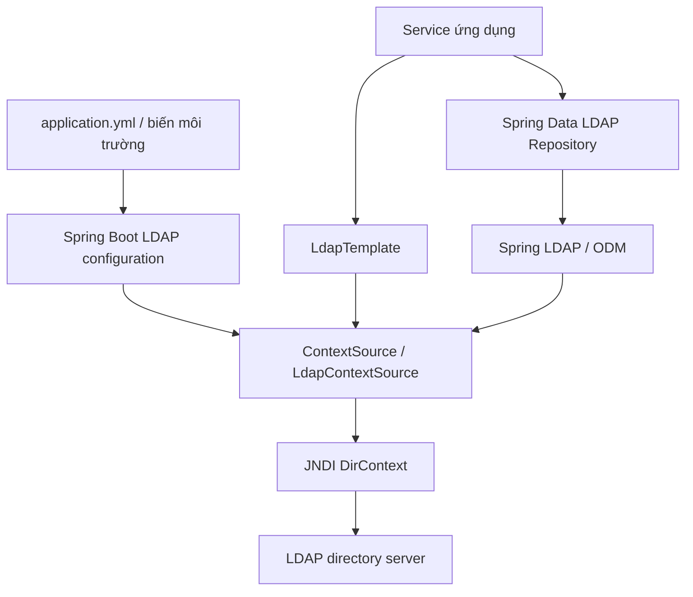

# Cấu hình spring.ldap trong application.yml

## Mục tiêu học tập

Sau bài này, bạn có thể:

1. Giải thích vai trò của nhóm thuộc tính `spring.ldap` trong ứng dụng **Spring Boot** sử dụng Spring LDAP và Spring Data LDAP.
2. Cấu hình **server URL**, **base DN**, **bind DN**, mật khẩu và các tùy chọn JNDI cơ bản bằng `application.yml`.
3. Hiểu cách Spring Boot tạo hoặc cấu hình `ContextSource` / `LdapTemplate`, phân biệt cấu hình kết nối với cấu hình repository và Object-Directory Mapping (ODM).
4. Dùng **biến môi trường**, profile và secret manager để tách thông tin môi trường khỏi mã nguồn, đồng thời dùng LDAPS/StartTLS theo chính sách bảo mật.
5. Nhận diện các lỗi thường gặp về DN tương đối, attribute, quyền tìm kiếm, TLS, timeout và nhiều bean LDAP.
6. Kiểm tra một cấu hình LDAP thông qua test kết nối và truy vấn vào directory được kiểm soát.

Bài thuộc chương **Khởi tạo** của module `SPRING_DATA_LDAP`: truy cập directory qua repository và ánh xạ LDAP entry phân cấp sang đối tượng Java. Bên cạnh cấu hình, module còn yêu cầu hiểu **DN, objectClass, schema, repository/LdapTemplate, CRUD, LDAP filter an toàn, bảo mật và kiểm thử với directory**.

## 1. `spring.ldap` giải quyết vấn đề nào?

Spring Data LDAP cho phép ứng dụng Java truy cập entry LDAP thông qua repository và ODM. Tuy nhiên, trước khi thực hiện `findBy...` hoặc `LdapTemplate.search(...)`, ứng dụng cần có một **nguồn kết nối** biết:

- Máy chủ LDAP ở đâu và hỗ trợ LDAP/LDAPS trên cổng nào?
- Gốc cây thư mục (base DN) mà ứng dụng thao tác là gì?
- Ứng dụng dùng danh tính (bind DN) và mật khẩu nào để tìm/đọc entry?
- Java LDAP provider có timeout hoặc thuộc tính môi trường đặc biệt nào?
- Kết nối có được mã hóa và **xác minh chứng chỉ** đúng không?

Spring Boot hỗ trợ khai báo phần lớn thông số kết nối bằng cấu hình ngoài mã nguồn trong `application.yml`. Những property này được bind vào lớp cấu hình của Boot, sau đó được dùng để thiết lập thành phần Spring LDAP khi các dependency và điều kiện auto-configuration phù hợp.



**Phân biệt hai vai trò:**

- **`spring.ldap.*`** cấu hình **cách kết nối và xác thực mặc định với directory**.
- **Entity/repository/`LdapTemplate`** quyết định **tìm kiếm entry nào, ánh xạ attribute ra sao và xử lý dữ liệu thế nào**.

Một file `application.yml` đúng cú pháp **không tự tạo** LDAP schema, OU, user hoặc group; những đối tượng đó phải tồn tại (hoặc được seed) trong directory.

## 2. Cấu hình tối thiểu trong application.yml

Ví dụ ứng dụng muốn đọc người dùng tại `ou=people,dc=example,dc=org` qua LDAPS:

```yaml
spring:
  ldap:
    urls:
      - "ldaps://ldap.example.org:636"
    base: "dc=example,dc=org"
    username: "uid=ldap-reader,ou=service,dc=example,dc=org"
    password: "${LDAP_BIND_PASSWORD}"
```

Với cấu hình này:

| Thuộc tính | Ví dụ | Ý nghĩa |
| --- | --- | --- |
| `spring.ldap.urls` | `ldaps://ldap.example.org:636` | Một hoặc nhiều URL của directory server |
| `spring.ldap.base` | `dc=example,dc=org` | Base DN ứng dụng sử dụng làm gốc thao tác |
| `spring.ldap.username` | `uid=ldap-reader,ou=service,dc=example,dc=org` | **Bind principal** của tài khoản dịch vụ |
| `spring.ldap.password` | `${LDAP_BIND_PASSWORD}` | Mật khẩu bind lấy từ cấu hình bên ngoài |

**Lưu ý quan trọng:**

1. `spring.ldap.urls` là danh sách; YAML list phù hợp khi có nhiều endpoint. Một URL duy nhất cũng có thể được biểu diễn bằng giá trị scalar. Nhiều URL **không có nghĩa** Spring tự triển khai cân bằng tải hoặc high availability theo cách bạn mong muốn; cơ chế failover thực tế còn phụ thuộc LDAP provider và thiết kế triển khai.
2. `spring.ldap.base` là DN dạng cây thư mục, **không phải LDAP filter** và không phải đường dẫn tệp.
3. `spring.ldap.username` ở đây là **tài khoản kỹ thuật dùng để bind**, thường là full DN; **không phải** tên field `username` trong entity và cũng không phải user hiện đang đăng nhập ứng dụng.
4. `spring.ldap.password` phải đến từ nơi quản lý secret. Ví dụ không chứa mật khẩu thật và cố ý **không có giá trị mặc định** để tránh ứng dụng khởi động với credential không đúng.
5. `ldaps://` mã hóa từ khi thiết lập kết nối, nhưng vẫn cần cấu hình truststore và xác minh hostname/chứng chỉ.

### 2.1. Base DN và đường dẫn tìm kiếm

Giả sử cây dữ liệu:

```text
dc=example,dc=org                  <- spring.ldap.base
├── ou=people
│   ├── uid=an.nguyen
│   └── uid=lan.tran
├── ou=groups
│   └── cn=engineering
└── ou=service
    └── uid=ldap-reader
```

DN đầy đủ của một user:

```text
uid=an.nguyen,ou=people,dc=example,dc=org
```

Khi `ContextSource` đã có base `dc=example,dc=org`, nhiều API Spring LDAP sẽ dùng DN hoặc search base **tương đối với base**:

```text
ou=people
uid=an.nguyen,ou=people
```

**Lỗi thường gặp:** Đưa nguyên full DN vào API đang ghép thêm base, khiến đường dẫn có thể bị lặp `dc=example,dc=org`. Khi làm việc với `@Entry(base=...)`, `LdapTemplate.lookup(...)` hoặc `LdapQueryBuilder.base(...)`, cần đọc hợp đồng về **relative DN** của API cụ thể.

Nếu directory có nhiều naming context như `dc=example,dc=org` và `dc=partners,dc=org`, đừng kỳ vọng một base DN cố định có thể bao phủ toàn bộ cả hai. Cần thiết kế nguồn/cấu hình và phạm vi tìm kiếm phù hợp.

## 3. Những property cơ bản và những thứ không nằm trong spring.ldap

```yaml
spring:
  ldap:
    urls: "ldaps://ldap.example.org:636"
    base: "dc=example,dc=org"
    username: "uid=ldap-reader,ou=service,dc=example,dc=org"
    password: "${LDAP_BIND_PASSWORD}"
```

Đây là các **property kết nối LDAP thông dụng** trong Spring Boot. Đặt chúng vào `application.yml` không bắt buộc phải tự viết một class `@Configuration` cho từng giá trị.

Tuy nhiên, một số yêu cầu thuộc **tầng khác**:

| Yêu cầu | Nơi cấu hình/chịu trách nhiệm |
| --- | --- |
| URL, base DN, bind principal và password | `spring.ldap.*` |
| JNDI connect/read timeout | `spring.ldap.base-environment` hoặc cấu hình provider tương đương |
| Tập repository nào được quét và tạo bean | Spring Data LDAP repository configuration, tùy cách tích hợp |
| Chuyển `uid`/`cn`/`sn` sang field Java | ODM `@Entry`, `@Attribute`, `@Id` |
| Điều kiện truy vấn theo `uid` | Derived query, `@Query` hoặc `LdapQueryBuilder` |
| Bảo đảm password bind được mã hóa | LDAPS hoặc StartTLS được cấu hình đúng + truststore |
| Người dùng có quyền đọc/sửa/xóa entry | LDAP server ACL và bind identity |
| LDAP schema và `objectClass` | Directory server/schema |
| Giới hạn search và paging control | `LdapTemplate`, SearchControls, khả năng LDAP server |
| Đăng nhập người dùng vào ứng dụng | Spring Security LDAP, không phải riêng `spring.ldap.username` |

Không nhầm property kết nối với một giải pháp bảo mật trọn vẹn. **Đăng nhập bằng Spring Security LDAP** có thể dùng tài khoản dịch vụ để tìm DN, sau đó bind bằng DN/mật khẩu người dùng; bước đó không tự xảy ra chỉ vì bạn đặt `spring.ldap.username`.

## 4. Khai báo connect timeout và read timeout qua base-environment

Trong nhiều ứng dụng chạy trên JDK LDAP provider, có thể đưa các JNDI environment properties vào nguồn kết nối. Hai khóa thường gặp là:

- `com.sun.jndi.ldap.connect.timeout`: giới hạn thời gian chờ kết nối.
- `com.sun.jndi.ldap.read.timeout`: giới hạn thời gian chờ phản hồi LDAP ở tầng client.

Ví dụ:

```yaml
spring:
  ldap:
    urls:
      - "ldaps://ldap.example.org:636"
    base: "dc=example,dc=org"
    username: "uid=ldap-reader,ou=service,dc=example,dc=org"
    password: "${LDAP_BIND_PASSWORD}"

    base-environment:
      "com.sun.jndi.ldap.connect.timeout": "3000"
      "com.sun.jndi.ldap.read.timeout": "5000"
```

Hai giá trị trên biểu diễn **millisecond** trong JNDI LDAP provider tương ứng: 3.000 ms và 5.000 ms. Cú pháp `base-environment` được Spring Boot dùng để cung cấp các khóa môi trường JNDI; kiểm tra cấu trúc binding thực tế theo phiên bản Boot và provider đang dùng.

### 4.1. Đừng nhầm các loại timeout

| Loại | Bắt đầu/kết thúc điển hình | Không bao gồm |
| --- | --- | --- |
| Connect timeout | Chờ thiết lập kết nối LDAP | Không thay thế read timeout |
| Read timeout | Chờ dữ liệu phản hồi từ server | Không nhất thiết giới hạn toàn bộ nghiệp vụ |
| LDAP search time limit | Giới hạn search qua request/server policy | Không phải cùng khái niệm với socket timeout |
| HTTP request timeout | Giới hạn toàn bộ API | Có thể gồm nhiều lần truy vấn LDAP và logic khác |
| Connection pool wait timeout | Chờ mượn connection/context từ pool | Khác với thời gian mở socket mới |

Nếu search tốn 20 giây, có thể do kết nối/TLS/bind, filter kém chọn lọc, thiếu index, nhiều entry trả về hoặc mapper chậm. Chỉ tăng read timeout không giải quyết bản chất tất cả các trường hợp đó.

**Kiểm tra giá trị bằng thử nghiệm có kiểm soát:** thuộc tính môi trường của JNDI được provider diễn giải. Các implementation không dùng JDK LDAP provider có thể có thuộc tính hoặc hành vi khác.

## 5. Cấu hình LDAPS và StartTLS cho đúng

### 5.1. LDAP thường và LDAPS

```yaml
# Ví dụ LDAPS: dùng TLS ngay từ lúc mở kết nối.
spring:
  ldap:
    urls: "ldaps://ldap.example.org:636"
```

So sánh:

| Hình thức | URL thường thấy | Mức bảo vệ |
| --- | --- | --- |
| LDAP không nâng cấp TLS | `ldap://ldap.example.org:389` | Không có mã hóa truyền tải mặc định |
| LDAPS | `ldaps://ldap.example.org:636` | Kênh TLS từ đầu; cần xác minh chứng chỉ |
| StartTLS | Bắt đầu bằng `ldap://...` rồi thương lượng StartTLS | Phải thực hiện luồng StartTLS riêng; không tự bật nhờ URL |

**Không nên gửi bind credentials qua LDAP không mã hóa** trên đường mạng không được bảo vệ. Với LDAPS, tin cậy chứng chỉ server và kiểm tra hostname là yêu cầu bắt buộc của cấu hình bảo mật đúng.

### 5.2. Truststore thuộc JVM, không phải chỉ riêng spring.ldap

Trong nhiều triển khai Java, chứng chỉ CA của LDAP server được cấu hình qua **JVM truststore**. Ví dụ tùy chọn JVM ở mức khái niệm:

```text
-Djavax.net.ssl.trustStore=/etc/security/ldap-truststore.p12
-Djavax.net.ssl.trustStoreType=PKCS12
```

Nếu truststore được bảo vệ bằng mật khẩu, mật khẩu đó cũng phải đến từ secret management. Không ghi password vào source, command history, log hoặc hướng dẫn triển khai được chia sẻ công khai.

Đừng dùng custom trust manager chấp nhận mọi chứng chỉ hoặc tắt hostname verification để chữa lỗi kết nối trong production. Cần kiểm tra đúng CA, chuỗi chứng chỉ, SAN/hostname, thời hạn và các phiên bản TLS được hai phía hỗ trợ.

### 5.3. StartTLS không tự bật bằng ldap://

`spring.ldap.urls: ldap://...` **không có nghĩa** client đang sử dụng StartTLS. StartTLS yêu cầu gửi LDAP extended operation để thương lượng kênh TLS theo luồng và thư viện hỗ trợ; việc triển khai có thể cần cấu hình `ContextSource`/provider chuyên biệt.

Nếu tổ chức bắt buộc StartTLS, hãy xác minh bằng integration test và log/telemetry của server. Không suy rằng chỉ một property URL có thể đáp ứng toàn bộ yêu cầu.

## 6. Dùng biến môi trường, profile và secret an toàn

### 6.1. Không để password thật trong repository

Không nên viết:

```yaml
# KHÔNG NÊN: chỉ là ví dụ phản diện.
spring:
  ldap:
    username: "uid=ldap-reader,ou=service,dc=example,dc=org"
    password: "my-real-password"
```

Nên viết:

```yaml
spring:
  ldap:
    urls: "${LDAP_URL:ldaps://ldap.example.org:636}"
    base: "${LDAP_BASE_DN:dc=example,dc=org}"
    username: "${LDAP_BIND_DN}"
    password: "${LDAP_BIND_PASSWORD}"
```

Khi triển khai, cung cấp `LDAP_BIND_DN` và `LDAP_BIND_PASSWORD` qua hệ thống quản lý cấu hình/secret đã được phân quyền. Các giá trị mặc định ở ví dụ chỉ dành cho **endpoint và base DN giả định**, không tạo default password. Với production, nhiều đội nên yêu cầu URL/base DN được cung cấp rõ ràng để tránh kết nối nhầm môi trường.

Spring Boot còn hỗ trợ **externalized configuration**; ví dụ biến môi trường `SPRING_LDAP_URLS`, `SPRING_LDAP_BASE`, `SPRING_LDAP_USERNAME` và `SPRING_LDAP_PASSWORD` có thể override các property tương ứng theo quy tắc binding/ưu tiên nguồn của Boot. Đừng dựa vào cấu hình fallback mà không kiểm tra giá trị cuối cùng được áp dụng.

### 6.2. Phân biệt môi trường phát triển và production

Giả sử `application.yml` chứa các thuộc tính chung, còn môi trường local sử dụng directory thử nghiệm:

```yaml
# application-dev.yml
spring:
  ldap:
    urls: "ldap://127.0.0.1:1389"
    base: "dc=example,dc=test"
    username: "cn=admin,dc=example,dc=test"
    password: "${DEV_LDAP_BIND_PASSWORD}"
```

**Đây chỉ là ví dụ môi trường local được cách ly**, không phải khuyến nghị dùng kết nối LDAP không mã hóa ở môi trường thật. Nếu local directory có TLS, ưu tiên dùng LDAPS hoặc StartTLS với chứng chỉ kiểm thử hợp lệ.

Kích hoạt profile ở môi trường chạy, chẳng hạn `SPRING_PROFILES_ACTIVE=dev`, sẽ khiến Spring Boot áp dụng cấu hình profile theo cơ chế externalized configuration. Không bật profile `dev` cho production, không để ứng dụng trỏ tới directory thật bằng credentials của test.

### 6.3. Không lộ bí mật khi kiểm tra cấu hình

Khi cần xem cấu hình thực tế:

- Chỉ ghi **host, scheme, base DN ở mức cho phép** và trạng thái kết nối; không log bind password.
- Kiểm tra nguồn cấu hình đang được dùng: file, profile, environment variables hoặc secret store.
- Nếu bật Actuator `env`/`configprops`, phải hạn chế truy cập và giữ chính sách che dữ liệu nhạy cảm. Không công khai endpoint cấu hình chỉ để debug.
- Không đặt full DN cá nhân, email hay mật khẩu vào metric tags vì có thể gây lộ dữ liệu và tăng cardinality.

## 7. Phần nào được Spring Boot auto-configure?

Khi ứng dụng có các dependency phù hợp, **Spring Boot LDAP auto-configuration** có thể tạo/cấu hình `LdapContextSource` (hoặc `ContextSource`) và `LdapTemplate` dựa trên `spring.ldap.*`.

Ví dụ một service sử dụng `LdapTemplate` được inject:

```java
import java.util.List;
import org.springframework.ldap.core.AttributesMapper;
import org.springframework.ldap.core.LdapTemplate;
import org.springframework.stereotype.Service;

import static org.springframework.ldap.query.LdapQueryBuilder.query;

@Service
public class PersonSearchService {

    private final LdapTemplate ldapTemplate;

    public PersonSearchService(LdapTemplate ldapTemplate) {
        this.ldapTemplate = ldapTemplate;
    }

    public List<String> findCommonNames(String loginId) {
        return ldapTemplate.search(
            query()
                .base("ou=people")
                .attributes("cn")
                .where("uid").is(loginId),
            (AttributesMapper<String>) attributes ->
                (String) attributes.get("cn").get()
        );
    }
}
```

Trong ví dụ này:

- `query().base("ou=people")` xác định nhánh tìm kiếm tương đối với `spring.ldap.base`.
- `where("uid").is(loginId)` xây filter theo **attribute LDAP** và có cơ chế escaping giá trị; không nối raw input vào `"(uid=" + loginId + ")"`.
- `AttributesMapper` đọc attribute `cn`. Ví dụ giả định entry có `cn` và bind account được phép đọc nó.
- `LdapTemplate` quản lý vòng đời context khi thực hiện search; service không cần tự mở/đóng `DirContext`.

**Giới hạn:** Auto-configuration phụ thuộc phiên bản và những bean đã có trong Spring context. Nếu bạn tự định nghĩa `ContextSource` hoặc `LdapTemplate` khác, Boot có thể không tạo bean mặc định hoặc điều kiện wiring thay đổi. Khi debug, cần kiểm tra bean thực sự được inject thay vì mặc định cho rằng mọi lời gọi đều dùng `spring.ldap.urls` đã đọc.

### 7.1. Spring Data LDAP repository cần thêm thiết lập về entity

Khi dùng Spring Data LDAP, entity có thể được ánh xạ như sau:

```java
import javax.naming.Name;

import org.springframework.ldap.odm.annotations.Attribute;
import org.springframework.ldap.odm.annotations.Entry;
import org.springframework.ldap.odm.annotations.Id;

@Entry(
    base = "ou=people",
    objectClasses = {
        "top", "person", "organizationalPerson", "inetOrgPerson"
    }
)
public class PersonEntry {

    @Id
    private Name dn;

    @Attribute(name = "uid")
    private String loginId;

    @Attribute(name = "cn")
    private String commonName;

    @Attribute(name = "sn")
    private String surname;

    public PersonEntry() {}

    public Name getDn() { return dn; }
    public String getLoginId() { return loginId; }
    public String getCommonName() { return commonName; }
}
```

Một repository tối giản:

```java
import java.util.List;
import org.springframework.data.ldap.repository.LdapRepository;

public interface PersonRepository
        extends LdapRepository<PersonEntry> {

    List<PersonEntry> findByLoginId(String loginId);
}
```

Vì `@Attribute(name = "uid")` ánh xạ `loginId` sang `uid`, derived query mang tên **`findByLoginId`**, không phải `findByUid` (trừ khi entity có property Java tên `uid`).

Để Spring Data tạo repository bean, cần có dependency Spring Data LDAP và cấu hình **repository scanning** phù hợp. Tùy Spring Boot/phiên bản và vị trí package, auto-configuration có thể xử lý quét repository; nếu phải bật rõ ràng, có thể sử dụng:

```java
import org.springframework.context.annotation.Configuration;
import org.springframework.data.ldap.repository.config.EnableLdapRepositories;

@Configuration
@EnableLdapRepositories(basePackageClasses = PersonRepository.class)
public class LdapRepositoryConfig {
}
```

Chỉ thêm `@EnableLdapRepositories` **khi cần** và xác minh không tạo trùng repository bean do một cơ chế auto-configuration khác đã chạy. Bài này không tự giả định mọi phiên bản Boot đều bật Spring Data LDAP repositories chỉ bởi bốn property kết nối.

### 7.2. Không nhầm @Id Name với spring.ldap.base

- `spring.ldap.base`: gốc chung của client.
- `@Entry(base = "ou=people")`: vùng entry cho mô hình `PersonEntry`.
- `@Id Name dn`: tên DN của **một entry cụ thể**.
- `@Attribute(name = "uid")`: tên attribute dữ liệu dùng cho tìm kiếm hoặc ánh xạ.

Các khái niệm liên hệ với nhau nhưng không thay thế nhau. Đổi `spring.ldap.base` có thể khiến đường dẫn tương đối trỏ đến entry khác hoặc không tìm thấy gì, ngay cả khi code repository không thay đổi.

### 7.3. Có nên tự tạo LdapContextSource?

Nếu có nhu cầu riêng không được auto-configuration đáp ứng, có thể tự định nghĩa bean:

```java
import org.springframework.beans.factory.annotation.Value;
import org.springframework.context.annotation.Bean;
import org.springframework.context.annotation.Configuration;
import org.springframework.ldap.core.LdapTemplate;
import org.springframework.ldap.core.support.LdapContextSource;

@Configuration
public class CustomLdapConfig {

    @Bean
    public LdapContextSource ldapContextSource(
            @Value("${spring.ldap.urls}") String url,
            @Value("${spring.ldap.base}") String base,
            @Value("${spring.ldap.username}") String userDn,
            @Value("${spring.ldap.password}") String password) {

        LdapContextSource source = new LdapContextSource();
        source.setUrl(url);
        source.setBase(base);
        source.setUserDn(userDn);
        source.setPassword(password);
        return source;
    }

    @Bean
    public LdapTemplate ldapTemplate(LdapContextSource source) {
        return new LdapTemplate(source);
    }
}
```

**Đây là lựa chọn thay thế cấu hình tự động**, không phải phần phải copy vào mọi dự án. Ví dụ `@Value("${spring.ldap.urls}")` ở trên giả định **một URL dạng scalar**; nếu `urls` là danh sách, hãy bind `LdapProperties` hoặc dùng API phù hợp thay vì cưỡng ép list thành một chuỗi. Đồng thời, khi tự tạo context source, bạn chịu trách nhiệm bảo đảm toàn bộ thiết lập bổ sung (timeout, TLS tùy chọn, pooling, credentials) được áp dụng nhất quán.

Nếu chỉ cần URL/base/credentials thông thường, hãy bắt đầu với `spring.ldap.*` và tránh thêm bean thủ công không cần thiết.

## 8. Cấu hình nhiều URL và các rủi ro khi failover

Một ví dụ gồm hai endpoint:

```yaml
spring:
  ldap:
    urls:
      - "ldaps://ldap-primary.example.org:636"
      - "ldaps://ldap-secondary.example.org:636"
    base: "dc=example,dc=org"
    username: "uid=ldap-reader,ou=service,dc=example,dc=org"
    password: "${LDAP_BIND_PASSWORD}"
```

Trong thực tế, cần kiểm tra:

1. Hai server có cùng schema, naming context và tập dữ liệu người dùng cần thiết không?
2. Bind account/password có sử dụng được ở cả hai endpoint không?
3. TLS certificate của cả hai endpoint có được client xác minh đúng không?
4. Replication có độ trễ hoặc khả năng đọc dữ liệu khác nhau không?
5. Provider chọn server ra sao khi mất kết nối, timeout, hoặc đã có pool context cũ?

Chỉ đưa hai URL vào danh sách không tự bảo đảm failover tức thời hoặc strong consistency. Những điều đó phụ thuộc JNDI LDAP provider, directory topology, DNS/load balancer và cách quản lý connection.

## 9. Hướng dẫn xác minh cấu hình với directory kiểm thử

Một cấu hình được Boot parse thành công chưa chứng minh được rằng kết nối, bind, filter và mapping thực sự hoạt động. Cần kiểm thử với LDAP server riêng (container/embedded/test instance) có dữ liệu giả, quyền rõ ràng và, nếu sử dụng LDAPS, chứng chỉ được xác minh.

### 9.1. Fixture LDIF minh họa

```ldif
dn: dc=example,dc=org
objectClass: top
objectClass: domain
dc: example

dn: ou=people,dc=example,dc=org
objectClass: top
objectClass: organizationalUnit
ou: people

dn: uid=an.nguyen,ou=people,dc=example,dc=org
objectClass: top
objectClass: person
objectClass: organizationalPerson
objectClass: inetOrgPerson
uid: an.nguyen
cn: An Nguyen
sn: Nguyen
mail: an.nguyen@example.org
```

Fixture chỉ mô tả cấu trúc entry; test server phải được seed thêm tài khoản bind, mật khẩu giả và ACL thích hợp. Không dùng directory production hoặc thông tin người dùng thật trong bộ test.

### 9.2. Kiểm tra bind và search bằng công cụ độc lập

Ví dụ `ldapsearch` với LDAPS và mật khẩu được yêu cầu tương tác:

```bash
ldapsearch -LLL -x \
  -H "ldaps://ldap.example.org:636" \
  -D "uid=ldap-reader,ou=service,dc=example,dc=org" -W \
  -b "ou=people,dc=example,dc=org" \
  "(uid=an.nguyen)" dn uid cn sn objectClass
```

Nếu công cụ độc lập không kết nối được, ưu tiên kiểm tra endpoint, CA/hostname, firewall, bind account và LDAP server. Nếu `ldapsearch` trả đúng entry nhưng Spring không thấy, cần đối chiếu `spring.ldap.base`, bean `ContextSource` thực tế, `@Entry(base=...)`, search scope, filter và credentials.

**Không log mật khẩu** và không đưa mật khẩu vào tham số lệnh hoặc history. `-W` giúp nhập password tương tác.

### 9.3. Kiểm thử tích hợp trong Spring Boot

Một integration test có thể xác minh service tìm được entry đã seed:

```java
import static org.junit.jupiter.api.Assertions.assertEquals;

import java.util.List;

import org.junit.jupiter.api.Test;
import org.springframework.beans.factory.annotation.Autowired;
import org.springframework.boot.test.context.SpringBootTest;

@SpringBootTest
class PersonSearchIntegrationTest {

    @Autowired
    PersonSearchService service;

    @Test
    void findsSeededPersonInTestDirectory() {
        List<String> names = service.findCommonNames("an.nguyen");
        assertEquals(List.of("An Nguyen"), names);
    }
}
```

Test này chỉ ổn định khi application context chạy với **cấu hình riêng của test directory** và entry mẫu tồn tại. Không dùng `@SpringBootTest` trỏ vào production LDAP chỉ để kiểm tra kết nối. Có thể dùng profile `test`, server LDAP test được khởi động trong quy trình CI và dữ liệu LDIF được nạp có kiểm soát.

Kiểm tra thêm các tình huống:

- Mật khẩu bind sai → kết nối/xác thực thất bại được phân loại.
- Base DN sai hoặc thiếu `ou=people` → kết quả hoặc lỗi đúng ngữ nghĩa, không đánh đồng lỗi với “không có user”.
- Input filter có `*`, `(`, `)` và `\` → query builder escape đúng.
- Server không cho đọc `cn` → mapping được xử lý theo chính sách ứng dụng.
- Chứng chỉ LDAPS không được tin cậy → kết nối từ chối an toàn, không bypass TLS.
- Tài khoản chỉ đọc → tìm được entry nhưng thao tác ghi bị LDAP server từ chối.
- Timeout đã cấu hình → ứng dụng không chờ vô hạn khi server/network không phản hồi.

### 9.4. Đo và giám sát đúng ranh giới

Khi ứng dụng chậm, đo riêng hoặc đối chiếu:

| Metric | Gợi ý giải thích |
| --- | --- |
| `context_acquire` | Lấy context; có thể gồm chờ pool, connect/TLS và bind |
| `ldap_search_e2e` | Toàn bộ thao tác `LdapTemplate.search` từ phía client |
| `ldap_authentication_e2e` | Luồng xác thực user, có thể gồm tìm DN rồi bind |
| `ldap_errors` theo loại | Network, TLS, credentials, ACL, timeout hoặc mapping |
| `request_count` và p95/p99 | Độ trễ ở phần đuôi phân phối khi tải thay đổi |

Không suy từ timer `getReadOnlyContext()` rằng nó luôn đo riêng TCP handshake, và không suy từ `LdapTemplate.search(...)` rằng toàn bộ thời gian nằm ở server. Pooling hoặc JNDI provider có thể khiến điểm thực hiện network I/O khác nhau.

## 10. Bảng chẩn đoán lỗi cấu hình phổ biến

| Triệu chứng | Nguyên nhân có thể | Cách xử lý |
| --- | --- | --- |
| Kết nối đến server không thành công | Sai `urls`, cổng, DNS, firewall hoặc endpoint | Kiểm tra địa chỉ, port, network, log server |
| LDAPS handshake lỗi | Truststore, CA, chứng chỉ hết hạn, hostname/SAN không khớp | Kiểm tra chứng chỉ đúng, không tắt verification |
| `AuthenticationException` khi bind | Sai DN/password, tài khoản bị hạn chế | Kiểm tra bind account, chính sách directory |
| Search rỗng dù bind được | Sai `base`/`@Entry(base)`, filter, ACL hoặc dữ liệu | Đối chiếu DIT, search base, attribute, quyền |
| `NameNotFoundException` | OU/base DN không tồn tại hoặc sai DN tương đối | Kiểm tra DN đầy đủ và cách ghép base |
| Repository `findByUid` lỗi tạo bean | Entity chỉ có property Java `loginId` | Dùng `findByLoginId`, ánh xạ `@Attribute(name = "uid")` |
| Bean `LdapTemplate` không được tạo | Thiếu dependency/auto-config không áp dụng, bean wiring khác | Kiểm tra classpath, điều kiện auto-config và `@Bean` |
| Kết nối được nhưng ghi thất bại | Bind account không có ACL ghi hoặc vi phạm schema | Kiểm tra quyền và `objectClass` |
| Request bị treo lâu | Chưa cấu hình timeout, server chậm hoặc pool quá tải | Thiết lập timeout, đo theo phase, xem chỉ mục và pool |
| Cấu hình đúng file nhưng app dùng endpoint khác | Profile, environment override hoặc nhiều `ContextSource` | Xem effective configuration và bean thực tế |
| Biến môi trường password trống | Secret chưa được mount/propagate đúng | Fail startup an toàn, kiểm tra secret deployment |
| Hai server cho kết quả khác nhau | Replication lag, schema/ACL hoặc base DN khác | Kiểm tra dữ liệu và topology, không giả định consistency |

### 10.1. Checklist trước khi đưa vào production

- [ ] URL, cổng và base DN đúng với môi trường, được kiểm soát qua config.
- [ ] Bind account có quyền tối thiểu, password do secret manager cung cấp.
- [ ] Kênh LDAP dùng LDAPS hoặc StartTLS đúng chính sách; chứng chỉ và hostname được xác minh.
- [ ] Connect/read timeout và hành vi lỗi được kiểm thử với provider thực.
- [ ] Bean `ContextSource`/`LdapTemplate` và repository đang trỏ đúng nguồn kết nối.
- [ ] `@Entry`, `@Id`, `@Attribute` khớp schema/OU và DN tương đối.
- [ ] Filter từ input có escaping an toàn; search base/scope có giới hạn.
- [ ] Test trên directory giả cô lập, không kiểm thử ghi/xóa lên production.
- [ ] Log/metric không làm lộ password, full DN nhạy cảm hoặc dữ liệu cá nhân.

## 11. Bài thực hành

Giả sử application dùng:

```yaml
spring:
  ldap:
    urls: "ldaps://ldap.lab.example.org:636"
    base: "dc=lab,dc=example,dc=org"
    username: "uid=reader,ou=service,dc=lab,dc=example,dc=org"
    password: "${LDAP_BIND_PASSWORD}"
```

Một entry có DN:

```text
uid=lan.tran,ou=people,dc=lab,dc=example,dc=org
```

**Câu A.** Khi dùng `LdapTemplate.search(...)` với base đã cấu hình, giá trị `base("ou=people")` có ý nghĩa gì?

**Câu B.** `spring.ldap.username` là tên người dùng đăng nhập ứng dụng hay tài khoản bind mặc định?

**Câu C.** Chỉ đổi `urls` từ `ldap://...:389` sang `ldaps://...:636` có bảo đảm client tin cậy chứng chỉ không?

**Câu D.** Sau khi thêm `spring.ldap.base-environment` với read timeout, tại sao vẫn cần đánh giá search time limit và timeout nghiệp vụ?

**Câu E.** Entity có `@Attribute(name = "uid") private String loginId;`. Repository nên dùng tên `findByUid` hay `findByLoginId`?

**Câu F.** Khi dùng Boot auto-configuration đã có bean `LdapTemplate`, có nên luôn tạo thêm `LdapContextSource`/`LdapTemplate` thủ công không?

### Đáp án gợi ý

- **A:** `ou=people` là search base **tương đối với `dc=lab,dc=example,dc=org`**, nên tìm dưới `ou=people,dc=lab,dc=example,dc=org`.
- **B:** Đây là **bind principal mặc định** của ứng dụng. Xác thực mật khẩu của user cuối là nghiệp vụ khác, thường do Spring Security LDAP xử lý.
- **C:** Không. Cần truststore/CA phù hợp và xác minh chứng chỉ/hostname, đồng thời server phải hỗ trợ LDAPS.
- **D:** JNDI read timeout chỉ giới hạn một phần thời gian chờ mạng. Giới hạn search tại server và tổng thời gian request thuộc những tầng khác.
- **E:** `findByLoginId`, vì derived query được suy ra từ **tên property Java**; annotation ánh xạ nó sang attribute LDAP `uid`.
- **F:** Không. Chỉ tự khai báo bean khi cần override có chủ đích và phải kiểm tra điều kiện auto-configuration/wiring để tránh dùng nhầm nguồn.

## 12. Ghi nhớ cốt lõi

**`spring.ldap` trong `application.yml`** là nơi khai báo thông số kết nối LDAP của ứng dụng Spring Boot: **URL, base DN, bind DN, password** và các property JNDI tùy chọn. Đây là nền tảng để `LdapContextSource`/`ContextSource` cung cấp context cho `LdapTemplate` và Spring Data LDAP repository.

Cấu hình chỉ được coi là đúng khi cả ba lớp đều khớp: **ứng dụng nhận đúng property**, **client kết nối/bind an toàn**, và **repository truy vấn/ánh xạ đúng entry của directory**. Giữ bí mật trong secret manager, xác minh TLS, phân quyền tối thiểu, tránh lặp base DN và kiểm thử trên directory kiểm soát được trước khi triển khai.

## Tài liệu tham khảo

1. [Spring Boot Reference — LDAP](https://docs.spring.io/spring-boot/reference/data/nosql.html#data.nosql.ldap) — cấu hình LDAP và tích hợp Spring Data LDAP.
2. [Spring Boot — Common Application Properties](https://docs.spring.io/spring-boot/appendix/application-properties/index.html) — `spring.ldap.urls`, `spring.ldap.base`, `spring.ldap.username`, `spring.ldap.password` và các thuộc tính liên quan.
3. [Spring Boot — Externalized Configuration](https://docs.spring.io/spring-boot/reference/features/external-config.html) — `application.yml`, profile, biến môi trường và property precedence.
4. [Spring LDAP Reference](https://docs.spring.io/spring-ldap/reference/) — `ContextSource`, `LdapTemplate`, bảo mật và truy vấn.
5. [Spring Data LDAP Reference](https://docs.spring.io/spring-data/ldap/reference/) — repository và ODM.
6. [Oracle JNDI LDAP Service Provider — Connection and Read Timeouts](https://docs.oracle.com/javase/jndi/tutorial/ldap/connect/config.html) — các thuộc tính JNDI provider.
7. [RFC 4511 — LDAP: The Protocol](https://www.rfc-editor.org/rfc/rfc4511.html) và [RFC 4513 — LDAP Authentication Methods and Security Mechanisms](https://www.rfc-editor.org/rfc/rfc4513.html).
