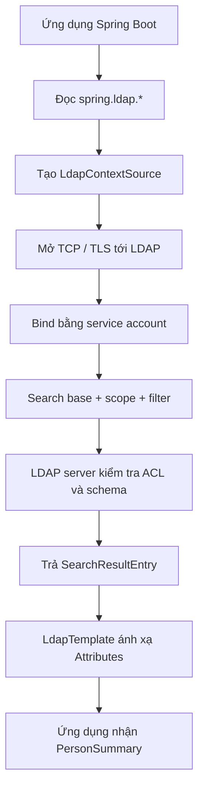

# Kiểm tra kết nối bằng một truy vấn tra cứu đơn giản

Sau khi thêm dependency Spring Data LDAP và cấu hình địa chỉ directory, ứng dụng Spring Boot có thể khởi động thành công nhưng **chưa chắc đã truy cập LDAP được**. Một lần khởi động không chứng minh DNS, TCP/TLS, bind credentials, base DN, quyền tìm kiếm và schema đều đúng. Cách kiểm tra hữu ích là thực hiện một truy vấn đọc nhỏ tới **entry đã biết**, yêu cầu một vài thuộc tính cần thiết và xác nhận kết quả thực tế.

Ví dụ, directory của tổ chức có nhánh `ou=people,dc=example,dc=org` và entry `uid=lan`. Ta sẽ cấu hình `LdapContextSource` qua Spring Boot, inject `LdapTemplate`, thực hiện một search theo `uid`, đọc `uid`/`cn`/`mail` rồi phân tích các lỗi thường gặp. Một truy vấn thành công giúp xác nhận ứng dụng đã đi qua các bước kết nối, xác thực và tìm kiếm cần thiết cho thao tác đó.

Bài thuộc chương **Khởi tạo** của module `SPRING_DATA_LDAP`. Module học cách truy cập dịch vụ thư mục LDAP qua Spring Data LDAP bằng repository và ánh xạ entry phân cấp sang đối tượng Java; người học hiểu DN, `objectClass`, schema, truy vấn repository/`LdapTemplate`, CRUD, filter an toàn, bảo mật kết nối và kiểm thử với directory. Bài này tập trung vào bước smoke test đầu tiên: **kiểm tra kết nối bằng một truy vấn tra cứu đơn giản**.

## 1. Mục tiêu học tập

Sau bài học, bạn có thể:

- Chuẩn bị URL, base DN, bind DN và credential cần thiết để kết nối directory.
- Thêm dependency `spring-boot-starter-data-ldap` và sử dụng các bean auto-configured của Spring Boot.
- Phân biệt DN đầy đủ với DN tương đối theo `spring.ldap.base`.
- Cấu hình kết nối LDAPS, trust material và timeout JNDI cơ bản.
- Inject `LdapTemplate` và thực hiện một search nhỏ bằng `LdapQueryBuilder`.
- Dùng `lookup` khi đã biết chính xác DN của entry.
- Phân biệt search thành công không có kết quả với lỗi kết nối, bind, base DN hoặc ACL.
- Đọc các exception Spring LDAP và mã LDAP thường gặp.
- Dùng `ldapsearch` để kiểm tra độc lập với ứng dụng Java.
- Viết integration test với LDAP server nhúng để xác minh query, mapping và cấu hình.
- Đưa kiểm tra LDAP vào readiness theo cách phù hợp, không biến lỗi dependency thành liveness failure.

## 2. Một truy vấn tra cứu cần xác nhận điều gì?

Một truy vấn đọc đơn giản có thể xác nhận nhiều thành phần trong cùng một luồng:



Nếu truy vấn trả về đúng entry và các thuộc tính dự kiến, ta đã xác minh **đường đi thực tế** từ ứng dụng tới directory cho operation đó.

| Thành phần | Điều cần xác minh |
|---|---|
| DNS/hostname | Tên máy chủ LDAP phân giải được. |
| TCP/port | Có thể mở kết nối tới port LDAP/LDAPS. |
| TLS | Certificate chain và hostname được xác minh nếu dùng LDAPS. |
| Bind identity | Service account được LDAP server chấp nhận. |
| Base DN | Nhánh search tồn tại và đúng hệ quy chiếu. |
| Scope/filter | Truy vấn nhắm đúng entry trong cây. |
| ACL | Bind account được phép search và đọc thuộc tính cần thiết. |
| Mapping | JNDI attributes được chuyển thành Java object đúng. |

**Chỉ mở được TCP socket chưa có nghĩa là LDAP bind thành công.** Ngược lại, chỉ thấy ứng dụng khởi động cũng chưa chứng minh đã thực hiện một LDAP request. Một truy vấn đọc thành công là smoke test có ý nghĩa hơn việc chỉ kiểm tra port.

## 3. Chuẩn bị thông tin kết nối trước khi viết code

Trước khi cấu hình, cần có các thông tin sau từ quản trị directory hoặc môi trường triển khai:

| Thông tin | Ví dụ | Ghi chú |
|---|---|---|
| LDAP URL | `ldaps://ldap.example.org:636` | Chọn đúng hostname, port và giao thức. |
| Base DN | `dc=example,dc=org` | Gốc tương đối mà ứng dụng sẽ thao tác. |
| Bind DN | `uid=svc-reader,ou=service-accounts,dc=example,dc=org` | DN đầy đủ của service account. |
| Password | Lấy từ secret manager | Không ghi vào Git hoặc log. |
| Search base | `ou=people` | Nhánh cần tra cứu, tương đối với base cấu hình. |
| Probe UID | `lan` | Một entry test đã biết chắc tồn tại. |
| Attributes | `uid`, `cn`, `mail` | Chỉ yêu cầu dữ liệu thực sự cần. |
| TLS trust | CA/truststore hoặc SSL bundle | Phải xác minh chứng chỉ server. |

Trong bài, ta dùng cây directory:

```text
dc=example,dc=org
├── ou=people
│   ├── uid=lan
│   └── uid=minh
└── ou=service-accounts
    └── uid=svc-reader
```

Entry người Lan:

```ldif
dn: uid=lan,ou=people,dc=example,dc=org
objectClass: top
objectClass: person
objectClass: organizationalPerson
objectClass: inetOrgPerson
uid: lan
cn: Lan Nguyen
sn: Nguyen
mail: lan@example.org
```

DN service account trong cấu hình là **DN đầy đủ từ gốc directory**. Đây là điểm quan trọng: dù `spring.ldap.base` được cấu hình, username bind dạng DN vẫn cần là DN đầy đủ theo cây LDAP.

### 3.1. Chọn service account có quyền tối thiểu

Để chạy truy vấn kiểm tra, service account chỉ cần quyền phù hợp với operation:

- Bind vào directory.
- Search trong nhánh `ou=people`.
- Đọc `uid` và `cn`.
- Đọc `mail` nếu ứng dụng cần thuộc tính này.

Không dùng tài khoản quản trị directory chỉ để thử kết nối. Nếu tài khoản chỉ có quyền đọc, smoke test vẫn thành công cho search nhưng không chứng minh ứng dụng có quyền ghi. Các quyền CRUD phải được kiểm thử riêng theo yêu cầu nghiệp vụ.

## 4. Thêm Spring Data LDAP dependency

Với Spring Boot, cách đơn giản là thêm starter:

### Maven

```xml
<dependency>
    <groupId>org.springframework.boot</groupId>
    <artifactId>spring-boot-starter-data-ldap</artifactId>
</dependency>
```

### Gradle

```kotlin
dependencies {
    implementation("org.springframework.boot:spring-boot-starter-data-ldap")
}
```

Để Spring Boot dependency management quản lý phiên bản tương thích với Boot BOM. Không tự ghép một phiên bản Spring LDAP hoặc Spring Data LDAP bất kỳ vào một ứng dụng đang dùng Boot mà chưa kiểm tra compatibility.

Starter cung cấp các abstraction Spring Data LDAP và Spring LDAP. Khi cấu hình LDAP phù hợp, Boot có thể auto-configure `LdapContextSource` và `LdapTemplate` để inject như các Spring bean khác.

Nếu chỉ dùng `spring-ldap-core` thay starter, bạn có thể phải tự cấu hình context source, template và repository infrastructure. Với bài khởi tạo này, dùng starter giúp tập trung vào cấu hình và truy vấn.

## 5. Cấu hình LDAP trong application.yml

Ví dụ cấu hình môi trường thật:

```yaml
spring:
  ldap:
    urls: ldaps://ldap.example.org:636
    base: dc=example,dc=org
    username: uid=svc-reader,ou=service-accounts,dc=example,dc=org
    password: ${LDAP_BIND_PASSWORD}
    base-environment:
      "[com.sun.jndi.ldap.connect.timeout]": "2000"
      "[com.sun.jndi.ldap.read.timeout]": "3000"
```

Giải thích:

- `urls`: địa chỉ LDAP server. Ví dụ dùng LDAPS trên port 636.
- `base`: naming context mà các DN tương đối trong thao tác Spring LDAP sẽ dựa vào.
- `username`: bind principal; nếu là DN thì dùng **DN đầy đủ từ gốc**.
- `password`: secret được truyền từ môi trường, không hard-code.
- `connect.timeout`: thời gian tối đa thiết lập kết nối, đơn vị mili giây theo JNDI LDAP provider.
- `read.timeout`: thời gian tối đa chờ phản hồi LDAP, đơn vị mili giây theo JNDI LDAP provider.

Các giá trị timeout là ví dụ khởi đầu. Cần chọn theo network, LDAP server, SLA và thời gian thực tế của truy vấn. Không đặt timeout bằng 0 nếu mục tiêu là tránh chờ vô hạn theo semantics của JNDI provider.

### 5.1. Tại sao dùng DN đầy đủ cho username?

Với `base: dc=example,dc=org`, DN tương đối của Lan có thể viết trong code là:

```text
uid=lan,ou=people
```

Nhưng bind DN service account vẫn là:

```text
uid=svc-reader,ou=service-accounts,dc=example,dc=org
```

`ContextSource.base` giúp đơn giản hóa các DN dùng trong thao tác; nó không biến bind principal thành DN tương đối. Cần giữ hai khái niệm này tách biệt để tránh lỗi xác thực.

### 5.2. Cấu hình LDAPS và trust material

Với Spring Boot có hỗ trợ LDAP SSL bundle, có thể tham chiếu bundle:

```yaml
spring:
  ldap:
    urls: ldaps://ldap.example.org:636
    ssl:
      bundle: ldap-client
```

Tên property dạng dotted tương ứng là `spring.ldap.ssl.bundle`. SSL bundle phải được định nghĩa trong cấu hình SSL của ứng dụng với trust material phù hợp. Một lựa chọn khác là dùng truststore mặc định của JVM nếu CA của LDAP server đã được tin cậy.

Các property `spring.ldap.ssl.*` áp dụng cho `LdapContextSource` do Boot auto-configure. Nếu tự tạo `LdapContextSource` riêng, bạn phải cấu hình SSL cho source đó. LDAPS và StartTLS là hai cách thiết lập TLS khác nhau; SSL bundle dùng cho kết nối `ldaps://` không tự cấu hình StartTLS.

**Không tắt certificate validation để sửa lỗi handshake.** Kiểm tra hostname trong certificate, chain CA, thời hạn certificate và truststore của JVM/bundle.

### 5.3. Đặt secret ở môi trường

Ví dụ PowerShell cho một phiên terminal:

```powershell
$env:LDAP_BIND_PASSWORD = "secret-from-vault"
./mvnw spring-boot:run
```

Đây chỉ là minh họa cách truyền biến môi trường trong phiên hiện tại. Trong triển khai thực tế, lấy secret từ secret manager/Kubernetes Secret hoặc cơ chế quản lý thông tin xác thực của tổ chức. Không commit giá trị thật vào `application.yml`, không đưa password vào command history và không log environment.

## 6. Base DN trong Spring LDAP là hệ quy chiếu

Khi cấu hình:

```yaml
spring:
  ldap:
    base: dc=example,dc=org
```

các DN truyền vào thao tác Spring LDAP thường được hiểu tương đối với base này.

| Giá trị trong code | DN thực được nhắm tới |
|---|---|
| `ou=people` | `ou=people,dc=example,dc=org` |
| `uid=lan,ou=people` | `uid=lan,ou=people,dc=example,dc=org` |
| `ou=service-accounts` | `ou=service-accounts,dc=example,dc=org` |

Nếu bạn vừa cấu hình `base` vừa truyền lặp lại toàn bộ DN đầy đủ, request có thể nhắm tới một tên sai hoặc một naming context khác tùy cách API xử lý DN. Trong code ví dụ, ta dùng `ou=people` làm search base và `uid=lan,ou=people` làm DN tương đối cho lookup.

**Không phải mọi DN trong mọi trường hợp đều được phép rút gọn.** Các giá trị tham chiếu như `member` của `groupOfNames` thường cần DN đầy đủ. Bài này chỉ sử dụng DN tương đối cho các thao tác mà `ContextSource` quản lý base.

## 7. Viết một DTO nhỏ để nhận kết quả

Ta chỉ cần ba thuộc tính cho smoke test:

```java
public record PersonSummary(
    String uid,
    String commonName,
    String email
) {}
```

`PersonSummary` là DTO của ứng dụng, không phải entity LDAP. Nó không cần mang `@Entry` hoặc `@Id` vì ta đang dùng `LdapTemplate` và `AttributesMapper` để ánh xạ kết quả trực tiếp.

Với một project chưa dùng Java record, có thể thay bằng class thông thường có constructor, field và getter. Ví dụ trong bài dùng Java 17+ theo baseline phổ biến của các phiên bản Spring Boot hiện đại.

## 8. Truy vấn smoke test bằng LdapTemplate và LdapQueryBuilder

Tạo service:

```java
import java.util.List;

import javax.naming.NamingException;
import javax.naming.directory.Attribute;
import javax.naming.directory.Attributes;

import org.springframework.ldap.core.AttributesMapper;
import org.springframework.ldap.core.LdapTemplate;
import org.springframework.ldap.query.LdapQuery;
import org.springframework.ldap.query.SearchScope;
import org.springframework.stereotype.Service;

import static org.springframework.ldap.query.LdapQueryBuilder.query;

@Service
public class PersonDirectoryReader {

    private final LdapTemplate ldapTemplate;

    public PersonDirectoryReader(LdapTemplate ldapTemplate) {
        this.ldapTemplate = ldapTemplate;
    }

    public List<PersonSummary> findByUid(String uid) {
        validateUid(uid);

        LdapQuery ldapQuery = query()
            .base("ou=people")
            .searchScope(SearchScope.SUBTREE)
            .attributes("uid", "cn", "mail")
            .where("objectClass").is("inetOrgPerson")
            .and("uid").is(uid);

        return ldapTemplate.search(
            ldapQuery,
            (AttributesMapper<PersonSummary>) attributes ->
                new PersonSummary(
                    required(attributes, "uid"),
                    required(attributes, "cn"),
                    optional(attributes, "mail")
                )
        );
    }

    private static String required(
            Attributes attributes, String name)
            throws NamingException {

        String value = optional(attributes, name);
        if (value == null) {
            throw new NamingException(
                "Required LDAP result attribute is missing: " + name
            );
        }
        return value;
    }

    private static String optional(
            Attributes attributes, String name)
            throws NamingException {

        Attribute attribute = attributes.get(name);

        if (attribute == null || attribute.size() == 0) {
            return null;
        }

        Object value = attribute.get();
        return value == null ? null : value.toString();
    }

    private static void validateUid(String uid) {
        if (uid == null || uid.isBlank() || uid.length() > 64) {
            throw new IllegalArgumentException("Invalid uid");
        }
    }
}
```

Đọc từng phần:

1. `base("ou=people")` giới hạn search vào nhánh nhân viên, tương đối với `spring.ldap.base`.
2. `searchScope(SearchScope.SUBTREE)` cho phép tìm cả entry con trong nhánh.
3. `attributes("uid", "cn", "mail")` chỉ yêu cầu các thuộc tính mà DTO cần.
4. `objectClass=inetOrgPerson` giới hạn loại entry người.
5. `uid` được truyền qua `LdapQueryBuilder` để tạo equality filter; không nối chuỗi filter thủ công.
6. `AttributesMapper` chuyển kết quả JNDI thành `PersonSummary`.
7. `mail` là thuộc tính tùy chọn nên mapper chấp nhận `null`; `uid` và `cn` được coi là bắt buộc trong ví dụ.

Đây là một LDAP search đồng bộ. Nó thực sự thực hiện network operation khi method `findByUid` được gọi.

### 8.1. Vì sao không nối filter bằng chuỗi?

Không viết:

```java
// Không an toàn nếu uid đến từ request.
String filter = "(&(objectClass=inetOrgPerson)(uid=" + uid + "))";
```

Ký tự đặc biệt như `*`, `(`, `)` và backslash có thể thay đổi cấu trúc filter nếu không được encode. `LdapQueryBuilder` xử lý assertion value theo API filter của Spring LDAP, giúp tránh LDAP injection do nối chuỗi thô.

Validation `uid` trong ví dụ là kiểm tra nghiệp vụ cơ bản. Nếu hệ thống cho phép các ký tự đặc biệt hợp lệ trong UID, hãy dùng builder để encode đúng thay vì tự loại bỏ ký tự bằng regex thiếu căn cứ.

### 8.2. Chạy truy vấn và kiểm tra kết quả

Một thành phần gọi thử:

```java
import java.util.List;

import org.springframework.boot.CommandLineRunner;
import org.springframework.stereotype.Component;

@Component
public class LdapSmokeTestRunner implements CommandLineRunner {

    private final PersonDirectoryReader directoryReader;

    public LdapSmokeTestRunner(PersonDirectoryReader directoryReader) {
        this.directoryReader = directoryReader;
    }

    @Override
    public void run(String... args) {
        List<PersonSummary> matches =
            directoryReader.findByUid("lan");

        if (matches.size() != 1) {
            throw new IllegalStateException(
                "LDAP smoke test expected exactly one known entry"
            );
        }

        PersonSummary person = matches.get(0);

        if (!"lan".equals(person.uid())) {
            throw new IllegalStateException(
                "LDAP smoke test returned an unexpected uid"
            );
        }

        System.out.println(
            "LDAP smoke test succeeded for uid=" + person.uid()
        );
    }
}
```

Đây là cách **fail-fast khi ứng dụng khởi động** nếu directory là dependency bắt buộc và probe entry phải tồn tại. Không đưa email hoặc toàn bộ LDAP attributes vào log chỉ để chứng minh kết nối.

Nếu LDAP có thể tạm thời không sẵn sàng khi app khởi động, đừng mặc định dùng runner làm điều kiện startup thành công. Có thể chuyển kiểm tra sang readiness/health policy để orchestrator ngừng gửi traffic khi directory chưa đáp ứng.

## 9. Lookup chính xác một DN khi đã biết tên entry

`search` phù hợp khi bạn muốn tìm theo thuộc tính `uid` trong một nhánh. Nếu đã biết DN chính xác, có thể dùng `LdapTemplate.lookup`.

Ví dụ DN tương đối:

```text
uid=lan,ou=people
```

Code:

```java
import javax.naming.NamingException;
import javax.naming.directory.Attribute;
import javax.naming.directory.Attributes;

import org.springframework.ldap.core.AttributesMapper;
import org.springframework.ldap.core.LdapTemplate;
import org.springframework.stereotype.Service;

@Service
public class PersonLookup {

    private final LdapTemplate ldapTemplate;

    public PersonLookup(LdapTemplate ldapTemplate) {
        this.ldapTemplate = ldapTemplate;
    }

    public PersonSummary findKnownEntry() {
        return ldapTemplate.lookup(
            "uid=lan,ou=people",
            new String[] {"uid", "cn", "mail"},
            (AttributesMapper<PersonSummary>) attributes ->
                new PersonSummary(
                    value(attributes, "uid"),
                    value(attributes, "cn"),
                    value(attributes, "mail")
                )
        );
    }

    private static String value(
            Attributes attributes, String name)
            throws NamingException {

        Attribute attribute = attributes.get(name);
        if (attribute == null || attribute.size() == 0) {
            return null;
        }

        Object value = attribute.get();
        return value == null ? null : value.toString();
    }
}
```

`lookup` đọc **một DN cụ thể**. Nếu entry không tồn tại, Spring LDAP thường ném `NameNotFoundException` thay vì trả một danh sách rỗng.

| API | Khi nào dùng | Kết quả không tìm thấy thường gặp |
|---|---|---|
| `LdapTemplate.search(query, mapper)` | Tìm theo filter trong base/scope | `List` rỗng khi search hoàn tất nhưng không có entry khớp |
| `LdapTemplate.lookup(dn, mapper)` | Đọc đúng một entry theo DN | `NameNotFoundException` khi DN không tìm thấy |
| `LdapRepository.findById(dn)` | Đọc entity ODM theo ID/DN | `Optional.empty()` theo contract repository |

Không dùng `lookup` để tìm người theo một thuộc tính không phải DN. Không dùng `search` rộng trên toàn directory khi đã biết DN chính xác.

## 10. Nếu dùng Spring Data LDAP Repository

Khi ứng dụng đã có entity ODM, có thể kiểm tra bằng repository thay vì viết mapper thủ công.

Entity minh họa:

```java
import javax.naming.Name;

import org.springframework.ldap.odm.annotations.Attribute;
import org.springframework.ldap.odm.annotations.Entry;
import org.springframework.ldap.odm.annotations.Id;

@Entry(
    base = "ou=people",
    objectClasses = {
        "top", "person", "organizationalPerson", "inetOrgPerson"
    }
)
public class PersonEntry {

    @Id
    private Name dn;

    @Attribute(name = "uid")
    private String uid;

    @Attribute(name = "cn")
    private String commonName;

    @Attribute(name = "sn")
    private String surname;

    @Attribute(name = "mail")
    private String email;

    public PersonEntry() {
    }

    public Name getDn() {
        return dn;
    }

    public String getUid() {
        return uid;
    }

    public String getCommonName() {
        return commonName;
    }

    public String getSurname() {
        return surname;
    }

    public String getEmail() {
        return email;
    }
}
```

Repository:

```java
import org.springframework.data.ldap.repository.LdapRepository;

public interface PersonRepository
        extends LdapRepository<PersonEntry> {
}
```

Nếu đã có DN tương đối:

```java
import java.util.Optional;
import javax.naming.ldap.LdapName;
import javax.naming.ldap.Rdn;

import org.springframework.ldap.support.LdapNameBuilder;

LdapName dn = LdapNameBuilder.newInstance("ou=people")
    .add("uid", "lan")
    .build();

Optional<PersonEntry> person = personRepository.findById(dn);
```

Đối chiếu thứ tự RDN trong DN được tạo với cấu trúc directory thực tế và kiểm thử trên server. Trong ứng dụng có nhiều OU hoặc quy tắc DN phức tạp, nên dùng builder và test DN thay vì ghép chuỗi thủ công.

Spring Boot có thể scan repository/document trong các package auto-configuration mặc định. Nếu repository nằm ngoài vùng scan, cấu hình `@EnableLdapRepositories` và entity scanning theo đúng package của ứng dụng.

**Chọn một cách cho smoke test đầu tiên:** `LdapTemplate` giúp nhìn rõ base/filter/attributes; repository phù hợp khi muốn kiểm tra luôn ODM mapping và cấu hình repository. Có thể dùng cả hai trong cùng ứng dụng nhưng không cần tạo thêm nhiều bean source không cần thiết.

## 11. Hiểu đúng kết quả: empty list không phải lỗi kết nối

Giả sử `findByUid("unknown")` trả về danh sách rỗng:

```java
List<PersonSummary> matches =
    directoryReader.findByUid("unknown");

System.out.println(matches.isEmpty()); // true
```

Điều này thường có nghĩa search hoàn tất thành công nhưng không có entry nào khớp filter trong base/scope được chọn. Nó **không đồng nghĩa** server không kết nối được.

| Kết quả | Cách hiểu |
|---|---|
| Có một entry Lan đúng thuộc tính | Kết nối, bind, search và mapping đã hoạt động cho thao tác này. |
| Search thành công nhưng list rỗng | Không có entry khớp; kiểm tra UID, base, scope và filter. |
| `NameNotFoundException` | DN lookup hoặc search base không tìm được theo server/principal. |
| `AuthenticationException` | Bind credentials hoặc cơ chế xác thực bị từ chối. |
| `CommunicationException` | Lỗi liên lạc mạng, socket hoặc transport. |
| `NoPermissionException` | Directory từ chối quyền cho thao tác. |
| `PartialResultException` | Có thể gặp vấn đề referral/kết quả một phần tùy server và cấu hình. |

Một search rỗng chỉ có ý nghĩa “không tìm thấy” khi base, scope, filter và quyền đã được xác định đúng. Nếu account bị ACL che dữ liệu, kết quả có thể không phản ánh toàn bộ trạng thái directory.

## 12. Các lỗi thường gặp khi chạy truy vấn đầu tiên

### 12.1. Connection refused hoặc timeout

Triệu chứng thường gặp:

- `CommunicationException`.
- Root cause là `ConnectException` hoặc `SocketTimeoutException`.
- Log cho thấy không thể mở socket hoặc chờ phản hồi quá lâu.

Kiểm tra:

1. Hostname LDAP đúng chưa?
2. Port 389/636 có đúng với giao thức không?
3. Firewall, routing, VPN và security group có cho phép kết nối?
4. Server LDAP có đang lắng nghe?
5. Connect/read timeout có phù hợp?
6. Ứng dụng đang chạy ở container/network namespace nào?

Không suy ra bind credentials sai chỉ từ lỗi TCP.

### 12.2. TLS handshake hoặc certificate validation lỗi

Triệu chứng có thể gồm `SSLHandshakeException`, `CertificateException` hoặc lỗi xác minh hostname.

Kiểm tra:

- URL `ldaps://` có đúng port?
- Certificate còn hạn và có SAN phù hợp hostname?
- Truststore/SSL bundle có CA chain?
- Ứng dụng có đang kết nối nhầm endpoint qua proxy/load balancer?
- Có dùng StartTLS nhưng lại cấu hình SSL bundle cho LDAPS, hoặc ngược lại?

Không sửa bằng cách bỏ xác minh chứng chỉ. Cấu hình trust material đúng cho môi trường cần truy cập.

### 12.3. AuthenticationException / LDAP result code 49

Đây thường là bind failure. Kiểm tra:

- Bind DN có phải DN đầy đủ?
- Password lấy từ secret có đúng environment?
- Account có bị khóa, hết hạn hoặc yêu cầu cơ chế SASL khác?
- Server có yêu cầu bind qua TLS?
- Có ký tự đặc biệt/whitespace thừa trong secret?

Không log password để debug. Nếu cần xác minh, dùng secret test trong môi trường được phép.

### 12.4. NameNotFoundException / noSuchObject (32)

Có thể do:

- `spring.ldap.base` sai.
- Search base `ou=people` không tồn tại dưới naming context.
- Lookup DN bị thiếu RDN hoặc sai thứ tự.
- Đã nối lặp base DN.
- Ứng dụng kết nối nhầm directory/replica.
- ACL/server che giấu entry.

Phân biệt search base missing với filter không match. Spring LDAP mặc định không nên được cấu hình bỏ qua lỗi base missing nếu ứng dụng cần chẩn đoán chính xác.

### 12.5. Search rỗng dù không có exception

Kiểm tra theo thứ tự:

1. UID trong query có đúng không?
2. Filter có dùng đúng attribute LDAP (ví dụ `uid` thay vì `username`)?
3. `objectClass` có đúng với schema/entry không?
4. Base DN và scope có bao phủ entry?
5. Bind account có quyền search/read?
6. Attributes cần thiết có được yêu cầu trong query?
7. Đang truy vấn đúng server và replica?

Không bắt mọi exception rồi trả danh sách rỗng. Làm vậy sẽ biến sự cố LDAP thành “không tìm thấy người”.

### 12.6. NoPermissionException / insufficientAccessRights (50)

Bind thành công không có nghĩa mọi operation đều được phép. ACL có thể cho phép search nhưng không cho đọc `mail`, hoặc cho đọc entry nhưng không cho đọc một attribute cụ thể. Hãy xác minh quyền của service account ở đúng OU và attribute.

## 13. Kiểm tra độc lập bằng ldapsearch

Nếu môi trường có OpenLDAP client, `ldapsearch` là cách đối chiếu hữu ích ngoài Java.

Ví dụ tìm Lan:

```bash
ldapsearch -x \
  -H ldaps://ldap.example.org:636 \
  -D 'uid=svc-reader,ou=service-accounts,dc=example,dc=org' \
  -W \
  -b 'dc=example,dc=org' \
  -s sub \
  '(&(objectClass=inetOrgPerson)(uid=lan))' \
  uid cn mail
```

Giải thích:

- `-x` dùng simple authentication.
- `-H` chỉ định LDAP URL.
- `-D` là bind DN đầy đủ.
- `-W` yêu cầu nhập password tương tác.
- `-b` là search base đầy đủ.
- `-s sub` tìm trong subtree.
- Filter giới hạn entry theo objectClass và uid.
- Các attribute cuối là dữ liệu cần trả về.

Không đặt password trực tiếp sau `-w` trong shell command, vì có thể lộ qua process list hoặc command history. Dùng `-W` hoặc cơ chế secret an toàn của môi trường.

Nếu CLI và Spring cho kết quả khác, so sánh **cùng endpoint, bind identity, base DN, scope, filter, attribute selection và thời điểm**. Trong Spring, base thường tương đối với `spring.ldap.base`; trong lệnh `ldapsearch` ở trên, base là DN đầy đủ.

## 14. Một startup smoke test có nên làm ứng dụng fail không?

Có hai chiến lược thường gặp:

### 14.1. Fail-fast khi LDAP là dependency bắt buộc

Nếu ứng dụng không thể phục vụ bất kỳ chức năng cốt lõi nào khi LDAP không sẵn sàng, có thể chạy một truy vấn đã biết khi khởi động. Nếu truy vấn thất bại, ứng dụng không báo trạng thái ready.

Ưu điểm:

- Phát hiện sai URL, secret, TLS, base DN ngay khi deploy.
- Không nhận request nghiệp vụ rồi mới phát hiện directory chưa sẵn sàng.
- Dễ đưa lỗi vào deployment pipeline và startup diagnostics.

Rủi ro:

- Một đợt LDAP bảo trì ngắn có thể khiến instance mới không khởi động.
- Nếu probe entry bị xóa/đổi DN, startup thất bại dù LDAP server vẫn hoạt động.
- Probe phải có giới hạn timeout và account phù hợp.

Chỉ chọn fail-fast khi đó là chính sách vận hành rõ ràng.

### 14.2. Readiness check khi LDAP có thể tạm gián đoạn

Nếu ứng dụng có thể khởi động nhưng chưa sẵn sàng phục vụ chức năng cần LDAP, dùng readiness để điều khiển traffic. Khi LDAP phục hồi và probe thành công, instance trở lại ready.

Phân biệt:

| Probe | Mục tiêu | Khi LDAP down |
|---|---|---|
| **Liveness** | Tiến trình JVM/app có còn hoạt động không? | Thường không nên fail chỉ vì LDAP down; tránh restart loop. |
| **Readiness** | Instance có đủ dependency để nhận traffic không? | Có thể báo DOWN/REFUSING_TRAFFIC nếu LDAP là dependency bắt buộc. |
| **Startup** | Ứng dụng đã hoàn tất khởi tạo chưa? | Dùng theo policy startup; không thay thế readiness dài hạn. |

Nếu dùng Spring Boot Actuator, có thể triển khai health contributor riêng để gọi một truy vấn LDAP nhỏ. Vì `LdapTemplate` là blocking, health check phải chạy theo cơ chế phù hợp, không chặn event loop nếu endpoint health được phục vụ trên WebFlux.

**Không cần chạy truy vấn nặng hoặc quét toàn bộ OU ở mỗi lần health check.** Chọn một entry/OU ổn định, ít thuộc tính, timeout ngắn và tần suất hợp lý.

## 15. Kiểm thử với embedded LDAP của Spring Boot

Spring Boot hỗ trợ LDAP server nhúng trong bộ nhớ dựa trên UnboundID để kiểm thử. Đây là cách kiểm tra query và mapping mà không phụ thuộc directory thật.

Thêm dependency test:

```xml
<dependency>
    <groupId>com.unboundid</groupId>
    <artifactId>unboundid-ldapsdk</artifactId>
    <scope>test</scope>
</dependency>
```

Dùng phiên bản tương thích với Spring Boot dependency management của dự án. Nếu BOM không quản lý artifact này, khai báo version phù hợp với JDK và Boot đang sử dụng.

### 15.1. Cấu hình application-test.yml

```yaml
spring:
  ldap:
    base: dc=example,dc=org
    embedded:
      base-dn: dc=example,dc=org
      ldif: classpath:test-data.ldif
```

Server embedded mặc định có thể dùng port ngẫu nhiên. Khi embedded LDAP được kích hoạt, URL/credential client được lấy theo cấu hình embedded server; không giả định `spring.ldap.urls` hoặc `spring.ldap.username/password` của môi trường production sẽ quyết định endpoint embedded. Các property còn lại như base và base-environment vẫn có thể áp dụng theo tài liệu Boot.

Ví dụ trên tập trung vào query với fixture. Nếu muốn kiểm thử cả bind bằng service account, cấu hình client bằng `spring.ldap.embedded.credential.username` và `spring.ldap.embedded.credential.password`, đồng thời thêm entry service account tương ứng (có credential test) vào LDIF. Trong chế độ embedded, hai property credential này được dùng thay cho `spring.ldap.username/password`; không đưa credential production vào test.

Tạo file `src/test/resources/test-data.ldif`:

```ldif
dn: ou=people,dc=example,dc=org
objectClass: top
objectClass: organizationalUnit
ou: people

dn: uid=lan,ou=people,dc=example,dc=org
objectClass: top
objectClass: person
objectClass: organizationalPerson
objectClass: inetOrgPerson
uid: lan
cn: Lan Nguyen
sn: Nguyen
mail: lan@example.org

dn: uid=minh,ou=people,dc=example,dc=org
objectClass: top
objectClass: person
objectClass: organizationalPerson
objectClass: inetOrgPerson
uid: minh
cn: Minh Tran
sn: Tran
mail: minh@example.org
```

Đây là fixture test. Nếu server nhúng đã được cấu hình base DN tự động, không tạo trùng base entry. Nếu schema validation từ chối LDIF, kiểm tra objectClass và các thuộc tính bắt buộc thay vì tắt validation một cách tùy tiện.

### 15.2. Integration test bằng JUnit 5

```java
import static org.assertj.core.api.Assertions.assertThat;

import java.util.List;

import org.junit.jupiter.api.Test;
import org.springframework.beans.factory.annotation.Autowired;
import org.springframework.boot.test.context.SpringBootTest;
import org.springframework.ldap.core.AttributesMapper;
import org.springframework.ldap.core.LdapTemplate;
import org.springframework.ldap.query.LdapQuery;
import org.springframework.ldap.query.SearchScope;
import org.springframework.test.context.ActiveProfiles;

import static org.springframework.ldap.query.LdapQueryBuilder.query;

@SpringBootTest
@ActiveProfiles("test")
class PersonDirectoryReaderIT {

    @Autowired
    private LdapTemplate ldapTemplate;

    @Test
    void canSearchKnownPerson() {
        LdapQuery q = query()
            .base("ou=people")
            .searchScope(SearchScope.SUBTREE)
            .attributes("uid", "cn", "mail")
            .where("objectClass").is("inetOrgPerson")
            .and("uid").is("lan");

        List<PersonSummary> results = ldapTemplate.search(
            q,
            (AttributesMapper<PersonSummary>) attrs ->
                new PersonSummary(
                    attrs.get("uid").get().toString(),
                    attrs.get("cn").get().toString(),
                    attrs.get("mail").get().toString()
                )
        );

        assertThat(results).containsExactly(
            new PersonSummary(
                "lan", "Lan Nguyen", "lan@example.org"
            )
        );
    }

    @Test
    void successfulSearchCanReturnNoMatches() {
        LdapQuery q = query()
            .base("ou=people")
            .searchScope(SearchScope.SUBTREE)
            .where("objectClass").is("inetOrgPerson")
            .and("uid").is("unknown");

        List<String> results = ldapTemplate.search(
            q,
            (AttributesMapper<String>) attrs ->
                attrs.get("uid").get().toString()
        );

        assertThat(results).isEmpty();
    }
}
```

Test đầu xác minh một entry biết trước và các attribute cần thiết. Test thứ hai xác minh search hợp lệ có thể trả danh sách rỗng khi không có UID khớp. Hai trạng thái này không nên bị gộp với exception kết nối.

### 15.3. Khi cần kiểm thử bind credentials

Test embedded mặc định có thể không tái hiện chính sách bind/ACL của directory production. Nếu cần xác minh simple bind, hãy cấu hình credential test riêng, tạo entry service account phù hợp trong fixture và kiểm thử với server nhúng hoặc container có cấu hình bảo mật tương ứng.

Để xác minh **quyền thực tế trên production-like LDAP**, cần integration test trong môi trường directory được cấp phép với account test có đúng ACL. Một server embedded không tự chứng minh mọi chính sách ACL, referral, TLS hoặc schema mở rộng giống server tổ chức.

## 16. Phân biệt smoke test với kiểm thử đầy đủ

Một truy vấn tra cứu nhỏ chỉ là bước đầu:

| Loại kiểm tra | Câu hỏi được trả lời |
|---|---|
| TCP connect | Có mở được socket tới host/port không? |
| TLS handshake | Certificate và kênh bảo mật có hợp lệ không? |
| LDAP bind | Principal/credential có được chấp nhận không? |
| Simple search | Có search được base/filter cụ thể không? |
| Attribute read | Có quyền đọc các thuộc tính cần thiết không? |
| Repository test | ODM, @Entry, @Id, @Attribute và repository wiring có đúng không? |
| CRUD integration | Có quyền tạo/sửa/xóa và schema chấp nhận dữ liệu không? |
| Security test | ACL, TLS, referral và identity có đúng policy không? |
| Load test | Pool, timeout và server chịu tải theo mục tiêu không? |

**Smoke test không thay thế integration test CRUD hoặc security test.** Nó chỉ giúp phát hiện sớm lỗi cấu hình và đường đọc cơ bản.

## 17. Một số lưu ý khi đưa truy vấn vào ứng dụng thật

- Chỉ tìm trong base DN cần thiết; tránh search subtree toàn directory nếu không cần.
- Chỉ yêu cầu attributes cần thiết; không tải toàn bộ entry cho một health check.
- Dùng filter builder/parameter encoding, không nối chuỗi filter từ input.
- Không nhận DN tùy ý từ client để làm search base; chọn base từ cấu hình hoặc tenant đã xác thực.
- Không log password, access token hoặc toàn bộ thông tin nhân sự.
- Đặt JNDI connect/read timeout; tránh request giữ thread vô hạn khi LDAP server treo.
- Dùng service account least privilege.
- Dùng LDAPS hoặc StartTLS có xác minh certificate; không bỏ kiểm tra hostname.
- Không dùng probe có side effect; smoke test nên là thao tác read-only.
- Không tạo OU hoặc entry thật chỉ để “thử xem kết nối được không”.
- Không biến mọi exception thành empty list hoặc 404.
- Nếu có nhiều replica, kiểm tra đúng endpoint và hiểu khả năng replication lag.
- Nếu dùng referral, xác minh client xử lý referral và credential forwarding theo policy.
- Khi có nhiều bean `ContextSource`, `LdapTemplate` hoặc repository, xác minh ứng dụng inject đúng bean.

## 18. Bảng chẩn đoán nhanh

| Triệu chứng | Nguyên nhân có thể | Hướng xử lý |
|---|---|---|
| Connection refused | Sai host/port hoặc server không lắng nghe | Kiểm tra URL, firewall và LDAP listener |
| Connect timeout | Routing/firewall/DNS/network chậm | Kiểm tra DNS/TCP và connect timeout |
| SSLHandshakeException | CA/hostname/certificate sai | Kiểm tra SSL bundle/truststore/SAN |
| AuthenticationException | Bind DN/password sai hoặc account bị khóa | Kiểm tra secret và chính sách bind |
| NameNotFoundException | Base DN hoặc DN lookup sai | Kiểm tra base, DN tương đối và naming context |
| Search trả empty | Filter không match, scope/base sai hoặc ACL che dữ liệu | So sánh filter/base/scope với fixture và ldapsearch |
| NoPermissionException | Bind account thiếu quyền | Kiểm tra ACL theo OU/attribute |
| PartialResultException | Referral không được xử lý như mong muốn | Kiểm tra referral policy và server topology |
| Read timeout | Server không phản hồi trong thời hạn | Kiểm tra server, query/index và timeout |
| Mapper lỗi vì attribute null | Attribute không có hoặc không được trả về | Kiểm tra schema, projection và ACL |
| Test embedded pass nhưng production fail | Schema/ACL/TLS/referral khác nhau | Integration test trên môi trường production-like |
| App khởi động nhưng query lỗi | Chưa có operation nào được thực thi khi startup | Chạy smoke query hoặc readiness check |

## 19. Bài tập thực hành

### Bài 1 — Cấu hình kết nối

Viết `application.yml` với:

- URL `ldaps://ldap.example.org:636`.
- Base `dc=example,dc=org`.
- Bind DN đầy đủ của service account.
- Password đọc từ environment.
- Connect timeout 2 giây và read timeout 3 giây.

Giải thích vì sao bind DN vẫn đầy đủ dù base đã cấu hình.

### Bài 2 — Tạo truy vấn tra cứu Lan

Dùng `LdapQueryBuilder` để tìm `uid=lan` dưới `ou=people`, scope `SUBTREE`, chỉ trả `uid`, `cn` và `mail`. Ánh xạ kết quả sang `PersonSummary`.

### Bài 3 — Phân biệt lookup và search

Khi biết DN của Lan, viết `LdapTemplate.lookup`. Sau đó viết search theo UID. Nêu khác biệt kết quả khi entry không tồn tại.

### Bài 4 — Xử lý search rỗng

Cho truy vấn trả `List.isEmpty()` nhưng không có exception. Hãy liệt kê các nguyên nhân có thể và các bước để xác minh đây là “không có UID khớp” thật sự.

### Bài 5 — Chẩn đoán bind failure

Cấu hình sai password khiến ứng dụng nhận `AuthenticationException`. Phân biệt lỗi này với `CommunicationException` và `NameNotFoundException`. Không log secret trong quá trình debug.

### Bài 6 — Kiểm thử embedded LDAP

Tạo `test-data.ldif` có base DN, OU people và entry Lan. Viết integration test dùng `@SpringBootTest` để xác minh search trả đúng một `PersonSummary`.

### Bài 7 — Readiness và liveness

Giải thích vì sao LDAP down có thể khiến readiness fail nhưng không nhất thiết phải làm liveness fail. Đề xuất một probe read-only nhẹ và timeout phù hợp.

### Bài 8 — Kiểm tra TLS

Một truy vấn thất bại do hostname trong certificate không khớp LDAP URL. Nêu cách kiểm tra certificate SAN và cấu hình trust material. Giải thích tại sao tắt hostname verification là lựa chọn không phù hợp.

## 20. Checklist trước khi coi kết nối LDAP hoạt động

| Câu hỏi | Tiêu chí |
|---|---|
| Dependency đúng? | Có starter Spring Data LDAP hoặc cấu hình Spring LDAP tương ứng |
| URL đúng? | Host, port và ldap/ldaps đúng |
| Base DN đúng? | Đúng naming context và hệ quy chiếu |
| Bind DN đầy đủ? | Principal được định danh từ gốc directory |
| Secret an toàn? | Không hard-code/commit/log |
| TLS đúng? | Trust chain và hostname được xác minh |
| Timeout có giới hạn? | Connect/read timeout không vô hạn |
| Search base hợp lệ? | Nhánh tồn tại và account được phép search |
| Filter an toàn? | Dùng query builder hoặc parameter encoding |
| Attributes đủ? | Chỉ yêu cầu field mapper cần và có quyền đọc |
| Kết quả được xác minh? | Entry UID và thuộc tính khớp dữ liệu mong đợi |
| Empty khác error? | Không biến exception thành danh sách rỗng |
| Có đối chiếu CLI? | Cùng endpoint, principal, base, scope và filter |
| Có integration test? | LDAP server test, fixture và profile riêng |
| Readiness hợp lý? | Dependency down không gây liveness restart loop |
| Không có side effect? | Probe chỉ đọc, không tạo/sửa/xóa entry |

## 21. Kết luận và tài liệu tham khảo

Để **kiểm tra kết nối LDAP bằng một truy vấn tra cứu đơn giản**, hãy cấu hình đúng URL, base DN, bind DN, secret và TLS; inject `LdapTemplate`; rồi thực hiện một search nhỏ theo entry đã biết. Kết quả đúng chứng minh ứng dụng đã hoàn tất đường kết nối, bind, search và đọc thuộc tính cần thiết cho operation đó.

Hãy phân biệt **search thành công nhưng không có entry khớp** với lỗi network, TLS, bind, base DN hoặc ACL. Dùng `lookup` khi đã biết DN chính xác, `LdapQueryBuilder` khi tìm theo thuộc tính, và integration test với LDAP server riêng để xác minh mapping. Một smoke test chỉ là bước kiểm tra đầu tiên; quyền CRUD, schema, referral, TLS và khả năng chịu tải vẫn cần được kiểm thử riêng.

Tài liệu chính thức để đối chiếu:

- [Spring Boot — Working with LDAP and LDAP auto-configuration](https://docs.spring.io/spring-boot/reference/data/nosql.html)
- [Spring Boot 3.4 — LDAP configuration](https://docs.spring.io/spring-boot/3.4/reference/data/nosql.html)
- [Spring LDAP — ContextSource and LdapTemplate configuration](https://docs.spring.io/spring-ldap/reference/configuration.html)
- [Spring LDAP — LdapTemplate API: lookup and search](https://docs.spring.io/spring-ldap/reference/api/java/org/springframework/ldap/core/LdapTemplate.html)
- [Spring LDAP — Advanced LDAP Queries](https://docs.spring.io/spring-ldap/reference/query-builder-advanced.html)
- [Spring Data LDAP — Reference](https://docs.spring.io/spring-data/ldap/reference/)
- [Oracle JNDI — LDAP Service Provider](https://docs.oracle.com/javase/8/docs/technotes/guides/jndi/jndi-ldap.html)
- [Oracle JNDI — LDAP connection timeout](https://docs.oracle.com/javase/tutorial/jndi/ldap/connect/create.html)
- [Oracle JNDI — LDAP read timeout](https://docs.oracle.com/javase/tutorial/jndi/newstuff/readtimeout.html)
- [RFC 4511 — Lightweight Directory Access Protocol](https://www.rfc-editor.org/rfc/rfc4511)
