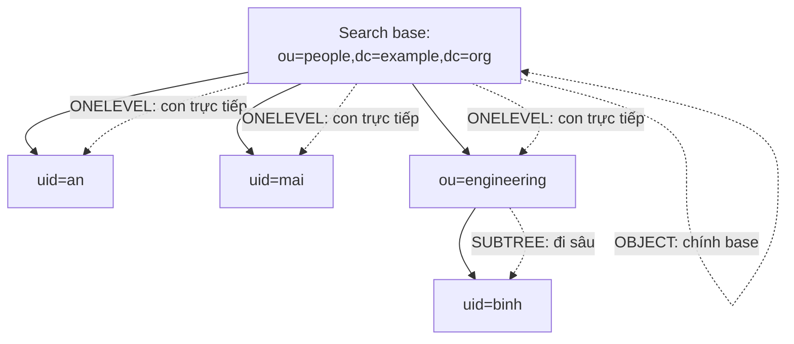

# Phân biệt LDAP URL với base của phép tìm kiếm

Trong chương **Kết nối** của **SPRING_DATA_LDAP**, người học cần tách hai câu hỏi thường bị gộp làm một:

1. **Ứng dụng kết nối tới LDAP server nào và bằng cách nào?** Đây là vai trò chính của **LDAP URL/endpoint**, chẳng hạn `ldaps://directory.example.org:636`.
2. **Ứng dụng tìm kiếm từ entry nào trong cây thư mục?** Đây là vai trò của **search base DN**, chẳng hạn `ou=people,dc=example,dc=org`.

Một URL hợp lệ có thể kết nối thành công nhưng truy vấn vẫn không thấy dữ liệu vì chọn sai base hoặc search scope. Ngược lại, một base DN đúng không giúp kết nối nếu hostname, cổng, TLS hoặc thông tin xác thực sai. Phân biệt được hai khái niệm là nền tảng để dùng Spring Data LDAP repository, `LdapTemplate`, ánh xạ `@Entry` và xử lý entry phân cấp mà không lẫn cấu hình mạng với vị trí dữ liệu.

> **Ý chính:** URL trả lời **“kết nối tới đâu?”**; search base trả lời **“bắt đầu tìm ở nhánh nào?”**; search scope trả lời **“tìm sâu đến mức nào?”**.

## 1. LDAP là cây entry, không phải danh sách phẳng

LDAP lưu các **entry** trong một cây thông tin thư mục (*Directory Information Tree*, DIT). Mỗi entry có **Distinguished Name (DN)** để xác định vị trí trong cây, các thuộc tính như `uid`, `cn`, `mail` và các `objectClass` quy định schema.

Ví dụ directory minh họa:

```text
dc=example,dc=org
├── ou=people
│   ├── uid=an
│   ├── uid=mai
│   └── ou=engineering
│       └── uid=binh
└── ou=groups
    └── cn=developers
```

Tên đầy đủ của một số entry:

- Người dùng An: `uid=an,ou=people,dc=example,dc=org`.
- Người dùng Bình: `uid=binh,ou=engineering,ou=people,dc=example,dc=org`.
- Nhóm developers: `cn=developers,ou=groups,dc=example,dc=org`.

Trong DN, từng thành phần là một **Relative Distinguished Name (RDN)**; ví dụ `uid=an` là RDN của entry An. DN đi từ entry lên các cấp cha. Chuỗi `dc=example,dc=org` là phần gốc trong **cây ví dụ**, không nhất thiết trùng tên host của máy chủ.

Một LDAP server có thể phục vụ nhiều naming context/suffix, và một naming context có thể được phục vụ bởi nhiều server. Do đó **không thể suy ra search base chỉ bằng cách lấy tên miền trong LDAP URL và chuyển dấu chấm thành `dc=...`**.

## 2. LDAP URL: xác định endpoint và cách thiết lập kết nối

Khi cấu hình client thông thường, LDAP URL chủ yếu xác định:

- **Scheme:** `ldap://` hoặc `ldaps://`.
- **Host:** địa chỉ máy chủ/dịch vụ, ví dụ `directory.example.org`.
- **Port:** cổng TCP, thường là **389** cho LDAP/StartTLS hoặc **636** cho LDAPS; server vẫn có thể dùng cổng khác.

Ví dụ:

```text
ldap://directory.example.org:389
ldaps://directory.example.org:636
ldap://ldap.internal.example.org:1389
```

| Thành phần | Ví dụ | Ý nghĩa |
| --- | --- | --- |
| Scheme | `ldap://` | Kết nối LDAP ban đầu; chỉ có TLS nếu client chủ động dùng StartTLS hoặc cơ chế bảo vệ phù hợp |
| Scheme | `ldaps://` | Bắt tay TLS ngay từ đầu kết nối, rồi mới gửi thông điệp LDAP |
| Host | `directory.example.org` | DNS/IP của endpoint LDAP, có thể là địa chỉ cân bằng tải |
| Port | `389`, `636` | Cổng dịch vụ, không phải cấp thư mục hay scope tìm kiếm |
| Credential Bind | DN và mật khẩu cấu hình riêng | Danh tính mà ứng dụng dùng để truy cập LDAP; **không phải search base** |

**StartTLS** vẫn có thể bắt đầu với `ldap://directory.example.org:389`, sau đó client gửi StartTLS extended operation để nâng cấp chính kết nối sang TLS. Vì vậy `ldap://` không đồng nghĩa với “luôn không mã hóa”; khả năng bảo vệ phụ thuộc vào chiến lược kết nối và việc nâng cấp có thành công hay không. Với simple Bind chứa mật khẩu, phải hoàn tất và xác minh TLS trước khi gửi thông tin xác thực.

Không đưa mật khẩu hay bí mật vào URL; lưu credential trong cấu hình bảo mật/secret manager. Việc sử dụng `ldaps://` cũng không tự kiểm chứng quyền truy cập entry: TLS, Bind và ACL là các cơ chế khác nhau.

## 3. Search base DN: chọn nhánh bắt đầu truy vấn

**Search base** là DN của entry dùng làm điểm xuất phát cho thao tác LDAP Search. Search base có thể là gốc naming context, một OU cụ thể, hoặc thậm chí DN của một entry người dùng.

Với cây ví dụ:

| Search base DN | Khu vực tìm kiếm theo subtree | Tình huống |
| --- | --- | --- |
| `dc=example,dc=org` | Cả nhánh people và groups, kể cả cấp con | Truy vấn rộng trong một naming context |
| `ou=people,dc=example,dc=org` | Người dùng trực tiếp trong people và các OU con | Tìm người dùng |
| `ou=engineering,ou=people,dc=example,dc=org` | Riêng engineering và các entry con | Tìm tài khoản trong bộ phận |
| `ou=groups,dc=example,dc=org` | Nhánh nhóm | Tìm nhóm LDAP |
| `uid=an,ou=people,dc=example,dc=org` | Entry An khi scope là base/object | Đọc đúng một entry |

**Base DN không phải câu lệnh lọc.** Để tìm “người có `uid=an`”, thường còn cần một **LDAP filter** như `(uid=an)`. Với filter giống nhau nhưng base khác nhau, tập kết quả có thể khác vì phép tìm kiếm chỉ xét phạm vi được chọn.

**Base DN cũng không phải tài khoản Bind.** Một tài khoản `uid=service-reader,ou=services,dc=example,dc=org` có thể được ủy quyền tìm kiếm dưới `ou=people,dc=example,dc=org`. DN dùng để xác thực và DN dùng làm search base không cần trùng nhau.

## 4. Search scope: base, one-level và subtree

Search base xác định **điểm xuất phát**; **scope** xác định độ sâu đi qua cây LDAP.

Giả sử base là `ou=people,dc=example,dc=org`:

| Scope | Tên trong công cụ/thư viện | Những entry có thể được xét |
| --- | --- | --- |
| **Base/Object** | `ldapsearch -s base`; `SearchScope.OBJECT` | Chỉ chính entry `ou=people` |
| **One level** | `ldapsearch -s one`; `SearchScope.ONELEVEL` | Các entry con **trực tiếp**: `uid=an`, `uid=mai`, `ou=engineering` |
| **Subtree** | `ldapsearch -s sub`; `SearchScope.SUBTREE` | Entry base và mọi hậu duệ: gồm cả `uid=binh` nằm sâu trong `ou=engineering` |

Chỉ những entry **đồng thời nằm trong scope và thỏa filter** mới xuất hiện trong kết quả. Ví dụ:

- Base `ou=people,dc=example,dc=org`, scope `ONELEVEL`, filter `(uid=binh)` → **không thấy** Bình vì entry nằm sâu hơn một cấp.
- Cùng base và filter, scope `SUBTREE` → **có thể thấy** Bình nếu ACL cho phép và server có entry tương ứng.
- Base `ou=groups,dc=example,dc=org`, scope `SUBTREE`, filter `(uid=an)` → **không thấy** An dù kết nối server đúng.



Trong ví dụ này, dùng filter `(objectClass=inetOrgPerson)` còn hạn chế tập kết quả về các entry có objectClass phù hợp. **Scope và filter là hai chiều khác nhau**: scope giới hạn vị trí, filter giới hạn đặc điểm của entry.

## 5. Lưu ý quan trọng: một LDAP URL đầy đủ cũng có thể chứa DN

Trong cấu hình Spring Boot, ta thường gọi `ldap://host:port` là “LDAP URL”. Tuy nhiên, theo cú pháp LDAP URL dùng để biểu diễn truy vấn (RFC 4516), URL đầy đủ có thể chứa **DN, danh sách thuộc tính, scope, filter và extension**:

```text
ldap[s]://host:port/dn?attributes?scope?filter?extensions
```

Ví dụ minh họa:

```text
ldap://directory.example.org:389/ou=people,dc=example,dc=org?cn,mail?sub?(uid=an)
```

Đọc các phần của URL này:

| Thành phần | Giá trị | Ý nghĩa |
| --- | --- | --- |
| Scheme/host/port | `ldap://directory.example.org:389` | Endpoint LDAP |
| Đoạn path `/dn` | `ou=people,dc=example,dc=org` | **Search base** được biểu diễn ngay trong LDAP URL đầy đủ |
| Attributes | `cn,mail` | Các thuộc tính muốn lấy |
| Scope | `sub` | Tìm theo subtree |
| Filter | `(uid=an)` | Điều kiện tìm entry |

Các dấu `?` giữ vai trò phân tách thành phần trong cú pháp LDAP URL; dữ liệu cần thiết phải được **percent-encode** theo quy tắc URL, trong khi giá trị đưa vào LDAP filter phải tuân thủ quy tắc escape của filter (RFC 4515). Không tự nối URL/filter từ chuỗi người dùng.

Điều này dẫn đến một phân biệt tinh tế:

- **LDAP URL ở mức chuẩn giao thức** có thể mang search base ngay trong phần DN của URL.
- **Thuộc tính `spring.ldap.urls` dùng để khai báo endpoint trong cấu hình Spring Boot** thường được đặt chỉ gồm scheme, host và port; **`spring.ldap.base` được cấu hình riêng**.
- **Search base của một phép tìm kiếm cụ thể** có thể tiếp tục chọn một OU tương đối so với base của `ContextSource`.

Vì vậy câu “LDAP URL và search base luôn nằm ở hai chuỗi hoàn toàn tách biệt” là **quá đơn giản**. Điều cần hiểu đúng là chúng đảm nhiệm **hai vai trò khác nhau**; cùng một dạng URL chuẩn có thể mã hóa nhiều thông tin, nhưng code ứng dụng Spring thường tách chúng để dễ quản trị.

## 6. Cấu hình Spring Boot: URL và base là hai thuộc tính

Ví dụ `application.yml` cho ứng dụng Spring Data LDAP đọc người dùng:

```yaml
spring:
  ldap:
    urls: ldaps://directory.example.org:636
    base: dc=example,dc=org
    username: uid=service-reader,ou=services,dc=example,dc=org
    password: ${LDAP_BIND_PASSWORD}
```

Giải thích theo đúng vai trò:

| Thuộc tính | Dùng làm gì? | Không nên hiểu thành |
| --- | --- | --- |
| `spring.ldap.urls` | Chọn LDAP endpoint/kết nối | Base của mọi phép tìm kiếm |
| `spring.ldap.base` | Base DN chung cho `ContextSource`; các DN truyền cho Spring LDAP thường được diễn giải tương đối từ đây | URL, hostname, cổng hoặc tài khoản Bind |
| `spring.ldap.username` | DN/tên định danh dùng để Bind | OU tìm kiếm |
| `spring.ldap.password` | Credential của tài khoản Bind | Một phần của search filter |

Trong cấu hình này, một truy vấn với base tương đối `ou=people` sẽ được thực hiện dưới DN hiệu lực **`ou=people,dc=example,dc=org`**. Người dùng không cần lặp `dc=example,dc=org` ở mọi query; việc lặp lại có thể tạo đường dẫn sai, ví dụ `ou=people,dc=example,dc=org,dc=example,dc=org`.

Tùy phiên bản Spring Boot và cách dự án tự định nghĩa `LdapContextSource`, các bean tự cấu hình có thể được thay thế bởi bean thủ công. Luôn xác nhận **ContextSource mà repository/`LdapTemplate` đang dùng** và base DN đã được cấu hình ở đâu.

### 6.1. Cấu hình thủ công tương đương với Spring LDAP

```java
import org.springframework.ldap.core.support.LdapContextSource;

LdapContextSource contextSource = new LdapContextSource();
contextSource.setUrl("ldaps://directory.example.org:636");
contextSource.setBase("dc=example,dc=org");
contextSource.setUserDn("uid=service-reader,ou=services,dc=example,dc=org");
contextSource.setPassword(bindPasswordFromSecretManager);
contextSource.afterPropertiesSet();
```

Đoạn mã minh họa API của `LdapContextSource`, không phải nguyên một ứng dụng chạy độc lập. Trong Spring Boot, thông thường nên cấu hình qua properties và bean thay vì tự gọi `afterPropertiesSet()`; Spring sẽ quản lý vòng đời bean. Với LDAPS phải kiểm tra chuỗi chứng chỉ, hostname và truststore JVM. Đổi `setBase(...)` **không** thay đổi host/port, cũng không tự tạo OU trên server.

## 7. Search base khi dùng LdapTemplate và Repository

### 7.1. Search base tương đối trong LdapTemplate

Với `ContextSource` có base `dc=example,dc=org`, code sau tìm trong nhánh `ou=people,dc=example,dc=org`:

```java
import java.util.List;
import org.springframework.ldap.core.LdapTemplate;
import org.springframework.ldap.core.AttributesMapper;
import org.springframework.ldap.query.LdapQuery;
import org.springframework.ldap.query.LdapQueryBuilder;
import org.springframework.ldap.query.SearchScope;

public class PersonDirectorySearch {
    private final LdapTemplate ldapTemplate;

    public PersonDirectorySearch(LdapTemplate ldapTemplate) {
        this.ldapTemplate = ldapTemplate;
    }

    public List<String> findCommonNamesByUid(String uid) {
        LdapQuery query = LdapQueryBuilder.query()
            .base("ou=people")                 // tương đối với ContextSource base
            .searchScope(SearchScope.SUBTREE)
            .where("uid").is(uid);             // không nối chuỗi filter

        return ldapTemplate.search(query,
            (AttributesMapper<String>) attrs ->
                (String) attrs.get("cn").get());
    }
}
```

Đoạn mã giả định các entry tìm thấy có `cn` và ứng dụng muốn lấy một giá trị `cn`. Với directory có thuộc tính thiếu hoặc đa trị, mapper cần xử lý rõ. Kết quả là danh sách vì filter có thể khớp nhiều entry.

Ba yếu tố quyết định tập kết quả:

1. **`ContextSource.base`:** `dc=example,dc=org`, phần chung cho thao tác LDAP.
2. **`LdapQueryBuilder.base("ou=people")`:** nhánh tương đối cho *query này*.
3. **`SearchScope.SUBTREE` và `(uid=...)`:** độ sâu và điều kiện lọc.

Nếu muốn tìm trong `ou=groups`, thay query base thành `ou=groups` mà **không cần đổi endpoint LDAP**. Nếu ứng dụng chuyển sang LDAP server dự phòng phục vụ cùng naming context, có thể đổi endpoint nhưng giữ nguyên search base.

### 7.2. Base của entity trong Spring Data LDAP Repository

Với Spring Data LDAP, `@Entry(base=...)` chỉ nơi các entry thuộc loại Java được ánh xạ:

```java
import javax.naming.Name;
import org.springframework.ldap.odm.annotations.Attribute;
import org.springframework.ldap.odm.annotations.Entry;
import org.springframework.ldap.odm.annotations.Id;
import org.springframework.data.ldap.repository.LdapRepository;
import java.util.List;

@Entry(base = "ou=people", objectClasses = {"inetOrgPerson"})
public class PersonEntry {
    @Id
    private Name dn;

    @Attribute(name = "uid")
    private String uid;

    public PersonEntry() {}
    public Name getDn() { return dn; }
    public String getUid() { return uid; }
}

interface PersonRepository extends LdapRepository<PersonEntry> {
    List<PersonEntry> findByUid(String uid);
}
```

Trong cấu hình phổ biến với `ContextSource` base `dc=example,dc=org`, base `ou=people` ở `@Entry` giúp khoanh vùng entry người dùng. `@Id` ánh xạ DN; `objectClasses` hỗ trợ ánh xạ schema LDAP sang model Java. **Không dùng `@Entry(base=...)` để thay cho URL server**, và cũng không hiểu `base` là một thuộc tính `objectClass`.

Khi phối hợp annotation, repository và `LdapTemplate`, hãy kiểm tra chính xác **base mà từng API đang sử dụng**. Các API có thể diễn giải DN tương đối theo `ContextSource`; nếu trộn DN tuyệt đối với cơ chế tự thêm base, câu truy vấn có thể bị ghép suffix hai lần.

### 7.3. Không nhầm search base với DN của entry

Search base có thể là `ou=people,dc=example,dc=org` nhưng DN của người dùng là `uid=an,ou=people,dc=example,dc=org`. Một repository tìm nhiều entry dưới base; một thao tác đọc/sửa đúng một entry thường cần **DN thực tế** của entry đó.

Nếu muốn dựng DN từ các thành phần đã xác định, dùng `LdapNameBuilder` thay vì ghép chuỗi:

```java
import javax.naming.Name;
import org.springframework.ldap.support.LdapNameBuilder;

Name relativeDn = LdapNameBuilder.newInstance()
    .add("ou", "people")
    .add("uid", "an")
    .build();
// uid=an,ou=people (tương đối với dc=example,dc=org)
```

Chỉ dựng DN như vậy nếu ứng dụng **biết chắc** RDN của người dùng là `uid` và nhánh chứa là `ou=people`. Khi đọc/sửa entry hiện hữu, lấy DN từ kết quả tìm kiếm thường đáng tin hơn suy đoán DN từ `uid` vì entry có thể ở OU khác hoặc dùng RDN khác.

## 8. Dùng ldapsearch để quan sát ba khái niệm

`ldapsearch` cho phép phân biệt rõ:

- `-H`: **LDAP URL/endpoint**.
- `-b`: **search base**.
- `-s`: **search scope** (`base`, `one` hoặc `sub`).
- Biểu thức `"(uid=an)"`: **search filter**.

Với endpoint LDAPS và một directory cho phép truy vấn theo tài khoản thích hợp:

```bash
ldapsearch -x -H ldaps://directory.example.org:636 \
  -D "uid=service-reader,ou=services,dc=example,dc=org" -W \
  -b "ou=people,dc=example,dc=org" -s sub \
  "(uid=an)" dn cn mail
```

Giữ nguyên `-H`, thay `-b` để tìm người dùng thuộc nhánh engineering:

```bash
ldapsearch -x -H ldaps://directory.example.org:636 \
  -D "uid=service-reader,ou=services,dc=example,dc=org" -W \
  -b "ou=engineering,ou=people,dc=example,dc=org" -s sub \
  "(uid=binh)" dn cn
```

Giữ nguyên `-H` và `-b`, thay `-s` để kiểm tra sự khác biệt phạm vi:

```bash
# Chỉ các entry con trực tiếp dưới ou=people.
ldapsearch -x -H ldaps://directory.example.org:636 \
  -b "ou=people,dc=example,dc=org" -s one "(uid=binh)" dn

# Bao gồm cả các OU nằm sâu dưới ou=people.
ldapsearch -x -H ldaps://directory.example.org:636 \
  -b "ou=people,dc=example,dc=org" -s sub "(uid=binh)" dn
```

Hai lệnh cuối là ví dụ truy vấn **ẩn danh**; tùy ACL, server có thể từ chối hoặc trả tập kết quả khác nhau. Khi cần Bind, dùng `-D ... -W` như các lệnh phía trên. Không đặt mật khẩu ngay trên command line hay thử simple Bind trên kết nối không mã hóa.

### 8.1. Tìm naming context thay vì đoán base DN

Nhiều server công bố `namingContexts` trong **Root DSE**. Đọc Root DSE thường dùng search base **DN rỗng** và scope `base`:

```bash
ldapsearch -x -H ldaps://directory.example.org:636 \
  -b "" -s base "(objectClass=*)" namingContexts
```

Ví dụ phản hồi có thể bao gồm:

```text
dn:
namingContexts: dc=example,dc=org
namingContexts: dc=partners,dc=example,dc=org
```

DN rỗng của Root DSE **không có nghĩa base dữ liệu mọi ứng dụng phải để trống**. Root DSE là entry đặc biệt cung cấp thông tin server; `namingContexts` gợi ý các suffix được phục vụ. Khả năng xem thuộc tính này phụ thuộc loại directory và cấu hình truy cập; Active Directory hoặc LDAP khác có thể công bố thuộc tính, naming context và chính sách khác nhau.

## 9. Những lỗi điển hình và cách định vị nguyên nhân

| Triệu chứng | Nguyên nhân đáng kiểm tra | Cách khắc phục |
| --- | --- | --- |
| Không kết nối được, connection refused/timeout | Sai URL host/port, firewall, DNS, listener chưa mở | Kiểm tra `spring.ldap.urls`, mạng và listener; chưa cần thay search base |
| TLS handshake hoặc chứng chỉ lỗi | CA/truststore, hostname, phiên bản TLS không tương thích | Cấu hình truststore và endpoint đúng, xác minh CA/hostname; không tắt kiểm tra chứng chỉ |
| Bind thất bại dù endpoint đúng | Sai DN Bind, mật khẩu, account bị khóa, cơ chế xác thực | Kiểm tra `spring.ldap.username/password` và chính sách xác thực; search base không giải quyết lỗi Bind |
| Search trả 0 kết quả | Base chọn sai OU, scope quá hẹp, filter không khớp, ACL thiếu quyền | Thử `ldapsearch -b ... -s ...`, kiểm tra DN thực tế, filter/schema và quyền |
| `NoSuchObject` hoặc LDAP result code 32 | Search base/entry DN không tồn tại trên naming context đang dùng | Xác định naming context, kiểm tra từng thành phần DN và ContextSource base |
| Có người dùng An nhưng không thấy Bình | Bình nằm trong OU con, scope `ONELEVEL` | Đổi sang `SUBTREE` khi use case cần tìm ở nhiều cấp |
| DN bị lặp `dc=...` | Truyền DN tuyệt đối vào API đang tự thêm `ContextSource.base` | Chuẩn hóa quy tắc DN tương đối/tuyệt đối, không thêm suffix hai lần |
| Repository đọc được người dùng nhưng không đọc được nhóm | `@Entry(base)` và `objectClass` đang nhắm nhánh people | Tạo repository/entity hoặc query với base groups phù hợp |
| Kết quả quá nhiều hoặc chậm | Base quá rộng, scope subtree, filter thiếu giới hạn | Chọn OU hẹp, filter có chỉ mục, giới hạn size/time và phân trang khi hỗ trợ |
| Tìm thấy entry qua CLI nhưng Java không thấy | CLI dùng `-b`/`-s` khác query Java hoặc khác credential | So khớp URL, base hiệu lực, scope, filter, Bind DN và ACL |

**Thứ tự chẩn đoán thực tế:** (1) kết nối TCP/TLS, (2) Bind, (3) naming context/base DN, (4) scope, (5) filter và objectClass, (6) ACL cùng cách ánh xạ dữ liệu. Phân loại theo thứ tự giúp tránh sửa nhầm endpoint khi vấn đề chỉ là query.

## 10. Chọn base đúng, filter an toàn và kiểm soát truy cập

### 10.1. Không mở rộng phạm vi không cần thiết

Nếu API chỉ tìm nhân viên, dùng base `ou=people` thay vì mặc định truy vấn từ `dc=example,dc=org`. Base hẹp giúp tránh tìm nhầm nhóm/tài khoản dịch vụ và giảm tải server. Tuy nhiên base **chỉ là giới hạn truy vấn phía client**, không thay thế **LDAP ACL** ở server hay kiểm tra quyền của người gọi API.

Các ứng dụng nhiều đơn vị/tổ chức cần xác định OU được phép dùng dựa trên cấu hình đáng tin cậy và quyền của người dùng, thay vì nhận nguyên một base DN tùy ý từ HTTP request.

### 10.2. Không nối chuỗi LDAP filter hoặc DN từ input

Ví dụ không an toàn:

```java
String filter = "(uid=" + userSuppliedUid + ")";  // Không nên
String dn = "uid=" + userSuppliedUid + ",ou=people,dc=example,dc=org";
```

Đầu vào có ký tự đặc biệt có thể làm sai cấu trúc filter hoặc DN. Hãy dùng derived query của Spring Data LDAP, `LdapQueryBuilder`/filter builder cho giá trị filter và `LdapNameBuilder` cho DN. **Escape LDAP filter và escape DN là hai việc khác nhau**; validation không thay thế việc escape.

### 10.3. Search base không quyết định quyền xem dữ liệu

Một account Bind chỉ được phép đọc người dùng ở một số OU có thể nhận kết quả rỗng hoặc lỗi khi tìm OU khác. Một account có quyền rộng có thể đọc được nhiều dữ liệu hơn dù cùng base. Vì vậy khi kết quả khác giữa máy local và môi trường production, phải đối chiếu **credential, ACL, naming context và search scope**, không chỉ so URL.

## 11. Tình huống thực tế: một endpoint, nhiều phép tìm kiếm

Giả sử ứng dụng quản lý nhân sự sử dụng cùng endpoint `ldaps://directory.example.org:636` với `ContextSource.base = dc=example,dc=org`:

| Use case | Query base tương đối | Scope | Filter ví dụ |
| --- | --- | --- | --- |
| Tìm người dùng theo UID | `ou=people` | `SUBTREE` | `(uid=an)` |
| Tìm tài khoản trong engineering | `ou=engineering,ou=people` | `SUBTREE` | `(objectClass=inetOrgPerson)` |
| Tìm nhóm developers | `ou=groups` | `ONELEVEL` hoặc `SUBTREE` tùy cấu trúc nhóm | `(cn=developers)` |
| Đọc riêng entry nhóm đã biết DN | `cn=developers,ou=groups` | `OBJECT` | `(objectClass=*)` |

Không cần tạo kết nối đến server khác cho từng OU. **Cùng một LDAP URL có thể phục vụ nhiều base của phép tìm kiếm.** Trường hợp khác, hai endpoint `ldaps://directory-a.example.org:636` và `ldaps://directory-b.example.org:636` có thể cùng phục vụ một naming context; khi failover, URL thay đổi còn cấu trúc base có thể giữ nguyên, nếu dữ liệu và chính sách directory tương đương.

Với Spring Data LDAP, có thể thiết kế repository dành cho `ou=people` và adapter `LdapTemplate` dành cho `ou=groups` trong cùng ứng dụng. Tầng service nhận DTO nghiệp vụ, không cần biết endpoint, DN hoặc schema chi tiết. Khi thao tác CRUD, entry phải được định danh bằng DN chính xác và phù hợp schema/`objectClass`; việc đổi base không tự di chuyển entry trong cây.

## 12. Câu hỏi tự kiểm tra

1. **`ldaps://directory.example.org:636` có cho biết người dùng nằm ở OU nào?** Không. Nó xác định endpoint và cách khởi tạo TLS; vị trí entry được chỉ bằng DN/base.
2. **Đổi `spring.ldap.base` có tự đổi địa chỉ kết nối không?** Không. Host/port vẫn lấy từ `spring.ldap.urls`.
3. **Vì sao `uid=binh` không được tìm thấy dưới `ou=people` với scope `ONELEVEL`?** Vì entry thuộc `ou=engineering`, là cấp cháu của `ou=people`; cần `SUBTREE` hoặc base cụ thể hơn.
4. **`spring.ldap.username` và search base có phải cùng một DN?** Không. Username là định danh Bind; search base là điểm xuất phát của truy vấn.
5. **Một LDAP URL có thể chứa base DN không?** Có. Cú pháp LDAP URL đầy đủ (RFC 4516) có phần DN trong path; tuy nhiên cấu hình ứng dụng Spring thường tách endpoint và base qua các thuộc tính riêng.
6. **Vì sao truy vấn trùng hậu tố `dc=example,dc=org`?** Có thể do truyền DN tuyệt đối vào thao tác vốn dùng DN tương đối với `ContextSource.base`.
7. **Có thể dùng base hẹp để thay cho ACL không?** Không. Base giới hạn phạm vi query; bảo vệ dữ liệu phải dựa thêm vào Bind, ACL, TLS và quyền ứng dụng.
8. **Khi CLI có kết quả mà repository không có, cần so gì?** URL, credential, base hiệu lực (gồm base từ ContextSource và annotation/query), scope, filter, objectClass và ACL.

**Ghi nhớ:** Trong SPRING_DATA_LDAP, hãy xác định rõ **LDAP URL/endpoint**, **base DN của `ContextSource`**, **base tương đối của repository hoặc query**, **search scope** và **filter**. Một phép tìm kiếm đúng cần đồng thời có kết nối hợp lệ, quyền truy cập, base tồn tại và scope/filter phù hợp; mỗi yếu tố giải quyết một vấn đề khác nhau.
