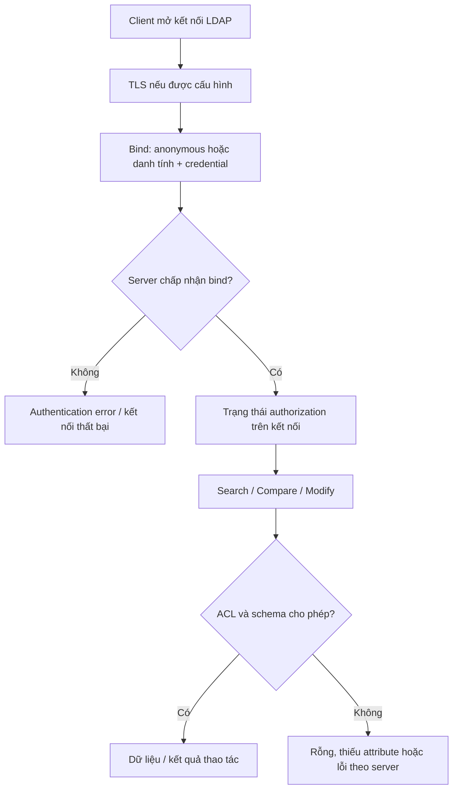
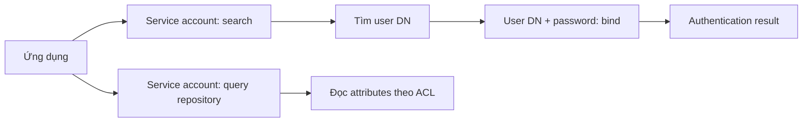

# Anonymous bind, simple bind và điều kiện máy chủ cho phép

## Mục tiêu học tập

Sau bài này, bạn có thể:

1. Phân biệt **anonymous bind**, **simple bind bằng DN và mật khẩu**, và trường hợp dễ gây hiểu nhầm **unauthenticated simple bind** (DN không rỗng nhưng mật khẩu rỗng).
2. Giải thích tại sao **bind thành công** không mặc nhiên có nghĩa người dùng đã được xác thực theo danh tính mong đợi hoặc có quyền đọc/ghi LDAP entry.
3. Nhận diện điều kiện server cho phép/từ chối từng kiểu bind dựa trên **chính sách xác thực, TLS và Access Control List (ACL)**.
4. Cấu hình `ContextSource`/`LdapContextSource` trong Spring LDAP, `spring.ldap` trong Spring Boot và thực hiện xác thực người dùng bằng `LdapTemplate.authenticate(...)` một cách phù hợp.
5. Kiểm tra cơ chế bind và khả năng đọc dữ liệu bằng `ldapwhoami`, `ldapsearch`; phân biệt trường hợp Root DSE đọc được với dữ liệu người dùng bị chặn.
6. Thiết kế kiểm thử cho mật khẩu rỗng, mật khẩu sai, mất kết nối, chứng chỉ TLS không hợp lệ và giới hạn quyền của tài khoản dịch vụ.

Bài thuộc chương **Kết nối** của module `SPRING_DATA_LDAP`. Module cung cấp cách truy cập dịch vụ thư mục LDAP bằng repository và ánh xạ entry phân cấp sang Java object, bao gồm DN, `objectClass`, schema, `LdapTemplate`, CRUD, LDAP filter an toàn, bảo mật kết nối và kiểm thử với directory thực.

## 1. Bind trong LDAP là gì?

LDAP là giao thức trao đổi yêu cầu giữa client và **directory server**. Một số thao tác gồm:

- **Bind**: xác lập trạng thái xác thực trên kết nối LDAP.
- **Search**: tìm LDAP entry theo search base, phạm vi, filter và danh sách attribute.
- **Compare**: so sánh giá trị attribute theo quy tắc directory.
- **Add/Modify/Delete/ModifyDN**: tạo, sửa, xóa hoặc đổi DN của entry.

Trong LDAPv3, bind có thể dùng **simple authentication** hoặc **SASL**. Bài này tập trung vào **simple bind** và các biến thể anonymous của nó.

Một user entry ví dụ:

```ldif
dn: uid=an.nguyen,ou=people,dc=example,dc=org
objectClass: top
objectClass: person
objectClass: organizationalPerson
objectClass: inetOrgPerson
uid: an.nguyen
cn: An Nguyen
sn: Nguyen
mail: an.nguyen@example.org
```

DN của entry trên là `uid=an.nguyen,ou=people,dc=example,dc=org`. Giá trị `uid: an.nguyen` là **attribute dữ liệu**, không phải lúc nào cũng đủ để dùng trực tiếp làm bind identity: server thường cần DN hoặc cách định danh khác được nó hỗ trợ.

### 1.1. Bind khác search và quyền truy cập



**Bind thành công chỉ là một bước.** LDAP server vẫn áp dụng ACL đối với từng entry, nhánh, attribute và loại thao tác. Một tài khoản có thể bind được nhưng không được đọc `mail`, không được search `ou=groups` hoặc bị cấm sửa `uid`.

**Không có quy tắc phổ quát rằng mọi kết nối đều đã được bind bằng danh tính cụ thể**: LDAP có trạng thái anonymous ban đầu; JNDI/provider và server có thể thực thi anonymous access mà không phát sinh một BindRequest explicit trong từng luồng.

## 2. Ba trường hợp simple bind cần phân biệt

Theo **RFC 4513**, simple bind có những trạng thái quan trọng sau:

| Trường hợp | DN trong BindRequest | Password | Danh tính/ý nghĩa |
| --- | --- | --- | --- |
| **Anonymous simple bind** | Rỗng | Rỗng | Yêu cầu trạng thái **anonymous** |
| **Unauthenticated simple bind** | Không rỗng | Rỗng | Nếu server cho phép, vẫn là trạng thái **anonymous**, không phải user đã xác thực |
| **Name/password simple bind** | Không rỗng | Không rỗng | Server kiểm tra credential của danh tính được chỉ định |
| **SASL bind** | Tùy cơ chế | Không sử dụng theo dạng simple password này | Cơ chế khác, ví dụ tích hợp Kerberos/GSSAPI |

Chữ **simple** mô tả cách xác thực trong LDAP BindRequest; nó **không đồng nghĩa** với “có password” trong mọi trường hợp.

### 2.1. Anonymous simple bind

Một yêu cầu anonymous simple bind có tên rỗng và mật khẩu rỗng. Nếu được thực hiện/chấp nhận, kết nối có trạng thái **anonymous authorization**.

Ví dụ truy vấn Root DSE có thể được server cho phép ở trạng thái anonymous:

```text
Bind identity: anonymous
Search base: "" (Root DSE)
Search scope: base
Requested attribute: supportedLDAPVersion
```

Nhưng server có thể **từ chối** anonymous search dưới `ou=people` hoặc chỉ trả một phần attribute. Đọc được Root DSE **không chứng minh** được phép đọc dữ liệu người dùng, nhóm, mật khẩu hay schema riêng.

### 2.2. Unauthenticated simple bind: bẫy mật khẩu rỗng

Đây là trường hợp dễ gây lỗi xác thực nghiêm trọng:

```text
DN:       uid=an.nguyen,ou=people,dc=example,dc=org
Password: ""       (chuỗi độ dài bằng 0)
```

Nếu server cho phép **unauthenticated authentication**, yêu cầu này có thể trả **BindResponse thành công**, nhưng trạng thái authorization vẫn **anonymous**. Điều đó **không chứng minh** mật khẩu của An đúng.

RFC 4513 khuyến nghị server **nên từ chối** hình thức unauthenticated bind trừ khi nó được cấu hình cho phép một cách rõ ràng. Chính sách thực tế khác nhau giữa các directory và deployment.

**Tuyệt đối không viết logic:**

```java
// SAI VỀ Ý NGHĨA BẢO MẬT:
boolean loggedIn = ldapBindReturnedSuccess(userDn, "");
```

Một bind thành công với password rỗng có thể chỉ là anonymous authorization, hoặc provider/server đã áp dụng một đường xử lý khác. **Ứng dụng phải chặn password rỗng trước khi gửi yêu cầu xác thực bằng bind**, đồng thời kiểm thử cấu hình server.

### 2.3. Name/password simple bind

Với DN không rỗng và password không rỗng:

```text
DN:       uid=an.nguyen,ou=people,dc=example,dc=org
Password: <giá trị được người dùng cung cấp>
```

Server xác minh credential theo chính sách của nó. Nếu thành công, kết nối được xác thực dưới danh tính được chấp nhận; nếu sai, thường nhận kết quả lỗi xác thực.

Nhưng có các điều kiện bổ sung:

- Server có thể yêu cầu **TLS hoặc cơ chế bảo vệ mạnh** trước khi nhận simple bind.
- Account có thể bị khóa, hết hạn credential hoặc bị hạn chế đăng nhập.
- Directory có thể không cho phép bind trực tiếp bằng login ID; ứng dụng cần tìm **DN thực** trước.
- Xác thực xong không có nghĩa được cấp `ROLE_ADMIN` hay được sửa LDAP entry.
- Thông báo lỗi phía API không nên cho phép suy ra một login ID tồn tại hay không.

## 3. Điều kiện nào khiến LDAP server cho phép anonymous bind?

Không có một công tắc chung cho mọi LDAP server. Chính sách có thể được quyết định bởi cấu hình server, ACL, naming context, yêu cầu bảo mật đường truyền và quyền của từng entry.

### 3.1. Các mức cho phép khác nhau

| Cấu hình/chính sách minh họa | Anonymous bind | Anonymous search dữ liệu nghiệp vụ |
| --- | --- | --- |
| Server chấp nhận anonymous state nhưng giới hạn ACL | Có thể thành công | Có thể **bị cấm hoàn toàn** |
| Server cho đọc Root DSE để discovery | Có thể dùng anonymous access | Chỉ Root DSE được phép; OU người dùng có thể bị ẩn |
| Directory công khai có dữ liệu cho anonymous | Được cho phép | Có thể search **một số** nhánh/attribute |
| Directory nội bộ siết quyền | Có thể vẫn có anonymous protocol state | Không cho đọc user/group hoặc chỉ trả subset |
| Server/policy yêu cầu xác thực trước mọi search nghiệp vụ | Anonymous connection có thể tồn tại | Search cần bind account phù hợp |

**Quan trọng:** “Anonymous bind được chấp nhận” và “Anonymous được đọc directory” là **hai câu hỏi riêng**. Server có thể trả success cho anonymous bind nhưng không trả dữ liệu ở `ou=people`.

Có thể ngược lại: một server cho truy vấn Root DSE anonymous nhưng **từ chối** unauthenticated bind dạng DN không rỗng + password rỗng. Không đánh đồng hai đường yêu cầu.

### 3.2. Root DSE không đại diện toàn bộ directory

Root DSE nằm tại DN rỗng `""`. Nó có thể cung cấp metadata như:

- `supportedLDAPVersion`.
- `namingContexts`.
- `supportedControl` hoặc `supportedExtension`.

Các attribute cụ thể có thể thay đổi hoặc bị ẩn bởi server. Đọc Root DSE là một kiểm tra hữu ích về endpoint, nhưng không xác nhận được:

- Người dùng có tồn tại dưới `ou=people`.
- Attribute `cn` hay `mail` được phép đọc.
- Group `member` được phép tìm kiếm.
- Tài khoản service có quyền create/update/delete/rename.
- Một người dùng cụ thể có thể bind bằng credential của họ.

Để kiểm tra năng lực đọc cần thiết, phải thực hiện **đúng search base, filter, attribute và bind identity** của ứng dụng.

## 4. Simple bind có phụ thuộc TLS không?

Simple bind gửi credential theo cơ chế của LDAP và **không tự bảo vệ mật khẩu khi đường truyền chưa được mã hóa**. Vì vậy cần kết nối được bảo vệ thích hợp:

| Kết nối | Ví dụ | Đánh giá khi gửi password |
| --- | --- | --- |
| LDAP không TLS | `ldap://ldap.example.org:389` | Không an toàn trên mạng không được bảo vệ; server có thể từ chối simple bind |
| LDAPS | `ldaps://ldap.example.org:636` | TLS từ đầu; cần xác minh chứng chỉ server |
| LDAP + StartTLS | Bắt đầu `ldap://...` rồi nâng cấp TLS | Chỉ an toàn **sau khi StartTLS thành công và xác minh chứng chỉ** |
| SASL với bảo vệ phù hợp | Phụ thuộc cơ chế | Khác simple bind; yêu cầu cấu hình cơ chế và mức bảo vệ |

### 4.1. Chính sách TLS là điều kiện phía server

Nhiều hệ thống tổ chức cấu hình server để **không chấp nhận simple bind khi kết nối thiếu mức bảo vệ cần thiết**. Một số LDAP directory có thể chấp nhận bind đó nếu được cấu hình kém an toàn; client **không nên dựa vào sự cho phép này**.

Ví dụ, quản trị LDAP có thể yêu cầu mọi simple bind có password phải sử dụng LDAPS hoặc StartTLS. Với một số triển khai Active Directory, chính sách LDAP signing, yêu cầu channel security và các thiết lập domain controller cũng có thể ảnh hưởng việc bind có được chấp nhận hay không.

Không suy từ “client kết nối được cổng 389” rằng simple bind với credential sẽ được chấp nhận.

### 4.2. Cấu hình LDAPS chưa đủ nếu không xác minh chứng chỉ

```yaml
spring:
  ldap:
    urls: "ldaps://ldap.example.org:636"
    base: "dc=example,dc=org"
    username: "uid=ldap-reader,ou=service,dc=example,dc=org"
    password: "${LDAP_BIND_PASSWORD}"
```

Kênh `ldaps://` cần **truststore/CA** phù hợp và xác minh hostname theo chính sách bảo mật. Đừng sửa lỗi TLS bằng cách tắt certificate verification hoặc dùng trust manager chấp nhận mọi chứng chỉ.

Trong ví dụ, `spring.ldap.username` là **bind principal của tài khoản dịch vụ**, không phải username người đang đăng nhập ứng dụng. Password phải lấy từ secret manager/biến môi trường có phân quyền, không hardcode trong Git.

## 5. Anonymous bind trong JNDI và Spring LDAP

Spring LDAP sử dụng `ContextSource` để cấp `DirContext`. Implementation phổ biến là `LdapContextSource`. Client Java có thể cấu hình **anonymous access** bằng JNDI khi muốn thử capability không yêu cầu credentials.

### 5.1. Ví dụ JNDI yêu cầu anonymous context

Đoạn code dưới đây **không cần credential**, chỉ thử đọc Root DSE. Nó dùng JNDI provider của JDK và yêu cầu LDAPS với TLS đúng:

```java
import java.util.Hashtable;

import javax.naming.Context;
import javax.naming.NamingException;
import javax.naming.directory.Attributes;
import javax.naming.directory.DirContext;
import javax.naming.directory.InitialDirContext;

public final class AnonymousRootDseProbe {

    public boolean canReadRootDse() throws NamingException {
        Hashtable<String, Object> environment = new Hashtable<>();

        environment.put(
            Context.INITIAL_CONTEXT_FACTORY,
            "com.sun.jndi.ldap.LdapCtxFactory"
        );
        environment.put(
            Context.PROVIDER_URL,
            "ldaps://ldap.example.org:636"
        );
        environment.put(Context.SECURITY_AUTHENTICATION, "none");

        DirContext context = new InitialDirContext(environment);
        try {
            Attributes rootDse = context.getAttributes(
                "",
                new String[] {"supportedLDAPVersion"}
            );
            return rootDse != null;
        } finally {
            context.close();
        }
    }
}
```

**Diễn giải đúng:**

1. `SECURITY_AUTHENTICATION = "none"` yêu cầu **anonymous authentication context**. Provider có thể dùng trạng thái anonymous ban đầu hoặc gửi bind theo cách triển khai; đừng khẳng định đoạn code luôn phát một BindRequest cụ thể.
2. `getAttributes("", ...)` là thao tác đọc Root DSE khi provider URL không mang base DN; nó buộc client thực hiện một thao tác directory, thay vì chỉ tạo object Java.
3. `rootDse != null` là điều kiện minh họa tối thiểu; muốn xác nhận một attribute cụ thể, phải kiểm tra `rootDse.get("supportedLDAPVersion")` và giá trị của nó. Không mặc định mọi server đều công bố cùng metadata cho anonymous.
4. `DirContext` phải được đóng để giải phóng tài nguyên.
5. Kết quả `true` **không** chứng minh quyền đọc người dùng hay xác thực mật khẩu.

**Không dùng code này làm health check duy nhất** cho một hệ thống cần đọc `uid`, `cn` hoặc `member` trong các OU nghiệp vụ.

### 5.2. Khi không cấu hình bind credentials trong Spring Boot

Một cấu hình chỉ có:

```yaml
spring:
  ldap:
    urls: "ldaps://ldap.example.org:636"
    base: "dc=example,dc=org"
```

không cung cấp service-account DN/password. Theo cấu hình và implementation `ContextSource` đang chạy, thao tác đọc có thể được thực hiện ở trạng thái anonymous hoặc bị từ chối vì không có danh tính hợp lệ.

Vì vậy:

- **Không giả định** thiếu `spring.ldap.username`/`password` là một cấu hình đọc production an toàn.
- **Không giả định** mọi server cho anonymous search.
- **Không tự “chữa” lỗi credential bằng cách xóa username/password**, vì điều đó có thể dẫn đến kết quả rỗng hoặc khiến ứng dụng đọc nhầm tập dữ liệu công khai.
- Với ứng dụng đọc dữ liệu cần kiểm soát, dùng **bind account chỉ đọc** và ACL rõ ràng.
- Nếu hệ thống cố ý cung cấp LDAP directory công khai, xác định rõ dữ liệu/attribute nào có thể anonymous read và kiểm thử đúng giới hạn đó.

### 5.3. ContextSource không phải bộ phân quyền

`getReadOnlyContext()` và `getReadWriteContext()` chỉ thể hiện cách tầng client lấy context. Tên `readOnly` **không tự thay đổi ACL trên server**. Muốn bảo đảm chỉ đọc, phải dùng tài khoản được server phân quyền chỉ đọc và kiểm chứng rằng thao tác ghi bị từ chối.

Tương tự, `ContextSource.getContext(principal, credentials)` có thể giúp thử bind bằng danh tính người dùng, nhưng nó không thay thế chính sách login, mapping nhóm và authorization của Spring Security.

## 6. Đăng nhập bằng simple bind: chặn mật khẩu rỗng trước tiên

Trong Spring LDAP, `LdapTemplate.authenticate(LdapQuery, String)` có thể tìm entry theo filter rồi thử xác thực bằng bind với DN của entry đó và mật khẩu.

Ví dụ cho đăng nhập bằng `uid`:

```java
import org.springframework.ldap.core.LdapTemplate;
import org.springframework.ldap.query.LdapQuery;
import static org.springframework.ldap.query.LdapQueryBuilder.query;

public final class LdapUserAuthenticator {

    private final LdapTemplate ldapTemplate;

    public LdapUserAuthenticator(LdapTemplate ldapTemplate) {
        this.ldapTemplate = ldapTemplate;
    }

    public boolean authenticate(String loginId, String password) {
        if (loginId == null || loginId.isBlank()
                || password == null || password.isEmpty()) {
            return false;
        }

        LdapQuery userQuery = query()
            .base("ou=people")
            .where("uid").is(loginId);

        return ldapTemplate.authenticate(userQuery, password);
    }
}
```

Những điểm cần chú ý:

1. **Kiểm tra `password.isEmpty()` trước khi bind**. Một password rỗng không được xem là credential hợp lệ của luồng đăng nhập này.
2. `where("uid").is(loginId)` tạo LDAP filter có escaping giá trị; không nối raw login ID thành `"(uid=" + loginId + ")"`.
3. `base("ou=people")` là search base tương đối với base DN đã cấu hình ở `ContextSource`.
4. Luồng thường gồm **search để tìm DN của user**, sau đó **bind bằng DN và password**. Đây không phải phép so sánh chuỗi password với attribute `userPassword`.
5. Kết quả `false` chỉ đại diện thất bại xác thực theo hợp đồng API; **lỗi kết nối, TLS, schema, search/ACL** cần được phân loại theo exception/khả năng của phiên bản Spring LDAP, không được âm thầm quy thành “không có user”.
6. Ví dụ là lớp xác thực ở tầng kỹ thuật. Với ứng dụng web có session, authorization, MFA hoặc chính sách account, ưu tiên tích hợp **Spring Security LDAP** để có chuỗi xác thực đầy đủ.

**Vì sao chỉ chặn chuỗi độ dài bằng 0?** Ví dụ ngăn trường hợp unauthenticated bind do password rỗng. Một tổ chức có thể quy định thêm không chấp nhận password chỉ có khoảng trắng, nhưng cần làm rõ quy tắc đó: cắt `trim()` mật khẩu người dùng một cách tùy tiện có thể thay đổi credential thực.

### 6.1. Bind trực tiếp theo DN và tìm DN rồi bind

Hai đường xác định DN phổ biến:

| Cách làm | Định vị user | Khi nào phù hợp |
| --- | --- | --- |
| **DN pattern** | Tạo DN theo cấu trúc ổn định như `uid={0},ou=people` | Username chính là giá trị RDN và user nằm ở nhánh cố định |
| **User search + bind** | Search theo `(uid={0})` rồi lấy DN thực | User nằm ở nhiều OU, dùng RDN khác `uid` hoặc đăng nhập bằng email |

Cả hai **đều dùng bind để xác thực password**. Nếu user có DN `cn=An Nguyen,ou=engineering,ou=people,...` nhưng attribute `uid=an.nguyen`, chỉ nối `uid=an.nguyen,ou=people,...` sẽ trỏ sai DN.

DN còn phải được escape theo cú pháp **RFC 4514**, còn filter theo **RFC 4515**. Không dùng một hàm nối chuỗi chung cho cả hai.

## 7. Kiểm tra anonymous và simple bind bằng ldapwhoami

Khi có quyền truy cập một directory **thử nghiệm**, `ldapwhoami` rất hữu ích để nhận diện **authorization identity** sau bind.

### 7.1. Anonymous

```bash
ldapwhoami -x \
  -H "ldaps://ldap.example.org:636"
```

`-x` yêu cầu simple authentication. Khi không truyền bind DN/password, client thường thử trạng thái anonymous theo cách nó triển khai. Server có thể trả identity rỗng/anonymous hoặc từ chối.

**Không kết luận** từ exit code thành công rằng một user được xác thực. Cần quan sát danh tính trả về và so với chính sách.

### 7.2. Simple bind bằng tài khoản dịch vụ

```bash
ldapwhoami -x \
  -H "ldaps://ldap.example.org:636" \
  -D "uid=ldap-reader,ou=service,dc=example,dc=org" -W
```

`-W` yêu cầu nhập password tương tác; không nên đưa password vào command line hoặc shell history.

Khi server cho phép simple bind an toàn và credential đúng, kết quả có thể trả authorization identity tương ứng. Cách biểu diễn identity còn phụ thuộc server và control/proxy authorization.

### 7.3. Thử riêng unauthenticated bind trong môi trường cô lập

Một bài test an ninh nên thử **DN không rỗng + mật khẩu rỗng** bằng client phù hợp, trên server test:

```bash
# CHỈ DÙNG TRÊN LDAP TEST SERVER, KHÔNG PHẢI LUỒNG LOGIN.
ldapwhoami -x \
  -H "ldaps://ldap.example.org:636" \
  -D "uid=an.nguyen,ou=people,dc=example,dc=org" \
  -w ""
```

`-w ""` truyền password độ dài bằng 0. Nếu server trả success, hãy kiểm tra authorization identity: theo semantics unauthenticated bind được cho phép, kết quả **không phải xác thực user An bằng mật khẩu**, mà là anonymous authorization.

Nếu server từ chối, đó có thể là chính sách được áp dụng đúng. **Không dùng test này để “vượt” chính sách server** hoặc thử hàng loạt user thật; luôn xác định phạm vi được phép và dùng tài khoản giả.

### 7.4. Đọc Root DSE so với dữ liệu người dùng

Một probe không cần credentials:

```bash
ldapsearch -LLL -x \
  -H "ldaps://ldap.example.org:636" \
  -b "" -s base "(objectClass=*)" \
  supportedLDAPVersion namingContexts
```

Và một phép search trong OU nghiệp vụ (được thử dưới danh tính bind thích hợp):

```bash
ldapsearch -LLL -x \
  -H "ldaps://ldap.example.org:636" \
  -D "uid=ldap-reader,ou=service,dc=example,dc=org" -W \
  -b "ou=people,dc=example,dc=org" -s sub \
  "(&(objectClass=inetOrgPerson)(uid=an.nguyen))" \
  dn uid cn
```

Hai lệnh này **không đo cùng một khả năng**. Root DSE có thể đọc được khi anonymous; OU người dùng có thể chỉ được đọc bằng account được cấp quyền, và một số attribute có thể bị ACL ẩn.

Nếu CLI truy vấn được nhưng ứng dụng Spring không thấy dữ liệu, cần kiểm tra **URL, TLS truststore, base DN, principal, ACL, search base/filter và bean `ContextSource`** đang được inject.

## 8. Quyền đọc sau bind: một bảng tình huống

Giả sử trong directory có:

```text
dc=example,dc=org
├── ou=people
│   └── uid=an.nguyen
├── ou=groups
│   └── cn=developers
└── ou=service
    └── uid=ldap-reader
```

Một hệ thống có thể áp chính sách:

| Danh tính trên kết nối | Bind | Search `ou=people` | Đọc `cn` | Sửa `uid` | Search nhóm |
| --- | --- | --- | --- | --- | --- |
| Anonymous | Có thể được chấp nhận | Có thể bị từ chối | Theo ACL | Thường bị chặn | Theo ACL |
| `ldap-reader` | Password hợp lệ | Được cấp quyền theo mục đích | Được phép nếu cần | Không được cấp quyền | Có thể cần quyền riêng |
| `ldap-writer` | Password hợp lệ | Theo chính sách | Theo ACL | Có thể được phép trên vùng được chỉ định | Theo ACL |
| Người dùng cuối | Password hợp lệ | Theo quyền của user | Theo ACL | Không tự động được sửa người khác | Theo ACL |

Bảng là **ví dụ mô hình phân quyền**, không phải cấu hình mặc định của OpenLDAP, Active Directory hay mọi sản phẩm LDAP. Phải kiểm tra ACL thực tế trên server.

### 8.1. Dữ liệu rỗng chưa chắc là quyền bị từ chối

Kết quả search không có entry có thể do:

- Base DN hoặc scope sai.
- LDAP filter dùng sai attribute (`userName` thay vì `uid`).
- Entry thật sự không tồn tại.
- Anonymous/reader không có quyền nhìn thấy entry.
- Query bị size/time limit hoặc referral không được xử lý đúng.
- Entry nằm ngoài OU người dùng ứng dụng đang duyệt.

Do đó, **không dùng “List rỗng” để khẳng định kết nối khỏe và tài khoản đủ quyền**. Với readiness quan trọng, dùng entry kiểm thử cố định và xác nhận đủ các attribute bắt buộc.

### 8.2. Simple bind không cấp quyền ứng dụng

Bind LDAP thành công có thể xác thực danh tính, nhưng ứng dụng web vẫn cần:

- Chính sách authorization của API và vai trò.
- Quy tắc mapping nhóm `groupOfNames.member` hoặc cơ chế đặc thù server.
- Kiểm tra trạng thái account theo chính sách nghiệp vụ.
- Giới hạn đăng nhập, logging và session/token protection.
- MFA khi phù hợp yêu cầu bảo mật.

Không suy rằng người dùng bind được có quyền quản trị, hoặc tài khoản service search được đồng nghĩa có quyền sửa nhóm.

## 9. Liên hệ với Spring Data LDAP repository và LdapTemplate

Spring Data LDAP thường làm việc với entity ODM:

```java
import javax.naming.Name;
import org.springframework.ldap.odm.annotations.Attribute;
import org.springframework.ldap.odm.annotations.Entry;
import org.springframework.ldap.odm.annotations.Id;

@Entry(
    base = "ou=people",
    objectClasses = {
        "top", "person", "organizationalPerson", "inetOrgPerson"
    }
)
public class PersonEntry {

    @Id
    private Name dn;

    @Attribute(name = "uid")
    private String loginId;

    @Attribute(name = "cn")
    private String fullName;

    @Attribute(name = "sn")
    private String familyName;

    public PersonEntry() {}

    public Name getDn() { return dn; }
    public String getLoginId() { return loginId; }
    public String getFullName() { return fullName; }
}
```

Repository:

```java
import java.util.List;
import org.springframework.data.ldap.repository.LdapRepository;

public interface PersonRepository extends LdapRepository<PersonEntry> {

    List<PersonEntry> findByLoginId(String loginId);
}
```

**Repository query và LDAP bind có mục đích khác nhau:**

- `findByLoginId(...)` chạy **search** bằng context phù hợp; kết quả phụ thuộc ACL đọc, scope và ODM mapping.
- `LdapTemplate.authenticate(...)` tìm DN rồi thử **bind** với password để xác thực.
- `@Id Name dn` biểu diễn DN của entry, **không chứa trạng thái xác thực**.
- `@Attribute(name = "uid")` ánh xạ property Java `loginId` sang LDAP attribute `uid`.
- Lấy được `PersonEntry` không phải bằng chứng user nhập đúng mật khẩu.
- Bind được bằng password user không tự làm account dịch vụ có quyền đọc `mail` hoặc sửa entry.

### 9.1. Vì sao anonymous repository access là rủi ro?

Nếu ứng dụng cố ý cho anonymous search rộng, người ngoài có thể liệt kê user, email, thông tin tổ chức hoặc nhóm. Mức rủi ro phụ thuộc dữ liệu, tốc độ truy vấn và ACL.

Không bật anonymous access “cho tiện thử” trên directory chứa dữ liệu nội bộ. Hãy dùng **tài khoản service chỉ đọc**, giới hạn OU và attribute, rate limit và truy vấn có escaping. Với một số use case danh bạ công khai, cần thỏa thuận rõ dữ liệu được phép xuất bản.

### 9.2. Quyền đọc và quyền xác thực là hai luồng



Hai luồng có thể dùng hai danh tính LDAP khác nhau. Bảo vệ credential của cả service account lẫn người dùng; không đưa credential vào metrics, tracing hay log. Khi debug, log **loại thao tác và loại lỗi**, không log password.

## 10. Lỗi phổ biến và nguyên nhân

| Triệu chứng | Khả năng xảy ra | Hướng kiểm tra |
| --- | --- | --- |
| Anonymous `ldapwhoami` thành công nhưng repository tìm user rỗng | ACL ẩn `ou=people` hoặc filter/base sai | So sánh search bằng anonymous với service account theo quyền được cấp |
| DN không rỗng + password rỗng trả bind success | Server cho phép unauthenticated bind | Kiểm tra authorization identity; **chặn password rỗng ở application** |
| Simple bind có password thất bại trên `ldap://` | Server yêu cầu kết nối được bảo vệ | Dùng LDAPS/StartTLS và kiểm chứng TLS |
| LDAPS kết nối không được | CA/truststore, hostname, TLS version hoặc firewall | Kiểm tra chứng chỉ, endpoint, protocol |
| Bind tài khoản dịch vụ thành công nhưng sửa entry thất bại | ACL không cấp quyền ghi hoặc schema không hợp lệ | Kiểm tra quyền và `objectClass` |
| Search được `uid` nhưng `cn` null | ACL theo attribute, returned attributes hoặc mapping sai | Kiểm tra phép đọc attribute và cấu hình ODM |
| User không đăng nhập được dù `uid` tồn tại | DN pattern sai, password sai, account bị khóa hoặc bind policy | Dùng search DN thực, phân loại lỗi xác thực |
| Login báo thành công với password rỗng | Xử lý sai unauthenticated bind hoặc bug validate | Chặn input, test empty password trên server |
| Root DSE đọc được mà group lookup không hoạt động | Root DSE và `ou=groups` có ACL khác nhau | Test filter `member` và group search base |
| Sau khi bỏ bind DN, ứng dụng đọc được ít dữ liệu hơn | Chuyển sang anonymous context không chủ đích | Cấu hình explicit principal/credential và test readiness |
| Không thấy entry do quyền đọc | Trường hợp “không thấy” có thể khác “không tồn tại” | Không suy từ kết quả rỗng; đối chiếu server ACL |
| Xác thực user đúng nhưng không có role | Chưa cấu hình group mapping hoặc thiếu quyền search nhóm | Kiểm tra Spring Security LDAP authorities |

## 11. Kiểm thử tích hợp trên directory riêng

Unit test có thể xác minh application **không gọi bind khi password rỗng**, nhưng mock không chứng minh server cho phép anonymous, từ chối unauthenticated bind hoặc cưỡng chế ACL.

Một fixture test tối giản:

```ldif
dn: dc=example,dc=org
objectClass: top
objectClass: domain
dc: example

dn: ou=people,dc=example,dc=org
objectClass: top
objectClass: organizationalUnit
ou: people

dn: uid=an.nguyen,ou=people,dc=example,dc=org
objectClass: top
objectClass: person
objectClass: organizationalPerson
objectClass: inetOrgPerson
uid: an.nguyen
cn: An Nguyen
sn: Nguyen

dn: ou=service,dc=example,dc=org
objectClass: top
objectClass: organizationalUnit
ou: service
```

Fixture không tự cung cấp password hợp lệ hay ACL. Test server cần seed tài khoản service/user cùng password **giả** và chính sách quyền riêng. Không dùng production account hoặc dữ liệu người thật.

### 11.1. Ma trận kiểm thử

| Trường hợp | Điều cần khẳng định |
| --- | --- |
| Anonymous bind/anonymous access | Trạng thái authorization thực và phạm vi dữ liệu anonymous được phép |
| Root DSE anonymous | Có thể đọc metadata không đồng nghĩa đọc người dùng |
| Anonymous search `ou=people` | Đúng chính sách, không rò rỉ dữ liệu nhạy cảm |
| DN không rỗng + password rỗng | Server từ chối hoặc chỉ thiết lập **anonymous** theo cấu hình; app không chấp nhận là login |
| Đúng DN + password đúng trên TLS | Bind user thành công khi chính sách account cho phép |
| Đúng DN + password sai | Xác thực bị từ chối |
| Password rỗng trong service Java | Trả thất bại trước khi gọi directory |
| DN không tồn tại | Không coi là xác thực thành công |
| Tài khoản service bind được nhưng thiếu quyền search | Query thất bại hoặc không có kết quả theo ACL; readiness phải phản ánh |
| Đọc được `uid` nhưng không đọc được `cn` | Kết quả đọc attribute bị xem là không đạt yêu cầu |
| Account reader thử sửa entry | Server từ chối theo least privilege |
| LDAPS certificate bị thay bằng CA không tin | Client từ chối kết nối, không bypass certificate verification |
| Search chứa dấu `*`, `(`, `)` | Filter builder escape giá trị an toàn |
| Bind context bị lỗi timeout | Phân loại network/server error khác “password sai” |

### 11.2. Unit test: password rỗng không được gửi đến LDAP

Với lớp `LdapUserAuthenticator` ở mục 6, JUnit 5 và Mockito có thể xác minh:

```java
import static org.junit.jupiter.api.Assertions.assertFalse;
import static org.mockito.Mockito.verifyNoInteractions;

import org.junit.jupiter.api.Test;
import org.mockito.Mockito;
import org.springframework.ldap.core.LdapTemplate;

class LdapUserAuthenticatorTest {

    @Test
    void emptyPasswordIsRejectedBeforeBind() {
        LdapTemplate template = Mockito.mock(LdapTemplate.class);
        LdapUserAuthenticator authenticator =
            new LdapUserAuthenticator(template);

        assertFalse(authenticator.authenticate("an.nguyen", ""));
        verifyNoInteractions(template);
    }
}
```

Test này chỉ chứng minh guard ở **lớp ứng dụng**. Một integration test riêng phải xác minh bind đúng/sai trên LDAP server, kể cả khi provider hoặc server có hành vi khác dự kiến với anonymous/unauthenticated bind.

### 11.3. Quy tắc quan sát và ghi log

Để điều tra, đo:

- Thời gian lấy context và thời gian bind thực tế (không đồng nhất với TCP handshake).
- Số yêu cầu xác thực thành công/thất bại theo **loại kết quả**.
- Lỗi TLS/network/ACL/search theo nhãn có cardinality thấp.
- Tỷ lệ empty-password attempt bị chặn ở application, **không lưu username/password trong metrics**.
- Quyền đọc các attribute bắt buộc bằng probe riêng khi cần.

Không log mật khẩu, giá trị credential hash, full LDAP filter chứa dữ liệu cá nhân, hay mọi DN nhạy cảm vào hệ thống telemetry không được phân quyền.

## 12. Bài tập tự kiểm tra

Giả sử LDAP server có base `dc=example,dc=org` và user `uid=lan.tran,ou=people,dc=example,dc=org`.

**Câu 1.** Anonymous bind thành công. Có thể kết luận anonymous được đọc attribute `mail` của Lan không?

**Câu 2.** Client gửi DN `uid=lan.tran,...` với password rỗng và server trả bind success. Theo RFC 4513, tại sao không được coi đó là đăng nhập thành công?

**Câu 3.** Service account bind bằng password hợp lệ nhưng `findByLoginId("lan.tran")` trả danh sách rỗng. Kể tên ít nhất ba nguyên nhân không liên quan trực tiếp đến password sai.

**Câu 4.** Tại sao một ứng dụng dùng simple bind phải cấu hình LDAPS hoặc StartTLS được xác minh chứng chỉ?

**Câu 5.** Khi muốn kiểm tra người dùng có quyền cập nhật group, vì sao `getReadWriteContext()` trả thành công vẫn không phải bằng chứng đủ?

**Câu 6.** `ldapwhoami` anonymous trả exit code thành công. Có thể suy ra ứng dụng đang đăng nhập dưới service account không?

**Câu 7.** Muốn kiểm tra quyền đọc dữ liệu thật sự, nên dùng Root DSE hay một phép search với đúng base/filter/attribute của nghiệp vụ?

### Đáp án gợi ý

- **1. Không.** Anonymous bind success chỉ cho biết trạng thái anonymous được chấp nhận; quyền đọc `mail` theo ACL là vấn đề khác.
- **2.** DN không rỗng + password rỗng là **unauthenticated simple bind**; nếu server chấp nhận, trạng thái authorization là **anonymous**, không xác minh password user.
- **3.** Sai search base/scope, filter sai tên attribute, ACL ẩn entry, user nằm OU khác, dữ liệu không tồn tại hoặc lỗi query/mapping.
- **4.** Simple bind không tự mã hóa credential; TLS bảo vệ đường truyền và xác minh danh tính endpoint để tránh lộ password và tấn công trung gian.
- **5.** Tên method chỉ thể hiện ý định client; quyền sửa group được directory ACL và schema quyết định.
- **6. Không.** Nó thường đang kiểm tra anonymous authorization, không phải service account.
- **7.** Phải dùng **phép search nghiệp vụ** với cùng bind identity và đọc đúng attribute cần thiết; Root DSE chỉ giúp kiểm tra metadata/kết nối cơ bản.

## 13. Ghi nhớ cốt lõi

- **Anonymous bind:** tên rỗng + password rỗng; thực hiện thao tác với trạng thái **anonymous** khi được phép.
- **Unauthenticated simple bind:** tên **không rỗng** nhưng password **rỗng**; nếu server chấp nhận, **vẫn là anonymous**, không phải user đã được xác thực. Ứng dụng phải **chặn password rỗng**.
- **Name/password simple bind:** DN và password không rỗng; server kiểm tra credentials, nhưng có thể yêu cầu TLS và áp dụng chính sách account.
- **Bind thành công không cấp quyền đọc/ghi tự động**. Mọi search/modify còn phụ thuộc ACL, schema, base, filter và entry.
- Với **Spring Data LDAP**, repository/`LdapTemplate` dùng context để truy cập directory; xác thực password người dùng là một luồng riêng, thường nên tích hợp Spring Security LDAP.
- Chỉ kết luận hệ thống hoạt động khi **test được kết nối, bind và quyền truy cập dữ liệu đúng yêu cầu**, không dừng ở phép thử TCP hay Root DSE.

## Tài liệu tham khảo

1. [RFC 4513 — LDAP Authentication Methods and Security Mechanisms](https://www.rfc-editor.org/rfc/rfc4513.html) — anonymous simple bind, unauthenticated authentication, name/password simple bind và an toàn truyền credential.
2. [RFC 4511 — Lightweight Directory Access Protocol](https://www.rfc-editor.org/rfc/rfc4511.html) — BindRequest, BindResponse và trạng thái LDAP connection.
3. [Spring LDAP Reference](https://docs.spring.io/spring-ldap/reference/) — `ContextSource`, `LdapTemplate` và xác thực.
4. [Spring LDAP — LdapTemplate API](https://docs.spring.io/spring-ldap/reference/api/java/org/springframework/ldap/core/LdapTemplate.html) — `authenticate(LdapQuery, String)`.
5. [Spring Boot Reference — LDAP](https://docs.spring.io/spring-boot/reference/data/nosql.html#data.nosql.ldap) — `spring.ldap`.
6. [Spring Security — LDAP Authentication](https://docs.spring.io/spring-security/reference/servlet/authentication/passwords/ldap.html) — bind authentication và phân quyền.
7. [RFC 4514 — Distinguished Names](https://www.rfc-editor.org/rfc/rfc4514.html) và [RFC 4515 — Search Filters](https://www.rfc-editor.org/rfc/rfc4515.html).
