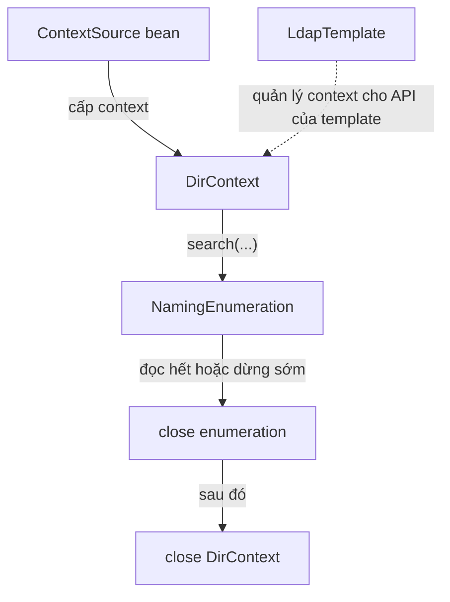

# Quản lý vòng đời DirContext và NamingEnumeration trong Spring Data LDAP

Khi làm việc với **Spring Data LDAP**, ứng dụng thường dùng `LdapRepository` hoặc `LdapTemplate` để tìm, đọc và cập nhật entry trong directory. Ở tầng thấp hơn, Java Naming and Directory Interface (**JNDI**) cung cấp hai đối tượng quan trọng: `DirContext` đại diện cho một context kết nối/tra cứu directory, còn `NamingEnumeration` đại diện cho luồng kết quả mà một thao tác như `search` trả về.

Hai đối tượng này có **vòng đời tài nguyên riêng**. Một `NamingEnumeration` chưa đóng có thể giữ tài nguyên tìm kiếm hoặc connection phía dưới; một `DirContext` không được giải phóng có thể giữ connection LDAP, socket hoặc một đối tượng đang được mượn từ connection pool. Nếu quên đóng, ứng dụng có thể chậm dần, cạn connection pool hoặc gặp lỗi chỉ xuất hiện khi tải tăng.

Bài học giải thích ai sở hữu từng đối tượng, khi nào cần đóng, cách Spring LDAP quản lý tài nguyên trong `LdapTemplate`, và cách xử lý khi gọi JNDI trực tiếp. Trọng tâm là **đóng enumeration trước context**, bảo đảm cleanup ngay cả khi đọc kết quả hoặc mapper phát sinh exception, và không chia sẻ context không an toàn giữa nhiều thread.

## 1. Mục tiêu học tập

Sau bài này, bạn có thể:

- Phân biệt vai trò và vòng đời của `DirContext`, `LdapContext`, `NamingEnumeration<T>` và `ContextSource`.
- Giải thích vì sao `NamingEnumeration` phải được đóng sau khi đọc kết quả, kể cả khi vòng lặp thất bại.
- Biết khi nào `LdapTemplate` tự quản lý context/enumeration và khi nào ứng dụng phải tự đóng.
- Sử dụng `ContextSource.getReadOnlyContext()` và `getReadWriteContext()` đúng mục đích.
- Dùng `LdapTemplate.executeReadOnly(...)`/`executeReadWrite(...)` cho thao tác JNDI tùy chỉnh mà vẫn giữ vòng đời context do template quản lý.
- Viết cleanup theo `try/finally`, bảo toàn exception chính và ghi nhận lỗi khi đóng tài nguyên.
- Hiểu cách connection pooling thay đổi ý nghĩa của `close()` mà không loại bỏ trách nhiệm đóng.
- Tránh chia sẻ `DirContext`/`NamingEnumeration` giữa thread, request hoặc tác vụ bất đồng bộ.
- Kiểm thử cleanup, exception, pool exhaustion và tải truy vấn trên directory test.

## 2. Bốn đối tượng cần phân biệt

| Đối tượng | Vai trò | Ai quản lý vòng đời? |
| --- | --- | --- |
| `ContextSource` | Factory cung cấp context LDAP cho ứng dụng. | Thường là bean singleton do Spring quản lý. |
| `DirContext` | Context JNDI dùng thao tác directory như lookup, search, bind và modify. | Bên đã lấy context từ `ContextSource` phải đóng, trừ khi một abstraction như `LdapTemplate` đang quản lý nó. |
| `NamingEnumeration<T>` | Duyệt kết quả search/list hoặc thao tác naming. | Bên gọi nhận enumeration phải gọi `close()` khi xong. |
| `LdapTemplate` | Abstraction thực hiện thao tác LDAP và quản lý việc lấy/giải phóng context trong các API thông thường. | Bean Spring; caller không đóng template sau từng request. |

Ví dụ quan hệ tài nguyên:



**Quy tắc thứ tự:** nếu enumeration được tạo từ context, hãy đóng **enumeration trước**, sau đó đóng **context**. Đóng context trong khi enumeration vẫn còn được sử dụng có thể làm thao tác đọc tiếp theo thất bại hoặc để lại trạng thái không rõ ràng ở provider.

## 3. `DirContext` và `NamingEnumeration<T>` làm gì?

### 3.1. `DirContext`

`DirContext` mở rộng JNDI `Context` để làm việc với thuộc tính directory. Một số thao tác thường gặp:

| API | Công việc |
| --- | --- |
| `lookup(name)` | Lấy object/context tại tên được chỉ định. |
| `getAttributes(name)` | Đọc attributes của entry. |
| `search(name, filter, controls)` | Tìm entry và trả về `NamingEnumeration<SearchResult>`. |
| `bind(name, obj, attrs)` | Tạo binding/entry theo semantics JNDI provider. |
| `rebind(name, obj, attrs)` | Thay binding hiện có hoặc tạo mới theo semantics provider. |
| `modifyAttributes(name, mods)` | Sửa một hoặc nhiều attribute của entry. |
| `unbind(name)` | Gỡ entry/binding tại tên. |
| `close()` | Giải phóng context và tài nguyên liên quan. |

Context thường gắn với một kết nối LDAP và trạng thái xác thực. Nó **không phải** một DTO bất biến để truyền giữa các layer hoặc giữ lâu trong field của service. Sau khi hoàn tất công việc, cần đóng nó để provider giải phóng tài nguyên hoặc trả đối tượng về pool.

### 3.2. `NamingEnumeration<T>`

Một thao tác search thường trả một enumeration:

```java
NamingEnumeration<SearchResult> results =
        context.search("ou=people", "(objectClass=inetOrgPerson)", controls);
```

Enumeration này được đọc bằng:

- `hasMore()`: kiểm tra còn kết quả, có thể ném `NamingException`.
- `next()`: lấy kết quả kế tiếp, có thể ném `NamingException`.
- `close()`: báo cho provider rằng caller đã đọc xong và enumeration không còn được sử dụng.

`NamingEnumeration` cung cấp phương thức `close()` riêng nhưng không triển khai `AutoCloseable`; vì vậy không thể mặc định đặt nó trực tiếp trong khối `try-with-resources`. Hãy dùng `try/finally` hoặc một helper cleanup có cùng bảo đảm.

**Không chỉ đóng khi đọc hết.** Nếu ứng dụng dừng sớm sau kết quả đầu tiên, filter validation thất bại, mapper ném exception hoặc request bị hủy, enumeration vẫn cần được đóng.

`NamingEnumeration` không nên được lưu vào field, cache, HTTP response hoặc trả về từ service để layer khác tiếp tục đọc sau khi context đã đóng. Hãy chuyển kết quả sang **DTO/collection** trong phạm vi tài nguyên còn mở.

## 4. Ai chịu trách nhiệm đóng tài nguyên?

Trách nhiệm phụ thuộc cách lấy context:

| Cách thao tác | Context | Enumeration |
| --- | --- | --- |
| `LdapTemplate.search(...)`, `lookup(...)`, `find(...)` | Template lấy và giải phóng context. | Template quản lý việc xử lý enumeration nội bộ. |
| `LdapTemplate.executeReadOnly(ctx -> ...)` | Template quản lý context cho callback. | Code callback tạo enumeration phải đóng enumeration. |
| `ContextSource.getReadOnlyContext()` | Caller phải đóng context. | Caller phải đóng enumeration do context trả về. |
| `ContextSource.getReadWriteContext()` | Caller phải đóng context. | Caller phải đóng enumeration nếu có thao tác trả enumeration. |
| `InitialDirContext`/`InitialLdapContext` tạo trực tiếp | Caller phải đóng context. | Caller phải đóng enumeration. |

**Đừng đóng một context mà `LdapTemplate` đang sở hữu.** Trong callback của `executeReadOnly`/`executeReadWrite`, template sẽ chịu trách nhiệm giải phóng context sau khi callback hoàn tất. Caller chỉ đóng các tài nguyên con mà chính callback tạo ra, chẳng hạn `NamingEnumeration`.

Ngược lại, nếu gọi trực tiếp `ContextSource.getReadOnlyContext()`, bạn đã nhận context và phải chịu trách nhiệm đóng nó trong mọi nhánh chạy.

## 5. Dùng `LdapTemplate`: để template quản lý context

Với các thao tác phổ biến, ưu tiên `LdapTemplate` hoặc repository. Ví dụ tìm người dùng:

```java
package com.example.directory;

import java.util.List;
import org.springframework.ldap.core.AttributesMapper;
import org.springframework.ldap.core.LdapTemplate;
import org.springframework.ldap.query.LdapQuery;
import org.springframework.ldap.query.SearchScope;
import org.springframework.stereotype.Service;

import static org.springframework.ldap.query.LdapQueryBuilder.query;

@Service
public class DirectoryUserReader {
    private final LdapTemplate ldapTemplate;

    public DirectoryUserReader(LdapTemplate ldapTemplate) {
        this.ldapTemplate = ldapTemplate;
    }

    public List<String> findUserIds() {
        LdapQuery q = query()
                .base("ou=people")
                .searchScope(SearchScope.ONELEVEL)
                .attributes("uid")
                .where("objectClass").is("inetOrgPerson");

        return ldapTemplate.search(
                q,
                (AttributesMapper<String>) attrs ->
                        String.valueOf(attrs.get("uid").get()));
    }
}
```

Ở đây:

- `LdapTemplate` tự lấy context phù hợp từ `ContextSource`.
- Template thực hiện search, ánh xạ các kết quả và đóng tài nguyên enumeration/context theo vòng đời thao tác.
- Service nhận `List<String>` đã được materialize; không cần và không được đóng context bên trong service.
- Caller có thể xử lý danh sách sau khi method trả về mà không phụ thuộc connection LDAP còn mở.

### 5.1. Đừng tự quản lý tài nguyên nội bộ của template

Không viết code kiểu:

```java
// Không nên: service không sở hữu context nội bộ của LdapTemplate.
ldapTemplate.search(query, mapper);
// Không có context nào để caller đóng ở đây.
```

`LdapTemplate` là bean có thể được chia sẻ qua nhiều request. Không tạo một template mới cho mỗi truy vấn chỉ để đóng nó sau đó; vòng đời của template/ContextSource được quản lý ở cấp ứng dụng.

### 5.2. Khi cần thao tác JNDI tùy chỉnh

Nếu cần một API JNDI chưa có abstraction tương ứng trong `LdapTemplate`, có thể dùng `executeReadOnly` hoặc `executeReadWrite`:

```java
import java.util.ArrayList;
import java.util.List;
import javax.naming.NamingEnumeration;
import javax.naming.NamingException;
import javax.naming.directory.SearchControls;
import javax.naming.directory.SearchResult;

import org.springframework.ldap.core.LdapTemplate;
import org.springframework.stereotype.Service;

@Service
public class CustomDirectorySearch {
    private final LdapTemplate ldapTemplate;

    public CustomDirectorySearch(LdapTemplate ldapTemplate) {
        this.ldapTemplate = ldapTemplate;
    }

    public List<String> readUids() {
        return ldapTemplate.executeReadOnly(ctx -> {
            SearchControls controls = new SearchControls();
            controls.setSearchScope(SearchControls.ONELEVEL_SCOPE);
            controls.setReturningAttributes(new String[]{"uid"});

            NamingEnumeration<SearchResult> results = ctx.search(
                    "ou=people",
                    "(objectClass=inetOrgPerson)",
                    controls);
            try {
                List<String> ids = new ArrayList<>();
                while (results.hasMore()) {
                    SearchResult row = results.next();
                    var uid = row.getAttributes().get("uid");
                    if (uid != null) {
                        ids.add(String.valueOf(uid.get()));
                    }
                }
                return List.copyOf(ids);
            } finally {
                results.close();
            }
        });
    }
}
```

**Phân chia ownership:**

- `executeReadOnly` lấy context và đóng context khi callback hoàn tất, kể cả callback ném exception.
- Callback phải đóng `NamingEnumeration` trong `finally` vì enumeration do chính callback tạo ra.
- Callback trả về `List<String>` độc lập; không trả enumeration hoặc context ra ngoài.
- Vì dùng read-only context, không thực hiện thao tác ghi trong callback này.

Nếu cần sửa entry, dùng `executeReadWrite` hoặc các API ghi của `LdapTemplate`. Không dùng read-only context cho thao tác thay đổi dữ liệu.

## 6. Gọi trực tiếp `ContextSource`: caller phải đóng context

Khi cần thao tác cấp thấp ngoài các callback của template, `ContextSource` có thể cung cấp `DirContext`:

```java
import java.util.ArrayList;
import java.util.List;
import javax.naming.NamingEnumeration;
import javax.naming.directory.DirContext;
import javax.naming.directory.SearchControls;
import javax.naming.directory.SearchResult;
import org.springframework.ldap.core.ContextSource;

public List<String> searchDirectly(ContextSource contextSource)
        throws NamingException {
    DirContext context = null;
    NamingEnumeration<SearchResult> results = null;
    try {
        context = contextSource.getReadOnlyContext();

        SearchControls controls = new SearchControls();
        controls.setSearchScope(SearchControls.ONELEVEL_SCOPE);
        controls.setReturningAttributes(new String[]{"uid"});

        results = context.search(
                "ou=people",
                "(objectClass=inetOrgPerson)",
                controls);

        List<String> ids = new ArrayList<>();
        while (results.hasMore()) {
            SearchResult row = results.next();
            var uid = row.getAttributes().get("uid");
            if (uid != null) {
                ids.add(String.valueOf(uid.get()));
            }
        }
        return List.copyOf(ids);
    } finally {
        try {
            if (results != null) {
                results.close();
            }
        } finally {
            if (context != null) {
                context.close();
            }
        }
    }
}
```

Đây là **mẫu minh họa** cho trách nhiệm đóng theo đúng thứ tự. Trong một lớp production, hãy khai báo rõ import/kiểu trả về và xử lý exception theo contract của service; ví dụ dùng `NamingException` để thể hiện lỗi JNDI cụ thể.

### 6.1. Vì sao phải có hai tầng `finally`?

Nếu `results.close()` ném `NamingException`, một `finally` đơn giản có thể làm `context.close()` không chạy. Hai tầng `finally` đảm bảo việc đóng context vẫn được thử sau khi đóng enumeration.

Tuy nhiên, cấu trúc này có một giới hạn: exception phát sinh khi đóng có thể thay thế exception chính đang được ném từ vòng lặp. Trong code production cần **bảo toàn exception chính và gắn lỗi cleanup thành suppressed exception**, hoặc dùng helper cleanup tương đương với ngữ nghĩa try-with-resources.

Một helper có thể giữ lỗi cleanup mà không che lỗi chính:

```java
private static void closeResources(
        NamingEnumeration<?> enumeration,
        DirContext context,
        Throwable primaryFailure) throws NamingException {

    NamingException closeFailure = null;

    if (enumeration != null) {
        try {
            enumeration.close();
        } catch (NamingException ex) {
            closeFailure = ex;
        }
    }

    if (context != null) {
        try {
            context.close();
        } catch (NamingException ex) {
            if (closeFailure == null) {
                closeFailure = ex;
            } else {
                closeFailure.addSuppressed(ex);
            }
        }
    }

    if (closeFailure != null) {
        if (primaryFailure != null) {
            primaryFailure.addSuppressed(closeFailure);
        } else {
            throw closeFailure;
        }
    }
}
```

Cách gọi:

```java
Throwable primaryFailure = null;
try {
    // Mở context, tạo enumeration, đọc kết quả.
} catch (NamingException | RuntimeException | Error ex) {
    primaryFailure = ex;
    throw ex;
} finally {
    closeResources(results, context, primaryFailure);
}
```

Đoạn này là **mẫu cấu trúc**, cần khai báo `results`/`context` ở scope bao ngoài và dùng cùng kiểu exception của method. Mục tiêu là không che exception gốc bằng lỗi close; không được âm thầm nuốt lỗi cleanup nếu việc giải phóng tài nguyên thất bại.

## 7. Vì sao `NamingEnumeration` cần được đóng riêng?

Một search có thể trả nhiều kết quả hơn số lượng ứng dụng cần. Provider có thể dùng cursor, buffer, paging hoặc tài nguyên giao tiếp phía dưới. `NamingEnumeration.close()` báo cho provider rằng caller đã kết thúc việc đọc.

Các tình huống phải đóng:

| Tình huống | Cách xử lý |
| --- | --- |
| Đã duyệt hết kết quả | Đóng enumeration ngay sau vòng lặp. |
| Tìm thấy kết quả đầu tiên và return sớm | `finally` vẫn phải đóng enumeration. |
| Mapper/logic Java ném exception | `finally` vẫn phải đóng enumeration. |
| `hasMore()` hoặc `next()` ném `NamingException` | `finally` vẫn phải đóng enumeration. |
| Request bị hủy hoặc timeout | Đảm bảo đường cleanup chạy; không giữ enumeration trong tác vụ sống lâu. |
| Chỉ đọc một vài kết quả đầu tiên | Đóng enumeration sau khi dừng, không đợi nó tự hết. |

Không được suy ra rằng “đã đọc được một số kết quả” nghĩa là server đã giải phóng tài nguyên. Nếu caller dừng sớm, chính caller phải kết thúc enumeration.

### 7.1. Vì sao không thể trả `NamingEnumeration` từ service?

Ví dụ thiết kế sai:

```java
public NamingEnumeration<SearchResult> searchUsers() throws NamingException {
    DirContext context = contextSource.getReadOnlyContext();
    return context.search("ou=people", "(objectClass=inetOrgPerson)");
}
```

Method này trả enumeration nhưng **không giữ được quyền sở hữu rõ ràng** đối với context. Layer gọi có thể không biết phải đóng context nào, và nếu context bị đóng ngay sau đó thì enumeration không còn hợp lệ.

Thiết kế tốt hơn là trả collection/DTO:

```java
public List<UserSummary> searchUsers() {
    return ldapTemplate.search(
            query().base("ou=people")
                    .where("objectClass").is("inetOrgPerson"),
            (ContextMapper<UserSummary>) ctx ->
                    new UserSummary(
                            ctx.getNameInNamespace()));
}
```

`LdapTemplate` quản lý resource nội bộ; service chỉ trả dữ liệu đã được materialize. Nếu cần streaming cho tập dữ liệu rất lớn, hãy dùng API callback/streaming có **contract vòng đời rõ ràng**, không trả thẳng JNDI enumeration qua nhiều layer.

## 8. `getReadOnlyContext()` và `getReadWriteContext()`

`ContextSource` phân biệt context chỉ đọc và context có thể ghi:

| API | Dùng khi | Lưu ý |
| --- | --- | --- |
| `getReadOnlyContext()` | Search, lookup, đọc attribute. | Không dùng để thực hiện thay đổi entry. |
| `getReadWriteContext()` | Add, modify, rename hoặc delete entry. | Cần quyền ghi phù hợp theo LDAP ACL. |

Tên phương thức phản ánh **ý định và cấu hình context**; không nên coi đó là cơ chế authorization duy nhất. Quyền thực tế vẫn do LDAP server và ACL quyết định. Một tài khoản chỉ đọc không trở thành tài khoản có quyền ghi chỉ vì caller dùng `getReadWriteContext()`.

### 8.1. Không giữ context trong field của service singleton

Không viết:

```java
@Service
class BadDirectoryService {
    private final DirContext context; // Không giữ context dùng chung.

    BadDirectoryService(ContextSource source) throws NamingException {
        this.context = source.getReadOnlyContext();
    }
}
```

Spring service thường là singleton; nhiều request có thể gọi cùng instance đồng thời. `DirContext` không được thiết kế để dùng chung như một bean stateless giữa nhiều thread. Nó còn có vòng đời kết nối và trạng thái xác thực, do đó giữ lâu trong field có thể làm rò connection, gây race hoặc dùng nhầm identity.

Thay vào đó:

- Inject `ContextSource`/`LdapTemplate` singleton.
- Lấy context **trong phạm vi một thao tác** khi cần dùng trực tiếp.
- Đóng context trước khi method kết thúc.
- Không truyền context qua executor, callback bất đồng bộ hoặc request khác.

## 9. Connection pooling: `close()` vẫn bắt buộc

Một ứng dụng tải cao có thể cấu hình connection pooling để tránh tạo TCP/TLS connection mới cho mọi thao tác. Một implementation như `PoolingContextSource` có thể mượn context từ pool và trả context về pool khi context được đóng.

Điều này **không** có nghĩa caller được giữ context mãi hoặc không cần gọi `close()`:

```text
ContextSource.getReadOnlyContext()
        |
        v
Borrow context từ pool
        |
        v
Thực hiện search / lookup
        |
        v
Đóng NamingEnumeration
        |
        v
DirContext.close()
        |
        v
Trả context về pool (nếu pooling được cấu hình)
```

Nếu không đóng context, pool có thể xem nó vẫn đang được mượn. Khi số context đang mượn chạm giới hạn, request mới phải chờ hoặc thất bại do pool exhaustion.

### 9.1. Pool không làm context thread-safe

Pooling chỉ quản lý việc **tái sử dụng** đối tượng/kết nối theo implementation; nó không cho phép hai thread cùng thao tác một `DirContext` đang được mượn. Một context chỉ nên được một đơn vị công việc sử dụng tại một thời điểm, sau đó đóng/trả về pool.

Không lưu context được mượn trong cache hoặc truyền sang một thread khác trong khi thread đầu vẫn đang dùng nó.

### 9.2. Pool validation và credential rotation

Khi dùng pooling, cần quan tâm:

- **Test on borrow/return/idle:** kiểm tra context còn dùng được theo cấu hình pool/provider.
- **Idle eviction:** dọn context không còn hợp lệ hoặc vượt thời gian nhàn rỗi.
- **Max active/idle:** đặt giới hạn hợp lý để không làm quá tải LDAP server.
- **Wait/timeout:** giới hạn thời gian chờ khi pool cạn.
- **Credential thay đổi:** connection đã bind trước đó có thể giữ trạng thái cũ; pool cần được làm mới/clear hoặc ứng dụng phải rolling restart theo kế hoạch.
- **TLS certificate thay đổi:** SSL context/connection đã mở có thể không tự nhận truststore mới; cần kiểm tra lifecycle và reconnect.

Đừng bật pool mà không kiểm thử lỗi bind, server restart, connection stale, rotation password và shutdown ứng dụng.

## 10. Đọc nhiều kết quả, giới hạn và xử lý exception

### 10.1. Luôn đóng trong nhánh lỗi

Một vòng lặp có thể ném exception từ cả `hasMore()` và `next()`:

```java
NamingEnumeration<SearchResult> results = context.search(
        "ou=people", "(objectClass=inetOrgPerson)", controls);
try {
    while (results.hasMore()) {
        SearchResult row = results.next();
        process(row);
    }
} finally {
    results.close();
}
```

Nếu `process(row)` ném exception, `finally` vẫn chạy. Nếu `results.close()` cũng ném exception, lỗi cleanup có thể ảnh hưởng exception chính; code production nên giữ exception gốc và thêm cleanup error dưới dạng suppressed như mẫu mục 6.1.

### 10.2. Giới hạn kết quả search

`SearchControls` có thể cấu hình:

```java
SearchControls controls = new SearchControls();
controls.setSearchScope(SearchControls.SUBTREE_SCOPE);
controls.setCountLimit(500);
controls.setTimeLimit(3_000);
controls.setReturningAttributes(new String[]{"uid", "cn"});
controls.setReturningObjFlag(false);
```

Các giá trị minh họa:

- `setCountLimit(500)` giới hạn số kết quả theo API JNDI; giới hạn server và semantics của provider vẫn cần kiểm tra.
- `setTimeLimit(3_000)` đặt giới hạn thời gian tìm kiếm (milliseconds) trong search controls; cần kết hợp network/socket timeout và timeout ứng dụng.
- `setReturningAttributes(...)` chỉ yêu cầu các thuộc tính cần dùng, giảm dữ liệu và nguy cơ lộ thuộc tính nhạy cảm.
- `setReturningObjFlag(false)` tránh yêu cầu provider dựng object được serialize từ directory nếu ứng dụng chỉ cần attributes.

Giới hạn search **không thay thế** cleanup. Dù search trả ít kết quả, enumeration vẫn phải được đóng.

### 10.3. Phân biệt lỗi LDAP và lỗi đóng tài nguyên

| Lỗi | Diễn giải | Hướng xử lý |
| --- | --- | --- |
| `CommunicationException` | Kết nối/server/network gặp vấn đề. | Kiểm tra TLS, endpoint, timeout, trạng thái server. |
| `AuthenticationException`/`AuthenticationNotSupportedException` | Lỗi xác thực/cơ chế bind. | Kiểm tra credential và cơ chế xác thực; không log password. |
| `NameNotFoundException` | DN/base không tồn tại. | Kiểm tra naming context và DN tương đối/đầy đủ. |
| `SizeLimitExceededException` | Vượt giới hạn kết quả. | Thu hẹp scope/filter hoặc dùng paging phù hợp. |
| `TimeLimitExceededException` | Search vượt giới hạn thời gian. | Kiểm tra index, filter, server load và timeout. |
| Lỗi khi `NamingEnumeration.close()` | Provider không giải phóng enumeration sạch. | Ghi nhận cleanup failure, tiếp tục đóng context và giám sát pool. |
| Lỗi khi `DirContext.close()` | Đóng context/trả pool gặp vấn đề. | Không bỏ qua âm thầm; kiểm tra pool/provider và trạng thái connection. |

`LdapTemplate` thường dịch `NamingException` thành hệ exception của Spring LDAP/Spring DAO. Khi gọi JNDI trực tiếp, caller phải xử lý `NamingException` theo API. Dù theo cách nào, không nên bắt exception rồi trả danh sách rỗng như thể search thành công.

## 11. `executeReadOnly` và `executeReadWrite` cho thao tác nâng cao

Đây là hai abstraction hữu ích khi cần truy cập context trong một callback:

```java
List<String> ids = ldapTemplate.executeReadOnly(ctx -> {
    // ctx do LdapTemplate cấp và sẽ được template đóng.
    // Nếu gọi ctx.search(...), caller vẫn đóng enumeration.
    return ...;
});
```

Với thao tác ghi:

```java
String updatedDn = ldapTemplate.executeReadWrite(ctx -> {
    // Dùng ctx cho thao tác ghi trong phạm vi callback.
    // Không tự đóng ctx do template sở hữu.
    return ...;
});
```

Không giữ tham chiếu `ctx` trong biến instance hoặc trả nó từ callback. Hãy trả kết quả đã chuyển đổi thành DTO/giá trị Java. Context được template cấp có vòng đời gắn với callback, và sau khi callback kết thúc, caller không được tiếp tục dùng nó.

### 11.1. Tránh lồng nhiều callback/context không cần thiết

Không gọi `executeReadOnly` rồi trong callback lại tạo một context mới qua `ContextSource.getReadOnlyContext()` nếu thao tác có thể dùng trực tiếp context đã được cấp. Mỗi context bổ sung có thể tiêu thụ thêm một connection, làm tăng nguy cơ pool exhaustion và khiến transaction/identity khó theo dõi.

Nếu cần nhiều thao tác trên cùng context, thực hiện chúng trong **một callback** khi semantics cho phép; nếu cần thao tác độc lập, dùng API template riêng.

## 12. Bất đồng bộ và hủy tác vụ

Không truyền `DirContext` hoặc `NamingEnumeration` sang:

- `CompletableFuture`/`ExecutorService` để xử lý sau khi method trả về.
- Reactor pipeline hoặc callback chạy muộn sau khi `executeReadOnly` hoàn tất.
- Cache hoặc queue để một request khác tiếp tục duyệt.
- Thread khác trong khi thread hiện tại vẫn thao tác context.

Một pattern an toàn hơn:

1. Mở context/enumeration trong phạm vi callback.
2. Đọc kết quả cần thiết và chuyển sang DTO bất biến.
3. Đóng enumeration và context.
4. Chỉ sau đó gửi DTO sang executor/queue.

Nếu phải streaming lượng dữ liệu lớn, thiết kế API có lifecycle rõ ràng, cancellation và backpressure; đảm bảo hủy downstream sẽ kích hoạt cleanup. Không tạo stream mà enumeration/context đã bị đóng trước khi consumer đọc, cũng không để stream bỏ quên resource khi consumer dừng sớm.

## 13. Kiểm thử vòng đời tài nguyên

Mock một lời gọi `LdapTemplate.search` có thể xác minh mapper, nhưng không đủ chứng minh pool không cạn hoặc JNDI enumeration được đóng trên lỗi. Cần kết hợp unit test và integration test.

### 13.1. Các kịch bản nên kiểm thử

| Trường hợp | Điều cần xác minh |
| --- | --- |
| Search thành công, có nhiều kết quả | Danh sách trả đúng, context/enumeration được giải phóng. |
| Search không có kết quả | Trả collection rỗng đúng nghĩa; resource vẫn được đóng. |
| Mapper ném exception giữa vòng lặp | Enumeration và context vẫn được đóng. |
| Caller dừng sau kết quả đầu tiên | Enumeration vẫn được đóng trong finally. |
| `hasMore()`/`next()` lỗi | Cleanup chạy và exception gốc được giữ. |
| Đóng enumeration lỗi | Context vẫn được đóng; lỗi cleanup được ghi nhận. |
| ContextSource trực tiếp | Caller đóng context trong mọi nhánh. |
| `LdapTemplate.executeReadOnly` | Template đóng context; callback đóng enumeration. |
| Pool max active nhỏ | Sau nhiều request, connection được trả lại; không tăng số borrowed context vô hạn. |
| Directory restart hoặc network ngắt | Request lỗi có kiểm soát, context lỗi không bị giữ trong pool mãi. |
| Nhiều request đồng thời | Không dùng chung context/enumeration; không có lỗi trạng thái chéo. |
| Shutdown ứng dụng | Pool/context source được lifecycle container dọn theo cấu hình. |

### 13.2. Integration test với Spring Boot

Ví dụ test dùng `LdapTemplate` để xác minh kết quả được materialize:

```java
package com.example.directory;

import static org.junit.jupiter.api.Assertions.assertTrue;

import java.util.List;
import org.junit.jupiter.api.Test;
import org.springframework.beans.factory.annotation.Autowired;
import org.springframework.boot.test.context.SpringBootTest;
import org.springframework.test.context.ActiveProfiles;

@SpringBootTest
@ActiveProfiles("test")
class DirectoryContextLifecycleIT {
    @Autowired DirectoryUserReader reader;

    @Test
    void returnsMaterializedResults() {
        List<String> ids = reader.findUserIds();
        assertTrue(ids.contains("alice"));
    }
}
```

Test giả định directory test đã seed `alice` và Spring LDAP được cấu hình đúng. Nó xác minh hành vi đọc, nhưng để kiểm tra resource lifecycle sâu hơn cần test trực tiếp callback/context hoặc pool metrics.

### 13.3. Test lỗi callback

Có thể tạo một service test dùng `executeReadOnly` và cố ý ném exception trong callback sau khi tạo enumeration. Sau đó gọi lại một truy vấn khác và kiểm tra hệ thống vẫn hoạt động. Với pool có giới hạn nhỏ, test này giúp phát hiện context không được trả lại.

Không chỉ assert rằng exception được ném. Cần xác minh:

- Lần gọi tiếp theo có lấy được context không.
- Pool borrowed/active count trở lại mức mong đợi (nếu implementation cung cấp metric).
- Không còn enumeration/context được lưu trong object/service.
- Exception cleanup không làm mất exception nghiệp vụ gốc.

### 13.4. Kiểm thử đồng thời

Chạy nhiều thread đồng thời qua một `LdapTemplate` singleton. Mỗi tác vụ phải nhận kết quả độc lập; không truyền cùng `DirContext` cho các thread. Nếu dùng pool, giới hạn pool và timeout nên được chọn để test có thể phát hiện tình huống mượn quá mức nhưng không gây tải không kiểm soát lên directory.

## 14. Checklist vận hành

- [ ] `ContextSource` và `LdapTemplate` được quản lý như bean dùng chung; không tạo mới theo từng request nếu không có lý do.
- [ ] Mỗi `DirContext` lấy trực tiếp từ `ContextSource` được đóng trong mọi nhánh.
- [ ] Mỗi `NamingEnumeration` được đóng, kể cả dừng sớm hoặc exception.
- [ ] Đóng enumeration **trước** context.
- [ ] Callback `LdapTemplate.executeReadOnly/executeReadWrite` không tự đóng context mà template sở hữu.
- [ ] Không trả `DirContext`/`NamingEnumeration` ra ngoài service hoặc giữ trong field/cache.
- [ ] Không chia sẻ context giữa thread/request.
- [ ] Nếu dùng pool, kiểm tra borrow/return, max active, timeout, stale connection và rotation credential.
- [ ] Search có scope, projection, count/time limit phù hợp; không tải thuộc tính không cần thiết.
- [ ] Lỗi cleanup được quan sát, không nuốt im lặng hoặc che exception chính.
- [ ] Có test success, empty result, early exit, mapper exception, network failure và concurrent access.

## 15. Bài tập thực hành

**Bài 1.** `LdapTemplate.search(...)` trả về `List<User>`. Service có phải tự lấy và đóng `DirContext` không?

**Đáp án:** Không. `LdapTemplate` quản lý context và enumeration nội bộ của thao tác search. Service nhận dữ liệu đã materialize và không sở hữu context nội bộ.

**Bài 2.** Trong `executeReadOnly(ctx -> ...)`, callback gọi `ctx.search(...)` và nhận `NamingEnumeration`. Ai đóng cái nào?

**Đáp án:** `LdapTemplate` quản lý context `ctx`; callback phải đóng `NamingEnumeration` mà nó tạo ra trước khi callback kết thúc.

**Bài 3.** Vòng lặp search tìm thấy kết quả đầu tiên rồi `return` ngay. Có cần gọi `results.close()` không?

**Đáp án:** Có. Dùng `finally` để đóng enumeration dù return sớm.

**Bài 4.** Nếu `results.close()` ném exception thì `context.close()` có còn phải được thử không?

**Đáp án:** Có. Dùng cleanup lồng nhau hoặc helper để bảo đảm context vẫn được đóng; đồng thời giữ exception chính và gắn lỗi cleanup thành suppressed khi phù hợp.

**Bài 5.** Ứng dụng bật connection pool. Vì sao vẫn phải gọi `context.close()`?

**Đáp án:** `close()` thường trả context được mượn về pool. Không gọi close khiến context vẫn bị coi là đang mượn, dẫn đến pool exhaustion.

**Bài 6.** Có thể lưu `DirContext` vào field của một Spring singleton service để tiết kiệm kết nối không?

**Đáp án:** Không. Context không an toàn để dùng chung giữa nhiều thread và có vòng đời kết nối; hãy dùng `ContextSource`/`LdapTemplate` và lấy context trong phạm vi thao tác.

**Bài 7.** Có thể trả `NamingEnumeration` từ service để controller đọc dần không?

**Đáp án:** Không nên. Controller không sở hữu context rõ ràng và enumeration có thể hết hiệu lực khi context đóng. Hãy materialize thành DTO/collection hoặc thiết kế streaming API có lifecycle/cancellation rõ ràng.

**Bài 8.** Một mapper ném exception sau khi đọc 10 kết quả. Resource phải được xử lý ra sao?

**Đáp án:** Enumeration phải được đóng trong finally; nếu caller tự lấy context thì context cũng phải được đóng sau enumeration. Không nuốt exception mapper.

## 16. Ghi nhớ

- **`DirContext` là tài nguyên có vòng đời**, không phải object stateless để giữ trong service singleton hoặc chia sẻ giữa thread.
- **`NamingEnumeration` phải được đóng**, ngay cả khi đọc hết, dừng sớm, mapper lỗi hoặc request bị hủy.
- Khi dùng **`LdapTemplate` API thông thường**, template quản lý context và enumeration nội bộ. Khi dùng `executeReadOnly/executeReadWrite`, template quản lý context nhưng callback phải đóng enumeration tự tạo.
- Khi gọi trực tiếp `ContextSource.getReadOnlyContext()/getReadWriteContext()`, caller chịu trách nhiệm đóng context.
- **Đóng enumeration trước context**; xử lý cleanup sao cho lỗi close không che exception chính.
- Connection pool làm `close()` trả context về pool; **không** loại bỏ trách nhiệm đóng và không làm context thread-safe.
- Trả DTO/collection thay vì `DirContext`/`NamingEnumeration`. Với streaming, cần thiết kế rõ cancellation và cleanup.
- Giới hạn scope/kết quả/time, giám sát pool và kiểm thử exception/concurrency để phát hiện resource leak sớm.

## Tài liệu tham khảo

- [Spring LDAP — Reference](https://docs.spring.io/spring-ldap/reference/): `ContextSource`, `LdapTemplate`, context callback và pooling.
- [Spring LDAP — LdapTemplate API](https://docs.spring.io/spring-ldap/docs/current/api/org/springframework/ldap/core/LdapTemplate.html): các phương thức search, lookup, execute callback.
- [Java API — DirContext](https://docs.oracle.com/en/java/javase/17/docs/api/java.naming/javax/naming/directory/DirContext.html): thao tác directory và vòng đời context.
- [Java API — NamingEnumeration](https://docs.oracle.com/en/java/javase/17/docs/api/java.naming/javax/naming/NamingEnumeration.html): duyệt kết quả và phương thức close.
- [Java API — Context](https://docs.oracle.com/en/java/javase/17/docs/api/java.naming/javax/naming/Context.html): JNDI context và giải phóng tài nguyên.
