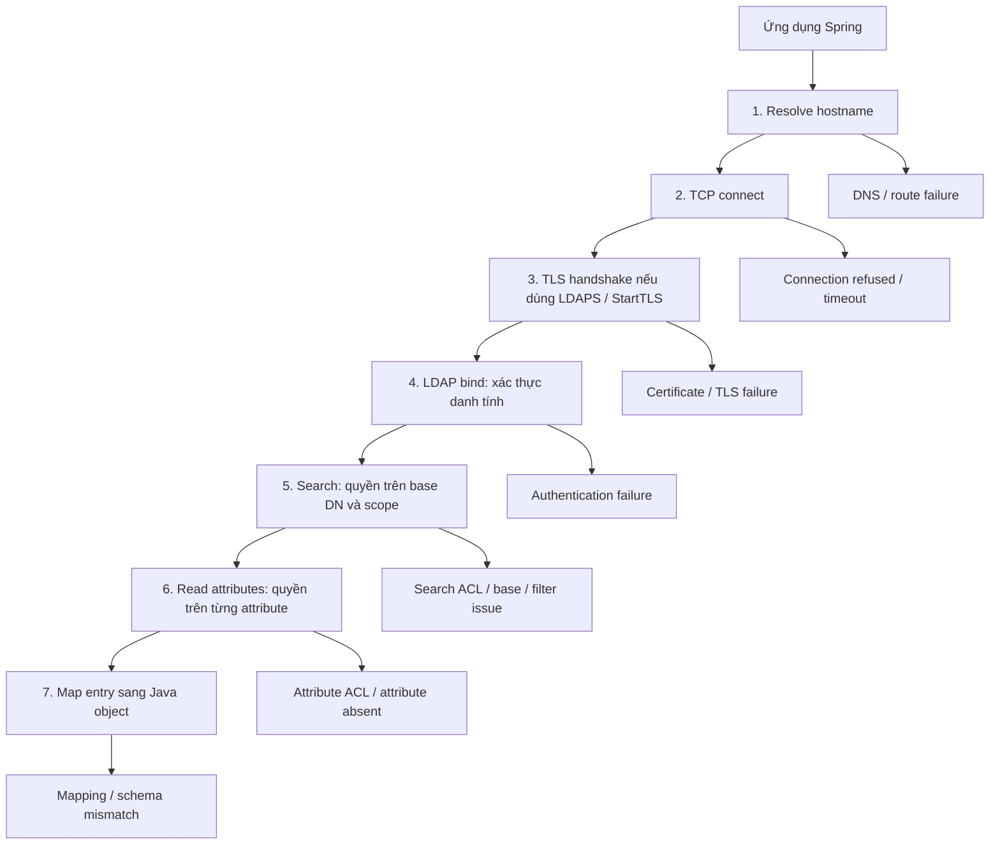

# Phân biệt không kết nối được với không đủ quyền đọc dữ liệu

> **Chương:** Kết nối  
> **Module:** SPRING_DATA_LDAP — truy cập dịch vụ thư mục LDAP qua Spring Data LDAP repository và Spring LDAP `LdapTemplate`, ánh xạ entry phân cấp sang Java; hiểu DN, `objectClass`, schema, truy vấn repository/LdapTemplate, CRUD, filter an toàn, bảo mật kết nối và kiểm thử với directory.

## Mục tiêu học tập

Sau bài này, bạn có thể:

1. Chia quá trình truy cập LDAP thành các lớp: DNS/TCP, TLS, bind, quyền search/read entry, quyền đọc attribute và mapping.
2. Phân biệt lỗi kết nối, lỗi xác thực và lỗi phân quyền dựa trên bằng chứng phù hợp.
3. Giải thích vì sao bind thành công không có nghĩa service account được phép đọc mọi OU hoặc mọi attribute.
4. Nhận diện các LDAP result code thường gặp như `invalidCredentials (49)`, `insufficientAccessRights (50)` và `noSuchObject (32)`.
5. Dùng `ldapwhoami` và `ldapsearch` để kiểm tra cùng endpoint, bind identity, base DN và filter với ứng dụng.
6. Kiểm tra bind riêng bằng `ContextSource` và kiểm tra quyền đọc bằng một search thực tế qua `LdapTemplate`.
7. Phân biệt search trả danh sách rỗng với lỗi ACL; hiểu rằng một số directory có thể che giấu entry/attribute theo policy.
8. Thiết kế log, exception mapping, health checks và integration tests mà không làm lộ credentials hoặc dữ liệu cá nhân.

## 1. Vì sao cần phân biệt hai nhóm lỗi?

Một ứng dụng Spring Boot có thể báo “không đọc được LDAP” trong nhiều tình huống khác nhau:

- Host LDAP không phân giải DNS được.
- TCP port bị firewall chặn hoặc server không lắng nghe.
- TLS handshake thất bại do certificate, hostname hoặc truststore.
- Server nhận kết nối nhưng bind credentials không hợp lệ.
- Bind thành công, nhưng service account không có quyền search OU.
- Search được phép, nhưng không có quyền đọc một số attributes.
- Entry có thể đọc, nhưng mapper yêu cầu một attribute không tồn tại hoặc không được trả về.

Các tình huống này có cách xử lý khác nhau. Đổi password không sửa được firewall; tăng timeout không cấp thêm quyền đọc; dùng administrator account để “thử cho chạy” có thể che giấu lỗi cấu hình quyền của service account.

**Nguyên tắc:** chẩn đoán theo từng lớp và ghi nhận bằng chứng ở lớp đầu tiên thất bại.

## 2. Luồng truy cập LDAP theo từng lớp



Một request có thể đi qua các bước đầu rồi thất bại ở bước sau. Ví dụ:

1. TCP kết nối tới `ldap.example.org:636` thành công.
2. TLS handshake xác minh certificate thành công.
3. Bind bằng `cn=app-reader,ou=services,dc=example,dc=org` thành công.
4. Search vào `ou=people,dc=example,dc=org` trả `insufficientAccessRights`.
5. Ứng dụng không nhận được danh sách nhân viên.

Trong trường hợp này, kết nối và xác thực đã hoạt động; vấn đề nằm ở quyền thực hiện search hoặc policy của directory đối với base/scope/filter đó.

### Những khái niệm phải tách riêng

| Khái niệm | Câu hỏi cần trả lời | Ví dụ lỗi |
| --- | --- | --- |
| **Connectivity** | Ứng dụng có tới được endpoint không? | DNS failure, connection refused, timeout |
| **TLS** | Kênh bảo mật có được thiết lập và xác minh không? | Certificate expired, hostname mismatch |
| **Authentication / bind** | Danh tính bind có được server chấp nhận không? | LDAP result code 49 |
| **Authorization** | Bind identity có quyền thực hiện operation trên dữ liệu không? | LDAP result code 50 |
| **Search semantics** | Base, scope, filter có trỏ tới dữ liệu mong muốn không? | Base không tồn tại, filter không match |
| **Attribute access** | Attribute được yêu cầu có được trả về không? | Attribute bị ẩn hoặc bị từ chối |
| **Mapping** | Java mapper có hiểu dữ liệu thực tế không? | Null, conversion error, schema mismatch |

## 3. Nhận diện lỗi ở từng lớp

### 3.1. DNS và TCP: chưa có LDAP response

Ví dụ các biểu hiện:

- `UnknownHostException`: hostname không phân giải được.
- `ConnectException: Connection refused`: host tới được nhưng port không nhận kết nối.
- `SocketTimeoutException`: kết nối hoặc thao tác mạng vượt thời gian chờ.
- `No route to host`: không có đường mạng phù hợp.

Đây là lỗi ở tầng mạng/client. Thông thường server chưa nhận được LDAP operation nên chưa có LDAP result code để kết luận ACL.

Kiểm tra:

- URL đúng host/port chưa?
- DNS từ đúng máy/container/pod có trả IP đúng không?
- Firewall, security group, Kubernetes NetworkPolicy hoặc proxy có chặn không?
- LDAP listener có đang hoạt động không?
- Endpoint đang dùng LDAP `389`, LDAPS `636` hay một port tùy chỉnh?

Không kết luận “sai quyền LDAP” chỉ từ `Connection refused` hoặc `UnknownHostException`.

### 3.2. TLS: TCP mở được nhưng kênh bảo mật thất bại

Với LDAPS, TCP có thể kết nối thành công nhưng TLS handshake thất bại do:

- CA không nằm trong truststore của JVM;
- certificate hết hạn hoặc chưa có hiệu lực;
- hostname trên certificate không khớp URL;
- server thiếu intermediate certificate;
- protocol/cipher không tương thích;
- ứng dụng kết nối nhầm endpoint.

Với StartTLS, client bắt đầu trên LDAP rồi nâng cấp kết nối bằng TLS trước khi gửi bind credentials theo chính sách bảo mật. Cần xác minh đúng cách cấu hình của provider và directory server.

Ví dụ kiểm tra LDAPS bằng OpenSSL:

```bash
openssl s_client \
  -connect ldap.example.org:636 \
  -servername ldap.example.org \
  -showcerts
```

Lệnh này giúp xem certificate chain và handshake. Nó không thay thế kiểm tra cấu hình truststore của đúng JVM chạy ứng dụng. Không dùng trust-all hoặc tắt hostname verification để bỏ qua lỗi certificate.

### 3.3. Bind: server không chấp nhận danh tính hoặc phương thức xác thực

LDAP bind kiểm tra danh tính và authentication mechanism. Với simple bind, các nguyên nhân thường gặp:

- Bind DN sai;
- Password sai hoặc đã hết hạn;
- Account bị khóa/disabled;
- Password vừa rotate nhưng ứng dụng vẫn dùng secret cũ;
- Server yêu cầu cơ chế xác thực mạnh hơn;
- Simple bind bị cấm trên kết nối không mã hóa.

LDAP result code thường gặp:

| Result code | Tên | Ý nghĩa thường gặp |
| ---: | --- | --- |
| **49** | `invalidCredentials` | Danh tính/password hoặc credential không được chấp nhận |
| **7** | `authMethodNotSupported` | Server không hỗ trợ authentication method được yêu cầu |
| **8** | `strongerAuthRequired` | Server yêu cầu cơ chế xác thực/kênh bảo mật mạnh hơn |
| **13** | `confidentialityRequired` | Server yêu cầu bảo vệ tính bí mật cho operation |

Một số server cố ý không tiết lộ account bị khóa, DN không tồn tại hay password sai khác nhau như thế nào. Vì vậy không dựa vào diagnostic message chi tiết để thiết kế logic bảo mật.

**Bind thành công chỉ chứng minh server chấp nhận danh tính theo cơ chế bind đã dùng.** Nó không chứng minh account có quyền đọc mọi entry.

### 3.4. Search và read: bind thành công nhưng không đủ quyền

Khi bind đã thành công, LDAP server vẫn kiểm tra quyền cho từng operation:

- Search được phép ở base DN nào?
- Có được duyệt các entry con trong subtree không?
- Có được đọc entry tìm thấy không?
- Có được đọc các attribute cụ thể không?
- Có được dùng attribute trong filter không?
- Có được đọc operational attributes không?

LDAP result code quan trọng:

| Result code | Tên | Ý nghĩa thường gặp |
| ---: | --- | --- |
| **50** | `insufficientAccessRights` | Bind identity không đủ quyền cho operation |
| **32** | `noSuchObject` | Base DN hoặc entry được tham chiếu không tồn tại trong view của server |
| **3** | `timeLimitExceeded` | Search vượt giới hạn thời gian |
| **4** | `sizeLimitExceeded` | Search vượt giới hạn số kết quả |
| **10** | `referral` | Server chỉ dẫn client tới naming context/server khác |
| **52** | `unavailable` | Dịch vụ directory không sẵn sàng cho operation |

Result code 50 là bằng chứng rõ về việc operation bị từ chối vì quyền. Tuy nhiên, **không phải mọi lỗi quyền đều nhất thiết xuất hiện dưới code 50**. Một số directory dùng ACL để che giấu entry, trả kết quả rỗng, không trả attribute hoặc thể hiện hành vi khác theo policy.

### 3.5. Attribute-level ACL: entry thấy được nhưng một số field bị thiếu

Directory có thể cấp quyền khác nhau theo attribute. Ví dụ service account được đọc `uid` và `cn`, nhưng không được đọc `telephoneNumber` hoặc một attribute nhạy cảm.

Khi search thành công, kết quả có thể không chứa attribute bị hạn chế. Mapper sau đó có thể nhận `null` hoặc lỗi nếu code giả định attribute luôn tồn tại.

Phân biệt:

- Attribute không tồn tại trên entry;
- Client không yêu cầu attribute đó;
- Attribute bị ACL ẩn;
- Server/provider không trả operational attribute theo mặc định;
- Mapper dùng sai tên attribute hoặc sai kiểu dữ liệu.

**Attribute không xuất hiện không tự chứng minh ACL đã từ chối.** Cần kiểm tra fixture/schema, requested attributes, quyền account và hành vi directory server.

## 4. Bảng chẩn đoán nhanh

| Triệu chứng | Lớp nghi vấn đầu tiên | Bằng chứng cần thu thập |
| --- | --- | --- |
| `UnknownHostException` | DNS | Kết quả resolve từ đúng runtime |
| `Connection refused` | TCP/listener/firewall | Host, port, listener và network path |
| Connect timeout | TCP/network | Route, firewall, endpoint health |
| `SSLHandshakeException` | TLS | Certificate chain, hostname, truststore |
| LDAP code 49 | Bind/authentication | Bind DN, secret version, account state |
| Bind thành công, search code 50 | Search authorization | Bind identity, base DN, operation và ACL |
| Search trả 0 entries | Base/filter/ACL visibility | Base, scope, filter, quyền và dữ liệu test |
| Search thành công, thiếu `mail` | Attribute/schema/request | Requested attributes, schema, attribute ACL |
| `NameNotFoundException` / code 32 | DN/base hoặc directory view | DN tương đối, base của ContextSource, endpoint |
| `TimeLimitExceededException` | Query/server capacity | Search scope, filter/index, time limit |
| `SizeLimitExceededException` | Search result limit | Dataset size, count limit, paging |
| Mapper ném NPE | Mapping hoặc attribute thiếu | Attribute presence, mapper contract |

Bảng này giúp chọn hướng kiểm tra, không phải luật ánh xạ một-một. Spring LDAP dịch exception từ JNDI sang hệ exception của Spring; provider, server và phiên bản có thể làm thay đổi exception bề mặt. Hãy kiểm tra root cause, LDAP result code và server log thay vì chỉ so chuỗi message.

## 5. Kiểm tra theo thứ tự bằng công cụ dòng lệnh

Khi kiểm tra, giữ cố định bốn yếu tố:

1. Cùng LDAP endpoint và scheme;
2. Cùng bind DN và credentials;
3. Cùng base DN;
4. Cùng search scope/filter và attributes.

Nếu thay đồng thời nhiều yếu tố, bạn khó biết điều gì làm kết quả thay đổi.

### 5.1. Kiểm tra bind

Với OpenLDAP client tools, `ldapwhoami` có thể kiểm tra bind:

```bash
ldapwhoami -x \
  -H ldaps://ldap.example.org:636 \
  -D "cn=app-reader,ou=services,dc=example,dc=org" \
  -W
```

- `-x`: dùng simple authentication;
- `-H`: LDAP URI;
- `-D`: bind DN;
- `-W`: hỏi password tương tác.

Không truyền password bằng `-w password` trong command line, script log hoặc ticket. Nếu lệnh thành công, bạn có bằng chứng endpoint/TLS/bind đã hoạt động từ môi trường chạy lệnh đó. Nó chưa chứng minh quyền search.

Với StartTLS trên port LDAP:

```bash
ldapwhoami -x -ZZ \
  -H ldap://ldap.example.org:389 \
  -D "cn=app-reader,ou=services,dc=example,dc=org" \
  -W
```

`-ZZ` yêu cầu StartTLS thành công; nếu không thiết lập được TLS thì client dừng. Không bỏ `-ZZ` để gửi simple-bind credentials qua kết nối plaintext.

### 5.2. Kiểm tra base DN có thể đọc/được nhận diện không

Dùng search scope `base` để kiểm tra đúng entry gốc:

```bash
ldapsearch -x -LLL \
  -H ldaps://ldap.example.org:636 \
  -D "cn=app-reader,ou=services,dc=example,dc=org" \
  -W \
  -b "ou=people,dc=example,dc=org" \
  -s base \
  "(objectClass=*)" \
  dn objectClass
```

Nếu lệnh trả một entry, bind identity có thể search/read base entry trong phạm vi operation này. Nếu trả code 50, kiểm tra quyền search/read base. Nếu trả code 32, xác minh DN và naming context; một số ACL có thể che giấu sự tồn tại của entry nên cần đối chiếu với operator có quyền phù hợp.

### 5.3. Kiểm tra search trong subtree

```bash
ldapsearch -x -LLL \
  -H ldaps://ldap.example.org:636 \
  -D "cn=app-reader,ou=services,dc=example,dc=org" \
  -W \
  -b "ou=people,dc=example,dc=org" \
  -s sub \
  "(&(objectClass=inetOrgPerson)(uid=linh))" \
  uid cn mail
```

Nếu base search thành công nhưng subtree search bị code 50, quyền có thể khác nhau giữa base entry và entries con, hoặc policy không cho phép search subtree. Hãy kiểm tra ACL ở OU và entry con.

Nếu kết quả là 0 entries với LDAP success, đừng vội kết luận thiếu quyền. Có thể filter không match, entry ở OU khác, scope không đúng hoặc server che giấu entry theo policy. Dùng một fixture đã biết trong môi trường test để đối chiếu.

### 5.4. Kiểm tra một attribute cụ thể

Nếu entry xuất hiện nhưng `mail` thiếu, thử đọc trực tiếp một entry đã biết và yêu cầu attribute:

```bash
ldapsearch -x -LLL \
  -H ldaps://ldap.example.org:636 \
  -D "cn=app-reader,ou=services,dc=example,dc=org" \
  -W \
  -b "uid=linh,ou=people,dc=example,dc=org" \
  -s base \
  "(objectClass=*)" \
  uid cn mail
```

So sánh kết quả với fixture/schema và policy ACL. Nếu dùng tài khoản operator để kiểm tra, chỉ dùng nó để xác nhận attribute có tồn tại và không bị thiếu trong dữ liệu; sau đó vẫn phải kiểm tra lại bằng đúng application bind identity. Kết quả của administrator không chứng minh service account có quyền tương tự.

## 6. Cấu hình Spring LDAP với timeout và TLS rõ ràng

Ví dụ cấu hình một `LdapContextSource`:

```java
package com.example.directory.config;

import java.util.Map;

import org.springframework.context.annotation.Bean;
import org.springframework.context.annotation.Configuration;
import org.springframework.ldap.core.ContextSource;
import org.springframework.ldap.core.LdapOperations;
import org.springframework.ldap.core.LdapTemplate;
import org.springframework.ldap.core.support.LdapContextSource;

@Configuration(proxyBeanMethods = false)
public class DirectoryConfiguration {

    @Bean
    LdapContextSource ldapContextSource() {
        LdapContextSource source = new LdapContextSource();
        source.setUrl(System.getenv("LDAP_URL"));
        source.setBase(System.getenv("LDAP_BASE_DN"));
        source.setUserDn(System.getenv("LDAP_READ_BIND_DN"));
        source.setPassword(System.getenv("LDAP_READ_BIND_PASSWORD"));

        source.setBaseEnvironmentProperties(Map.of(
            "com.sun.jndi.ldap.connect.timeout", "2000",
            "com.sun.jndi.ldap.read.timeout", "5000"
        ));
        return source;
    }

    @Bean
    LdapOperations ldapTemplate(ContextSource ldapContextSource) {
        return new LdapTemplate(ldapContextSource);
    }
}
```

Đây là cấu hình minh họa cho JDK LDAP provider. Trong ứng dụng thực tế:

- Dùng `@ConfigurationProperties` hoặc cơ chế secret manager để quản lý cấu hình;
- Dùng LDAPS hoặc StartTLS theo policy;
- Cấu hình truststore/CA và xác minh hostname;
- Không log bind password;
- Dùng bind account có quyền tối thiểu;
- Kiểm tra URL, base DN và secret version trong đúng runtime/container;
- Nếu đã có Spring Boot LDAP auto-configuration, tránh tạo bean trùng hoặc để repository dùng nhầm `ContextSource`.

`connect.timeout` giới hạn bước thiết lập kết nối theo JNDI provider; `read.timeout` giới hạn chờ dữ liệu phản hồi. Chúng không cấp quyền đọc và không thay cho pool-borrow timeout hoặc deadline tổng của request.

## 7. Kiểm tra bind riêng với search permission

Một cách chẩn đoán hữu ích là tách việc lấy context khỏi việc search.

### 7.1. Kiểm tra context được tạo bằng bind identity cấu hình

`ContextSource.getReadOnlyContext()` yêu cầu Spring LDAP cung cấp một read-only context. Với source cấu hình bind DN/password, việc lấy context thành công là bằng chứng kết nối và bind đã hoàn tất theo cấu hình hiện tại.

```java
package com.example.directory.diagnostics;

import javax.naming.NamingException;
import javax.naming.directory.DirContext;

import org.springframework.ldap.core.support.LdapContextSource;
import org.springframework.stereotype.Component;

@Component
public class LdapBindProbe {

    private final LdapContextSource contextSource;

    public LdapBindProbe(LdapContextSource contextSource) {
        this.contextSource = contextSource;
    }

    public void verifyConnectionAndBind() throws NamingException {
        DirContext context = contextSource.getReadOnlyContext();
        try {
            // Lấy context thành công: kết nối và bind đã hoàn tất.
            // Chưa kiểm tra quyền search trên OU hoặc đọc attribute.
        } finally {
            context.close();
        }
    }
}
```

Nếu phương thức này thất bại, kiểm tra URL, DNS/TCP, TLS, bind DN/password, authentication mechanism và trạng thái account. Exception có thể được Spring LDAP dịch sang runtime data-access exception; chữ ký `throws NamingException` ở đây chỉ phản ánh thao tác `DirContext.close()` của JNDI.

Nếu phương thức này thành công, hãy tiếp tục kiểm tra search bằng cùng context source. Đừng kết luận service account có toàn quyền đọc directory.

### 7.2. Kiểm tra search và attribute thực tế bằng LdapTemplate

```java
package com.example.directory.diagnostics;

import static org.springframework.ldap.query.LdapQueryBuilder.query;

import java.util.List;

import org.springframework.ldap.core.ContextMapper;
import org.springframework.ldap.core.DirContextOperations;
import org.springframework.ldap.core.LdapOperations;
import org.springframework.ldap.query.SearchScope;
import org.springframework.stereotype.Component;

@Component
public class LdapReadProbe {

    private final LdapOperations ldap;

    public LdapReadProbe(LdapOperations ldap) {
        this.ldap = ldap;
    }

    public List<PersonProbeResult> findPerson(String uid) {
        return ldap.search(
            query()
                .base("ou=people")
                .searchScope(SearchScope.SUBTREE)
                .attributes("uid", "cn", "mail")
                .where("objectClass").is("inetOrgPerson")
                .and("uid").is(uid),
            (ContextMapper<PersonProbeResult>) context -> {
                DirContextOperations entry =
                    (DirContextOperations) context;

                String foundUid = entry.getStringAttribute("uid");
                if (foundUid == null) {
                    throw new IllegalStateException(
                        "Required attribute uid was not returned");
                }

                return new PersonProbeResult(
                    foundUid,
                    entry.getStringAttribute("cn"),
                    entry.getStringAttribute("mail")
                );
            }
        );
    }

    public record PersonProbeResult(
        String uid,
        String commonName,
        String mail
    ) {}
}
```

Cách đọc kết quả:

- Exception ở lúc search: kiểm tra base DN, scope, filter, search ACL, referral và timeout.
- List rỗng: không có match trong kết quả mà server cho client nhìn thấy; cần kiểm tra dữ liệu, filter, base và ACL visibility.
- Có entry nhưng `mail == null`: kiểm tra attribute có tồn tại, đã được request, và bind identity có quyền đọc.
- Mapper báo thiếu `uid`: xác minh schema, requested attributes và ACL; không tự thay bằng email làm identity.

Trong ví dụ, `uid` là bắt buộc đối với probe; `mail` là tùy chọn. Đừng ném lỗi chỉ vì một attribute tùy chọn vắng mặt.

## 8. Đọc exception và LDAP result code đúng cách

Spring LDAP dịch các lỗi JNDI thành exception trong hệ Spring. Các lớp thường gặp có thể gồm:

| Nhóm | Exception thường gặp | Cách hiểu |
| --- | --- | --- |
| Kết nối | `org.springframework.ldap.CommunicationException` | Mạng, endpoint hoặc provider communication |
| Authentication | `org.springframework.ldap.AuthenticationException` | Bind credentials/authentication |
| Authorization | `org.springframework.ldap.NoPermissionException` | Operation bị từ chối do quyền |
| Entry/DN | `org.springframework.ldap.NameNotFoundException` | DN/base không tìm thấy trong view hiện tại |
| Search partial | `org.springframework.ldap.PartialResultException` | Search chưa chắc đã bao phủ toàn bộ naming context |
| Search limit | `org.springframework.ldap.SizeLimitExceededException`, `TimeLimitExceededException` | Search vượt giới hạn |

Tên exception bề mặt và root cause có thể khác theo version/provider. Hãy xem class, cause chain và LDAP diagnostic/result code do server trả về. Tránh phân loại bằng cách so khớp chuỗi message vì message có thể thay đổi theo ngôn ngữ, server và phiên bản.

### Không biến mọi lỗi thành “không tìm thấy”

Anti-pattern:

```java
try {
    return ldap.search(query, mapper);
} catch (RuntimeException ex) {
    return List.of();
}
```

Đoạn code này biến lỗi mạng, TLS, bind, ACL, referral và mapping thành danh sách rỗng. Hệ thống phía trên sẽ hiểu sai rằng không có người dùng nào khớp.

Thay vào đó, giữ các nhóm lỗi riêng:

- `DirectoryUnavailableException`: không kết nối/không nhận được response;
- `DirectoryAuthenticationException`: bind thất bại;
- `DirectoryAccessDeniedException`: operation bị từ chối;
- `DirectoryQueryException`: query/base/filter/limit/referral có vấn đề;
- `DirectoryMappingException`: dữ liệu không map được.

Đây là exception nghiệp vụ do ứng dụng định nghĩa; chỉ map khi có bằng chứng đủ rõ. Không map một `NameNotFoundException` thành access denied nếu server không cung cấp bằng chứng đó.

### Mẫu xử lý ở tầng service

```java
import org.springframework.dao.DataAccessException;
import org.springframework.ldap.AuthenticationException;
import org.springframework.ldap.CommunicationException;
import org.springframework.ldap.NoPermissionException;

public List<PersonProbeResult> searchPeople(String uid) {
    try {
        return readProbe.findPerson(uid);
    } catch (AuthenticationException ex) {
        throw new DirectoryAuthenticationException(
            "LDAP bind was rejected", ex);
    } catch (NoPermissionException ex) {
        throw new DirectoryAccessDeniedException(
            "LDAP operation is not permitted", ex);
    } catch (CommunicationException ex) {
        throw new DirectoryUnavailableException(
            "LDAP endpoint could not complete the operation", ex);
    } catch (DataAccessException ex) {
        throw new DirectoryQueryException(
            "LDAP query failed", ex);
    }
}
```

Các exception `Directory...Exception` là kiểu ứng dụng cần định nghĩa. Tùy version Spring LDAP, một số lỗi có thể được bọc trong exception khác hoặc `DataAccessException` tổng quát; kiểm tra root cause và không để catch cụ thể bỏ sót nguyên nhân.

## 9. Search trả rỗng không đồng nghĩa thiếu quyền

Đây là điểm dễ gây chẩn đoán sai nhất.

Một search trả LDAP success với 0 entries có thể có nhiều nguyên nhân:

1. Filter không khớp entry nào;
2. Base DN hoặc scope không đúng;
3. Entry nằm ở naming context khác;
4. Data chưa replicate tới endpoint đang truy vấn;
5. ACL che giấu entry hoặc attribute;
6. Directory áp dụng policy không tiết lộ sự tồn tại của đối tượng;
7. Ứng dụng đang bind bằng identity khác với identity đã dùng khi kiểm tra.

Ví dụ filter:

```text
(&(objectClass=inetOrgPerson)(uid=linh))
```

Nếu entry thực tế có `uid=linh.nguyen`, kết quả rỗng là hợp lý, không phải ACL failure.

### Quy trình khi kết quả rỗng

- Kiểm tra chính xác endpoint và bind identity.
- Kiểm tra base DN và scope.
- Kiểm tra entry có tồn tại trong fixture/test directory bằng tài khoản operator có quyền phù hợp.
- Dùng cùng filter với application bind identity.
- Kiểm tra ACL có thể hide entry không.
- Kiểm tra replica lag và referral.
- Chỉ kết luận “không tồn tại” nếu policy directory đảm bảo caller có thể nhìn thấy toàn bộ phạm vi liên quan.

Không dùng tài khoản administrator làm bằng chứng rằng service account có quyền. Administrator có thể nhìn thấy entry mà application account không được phép biết.

## 10. Search ACL và attribute ACL là hai quyền khác nhau

Một số directory phân biệt các quyền như:

- Quyền search/list trên container hoặc OU;
- Quyền đọc entry;
- Quyền đọc attribute cụ thể;
- Quyền dùng attribute trong filter;
- Quyền đọc operational attributes;
- Quyền theo referral hoặc truy cập naming context khác.

Tên gọi và cách cấu hình ACL khác nhau giữa OpenLDAP, Active Directory và các directory server khác. Không áp một cú pháp ACL của sản phẩm này sang sản phẩm khác.

### Ví dụ ma trận quyền

| Operation | Service account được phép? | Kết quả mong đợi |
| --- | --- | --- |
| Bind bằng service account | Có | Bind thành công |
| Search `ou=people` | Có | Tìm được entries trong scope cho phép |
| Read `uid`, `cn` | Có | Attributes xuất hiện |
| Read `mail` | Không | Có thể bị từ chối hoặc bị ẩn tùy server |
| Read `userPassword` | Không | Không trả về attribute nhạy cảm |
| Search OU `ou=payroll` | Không | Có thể nhận code 50 hoặc kết quả bị giới hạn/che giấu |
| Modify entry | Không | Write bị từ chối |

Quyền được cấp theo least privilege: service account chỉ có những quyền cần thiết cho use case. Nếu ứng dụng chỉ hiển thị danh bạ, không cấp quyền modify/delete hoặc đọc password/hash.

### Khi nào cần quyền filter/search trên attribute?

Một số directory kiểm soát quyền dùng attribute trong search filter riêng với quyền đọc giá trị attribute. Do đó có thể xảy ra:
- Account đọc được `uid` nếu biết DN;
- Nhưng không được search toàn OU theo `uid`;
- Hoặc được search theo `uid` nhưng không được đọc một attribute nhạy cảm.

Hãy kiểm tra ACL theo đúng operation của ứng dụng, không chỉ thử lookup một DN duy nhất rồi suy ra search subtree cũng được phép.

## 11. Cấu hình service account theo quyền tối thiểu

Đừng giải quyết `insufficientAccessRights` bằng cách chuyển ứng dụng sang administrator account. Hãy xác định operation cần thiết rồi cấp đúng quyền.

Một service account đọc danh bạ có thể chỉ cần:

- Bind để xác thực;
- Search trong `ou=people,dc=example,dc=org`;
- Read `uid`, `cn`, `sn`, `mail`, `employeeNumber` nếu nghiệp vụ cần;
- Không có quyền write/delete;
- Không có quyền đọc `userPassword`, token hoặc attributes nhạy cảm;
- Không được truy cập tenant/OU ngoài phạm vi.

### Không cấp quyền rộng để né lỗi

Nếu ứng dụng cần thêm `mail`, yêu cầu cấp read access cho `mail` trên đúng OU. Không cấp read access cho mọi attribute trong toàn bộ directory nếu không cần. Nếu ứng dụng cần tìm người ở một OU khác, xác định rõ business requirement, tenant boundary và quyền trước khi mở rộng base.

## 12. Health check: kiểm tra đúng thứ cần bảo đảm

Một health check LDAP nên nói rõ nó đang kiểm tra lớp nào.

| Health check | Có thể chứng minh | Không chứng minh |
| --- | --- | --- |
| DNS/TCP probe | Host/port có thể tiếp cận | Bind hoặc quyền đọc |
| TLS probe | Handshake/certificate hợp lệ theo cấu hình probe | Bind credentials đúng |
| Bind probe | Server chấp nhận bind identity | Search/read ACL trên OU |
| Search probe | Một query cụ thể hoạt động | Mọi OU/attribute đều đọc được |
| Business query probe | Use case quan trọng có thể đọc dữ liệu cần thiết | Mọi query khác đều thành công |

### Readiness check thực tế

Nếu service không thể phục vụ request khi không đọc được một OU bắt buộc, readiness check có thể thực hiện một search nhẹ bằng đúng service account và base/filter tối thiểu. Nếu chỉ cần biết directory đang sống, bind probe có thể đủ; đừng gọi nó là “LDAP read-ready”.

Health check không nên:
- Search subtree lớn mỗi vài giây;
- Dùng administrator credentials;
- Ghi password/DN nhạy cảm vào response;
- Bỏ qua partial results rồi báo healthy;
- Để timeout health check lâu hơn timeout của orchestration platform.

Có thể tách trạng thái `ldap-connectivity`, `ldap-bind` và `ldap-read` trong diagnostics nội bộ để vận hành biết lớp nào đang lỗi.

## 13. Bảo mật khi chẩn đoán

- Không ghi password, bind secret hoặc token vào log.
- Không truyền password trực tiếp trên command line; dùng prompt hoặc secret manager.
- Mask bind DN, base DN và user DN nếu chúng được xem là dữ liệu nhạy cảm trong môi trường.
- Không bật debug JNDI/TLS lâu dài trên production nếu log có thể chứa dữ liệu nhạy cảm.
- Không gửi LDAP filter chứa PII vào telemetry công khai.
- Không dùng administrator account trong health check hoặc test thường xuyên.
- Dùng endpoint test và account có quyền tối thiểu để tái hiện ACL.
- Xoay secret nếu phát hiện credentials bị ghi vào log/ticket/terminal history.
- Không tắt TLS validation để phân biệt lỗi certificate với lỗi ACL; hai việc này phải được kiểm tra độc lập.

Khi mở ticket cho đội directory, cung cấp:
- Thời điểm lỗi và timezone;
- Endpoint/port và môi trường;
- Bind identity đã mask hoặc service account ID;
- Base DN/scope/filter đã mask;
- Operation bị lỗi (bind/search/read attribute);
- LDAP result code và correlation ID;
- Root cause exception đã loại bỏ secret/PII.

## 14. Kịch bản thực hành chẩn đoán

Dùng directory test có:
- Base: `dc=example,dc=org`;
- OU: `ou=people`;
- Entry: `uid=linh,ou=people,dc=example,dc=org`;
- Service account: `cn=app-reader,ou=services,dc=example,dc=org`.

### Kịch bản A — sai endpoint hoặc port

1. Đổi URL test sang hostname không tồn tại.
2. Chạy bind probe.
3. Quan sát lỗi DNS/connect trước khi LDAP bind.
4. Khôi phục endpoint đúng.

**Kết quả mong đợi:** lỗi kết nối; không có LDAP result code về ACL.

### Kịch bản B — TLS truststore không đúng

1. Dùng endpoint LDAPS test có certificate CA chưa được trust.
2. Chạy bind probe.
3. Quan sát TLS handshake failure.
4. Thêm CA test vào truststore phù hợp rồi thử lại.

**Kết quả mong đợi:** TLS lỗi trước bind; sau khi trust đúng, bind mới được kiểm tra.

### Kịch bản C — bind credentials sai

1. Dùng đúng host/certificate nhưng password sai trong test profile.
2. Chạy `ldapwhoami` hoặc bind probe.
3. Quan sát invalid credentials (thường result code 49).
4. Khôi phục secret đúng.

**Kết quả mong đợi:** kết nối/TLS thành công nhưng bind bị từ chối.

### Kịch bản D — bind được nhưng search bị từ chối

1. Cấu hình service account chỉ được bind, không được search OU.
2. Chạy bind probe: phải thành công.
3. Chạy `ldapsearch` với base `ou=people` và filter của ứng dụng.
4. Quan sát code 50 nếu server thể hiện quyền bị từ chối.
5. Cấp quyền search/read tối thiểu trong directory test.
6. Chạy lại cùng lệnh và so sánh.

**Kết quả mong đợi:** bind success không đổi; search chỉ thành công sau khi quyền operation được cấp.

### Kịch bản E — search được nhưng attribute bị ẩn

1. Cấp quyền search và read `uid`, `cn`.
2. Không cấp quyền read `mail`.
3. Search entry và yêu cầu `uid`, `cn`, `mail`.
4. Quan sát hành vi server: attribute có thể bị ẩn hoặc operation bị từ chối.
5. Kiểm tra fixture để xác nhận `mail` thực sự tồn tại.
6. Cấp read `mail` trong test directory và chạy lại.

**Kết quả mong đợi:** phân biệt attribute không tồn tại với attribute không được trả theo ACL.

### Kịch bản F — filter hoặc base sai

1. Dùng đúng bind identity.
2. Đổi filter thành `uid=missing-user` hoặc base sang OU không có entry.
3. Search trả rỗng hoặc noSuchObject tùy tình huống.
4. Khôi phục base/filter đúng.

**Kết quả mong đợi:** không gán nhầm kết quả rỗng thành lỗi authentication hoặc access denied.

## 15. Ma trận kiểm thử tích hợp

| Test | Setup | Kỳ vọng |
| --- | --- | --- |
| **T1 — DNS failure** | Hostname không resolve | Connectivity failure, không phân loại thành ACL |
| **T2 — TCP refused** | Port không lắng nghe | Connect failure |
| **T3 — Connect timeout** | Firewall drop packet | Timeout ở tầng kết nối |
| **T4 — TLS failure** | CA/hostname sai | TLS handshake failure trước bind |
| **T5 — Bind invalid** | Password sai | Authentication failure / code 49 |
| **T6 — Bind valid** | Secret đúng | Context được tạo |
| **T7 — Search denied** | Bind được, ACL search bị từ chối | Access denied / code 50 nếu server trả |
| **T8 — Attribute hidden** | Search được, một attribute không được đọc | Attribute có thể bị thiếu hoặc lỗi theo server |
| **T9 — Base missing** | Base DN sai | NoSuchObject / code 32 hoặc hành vi che giấu theo ACL |
| **T10 — Filter no match** | UID không tồn tại | Search thành công, list rỗng |
| **T11 — Scope denied** | Base được phép, subtree không được phép | Lỗi/partial/empty tùy ACL và server |
| **T12 — Size/time limit** | Dataset lớn hoặc search chậm | Limit exception/result code, không coi là full snapshot |
| **T13 — Referral** | Base dẫn tới naming context khác | Theo policy referral, không tự mở rộng phạm vi |
| **T14 — Mapper mismatch** | Attribute bắt buộc không có | Mapping validation failure, không map thành user absent |
| **T15 — Wrong identity** | CLI dùng admin, app dùng reader | Kết quả khác nhau; test phải dùng đúng app bind identity |
| **T16 — Secret rotation** | Secret store cập nhật nhưng pod chưa reload | Phát hiện version/refresh mismatch và rollout đúng cách |

Integration test cần chạy với đúng JDK, Spring LDAP version, provider, directory server và ACL policy của môi trường mục tiêu. Mock `LdapOperations` không kiểm tra được TLS, bind thực, ACL, referral hoặc attribute visibility.

## 16. Các lỗi chẩn đoán thường gặp

| Cách xử lý sai | Vì sao sai | Cách xử lý đúng |
| --- | --- | --- |
| Tăng connect timeout khi nhận code 50 | Code 50 là operation bị từ chối, không phải connect timeout | Kiểm tra ACL cho operation |
| Đổi password khi search bị denied | Bind đã thành công; quyền search là vấn đề khác | Giữ credential đúng, kiểm tra quyền trên base/scope |
| Dùng admin account cho ứng dụng | Che giấu thiếu quyền và mở rộng blast radius | Cấp quyền tối thiểu cho service account |
| Xem list rỗng là ACL error | Filter/base/replica cũng có thể tạo kết quả rỗng | Kiểm tra query và ACL visibility |
| Xem thiếu attribute là chắc chắn ACL | Attribute có thể không tồn tại hoặc chưa được request | Kiểm tra schema, fixture, requested attrs và ACL |
| Catch mọi exception rồi trả empty list | Biến outage/security failure thành dữ liệu “không có” | Phân loại exception và giữ root cause |
| Bật anonymous bind để test | Không phản ánh application identity và có thể mở rộng truy cập | Test đúng bind DN của ứng dụng |
| Tắt TLS verification | Che giấu vấn đề trust và có nguy cơ lộ credentials | Sửa truststore/hostname/certificate |
| Dùng admin search làm bằng chứng quyền của reader | ACL có thể khác theo identity | Lặp lại test bằng service account thực |
| Chỉ kiểm tra bind trong readiness | Bind không chứng minh query nghiệp vụ được phép | Thêm search probe nhẹ nếu read access là điều kiện phục vụ |

## 17. Checklist vận hành

- [ ] Xác nhận URL, hostname, port, DNS và network path từ đúng runtime.
- [ ] Xác nhận TCP listener hoạt động.
- [ ] Xác minh TLS certificate chain, hostname và truststore.
- [ ] Kiểm tra bind bằng đúng application service account.
- [ ] Ghi nhận authentication result code nếu bind thất bại.
- [ ] Kiểm tra base DN, scope, filter và attributes giống request thực tế.
- [ ] Kiểm tra quyền search/list trên OU và quyền đọc entry.
- [ ] Kiểm tra quyền đọc từng attribute cần thiết.
- [ ] Phân biệt code 49, code 50, code 32, search limit và transport failure.
- [ ] Không coi search rỗng hoặc attribute null là bằng chứng ACL duy nhất.
- [ ] Không dùng administrator account để che lỗi service account.
- [ ] Không biến lỗi LDAP thành list rỗng hoặc HTTP 404 một cách tùy tiện.
- [ ] Timeout connect/read/search có giới hạn; health check có deadline.
- [ ] Credentials nằm trong secret manager/environment an toàn, không ở log/command history.
- [ ] Có health status riêng cho connectivity, bind và read operation.
- [ ] Có integration test với ACL thực và đúng directory provider.

## 18. Câu hỏi tự đánh giá

**Câu 1.** TCP connect và TLS handshake thành công có chứng minh bind credentials đúng không?  
**Đáp án:** Không. Chúng chỉ chứng minh đường mạng và kênh TLS đã hoạt động; bind là bước xác thực riêng.

**Câu 2.** Bind thành công nhưng search trả LDAP code 50. Lớp nào cần kiểm tra?  
**Đáp án:** Quyền operation trên base DN, scope hoặc dữ liệu được search. Không cần đổi password nếu bind đã được xác nhận thành công.

**Câu 3.** LDAP code 49 thường chỉ điều gì?  
**Đáp án:** `invalidCredentials`, tức server không chấp nhận credentials/authentication cho bind.

**Câu 4.** LDAP code 50 thường chỉ điều gì?  
**Đáp án:** `insufficientAccessRights`, tức identity đã xác thực nhưng không đủ quyền thực hiện operation.

**Câu 5.** Search trả 0 entries có chứng minh service account thiếu quyền không?  
**Đáp án:** Không. Filter/base/scope có thể không match; ACL cũng có thể che giấu entry. Cần đối chiếu với dữ liệu test và policy server.

**Câu 6.** Entry xuất hiện nhưng `mail` là null. Có thể kết luận ACL chặn `mail` không?  
**Đáp án:** Chưa. Attribute có thể không tồn tại, không được request hoặc bị ẩn theo ACL. Cần kiểm tra từng khả năng.

**Câu 7.** Vì sao không dùng administrator account trong health check?  
**Đáp án:** Nó không phản ánh quyền của ứng dụng và có thể che giấu cấu hình ACL sai; đồng thời làm tăng rủi ro nếu secret bị lộ.

**Câu 8.** Vì sao không catch mọi `RuntimeException` rồi trả list rỗng?  
**Đáp án:** Vì network outage, bind failure, ACL denial và mapping errors sẽ bị biến thành “không có dữ liệu”, khiến hệ thống quyết định sai.

## Tài liệu tham khảo

- [Spring LDAP — Configuration](https://docs.spring.io/spring-ldap/reference/configuration.html)
- [Spring LDAP — LdapContextSource API](https://docs.spring.io/spring-ldap/reference/api/java/org/springframework/ldap/core/support/LdapContextSource.html)
- [Spring LDAP — ContextSource API](https://docs.spring.io/spring-ldap/reference/api/java/org/springframework/ldap/core/ContextSource.html)
- [Spring LDAP — LdapOperations API](https://docs.spring.io/spring-ldap/reference/api/java/org/springframework/ldap/core/LdapOperations.html)
- [Spring LDAP — Exception Translation](https://docs.spring.io/spring-ldap/reference/overview.html)
- [RFC 4511 — LDAPv3 Protocol and Result Codes](https://www.rfc-editor.org/rfc/rfc4511.html)
- [RFC 4513 — LDAP Authentication Methods and Security Mechanisms](https://www.rfc-editor.org/rfc/rfc4513.html)
- [RFC 4512 — LDAP Directory Information Models](https://www.rfc-editor.org/rfc/rfc4512.html)
- [Oracle JNDI — LDAP Connection Creation and Timeouts](https://docs.oracle.com/javase/jndi/tutorial/ldap/connect/create.html)
- [Oracle JNDI — LDAP Authentication](https://docs.oracle.com/javase/jndi/tutorial/ldap/security/auth.html)
- [OpenLDAP — ldapsearch manual](https://www.openldap.org/software/man.cgi?query=ldapsearch)

