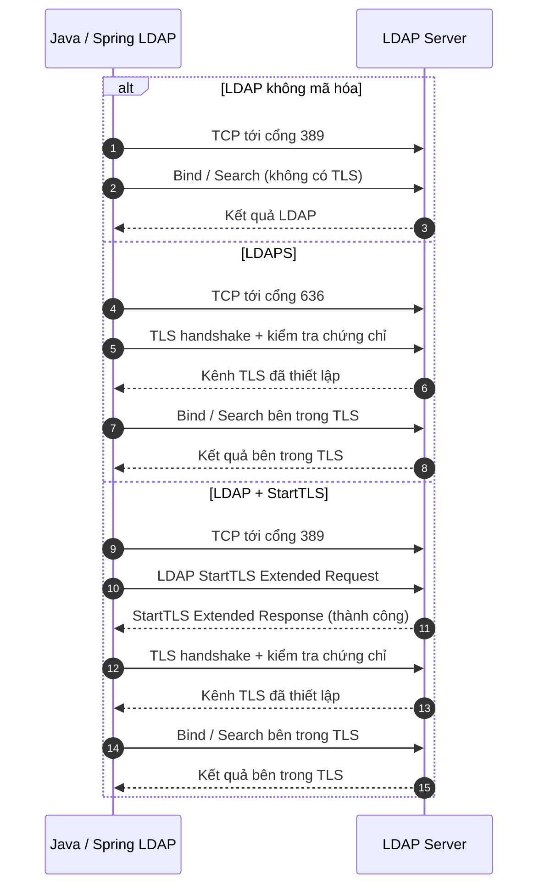

# Phân biệt LDAP không mã hóa, LDAPS và StartTLS

Trong chương **TLS và xác thực** của **SPRING_DATA_LDAP**, một ứng dụng Java dùng Spring Data LDAP có thể truy vấn cùng một cây thư mục LDAP thông qua ba cách thiết lập kết nối: LDAP không mã hóa, LDAPS hoặc LDAP kết hợp StartTLS. Chúng đều có thể phục vụ các thao tác quen thuộc như Bind, Search, Add, Modify và Delete, nhưng khác nhau ở **thời điểm thiết lập TLS**, **khả năng bảo vệ dữ liệu trên đường truyền** và **cách cấu hình phía client**.

Việc chọn đúng cơ chế đặc biệt quan trọng khi ứng dụng sử dụng repository hoặc `LdapTemplate` để đọc thông tin người dùng, nhóm, DN (Distinguished Name) và các thuộc tính tuân theo `objectClass`/schema. Đối tượng Java và truy vấn repository có thể giống nhau giữa ba cách kết nối, trong khi mức an toàn của phiên giao tiếp rất khác nhau.

## 1. Kiến thức nền: LDAP, Bind và TLS giải quyết việc gì?

- **LDAP (Lightweight Directory Access Protocol)** là giao thức truy cập dịch vụ thư mục. Client kết nối tới LDAP server rồi gửi các thao tác như Bind để xác thực, Search để tìm entry, hoặc Modify để cập nhật thuộc tính. Một entry được nhận diện bằng **DN**, ví dụ `uid=linh,ou=people,dc=example,dc=org`.
- **Bind** là thao tác xác thực với LDAP server. Với **simple Bind**, client có thể gửi DN/tên định danh và mật khẩu. Nếu không có lớp bảo vệ đường truyền, thông tin này có nguy cơ bị đọc trên mạng.
- **TLS (Transport Layer Security)** bảo vệ kênh truyền bằng mã hóa, kiểm tra tính toàn vẹn và xác minh danh tính máy chủ qua chứng chỉ. TLS **không thay thế Bind**, quyền truy cập entry, ACL hoặc biện pháp bảo vệ dữ liệu lưu trong directory.
- **LDAPS** thiết lập TLS ngay khi kết nối TCP bắt đầu, rồi mới trao đổi thông điệp LDAP.
- **StartTLS** bắt đầu bằng kết nối LDAP thông thường, gửi yêu cầu mở rộng StartTLS để **nâng cấp chính kết nối đó sang TLS**, rồi mới thực hiện những thao tác cần bảo mật.

Ở đây, cụm từ *LDAP không mã hóa* chỉ trường hợp sử dụng `ldap://` **không bật StartTLS và không có lớp bảo mật bổ sung như SASL security layer**. Bản thân tiền tố `ldap://` không đủ để kết luận rằng phiên kết nối không được mã hóa: StartTLS cũng sử dụng tiền tố này.

## 2. So sánh nhanh ba cơ chế

| Tiêu chí | LDAP không mã hóa | LDAPS (TLS ngay từ đầu) | LDAP + StartTLS |
| --- | --- | --- | --- |
| URI thường dùng | `ldap://ldap.example.org:389` | `ldaps://ldap.example.org:636` | `ldap://ldap.example.org:389` |
| Cổng thông dụng | TCP **389** | TCP **636** | TCP **389** |
| Trình tự khởi tạo | TCP → thông điệp LDAP | TCP → **TLS handshake** → LDAP | TCP → yêu cầu **StartTLS** → TLS handshake → LDAP |
| Mã hóa nội dung LDAP | **Không**, nếu không dùng lớp bảo vệ khác | **Có** sau khi TLS bắt tay thành công | **Có** sau khi nâng cấp TLS thành công |
| Simple Bind chứa mật khẩu | Có thể lộ nếu gửi trên mạng | Được truyền trong kênh TLS | Chỉ an toàn khi **Bind diễn ra sau StartTLS thành công** |
| Xác minh chứng chỉ máy chủ | Không có ở tầng TLS | Bắt buộc kiểm tra CA/chuỗi tin cậy và hostname | Bắt buộc kiểm tra CA/chuỗi tin cậy và hostname |
| Điều kiện phía server | Cho phép LDAP thường | Bật cổng LDAPS và chứng chỉ TLS | Hỗ trợ LDAP StartTLS extended operation và chứng chỉ TLS |
| Cấu hình client | Kết nối `ldap://` | Kết nối `ldaps://` và cấu hình truststore khi cần | Kết nối `ldap://` **kèm chiến lược chủ động gọi StartTLS** |
| Khuyến nghị với dữ liệu nhạy cảm | Tránh sử dụng | Phù hợp | Phù hợp nếu yêu cầu nâng cấp TLS nghiêm ngặt |

**389 và 636 là các cổng mặc định theo quy ước**, không phải giới hạn cứng: hệ thống thực tế có thể cấu hình cổng khác. Việc cổng 389 đang mở không chứng minh StartTLS được hỗ trợ; muốn biết phải kiểm tra khả năng của server và thử nâng cấp.

## 3. Thứ tự trao đổi trên mạng



Điểm quyết định là **Bind và các thao tác chứa dữ liệu nhạy cảm chỉ được thực hiện sau khi TLS đã sẵn sàng**. Nếu StartTLS bị từ chối hoặc TLS handshake/chứng chỉ thất bại, ứng dụng phải **dừng kết nối**; không được tự động chuyển sang simple Bind trên LDAP không mã hóa. Hành vi tự hạ cấp này tạo ra lỗ hổng *downgrade*.

### 3.1. LDAP không mã hóa

Ví dụ client mở `ldap://ldap.example.org:389` rồi ngay lập tức gửi simple Bind:

```text
Client -------- TCP/389 --------> Server
Client ------ LDAP Bind -------> Server   (không mã hóa)
Client ------ LDAP Search -----> Server   (không mã hóa)
Client <----- LDAP Entries ----- Server   (không mã hóa)
```

Người có khả năng quan sát hoặc can thiệp đường truyền có thể đọc thông tin Bind, DN, bộ lọc tìm kiếm và các thuộc tính trả về, hoặc sửa đổi lưu lượng. Mạng nội bộ không tự động loại bỏ rủi ro này. Nếu server từ chối simple Bind thiếu TLS, đó là một cơ chế bảo vệ hữu ích, không phải lỗi cần khắc phục bằng cách tắt chính sách.

Ngoại lệ cần phân biệt: một cơ chế **SASL có lớp bảo vệ toàn vẹn/bảo mật riêng** có thể bảo vệ lưu lượng dù không có TLS. Đây là cấu hình khác với trường hợp LDAP không mã hóa đang được so sánh; không nên mặc định rằng mọi phiên `ldap://` đều truyền dữ liệu rõ.

### 3.2. LDAPS: TLS trước, LDAP sau

Với `ldaps://ldap.example.org:636`, client bắt tay TLS ngay sau khi thiết lập TCP. Nếu chứng chỉ máy chủ hợp lệ và quá trình bắt tay thành công, client mới gửi Bind và các truy vấn LDAP.

```text
TCP:636 -> TLS handshake -> kiểm tra CA/hostname -> LDAP Bind -> LDAP Search
```

Ứng dụng cần **tin cậy CA phát hành chứng chỉ**, xác minh rằng tên máy chủ đang kết nối khớp với chứng chỉ, và sử dụng phiên bản TLS/bộ mã được cho phép. Trong hệ thống dùng CA nội bộ, thường phải đưa CA phù hợp vào **truststore** của JVM. Không sửa lỗi chứng chỉ bằng cách vô hiệu hóa kiểm tra hostname hoặc tự chấp nhận mọi chứng chỉ.

LDAPS được dùng rộng rãi và dễ cấu hình bằng URL trong nhiều ứng dụng Spring. Tên gọi “LDAP over SSL” thường xuất hiện trong tài liệu cũ, nhưng khi triển khai hiện đại cần dùng **TLS an toàn**.

### 3.3. StartTLS: chủ động nâng cấp kết nối LDAP

StartTLS sử dụng **LDAPv3 extended operation** (OID `1.3.6.1.4.1.1466.20037`). Client kết nối `ldap://...:389`, gửi yêu cầu StartTLS, nhận phản hồi thành công, sau đó mới bắt tay TLS trên **cùng kết nối TCP**.

```text
TCP:389 -> StartTLS request -> response OK -> TLS handshake
        -> kiểm tra CA/hostname -> LDAP Bind -> LDAP Search
```

Trong quy trình bảo mật, cần gửi yêu cầu StartTLS **trước khi gửi simple Bind chứa mật khẩu hoặc dữ liệu nhạy cảm**. Một thư viện chỉ được cấu hình URL `ldap://` sẽ không tự động bật StartTLS trừ khi có hỗ trợ/cấu hình rõ ràng. Nếu server không hỗ trợ StartTLS, trả lỗi, hoặc việc kiểm tra chứng chỉ thất bại, client phải báo lỗi và đóng kết nối.

Về mức độ bảo vệ nội dung LDAP **sau khi TLS thiết lập thành công và được xác minh đúng cách**, StartTLS và LDAPS có thể tương đương. Điểm khác biệt chính là cách khởi tạo, hỗ trợ của hệ thống và nguy cơ cấu hình nhầm cho phép hoạt động trước khi nâng cấp.

## 4. Cấu hình ứng dụng Spring Data LDAP

Spring Data LDAP ánh xạ entry LDAP sang đối tượng Java và cung cấp repository; phía dưới là Spring LDAP với `ContextSource` và `LdapTemplate`. **Kênh truyền được quyết định tại ContextSource**, nên mã nguồn repository có thể giữ nguyên khi đổi từ LDAP thường sang LDAPS hoặc StartTLS.

### 4.1. LDAPS với Spring Boot

Ví dụ `application.yml` cho một ứng dụng Spring Boot có tích hợp Spring LDAP/Spring Data LDAP:

```yaml
spring:
  ldap:
    urls: ldaps://ldap.example.org:636
    base: dc=example,dc=org
    username: uid=app-reader,ou=services,dc=example,dc=org
    password: ${LDAP_BIND_PASSWORD}
```

Trong ví dụ, `base` xác định DN gốc cho truy vấn, `username` là DN dùng để Bind với directory và mật khẩu được lấy từ môi trường/secret manager. Hãy thay tên host và DN theo schema thực tế; đây là các giá trị minh họa, không phải địa chỉ dịch vụ có sẵn.

Để JVM xác minh chứng chỉ của LDAP server sử dụng CA nội bộ, cấu hình **truststore chứa CA được tin cậy** trong môi trường chạy ứng dụng, chẳng hạn thông qua `javax.net.ssl.trustStore` và `javax.net.ssl.trustStoreType`. Chỉ đưa CA đáng tin cậy vào truststore; giữ mật khẩu truststore, mật khẩu Bind và khóa riêng (nếu có) trong cơ chế quản lý bí mật phù hợp.

Repository không cần thay đổi theo lựa chọn LDAPS:

```java
import javax.naming.Name;
import org.springframework.data.ldap.repository.LdapRepository;
import org.springframework.ldap.odm.annotations.Attribute;
import org.springframework.ldap.odm.annotations.Entry;
import org.springframework.ldap.odm.annotations.Id;
import java.util.List;

@Entry(base = "ou=people", objectClasses = {"inetOrgPerson"})
class Person {
    @Id
    private Name dn;

    @Attribute(name = "uid")
    private String uid;

    // Bổ sung constructor, getter/setter theo nhu cầu ứng dụng.
}

interface PersonRepository extends LdapRepository<Person> {
    List<Person> findByUid(String uid);
}
```

Repository trên làm việc với `uid`, `DN` và entry có `objectClass=inetOrgPerson`. Việc dùng TLS được thiết lập bên dưới tại `ContextSource`, không thể suy ra từ định nghĩa `PersonRepository` hay `@Entry`. Đối tượng Java phản ánh entry LDAP; TLS bảo vệ dữ liệu khi entry được đọc/ghi qua mạng.

### 4.2. StartTLS với Spring LDAP `LdapContextSource`

Trong ứng dụng cần dùng StartTLS, cấu hình `ldap://` **chưa đủ**. Spring LDAP cung cấp chiến lược xác thực hỗ trợ StartTLS, chẳng hạn `DefaultTlsDirContextAuthenticationStrategy`:

```java
import org.springframework.context.annotation.Bean;
import org.springframework.context.annotation.Configuration;
import org.springframework.beans.factory.annotation.Value;
import org.springframework.ldap.core.LdapTemplate;
import org.springframework.ldap.core.support.DefaultTlsDirContextAuthenticationStrategy;
import org.springframework.ldap.core.support.LdapContextSource;

@Configuration
class LdapStartTlsConfig {
    @Bean
    LdapContextSource ldapContextSource(
            @Value("${LDAP_BIND_DN}") String bindDn,
            @Value("${LDAP_BIND_PASSWORD}") String bindPassword) {
        LdapContextSource source = new LdapContextSource();
        source.setUrl("ldap://ldap.example.org:389");
        source.setBase("dc=example,dc=org");
        source.setUserDn(bindDn);
        source.setPassword(bindPassword);
        source.setAuthenticationStrategy(
                new DefaultTlsDirContextAuthenticationStrategy());
        source.setPooled(false);
        return source;
    }

    @Bean
    LdapTemplate ldapTemplate(LdapContextSource source) {
        return new LdapTemplate(source);
    }
}
```

Đây là cấu hình minh họa một `ContextSource` StartTLS riêng. Với ứng dụng đã có bean LDAP hoặc Spring Boot auto-configuration, cần tránh khai báo trùng và xác định rõ bean nào được repository/`LdapTemplate` sử dụng. Cần cấu hình truststore và xác minh hostname giống LDAPS. Không bật pooling JNDI mặc định một cách tùy tiện cho StartTLS: việc tái sử dụng connection và vòng đời TLS/Bind cần được kiểm tra với phiên bản thư viện và directory đang triển khai.

**Lưu ý:** `DefaultTlsDirContextAuthenticationStrategy` là API thuộc **Spring LDAP**, không phải một phương thức trên `LdapRepository`. Việc chuyển một URL `ldaps://` thành `ldap://` mà không thêm chiến lược StartTLS sẽ làm thay đổi đặc tính bảo mật của kết nối.

### 4.3. Ví dụ logic kết nối an toàn

```text
Tạo ContextSource
    |
    +-- LDAPS: TLS handshake ngay khi kết nối
    |       |
    |       +-- Chứng chỉ hợp lệ? -- Không --> FAIL / đóng kết nối
    |                                  Có
    |                                  |
    |                              LDAP Bind
    |
    +-- StartTLS: gửi StartTLS, nhận OK, bắt tay TLS
            |
            +-- Nâng cấp + chứng chỉ hợp lệ? -- Không --> FAIL / đóng kết nối
                                                Có
                                                |
                                            LDAP Bind
                                                  |
                                       Repository / LdapTemplate
```

Ứng dụng phải kiểm tra trường hợp lỗi ở **mọi** bước thiết lập TLS. Chỉ sau khi có phiên TLS được xác minh thì thao tác Bind mới được phép gửi thông tin xác thực.

## 5. Thử kết nối với `ldapsearch`

Nếu có công cụ dòng lệnh OpenLDAP và quyền truy cập tới directory, có thể kiểm tra từng phương thức. Các lệnh dưới đây dùng hostname và DN giả định; kết quả tùy cấu hình ACL và chính sách xác thực của server.

**LDAP không mã hóa** (chỉ thử truy vấn ẩn danh khi được phép; **không nhập mật khẩu thật**):

```bash
ldapsearch -x -H ldap://ldap.example.org:389 \
  -b "dc=example,dc=org" "(objectClass=*)" dn
```

**LDAPS** (TLS bắt đầu ngay khi kết nối):

```bash
ldapsearch -x -H ldaps://ldap.example.org:636 \
  -D "uid=app-reader,ou=services,dc=example,dc=org" -W \
  -b "dc=example,dc=org" "(uid=linh)" cn mail
```

**StartTLS bắt buộc** (dùng `-ZZ`, phải nâng cấp thành công mới tiếp tục):

```bash
ldapsearch -x -ZZ -H ldap://ldap.example.org:389 \
  -D "uid=app-reader,ou=services,dc=example,dc=org" -W \
  -b "dc=example,dc=org" "(uid=linh)" cn mail
```

Trong các lệnh trên, `-x` chọn simple authentication, `-D` chỉ DN Bind, `-W` hỏi mật khẩu tương tác, `-b` là search base. Tùy chọn `-ZZ` yêu cầu **StartTLS thành công**; không nên thay bằng chế độ cho phép tiếp tục nếu việc nâng cấp thất bại. Công cụ `ldapsearch` có cấu hình CA riêng của OpenLDAP, vì vậy việc thử thành công bằng CLI **không tự chứng minh JVM truststore đã cấu hình đúng**.

Nếu LDAP server chỉ cho phép simple Bind trên kết nối đã bảo vệ, truy vấn ở ví dụ thứ nhất có thể bị từ chối. Điều đó không chứng tỏ server hỏng; hãy thử LDAPS hoặc StartTLS với chứng chỉ hợp lệ.

## 6. Kiểm tra bảo mật và xử lý lỗi thường gặp

| Hiện tượng | Khả năng cần kiểm tra | Hướng xử lý |
| --- | --- | --- |
| Kết nối `ldap://` thành công nhưng thiếu bảo mật | Chưa kích hoạt StartTLS hoặc đang dùng LDAP thường | Cấu hình chiến lược StartTLS hoặc chuyển sang `ldaps://`, kiểm tra phiên TLS thực tế |
| Không kết nối được cổng 636 | LDAPS chưa bật, sai cổng, DNS, firewall hoặc TLS handshake lỗi | Xác minh listener, định tuyến và log TLS của client/server |
| StartTLS bị từ chối/không được hỗ trợ | Server không quảng bá/hỗ trợ StartTLS, cấu hình hoặc proxy gây cản trở | Kiểm tra cấu hình LDAP server; **không fallback sang Bind không mã hóa** |
| Lỗi `PKIX path building failed` / chứng chỉ không tin cậy | CA của server chưa nằm trong truststore JVM, hoặc chuỗi chứng chỉ thiếu | Cập nhật truststore/chuỗi CA chính xác; không tắt certificate validation |
| Lỗi hostname mismatch | URL truy cập khác SAN/DNS trong chứng chỉ | Dùng hostname khớp chứng chỉ hoặc cấp lại chứng chỉ phù hợp |
| `invalidCredentials` (thường là LDAP result code 49) | DN Bind hoặc mật khẩu sai; cũng có thể tài khoản bị khóa/hết hạn | Xác minh credential, trạng thái tài khoản và chính sách directory sau khi TLS đã thành công |
| `confidentialityRequired` / `strongAuthRequired` | Server yêu cầu kênh bảo mật hoặc phương thức xác thực mạnh | Dùng LDAPS/StartTLS hợp lệ và cơ chế Bind đúng chính sách |
| CLI hoạt động nhưng ứng dụng Java lỗi TLS | Truststore/JDK, hostname hoặc cấu hình client khác nhau | Kiểm tra truststore JVM, endpoint được gọi và cấu hình TLS của ứng dụng |

Khi triển khai thực tế:

1. **Bảo vệ credential trước tiên:** chỉ gửi simple Bind sau khi TLS được xác lập; không lưu mật khẩu trong source code, log hoặc file cấu hình public.
2. **Xác minh máy chủ:** kiểm tra chuỗi chứng chỉ, CA tin cậy, hostname (SAN), thời hạn chứng chỉ; quản lý việc gia hạn chứng chỉ.
3. **Yêu cầu TLS khi xử lý dữ liệu thật:** nếu TLS không thể khởi tạo, báo lỗi; tuyệt đối không cho phép fallback im lặng sang kết nối không mã hóa.
4. **Giới hạn quyền tài khoản Bind:** dùng tài khoản dịch vụ với ACL tối thiểu, phân biệt quyền đọc với quyền ghi entry; tránh dùng tài khoản quản trị directory cho các truy vấn thông thường.
5. **Kiểm tra cấu hình môi trường:** xác minh URL, port, firewall, CA/truststore, timeout, pooling và khả năng hỗ trợ TLS của từng LDAP server.
6. **Kiểm thử đúng đường đi của ứng dụng:** với Spring Data LDAP, thực hiện một truy vấn repository hoặc `LdapTemplate` qua `ContextSource` thực tế, đồng thời kiểm tra log server hoặc trace TLS để chắc chắn phiên đã được bảo vệ.
7. **Dùng TLS hiện đại theo chính sách hệ thống:** ưu tiên TLS 1.2/1.3 được hỗ trợ; không bật lại SSL hay thuật toán yếu chỉ để vượt qua lỗi kết nối.

TLS bảo vệ **dữ liệu trên đường truyền**. Các vấn đề khác như quyền xem thuộc tính người dùng, lọc query an toàn, tránh LDAP injection, bảo vệ bản sao lưu và log, hoặc quản lý schema/`objectClass` vẫn cần giải quyết riêng.

## 7. Chọn LDAPS hay StartTLS?

**Chọn LDAPS** khi directory và hạ tầng đã cung cấp endpoint `ldaps://`, client hỗ trợ sẵn và tổ chức muốn TLS được thiết lập ngay từ đầu phiên TCP. Đây thường là lựa chọn triển khai thuận tiện với thuộc tính `spring.ldap.urls` của Spring Boot.

**Chọn StartTLS** khi directory cung cấp cơ chế nâng cấp chuẩn LDAPv3 trên `ldap://`, hoặc kiến trúc hiện tại dùng endpoint 389 và client có thể buộc nâng cấp an toàn trước Bind. Đối với Spring LDAP, cần cấu hình chiến lược StartTLS rõ ràng và kiểm thử tình huống nâng cấp thất bại.

**Không chọn LDAP không mã hóa** cho simple Bind có mật khẩu, dữ liệu người dùng hoặc các thao tác ghi qua mạng. Trường hợp thử nghiệm trên môi trường cách ly vẫn cần hiểu rằng việc chưa bật TLS là một quyết định có rủi ro, không phải đặc tính mặc định an toàn.

### Tình huống minh họa

Ứng dụng quản lý nhân sự dùng `PersonRepository.findByUid("linh")` để lấy email, tên và nhóm của một nhân viên:

- Nếu cấu hình `ldap://server:389` và không bật StartTLS, Bind và kết quả Search có thể đi qua mạng dưới dạng không mã hóa.
- Nếu cấu hình `ldaps://server:636` với chứng chỉ hợp lệ, Bind và kết quả Search đi trong kênh TLS từ đầu.
- Nếu cấu hình `ldap://server:389` **kèm StartTLS bắt buộc**, ứng dụng nâng cấp kết nối và xác minh chứng chỉ trước khi Bind; sau đó dữ liệu Search cũng đi trong kênh TLS.

Trong cả ba trường hợp, `uid`, DN, `objectClass`, quy tắc ánh xạ entry và chữ ký repository đều có thể giống hệt nhau. Điểm cần kiểm soát nằm ở **cách khởi tạo và xác minh phiên kết nối trước khi repository thực hiện thao tác**.

## 8. Câu hỏi tự kiểm tra

1. **URL `ldap://...:389` có luôn đồng nghĩa với truyền rõ không?** Không. Client có thể nâng cấp bằng StartTLS; cần xem cấu hình và trạng thái kết nối thực tế.
2. **LDAPS và StartTLS khác nhau về mức mã hóa sau khi TLS hoàn tất?** Không nhất thiết. Nếu dùng cùng phiên bản/cấu hình TLS, xác minh chứng chỉ đúng và không để thao tác nhạy cảm diễn ra trước TLS, cả hai đều bảo vệ thông điệp LDAP trên đường truyền.
3. **Có thể gửi simple Bind trước StartTLS rồi mới nâng cấp không?** Không nên. Mật khẩu đã có thể bị lộ trước khi TLS được thiết lập; phải nâng cấp trước khi Bind.
4. **TLS thành công có nghĩa người dùng đã được xác thực và có quyền sửa mọi entry?** Không. TLS xác minh kênh và thường là máy chủ; Bind và ACL quyết định danh tính LDAP và quyền thực hiện thao tác.
5. **Nếu StartTLS lỗi, có thể tự chuyển sang `ldap://` thường để hệ thống tiếp tục chạy?** Không. Với kết nối yêu cầu bảo mật, đó là lỗi phải được trả về cho ứng dụng và ghi nhận để xử lý.

**Ghi nhớ:** LDAP thường chỉ mô tả giao thức và endpoint; **LDAPS = TLS trước LDAP**; **StartTLS = yêu cầu nâng cấp rồi TLS trước Bind**. Trong Spring Data LDAP, hãy đặt yêu cầu an toàn tại `ContextSource`, xác minh chứng chỉ đầy đủ và để thao tác repository chạy sau khi kênh bảo mật đã được thiết lập.
