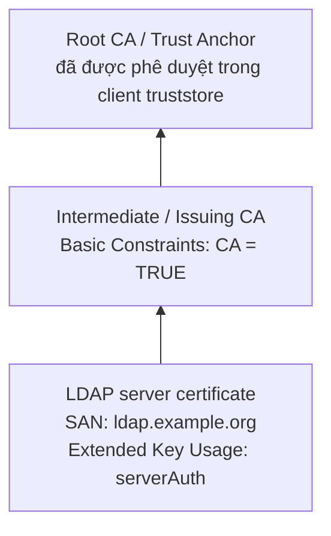
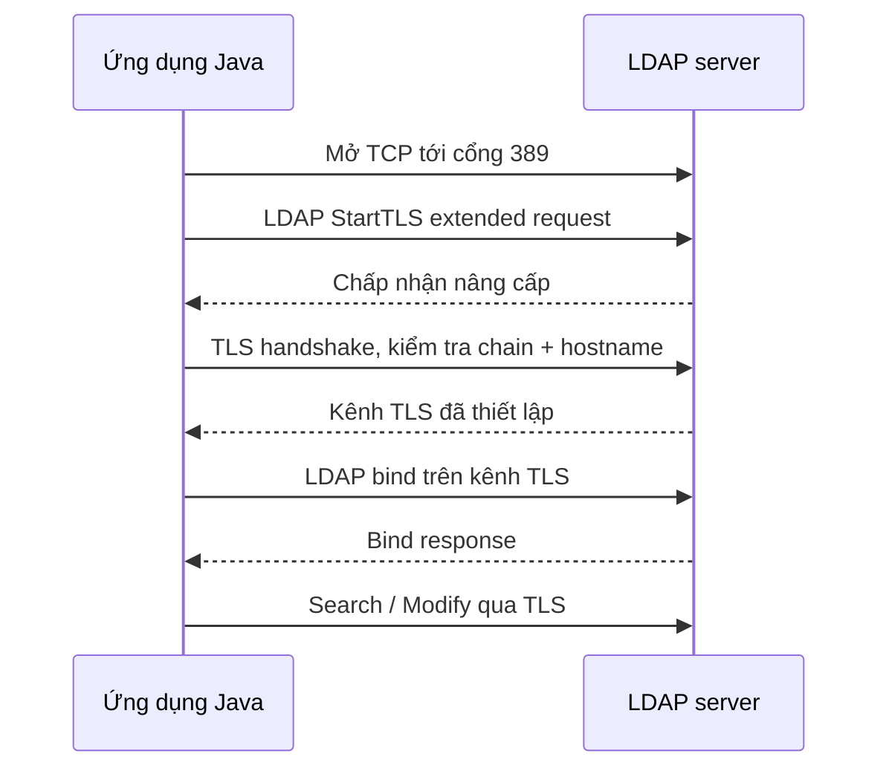
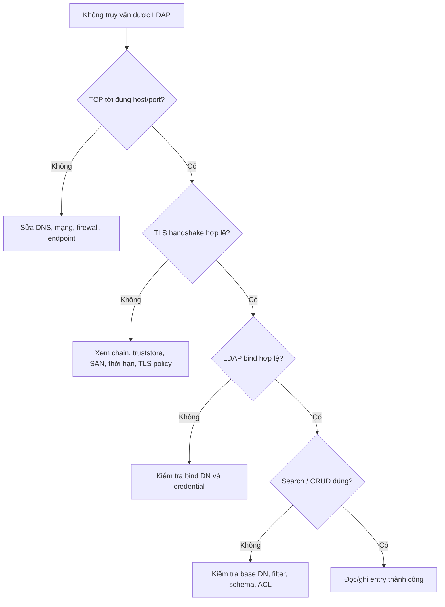

# Cấu hình truststore và kiểm tra chuỗi chứng chỉ trong Spring Data LDAP

Khi một ứng dụng Spring Data LDAP kết nối tới directory qua `ldaps://` hoặc LDAP + StartTLS, máy chủ gửi chứng chỉ X.509 để ứng dụng xác minh danh tính của điểm cuối và thiết lập kênh mã hóa. Một lỗi thường gặp là ứng dụng không tìm được đường tin cậy tới CA đã ký chứng chỉ:

```text
javax.net.ssl.SSLHandshakeException:
  PKIX path building failed:
  unable to find valid certification path to requested target
```

Lúc này, chỉ sửa `spring.ldap.urls` hoặc thông tin bind chưa giải quyết được vấn đề. Ứng dụng cần **truststore** chứa các chứng chỉ tin cậy thích hợp, server phải cung cấp **chuỗi chứng chỉ** đúng, tên máy chủ phải phù hợp với chứng chỉ, và phiên TLS phải được thiết lập trước khi gửi mật khẩu bind.

Bài học thuộc chương **TLS và xác thực** của `SPRING_DATA_LDAP`. Trọng tâm là **cấu hình truststore và kiểm tra chuỗi chứng chỉ**, gắn với ứng dụng Java dùng Spring Data LDAP repository hoặc `LdapTemplate` để đọc và cập nhật entry trong directory.

## 1. Mục tiêu học tập

Sau bài này, bạn có thể:

- Phân biệt **truststore** với **keystore**, chứng chỉ CA với chứng chỉ máy chủ và TLS với LDAP bind.
- Đọc một chuỗi X.509 từ chứng chỉ server qua intermediate CA tới trust anchor.
- Dùng `openssl` và `keytool` để quan sát, đối chiếu và nhập chứng chỉ CA đã được xác minh nguồn gốc.
- Cấu hình JVM truststore PKCS#12 và kết nối `ldaps://` cho ứng dụng Spring Boot/Spring Data LDAP.
- Hiểu sự khác biệt giữa LDAPS và StartTLS, tránh gửi thông tin bind trước khi nâng cấp kết nối.
- Phân tích lỗi `PKIX path building failed`, sai hostname, chứng chỉ hết hạn, thiếu intermediate và lỗi cấu hình truststore.
- Viết kế hoạch kiểm thử tích hợp xác nhận cả trường hợp kết nối thành công lẫn các trường hợp TLS phải bị từ chối.

## 2. Vì sao kết nối LDAP cần TLS?

LDAP cung cấp các thao tác tìm kiếm entry, đọc thuộc tính và có thể tạo/cập nhật/xóa dữ liệu trong directory. Ứng dụng dùng Spring Data LDAP thường truy vấn dữ liệu như:

```text
uid=lan,ou=people,dc=example,dc=org
objectClass: inetOrgPerson
uid: lan
cn: Lan Nguyen
sn: Nguyen
mail: lan@example.org
```

Khi dùng LDAP simple bind, ứng dụng gửi **bind DN** và mật khẩu để xác thực với directory. Nếu kết nối truyền trực tiếp qua `ldap://` mà không được bảo vệ bằng TLS, thông tin xác thực và dữ liệu truy vấn có thể bị lộ trên đường truyền. Kết nối TLS giải quyết hai mục tiêu:

1. **Bảo mật và toàn vẹn dữ liệu truyền:** người ngoài không dễ đọc hoặc sửa nội dung LDAP giữa ứng dụng và server.
2. **Xác thực điểm cuối:** ứng dụng phải xác minh mình đang kết nối tới LDAP server phù hợp với tên đã cấu hình và được CA đáng tin cậy chứng nhận.

Nếu chỉ mã hóa nhưng chấp nhận chứng chỉ bất kỳ, kẻ tấn công có thể giả danh server. Vì thế, **kiểm tra chuỗi chứng chỉ và hostname là phần thiết yếu của TLS**.

### 2.1. LDAPS và StartTLS

| Tiêu chí | LDAPS | LDAP + StartTLS |
|---|---|---|
| Địa chỉ thường gặp | `ldaps://ldap.example.org:636` | `ldap://ldap.example.org:389` |
| Khi nào TLS bắt đầu? | Ngay khi mở kết nối. | Sau thao tác LDAP StartTLS trên kết nối ban đầu. |
| Có gửi bind DN/password trước TLS không? | Không, nếu dùng đúng kết nối TLS. | **Không được**; phải nâng cấp StartTLS thành công trước simple bind. |
| Tin cậy chứng chỉ | Kiểm tra chuỗi và hostname. | Cũng phải kiểm tra chuỗi và hostname. |
| Phụ thuộc cấu hình | Java TLS, URL LDAPS, server certificate. | Java TLS **và** cơ chế StartTLS trong LDAP client. |

LDAPS và StartTLS đều có thể an toàn khi được cấu hình đúng; sự khác biệt là cách bắt đầu TLS. Đổi URL thành `ldap://…:389` **không tự kích hoạt StartTLS**. Với Spring LDAP/JNDI, StartTLS cần được cấu hình qua chiến lược xác thực/kết nối phù hợp và kiểm thử rằng TLS được thương lượng **trước bind**.

## 3. Truststore là gì? Keystore khác gì?

**Truststore** là kho chứa chứng chỉ mà bên **client** (ứng dụng Java) chấp nhận làm điểm tin cậy, thường là chứng chỉ của Root CA hoặc CA nội bộ được tổ chức phê duyệt. Khi LDAP server xuất trình chứng chỉ, Java xây và kiểm tra đường dẫn chứng thực tới một **trust anchor** trong kho đó.

**Keystore** thường chứa khóa riêng và chứng chỉ gắn với khóa, chẳng hạn danh tính của server hoặc chứng chỉ **client** nếu tổ chức dùng mutual TLS. Cả hai có thể là tệp kiểu PKCS#12, nhưng **vai trò** khác nhau:

| Thành phần | Thường chứa | Mục đích trong LDAP |
|---|---|---|
| Server keystore / certificate configuration | Khóa riêng của server và chuỗi chứng chỉ server. | Server chứng minh danh tính qua TLS. |
| Client truststore | Chứng chỉ Root CA/CA được chấp nhận. | Java xác minh chứng chỉ server. |
| Client keystore (nếu dùng mTLS) | Khóa riêng và chứng chỉ client. | Client trình chứng chỉ cho server khi server yêu cầu. |
| LDAP bind credentials | Bind DN hoặc tài khoản và mật khẩu. | Directory xác thực danh tính ứng dụng ở lớp LDAP. |

**Không nhập khóa riêng của server vào truststore client.** Để xác minh server, ứng dụng chỉ cần chứng chỉ tin cậy phù hợp. Trong nhiều hệ thống, **mTLS** và **LDAP bind** có thể cùng tồn tại, nhưng không mặc định dùng cơ chế này. Một chứng chỉ TLS hợp lệ cũng **không đồng nghĩa** tài khoản bind được xác thực hoặc có quyền đọc entry.

### 3.1. Java lấy truststore từ đâu?

Ứng dụng Spring Data LDAP chạy trên JVM, nên xác minh TLS của kết nối LDAPS thông thường dựa trên cơ chế JSSE/JNDI của Java. JVM có kho CA mặc định (thường là `cacerts` trong JDK), nhưng **CA nội bộ của doanh nghiệp** có thể chưa nằm trong đó.

Bạn có thể cung cấp một truststore riêng qua các JVM system properties:

```text
-Djavax.net.ssl.trustStore=/etc/my-app/certs/ldap-truststore.p12
-Djavax.net.ssl.trustStoreType=PKCS12
-Djavax.net.ssl.trustStorePassword=<được-cung-cấp-từ-secret-manager>
```

Đây là **tham số JVM khi khởi động**, không phải các thuộc tính `spring.ldap.*` trong `application.yml`. Khi chỉ định một truststore riêng theo cơ chế mặc định này, bạn có thể làm **thay đổi tập CA được JVM sử dụng**, ảnh hưởng cả các kết nối HTTPS/TLS khác trong cùng ứng dụng; vì thế cần tính toán CA nào phải được giữ lại và chính sách trust riêng theo kết nối.

Mật khẩu truststore không phải mật khẩu LDAP bind. Tùy loại kho và môi trường Java, JVM cần mật khẩu để nạp/kiểm tra tính toàn vẹn kho. Nên đưa mật khẩu qua phương thức quản lý bí mật của môi trường chạy; tránh commit vào mã nguồn, ghi trong log hoặc lộ trên command line/process arguments.

## 4. Hiểu chuỗi chứng chỉ X.509

Một LDAP server thường trình chứng chỉ của chính nó (**leaf/server certificate**) và một hoặc nhiều chứng chỉ **intermediate CA**. Client có **Root CA** tin cậy sẵn trong truststore.



Có thể đọc sơ đồ là: server certificate **được ký bởi** intermediate CA; intermediate CA được ký bởi Root CA; Root CA là điểm tin cậy mà ứng dụng chủ động chấp nhận.

Ví dụ minh họa:

```text
Subject: CN=ldap.example.org
Issuer:  CN=Example Issuing CA 02
           |
           v
Subject: CN=Example Issuing CA 02
Issuer:  CN=Example Root CA
           |
           v
Subject: CN=Example Root CA
Issuer:  CN=Example Root CA  (trust anchor)
```

**Lưu ý:** Không tin tưởng một chứng chỉ chỉ vì nó tự nhận là `CN=Example Root CA`. Tên subject không chứng minh danh tính. Bạn phải nhận chứng chỉ CA và xác minh dấu vân tay (*fingerprint*) từ kênh độc lập, được tổ chức phê duyệt.

### 4.1. Chuỗi hợp lệ được xác minh như thế nào?

Tùy cấu hình Java và chính sách PKI, việc xác thực máy chủ cần xem xét:

1. **Đường dẫn tin cậy:** tồn tại đường dẫn chứng chỉ từ leaf qua các CA trung gian tới trust anchor hợp lệ trong truststore.
2. **Chữ ký số:** chữ ký của các chứng chỉ trong đường dẫn phải kiểm tra được bằng khóa công khai của bên phát hành tương ứng.
3. **Thời hạn:** ngày hiện tại nằm trong khoảng `Not Before` và `Not After` của các chứng chỉ cần kiểm tra.
4. **Ràng buộc CA:** chứng chỉ dùng như CA trung gian có `Basic Constraints: CA=TRUE` và `Key Usage` cho phép ký chứng chỉ, nếu profile yêu cầu.
5. **Mục đích sử dụng:** chứng chỉ máy chủ phù hợp với xác thực TLS server, thường qua `Extended Key Usage: serverAuth` và các ràng buộc liên quan.
6. **Tên máy chủ:** tên `ldap.example.org` trong URL phải khớp DNS name/IP được phép trong `subjectAltName` của chứng chỉ, theo cơ chế hostname verification áp dụng.
7. **Thu hồi chứng chỉ:** CRL/OCSP phải được kiểm tra nếu chính sách và cấu hình client yêu cầu; **không được mặc định** mọi JVM tự kiểm tra thu hồi chứng chỉ đầy đủ.

Việc kiểm tra **đường dẫn PKIX** và **hostname** là hai phần liên quan nhưng khác nhau. Một chuỗi được ký bởi CA tin cậy vẫn có thể bị từ chối vì certificate chỉ cấp cho `directory.example.org` nhưng ứng dụng kết nối tới `ldap.example.org`.

Trong triển khai hiện đại, không nên dựa vào `Common Name (CN)` để thay thế `subjectAltName`. Nếu kết nối bằng địa chỉ IP, chứng chỉ phải có IP SAN tương ứng theo cơ chế xác minh điểm cuối, không thể tùy tiện dùng DNS SAN.

### 4.2. Vì sao thiếu intermediate CA thường gây lỗi?

Server có thể cấu hình chỉ gửi chứng chỉ leaf mà bỏ qua intermediate. Khi truststore chỉ có Root CA, Java cần tìm intermediate ở nơi có thể truy cập theo cơ chế đã cấu hình; nó không mặc định bảo đảm tải intermediate từ mạng. Thiếu chứng chỉ trung gian có thể khiến việc xây đường dẫn thất bại.

Cách xử lý tốt là **sửa cấu hình server để xuất trình chain đầy đủ** (leaf và intermediate theo yêu cầu của máy chủ), thay vì liên tục nhập các leaf certificate mới vào truststore client. Root CA thường không cần server gửi trong mỗi TLS handshake, vì client đã sở hữu trust anchor.

## 5. Kiểm tra chứng chỉ server bằng OpenSSL

Các lệnh tiếp theo là ví dụ chạy **từ máy có mạng tới LDAP server** và đã cài OpenSSL. Chúng quan sát và thử xác minh kết nối; không thay thế kiểm thử của chính JVM.

### 5.1. Quan sát chain của LDAPS

```bash
openssl s_client \
  -connect ldap.example.org:636 \
  -servername ldap.example.org \
  -showcerts
```

Đầu ra hiển thị các chứng chỉ server gửi. Hãy chú ý:

- `subject` và `issuer` của từng chứng chỉ.
- Số chứng chỉ được gửi (leaf và intermediate).
- `Verify return code`.
- Phiên bản TLS và các thông tin handshake liên quan.

**Không kết luận kết nối an toàn chỉ từ `CONNECTED` hoặc chỉ nhìn `Verify return code` nếu chưa chỉ rõ CA và yêu cầu xác minh hostname.** Lệnh chỉ quan sát có thể sử dụng tập CA mặc định của OpenSSL, khác với truststore Java.

### 5.2. Xác minh với CA được phê duyệt và hostname

Giả sử nhóm vận hành PKI đã cung cấp tệp `corp-root-ca.pem` qua kênh tin cậy:

```bash
openssl s_client \
  -connect ldap.example.org:636 \
  -servername ldap.example.org \
  -CAfile corp-root-ca.pem \
  -verify_hostname ldap.example.org \
  -verify_return_error \
  -showcerts
```

Trong ví dụ:

- `-CAfile` chỉ rõ CA tin cậy dùng khi kiểm chứng.
- `-verify_hostname` yêu cầu kiểm tra tên DNS dự kiến.
- `-verify_return_error` yêu cầu lệnh thất bại khi kiểm tra chứng chỉ thất bại.
- `-showcerts` hỗ trợ quan sát chuỗi server thực sự cung cấp.

Nếu server dùng intermediate CA, cần bảo đảm nó gửi chuỗi phù hợp. Nếu root CA nội bộ không phải chứng chỉ tin cậy của hệ thống, dùng `-CAfile` từ nguồn đã được kiểm chứng. Kết quả OpenSSL thành công là **bằng chứng hữu ích**, nhưng chưa thay cho test Java vì truststore, TLS provider và chính sách hai bên có thể khác nhau.

### 5.3. Với LDAP StartTLS

Để kiểm tra endpoint có hỗ trợ StartTLS và thương lượng TLS trên cổng LDAP:

```bash
openssl s_client \
  -starttls ldap \
  -connect ldap.example.org:389 \
  -CAfile corp-root-ca.pem \
  -verify_hostname ldap.example.org \
  -verify_return_error \
  -showcerts
```

Nếu StartTLS thất bại, phải dừng trước bước simple bind cần bảo vệ. Chuyển tạm sang `ldap://` không mã hóa chỉ để “chạy cho được” sẽ làm mất mục tiêu bảo mật.

### 5.4. Xem nội dung chứng chỉ PEM

Giả sử bạn đã có tệp PEM của leaf và intermediate theo nguồn hợp lệ, xem thông tin bằng:

```bash
openssl x509 -in ldap-server.pem \
  -noout -subject -issuer -dates -fingerprint -sha256

openssl x509 -in ldap-server.pem \
  -noout -ext subjectAltName,basicConstraints,keyUsage,extendedKeyUsage
```

Các extension được in ra phụ thuộc dữ liệu chứng chỉ và phiên bản OpenSSL. Kiểm tra SAN, thời hạn, issuer, key usage và fingerprint. Chứng chỉ không có thông tin cần thiết hoặc không hợp lệ theo chính sách phải được xử lý từ hệ thống PKI/server.

Để kiểm tra đường dẫn từ chứng chỉ leaf tới Root CA đã phê duyệt khi có intermediate ở tệp riêng:

```bash
openssl verify \
  -CAfile corp-root-ca.pem \
  -untrusted intermediates.pem \
  -verify_hostname ldap.example.org \
  ldap-server.pem
```

Lệnh này kiểm tra bộ tệp đã chuẩn bị; còn `s_client` cho biết endpoint thực tế gửi gì trong handshake. Hai phép kiểm tra bổ sung cho nhau.

## 6. Xác minh nguồn gốc CA trước khi nhập truststore

Đây là bước dễ bị bỏ qua: **không sao chép chứng chỉ xuất hiện trong một TLS handshake bị lỗi rồi tự động đánh dấu tin cậy**. Nếu endpoint đã bị giả mạo, thao tác như vậy sẽ khiến ứng dụng tin kẻ giả mạo.

Quy trình nên thực hiện:

1. Nhận Root CA hoặc CA được tổ chức phê duyệt từ bộ phận PKI/quản trị directory qua kênh đã được xác thực.
2. Đối chiếu SHA-256 fingerprint với giá trị do người quản trị xác nhận từ một **kênh độc lập**.
3. Kiểm tra `Subject`, `Issuer`, thời hạn và `Basic Constraints` của CA.
4. Xác định rõ phạm vi tin cậy: chỉ một hệ thống LDAP hay nhiều dịch vụ khác dùng cùng CA.
5. Sau khi xác nhận đúng danh tính, mới nhập chứng chỉ vào truststore do ứng dụng quản lý.

Dùng `openssl x509` như ở trên hoặc `keytool` để xem chi tiết:

```bash
keytool -printcert -file corp-root-ca.pem -v
```

Chứng chỉ public CA không phải là bí mật, nhưng việc **tin tưởng** CA là quyết định bảo mật quan trọng. Không lấy fingerprint từ cùng nguồn chưa tin cậy với chứng chỉ rồi xem đó là kiểm chứng độc lập.

## 7. Tạo và quản lý truststore PKCS#12

### 7.1. Tạo truststore từ CA đã được xác minh

Java hỗ trợ định dạng `PKCS12` (thường dùng đuôi `.p12`). Để tạo kho mới và thêm CA nội bộ:

```bash
keytool -importcert \
  -alias company-ldap-root-ca \
  -file corp-root-ca.pem \
  -keystore ldap-truststore.p12 \
  -storetype PKCS12
```

Nếu chưa tồn tại, tệp truststore được tạo sau khi nhập chứng chỉ. `keytool` sẽ yêu cầu mật khẩu kho và có thể hỏi xác nhận tin cậy; trước đó bạn phải tự đối chiếu fingerprint theo quy trình ở mục 6.

Với môi trường có nhiều Root CA cần thiết, nhập **từng chứng chỉ đã được phê duyệt** với alias riêng. Đừng đổ toàn bộ certificate chain vừa tải từ server vào truststore mà không kiểm tra, đặc biệt là certificate leaf.

### 7.2. Xem lại truststore

```bash
keytool -list -v \
  -keystore ldap-truststore.p12 \
  -storetype PKCS12
```

Xác nhận:

- Alias đúng với CA dự kiến.
- Fingerprint SHA-256 khớp bản đã phê duyệt.
- Chứng chỉ trong truststore thuộc loại/trust policy mong muốn.
- Kho mở được bằng mật khẩu quản lý trong môi trường triển khai.

Chỉ dùng `keytool -delete` khi bạn hiểu quan hệ tin cậy hiện tại; xóa CA còn dùng có thể làm hỏng cả LDAP và những kết nối TLS khác chia sẻ truststore.

### 7.3. Có nên nhập chứng chỉ leaf?

Nhập trực tiếp chứng chỉ máy chủ vào truststore có thể làm một số trường hợp thử nghiệm qua được, nhưng điều này tạo độ phụ thuộc mạnh vào vòng đời chứng chỉ server. Khi server gia hạn/đổi khóa, ứng dụng có thể lại lỗi.

Trong vận hành thông thường, ưu tiên quản lý **CA đáng tin cậy** và để server xuất trình chain hợp lệ. Trường hợp cần *pinning* hoặc trust leaf theo chính sách đặc thù phải được thiết kế rõ ràng, hiểu tác động của xoay vòng chứng chỉ và không coi đó là cách sửa mặc định cho mọi lỗi PKIX.

## 8. Cấu hình Spring Boot kết nối LDAPS

Giả sử máy chủ là `ldap.example.org`, certificate có SAN đúng với tên này, truststore đã được kiểm tra và LDAP server cho phép tài khoản dịch vụ bind trên TLS.

### 8.1. Dependency

```xml
<dependency>
    <groupId>org.springframework.boot</groupId>
    <artifactId>spring-boot-starter-data-ldap</artifactId>
</dependency>
```

Starter cung cấp tích hợp Spring Data LDAP và Spring LDAP phù hợp với Spring Boot được chọn. Cấu hình kết nối trong `application.yml`:

```yaml
spring:
  ldap:
    urls: ldaps://ldap.example.org:636
    base: dc=example,dc=org
    username: uid=svc-directory,ou=service-accounts,dc=example,dc=org
    password: ${LDAP_BIND_PASSWORD}
```

Ý nghĩa:

- `spring.ldap.urls`: yêu cầu TLS ngay khi kết nối tới endpoint LDAPS.
- `spring.ldap.base`: base DN cho thao tác LDAP của ứng dụng.
- `spring.ldap.username` và `password`: thông tin **simple bind** của tài khoản dịch vụ; chúng **không phải** chứng chỉ TLS.
- `${LDAP_BIND_PASSWORD}`: lấy mật khẩu từ biến môi trường hoặc nguồn cấu hình bảo mật thích hợp, không đặt mật khẩu thật vào YAML.

Trong ứng dụng thông thường, sau khi kết nối TLS và xác thực server thành công, JNDI/Spring LDAP mới thực hiện bind và truy vấn. Đây là lý do lỗi TLS phải được sửa trước khi kiểm tra repository query.

### 8.2. Truyền truststore khi khởi động JVM

Một cách triển khai là cấu hình JVM startup bằng các tham số:

```text
-Djavax.net.ssl.trustStore=/etc/my-app/certs/ldap-truststore.p12
-Djavax.net.ssl.trustStoreType=PKCS12
-Djavax.net.ssl.trustStorePassword=<secret-from-runtime>
```

Đường dẫn phải **tồn tại trong máy/container nơi JVM đang chạy** và tài khoản process Java phải đọc được. Hãy lấy mật khẩu theo cách tránh lộ trong shell history, biến môi trường bị ghi log hoặc process arguments khi chính sách môi trường yêu cầu; các hệ thống triển khai thường có cơ chế nạp bí mật chuyên dụng.

Các tham số trên áp dụng cho **JSSE mặc định**. Nếu ứng dụng có SSL context/socket factory riêng hoặc chạy trên runtime khác biệt, hãy xác minh cấu hình thực sự được dùng bởi LDAP client. Đừng giả định một property `spring.ldap.truststore` tồn tại trong mọi phiên bản Spring Boot; kiểu cấu hình trên JVM là cách phổ biến và rõ phạm vi đối với JNDI LDAPS.

### 8.3. Repository và `LdapTemplate` sử dụng cùng kết nối bảo vệ

Ví dụ entity và repository:

```java
import javax.naming.Name;
import org.springframework.ldap.odm.annotations.Attribute;
import org.springframework.ldap.odm.annotations.Entry;
import org.springframework.ldap.odm.annotations.Id;

@Entry(
    base = "ou=people",
    objectClasses = {
        "top", "person", "organizationalPerson", "inetOrgPerson"
    }
)
public class PersonEntry {

    @Id
    private Name dn;

    @Attribute(name = "uid")
    private String uid;

    @Attribute(name = "cn")
    private String fullName;

    @Attribute(name = "sn")
    private String surname;

    // Constructor không tham số và getter/setter được lược bớt.
}
```

```java
import java.util.Optional;
import org.springframework.data.ldap.repository.LdapRepository;

public interface PersonRepository extends LdapRepository<PersonEntry> {
    Optional<PersonEntry> findByUid(String uid);
}
```

Ví dụ, `personRepository.findByUid("lan")` sẽ dùng cấu hình LDAP đã thiết lập. Tương tự, `LdapTemplate` truy vấn trên `ContextSource` tương ứng cũng sử dụng phiên kết nối đã được cấu hình. Cả hai API này **không tự “bỏ qua” chứng chỉ** để thực thi query; nếu TLS handshake hoặc bind thất bại, thao tác LDAP sẽ lỗi dù tên method và DN đều đúng.

Không cần đưa khóa riêng hoặc đối tượng truststore vào từng entity. TLS là trách nhiệm của **cấu hình kết nối**, độc lập với mapping entry.

## 9. Cấu hình StartTLS: cần thêm bước nâng cấp

Đối với StartTLS, ban đầu client kết nối `ldap://ldap.example.org:389`, sau đó gửi yêu cầu LDAP StartTLS và **phải xác minh thành công TLS** trước khi thực hiện simple bind.



Trong Spring LDAP, cần cấu hình `ContextSource` và chiến lược xác thực hỗ trợ StartTLS (chẳng hạn `DefaultTlsDirContextAuthenticationStrategy` trong các phiên bản Spring LDAP có class này), kết hợp cơ chế kiểm tra hostname và chứng chỉ của JVM. Tên class và cách gắn bean cần được đối chiếu với phiên bản thư viện đang dùng.

**Không đủ chỉ sửa URL thành `ldap://…:389`.** Nếu không có StartTLS, ứng dụng có thể thực hiện bind qua kết nối không được mã hóa. Trong trường hợp yêu cầu StartTLS thất bại hoặc server không hỗ trợ, luồng phải fail-closed, không tự động chuyển sang simple bind không bảo vệ.

Truststore và nguyên tắc xác minh chuỗi chứng chỉ áp dụng cho StartTLS **giống LDAPS**; chỉ bước thương lượng giao thức khác nhau.

## 10. Kiểm tra kết nối TLS từ chính JVM

OpenSSL giúp tách vấn đề server/PKI; nhưng cần kiểm tra lại bằng runtime thực sự chạy ứng dụng Spring Data LDAP.

### 10.1. Kiểm thử tích hợp với directory dành riêng cho test

Giả sử một directory test cung cấp:

```text
dc=example,dc=org
└── ou=people
    └── uid=tls-test
        cn: TLS Test User
        sn: User
```

Với Spring Boot profile `ldap-tls-test` đã cấu hình URL LDAPS, base, bind account và JVM truststore, có thể viết:

```java
import static org.assertj.core.api.Assertions.assertThat;

import java.util.List;

import org.junit.jupiter.api.Test;
import org.springframework.beans.factory.annotation.Autowired;
import org.springframework.boot.test.context.SpringBootTest;
import org.springframework.ldap.core.AttributesMapper;
import org.springframework.ldap.core.LdapTemplate;
import org.springframework.test.context.ActiveProfiles;

import static org.springframework.ldap.query.LdapQueryBuilder.query;

@SpringBootTest
@ActiveProfiles("ldap-tls-test")
class LdapTlsConnectionIT {

    @Autowired
    private LdapTemplate ldapTemplate;

    @Test
    void searchesThroughTrustedLdapsConnection() {
        List<String> names = ldapTemplate.search(
            query().base("ou=people")
                   .where("uid").is("tls-test"),
            (AttributesMapper<String>) attrs ->
                attrs.get("cn").get().toString()
        );

        assertThat(names).containsExactly("TLS Test User");
    }
}
```

Đây là **kiểm thử tích hợp**, không phải unit test: nó cần endpoint LDAP thật, certificate chain, truststore, tài khoản bind, base DN và fixture. Test thành công chứng minh với **cấu hình được sử dụng ở lần chạy đó**, ứng dụng thiết lập được kết nối và đọc entry. Nó không chứng minh mọi LDAP endpoint, chứng chỉ khác hoặc chính sách thu hồi chứng chỉ đều đã đúng.

Một unit test dùng mock `LdapTemplate` không có khả năng kiểm chứng TLS handshake. Nếu dự án đã dùng repository thật, cũng có thể kiểm thử bằng `PersonRepository.findByUid("tls-test")`; mức bảo vệ đường truyền nằm ở `ContextSource`/JNDI phía dưới.

### 10.2. Các trường hợp âm cần kiểm thử

| Thay đổi có chủ đích trong môi trường test | Hành vi mong đợi |
|---|---|
| Truststore không chứa CA cần thiết | Java từ chối bắt tay TLS; không bind hoặc truy vấn thành công. |
| Certificate hợp lệ nhưng SAN không khớp tên endpoint | Java từ chối kết nối khi hostname verification hoạt động đúng. |
| Certificate hết hạn/chưa có hiệu lực | Bắt tay TLS thất bại vì kiểm tra thời hạn. |
| Server thiếu intermediate cần thiết để xây chain | Kết nối thất bại nếu client không có đường xác thực thay thế. |
| Sai mật khẩu bind nhưng TLS tin cậy | TLS có thể thành công, **LDAP bind** thất bại. |
| Bind đúng nhưng ACL không cho đọc `ou=people` | TLS và bind có thể thành công, **search** thất bại hoặc không trả dữ liệu được phép xem. |
| Lỗi TCP/firewall/port | Không thiết lập được transport, chưa tới bước xác minh chứng chỉ. |

Các test thay đổi truststore hoặc system properties ảnh hưởng JSSE có thể cần **process JVM tách biệt** vì SSL context/trust manager đã được khởi tạo hoặc cache trong một process. Không nên chạy hàng loạt test sửa global `System.setProperty("javax.net.ssl.trustStore", …)` trong cùng JVM rồi coi kết quả là độc lập.

### 10.3. Test server gần production đến mức nào?

- **Server nhúng**: tốt để kiểm tra truy vấn và mapping cơ bản, nhưng có thể thiếu cấu hình TLS/PKI/ACL tương ứng.
- **Container LDAP với CA test**: phù hợp để kiểm tra chain, hostname, bind, truy vấn và trường hợp âm; dễ tạo lại môi trường và dữ liệu.
- **Directory staging được quản trị**: phù hợp để xác nhận root CA doanh nghiệp, intermediate, SAN và chính sách xác thực thực tế. Không dùng production để cố tình thử chứng chỉ lỗi hoặc tài khoản đặc quyền.

Không ghi mật khẩu, private key, bản dump entry nhạy cảm hoặc truststore của production vào test artifact. Việc tạo certificate và CA phục vụ test nên cách ly hoàn toàn với PKI tin cậy của môi trường thật.

## 11. Debug lỗi chứng chỉ và TLS theo thứ tự

### 11.1. Bật log JSSE có kiểm soát

Trong môi trường test, có thể thêm:

```text
-Djavax.net.debug=ssl,handshake,trustmanager
-Djava.security.debug=certpath
```

Log hỗ trợ tìm chứng chỉ server gửi, trust anchor được xét, quá trình xây chuỗi và lý do handshake thất bại. Tuy nhiên log TLS và LDAP có thể chứa hostname, metadata, thậm chí thông tin nhạy cảm theo cấu hình; hãy giới hạn quyền đọc log và tắt sau khi chẩn đoán. Không bật debug chi tiết lâu dài trong production.

### 11.2. Bảng tra cứu nhanh

| Triệu chứng | Nguyên nhân thường gặp | Cách kiểm tra và hướng xử lý |
|---|---|---|
| `PKIX path building failed` / `unable to find valid certification path` | Thiếu CA tin cậy hoặc intermediate; truststore không được nạp. | `openssl s_client` xem chain, `keytool -list` xem CA, đối chiếu JVM truststore properties và đường dẫn thật. |
| `CertificateExpiredException` | Leaf/intermediate hết hạn (hoặc đồng hồ máy sai). | Kiểm tra `Not Before/Not After` và thời gian hệ thống; yêu cầu cấp lại chứng chỉ đúng quy trình. |
| `No subject alternative DNS name matching …` | Tên host trong URL không khớp SAN. | Dùng đúng DNS name theo certificate hoặc cấp certificate có SAN phù hợp. |
| `InvalidAlgorithmParameterException: the trustAnchors parameter must be non-empty` | Kho không chứa trust anchor hợp lệ hoặc đọc sai kho. | Kiểm tra đường dẫn, định dạng `PKCS12`, mật khẩu, entry type và nội dung truststore. |
| `UnrecoverableKeyException` / lỗi nạp keystore | Mật khẩu, định dạng hoặc loại entry không phù hợp. | Kiểm tra `-storetype`, mật khẩu và cơ chế quản lý kho; không thử ngẫu nhiên trên production. |
| `Connection refused` / `ConnectException` | Sai host/port, server ngừng chạy, firewall. | Kiểm tra DNS, TCP, port 636/389; lỗi này xảy ra trước validation PKIX. |
| TLS thành công nhưng `invalidCredentials` | Bind DN hoặc password sai. | Kiểm tra credential tại lớp LDAP sau TLS; không thêm CA vô cớ. |
| TLS/bind thành công nhưng không tìm thấy entry | Base DN, objectClass, schema hoặc ACL sai. | Kiểm tra cấu hình repository/`LdapTemplate` và entry thật; không quy lỗi cho truststore. |
| Bị lỗi sau khi xoay vòng certificate | Server thay leaf/issuer, thiếu intermediate mới hoặc SAN thay đổi. | Kiểm tra chuỗi mới; cập nhật truststore CA theo quy trình, kiểm thử trước khi phát hành. |

Mã ngoại lệ có thể được JNDI và Spring LDAP bọc trong exception khác. Hãy xem **root cause** của stack trace, thay vì chỉ đọc thông báo ở lớp controller hoặc repository.

### 11.3. Thứ tự xử lý sự cố



Quy trình này giúp khoanh vùng lỗi một cách có chứng cứ. Sửa mã derived query không chữa được lỗi `SSLHandshakeException`; nhập thêm certificate không chữa được bind password sai.

## 12. Các cách xử lý nguy hiểm cần tránh

**Tắt kiểm tra certificate hoặc hostname.** Tự cài `TrustManager` chấp nhận mọi certificate, bật chế độ “trust all” hoặc vô hiệu hóa endpoint identification khiến ứng dụng dễ bị giả mạo server. Không dùng những cách này để sửa lỗi TLS ở môi trường dùng thật. Với các phiên bản JDK hỗ trợ hostname verification cho LDAPS, tránh sử dụng tùy chọn `com.sun.jndi.ldap.object.disableEndpointIdentification` để bỏ qua kiểm tra tên máy chủ.

**Tin vào certificate tự lấy từ endpoint đang lỗi.** Nhập certificate chỉ vì `openssl s_client` hiển thị nó có thể biến một endpoint giả mạo thành “đáng tin”. Phải đối chiếu với thông tin PKI qua nguồn độc lập.

**Để mật khẩu trong cấu hình công khai.** Bind password và truststore password cần được quản lý an toàn, không commit vào Git, không để trong log debug hoặc báo lỗi.

**Nhầm lẫn truststore với bind credentials.** Truststore giải quyết xác thực **server TLS**; bind DN/password giải quyết xác thực **tài khoản LDAP**; ACL điều chỉnh **quyền thao tác**. Ba phần có thể thất bại độc lập.

**Chỉ kiểm tra handshake bằng OpenSSL.** OpenSSL và JVM có thể dùng các tập CA/truststore, phiên bản TLS và quy tắc hostname khác nhau. Phải có ít nhất một integration test dùng đúng Java runtime và kết nối Spring LDAP.

**Nạp CA mới vào truststore chung mà không xét tác động.** Đặc biệt khi dùng system properties của JVM, truststore có thể ảnh hưởng các giao tiếp HTTPS khác của ứng dụng. Phải kiểm kê các dịch vụ cần trust và thử nghiệm hồi quy.

## 13. Tình huống thực tế: xoay vòng chứng chỉ LDAP

Giả sử ứng dụng tra cứu nhân viên đang truy vấn `ldaps://ldap.example.org:636`. Directory đổi từ chứng chỉ do `Example Issuing CA 01` ký sang `Example Issuing CA 02` ký, cả hai thuộc `Example Root CA`.

Nếu truststore của ứng dụng đã tin đúng Root CA và server gửi intermediate mới đầy đủ, client thường **không cần** nhập từng leaf certificate. Nếu trước đây chỉ tin trực tiếp leaf cũ, kết nối dễ gãy khi đổi chứng chỉ.

Một quy trình triển khai an toàn:

1. Người vận hành công bố CA chain mới, SAN dự kiến và lịch thay đổi.
2. Đội ứng dụng xác nhận Root CA và fingerprint qua nguồn tin cậy, kiểm tra truststore.
3. Kiểm tra `openssl s_client` đối với endpoint staging có certificate mới.
4. Chạy integration test từ JVM runtime giống production, với tài khoản thử nghiệm.
5. Xác nhận bind và repository query hoạt động sau TLS.
6. Triển khai certificate mới theo lịch; giám sát handshake errors và kiểm tra lại, có kế hoạch khôi phục nếu lỗi.

Trường hợp CA gốc cũng được thay đổi, phải quản lý giai đoạn chuyển tiếp và phân phối Root CA mới đã được phê duyệt **trước** khi certificate server yêu cầu CA mới. Không nên vô hiệu hóa validation để che lỗi trong giai đoạn xoay vòng.

## 14. Bài tập thực hành

### Bài 1 – Phân biệt truststore và bind

Ứng dụng gặp hai thông báo ở hai môi trường:

- A: `PKIX path building failed`.
- B: `LDAP: error code 49 - Invalid Credentials`.

Hãy giải thích lỗi nào thuộc xác thực TLS server, lỗi nào thuộc LDAP bind. Nêu đúng thành phần cần kiểm tra cho mỗi lỗi và vì sao nhập thêm CA không sửa được lỗi B.

### Bài 2 – Đọc chain

Server cung cấp leaf của `ldap.example.org` và `Example Issuing CA`; client truststore chứa `Example Root CA`. Hãy mô tả đường dẫn kiểm chứng và điều kiện khiến validation thất bại nếu server quên gửi intermediate.

### Bài 3 – Kiểm tra hostname

Truststore có CA hợp lệ nhưng ứng dụng cấu hình `ldaps://ldap-alias.example.org:636`, trong khi certificate chỉ có DNS SAN `ldap.example.org`. Bạn nên sửa URL/DNS naming, hay tắt hostname verification? Giải thích dựa trên danh tính endpoint cần xác minh.

### Bài 4 – Soạn quy trình CA tin cậy

Viết các bước nhận `corp-root-ca.pem` từ đội PKI, đối chiếu SHA-256 fingerprint, nhập vào `ldap-truststore.p12` và xác nhận bằng `keytool -list`. Giải thích tại sao không lấy certificate ngay trong handshake thất bại rồi tự động tin.

### Bài 5 – Thiết kế integration test

Thiết kế ba bài kiểm thử sử dụng Spring Data LDAP hoặc `LdapTemplate`:

1. Directory TLS hợp lệ, truststore chứa Root CA đúng → query trả entry `uid=tls-test`.
2. Root CA không được tin cậy → TLS phải thất bại, không được bind.
3. Certificate có SAN khác hostname đang kết nối → TLS phải thất bại.

Nêu vì sao kiểm thử mock repository không chứng minh ba hành vi này.

## 15. Tự kiểm tra trước khi đưa LDAP TLS vào vận hành

| Câu hỏi kiểm tra | Kỳ vọng |
|---|---|
| URL có đúng endpoint và phương thức TLS? | `ldaps://…:636` hoặc StartTLS được cấu hình rõ và đã kiểm chứng. |
| Server gửi chain phù hợp? | Có leaf + intermediate cần thiết; chain xác minh được. |
| CA trong truststore đã được phê duyệt? | Có đối chiếu fingerprint từ kênh độc lập. |
| Hostname/SAN khớp? | Tên trong URL khớp danh tính server được chứng nhận. |
| Certificate còn hiệu lực và dùng đúng mục đích? | Validity, key usage/EKU và chính sách PKI phù hợp. |
| Client có vô hiệu hóa validation không? | Không. |
| Bind xảy ra sau TLS? | Có; nếu StartTLS lỗi, không fallback sang cleartext bind. |
| Credential được bảo vệ? | Không commit/log; quyền truy cập bí mật có kiểm soát. |
| Đã test trên JVM/runtime thực tế? | Có cả thành công và các trường hợp bị từ chối. |
| Chuỗi sau khi xoay vòng CA/certificate đã được chuẩn bị? | Có quy trình cập nhật truststore, kiểm tra và rollback. |

## 16. Kết luận và tài liệu tham khảo

Để Spring Data LDAP truy cập directory an toàn, cấu hình `ldaps://` hoặc StartTLS phải đi kèm **xác minh server certificate dựa trên truststore**. Đường dẫn X.509 phải dẫn tới CA tin cậy, hostname phải phù hợp SAN, chứng chỉ phải đáp ứng các ràng buộc và chính sách bảo mật; sau đó ứng dụng mới tiến hành LDAP bind và truy vấn repository/`LdapTemplate`. Phân biệt các tầng **mạng → TLS → bind → search/CRUD** giúp xử lý sự cố đúng nguyên nhân và tránh các cách khắc phục nguy hiểm.

Có thể đối chiếu khái niệm và tham số với tài liệu chính thức:

- [Spring LDAP Reference](https://docs.spring.io/spring-ldap/reference/)
- [Oracle JSSE Reference Guide](https://docs.oracle.com/en/java/javase/21/security/java-secure-socket-extension-jsse-reference-guide.html)
- [Java `keytool` Documentation](https://docs.oracle.com/en/java/javase/21/docs/specs/man/keytool.html)
- [RFC 5280 – Internet X.509 Public Key Infrastructure Certificate and CRL Profile](https://www.rfc-editor.org/rfc/rfc5280)
- [RFC 4513 – LDAP Authentication Methods and Security Mechanisms](https://www.rfc-editor.org/rfc/rfc4513)
- [RFC 9525 – Service Identity in TLS](https://www.rfc-editor.org/rfc/rfc9525)
