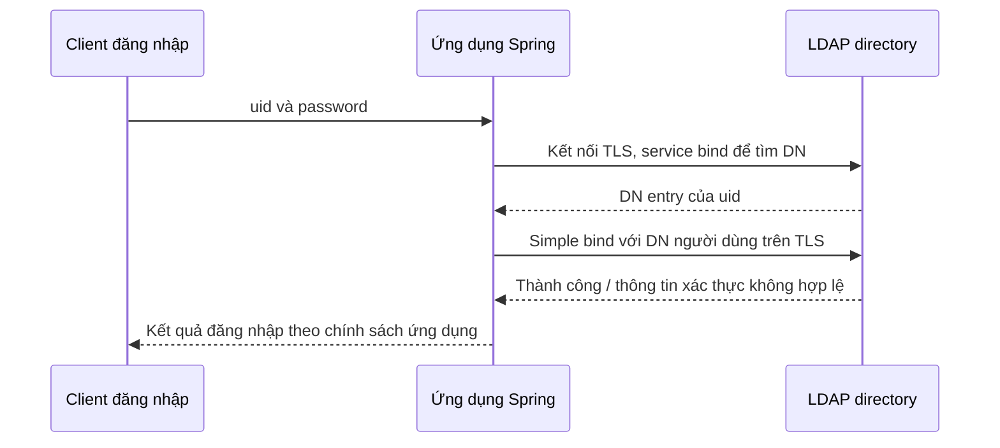

# Simple bind trên kênh bảo mật trong Spring Data LDAP

Trong **Spring Data LDAP**, ứng dụng thường dùng một tài khoản dịch vụ để đọc hoặc cập nhật entry bằng repository và `LdapTemplate`. Một số ứng dụng còn xác thực người dùng cuối bằng thông tin tài khoản trong directory. Với **LDAP simple bind**, client gửi **DN định danh và mật khẩu** để directory kiểm tra quyền xác thực. Vì cơ chế simple bind không tự mã hóa mật khẩu ở tầng giao thức LDAP, nó **phải được thực hiện trên kênh đã được bảo vệ bằng TLS**, đồng thời client phải xác minh danh tính máy chủ.

Bài học giải thích bản chất simple bind, hai cách thiết lập kênh bảo mật (**LDAPS** và **StartTLS**), cách cấu hình Spring Boot/Spring LDAP, sự khác nhau giữa bind tài khoản dịch vụ và xác thực người dùng, cũng như những lỗi TLS và tình huống kiểm thử cần có trước khi triển khai.

## 1. Mục tiêu học tập

Sau bài này, bạn có thể:

- Phân biệt **LDAP Bind để xác thực** với `LdapTemplate.bind(...)` dùng để **tạo entry**.
- Mô tả cách simple bind dùng DN/mật khẩu và vì sao cần TLS trước khi gửi thông tin xác thực.
- Phân biệt **LDAPS** (TLS ngay khi kết nối) và **StartTLS** (nâng cấp kết nối LDAP trước khi bind).
- Cấu hình `spring.ldap.urls`, `spring.ldap.base`, `spring.ldap.username` và `spring.ldap.password` cho ứng dụng Spring Boot.
- Hiểu vì sao trust chain, hostname verification, chứng chỉ hợp lệ và việc không hạ cấp xuống plaintext là điều kiện quan trọng.
- Thực hiện tìm kiếm qua tài khoản dịch vụ và minh họa xác thực người dùng với `LdapTemplate.authenticate(...)`.
- Viết kiểm thử tích hợp và xử lý lỗi sai mật khẩu, lỗi chứng chỉ, lỗi mạng và trường hợp tài khoản không đủ quyền.

## 2. LDAP simple bind là gì?

LDAP có **Bind operation** dùng để thiết lập trạng thái xác thực cho một kết nối. Với cơ chế **simple authentication**, client cung cấp:

1. **Tên định danh** dưới dạng DN, ví dụ `uid=alice,ou=people,dc=example,dc=org` hoặc DN tài khoản dịch vụ.
2. **Mật khẩu** của tài khoản đó.
3. Directory kiểm tra thông tin và trả kết quả bind thành công hoặc thất bại.

Ví dụ biểu diễn ý tưởng:

```text
Client                 Directory
  | ---- BindRequest(name=DN, simple=password) ----> |
  | <--- BindResponse(success / invalidCredentials) -|
```

Thông tin trong `BindRequest` **không được LDAP simple bind tự mã hóa theo kiểu challenge–response**. Nếu truyền qua kết nối LDAP plaintext, người có khả năng quan sát đường truyền có thể thu được thông tin xác thực. Khi dùng TLS được cấu hình và xác minh đúng, dữ liệu LDAP (bao gồm password trong BindRequest) nằm trong luồng truyền được TLS bảo vệ.

**TLS bảo vệ dữ liệu trên đường truyền**, không chứng minh rằng server lưu mật khẩu bằng thuật toán băm an toàn, không thay thế cơ chế phân quyền và không loại bỏ nhu cầu kiểm soát log, cấu hình hoặc vòng đời thông tin xác thực.

### 2.1. Không nhầm hai nghĩa của từ bind

| Thuật ngữ | Mục đích | Ví dụ |
| --- | --- | --- |
| **LDAP Bind operation** | Xác thực danh tính cho kết nối LDAP. | Dùng DN `cn=svc-reader,...` và password để kết nối directory. |
| **Simple bind** | Một hình thức LDAP Bind dùng DN và mật khẩu. | Client xác thực sau khi TLS sẵn sàng. |
| **`LdapTemplate.bind(Name, Object, Attributes)`** | **Thêm entry mới** tại DN, tương đương thao tác LDAP Add trong ngữ cảnh Spring LDAP. | Tạo `uid=alice,ou=people` với `objectClass` và thuộc tính. |
| **`LdapTemplate.authenticate(...)`** | Tìm/nhận diện entry phù hợp và xác thực bằng mật khẩu được cung cấp, theo quy trình Spring LDAP. | Kiểm tra thông tin đăng nhập của Alice. |

Nói “đã gọi `ldapTemplate.bind(...)`” trong code CRUD **không đồng nghĩa** với “vừa xác thực LDAP simple bind”. Đây là hai thao tác khác nhau có tên gần giống nhau.

## 3. Hai cách tạo kênh bảo mật

### 3.1. LDAPS: TLS từ đầu kết nối

**LDAPS** dùng URL bắt đầu bằng `ldaps://`, thường trên TCP port **636**:

```text
1. Client kết nối TCP tới ldap.example.org:636
2. TLS handshake; client xác minh chứng chỉ và hostname của server
3. Khi TLS thành công, client gửi LDAP BindRequest
4. Server trả BindResponse; client bắt đầu search/lookup/modify theo ACL
```

URL ví dụ:

```text
ldaps://ldap.example.org:636
```

LDAPS dễ cấu hình khi ứng dụng Spring Boot chỉ cần dùng `spring.ldap.urls` và Java TLS truststore đã được thiết lập đúng. Port 636 là **quy ước phổ biến**, không phải mọi triển khai đều bắt buộc dùng chính port đó.

### 3.2. StartTLS: nâng cấp LDAP connection trước khi bind

**StartTLS** bắt đầu bằng kết nối `ldap://` (thường port **389**), sau đó dùng LDAP Extended Operation để chuyển sang TLS:

```text
1. Kết nối ldap://ldap.example.org:389, chưa gửi mật khẩu
2. Gửi StartTLS ExtendedRequest
3. Server chấp nhận; TLS handshake bắt đầu
4. Client kiểm tra chuỗi tin cậy và tên máy chủ
5. TLS hoàn tất -> mới thực hiện LDAP simple bind
6. Search / lookup / modify qua kênh TLS
```

Điểm quan trọng là **thứ tự**: không thực hiện simple bind mang mật khẩu trên kết nối plaintext rồi mới gọi StartTLS. Nếu server không hỗ trợ StartTLS, handshake lỗi hoặc xác minh chứng chỉ thất bại, client phải **dừng xác thực (fail closed)**, không âm thầm quay về LDAP không mã hóa.

Không thể bật StartTLS chỉ bằng cách thay `ldaps://` thành `ldap://` trong cấu hình: cần **cơ chế StartTLS** thực sự được thư viện LDAP/connection context thực hiện trước bind. Khi dùng Spring LDAP với StartTLS, cần cấu hình authentication strategy có hỗ trợ TLS phù hợp với phiên bản Spring LDAP và hiểu vòng đời connection/rebind/pooling.

### 3.3. So sánh LDAPS và StartTLS

| Tiêu chí | LDAPS | StartTLS |
| --- | --- | --- |
| URL thường dùng | `ldaps://host:636` | `ldap://host:389` |
| TLS bắt đầu | Ngay khi thiết lập kết nối. | Sau StartTLS Extended Operation, **trước bind**. |
| Kiểm tra chứng chỉ server | Bắt buộc để chống giả mạo server. | Bắt buộc sau nâng cấp TLS. |
| Nguy cơ cấu hình sai | Sai truststore, hostname, TLS protocol. | Ngoài lỗi TLS còn có lỗi **quên StartTLS hoặc fallback plaintext**. |
| Ứng dụng Spring Boot cơ bản | Thường chọn URL `ldaps://`. | Cần cấu hình hỗ trợ StartTLS của provider/Spring LDAP. |

Cả hai phương án đều có thể bảo vệ simple bind **nếu** xác minh TLS đúng, không hạ cấp và gửi credentials sau khi kênh đã an toàn. Bài này dùng **LDAPS** cho code mẫu để tập trung vào cách xác thực.

## 4. Điều kiện TLS phải đáp ứng trước khi gửi password

Việc kết nối tới port 636 hoặc thấy URL `ldaps://` **chưa đủ để kết luận cấu hình an toàn**. Client cần xác nhận máy chủ mà nó định kết nối:

- **Chuỗi tin cậy:** chứng chỉ máy chủ phải dẫn tới CA được ứng dụng/JVM tin cậy. CA nội bộ của tổ chức cần được phân phối và cài vào truststore đúng cách.
- **Hostname verification:** tên `ldap.example.org` trong URL phải phù hợp với DNS name được chứng chỉ cho phép (thường trong Subject Alternative Name). Không vô hiệu hóa kiểm tra tên để “chạy cho được”.
- **Thời hạn và chính sách chứng chỉ:** kiểm tra chứng chỉ còn hiệu lực, dùng đúng mục đích và không thuộc loại bị từ chối theo chính sách TLS của hệ thống.
- **Phiên bản/mật mã TLS:** dùng TLS phiên bản và cipher suite được tổ chức hỗ trợ an toàn, thông thường TLS 1.2 hoặc 1.3; tránh cho phép bộ giao thức cũ yếu.
- **Không fallback plaintext:** lỗi TLS phải là lỗi kết nối/xác thực, không phải lý do để chuyển sang `ldap://` không được nâng cấp.
- **Không dùng trust-all:** một `TrustManager` “chấp nhận mọi chứng chỉ”, tắt hostname checking hoặc chấp nhận chứng chỉ sai tên có thể vô hiệu hóa mục tiêu xác minh máy chủ.

Một kẻ tấn công chủ động có thể giả lập máy chủ LDAP nếu client bỏ qua xác minh chứng chỉ. Trong trường hợp đó, password vẫn có thể bị tiết lộ cho đầu bên kia của một kênh TLS **không được xác thực danh tính đúng**.

### 4.1. Truststore cho CA nội bộ

JVM thường dựa vào **truststore** để quyết định CA nào được tin. Nếu tổ chức dùng CA nội bộ, có thể tạo một truststore dành riêng cho ứng dụng/test và nhập chứng chỉ CA bằng `keytool`:

```bash
keytool -importcert \
  -alias ldap-directory-ca \
  -file ./directory-ca.pem \
  -keystore ./directory-truststore.p12 \
  -storetype PKCS12
```

`keytool` có thể hỏi password để bảo vệ truststore. Ví dụ này dành cho **máy/phạm vi thử nghiệm**, không phải yêu cầu cấp quyền tin cậy toàn bộ chứng chỉ bất kỳ. Sau đó cấu hình JVM chạy ứng dụng với truststore phù hợp, chẳng hạn:

```text
-Djavax.net.ssl.trustStore=/secure/config/directory-truststore.p12
-Djavax.net.ssl.trustStoreType=PKCS12
```

Mật khẩu truststore (khi cần) phải được cấp qua cơ chế quản lý bí mật của môi trường; tránh ghi trực tiếp credential vào repository hoặc tài liệu cấu hình công khai. Đường dẫn truststore, chứng chỉ CA, quyền đọc file và cách JVM nạp cấu hình phụ thuộc môi trường triển khai.

**Phân biệt:** truststore chứa **chứng chỉ dùng để xác minh phía server**; nó không phải password LDAP. Nếu directory yêu cầu **mutual TLS** với client certificate thì cần thêm cấu hình key material, nhưng đó là cơ chế TLS/client authentication khác và **không phải điều kiện mặc định của LDAP simple bind**.

## 5. Cấu hình Spring Boot dùng simple bind qua LDAPS

Ví dụ `application.yml`:

```yaml
spring:
  ldap:
    urls: ldaps://ldap.example.org:636
    base: dc=example,dc=org
    username: ${LDAP_BIND_DN}
    password: ${LDAP_BIND_PASSWORD}
```

Trong đó:

| Thuộc tính | Vai trò |
| --- | --- |
| `spring.ldap.urls` | Danh sách endpoint LDAP; dùng `ldaps://` để khởi đầu bằng TLS. |
| `spring.ldap.base` | DN gốc cho các thao tác LDAP tương đối, ví dụ `dc=example,dc=org`. |
| `spring.ldap.username` | DN tài khoản mà context dùng để bind, thường là **service account**. |
| `spring.ldap.password` | Mật khẩu của service account, nên lấy từ secret/biến môi trường. |

Ví dụ giá trị cho `LDAP_BIND_DN` là:

```text
cn=svc-directory-reader,ou=services,dc=example,dc=org
```

**DN tài khoản bind** là DN đầy đủ theo cấu trúc directory, không phải đơn thuần `alice`. Một directory có thể hỗ trợ dạng tên xác thực khác, nhưng khi dùng simple bind trong ví dụ này nên truyền DN được server chấp nhận.

Không hardcode mật khẩu hoặc đưa mật khẩu vào URL. Không in toàn bộ `Environment`, cấu hình sau khi resolve placeholder hoặc bean chứa password ra log. Với ứng dụng triển khai thực tế, dùng secret manager hoặc khả năng cung cấp secret an toàn của hạ tầng; tránh đặt default password yếu ngay trong `application.yml`.

### 5.1. Spring Boot và `LdapTemplate`

Khi có dependency Spring LDAP và auto-configuration phù hợp, Spring Boot có thể tạo `ContextSource` và `LdapTemplate` từ `spring.ldap.*`. Service sử dụng nó như sau:

```java
package com.example.directory;

import java.util.List;

import org.springframework.ldap.core.AttributesMapper;
import org.springframework.ldap.core.LdapTemplate;
import org.springframework.ldap.query.LdapQuery;
import org.springframework.ldap.query.SearchScope;
import org.springframework.stereotype.Service;

import static org.springframework.ldap.query.LdapQueryBuilder.query;

@Service
public class SecureDirectoryReader {
    private final LdapTemplate ldapTemplate;

    public SecureDirectoryReader(LdapTemplate ldapTemplate) {
        this.ldapTemplate = ldapTemplate;
    }

    public List<String> findUserIds() {
        LdapQuery people = query()
                .base("ou=people")
                .searchScope(SearchScope.ONELEVEL)
                .attributes("uid")
                .where("objectClass").is("inetOrgPerson");

        return ldapTemplate.search(
                people,
                (AttributesMapper<String>) attrs ->
                        String.valueOf(attrs.get("uid").get())
        );
    }
}
```

Ở ví dụ này:

- `ContextSource` dùng `LDAP_BIND_DN` và `LDAP_BIND_PASSWORD` để xác thực với directory khi lấy connection. Spring Data LDAP repository cũng dựa trên cơ sở kết nối này nếu được cấu hình cùng context.
- `LdapTemplate` không tự khiến một URL `ldap://` trở nên mã hóa: **an toàn của connection nằm ở cấu hình LDAPS/StartTLS và xác minh TLS**.
- `base("ou=people")` là DN tương đối với `spring.ldap.base=dc=example,dc=org`. Chọn đúng nhánh và scope để giảm phạm vi tra cứu.
- Tài khoản `svc-directory-reader` chỉ cần quyền đọc những entry/thuộc tính nghiệp vụ cho phép. Không dùng tài khoản quản trị schema hoặc quản trị toàn directory cho thao tác tra cứu thông thường.

### 5.2. Cấu hình thủ công khi không dùng auto-configuration

Với Spring LDAP, `LdapContextSource` là thành phần tạo context LDAP. Khi tự cấu hình ứng dụng, có thể khai báo:

```java
package com.example.directory;

import org.springframework.context.annotation.Bean;
import org.springframework.context.annotation.Configuration;
import org.springframework.beans.factory.annotation.Value;
import org.springframework.ldap.core.LdapTemplate;
import org.springframework.ldap.core.support.LdapContextSource;

@Configuration
public class LdapConfiguration {

    @Bean
    public LdapContextSource ldapContextSource(
            @Value("${app.ldap.url}") String url,
            @Value("${app.ldap.base}") String base,
            @Value("${app.ldap.bind-dn}") String bindDn,
            @Value("${app.ldap.bind-password}") String password) {
        LdapContextSource source = new LdapContextSource();
        source.setUrl(url);           // Ví dụ: ldaps://ldap.example.org:636
        source.setBase(base);         // dc=example,dc=org
        source.setUserDn(bindDn);     // DN service account
        source.setPassword(password);
        return source;
    }

    @Bean
    public LdapTemplate ldapTemplate(LdapContextSource source) {
        return new LdapTemplate(source);
    }
}
```

Đây là **cấu hình thay thế** cho auto-configuration, không nên tạo hai bộ `ContextSource` khác nhau một cách vô tình. Phần `@Value` đọc từ các property `app.ldap.*` do ứng dụng tự khai báo; nó **không** đọc `spring.ldap.*` của ví dụ trước. Spring quản lý vòng đời bean và gọi các bước khởi tạo cần thiết. Tính an toàn TLS vẫn đến từ URL, truststore, chính sách JVM và TLS handshake, không phải từ tên lớp `LdapContextSource`.

## 6. Service account bind khác xác thực người dùng cuối

Trong ứng dụng LDAP có hai tình huống rất dễ bị lẫn:

**A. Service bind:** ứng dụng kết nối như tài khoản `cn=svc-directory-reader,...` để tìm entry, đọc thuộc tính hoặc thao tác CRUD theo ACL. Điều này xác thực **ứng dụng với directory**, không tự động xác thực người dùng đang gọi REST API.

**B. User bind:** ứng dụng kiểm tra mật khẩu của một người dùng cụ thể, chẳng hạn Alice, bằng cơ chế bind phù hợp. Có thể dùng `LdapTemplate.authenticate(...)` để tra tìm entry theo điều kiện rồi thử xác thực với mật khẩu được cung cấp.



Sequence diagram mô tả **quy trình logic**: số lượng context/kết nối thực tế do Spring LDAP quản lý. Nếu tài khoản dịch vụ chỉ dùng để đọc danh bạ, nó không nên có quyền sửa password của người dùng. Nếu ứng dụng cần phân quyền theo nhóm, nhóm/quyền phải được kiểm tra theo chính sách nghiệp vụ và không đồng nhất với việc bind đã thành công.

### 6.1. Ví dụ kiểm tra mật khẩu người dùng qua `LdapTemplate`

```java
package com.example.directory;

import org.springframework.ldap.core.LdapTemplate;
import org.springframework.ldap.query.LdapQuery;
import org.springframework.ldap.query.SearchScope;
import org.springframework.stereotype.Service;
import static org.springframework.ldap.query.LdapQueryBuilder.query;

@Service
public class DirectoryPasswordVerifier {
    private final LdapTemplate ldapTemplate;

    public DirectoryPasswordVerifier(LdapTemplate ldapTemplate) {
        this.ldapTemplate = ldapTemplate;
    }

    public boolean verify(String uid, String password) {
        // Chính sách UID chỉ là ví dụ của một sản phẩm dùng ASCII.
        if (uid == null || !uid.matches("[A-Za-z0-9._-]{1,64}")) {
            return false;
        }
        // Không được để password rỗng đi tới simple bind:
        // LDAP có ngữ nghĩa unauthenticated/anonymous bind riêng.
        if (password == null || password.isEmpty()) {
            return false;
        }

        LdapQuery user = query()
                .base("ou=people")
                .searchScope(SearchScope.SUBTREE)
                .where("objectClass").is("inetOrgPerson")
                .and("uid").is(uid);

        return ldapTemplate.authenticate(user, password);
    }
}
```

Điều kiện `.is(uid)` giúp giá trị được mã hóa theo cú pháp LDAP filter, thay vì nối input thô vào filter. `LdapTemplate.authenticate(...)` được dùng trên **ContextSource đã cấu hình bảo mật TLS**, vì giai đoạn bind với password người dùng cũng phải bảo vệ kênh.

**Không** đọc `userPassword` từ LDAP rồi tự so sánh với password request. Directory phải thực hiện xác thực và áp dụng các chính sách của nó. Tuyệt đối không log `password`, không đưa password vào exception message, và không cache mật khẩu người dùng.

Khi triển khai đăng nhập thật, nên tích hợp **Spring Security LDAP** để quản lý phiên đăng nhập, xác thực, xử lý tài khoản và giới hạn truy cập phù hợp; ví dụ trên chủ yếu minh họa simple bind ở tầng LDAP, **không phải** một cơ chế đăng nhập ứng dụng hoàn chỉnh.

### 6.2. Password rỗng là rủi ro đặc biệt

Trong các biến thể của LDAP simple bind, DN không rỗng đi cùng password rỗng có thể mang ngữ nghĩa **unauthenticated authentication** (hoặc bị server từ chối). Nó không có nghĩa mật khẩu của người dùng đã được xác minh. Vì vậy, API đăng nhập phải **từ chối mật khẩu rỗng trước khi gọi bind**, bất kể directory và thư viện có chính sách từ chối riêng hay không.

Không dùng `String.trim()` để “chuẩn hóa” mật khẩu. Khoảng trắng đầu/cuối có thể là một phần của mật khẩu hợp lệ; nếu sửa chuỗi trước khi bind, ứng dụng sẽ xác thực một giá trị **khác** giá trị người dùng cung cấp. Chỉ áp dụng chính sách độ dài/định dạng mật khẩu theo hợp đồng xác thực cụ thể, không dùng chung validator cho UID hoặc tên.

## 7. Kiểm thử kết nối TLS và simple bind bằng công cụ LDAP

Trong môi trường kiểm thử cô lập, các công cụ OpenLDAP có thể giúp phân biệt vấn đề **TLS** và vấn đề **thông tin xác thực**.

### 7.1. Kiểm tra LDAPS

```bash
ldapwhoami -x \
  -H ldaps://ldap-test.example.org:636 \
  -D "cn=svc-reader,ou=services,dc=example,dc=org" \
  -W
```

`-x` chọn simple authentication, `-D` chỉ DN và `-W` yêu cầu nhập password tương tác (không in password trong command). Khi thành công, máy chủ thường trả thông tin identity của kết nối như `dn:...`, tùy hỗ trợ của directory.

### 7.2. Kiểm tra StartTLS với yêu cầu bắt buộc nâng cấp

```bash
ldapwhoami -x -ZZ \
  -H ldap://ldap-test.example.org:389 \
  -D "cn=svc-reader,ou=services,dc=example,dc=org" \
  -W
```

Trong OpenLDAP CLI, `-ZZ` yêu cầu StartTLS phải thành công; nếu quá trình nâng cấp thất bại, lệnh phải báo lỗi thay vì tiếp tục xác thực trên plaintext. Dùng `-ZZ` thay cho quy trình có thể tùy chọn TLS khi mục tiêu là bảo vệ simple bind.

Các công cụ OpenLDAP có cơ chế riêng để tin CA (ví dụ cấu hình trust CA trong `ldap.conf` hoặc biến môi trường tương ứng). **Truststore của JVM không mặc nhiên là nguồn tin cậy cho `ldapwhoami`**: một lệnh CLI thành công không chứng minh Java client đã cấu hình đúng TLS, và ngược lại.

### 7.3. Phân biệt kết quả kiểm thử

| Tình huống | Kỳ vọng đúng |
| --- | --- |
| URL LDAPS, CA/tên máy chủ hợp lệ, đúng DN và mật khẩu | Simple bind thành công, thao tác LDAP tiếp tục theo ACL. |
| Đúng TLS nhưng sai mật khẩu | Directory từ chối bind (thường mã LDAP `49 invalidCredentials`). |
| Chứng chỉ không được tin | TLS handshake thất bại **trước** khi gửi password. |
| Chứng chỉ sai tên hostname | Client từ chối server, không hạ cấp xác minh. |
| Server không hỗ trợ StartTLS trong luồng bắt buộc | Không gửi password; báo lỗi. |
| Bind thành công nhưng đọc nhánh ngoài quyền | Search/modify bị hạn chế bởi ACL hoặc không thấy dữ liệu. |
| Tài khoản bị khóa/hết hạn | Có thể nhận lỗi xác thực/chính sách tùy directory. |

## 8. Kiểm thử tích hợp với Spring Data LDAP

Một test chỉ mock `LdapTemplate` không chứng minh TLS đã được thiết lập hoặc password thực sự được directory kiểm tra. Integration test cần **directory test có LDAPS, chứng chỉ hợp lệ và fixture riêng**, không sử dụng account production.

Ví dụ cấu hình cho profile `test`:

```yaml
spring:
  ldap:
    urls: ${LDAP_TEST_URL}
    base: dc=example,dc=org
    username: ${LDAP_TEST_BIND_DN}
    password: ${LDAP_TEST_BIND_PASSWORD}
```

Test runner phải cấp `LDAP_TEST_URL` theo dạng `ldaps://...`, cùng certificate truststore phù hợp. Không đặt giá trị default trỏ tới production khi biến môi trường thiếu. Nên tạo fail-fast validation ở cấu hình test để ngăn nhầm URL không bảo mật.

Giả sử directory test có entry `uid=alice,ou=people,dc=example,dc=org` với mật khẩu test và một tài khoản dịch vụ đủ quyền tìm người dùng:

```java
package com.example.directory;

import static org.junit.jupiter.api.Assertions.assertFalse;
import static org.junit.jupiter.api.Assertions.assertTrue;

import org.junit.jupiter.api.Test;
import org.springframework.beans.factory.annotation.Autowired;
import org.springframework.boot.test.context.SpringBootTest;
import org.springframework.test.context.ActiveProfiles;

@SpringBootTest
@ActiveProfiles("test")
class SecureLdapAuthenticationIT {
    @Autowired DirectoryPasswordVerifier verifier;

    @Test
    void authenticatesExistingUserThroughTls() {
        String password = System.getenv("LDAP_TEST_ALICE_PASSWORD");
        if (password == null || password.isEmpty()) {
            throw new IllegalStateException("Thiếu credential của fixture test");
        }

        assertTrue(verifier.verify("alice", password));
        assertFalse(verifier.verify("alice", "definitely-incorrect-test-password"));
        assertFalse(verifier.verify("alice", ""));
    }
}
```

Đây là **test minh họa**, chỉ chạy được khi directory test đã tạo đúng tài khoản/mật khẩu và Spring Boot đã có các dependency/bean tương ứng. Nếu sử dụng chung directory, các test thay đổi password phải có fixture tách biệt và cleanup xác định trước.

**Để xác minh TLS đúng nghĩa, cần thêm test âm tính:** cấu hình một endpoint test có chứng chỉ chưa được tin hoặc sai hostname, xác nhận kết nối thất bại **trước** khi simple bind thành công. Test xác thực đúng/sai mật khẩu một mình không chứng minh certificate verification đang được bật. Không “sửa” bài test này bằng một `TrustManager` bỏ kiểm tra chứng chỉ.

### Checklist kiểm thử tối thiểu

1. Kết nối LDAPS với CA và hostname hợp lệ thành công.
2. Sai CA hoặc hostname phải thất bại; không fallback `ldap://`.
3. Service account bind thành công nhưng chỉ đọc đúng OU/attribute được ACL cấp.
4. User bind đúng mật khẩu trả thành công; sai mật khẩu và mật khẩu rỗng bị từ chối.
5. Filter tìm DN người dùng được xây an toàn; đầu vào đặc biệt như `*` không biến thành wildcard tùy ý.
6. Password không xuất hiện trong log, exception response, test report hoặc cấu hình đã commit.
7. Khi directory không sẵn sàng, ứng dụng phân loại đó là lỗi hạ tầng, không coi là “sai mật khẩu” với tác dụng phụ không mong muốn.

## 9. Lỗi thường gặp và chẩn đoán

| Triệu chứng | Nguyên nhân khả dĩ | Cách kiểm tra/cải thiện |
| --- | --- | --- |
| `PKIX path building failed` / `SSLHandshakeException` | JVM chưa tin CA, thiếu intermediate cert hoặc truststore sai. | Kiểm tra chuỗi CA và truststore của đúng JVM đang chạy; không dùng trust-all. |
| Lỗi hostname/certificate mismatch | URL dùng IP/alias không nằm trong certificate SAN. | Sửa tên DNS hoặc cấp chứng chỉ phù hợp; không tắt hostname verification. |
| `invalidCredentials` (LDAP 49) | DN/password sai, account bị khóa/hết hạn hoặc chính sách directory khác. | Xác minh tài khoản test, DN, chính sách bind và trạng thái server; tránh lộ chi tiết cho client. |
| `CommunicationException` / timeout | Sai port, DNS, firewall, TLS hoặc server không sẵn sàng. | Kiểm tra URL, khả năng kết nối, timeout và TLS logs có kiểm soát. |
| URL `ldap://` chạy nhưng password không được bảo vệ | Chưa bật hoặc chưa hoàn tất StartTLS. | Dùng LDAPS hoặc StartTLS bắt buộc **trước bind**. |
| Service account bind thành công nhưng search thất bại | ACL không cho đọc base/attribute hoặc search base sai. | Phân biệt xác thực kết nối với quyền truy cập và DN tương đối. |
| Tài khoản người dùng có password rỗng vẫn được báo xác thực | Ứng dụng bỏ qua ràng buộc empty password hoặc nhầm với unauthenticated bind. | Từ chối empty password trước khi bind; không xem bind không xác thực là đăng nhập thành công. |
| Test CLI thành công nhưng ứng dụng Java lỗi TLS | CLI và JVM dùng kho CA/cấu hình hostname riêng. | Kiểm tra truststore, tên URL và TLS policy của từng client. |
| Kết nối được nhưng tự động chuyển sang LDAP plaintext khi TLS lỗi | Cấu hình fallback gây downgrade. | Fail closed; kiểm tra rõ mọi LDAP endpoint dự phòng cũng có TLS hợp lệ. |
| Simple bind thành công nhưng API vẫn cần quyết định quyền | Xác thực không tự xác định roles/permissions của ứng dụng. | Ánh xạ quyền qua chính sách ứng dụng, ACL và cơ chế authorization phù hợp. |

**Phân biệt rõ các loại thất bại:** sai mật khẩu là lỗi xác thực; lỗi TLS certificate là lỗi **xác thực máy chủ/kênh bảo mật**; lỗi ACL là **không đủ quyền** sau khi đã bind; lỗi schema hoặc dữ liệu là lỗi thao tác directory. Đừng bắt tất cả exception rồi trả “sai mật khẩu” trong log hoặc response.

## 10. Những sai lầm bảo mật cần tránh

**1. Gửi simple bind trên plaintext.** LDAP `ldap://` không tự tạo TLS. Nếu chọn StartTLS, phải đợi nâng cấp thành công và kiểm tra chứng chỉ trước khi gửi password.

**2. Tin mọi chứng chỉ để tránh lỗi.** Việc bỏ kiểm tra CA/hostname có thể cho phép máy chủ giả mạo nhận credential, dù kết nối có mã hóa.

**3. Dùng tài khoản quản trị toàn directory cho mọi query.** Service account nên có quyền tối thiểu; thao tác đọc danh bạ và thao tác tạo/sửa account cần trách nhiệm và credential riêng nếu phù hợp.

**4. Đưa password vào mã nguồn, URL hoặc log.** Quản lý password bằng secret store và hạn chế ai có quyền xem env, process/config dumps, exception traces. Luân chuyển credential có quy trình kiểm thử và triển khai an toàn.

**5. Dùng mật khẩu người dùng làm điều kiện search filter.** Server phải thực hiện bind/authentication; không tự tìm `userPassword` và so sánh chuỗi trên client.

**6. Tạo DN tìm người dùng bằng cách nối raw input.** Nếu cần xác định DN từ `uid`, dùng query builder để tìm entry hoặc `LdapNameBuilder` tạo DN đúng cú pháp; đừng cho request quyết định OU tùy ý.

**7. Quên xử lý login abuse.** Simple bind không tự cung cấp rate limiting, chống brute force, MFA, session management hoặc kiểm soát account enumeration cho API web. Những cơ chế này cần được xử lý ở tầng ứng dụng/identity solution và tích hợp với chính sách directory.

**8. Nhầm TLS với authorization.** TLS bảo vệ kết nối; thành công của simple bind chứng minh thông tin xác thực phù hợp với chính sách server, nhưng không mặc nhiên cho phép caller sửa mọi entry hoặc dùng mọi chức năng ứng dụng.

## 11. Bài tập thực hành

**Bài 1.** Ứng dụng có cấu hình `ldap://ldap.example.org:389`, gửi DN/mật khẩu simple bind rồi mới gọi StartTLS. Lỗi nằm ở đâu?

**Đáp án:** Password được gửi **trước** khi kênh TLS được thiết lập. Phải thực hiện StartTLS và xác minh server thành công trước BindRequest, hoặc dùng LDAPS từ đầu. Lỗi nâng cấp phải dừng xác thực, không fallback plaintext.

**Bài 2.** Vì sao chỉ thay URL từ `ldap://` sang `ldaps://` nhưng bỏ qua xác minh certificate vẫn có rủi ro?

**Đáp án:** TLS không xác minh đúng danh tính server có thể mã hóa kết nối tới **máy chủ giả mạo**. Phải kiểm tra trust chain, hostname, thời hạn/policy chứng chỉ và không dùng trust-all.

**Bài 3.** `spring.ldap.base=dc=example,dc=org`, `spring.ldap.username=cn=svc-reader,ou=services,dc=example,dc=org`. Ứng dụng đã xác thực người gọi REST API là Alice chưa?

**Đáp án:** Chưa. Nó mới cung cấp credential tài khoản **dịch vụ** cho LDAP context. Nếu cần xác thực Alice, phải có quy trình user authentication riêng, ví dụ `LdapTemplate.authenticate(...)` trên kênh TLS hoặc tích hợp Spring Security LDAP.

**Bài 4.** User nhập password rỗng; vì sao không nên gửi nó tới simple bind để server “tự quyết định”?

**Đáp án:** LDAP có ngữ nghĩa anonymous/unauthenticated bind cho một số tổ hợp DN/password rỗng. Ứng dụng đăng nhập phải từ chối rỗng ngay từ đầu để không nhầm trạng thái kết nối thành xác thực người dùng.

**Bài 5.** Công cụ `ldapwhoami -x -ZZ` kết nối thành công, nhưng ứng dụng Java gặp `PKIX path building failed`. Có mâu thuẫn không?

**Đáp án:** Không. CLI OpenLDAP và JVM có cấu hình CA/truststore khác nhau; phải kiểm tra CA và hostname trong **JVM chạy ứng dụng**, không tắt verification.

**Bài 6.** Service account bind thành công nhưng `ldapTemplate.search(...)` báo thiếu quyền khi đọc `ou=admins`. Cần sửa thế nào?

**Đáp án:** Đầu tiên xác nhận API có thật sự cần nhánh đó không. Giữ search base và ACL theo quyền tối thiểu; nếu có nhu cầu được duyệt, cấp quyền phù hợp qua quản trị directory. Không nâng toàn bộ service account thành superuser chỉ để giải quyết một truy vấn.

## 12. Ghi nhớ

- **LDAP simple bind** dùng DN và mật khẩu để xác thực; chỉ thực hiện sau khi TLS đã bảo vệ kênh.
- **LDAPS** tạo TLS từ đầu; **StartTLS** nâng cấp kết nối LDAP nhưng phải hoàn tất **trước** khi gửi password. Không fallback plaintext khi TLS thất bại.
- **Xác minh chứng chỉ, hostname và trust chain** là bắt buộc để tránh lộ credential cho máy chủ giả mạo; không dùng trust-all.
- Cấu hình `spring.ldap.urls` với `ldaps://`, `spring.ldap.username/password` từ secret store và `spring.ldap.base` đúng DN. Tài khoản dịch vụ chỉ có quyền tối thiểu.
- **Service bind** không phải **user login**. `LdapTemplate.authenticate(...)` hoặc Spring Security LDAP cần quy trình riêng khi xác thực người dùng cuối.
- Không nhầm **LDAP Bind operation** với `LdapTemplate.bind(...)` dùng để thêm entry.
- Kiểm thử TLS thành công/thất bại, mật khẩu đúng/sai/rỗng, ACL và xử lý lỗi trên **directory test cô lập**; không sử dụng credential production.
