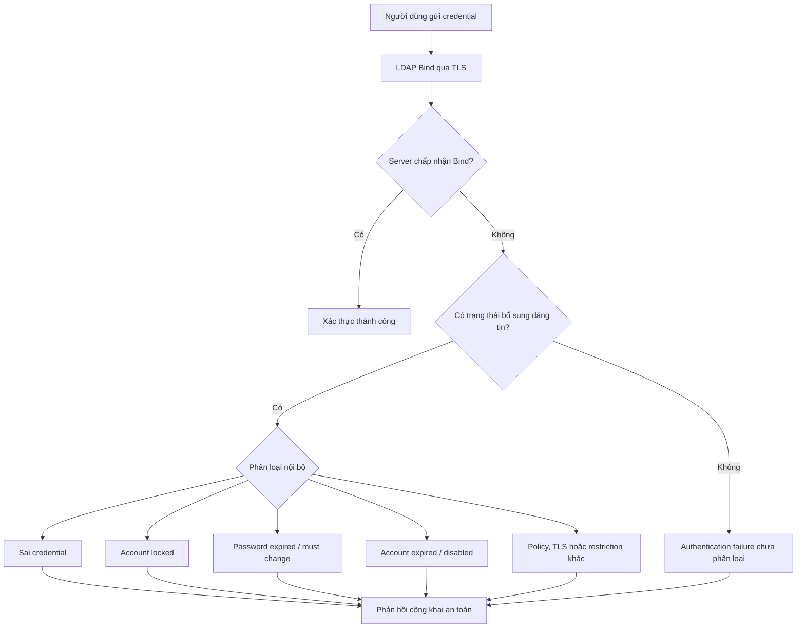
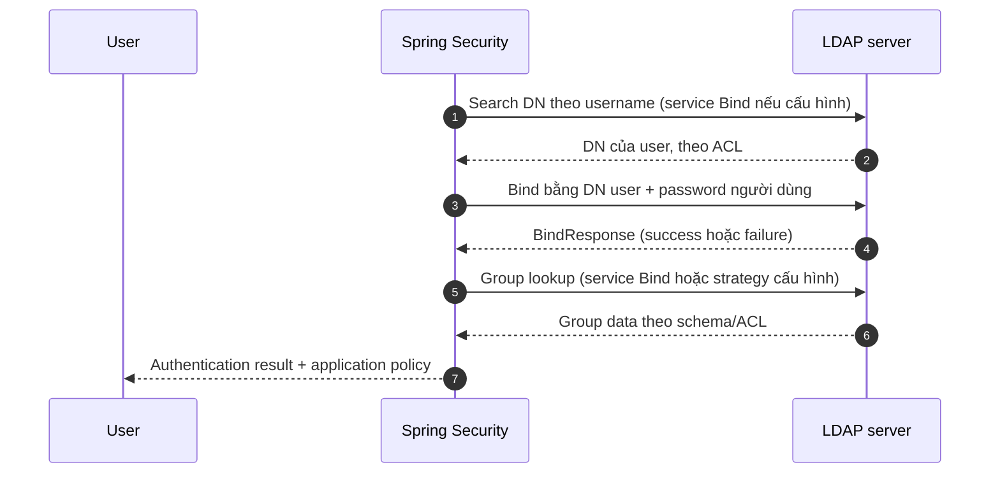

# Phân biệt sai mật khẩu, tài khoản bị khóa và tài khoản hết hạn

Trong chương **TLS và xác thực** của **SPRING_DATA_LDAP**, một lần đăng nhập LDAP thất bại có thể xuất phát từ nhiều nguyên nhân: người dùng nhập sai mật khẩu, tài khoản bị khóa sau nhiều lần xác thực sai, mật khẩu đã hết hạn, tài khoản hết hạn theo ngày, hoặc tài khoản bị quản trị viên vô hiệu hóa. Các trường hợp này có thể cần quy trình xử lý khác nhau, nhưng **không phải LDAP server nào cũng trả cho client một mã lỗi riêng và đầy đủ cho từng trạng thái**.

Một tình huống điển hình: ứng dụng dùng Spring Security LDAP để xác thực nhân viên. Người dùng nhập đúng tên đăng nhập nhưng sai mật khẩu nhiều lần. Directory áp chính sách khóa tài khoản. Lần tiếp theo, Bind tiếp tục thất bại. Nếu ứng dụng chỉ ghi nhận “sai mật khẩu” và tự động thử lại, nó có thể làm kéo dài trạng thái khóa. Nếu ứng dụng trả công khai “tài khoản này đã tồn tại nhưng bị khóa”, kẻ tấn công có thể dùng thông tin đó để dò danh sách tài khoản.

Vì vậy, phải tách **kết quả LDAP Bind**, **trạng thái mật khẩu**, **trạng thái vòng đời tài khoản** và **quyết định hiển thị của ứng dụng**. LDAP result code `49 invalidCredentials` thường chỉ cho biết thông tin xác thực không được chấp nhận; server có thể cung cấp thêm chi tiết qua response control hoặc diagnostic data đặc thù. Cách biểu diễn phụ thuộc sản phẩm, schema, cấu hình và quyền truy cập.

**Mục tiêu:** phân biệt sai mật khẩu, khóa tài khoản, hết hạn mật khẩu, hết hạn tài khoản và vô hiệu hóa; hiểu mã LDAP và thông tin bổ sung của OpenLDAP/Active Directory; xử lý Bind qua JNDI/Spring Security; thiết kế thông báo không làm lộ tài khoản; bảo vệ TLS/credential; và kiểm thử từng trạng thái bằng directory test phù hợp.

## 1. Trước tiên, phân biệt năm trạng thái

Những khái niệm sau thường bị gọi chung là “account lỗi”, nhưng ý nghĩa vận hành khác nhau:

| Trạng thái | Điều gì xảy ra? | Ai/cơ chế nào thường gây ra? | Hướng xử lý |
| --- | --- | --- | --- |
| **Sai mật khẩu** | Secret người dùng gửi không khớp credential được directory chấp nhận | Người dùng nhập nhầm, client gửi sai secret, credential đã đổi | Cho phép thử lại có giới hạn; không log mật khẩu |
| **Tài khoản bị khóa (locked)** | Directory tạm thời/nghiêm ngặt từ chối xác thực theo chính sách khóa | Số lần Bind sai, quản trị viên hoặc cơ chế bảo vệ | Chờ hết thời gian khóa hoặc quy trình unlock có thẩm quyền |
| **Mật khẩu hết hạn (password expired)** | Account có thể vẫn tồn tại/được kích hoạt, nhưng credential đã quá tuổi theo password policy | Chính sách tuổi mật khẩu | Dẫn tới luồng đổi mật khẩu an toàn |
| **Tài khoản hết hạn (account expired)** | Ngày/điều kiện vòng đời của account đã hết | Quản trị IAM, ngày kết thúc hợp đồng, policy account | Yêu cầu chủ sở hữu/quản trị gia hạn hoặc cấp lại |
| **Tài khoản bị vô hiệu hóa (disabled)** | Account bị tắt bởi quản trị hoặc policy | Quản trị viên, quy trình nghỉ việc, incident response | Quy trình kích hoạt lại có phê duyệt |

Ngoài ra còn có **password phải đổi ngay (must change/reset)**, giới hạn giờ đăng nhập, giới hạn workstation/client, yêu cầu TLS mạnh hơn và trạng thái chưa được phép Bind. Chúng không nên bị gộp thành “sai mật khẩu”.



**Không suy ra trạng thái chỉ từ một thông báo chung “Bind thất bại”.** Cần có nguồn dữ liệu được server xác nhận, đúng Bind identity và đúng directory đang phục vụ request.

## 2. LDAP Bind và result code 49

LDAP xác thực credential bằng **Bind operation**. Với simple Bind, client gửi Bind DN và password; server trả BindResponse. Nếu thông tin xác thực không được chấp nhận, một mã phổ biến là:

```text
49  invalidCredentials
```

Mã này **không có nghĩa duy nhất là người dùng gõ sai password**. Tùy directory, cùng mã 49 có thể bao phủ username không tồn tại, password sai, account bị khóa, password hết hạn, account disabled hoặc một số điều kiện xác thực khác. Server có thể cố ý không phân biệt để hạn chế dò tài khoản.

### 2.1. Những mã LDAP dễ nhầm

| Mã | Tên | Ý nghĩa khái quát | Không nên kết luận |
| ---: | --- | --- | --- |
| **0** | `success` | Operation thành công | Không có nghĩa người dùng được mọi quyền ứng dụng |
| **8** | `strongerAuthRequired` | Cần cơ chế/mức xác thực mạnh hơn | Không phải sai mật khẩu |
| **13** | `confidentialityRequired` | Cần bảo vệ tính bí mật của kết nối | Không phải account bị khóa |
| **32** | `noSuchObject` | DN/base không tồn tại hoặc không thể thấy theo chính sách server | Không luôn chứng minh người dùng không tồn tại trong toàn directory |
| **49** | `invalidCredentials` | Bind credentials không được chấp nhận | Không phân biệt duy nhất sai password/locked/expired |
| **50** | `insufficientAccessRights` | Không đủ quyền cho operation | Không đồng nghĩa password sai |
| **51** | `busy` | Server báo đang bận | Không phải password expired |
| **52** | `unavailable` | Server báo dịch vụ không khả dụng | Không phải account expired |
| **53** | `unwillingToPerform` | Server từ chối theo điều kiện/chính sách | Không tự chứng minh account bị khóa |

TLS handshake failure, DNS failure, TCP refusal và timeout trước khi nhận LDAP response **không nhất thiết có LDAP result code**. Đừng biến mọi exception kết nối thành mã 49 hoặc “sai mật khẩu”.

### 2.2. Vì sao LDAP không luôn trả lỗi chi tiết?

Nếu server nói rõ:

```text
user does not exist
password is wrong
account is locked
account is expired
```

thì một endpoint đăng nhập có thể trở thành công cụ **enumeration**: kẻ tấn công biết username nào tồn tại, tài khoản nào đang hoạt động và người dùng nào bị khóa. Một số directory vì vậy trả kết quả xác thực chung cho nhiều trạng thái.

Ứng dụng cần chấp nhận hai lớp thông tin:

- **Thông tin công khai:** thông báo chung, không xác nhận username tồn tại hoặc tiết lộ trạng thái nội bộ.
- **Thông tin vận hành nội bộ:** mã lỗi/control/diagnostic được xác minh, chỉ lưu ở log hoặc audit có phân quyền.

Không hy sinh bảo mật chỉ để hiển thị một thông báo “thân thiện” quá chi tiết.

## 3. Sai mật khẩu: credential không hợp lệ

Khi user nhập sai password:

1. Ứng dụng xác định DN/identity theo luồng đăng nhập đã được thiết kế.
2. Client thực hiện Bind qua TLS đã xác minh.
3. Server so sánh credential theo cơ chế xác thực của nó.
4. Nếu không khớp, Bind thất bại; thường gặp result code 49.
5. Server có thể cập nhật bộ đếm sai mật khẩu hoặc trạng thái policy.

Sai mật khẩu có thể đến từ:

- Người dùng gõ sai hoặc dùng mật khẩu cũ.
- Ứng dụng gửi nhầm secret do lỗi encode, trim, chuyển đổi ký tự hoặc cấu hình.
- Người dùng vừa đổi mật khẩu ở một nguồn khác nhưng session/client vẫn giữ credential cũ.
- Một service account bị rotation secret nhưng deployment chưa cập nhật đồng bộ.
- Username/DN được resolve sai và password đúng đang được thử trên một identity khác.

### 3.1. Không tự động retry Bind với cùng password

Một vòng lặp như sau rất nguy hiểm:

```java
while (bindFailed) {
    tryBindAgain(username, password);
}
```

Nếu server có lockout policy, mỗi lần Bind sai có thể tăng bộ đếm thất bại, dẫn đến khóa tài khoản thật. Retry vô hạn còn làm tăng tải và tạo điều kiện denial of service.

Quy tắc:

- Một yêu cầu đăng nhập chỉ thực hiện số lần Bind cần thiết cho một lần xác thực.
- Không retry tự động bằng cùng credential sau `invalidCredentials`.
- Rate limit theo account và nguồn truy cập ở tầng ứng dụng, có xét NAT/proxy và nguy cơ khóa nhầm người dùng.
- Không ghi password, token hoặc toàn bộ Bind request vào log.
- Khi secret service account sai, sửa secret/configuration qua quy trình quản lý secret, không yêu cầu người dùng đổi mật khẩu cá nhân.

### 3.2. Không trim hoặc biến đổi password tùy tiện

Password là dữ liệu nhạy cảm, có thể chứa dấu cách ở đầu/cuối hoặc Unicode theo policy của hệ thống. Không tự gọi:

```java
password = password.trim();
password = password.toLowerCase();
```

trước khi Bind. Việc biến đổi có thể khiến mật khẩu hợp lệ trở thành sai. Chỉ áp dụng encoding/chuyển đổi đúng hợp đồng của nguồn credential; không đoán charset.

## 4. Tài khoản bị khóa (account locked)

Account lockout là cơ chế chống đoán mật khẩu hoặc bảo vệ danh tính. Directory có thể khóa khi số lần xác thực sai vượt ngưỡng, trong một khoảng thời gian hoặc đến khi quản trị viên mở khóa.

Ví dụ chính sách:

```text
Maximum failed binds: 5
Observation window:   15 minutes
Lockout duration:     20 minutes
Unlock by:            expiry or authorized administrator
```

Các giá trị chỉ để minh họa; **không có ngưỡng LDAP chung**. Chính sách có thể được áp theo domain, user, password policy, IP hoặc cơ chế identity provider.

### 4.1. Lockout khác sai mật khẩu

| Sai mật khẩu | Account locked |
| --- | --- |
| Credential lần hiện tại không khớp | Directory từ chối vì trạng thái khóa |
| Có thể làm tăng bộ đếm thất bại | Có thể tiếp tục từ chối dù người dùng đã nhập đúng password |
| Có thể hết sau khi người dùng nhập đúng | Thường cần chờ lockout hết hạn hoặc quy trình unlock |
| Không tự khẳng định account đang bị khóa | Là trạng thái policy riêng nếu có nguồn xác nhận |

Một người dùng có thể **đã nhập đúng mật khẩu sau khi account bị khóa**, nhưng Bind vẫn thất bại. Nếu ứng dụng cứ nói “sai mật khẩu”, người dùng sẽ tiếp tục thử và có thể kéo dài tình trạng khóa hoặc tạo ticket hỗ trợ sai hướng.

### 4.2. Cần thận trọng với bộ đếm và trạng thái khóa

Không dùng `badPwdCount` hoặc một thuộc tính tương tự như bằng chứng tuyệt đối rằng account hiện đang locked:

- Bộ đếm có thể được cập nhật theo thời gian/replication.
- Server có thể không công bố thuộc tính cho account đọc thông thường.
- Trạng thái khóa hiện tại có thể phụ thuộc thời điểm, lockout duration và cơ chế tính toán.
- Một số server chỉ cung cấp trạng thái qua response control hoặc diagnostic.

Đối với AD, `lockoutTime` và thuộc tính computed liên quan có semantics riêng. Đối với OpenLDAP ppolicy, `pwdAccountLockedTime` là một phần của policy overlay. Không coi hai mô hình này có cùng cách đọc/ghi.

### 4.3. Mở khóa không phải việc của endpoint đăng nhập

Không tự xóa `pwdAccountLockedTime` hoặc đặt lại `lockoutTime` chỉ vì người dùng nhấn “Đăng nhập lại”. Unlock là thao tác quản trị có rủi ro và phải tuân thủ:

- Danh tính người yêu cầu đã được xác minh bằng kênh hỗ trợ phù hợp.
- Người thực hiện có quyền quản trị cụ thể.
- Có audit về người mở khóa, thời điểm và lý do.
- Không tiết lộ trạng thái account cho người chưa được phép.
- Nếu nghi ngờ tấn công, cần xem xét nguồn IP, số lần thử và chính sách incident response.

## 5. Mật khẩu hết hạn và tài khoản hết hạn là hai việc khác nhau

### 5.1. Password expired

Mật khẩu hết hạn khi credential đã vượt tuổi tối đa theo password policy hoặc server xác định cần đổi. Account có thể vẫn tồn tại và chưa bị disable. Server có thể:

- Từ chối Bind bằng mã 49.
- Trả thêm password-policy response control.
- Cho phép một số lần Bind grace theo policy.
- Yêu cầu client đổi mật khẩu qua một luồng riêng.
- Yêu cầu thay password trước khi cho phép truy cập ứng dụng.

### 5.2. Account expired

Tài khoản hết hạn là trạng thái vòng đời: ngày kết thúc hợp đồng, ngày hết quyền truy cập hoặc trường ngày hết hạn do directory/IAM quản lý đã tới. Nó **khác** password expiration. Thay password không tự gia hạn account đã hết hạn.

### 5.3. Disabled

Account disabled là hành động quản trị/policy tắt account. Một tài khoản disabled có thể không có password hết hạn, không bị lockout và chưa đến ngày account expiry. Đây là trạng thái riêng.

### 5.4. Must change password

Một account có thể phải đổi mật khẩu ở lần đăng nhập tiếp theo sau khi quản trị viên reset. Trạng thái này khác “mật khẩu đã quá tuổi” trong mọi hệ thống. Có server trả thông tin riêng như `changeAfterReset` hoặc vendor diagnostic; client cần luồng thay đổi credential phù hợp.

| Trạng thái | Đổi password có giải quyết không? | Cần hành động khác? |
| --- | --- | --- |
| Sai password | Có thể, nếu người dùng dùng đúng credential hiện tại | Không nếu chỉ là nhập nhầm |
| Account locked | Không nhất thiết | Chờ lockout hoặc unlock có thẩm quyền |
| Password expired | Thường cần đổi password | Luồng password change/reset an toàn |
| Account expired | **Không** | Gia hạn/kích hoạt lại account theo IAM |
| Disabled | **Không** | Quản trị viên phải kích hoạt lại theo policy |
| Must change password | Có, theo luồng bắt buộc | Có thể cần old password hoặc reset token/quyền quản trị |

## 6. OpenLDAP: Password Policy overlay và response control

OpenLDAP có thể triển khai password policy bằng **ppolicy overlay**. Khi được cấu hình, overlay có thể áp dụng các quy tắc như:

- Tuổi tối đa của password (`pwdMaxAge`).
- Thời gian cảnh báo trước khi hết hạn (`pwdExpireWarning`).
- Số lần xác thực sai cho phép (`pwdMaxFailure`).
- Thời gian khóa (`pwdLockoutDuration`).
- Có khóa sau số lần thất bại hay không (`pwdLockout`).
- Thời gian grace authentication (`pwdGraceAuthNLimit`).
- Bắt buộc đổi password sau reset (`pwdMustChange`, `pwdReset`).

Đây là các thuộc tính/configuration của triển khai OpenLDAP ppolicy; **không phải mọi LDAP server đều có chúng** và không phải mọi deployment OpenLDAP đều bật overlay.

### 6.1. Password Policy Request/Response Control

OpenLDAP ppolicy có thể sử dụng password-policy control với OID:

```text
1.3.6.1.4.1.42.2.27.8.5.1
```

Client gửi request control phù hợp trong Bind; server có thể trả response control cho biết warning/error theo policy. Các thông tin có thể gồm:

| Thông tin response | Ý nghĩa |
| --- | --- |
| `timeBeforeExpiration` | Thời gian còn lại trước khi password hết hạn |
| `graceAuthNsRemaining` | Số lần xác thực grace còn lại, nếu policy hỗ trợ |
| `passwordExpired` | Password đã hết hạn |
| `accountLocked` | Account đang bị khóa |
| `changeAfterReset` | Cần đổi password sau thao tác reset |
| `passwordModNotAllowed` | Không được phép đổi password trong điều kiện hiện tại |
| `insufficientPasswordQuality` | Password mới không đạt policy chất lượng |
| `passwordTooShort` / `passwordTooYoung` | Vi phạm độ dài tối thiểu hoặc tuổi tối thiểu |
| `passwordInHistory` | Password mới trùng lịch sử bị cấm |

Tên enum/encoding chi tiết phải theo implementation và tài liệu của phiên bản overlay. **Không suy ra response control luôn có mặt**: server có thể chưa bật ppolicy, client không yêu cầu control, ACL hoặc Bind path khác, hay provider không expose response controls theo cách ứng dụng mong đợi.

### 6.2. Password policy warning không nhất thiết là Bind failure

Một Bind có thể thành công nhưng response control báo password sắp hết hạn hoặc chỉ còn một số grace authentications. Ứng dụng cần phân biệt:

```text
Bind resultCode = success
Password policy response = warning

Khác với:
Bind resultCode = invalidCredentials
Password policy response = error (ví dụ passwordExpired)
```

Không tự chuyển một warning thành login failure nếu policy cho phép đăng nhập. Ngược lại, không bỏ qua `passwordExpired` hoặc `changeAfterReset` nếu ứng dụng bắt buộc người dùng đổi password trước khi truy cập tài nguyên.

### 6.3. Thuộc tính ppolicy không phải API phổ quát

OpenLDAP có thể lưu/duy trì các thuộc tính như `pwdAccountLockedTime`, `pwdFailureTime`, `pwdChangedTime`, `pwdReset` hoặc `pwdPolicySubentry`. Nhưng:

- Chúng có thể là operational attributes hoặc bị bảo vệ theo ACL/schema.
- Ứng dụng đọc thông thường có thể không thấy chúng.
- Không nên trực tiếp sửa các trường lockout để bypass policy.
- `pwdAccountLockedTime` phản ánh lock state theo overlay, không đồng nghĩa ngày account hết hạn.
- Account lifecycle expiry có thể do hệ thống IAM/custom schema quản lý, không nhất thiết là ppolicy.

**Đừng viết code generic “nếu LDAP có pwdAccountLockedTime thì mọi server dùng cùng quy tắc”.** Chỉ sử dụng chúng trong adapter dành cho directory đã được xác minh.

## 7. Active Directory: mã 49 và diagnostic subcodes

Active Directory thường trả LDAP result code `49 invalidCredentials` cho nhiều lỗi Bind. Trong diagnostic message, AD có thể kèm phần `data` với **mã phụ đặc thù của AD**. Ví dụ thường gặp:

| Diagnostic data | Ý nghĩa thường gặp trong AD | Phân biệt |
| --- | --- | --- |
| `525` | User không tìm thấy | Không khẳng định password sai |
| `52e` | Invalid credentials | Thường là username/password không hợp lệ |
| `52f` | Account restriction | Cần xem điều kiện hạn chế |
| `530` | Không được đăng nhập vào thời điểm này | Restriction theo giờ |
| `531` | Không được đăng nhập từ workstation này | Restriction theo máy |
| `532` | Password expired | Password hết hạn, không phải account expiry |
| `533` | Account disabled | Tài khoản bị vô hiệu hóa |
| `701` | Account expired | Account hết hạn theo ngày |
| `773` | User phải đổi password | Thường xuất hiện sau reset/đặt lại password |
| `775` | Account locked | Tài khoản đang bị khóa |

Các giá trị trên là **diagnostic subcodes đặc thù của Active Directory**, không phải LDAP result code chuẩn. Chúng thường xuất hiện trong diagnostic string của response; không phải mọi client/provider đều expose chúng theo cùng cách. Không dùng bảng này để phân loại OpenLDAP hoặc một directory khác.

### 7.1. Mã phụ AD không phải HTTP status

Một Bind thất bại có thể được quan sát dưới dạng:

```text
LDAP result code: 49 (invalidCredentials)
Diagnostic: ... data 775, ...
```

Đây là **một LDAP Bind failure với thông tin phụ của AD**. `775` không phải một LDAP result code độc lập để trả thẳng thành HTTP 775. Tương tự `532` không phải HTTP “password expired” được chuẩn hóa cho mọi hệ thống.

### 7.2. Thuộc tính AD liên quan đến trạng thái account

AD có những thuộc tính như:

| Thuộc tính | Vai trò | Cảnh báo |
| --- | --- | --- |
| `userAccountControl` | Các bit trạng thái/cấu hình account, gồm cờ disabled | Không phải tất cả trạng thái đều là cờ có thể đọc đơn giản từ giá trị này |
| `accountExpires` | Thời điểm account hết hạn theo định dạng thời gian AD | Một số giá trị đặc biệt có nghĩa không hết hạn; cần decode đúng Windows FILETIME |
| `lockoutTime` | Thời điểm liên quan đến lockout | Giá trị khác 0 không tự chứng minh account hiện vẫn đang locked |
| `badPwdCount` | Bộ đếm password sai trong ngữ cảnh AD | Có semantics theo DC/replication/policy, không dùng làm bằng chứng độc lập |
| `pwdLastSet` | Thời điểm đặt password; giá trị đặc biệt có thể yêu cầu đổi password | Không đồng nghĩa account expiry |
| `msDS-User-Account-Control-Computed` | Một số trạng thái computed, tùy quyền/server | Cần đọc theo bit flag và đặc tả AD |

Đối với AD, cờ disabled trong `userAccountControl` thường là `ACCOUNTDISABLE` (bit `0x0002`). Trạng thái lockout/expired và password phải đổi có những thuộc tính/quy tắc riêng. **Không tự decode toàn bộ trạng thái account bằng một phép so sánh chuỗi hoặc một bit duy nhất**.

### 7.3. Account expiry dùng FILETIME

`accountExpires` của AD có thể được biểu diễn bằng số 64-bit theo Windows FILETIME (đơn vị 100 ns kể từ mốc 1601 UTC). Một số giá trị đặc biệt được dùng cho “never expires”, tùy schema/implementation. Vì vậy:

- Không parse `accountExpires` như Unix timestamp giây.
- Không so sánh với chuỗi ngày ISO.
- Không coi giá trị 0 hoặc giá trị sentinel là ngày 1601 có nghĩa account đã hết hạn.
- Dùng thư viện/logic chuyển đổi đã kiểm chứng và test cả giá trị đặc biệt.

**Không cần đọc mọi thuộc tính AD để xử lý một lỗi Bind.** Chỉ truy vấn trạng thái account nếu ứng dụng có quyền và use case được phê duyệt; response Bind/diagnostic có thể đủ để phân loại nội bộ.

## 8. Account expired, password expired và disabled trong logic ứng dụng

Một lớp domain có thể biểu diễn các trạng thái mà ứng dụng cần phân biệt:

```java
public enum DirectoryAuthenticationState {
    AUTHENTICATED,
    INVALID_CREDENTIALS,
    ACCOUNT_LOCKED,
    PASSWORD_EXPIRED,
    PASSWORD_CHANGE_REQUIRED,
    ACCOUNT_EXPIRED,
    ACCOUNT_DISABLED,
    ACCOUNT_RESTRICTED,
    DIRECTORY_UNAVAILABLE,
    TLS_FAILURE,
    UNKNOWN_FAILURE
}
```

Đây là **enum của ứng dụng**, không phải danh sách LDAP result codes. Không gán trạng thái chi tiết nếu không có nguồn xác thực:

| Nguồn quan sát | Có thể kết luận gì? |
| --- | --- |
| Chỉ LDAP code 49 | Authentication thất bại; nguyên nhân chi tiết **UNKNOWN** nếu server không cung cấp dữ liệu đáng tin |
| LDAP code 49 + AD diagnostic subcode đã xác minh | Có thể phân loại theo mapping AD nội bộ |
| BindResponse có ppolicy response control được decode đúng | Có thể phân loại warning/error theo policy OpenLDAP đã cấu hình |
| Search thấy cờ disabled/account expiry | Chỉ phản ánh thuộc tính đọc được và thời điểm đọc; phải kiểm tra semantics, replication và quyền |
| TLS handshake exception | TLS failure, không phải password sai |
| Connect timeout/DNS failure | Directory dependency/transport failure, không phải account locked |

### 8.1. Không parse diagnostic message một cách tùy tiện

Không nên viết:

```java
if (exception.getMessage().contains("775")) {
    state = DirectoryAuthenticationState.ACCOUNT_LOCKED;
}
```

Chuỗi exception có thể thay đổi theo JDK, LDAP provider, server language, proxy hoặc cách Spring LDAP wrap exception. Một chuỗi chứa `775` cũng có thể là dữ liệu khác, không phải subcode AD.

Nếu cần phân loại AD:

1. Chỉ bật adapter cho **directory đã xác định là Active Directory**.
2. Lấy LDAP result code và diagnostic data từ nguồn response đáng tin cậy của provider.
3. Parse theo cấu trúc diagnostic đã kiểm chứng, không dùng regex tùy tiện trên thông báo công khai.
4. Lưu mapping theo phiên bản/endpoint và có fallback `UNKNOWN_FAILURE`.
5. Không trả raw diagnostic cho client HTTP.

Nếu cần phân loại OpenLDAP ppolicy, hãy decode **response control** đúng OID/BER qua thư viện LDAP hỗ trợ, không đoán từ exception message.

## 9. Spring Security LDAP: Bind user và service Bind là hai danh tính khác nhau

Trong ứng dụng, thường có ít nhất hai kiểu LDAP connection:

1. **Service Bind:** application dùng một service account để Search user DN, đọc group hoặc thao tác directory.
2. **User Bind:** ứng dụng xác thực người dùng bằng DN/password mà người đó cung cấp.

Hai danh tính này có mục đích khác nhau:



Một cấu hình Spring Boot:

```yaml
spring:
  ldap:
    urls: ldaps://directory.example.org:636
    base: dc=example,dc=org
    username: uid=ldap-reader,ou=services,dc=example,dc=org
    password: ${LDAP_SERVICE_BIND_PASSWORD}
```

Các thuộc tính trên là **service Bind** dùng bởi ContextSource khi cấu hình như vậy. Chúng không phải mật khẩu của người dùng đang đăng nhập. Trong luồng Bind authentication, Spring Security có thể resolve user DN rồi thử Bind bằng credential của user.

### 9.1. Lỗi service Bind khác lỗi user Bind

| Tình huống | Tác động | Cách xử lý |
| --- | --- | --- |
| User nhập sai password | Chỉ lần xác thực user đó thất bại, tùy policy | Phản hồi đăng nhập chung, không retry mù |
| User account locked | Directory từ chối user Bind | Luồng hỗ trợ/unlock theo policy |
| Service account password sai/expired | Search hoặc group lookup có thể thất bại cho **nhiều người dùng** | Sửa secret/configuration và giám sát dependency |
| Service account bị locked/disabled | Toàn bộ ứng dụng có thể mất khả năng resolve user/authority | Incident xử lý credential dịch vụ, không yêu cầu từng user đổi password |
| TLS certificate lỗi | Kết nối LDAP không được thiết lập an toàn | Sửa truststore/certificate/hostname, không downgrade |

Nếu mọi người dùng đồng loạt không đăng nhập được sau khi rotation secret, không kết luận hàng loạt account cá nhân bị khóa. Kiểm tra **service Bind** và kết nối trước.

### 9.2. Exception mapping không đồng nhất trên mọi phiên bản

Spring Security LDAP có các thành phần như `LdapAuthenticationProvider`, `BindAuthenticator` và `DefaultLdapAuthoritiesPopulator`. Nhưng không nên mặc định mọi phiên bản/provider tự biến:

```text
AD data 775 -> LockedException
AD data 532 -> CredentialsExpiredException
AD data 701 -> AccountExpiredException
```

thành các exception Spring Security tương ứng. Việc chuyển đổi phụ thuộc authenticator, JNDI/provider, server diagnostic/response controls và custom code. Nhiều đường Bind chỉ đưa ra lỗi authentication chung khi nhận `invalidCredentials`.

Nếu ứng dụng cần status chi tiết:

- Tạo **adapter theo server** để phân tích response control/diagnostic đáng tin.
- Chỉ phân loại khi có bằng chứng; nếu chỉ có mã 49, giữ `INVALID_CREDENTIALS` hoặc `UNKNOWN_FAILURE` theo contract.
- Tách trạng thái nội bộ khỏi exception/response công khai.
- Không tự tạo `LockedException` chỉ vì một message chứa từ “locked”.

## 10. Thiết kế thông báo đăng nhập để tránh account enumeration

Một giao diện có thể bị khai thác nếu hiển thị:

```text
Username không tồn tại
Password sai
Account đang bị khóa
Account đã hết hạn
```

cho người chưa xác thực. Người tấn công có thể kiểm tra hàng loạt username để xác định nhân viên nào đang tồn tại, nghỉ việc hoặc bị khóa.

### 10.1. Phản hồi công khai nên thống nhất

Ví dụ:

```text
Không thể đăng nhập bằng thông tin đã cung cấp.
Nếu bạn cần hỗ trợ, hãy sử dụng kênh hỗ trợ tài khoản của tổ chức.
```

Thông điệp này không xác nhận username có tồn tại, password đúng hay account đang ở trạng thái nào.

Trong nội bộ, có thể ghi sự kiện có phân loại:

```json
{
  "event": "directory_authentication_failed",
  "directory_id": "corp-directory",
  "bind_type": "user",
  "classification": "ACCOUNT_LOCKED",
  "ldap_result_code": "49",
  "provider_detail_available": true,
  "outcome": "rejected"
}
```

Đây là schema log **do ứng dụng tự định nghĩa**. Không đưa username/DN/password/raw diagnostic vào metric labels; nếu audit cần gắn định danh người dùng, dùng kho log được bảo vệ và chính sách retention phù hợp.

### 10.2. Không làm lộ trạng thái qua HTTP status hoặc thời gian xử lý

Nếu user không tồn tại trả HTTP 404, sai password trả 401, account locked trả 423 và account expired trả 410, endpoint có thể tiết lộ trạng thái qua mã phản hồi. Một chênh lệch thời gian xử lý lớn giữa các trạng thái cũng có thể trở thành side channel.

Đối với endpoint đăng nhập công khai:

- Dùng phản hồi chung theo contract xác thực.
- Hạn chế khác biệt timing có thể quan sát khi hợp lý; tránh cố tạo delay quá lớn gây DoS.
- Rate limit và giám sát credential stuffing.
- Không cho client thử nhiều biến thể Bind song song để “đoán” trạng thái.
- Quy trình unlock/đổi password chi tiết thực hiện qua kênh đã xác minh danh tính.

## 11. Password change/reset: không nhầm với đăng nhập lại

Khi password hết hạn hoặc cần đổi sau reset, ứng dụng phải chuyển sang **luồng thay đổi credential** phù hợp directory:

1. Xác định server hỗ trợ Password Modify Extended Operation hay cơ chế riêng.
2. Dùng TLS đã xác minh; không gửi password mới qua kết nối plaintext.
3. Kiểm tra caller được phép đổi password của chính mình hay reset cho người khác.
4. Tuân thủ old-password requirement, password quality, history, minimum age và reset policy.
5. Không log password cũ/mới, requestValue hoặc LDIF chứa secret.
6. Sau khi đổi thành công, xử lý session/token và yêu cầu xác thực lại theo policy.

### 11.1. RFC 3062 Password Modify

LDAP Password Modify Extended Operation có OID:

```text
1.3.6.1.4.1.4203.1.11.1
```

Nó định nghĩa một request riêng để thay đổi password theo khả năng server. OpenLDAP có thể hỗ trợ cơ chế này cùng password policy. Nhưng **không mặc định mọi LDAP server đều hỗ trợ RFC 3062** hoặc xử lý reset/self-change giống nhau.

### 11.2. Active Directory có cơ chế riêng

AD thường sử dụng thay đổi thuộc tính `unicodePwd` theo các điều kiện bảo mật và encoding riêng, qua kết nối được bảo vệ (TLS/LDAPS hoặc kênh tương đương được hỗ trợ). Không copy code Password Modify RFC 3062 cho AD rồi giả định hoạt động.

Việc reset password cho người khác và đổi password của chính người dùng có thể đòi quyền khác nhau. Hãy dùng API/thư viện được hỗ trợ, kiểm tra quyền reset, yêu cầu TLS và test trên AD test domain.

### 11.3. Không dùng repository.save để thay password một cách tùy tiện

`@Attribute(name="userPassword")` hoặc `@Attribute(name="unicodePwd")` chỉ là mapping Java nếu được khai báo; nó không thay thế policy/password API của directory. Password có thể được mã hóa/so sánh/đặt theo cơ chế riêng, và AD `unicodePwd` là dữ liệu binary/quoted UTF-16LE theo quy tắc của sản phẩm.

**Không**:

- Đọc password hash rồi trả về DTO.
- Log thuộc tính password hoặc request LDIF.
- Gọi `save(entity)` với password null vì projection không tải field.
- Ghi một chuỗi hash tùy ý vào `userPassword` mà không hiểu scheme/schema.
- Bỏ qua TLS để password modify thành công.

## 12. Trạng thái tài khoản theo từng server

### 12.1. OpenLDAP ppolicy

Nếu OpenLDAP ppolicy overlay được bật, các thuộc tính thường được kiểm tra trong quản trị/test gồm:

| Thuộc tính | Ý nghĩa trong ppolicy | Ghi chú |
| --- | --- | --- |
| `pwdChangedTime` | Thời điểm password thay đổi | Có thể phục vụ tính tuổi password |
| `pwdFailureTime` | Các thời điểm xác thực thất bại | Dữ liệu policy; không phải audit đăng nhập đầy đủ |
| `pwdAccountLockedTime` | Thời điểm/trạng thái account lock theo overlay | Do policy quản lý; không sửa tay để bypass |
| `pwdReset` | Cần thay password sau reset | Phụ thuộc overlay/policy |
| `pwdPolicySubentry` | Policy áp dụng cho entry | Có thể chỉ ra policy cụ thể |

Password expiry và lockout trong ppolicy không đồng nghĩa account lifecycle expiry theo ngày. Nếu tổ chức cần ngày hết hạn tài khoản, có thể phải dùng schema/custom IAM policy khác.

### 12.2. Active Directory

Một số thuộc tính AD thường dùng trong chẩn đoán:

| Thuộc tính | Mục đích | Lưu ý |
| --- | --- | --- |
| `userAccountControl` | Cờ account, gồm disabled | Decode bit flags theo tài liệu AD |
| `accountExpires` | Ngày account hết hạn | Windows FILETIME và giá trị sentinel |
| `lockoutTime` | Thời điểm lockout | Cần xét lockout duration và trạng thái hiện tại |
| `badPwdCount` | Bộ đếm password sai | Không phải chỉ báo locked phổ quát |
| `pwdLastSet` | Thời điểm password đặt lần cuối | `0` có thể yêu cầu đổi password |
| `msDS-User-Account-Control-Computed` | Các cờ trạng thái được tính toán | Có thể cần quyền và server phù hợp |

Để kiểm tra trạng thái hiệu lực, cần kết hợp thông tin account, policy và diagnostic của Bind. Đọc một thuộc tính bằng service account không đảm bảo dữ liệu cập nhật tức thời trên mọi domain controller.

### 12.3. Directory khác

389 DS, FreeIPA, OpenDJ/PingDirectory và các dịch vụ LDAP quản lý có thể có:

- Password policy controls hoặc attributes riêng.
- Lockout counters/expiration fields riêng.
- Virtual/computed attributes.
- Cơ chế password reset/temporary password khác nhau.
- Cấu hình trả mã lỗi chi tiết hay generic.

**Không viết một parser dùng chung dựa trên tên attribute hoặc diagnostic message** rồi áp dụng cho mọi server. Hãy có adapter capability rõ ràng theo loại directory, phiên bản và cấu hình.

## 13. JNDI và Spring LDAP: xử lý Bind thất bại

JNDI dùng `InitialLdapContext`/`InitialDirContext` để tạo context và Bind theo environment. Một Bind đơn giản:

```java
import java.util.Hashtable;
import javax.naming.Context;
import javax.naming.ldap.InitialLdapContext;
import javax.naming.ldap.LdapContext;

public final class UserBindAuthenticator {
    public void authenticate(String userDn, String password)
            throws Exception {
        Hashtable<String, Object> env = new Hashtable<>();
        env.put(Context.INITIAL_CONTEXT_FACTORY,
            "com.sun.jndi.ldap.LdapCtxFactory");
        env.put(Context.PROVIDER_URL,
            "ldaps://directory.example.org:636");
        env.put(Context.SECURITY_AUTHENTICATION, "simple");
        env.put(Context.SECURITY_PRINCIPAL, userDn);
        env.put(Context.SECURITY_CREDENTIALS, password);
        env.put("com.sun.jndi.ldap.connect.timeout", "2000");
        env.put("com.sun.jndi.ldap.read.timeout", "4000");

        LdapContext context = null;
        try {
            context = new InitialLdapContext(env, null);
            // Context được tạo: Bind đã thành công.
            // Tiếp tục bước ứng dụng cần thiết theo policy.
        } finally {
            if (context != null) {
                context.close();
            }
        }
    }
}
```

Đây là ví dụ **Bind bằng DN/password user**, không phải service Bind để tìm user. Nó minh họa LDAPS và timeout, nhưng chưa xử lý toàn bộ exception mapping, password policy control hoặc session management. Mật khẩu phải được nhận từ luồng xác thực an toàn, không ghi ra log.

### 13.1. Bind thất bại có thể không tạo ra context

Khi Bind thất bại trong constructor `InitialLdapContext`, JNDI thường ném exception và không trả về context hoạt động để gọi `getResponseControls()`. Vì thế:

- Không viết code giả định luôn lấy được response controls sau Bind failure từ một context đã tạo.
- Cách provider đưa LDAP diagnostic/result code vào exception có thể khác nhau.
- Nếu cần đọc password policy response control hoặc AD diagnostic chi tiết, cần xác minh API của provider/thư viện LDAP; một SDK LDAP chuyên dụng có thể expose Bind result/controls rõ hơn JNDI.
- Nếu chỉ nhận `AuthenticationException` tổng quát, hãy giữ phân loại ở mức tổng quát.

### 13.2. Không dùng service account Bind để xác thực password user

Một lỗi thiết kế:

```text
Bind service-reader thành công
Search user entry thành công
=> kết luận user password đúng
```

Điều này sai. Service Bind chỉ chứng minh **service account** có credential hợp lệ. Muốn xác thực user password, cần Bind bằng DN/password của user hoặc cơ chế IdP đã được phê duyệt. Không đọc `userPassword` rồi tự so sánh hash.

## 14. Mapping kết quả vào ứng dụng Spring Security

Spring Security có các exception như `BadCredentialsException`, `LockedException`, `AccountExpiredException`, `CredentialsExpiredException` và `DisabledException` trong hệ thống authentication chung. Nhưng việc `LdapAuthenticationProvider` có phân biệt được các trạng thái LDAP cụ thể hay không phụ thuộc authenticator/provider/server response.

Một thiết kế hợp lý:

```java
public enum InternalAuthFailure {
    INVALID_CREDENTIALS,
    ACCOUNT_LOCKED,
    PASSWORD_EXPIRED,
    PASSWORD_CHANGE_REQUIRED,
    ACCOUNT_EXPIRED,
    ACCOUNT_DISABLED,
    ACCOUNT_RESTRICTED,
    DIRECTORY_UNAVAILABLE,
    TLS_FAILURE,
    UNKNOWN
}

public record DirectoryAuthDecision(
    boolean authenticated,
    InternalAuthFailure failure
) {}
```

Đây là **model nội bộ minh họa**. Adapter theo server chịu trách nhiệm tạo kết quả dựa trên Bind response/control/diagnostic đã được xác minh. Nếu chỉ có LDAP code 49, nó không nên tự chọn `ACCOUNT_LOCKED` hay `PASSWORD_EXPIRED`.

### 14.1. Luồng xử lý khái niệm

```text
authenticate(username, password):
    resolve user DN bằng cơ chế được phép
    bind bằng credential của user qua TLS

    nếu Bind success:
        đọc warning/password policy nếu được hỗ trợ
        tạo Authentication theo policy

    nếu Bind thất bại:
        lấy LDAP result/control/diagnostic đáng tin
        nếu AD adapter + data 775 -> ACCOUNT_LOCKED
        nếu AD adapter + data 532 -> PASSWORD_EXPIRED
        nếu ppolicy response -> phân loại theo policy error
        nếu chỉ LDAP 49 -> INVALID_CREDENTIALS hoặc UNKNOWN
        nếu TLS/transport failure -> dependency failure

    trả phản hồi công khai chung
    ghi audit nội bộ có phân quyền
```

### 14.2. Exception mapping phải giữ nguyên ranh giới

| Kết quả nội bộ | Exception/flow có thể dùng | Lưu ý |
| --- | --- | --- |
| Invalid credentials không phân biệt được | `BadCredentialsException` | Thông báo công khai chung |
| Account locked được xác minh | `LockedException` hoặc trạng thái khóa riêng | Chỉ dùng khi có bằng chứng từ server |
| Password expired/must change | `CredentialsExpiredException` hoặc password-change flow | Không tự mở quyền truy cập bình thường |
| Account expired | `AccountExpiredException` hoặc flow hỗ trợ | Phải phân biệt password expiry |
| Disabled | `DisabledException` | Cần nguồn trạng thái đáng tin |
| Directory unavailable | Lỗi dependency/internal authentication | Không gọi là sai mật khẩu |
| TLS failure | Security/configuration failure | Không downgrade |
| Unknown Bind failure | `BadCredentialsException` hoặc generic authentication failure theo policy | Không suy đoán nguyên nhân |

**Không tạo exception chi tiết chỉ dựa vào message string.** Exception nội bộ không nên bị serialize trực tiếp thành JSON response; controller/AuthenticationFailureHandler phải áp chính sách chống enumeration.

## 15. Bảo vệ thông tin xác thực và lockout policy

### 15.1. Không tự khóa account bằng logic ứng dụng trùng với directory

Nếu LDAP đã có lockout policy, không tạo thêm bộ đếm khác mà không có thiết kế thống nhất. Hai lớp lockout độc lập có thể dẫn đến:

- Ứng dụng khóa trước khi directory khóa.
- Directory khóa nhưng cache ứng dụng vẫn cho thử.
- Một ứng dụng reset bộ đếm trong khi ứng dụng khác vẫn thấy account locked.
- Một NAT/proxy làm nhiều người dùng bị tính chung theo IP.

Nếu cần rate limit, hãy xác định mục tiêu rõ: giảm credential stuffing, bảo vệ endpoint, tránh khóa nhầm user và đồng bộ với policy directory.

### 15.2. Thông tin không được ghi log

Không log:

- Password plaintext hoặc password mới/cũ.
- Token reset, OTP, recovery code.
- Toàn bộ Bind request/response chứa dữ liệu nhạy cảm.
- Raw `diagnosticMessage` nếu có DN, thông tin account hoặc dữ liệu nội bộ.
- LDAP filter đầy đủ chứa username/email nếu log không được phép.

Có thể log:

- Alias directory endpoint (không chứa credential).
- Loại Bind: user/service.
- Kết quả success/failure và classification đã xác minh.
- LDAP result code nếu có response đáng tin.
- Mã AD subcode/ppolicy state đã chuẩn hóa trong trường nội bộ có kiểm soát.
- Correlation ID không chứa dữ liệu nhận dạng trực tiếp.

### 15.3. TLS là điều kiện bảo vệ credential

Simple Bind gửi password trong payload LDAP. Vì vậy:

- Dùng **LDAPS** hoặc **StartTLS** theo cấu hình được hỗ trợ.
- Xác minh CA chain và hostname; không dùng trust-all manager.
- Nếu StartTLS thất bại, dừng Bind; không fallback về simple Bind plaintext.
- Không gửi password trong URL, query string, command-line arguments hoặc log.
- Dùng secret manager/configuration bảo vệ cho service Bind password.
- Xoay vòng secret dịch vụ theo quy trình và giám sát trạng thái Bind.

## 16. Kiểm thử sai mật khẩu, locked và expired account

Không thể kiểm chứng các trạng thái này chỉ bằng mock `LdapTemplate`. Cần một directory test có password policy tương ứng hoặc môi trường AD test domain. **Không dùng tài khoản production thật** để thử sai mật khẩu nhiều lần vì có thể khóa người dùng.

### 16.1. Bộ account thử nghiệm

Chuẩn bị những account độc lập:

```text
uid=normal-test       password hợp lệ, chưa hết hạn, enabled
uid=bad-password-test password được biết trong test fixture
uid=lock-test         dùng để kiểm tra lockout threshold
uid=pwd-expired-test  password được policy đánh dấu hết hạn
uid=must-change-test  password reset, yêu cầu đổi lần đăng nhập tiếp
uid=account-exp-test  account expiry đã qua
uid=disabled-test     account disabled
uid=service-reader    service Bind riêng cho Search
```

Các account có thể được tạo bằng công cụ quản trị/LDIF phù hợp server; không phải mọi trạng thái đều có thể seed bằng cách ghi trực tiếp một attribute. Ví dụ AD lockout và OpenLDAP ppolicy thường cần kích hoạt policy hoặc dùng thao tác quản trị được hỗ trợ.

### 16.2. Ma trận test

| Ca thử | Điều kiện | Kết quả cần xác minh |
| --- | --- | --- |
| T01 | Bind user bình thường với password đúng | Bind success; application authentication đúng |
| T02 | Bind user bình thường với password sai | Authentication failure; không retry tự động |
| T03 | Username không tồn tại | Không lộ khác biệt công khai so với lỗi credential theo policy |
| T04 | Bind nhiều lần sai dưới ngưỡng | Đếm/policy đúng, không phát sinh lock sớm ngoài ý muốn |
| T05 | Vượt lockout threshold | Account bị khóa theo policy; phân loại nội bộ chỉ khi response xác nhận |
| T06 | Nhập đúng password khi account còn locked | Vẫn bị từ chối theo server; không báo “password sai” như kết luận chắc chắn |
| T07 | Lockout hết thời gian | Bind thành công trở lại nếu các điều kiện khác đều đúng |
| T08 | Quản trị viên unlock trong test | Audit/role quản trị đúng; Bind được khôi phục theo policy |
| T09 | Password hết hạn | Phân biệt password expiry với account expiry |
| T10 | Password warning trước khi hết hạn | Bind/control warning được đọc nếu server hỗ trợ |
| T11 | Password grace authentication | Số lần grace/điều kiện theo policy, không bỏ qua yêu cầu đổi password |
| T12 | Password reset yêu cầu đổi ngay | Phát hiện `changeAfterReset`/vendor state nếu có |
| T13 | Account hết hạn theo ngày | Đổi password không tự kích hoạt account |
| T14 | Account disabled | Phân biệt disabled với locked/expired |
| T15 | AD Bind lỗi với subcode 52e | Adapter AD phân loại invalid credentials khi dữ liệu đáng tin |
| T16 | AD account locked, subcode 775 | Adapter chỉ đánh dấu locked theo diagnostic đã xác minh |
| T17 | AD password expired, subcode 532 | Phân biệt với account expired |
| T18 | AD account expired, subcode 701 | Không gộp với password expiry |
| T19 | AD disabled, subcode 533 | Phân biệt trạng thái disabled |
| T20 | OpenLDAP ppolicy response control | Decode warning/error đúng OID và BER |
| T21 | OpenLDAP không bật ppolicy | Không giả định response control tồn tại |
| T22 | Service Bind sai secret | Search/user lookup lỗi dependency; không đánh dấu mọi user sai password |
| T23 | TLS CA/hostname sai | TLS failure; không gửi simple Bind plaintext |
| T24 | Directory unavailable/timeout | Dependency failure; không trả invalid credentials giả |
| T25 | Diagnostic không được expose | Client nhận thông báo chung; log nội bộ đã redaction |
| T26 | Rate limit/credential stuffing | Throttle đúng, không tạo lockout hàng loạt không kiểm soát |
| T27 | Cache/session cũ sau password change/disable | Session/token bị xử lý theo TTL/revocation policy |
| T28 | Nhiều DC/replica | Kết quả được kiểm tra theo replication/topology thực |

### 16.3. Test OpenLDAP ppolicy

Trong test directory:

1. Bật ppolicy overlay với policy riêng cho OU/account test.
2. Cấu hình max failure, lockout duration, password age và reset behavior.
3. Gửi Bind với password sai theo số lần được thiết kế.
4. Quan sát BindResponse/result code và response control, nếu client hỗ trợ.
5. Kiểm tra trạng thái lock bằng account quản trị/test phù hợp.
6. Thử đúng password khi còn locked, sau khi hết lockout và sau unlock.
7. Test password expired/must change bằng luồng password change được hỗ trợ.

Không seed trạng thái lock bằng cách ghi trực tiếp operational attribute nếu mục tiêu là kiểm thử **cơ chế lockout**: điều đó có thể bỏ qua logic policy và không mô phỏng đúng một chuỗi Bind sai.

### 16.4. Test Active Directory

Trong AD test domain:

- Tạo account riêng cho từng trạng thái.
- Dùng domain policy/password policy test để tạo lockout/expiry phù hợp.
- Kiểm tra diagnostic subcode của Bind bằng LDAP client/provider có thể quan sát response.
- Đối chiếu trạng thái với thuộc tính AD qua account quản trị có quyền đọc phù hợp.
- Test account expiry và password expiry độc lập.
- Test primary DC/replica nếu ứng dụng kết nối nhiều endpoint.

Không thay đổi password policy hoặc khóa account trên production chỉ để tạo test case. Các thao tác đó có thể ảnh hưởng hàng loạt người dùng.

### 16.5. Unit test exception mapping

Có thể unit test adapter bằng response đã được chuẩn hóa:

```java
import org.junit.jupiter.api.Test;
import static org.junit.jupiter.api.Assertions.*;

class DirectoryFailureMapperTest {
    private final DirectoryFailureMapper mapper =
        new DirectoryFailureMapper();

    @Test
    void mapsVerifiedAdLockedSubcode() {
        assertEquals(
            DirectoryAuthenticationState.ACCOUNT_LOCKED,
            mapper.fromVerifiedAdDiagnostic("775")
        );
    }

    @Test
    void doesNotGuessFromGenericInvalidCredentials() {
        assertEquals(
            DirectoryAuthenticationState.INVALID_CREDENTIALS,
            mapper.fromLdapResultCode(49)
        );
    }

    @Test
    void unknownProviderDetailStaysUnknown() {
        assertEquals(
            DirectoryAuthenticationState.UNKNOWN_FAILURE,
            mapper.fromUnknownDiagnostic("authentication failed")
        );
    }
}
```

Đây là **skeleton** cho một mapper do ứng dụng định nghĩa, không phải class có sẵn của Spring LDAP. Method `fromVerifiedAdDiagnostic` chỉ được gọi sau khi adapter đã xác minh server là AD và trích subcode từ response đáng tin. Không đưa raw exception message vào hàm này.

## 17. Xử lý lỗi trong API và quy trình hỗ trợ

Một luồng đăng nhập có thể hoạt động như sau:

```text
POST /login
    -> validate request
    -> rate limit
    -> resolve DN (nếu cần)
    -> user Bind qua TLS
    -> phân loại nội bộ nếu có evidence
    -> success hoặc generic authentication failure

Nếu cần đổi password:
    -> chuyển sang flow xác minh/đổi credential riêng
    -> không cấp session truy cập tài nguyên bình thường trước khi policy hoàn tất
```

### 17.1. Thông báo và hành động theo trạng thái

| Trạng thái nội bộ đã xác minh | Thông báo công khai | Hành động hỗ trợ |
| --- | --- | --- |
| Invalid credentials | “Không thể đăng nhập bằng thông tin đã cung cấp.” | Người dùng thử lại có giới hạn hoặc dùng recovery flow |
| Account locked | Thông báo chung | Hướng dẫn qua helpdesk đã xác minh hoặc chờ policy |
| Password expired | Thông báo chung hoặc điều hướng password-change theo policy mà không tiết lộ account enumeration | Đổi mật khẩu qua kênh an toàn |
| Account expired | Thông báo chung | Chủ sở hữu/quản trị IAM gia hạn |
| Disabled | Thông báo chung | Quản trị viên xác minh và kích hoạt lại khi được phép |
| Directory unavailable | Thông báo dịch vụ xác thực tạm thời không khả dụng | SRE/ops xử lý dependency |
| TLS failure | Không thử lại bằng plaintext | Quản trị certificate/truststore |

Trong một ứng dụng nội bộ đã xác thực danh tính bằng kênh khác, giao diện hỗ trợ có thể hiển thị trạng thái chi tiết hơn **sau khi người yêu cầu được xác minh và được phép xem**. Không dùng thông báo chi tiết này cho endpoint login công khai.

### 17.2. Không cấp quyền bình thường sau khi password expired

Nếu server cho phép grace authentication hoặc báo `passwordExpired` nhưng vẫn có một phiên Bind, ứng dụng phải quyết định rõ:

- Có cho phép **chỉ vào trang đổi mật khẩu** không?
- Có chặn mọi API dữ liệu khác không?
- Session được tạo có authority hạn chế nào?
- Sau khi đổi password có yêu cầu Bind lại không?
- Có hủy token/session cũ không?

Không tạo session với `ROLE_USER` đầy đủ rồi chỉ hiển thị một banner “password sắp hết hạn” nếu policy yêu cầu đổi trước khi truy cập dữ liệu.

## 18. Checklist vận hành và bảo mật

1. **Xác định loại Bind:** user Bind hay service Bind; không nhầm credential của hai danh tính.
2. **Dùng TLS đã xác minh:** LDAPS/StartTLS, CA và hostname đúng; không fallback plaintext.
3. **Phân biệt trạng thái:** invalid credentials, locked, password expired, account expired, disabled và must-change.
4. **Hiểu result code 49:** nó không đủ để kết luận duy nhất password sai.
5. **Adapter theo server:** OpenLDAP ppolicy, AD diagnostic subcodes và vendor-specific policy phải có mapping riêng.
6. **Không parse message tùy tiện:** lấy code/control/diagnostic từ nguồn response đáng tin, fallback UNKNOWN.
7. **Chống enumeration:** phản hồi công khai chung, log nội bộ có phân quyền.
8. **Không retry mù:** một lần Bind sai có thể tăng bộ đếm và khóa account.
9. **Không tự unlock:** unlock/reset cần quy trình quản trị và audit.
10. **Tách password change khỏi account renewal:** password expired không phải account expired.
11. **Không ghi secret:** password, reset token và raw Bind data không xuất hiện trong log.
12. **Kiểm thử theo server:** dùng test domain/DIT, policy riêng, account riêng và không tác động production.
13. **Kiểm tra replication/cache:** trạng thái account có thể khác theo DC/replica hoặc session cũ.
14. **Theo dõi service Bind:** nếu nhiều user cùng lỗi, kiểm tra secret và TLS của dependency.

## 19. Câu hỏi tự kiểm tra

1. **LDAP result code 49 có luôn nghĩa password sai không?** Không. Nó là `invalidCredentials` và có thể che nhiều trạng thái xác thực.
2. **Account locked khác sai password thế nào?** Account đang ở trạng thái khóa; nhập đúng password vẫn có thể bị từ chối cho tới khi hết khóa/unlock.
3. **Password expired có giống account expired không?** Không. Một là tuổi credential, một là vòng đời account.
4. **Disabled khác locked thế nào?** Disabled thường do quản trị/policy vô hiệu hóa; locked thường do cơ chế lockout hoặc quản trị khóa.
5. **OpenLDAP ppolicy dùng gì để cung cấp trạng thái bổ sung?** Overlay, thuộc tính policy và password-policy response control nếu được cấu hình/hỗ trợ.
6. **OID của OpenLDAP password-policy control thường gặp là gì?** `1.3.6.1.4.1.42.2.27.8.5.1`.
7. **AD data 775 là LDAP result code chuẩn không?** Không. Đó là diagnostic subcode đặc thù AD thường đi kèm Bind failure.
8. **AD data 532 và 701 khác nhau thế nào?** 532 thường chỉ password expired; 701 chỉ account expired.
9. **AD data 533 và 775 khác nhau thế nào?** 533 thường là account disabled; 775 thường là account locked.
10. **Có thể map mọi LDAP 49 thành `LockedException` không?** Không. Cần evidence server-specific đáng tin.
11. **Vì sao không parse `exception.getMessage().contains("775")`?** Message thay đổi theo provider/server và chuỗi có thể chứa số không liên quan.
12. **Service Bind thành công có chứng minh user password đúng không?** Không. Phải Bind bằng credential của user hoặc dùng cơ chế IdP phù hợp.
13. **Vì sao không retry liên tục password sai?** Có thể tăng bộ đếm thất bại và khóa tài khoản.
14. **Có nên trả công khai “account bị khóa” không?** Không trên endpoint đăng nhập công khai; thông báo chung giảm account enumeration.
15. **Password Modify RFC 3062 có được mọi directory hỗ trợ không?** Không. AD có cơ chế riêng; phải kiểm tra server và dùng TLS.
16. **Có được xóa lockout operational attribute trực tiếp để unlock không?** Không nếu không có quy trình quản trị được phê duyệt; cần dùng cơ chế unlock của server.
17. **TLS handshake failure có phải LDAP invalidCredentials không?** Không. Có thể chưa có BindRequest/LDAP response nào được xử lý.
18. **Nếu chỉ có LDAP code 49 và không có diagnostic/control, phân loại thế nào?** Giữ lỗi xác thực tổng quát hoặc UNKNOWN theo contract; không đoán locked/expired.

**Ghi nhớ:** Sai mật khẩu, **account locked**, **password expired**, **account expired** và **disabled** là các trạng thái khác nhau. LDAP result code **49 invalidCredentials** thường không đủ để phân biệt chúng; OpenLDAP ppolicy có thể cung cấp response control/attributes riêng, còn Active Directory có diagnostic subcodes và thuộc tính trạng thái riêng. Với Spring Security LDAP, hãy tách user Bind khỏi service Bind, chỉ phân loại chi tiết khi có dữ liệu server đáng tin, giữ thông báo đăng nhập công khai chung, không retry gây lockout và không hạ cấp TLS. Mọi luồng unlock, reset, đổi password hoặc gia hạn account phải theo đúng policy của directory và được kiểm thử trên môi trường test tương ứng.
