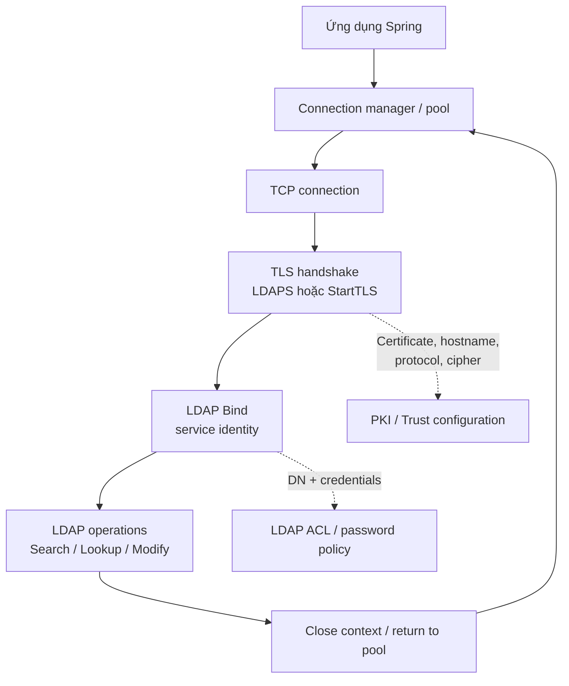
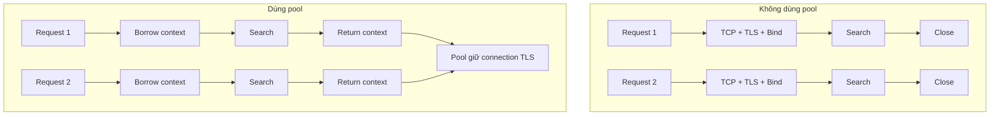

# Tương tác giữa TLS, pool và vòng đời kết nối

Trong chương **TLS và xác thực** của **SPRING_DATA_LDAP**, một kết nối LDAP phải đi qua nhiều lớp: thiết lập TCP, thương lượng TLS, xác thực Bind, thực hiện operation và giải phóng hoặc trả context về pool. Ba phần **TLS, connection pool và vòng đời kết nối** liên kết trực tiếp: TLS bảo vệ kênh truyền; Bind gắn danh tính lên connection; pool tái sử dụng connection đã thiết lập; lifecycle quyết định khi nào context được đóng, connection được giữ lại hoặc bị loại bỏ.

Ví dụ, một ứng dụng Spring dùng service account để đọc hồ sơ nhân viên. Nếu mỗi lần Search đều mở TCP connection, thương lượng TLS, Bind rồi đóng ngay, chi phí handshake và Bind có thể đáng kể. Pool giúp tái sử dụng kết nối. Nhưng nếu ứng dụng dùng StartTLS, thay đổi trạng thái bảo mật sau khi connection được tạo, hoặc trả context đã Bind bằng user Lan cho request của user Nam, pooling thiếu kiểm soát có thể làm hỏng kết nối hoặc gây rò rỉ danh tính.

**Mục tiêu:** phân biệt LDAPS và StartTLS; hiểu thứ tự TCP connect → TLS handshake → LDAP Bind → operation; dùng Spring LDAP TLS authentication strategy; phân biệt native JNDI pooling với Spring LDAP `PoolingContextSource`; quản lý context/connection đúng vòng đời; cấu hình validation, timeout, pool size và credential rotation; kiểm thử lỗi TLS, connection stale, pool exhaustion và identity isolation.

## 1. Ba lớp cần hiểu cùng nhau

| Lớp | Trách nhiệm | Ví dụ |
| --- | --- | --- |
| **Transport security** | Bảo vệ bytes trên đường truyền và xác minh endpoint server | TLS qua LDAPS hoặc StartTLS |
| **LDAP authentication/state** | Xác định Bind identity gắn với connection | Simple Bind bằng service DN |
| **Connection lifecycle** | Tạo, mượn, dùng, trả, validate, hủy connection/context | `LdapTemplate`, `ContextSource`, `PoolingContextSource` |



Một context Java không nhất thiết tương ứng một socket vật lý. LDAP provider có thể quản lý/reuse connection phía dưới; Spring LDAP pool có thể bọc `DirContext` để trả object về pool khi gọi `close()`. Vì vậy, phân biệt **vòng đời object `DirContext`**, **vòng đời LDAP connection** và **vòng đời TLS session**.

## 2. LDAPS và StartTLS

### 2.1. LDAPS: TLS ngay từ đầu

LDAPS sử dụng URL có scheme `ldaps://`, thường dùng port 636:

```text
ldaps://directory.example.org:636
```

Trình tự:

1. Client mở TCP connection tới endpoint LDAPS.
2. TLS handshake diễn ra ngay trên connection.
3. Client kiểm tra certificate chain, hostname, thời hạn và chính sách trust.
4. Sau khi TLS thành công, client gửi LDAP Bind.
5. Client thực hiện Search/Modify trong kênh TLS.

Không có LDAP operation plaintext trước handshake trong mô hình LDAPS. Nếu TLS handshake thất bại, ứng dụng không được chuyển sang LDAP plaintext để “thử lại”.

### 2.2. StartTLS: nâng cấp connection LDAP thành TLS

StartTLS thường bắt đầu với URL `ldap://`, thường dùng port 389:

```text
ldap://directory.example.org:389
```

Client mở LDAP connection, gửi StartTLS Extended Request, rồi nâng cấp chính connection đó thành TLS. Thứ tự:

1. TCP connect tới LDAP endpoint.
2. Tạo context chưa Bind hoặc theo trạng thái server cho phép.
3. Gửi StartTLS Extended Request.
4. Server chấp nhận yêu cầu.
5. Client và server thực hiện TLS handshake, kiểm tra certificate/hostname.
6. **Chỉ sau khi TLS thành công** mới gửi simple Bind hoặc operation có credential.
7. Search/Modify được thực hiện trên kênh đã mã hóa.

Nếu server từ chối StartTLS hoặc handshake thất bại, dừng luồng. Không gửi password qua connection plaintext và không fallback sang Bind không TLS.

### 2.3. So sánh

| Tiêu chí | LDAPS | StartTLS |
| --- | --- | --- |
| URL | `ldaps://host:636` | `ldap://host:389` rồi StartTLS |
| Thời điểm TLS | Ngay khi mở TCP connection | Sau LDAP StartTLS Extended Operation |
| LDAP plaintext trước TLS | Không | Có thể có giai đoạn ban đầu; tuyệt đối không gửi credential/dữ liệu nhạy cảm trước upgrade |
| Cấu hình client | SSL/TLS socket cho LDAP URL | TLS authentication strategy hoặc StartTLS API |
| Tương thích server | Phải bật listener LDAPS | Server phải hỗ trợ StartTLS |
| Pooling | Có thể pool nếu provider/pool hỗ trợ và cấu hình đúng | Không dùng native JNDI pooling cho context đã StartTLS |
| Khi handshake lỗi | Connection không được dùng | Dừng luồng, đóng context/response |

Port 636 và 389 là convention phổ biến, không phải ràng buộc bắt buộc của protocol. Dùng đúng endpoint/port mà directory administrator công bố.

## 3. TLS handshake và certificate validation

TLS handshake thiết lập kênh mã hóa và xác thực endpoint:

1. Client và server thương lượng phiên bản TLS/cipher suite.
2. Server gửi certificate chain.
3. Client kiểm tra chain đến CA tin cậy, thời hạn, mục đích sử dụng và hostname.
4. Hai bên thiết lập key material.
5. LDAP bytes sau đó được bảo vệ bởi TLS record layer.

### 3.1. Certificate chain

Certificate server cần:

- Được ký bởi CA nằm trong trust configuration của client.
- Còn hiệu lực theo thời gian.
- Có mục đích sử dụng phù hợp với TLS server authentication.
- Có SAN/hostname khớp tên host client kết nối.
- Có chain/intermediate certificate mà client xác minh được.

Nếu ứng dụng kết nối `ldaps://ldap01.example.org:636`, certificate cần xác thực được hostname `ldap01.example.org`. Certificate hợp lệ cho host khác không tự động hợp lệ cho endpoint này.

### 3.2. Truststore và keystore

| Thành phần | Chứa gì? | Dùng khi nào? |
| --- | --- | --- |
| **Truststore** | CA/server certificates được client tin cậy | Xác minh certificate LDAP server |
| **Keystore** | Private key và certificate của client | Mutual TLS/client certificate authentication |

Simple Bind qua TLS thường cần truststore để xác minh server. Nếu server yêu cầu mutual TLS, client còn cần keystore/certificate theo policy.

Không dùng trust-all `TrustManager`, tắt hostname verification hoặc chấp nhận mọi certificate để “làm cho kết nối chạy được”. Những cách đó phá vỡ mục đích xác thực server của TLS.

### 3.3. TLS session resumption khác connection pool

- **TLS session resumption:** tối ưu handshake khi thiết lập một connection TLS mới bằng cách tái sử dụng thông tin phiên theo cơ chế TLS.
- **LDAP connection pooling:** tái sử dụng connection LDAP/TLS đã mở thay vì tạo socket và handshake mới cho mỗi lần mượn.

Pool có thể giữ connection TLS sống qua nhiều LDAP operation. Session resumption chỉ có tác dụng khi tạo connection TLS mới và server/client hỗ trợ. Hai cơ chế có thể cùng tồn tại nhưng không thay thế nhau.

## 4. Thứ tự TLS và Bind

Với simple Bind, password nằm trong LDAP Bind request. Nếu gửi trước khi StartTLS thành công, password có thể đi qua mạng dưới dạng không được TLS bảo vệ.

Thứ tự đúng:

```text
TCP connect
    -> StartTLS request
    -> TLS handshake
    -> verify certificate + hostname
    -> simple Bind
    -> LDAP operations
```

Thứ tự sai:

```text
TCP connect
    -> simple Bind (password plaintext on transport)
    -> StartTLS
```

StartTLS không thể bảo vệ ngược một password đã được gửi trước khi upgrade.

### 4.1. JNDI StartTLS

JNDI có `StartTlsRequest` và `StartTlsResponse`. Ví dụ tạo context chưa xác thực, thương lượng TLS, rồi mới thêm thông tin simple Bind:

```java
import java.util.Hashtable;
import javax.naming.Context;
import javax.naming.ldap.InitialLdapContext;
import javax.naming.ldap.LdapContext;
import javax.naming.ldap.StartTlsRequest;
import javax.naming.ldap.StartTlsResponse;
import javax.net.ssl.HttpsURLConnection;

public final class StartTlsUserBind {
    public void bind(String userDn, String password) throws Exception {
        Hashtable<String, Object> env = new Hashtable<>();
        env.put(Context.INITIAL_CONTEXT_FACTORY,
            "com.sun.jndi.ldap.LdapCtxFactory");
        env.put(Context.PROVIDER_URL,
            "ldap://directory.example.org:389");
        env.put(Context.SECURITY_AUTHENTICATION, "none");
        env.put("com.sun.jndi.ldap.connect.timeout", "3000");
        env.put("com.sun.jndi.ldap.read.timeout", "5000");

        LdapContext context = null;
        StartTlsResponse tls = null;
        try {
            context = new InitialLdapContext(env, null);
            tls = (StartTlsResponse) context.extendedOperation(
                new StartTlsRequest()
            );
            tls.setHostnameVerifier(
                HttpsURLConnection.getDefaultHostnameVerifier()
            );
            tls.negotiate(
                HttpsURLConnection.getDefaultSSLSocketFactory()
            );

            // Chỉ cấu hình simple Bind sau khi TLS đã thành công.
            context.addToEnvironment(
                Context.SECURITY_AUTHENTICATION, "simple");
            context.addToEnvironment(
                Context.SECURITY_PRINCIPAL, userDn);
            context.addToEnvironment(
                Context.SECURITY_CREDENTIALS, password);
            context.reconnect(null);

            // Bind thành công. Thực hiện operation cần thiết tại đây.
        } finally {
            try {
                if (tls != null) {
                    tls.close();
                }
            } finally {
                if (context != null) {
                    context.close();
                }
            }
        }
    }
}
```

Đây là ví dụ JNDI để minh họa thứ tự protocol. Trong ứng dụng thực tế:

- Cấu hình `SSLSocketFactory`/truststore theo PKI của tổ chức.
- Xác minh hostname đúng với endpoint.
- Xử lý `NamingException`, `IOException`, Bind rejection và lỗi transport riêng.
- Không log password hoặc environment chứa credentials.
- Nếu TLS negotiation thất bại, không gọi `reconnect` với simple Bind và không tiếp tục plaintext.
- Đóng cả `StartTlsResponse` lẫn context theo đúng lifecycle.

`StartTlsResponse.close()` có thể kết thúc TLS session nhưng để LDAP connection tiếp tục tồn tại ở trạng thái không TLS. Vì vậy, sau khi đóng TLS response, context cũng được đóng ngay; không tiếp tục operation nhạy cảm trên connection đã downgrade.

### 4.2. LDAPS với JNDI

Với LDAPS, URL dùng scheme `ldaps://` và TLS được thiết lập khi provider mở connection:

```java
Hashtable<String, Object> env = new Hashtable<>();
env.put(Context.INITIAL_CONTEXT_FACTORY,
    "com.sun.jndi.ldap.LdapCtxFactory");
env.put(Context.PROVIDER_URL,
    "ldaps://directory.example.org:636");
env.put(Context.SECURITY_AUTHENTICATION, "simple");
env.put(Context.SECURITY_PRINCIPAL, userDn);
env.put(Context.SECURITY_CREDENTIALS, password);
env.put("com.sun.jndi.ldap.connect.timeout", "3000");
env.put("com.sun.jndi.ldap.read.timeout", "5000");

LdapContext context = new InitialLdapContext(env, null);
try {
    // TLS đã được provider thiết lập trước Bind.
    // Thực hiện LDAP operations.
} finally {
    context.close();
}
```

Truststore/hostname validation phải được cấu hình đúng trong JVM/provider. Đừng giả định chỉ đổi `ldap://` thành `ldaps://` là đủ nếu certificate chưa được tin cậy hoặc hostname không khớp.

## 5. Spring LDAP TLS authentication strategy

Spring LDAP cung cấp strategy để thiết lập TLS trong quá trình tạo `DirContext`:

| Strategy | Cơ chế | Trường hợp |
| --- | --- | --- |
| `DefaultTlsDirContextAuthenticationStrategy` | Thương lượng StartTLS rồi áp dụng SIMPLE authentication trên TLS channel | Server yêu cầu StartTLS + simple Bind |
| `ExternalTlsDirContextAuthenticationStrategy` | Thương lượng StartTLS rồi dùng SASL EXTERNAL với client certificate | Server cấu hình mutual TLS/EXTERNAL |

Các strategy này xử lý trình tự TLS và Bind trong quá trình tạo context. Chúng khác với việc chỉ đặt URL thành `ldaps://`.

### 5.1. Cấu hình StartTLS bằng Spring LDAP

Ví dụ Java configuration:

```java
import javax.net.ssl.HttpsURLConnection;
import org.springframework.context.annotation.Bean;
import org.springframework.context.annotation.Configuration;
import org.springframework.ldap.core.support.DefaultTlsDirContextAuthenticationStrategy;
import org.springframework.ldap.core.support.LdapContextSource;

@Configuration
public class DirectoryTlsConfiguration {
    @Bean
    DefaultTlsDirContextAuthenticationStrategy tlsStrategy() {
        DefaultTlsDirContextAuthenticationStrategy strategy =
            new DefaultTlsDirContextAuthenticationStrategy();
        strategy.setHostnameVerifier(
            HttpsURLConnection.getDefaultHostnameVerifier()
        );
        return strategy;
    }

    @Bean
    LdapContextSource ldapContextSource(
            DefaultTlsDirContextAuthenticationStrategy tlsStrategy) {
        LdapContextSource source = new LdapContextSource();
        source.setUrl("ldap://directory.example.org:389");
        source.setBase("dc=example,dc=org");
        source.setUserDn(
            "uid=app-reader,ou=services,dc=example,dc=org"
        );
        source.setPassword(System.getenv("LDAP_SERVICE_BIND_PASSWORD"));
        source.setAuthenticationStrategy(tlsStrategy);
        source.setPooled(false); // Tắt native JNDI pooling.
        return source;
    }
}
```

Đây là cấu hình minh họa cho Spring LDAP có `DefaultTlsDirContextAuthenticationStrategy`. `setPooled(false)` tắt native JNDI pooling; nếu cần pool TLS connection, dùng Spring LDAP `PoolingContextSource`. Trong production, lấy secret từ secret manager/configuration binding phù hợp; không gọi `System.getenv` trực tiếp trong mọi lớp ứng dụng.

### 5.2. Hostname verifier, SSL socket factory và TLS shutdown

`AbstractTlsDirContextAuthenticationStrategy` cung cấp các tùy chọn:

- `setHostnameVerifier(...)`: cấu hình xác minh hostname nếu cần.
- `setSslSocketFactory(...)`: dùng SSL socket factory/trust material riêng.
- `setShutdownTlsGracefully(...)`: chọn có đóng TLS session graceful trước khi đóng context hay không.

Một số server phản ứng khác nhau khi client gửi TLS shutdown. Spring LDAP mặc định không thực hiện graceful shutdown trong strategy này; chỉ bật khi đã kiểm thử với directory đích và biết server hỗ trợ.

Không dùng hostname verifier luôn trả `true`. Nếu cần custom verifier, nó phải kiểm tra hostname theo certificate/SAN và policy thực tế.

### 5.3. Mutual TLS với SASL EXTERNAL

Một số directory yêu cầu client certificate:

1. Client xác minh server certificate.
2. Client chứng minh danh tính bằng certificate/private key.
3. LDAP authentication dùng SASL EXTERNAL theo cấu hình server.
4. Directory ánh xạ certificate identity sang authorization identity theo policy.

`ExternalTlsDirContextAuthenticationStrategy` hỗ trợ kiểu xác thực này trong Spring LDAP. Cần cấu hình key material, certificate mapping và ACL ở server. Có client certificate không tự cấp mọi quyền LDAP.

## 6. Vòng đời của DirContext và LDAP connection

Một vòng đời điển hình:

```text
1. Application cần đọc directory
2. ContextSource lấy hoặc tạo DirContext
3. Provider mở TCP connection nếu cần
4. TLS handshake nếu cấu hình LDAPS/StartTLS
5. LDAP Bind
6. LdapTemplate thực hiện Search/Lookup
7. LdapTemplate đóng DirContext
8. Context được đóng thật hoặc trả về pool
```

### 6.1. Context không đồng nghĩa với socket

JNDI `Context`/`DirContext` là abstraction. Provider có thể chia sẻ/reuse connection phía dưới; Spring LDAP có thể bọc context bằng proxy để intercept `close()` và trả về pool.

- `DirContext.close()` với context thường giải phóng tài nguyên/context và connection theo provider.
- `DirContext.close()` với pooled context thường trả object về pool; socket có thể vẫn mở.
- Khi pool destroy/evict object, connection vật lý mới được đóng.
- `ContextSource`/pool là bean sống cùng application; không tạo và hủy pool cho từng request.

### 6.2. LdapTemplate quản lý context cho operation

Với `LdapTemplate`, ứng dụng thường không cần tự giữ `DirContext` toàn cục:

```java
List<PersonSummary> people = ldapTemplate.search(
    query,
    (AttributesMapper<PersonSummary>) attrs ->
        new PersonSummary(
            String.valueOf(attrs.get("uid").get()),
            String.valueOf(attrs.get("cn").get())
        )
);
```

Template lấy context từ `ContextSource`, thực hiện operation và đóng context theo lifecycle. Nếu ContextSource là pooled source, đóng context có thể trả connection về pool.

Không lưu `DirContext` trong singleton service rồi dùng lại đồng thời từ nhiều thread. JNDI context không được đảm bảo thread-safe; hãy để template/context source quản lý việc mượn và trả context cho từng operation.

### 6.3. Đóng resource trong code JNDI thủ công

```java
DirContext context = null;
try {
    context = new InitialDirContext(environment);
    // LDAP operation
} finally {
    if (context != null) {
        context.close();
    }
}
```

Với `NamingEnumeration`, cũng phải đóng enumeration:

```java
NamingEnumeration<SearchResult> results = null;
try {
    results = context.search(base, filter, controls);
    while (results.hasMore()) {
        SearchResult result = results.next();
        // Map kết quả.
    }
} finally {
    if (results != null) {
        results.close();
    }
    if (context != null) {
        context.close();
    }
}
```

Không đóng enumeration/context có thể giữ resource hoặc connection lâu hơn dự kiến, làm pool cạn dần.

## 7. Connection pool giải quyết điều gì?

Mỗi lần mở connection mới có thể tốn DNS resolution, TCP handshake, TLS handshake/certificate validation, LDAP Bind và chi phí tạo context/provider resources. Với nhiều Search nhỏ, tạo connection mới cho từng operation có thể làm tăng latency và tải server. Pool giữ một số context/connection sẵn sàng để tái sử dụng.



Pool có thể giảm số lần handshake và Bind cho connection được tái sử dụng. Đổi lại, ứng dụng phải quản lý số lượng connection, validation, stale connection, identity và invalidation.

### 7.1. Pool không phải cache dữ liệu LDAP

| Connection pool | Data cache |
| --- | --- |
| Giữ/reuse connection/context | Giữ kết quả Search/DTO |
| Giảm chi phí kết nối/TLS/Bind | Giảm số lần Search |
| Không làm dữ liệu entry cũ đi | Có thể trả dữ liệu stale |
| Cần lifecycle/validation/identity isolation | Cần TTL/invalidation/key |

Một ứng dụng có thể dùng cả pool và cache, nhưng phải theo dõi hai lớp riêng. Cache hit không cần LDAP connection; cache miss cần mượn connection từ pool.

## 8. Native JNDI pooling và Spring LDAP pooling

### 8.1. Native JNDI connection pooling

JNDI LDAP provider có cơ chế pooling tích hợp, điều khiển bằng các environment/system properties:

```text
com.sun.jndi.ldap.connect.pool
com.sun.jndi.ldap.connect.pool.protocol
com.sun.jndi.ldap.connect.pool.authentication
com.sun.jndi.ldap.connect.pool.timeout
com.sun.jndi.ldap.connect.timeout
com.sun.jndi.ldap.read.timeout
```

Native pooling có giới hạn:

- Cấu hình ở mức JVM/provider và ít linh hoạt hơn pool chuyên dụng.
- Không có đầy đủ pool validation/maintenance như Spring LDAP pooling.
- Connection identity được xác định theo các tham số tạo connection; chi tiết phụ thuộc JDK/provider.
- Thay đổi state của connection sau khi tạo có thể khiến pool không theo dõi được.
- Không pool context mà ứng dụng sẽ dùng StartTLS hoặc thay đổi security properties sau khi tạo.

Oracle JNDI LDAP documentation cảnh báo không dùng pooling cho context thực hiện StartTLS hoặc thay đổi security properties sau khi context được tạo, vì provider không theo dõi các state change đó.

### 8.2. Không bật native pooling cùng TLS authentication strategy của Spring LDAP

Spring LDAP nêu rõ native LDAP pooling (`native-pooling`/`setPooled(true)`) không hoạt động khi dùng TLS `DirContextAuthenticationStrategy`. Với TLS strategy:

1. Tắt native JNDI pooling.
2. Dùng Spring LDAP `PoolingContextSource`/Spring LDAP pooling support nếu cần tái sử dụng TLS context.
3. Bật validation và cấu hình pool theo tải.

Không dùng `setPooled(true)` chỉ vì muốn giảm handshake. Với StartTLS, điều này có thể tái sử dụng connection mà provider không quản lý đúng TLS state.

### 8.3. Spring LDAP PoolingContextSource

Spring LDAP cung cấp `PoolingContextSource`, dựa trên pool của Apache Commons Pool. Nó có thể quản lý context theo loại read-only/read-write và hỗ trợ:

- Giới hạn active/idle context.
- Validation khi borrow/return/idle.
- Loại bỏ context lỗi.
- Cấu hình wait khi pool cạn.
- Dùng cùng TLS authentication strategy khi native pooling đã tắt.

Với TLS, đây là hướng pooling được Spring LDAP khuyến nghị thay cho native JNDI pooling.

## 9. Cấu hình Spring LDAP pooling với StartTLS

Ví dụ XML minh họa:

```xml
<ldap:context-source
    id="directoryContextSource"
    url="ldap://directory.example.org:389"
    base="dc=example,dc=org"
    username="uid=app-reader,ou=services,dc=example,dc=org"
    password="injected-from-secret-manager"
    authentication-strategy-ref="tlsStrategy"
    native-pooling="false">
    <ldap:pooling
        max-active="16"
        max-idle="8"
        min-idle="1"
        test-on-borrow="true"
        test-while-idle="true" />
</ldap:context-source>

<bean id="tlsStrategy"
      class="org.springframework.ldap.core.support.DefaultTlsDirContextAuthenticationStrategy">
    <property name="hostnameVerifier" ref="hostnameVerifier"/>
</bean>
```

Đây là ví dụ theo Spring LDAP XML namespace; schema/version thực tế có thể dùng `pooling` hoặc `pooling2` với thuộc tính tương ứng. Kiểm tra đúng phiên bản Spring LDAP đang dùng. Điểm cốt lõi:

- URL là `ldap://` vì client sẽ nâng cấp bằng StartTLS.
- `authentication-strategy-ref` chọn TLS strategy.
- `native-pooling="false"` tắt JNDI native pooling.
- Pool của Spring LDAP quản lý context đã được TLS strategy thiết lập.
- Hostname verifier và trust material phải được cấu hình đúng.

### 9.1. Cấu hình LDAPS

Với LDAPS, URL dùng `ldaps://`:

```yaml
spring:
  ldap:
    urls: ldaps://directory.example.org:636
    base: dc=example,dc=org
    username: uid=app-reader,ou=services,dc=example,dc=org
    password: ${LDAP_SERVICE_BIND_PASSWORD}
```

SSL trust configuration phụ thuộc Spring Boot/JDK và phiên bản đang dùng. Có thể dùng platform truststore hoặc SSL bundle/truststore riêng nếu phiên bản hỗ trợ. Nếu tự tạo `LdapContextSource`, phải cấu hình SSL trên context source đó; đừng giả định mọi property auto-configuration tự áp dụng vào bean tự tạo.

Nếu cần pool LDAPS connection, dùng Spring LDAP pooling và validation theo cùng nguyên tắc. Không bật native pooling mặc định mà chưa xem xét provider, SSL và khả năng validation.

## 10. Pool key và danh tính Bind

LDAP connection sau Bind mang identity. Một connection service-bound:

```text
Bind identity:
    uid=app-reader,ou=services,dc=example,dc=org
Purpose:
    Search/read hồ sơ và group theo ACL service account
```

không thể tùy tiện được dùng như connection user-bound:

```text
Bind identity:
    uid=lan,ou=people,dc=example,dc=org
Purpose:
    Xác minh password của Lan
```

### 10.1. Không trộn context của các user

Nếu context đã Bind bằng Lan được trả vào pool chung rồi cấp cho request Nam, request Nam có thể thực hiện operation dưới identity Lan. Đây là lỗi phân quyền nghiêm trọng.

Nguyên tắc:

- Pool service account có identity ổn định và quyền tối thiểu.
- User Bind theo từng principal phải được quản lý riêng.
- Không chia sẻ `DirContext` user-bound giữa thread/request.
- Không rebind context đang nằm trong pool dùng chung.
- Không giả định pool key tách principal/credentials nếu chưa xác minh provider và wrapper.
- Nếu pool hỗ trợ nhiều authentication identities, phải kiểm thử identity isolation và credential rotation.

### 10.2. Spring LDAP PoolingContextSource và AuthenticationSource động

Spring LDAP documentation cảnh báo `PoolingContextSource` giả định các context lấy từ `getReadOnlyContext()` có cùng environment, và tương tự với `getReadWriteContext()`. Vì vậy, bọc một `LdapContextSource` có `AuthenticationSource` trả credential khác nhau theo thread/user có thể không hoạt động như mong đợi: pool có thể được tạo bằng credential của user đầu tiên rồi tái sử dụng cho request khác.

Đừng dùng một pool service chung để pool credential người dùng động. Dùng một service identity ổn định cho read/write context pool; user Bind cần đường xử lý riêng được framework/provider hỗ trợ và được kiểm thử.

### 10.3. getContext(principal, credentials)

`ContextSource.getContext(principal, credentials)` được dùng khi cần tạo context với principal/credential cụ thể, thường trong authentication. API Spring LDAP hiện hành ghi rõ phương thức này không dùng native Java LDAP pooling, nhằm để password change trong directory có hiệu lực sớm hơn.

Tuy vậy, vẫn cần đọc tài liệu đúng phiên bản và xác minh wrapper/context source đang sử dụng. Đừng kết luận một user Bind đã được pool riêng chỉ vì ứng dụng gọi overload nhận principal/password.

## 11. Pool validation và connection stale

Một connection có thể bị server đóng khi nằm idle trong pool:

- Server có idle timeout.
- Firewall/NAT/load balancer cắt TCP session.
- Directory failover/restart.
- TLS peer đóng connection.
- Network path thay đổi.

Pool có thể vẫn giữ một context tưởng như hợp lệ. Lần mượn tiếp theo có thể gặp `CommunicationException`, `SocketException`, timeout hoặc lỗi provider tương tự.

### 11.1. Validation khi borrow

`test-on-borrow` kiểm tra context khi lấy từ pool trước khi giao cho caller. Nó giảm khả năng trả connection stale, nhưng mỗi lần borrow có thêm operation/latency.

### 11.2. Validation khi idle

`test-while-idle` cho phép pool kiểm tra các connection đang chờ theo chu kỳ. Nó giúp loại connection hỏng trước khi request cần đến, nhưng cần cấu hình eviction/maintenance run phù hợp.

### 11.3. Validation khi return

`test-on-return` kiểm tra context trước khi đưa lại vào pool. Có thể hữu ích với workload đặc biệt, nhưng tăng chi phí và không thay thế validation khi borrow.

### 11.4. DefaultDirContextValidator

Spring LDAP `DefaultDirContextValidator` thực hiện một Search nhỏ (base rỗng, filter `objectclass=*`, giới hạn một kết quả và timeout ngắn) để kiểm tra context còn hoạt động. Cấu hình mặc định phù hợp với nhiều server, nhưng nếu ACL/Root DSE không cho phép thao tác validation, cần custom validator phù hợp.

Validation thành công chỉ chứng minh connection phản hồi một operation kiểm tra. Nó không chứng minh mọi Search base/attribute được phép, account còn active, mọi replica đã đồng bộ, certificate chưa bị thu hồi sau handshake hoặc một write cụ thể đã thành công.

## 12. Pool sizing và timeout

Pool quá nhỏ làm request chờ; pool quá lớn làm tăng số connection, Bind và tài nguyên server.

| Tham số | Ý nghĩa | Cách cân nhắc |
| --- | --- | --- |
| `max-active`/`max-total-per-key` | Số context tối đa đang được mượn/giữ theo pool key | Dựa vào concurrency và giới hạn LDAP server |
| `max-idle` | Số context idle tối đa | Tránh giữ quá nhiều socket nhàn rỗi |
| `min-idle` | Số context idle tối thiểu | Cân bằng warm pool với tài nguyên |
| `max-wait` | Thời gian chờ khi pool cạn | Có giới hạn; không chờ vô hạn |
| `test-on-borrow` | Validate trước khi giao context | Tăng độ tin cậy, có thêm latency |
| `test-while-idle` | Validate context đang idle | Hạn chế stale connection |
| Eviction interval | Chu kỳ kiểm tra/loại idle object | Phù hợp idle timeout server |

Các tên property cụ thể khác nhau giữa `pooling` và `pooling2` cũng như version Commons Pool. Không sao chép cấu hình từ version khác mà không kiểm tra schema/API.

### 12.1. Đừng dùng pool không giới hạn

Đặt giới hạn dựa trên:

- Số request đồng thời cần LDAP.
- Số operation trung bình trên mỗi request.
- Thời gian giữ context trong operation.
- Số application replicas.
- Giới hạn connection và năng lực LDAP server.
- Số pool keys (read-only/read-write, directory/tenant/identity).

Tổng số connection có thể xấp xỉ tổng giới hạn của các pool trên tất cả application instances, không chỉ giá trị cấu hình của một pod.

### 12.2. Phân biệt các loại timeout

| Timeout | Giới hạn điều gì? | Ví dụ |
| --- | --- | --- |
| Connect timeout | Thời gian thiết lập TCP connection | `com.sun.jndi.ldap.connect.timeout` |
| Read timeout | Thời gian chờ response LDAP từ server | `com.sun.jndi.ldap.read.timeout` |
| Pool borrow wait | Thời gian chờ lấy context khi pool cạn | Pool config `max-wait`/tương đương |
| TLS handshake timeout | Thời gian hoàn tất handshake | Phụ thuộc socket/provider |
| LDAP Search time limit | Thời gian server thực hiện Search | `SearchControls.setTimeLimit(...)` |
| Application deadline | Tổng thời gian request được phép chạy | HTTP/service timeout |

Một request có thể chờ pool 2 giây, connect 3 giây, TLS handshake, Bind và Search. Không đặt từng timeout lớn rồi để tổng thời gian vượt deadline HTTP. Timeout ở pool borrow khác timeout khi server không trả Search response.

## 13. Idle timeout, keepalive và connection lifetime

LDAP server, proxy hoặc firewall có thể đóng connection idle. Pool cần được cấu hình phù hợp với idle timeout thực tế.

Ví dụ:

```text
LDAP server idle timeout: 10 minutes
Pool eviction interval:    2 minutes
Validation on borrow:      enabled
```

Đây chỉ là ví dụ. Cần biết timeout của từng hop: client, load balancer, firewall, proxy và LDAP server.

### 13.1. TCP keepalive không thay validation LDAP

TCP keepalive có thể phát hiện một số kết nối chết theo hệ điều hành, nhưng không chứng minh LDAP operation sẽ thành công, thời gian phụ thuộc OS/network và không thay `DirContextValidator`. Validation bằng LDAP operation kiểm tra trạng thái protocol ở mức ứng dụng. Cả hai cơ chế có thể hữu ích nhưng khác mục tiêu.

### 13.2. Maximum connection lifetime

Pool có thể giữ connection lâu để tiết kiệm handshake, nhưng connection sống quá lâu có thể không nhận thay đổi cấu hình TLS/credential hoặc gặp server maintenance. Nếu pool/provider hỗ trợ lifetime limit, có thể đặt giới hạn để connection được tạo mới theo chu kỳ.

Không đặt lifetime quá ngắn đến mức liên tục TLS handshake/Bind; cũng không giữ vô hạn nếu server/proxy có giới hạn. Đo handshake latency và connection failure trước khi chọn.

## 14. Credential rotation và TLS certificate rotation

### 14.1. Service account password thay đổi

1. Ứng dụng cập nhật secret/configuration.
2. Connection đang nằm trong pool có thể vẫn Bind bằng credential cũ.
3. Nếu server chưa đóng connection, operation trên connection cũ có thể tiếp tục hoạt động.
4. Connection mới được tạo sẽ cần credential mới.
5. Nếu pool vẫn trả connection cũ, ứng dụng có thể thấy lỗi không đồng nhất hoặc vẫn dùng phiên xác thực cũ.

Sau rotation, cần quy trình **drain/evict pool và tạo connection mới** theo khả năng framework. Không giả định thay environment property tự động rebind tất cả connection đã mở.

### 14.2. TLS certificate hoặc truststore thay đổi

- Connection TLS đã mở không thực hiện lại handshake ở mỗi Search.
- Connection cũ có thể tiếp tục sử dụng TLS session/keys hiện có.
- Truststore mới thường ảnh hưởng các handshake mới.
- Pool có thể giữ socket cũ cho đến khi bị evict/đóng.

Nếu cần áp dụng certificate/trust change ngay, cần drain/recreate pool hoặc restart/reload context source theo quy trình vận hành. Kiểm thử rollover certificate, intermediate CA và thời điểm overlap giữa certificate cũ/mới.

### 14.3. TLS session resumption không tự cập nhật trust

Session resumption là tối ưu handshake, không phải cơ chế buộc client kiểm tra lại mọi policy certificate ở mỗi LDAP operation. Khi thay trust anchor hoặc certificate, phải xác định hành vi session/cache của provider và đóng connection cũ khi policy yêu cầu.

## 15. Retry và lỗi khi connection bị ngắt

Connection có thể bị đứt trước khi operation được gửi, sau khi server nhận operation nhưng trước response, trong lúc Search trả kết quả hoặc sau khi server đã áp dụng Modify nhưng client chưa nhận success response.

| Operation/tình huống | Retry? | Lưu ý |
| --- | --- | --- |
| Search idempotent, lỗi transport rõ ràng | Có thể retry hữu hạn | Mở connection hợp lệ, giữ deadline |
| User Bind sai credential | Không retry tự động | Có thể tăng lockout counter |
| Service Bind credential sai | Không retry liên tục | Xử lý secret/configuration |
| Search partial/size limit | Không retry y nguyên vô hạn | Điều chỉnh paging/scope/limit |
| LDAP Modify timeout sau khi gửi | Outcome có thể không rõ | Read-back/đối soát trước khi lặp write |
| Add timeout | Có thể entry đã được tạo | Lookup theo DN/operation ID trước retry |
| Delete timeout | Có thể entry đã bị xóa | Xác minh state trước retry |
| TLS handshake failure | Không downgrade | Sửa certificate/trust/protocol |

Khi connection hỏng, pool phải loại bỏ object theo validator/non-transient exception policy. Không trả connection đã biết là hỏng về idle pool.

## 16. Lỗi thường gặp khi kết hợp TLS và pool

| Triệu chứng | Nguyên nhân có thể | Hướng xử lý |
| --- | --- | --- |
| `SSLHandshakeException` | CA không tin cậy, certificate hết hạn, hostname sai, protocol/cipher không tương thích | Kiểm tra chain, SAN, truststore, TLS policy |
| `CommunicationException` sau idle | Server/firewall đã đóng connection | Bật validation, eviction, giới hạn idle/lifetime |
| StartTLS request thành công nhưng Bind thất bại | Credential sai, policy, SASL/simple config hoặc Bind sai thời điểm | Kiểm tra response; chỉ Bind sau TLS |
| Password xuất hiện trên network plaintext | Bind trước StartTLS hoặc fallback | Fail closed; sửa thứ tự và kiểm tra packet ở môi trường test |
| TLS hoạt động khi không pool nhưng lỗi khi native pool | Native pooling không quản lý StartTLS state | Tắt native pooling; dùng Spring LDAP PoolingContextSource |
| Node A đọc được, node B không | Pool config/credential/truststore khác nhau | So sánh endpoint, secret, trust và pool metrics |
| User Nam thao tác dưới identity Lan | User-bound context bị chia sẻ/reuse sai | Tách pool/service identity, không chia sẻ context user |
| Pool cạn | Context leak, operation lâu, max active thấp hoặc LDAP chậm | Đóng enumeration/context, xem borrow wait và active count |
| Validation thất bại liên tục | Validator bị ACL chặn hoặc timeout quá thấp | Kiểm tra validator operation, base và quyền |
| Sau rotation vẫn dùng credential/cert cũ | Pool giữ connection cũ | Drain/recreate pool |
| Search timeout nhưng connection vẫn được trả pool | Exception không được coi là non-transient hoặc validation thiếu | Cấu hình exception classification và validation |
| TLS shutdown gây server error | Server phản ứng khác nhau với close_notify | Kiểm tra `shutdownTlsGracefully` và server behavior |

## 17. Observability cho TLS và connection pool

Theo dõi cả pool và TLS, không chỉ LDAP Search duration.

| Metric/log | Ý nghĩa |
| --- | --- |
| `ldap_pool_active` | Số context đang được mượn |
| `ldap_pool_idle` | Số context đang chờ |
| `ldap_pool_wait_seconds` | Thời gian chờ borrow |
| `ldap_pool_exhausted_total` | Số lần pool hết context |
| `ldap_pool_validation_failed_total` | Số context bị loại do validation |
| `ldap_connection_created_total` | Số connection mới |
| `ldap_connection_destroyed_total` | Số connection bị đóng/evict |
| `ldap_tls_handshake_duration` | Thời gian TLS handshake |
| `ldap_tls_handshake_failure_total` | Lỗi TLS theo nhóm nguyên nhân |
| `ldap_bind_failure_total` | Bind failure theo loại identity, không log secret |
| `ldap_operation_duration` | Thời gian Search/Modify |
| `ldap_connection_age_seconds` | Tuổi connection trong pool nếu provider expose |
| `ldap_context_leak_suspected` | Active context tăng không giảm theo thời gian |

Không gắn password, full DN, username/email hoặc raw LDAP filter vào metric labels. Dùng directory alias, operation name, pool type và error family có cardinality thấp.

### 17.1. Phân biệt TLS failure với Bind failure

Log nội bộ nên phân loại:

```text
TLS_HANDSHAKE_FAILED
CERTIFICATE_UNTRUSTED
HOSTNAME_MISMATCH
LDAP_BIND_REJECTED
LDAP_SEARCH_DENIED
LDAP_SERVER_UNAVAILABLE
POOL_EXHAUSTED
CONNECTION_VALIDATION_FAILED
```

Đây là mã phân loại do ứng dụng định nghĩa. TLS failure có thể xảy ra trước LDAP Bind nên không có LDAP result code. `invalidCredentials (49)` là LDAP response cho Bind, không phải mã thay thế cho mọi lỗi kết nối.

## 18. Kiểm thử TLS, pool và lifecycle

Kiểm thử cần chứng minh protocol sequence lẫn hành vi khi connection được reuse.

### 18.1. Ma trận kiểm thử

| ID | Điều kiện | Kết quả cần xác minh |
| --- | --- | --- |
| TLS01 | LDAPS với certificate hợp lệ | TLS handshake thành công trước Bind |
| TLS02 | StartTLS được server chấp nhận | Upgrade TLS trước Bind |
| TLS03 | StartTLS bị từ chối | Dừng; không gửi simple Bind plaintext |
| TLS04 | TLS handshake thất bại | Context đóng; không fallback plaintext |
| TLS05 | CA không nằm trong truststore | Client từ chối certificate |
| TLS06 | Certificate hết hạn | Client từ chối handshake |
| TLS07 | Hostname không khớp SAN | Client từ chối handshake |
| TLS08 | Intermediate CA thiếu | Xác minh chain thất bại hoặc xử lý theo trust policy |
| TLS09 | TLS version/cipher không tương thích | Lỗi handshake được phân loại |
| TLS10 | Mutual TLS thiếu client certificate | Server từ chối theo policy |
| TLS11 | Mutual TLS certificate hợp lệ | SASL EXTERNAL/identity mapping đúng |
| TLS12 | StartTLS thành công rồi Bind đúng | Bind success trong TLS channel |
| TLS13 | Bind sai sau TLS | LDAP authentication failure, không phải TLS failure |
| POOL01 | Borrow context lần đầu | Connection/TLS/Bind được tạo đúng |
| POOL02 | Return rồi borrow lại | Context/connection được reuse nếu còn hợp lệ |
| POOL03 | Test on borrow | Connection stale bị loại trước khi giao |
| POOL04 | Test while idle | Connection hỏng khi idle được phát hiện |
| POOL05 | Server đóng connection idle | Borrow tiếp theo tạo connection mới hoặc lỗi được xử lý |
| POOL06 | Pool đạt max active | Request chờ có giới hạn hoặc fail theo policy |
| POOL07 | Context luôn được close | Active count trở về mức dự kiến |
| POOL08 | NamingEnumeration không đóng | Test phát hiện pool/resource không được giải phóng |
| POOL09 | Native pooling + StartTLS | Cấu hình bị tắt/không dùng; không reuse sai TLS state |
| POOL10 | Spring LDAP PoolingContextSource + TLS | TLS context được pool và validation hoạt động |
| POOL11 | Service Bind pool | Mọi context dùng đúng service identity |
| POOL12 | User Bind Lan rồi Nam | Không tái sử dụng context Lan cho Nam |
| POOL13 | Dynamic AuthenticationSource | Không trộn credentials giữa các thread/user |
| POOL14 | Credential rotation | Pool cũ được drain, connection mới dùng secret mới |
| POOL15 | Certificate/truststore rotation | Connection mới dùng trust/certificate mới |
| POOL16 | Pool shutdown | Context/connection được đóng theo lifecycle ứng dụng |
| LIFE01 | Concurrent requests | Không chia sẻ `DirContext` không thread-safe |
| LIFE02 | Search timeout | Connection lỗi được xử lý/evict đúng |
| LIFE03 | Modify timeout sau commit | Không retry write mù; read-back xác minh |
| LIFE04 | LDAP server restart | Pool hồi phục, không trả connection chết liên tục |
| LIFE05 | Failover sang endpoint khác | TLS hostname/trust hợp lệ cho endpoint mới |
| LIFE06 | Application shutdown | Pool destroy và không còn socket/resource rò rỉ |

### 18.2. Kiểm thử StartTLS không gửi credential trước handshake

Trong môi trường test:

1. Dùng LDAP server có StartTLS.
2. Bắt packet hoặc dùng server-side protocol trace chỉ trong môi trường kiểm thử.
3. Gửi request user Bind.
4. Xác minh StartTLS Extended Request/response và TLS handshake xảy ra trước Bind request.
5. Tắt StartTLS trên server hoặc làm certificate không hợp lệ.
6. Xác minh ứng dụng không gửi Bind plaintext khi upgrade thất bại.

Không ghi packet chứa password thật; dùng account/password test và bảo vệ artifact capture.

### 18.3. Kiểm thử pool identity isolation

1. Tạo service account chỉ đọc được nhánh people.
2. Tạo hai user test Lan và Nam với quyền khác nhau.
3. Mượn context user Lan, thực hiện operation được phép.
4. Đóng context.
5. Mượn context cho user Nam.
6. Xác minh operation chạy dưới identity Nam, không phải Lan.
7. Lặp nhiều vòng và concurrent để phát hiện reuse sai.

Nếu ứng dụng không có nhu cầu pool user-bound context, không đưa user Bind vào service account pool.

### 18.4. Kiểm thử credential rotation

1. Tạo service account với secret A.
2. Khởi động app và tạo vài pooled connections.
3. Rotate secret phía directory và cấu hình ứng dụng sang secret B theo quy trình test.
4. Drain/evict pool.
5. Xác minh connection mới Bind bằng secret B.
6. Xác minh không còn connection cũ được mượn.
7. Kiểm tra lỗi/metrics trong giai đoạn chuyển đổi.

Test này cần xác định rõ thứ tự rotation để tránh khóa service account hoặc làm gián đoạn tất cả instance.

## 19. Quy trình xử lý sự cố

Khi LDAP operation thất bại trong production:

1. **Xác định tầng lỗi:** DNS/TCP, TLS handshake, Bind, pool borrow, validation hay LDAP operation.
2. **Xác định endpoint:** host/port và protocol `ldap://`/`ldaps://`; không log secret.
3. **Kiểm tra certificate:** chain, expiry, SAN/hostname, truststore, intermediate CA.
4. **Kiểm tra thứ tự StartTLS:** không có Bind trước khi TLS thành công.
5. **Kiểm tra identity:** service Bind hay user Bind; principal có đúng không.
6. **Kiểm tra pool:** active/idle/wait, validation failure, stale connection và exhaustion.
7. **Kiểm tra server/network idle timeout:** firewall, proxy, load balancer, LDAP server.
8. **Kiểm tra lifecycle:** context/enumeration có được đóng không.
9. **Kiểm tra rotation:** secret/certificate đã đổi nhưng pool còn connection cũ không.
10. **Evict/drain có kiểm soát:** chỉ sau khi hiểu ảnh hưởng và có khả năng tạo connection mới.
11. **Xác minh phục hồi:** handshake, Bind và operation mẫu thành công trên connection mới.

Không khắc phục lỗi certificate bằng cách tắt xác minh hostname hoặc bật plaintext fallback. Không khắc phục pool exhaustion bằng cách tăng max vô hạn trước khi tìm context leak hoặc operation bị treo.

## 20. Checklist triển khai

1. **Chọn protocol rõ ràng:** LDAPS hoặc StartTLS theo khả năng server.
2. **Xác minh certificate:** CA chain, SAN/hostname, expiry và TLS policy.
3. **Bind sau TLS:** không gửi simple Bind trước khi StartTLS hoàn tất.
4. **Fail closed:** TLS failure không được fallback plaintext.
5. **Dùng đúng strategy:** `DefaultTlsDirContextAuthenticationStrategy` cho StartTLS + SIMPLE; `ExternalTlsDirContextAuthenticationStrategy` cho EXTERNAL khi server yêu cầu.
6. **Tắt native pooling khi dùng Spring TLS strategy:** dùng Spring LDAP `PoolingContextSource` nếu cần pool.
7. **Giữ identity ổn định trong pool:** service account pool riêng; không trộn user Bind.
8. **Đóng context và enumeration:** không giữ context trong singleton/thread dùng chung.
9. **Bật validation hợp lý:** test-on-borrow/idle theo ACL và latency.
10. **Đặt giới hạn pool:** active/idle/max wait dựa trên tổng số app instances và giới hạn server.
11. **Cấu hình timeout riêng:** connect, read, borrow, TLS và LDAP operation.
12. **Quản lý stale connection:** idle timeout, eviction, lifetime và validation.
13. **Có quy trình rotation:** drain pool khi đổi credential/trust/certificate.
14. **Retry có điều kiện:** không retry Bind sai; write timeout cần read-back.
15. **Theo dõi metrics:** pool active/idle/wait, TLS handshake, validation failure và Bind errors.
16. **Kiểm thử đúng topology:** StartTLS/LDAPS, ACL, pool, failover, credential và certificate rotation.

## 21. Câu hỏi tự kiểm tra

1. **LDAPS và StartTLS khác nhau ở thời điểm nào?** LDAPS dùng TLS ngay từ khi kết nối; StartTLS nâng cấp LDAP connection sau Extended Operation.
2. **Có được simple Bind trước StartTLS không?** Không; password có thể đi qua plaintext transport.
3. **Nếu StartTLS handshake thất bại thì làm gì?** Đóng context và fail; không fallback plaintext.
4. **TLS session resumption có giống connection pool không?** Không. Resumption tối ưu handshake cho connection mới; pool tái sử dụng connection đang mở.
5. **Truststore và keystore khác nhau thế nào?** Truststore xác minh server; keystore giữ client key/certificate cho mutual TLS.
6. **`DefaultTlsDirContextAuthenticationStrategy` làm gì?** Thương lượng StartTLS rồi áp dụng SIMPLE authentication trên TLS channel.
7. **`ExternalTlsDirContextAuthenticationStrategy` dùng khi nào?** Khi cần SASL EXTERNAL với client certificate.
8. **Vì sao không bật native JNDI pooling với StartTLS?** Provider không theo dõi state thay đổi của connection sau StartTLS; reuse có thể sai/bất an toàn.
9. **Spring LDAP khuyến nghị pool nào khi dùng TLS?** Spring LDAP `PoolingContextSource`, với native pooling tắt.
10. **`DirContext.close()` có luôn đóng socket vật lý không?** Không; với pooled context nó thường trả context về pool.
11. **Vì sao không chia sẻ một DirContext giữa threads?** Context không được đảm bảo thread-safe và mang state Bind identity.
12. **Pool validation chứng minh điều gì?** Connection phản hồi operation kiểm tra; không chứng minh mọi ACL hay dữ liệu nghiệp vụ đúng.
13. **Vì sao phải kiểm tra pool identity?** Tránh context user-bound bị tái sử dụng dưới danh tính user khác.
14. **`AuthenticationSource` động có thể gặp vấn đề gì với PoolingContextSource?** Pool giả định environment ổn định theo read-only/read-write context; credential của user đầu tiên có thể bị tái sử dụng.
15. **Sau khi rotate service password, connection cũ có tự Bind lại không?** Không mặc định; cần drain/evict và tạo connection mới.
16. **Đổi truststore có làm connection TLS đã mở handshake lại không?** Không; connection cũ tiếp tục dùng TLS session hiện có cho tới khi đóng.
17. **Connect timeout và pool borrow timeout khác gì?** Một cái giới hạn mở network connection; cái kia giới hạn chờ context rảnh trong pool.
18. **Nếu Modify timeout sau khi gửi request, có nên retry ngay?** Không; server có thể đã áp dụng write, cần read-back/đối soát.
19. **TCP keepalive có thay LDAP validation không?** Không; keepalive kiểm tra ở tầng TCP, validator kiểm tra LDAP operation.
20. **Pool exhaustion nên xử lý thế nào?** Backpressure/fail theo giới hạn, kiểm tra leak/latency và sizing; không tăng pool vô hạn.

## Tài liệu tham khảo

- [Spring LDAP — Configuration và TLS authentication strategies](https://docs.spring.io/spring-ldap/reference/configuration.html)
- [Spring LDAP — Pooling Support](https://docs.spring.io/spring-ldap/reference/pooling.html)
- [Spring LDAP — AbstractTlsDirContextAuthenticationStrategy API](https://docs.spring.io/spring-ldap/reference/api/java/org/springframework/ldap/core/support/AbstractTlsDirContextAuthenticationStrategy.html)
- [Spring LDAP — AbstractContextSource API](https://docs.spring.io/spring-ldap/reference/api/java/org/springframework/ldap/core/support/AbstractContextSource.html)
- [Oracle JNDI LDAP — Connection pooling configuration](https://docs.oracle.com/javase/tutorial/jndi/ldap/config.html)
- [Oracle JNDI LDAP — Pooling and when not to use pooling](https://docs.oracle.com/javase/tutorial/jndi/ldap/pool.html)

**Ghi nhớ:** TLS bảo vệ connection; Bind xác định identity trên connection; pool giữ và tái sử dụng context/connection; lifecycle quyết định khi nào context được trả hoặc connection bị đóng. Với Spring LDAP, dùng LDAPS hoặc StartTLS đúng thứ tự, xác minh certificate/hostname, không gửi credential trước TLS và không downgrade khi handshake lỗi. Khi dùng TLS authentication strategy, tắt native JNDI pooling và chọn Spring LDAP `PoolingContextSource` nếu cần pool; giữ service identity ổn định, không trộn context user-bound, validate connection và drain pool khi credential/certificate thay đổi. Đóng context đúng cách, đặt timeout/giới hạn pool, theo dõi stale connection và kiểm thử identity isolation trên đúng directory server để TLS, pool và lifecycle hoạt động an toàn cùng nhau.
