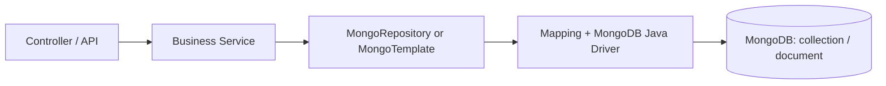

# What Is Spring Data MongoDB and What Storage Problems Does It Solve?

> **Scope:** `SPRING_DATA_MONGODB` — using Spring Data MongoDB to connect, map documents, and operate on MongoDB via `MongoTemplate` or repositories. This lesson builds a high-level picture of data design, querying, aggregation, indexes, transactions, reactive access, testing, and performance diagnostics before diving into each technique in depth.

## 1. The problem: storing application data as documents

Suppose an e-commerce service stores an order consisting of a customer ID, status, creation timestamp, and a list of items. In a relational database, the model typically has `orders` and `order_items` tables linked by a foreign key. If a screen always needs to display **the entire order along with its line items**, the application has to query multiple tables or use a `JOIN`.

MongoDB offers another option: storing an order as a **BSON document** in the `orders` collection, where `lines` is an array of nested documents:

```json
{
  "_id": { "$oid": "64b7a327f9c0b1e2d3a4f501" },
  "customerId": "C-42",
  "status": "PENDING",
  "lines": [
    { "sku": "BOOK-01", "quantity": 2, "unitPriceVnd": 150000 },
    { "sku": "PEN-02", "quantity": 1, "unitPriceVnd": 25000 }
  ],
  "createdAt": { "$date": "2026-01-15T09:30:00Z" }
}
```

The `$oid` and `$date` notations above are **Extended JSON** representations for the BSON `ObjectId` and date/time types; they do not mean MongoDB only stores plain JSON strings. `unitPriceVnd` uses an integer in VND to avoid floating-point rounding errors in the example. A document can contain nested objects and arrays, making it a strong fit when data is read, updated, and managed together as a single business unit.

However, when writing a Java application, we still have to answer several questions: how to convert documents into Java objects, how to retrieve order history, whether updates are safe, where to place indexes, and how to handle schema evolution. **Spring Data MongoDB solves that data-integration layer within the Spring ecosystem**.

## 2. What is Spring Data MongoDB?

**Spring Data MongoDB** is a module of the Spring Data project that helps Java/Spring applications interact with MongoDB through consistent abstractions: object–document mapping, repository-based data access, query construction via `MongoTemplate`, and support for aggregation, indexes, callbacks, auditing, and certain transaction mechanisms. It uses the **MongoDB Java Driver** at the connection layer; Spring Data MongoDB itself is **not** a database and does not replace MongoDB's querying, storage, or operational capabilities.

Typical workflow:



| Component | Practical Role |
| --- | --- |
| **MongoDB** | Stores BSON documents, provides queries, indexes, aggregation, replication, and sharding. |
| **MongoDB Java Driver** | Communicates with MongoDB, handles connections, commands, sessions, and driver-level operations. |
| **Spring Data MongoDB** | Maps Java data, standardizes access operations, and integrates with Spring. |
| **Spring Boot** (if used) | Auto-configures many beans and connection properties based on dependencies, configuration, and Boot version. |

In MongoDB, a **database** contains **collections**; a collection contains **documents**. Compared to relational thinking, a database is close to a database, a collection is close to a table, and a document is close to a row, though the analogy is only for orientation: documents support nested data, documents in a collection do not have to share an identical structure, and relationships between documents do not automatically enforce foreign key constraints like an RDBMS.

## 3. Problems that Spring Data MongoDB simplifies

### 3.1. Reducing boilerplate for object mapping and CRUD operations

Instead of manually converting every BSON field to Java and writing driver commands for every operation, you can model a collection with a Java class/record, annotate it with `@Document`, `@Id`, and `@Field` where needed, and use the built-in `save`, `findById`, and `deleteById` methods on a repository. `MappingMongoConverter` handles common mappings; for specialized types or custom storage conventions, the application can configure custom converters.

This is especially useful in services with many domain entities that need CRUD, pagination, sorting, and property-based queries, allowing code to stay focused on business rules.

### 3.2. Domain-oriented queries instead of command strings scattered across the application

Repositories support **derived queries**: Spring parses method names like `findByCustomerIdOrderByCreatedAtDesc` to build the appropriate query. For complex queries, you can use `@Query`, `MongoTemplate`, `Criteria`, aggregation, or call the driver directly in special cases. This choice helps teams keep data operations in a clear, testable layer.

### 3.3. Leveraging document structure for business data

For objects with nested details or attributes that vary by item type (for example: product specifications, forms, configurations), documents often model the domain more naturally than multiple auxiliary tables. Spring Data MongoDB maps these structures into Java types. However, **schema flexibility does not mean skipping schema governance**: you still need to define data contracts, validation, structural versioning, and a migration strategy for legacy documents.

### 3.4. Integrating MongoDB capabilities in a familiar Spring way

You can build aggregations, create or manage indexes, use sessions/transactions when the infrastructure supports them, access data using either blocking or reactive models, and run tests with Spring Test and a test MongoDB database. **Available features and exact configuration depend on the Spring Data, MongoDB Server, and driver versions**, so in production work always verify against the documentation for the version stack in use.

## 4. Example: storing orders with Spring Data MongoDB

The example below assumes a Spring Boot application has added the Spring Data MongoDB dependency matching its Boot version, can connect to MongoDB, and declares its connection configuration via an environment variable. Place each Java declaration in its appropriate file; snippets omit `package` and `import` statements to focus on the core concepts.

```yaml
# application.yml — illustrates configuration for Boot versions using this namespace
spring:
  data:
    mongodb:
      uri: ${MONGODB_URI}
```

Never hardcode usernames or passwords directly in documentation or source code. A development connection string might look like `mongodb://localhost:27017/shop`; systems with authentication, replica sets, or TLS require the corresponding URI and settings. Double-check property names when upgrading across Spring Boot versions.

### 4.1. Mapping the document

```java
@Document(collection = "orders")
@CompoundIndex(
    name = "orders_customer_created_idx",
    def = "{'customerId': 1, 'createdAt': -1}"
)
public record Order(
    @Id String id,
    String customerId,
    OrderStatus status,
    List<OrderLine> lines,
    Instant createdAt
) {}
```

```java
public record OrderLine(String sku, int quantity, long unitPriceVnd) {}

public enum OrderStatus {
    PENDING, PAID, CANCELLED
}
```

- `@Document(collection = "orders")` maps `Order` to the `orders` collection.
- `@Id` maps `id` to `_id`. A `String` field can be converted to `ObjectId` when the value is valid; if no application-supplied ID is provided, MongoDB can generate `_id` on insert.
- `lines` is a list of embedded documents. The price and quantity at the time of ordering are preserved inside the order, preventing price edits elsewhere from altering historical orders.
- `@CompoundIndex` declares the **intent** to have an index serving queries by `customerId` and sorted by `createdAt`. The annotation does not guarantee the index already exists on the server: automatic index creation depends on configuration, whereas production environments usually manage indexes through controlled migrations or deployment scripts.

### 4.2. Repository for common queries

```java
public interface OrderRepository extends MongoRepository<Order, String> {
    List<Order> findByCustomerIdOrderByCreatedAtDesc(String customerId);
}
```

```java
Order draft = new Order(
    null,
    "C-42",
    OrderStatus.PENDING,
    List.of(new OrderLine("BOOK-01", 2, 150_000L)),
    Instant.now()
);

Order saved = orderRepository.save(draft);
List<Order> history =
    orderRepository.findByCustomerIdOrderByCreatedAtDesc("C-42");
```

Here `save` writes the document and `findByCustomerIdOrderByCreatedAtDesc` queries a customer's order history sorted newest first. If a customer has millions of orders, use `Pageable`, `Slice`, or cursor/keyset pagination with an appropriate sort key instead of loading the entire history into a `List`. When stable pagination is needed across tied timestamps, include a tie-breaker key such as `_id` in the sort order and the corresponding index.

### 4.3. `MongoTemplate` when queries need dynamic flexibility

```java
Query query = new Query(
    Criteria.where("customerId").is("C-42")
            .and("status").is(OrderStatus.PENDING)
);
query.with(Sort.by(Sort.Direction.DESC, "createdAt"));
query.limit(20);

List<Order> pending = mongoTemplate.find(query, Order.class);
```

`MongoTemplate` provides explicit control over `Query`, `Criteria`, projections, sorting, updates, bulk operations, and aggregations. The query above adds a `status` filter; an index optimized for `customerId` + `createdAt` is not necessarily optimal for every filter combination, so always verify the query plan against realistic data.

**Which tool should you choose?** Use repositories for CRUD and queries with fixed, well-defined contracts; use `MongoTemplate` for dynamic queries, aggregations, or complex updates. Both operate on the same MongoDB instance, can coexist in the same service, and do not force an all-or-nothing choice across the entire application.

## 5. Document design: the core storage problem

**The data model should be driven by how the application reads and writes data**, rather than mechanically converting every SQL table into a collection. For an ordering system, consider:

| Design Question | Commonly Reasonable Choice | Trade-off to Know |
| --- | --- | --- |
| Are line items always displayed together with the order? | **Embed** `lines` inside the `orders` document. | Documents can grow large if arrays expand continuously; MongoDB limits the size of a single BSON document. |
| Is customer profile information used in many places and updated independently? | Store `customerId` to **reference** the `customers` collection; copy only fields that need a snapshot. | The application needs extra queries or a `$lookup` aggregation when data must be joined. |
| Need to modify a single field on an order? | Perform conditional updates using operators like `$set` and `$inc`. | Avoid read–modify–write of the whole document, which can overwrite concurrent changes. |
| Unbounded list of events, logs, or page views? | Store in a separate collection or design partitioning/bucketing around access patterns. | An unbounded embedded array easily bloats documents and incurs high update costs. |
| Product types with differing sets of attributes? | Documents with type-specific fields, combined with explicit validation. | Requires managing schema variants and reading older document shapes. |

MongoDB provides **single-document atomicity**: an update operation on one document is applied atomically, even when modifying multiple fields within that document. This is a key advantage of embedding. For consistency across **multiple documents or collections**, transactions can be used when the MongoDB configuration and topology support them, but transactions add overhead and complexity; do not use them as an excuse to skip designing sound data boundaries.

The fact that MongoDB does not enforce a fixed schema per collection does not remove the responsibility to protect data integrity. Combine API/domain validation, database-level schema validation where appropriate, consistent data type conventions, and a strategy for adding or transforming fields during version upgrades.

## 6. What problems do queries, aggregation, and indexes solve?

A convenient document model does not automatically guarantee fast queries. Performance depends on **access patterns, filter selectivity, indexes, document size, result counts, pagination, write load, and cluster configuration**.

### Indexes for critical access paths

For the query "order history for customer C-42, newest first", a compound index looks like:

```javascript
db.orders.createIndex({ customerId: 1, createdAt: -1 })
```

MongoDB can use a prefix of a compound index for matching queries; field order and sort direction matter. Indexes generally speed up selective reads, but they consume storage and add index-maintenance overhead to writes. Indexes should be derived from real queries rather than added to every field.

Specific use cases call for **unique indexes** to prevent duplicate keys, **TTL indexes** for time-based document expiration, and **text/geospatial indexes** for specialized searches. TTL is not an exact instant-deletion timer; the system must tolerate deletion delay under MongoDB's background thread cycle.

### Aggregation for server-side computation

Example counting orders by status for a customer:

```javascript
db.orders.aggregate([
  { $match: { customerId: "C-42" } },
  { $group: { _id: "$status", orderCount: { $sum: 1 } } },
  { $sort: { orderCount: -1 } }
])
```

A pipeline consists of multiple stages; placing `$match` early typically reduces the amount of data processed, provided the condition and index allow it. In Java, Spring Data MongoDB provides the `Aggregation` API through `MongoTemplate` to express the corresponding stages. For complex reports, also account for memory limits, intermediate disk spills, and processing load on MongoDB.

### Diagnose before optimizing

For slow queries, inspect `explain("executionStats")` and metrics such as the number of documents/index keys examined, documents returned, and execution time. For example:

```javascript
db.orders.find({ customerId: "C-42" })
  .sort({ createdAt: -1 })
  .explain("executionStats")
```

A query that runs fine on a collection of a few hundred documents does not prove the design works at millions of documents. When benchmarking, use data volumes, field distributions, load, and indexes close to production; inspect `COLLSCAN`, `IXSCAN`, payload sizes, and the exact queries emitted by the application.

## 7. Transactions and reactive: when are they actually needed?

**Transactions:** If an operation must modify multiple documents without tolerating partial state (such as adjusting inventory and writing a reconciliation record), consider multi-document transactions via `MongoTransactionManager` or the corresponding transaction management API. MongoDB requires a supported topology (such as a replica set; sharded cluster support depends on version), proper session setup, and appropriate error/retry handling. `@Transactional` alone does not guarantee every operation participates in a MongoDB transaction; a matching transaction manager and a supported MongoDB environment must be present. For a single document, an atomic update is usually simpler and more appropriate.

**Reactive access:** Spring Data MongoDB also provides `ReactiveMongoRepository` and `ReactiveMongoTemplate` built on the reactive driver, typically returning Project Reactor's `Mono<T>` or `Flux<T>`. This option is useful when the processing pipeline is already reactive end-to-end and the application serves high I/O concurrency. Reactive **does not make an individual MongoDB query run faster by itself**; do not mix the blocking driver onto an event loop without an appropriate isolation strategy.

## 8. When should and shouldn't you choose MongoDB for application data?

| Scenario | Assessment |
| --- | --- |
| APIs reading/writing document-shaped aggregates: orders, profiles, configs, content. | **Worth considering** when document boundaries are clear and structures are usually accessed together. |
| Data with type-dependent attributes or rapidly evolving fields. | **Advantageous** in representation, though versioning and validation are still required. |
| Filtering, sorting, and aggregation queries following known access patterns. | **Well supported** with the right model and indexes; benchmark under realistic load. |
| Reporting requiring many multi-dimensional joins, cross-references, and complex foreign key constraints. | **Evaluate carefully**, as a relational model may express and enforce constraints more naturally. |
| Tight transactions spanning many independent entities across most business flows. | **Re-evaluate document boundaries vs. an RDBMS** before accepting distributed multi-document transaction costs. |
| Choosing solely for "schemaless" convenience or assuming "NoSQL is always faster than SQL". | **Insufficient justification**: performance, consistency, and operations depend on the specific workload. |

A system can use MongoDB for document data and an RDBMS for tightly relational workflows. However, running multiple database engines introduces synchronization, cross-system transaction, backup, and operational overhead. Choose technology based on real requirements and team capability, not SQL/NoSQL labels.

## 9. Testing and operational readiness from the start

To verify how Spring Data MongoDB behaves, include the following categories of checks:

1. **Mapping:** Save and read back an `Order`, verifying `_id`, `Instant`, enums, the `lines` list, null values, and any custom converters.
2. **Repository/query:** Test filters, sort order, pagination, and update conditions; include test data with identical `createdAt` timestamps.
3. **Index/performance:** Verify indexes actually exist and measure query plans on representative data volumes. Do not equate annotations with created indexes.
4. **Transaction/concurrency:** When using transactions, test rollbacks and concurrent write errors on a transaction-capable MongoDB topology. Test atomic conditional updates for inventory counts or order statuses.
5. **Integration:** `@DataMongoTest` can help test the data layer; Testcontainers with MongoDB runs against a real server closer to production. Test configuration must match the features being verified.

In operations, monitor query latency, connection pools, timeouts, write errors, collection and index sizes, replica lag (if applicable), data growth rate, and backup/restore plans. Configure timeouts and `readConcern`/`writeConcern` according to business consistency and durability requirements. Backups and restore drills are part of storage design, not solely an infrastructure concern.

## 10. Common misconceptions

- **"Spring Data MongoDB automatically optimizes every query."** False: the framework helps construct queries; indexes, the document model, and actual performance still depend on the application and MongoDB.
- **"Documents are identical to tables, just in JSON format."** False: embedding, single-document atomic updates, and the lack of default foreign key constraints fundamentally change how relationships are designed.
- **"Adding `@Indexed` guarantees the index is already created."** False: you must verify index creation policies and actual index state in the database.
- **"MongoDB has no transactions at all."** False: MongoDB supports multi-document transactions under the required conditions; at the same time, not every operation needs a transaction.
- **"Reactive means faster queries and lower resource usage in every case."** False: the benefits depend on the full I/O pipeline, concurrency load, and implementation.

## 11. Conclusion and next steps for practice

Spring Data MongoDB enables Spring applications to work with MongoDB using familiar Java types and APIs while reducing boilerplate for mapping, CRUD, and querying. **The storage problem it solves best** is managing document-shaped data organized around how the application actually reads and updates it, especially when an aggregate contains nested information and controlled structural evolution. Scalability, query speed, and consistency do not come automatically from the framework: they must be designed and verified at the data layer.

To test your understanding, try building an `orders` collection, mapping `Order` and `OrderLine`, writing a repository to fetch customer order history, testing a dynamic query with `MongoTemplate`, then creating a compound index and comparing `explain("executionStats")` before and after. Finally, explain why `lines` is embedded in the order while `customerId` is stored as a reference. If you can articulate both the **benefits and trade-offs** of those two choices, you have grasped the core mindset for using Spring Data MongoDB.
