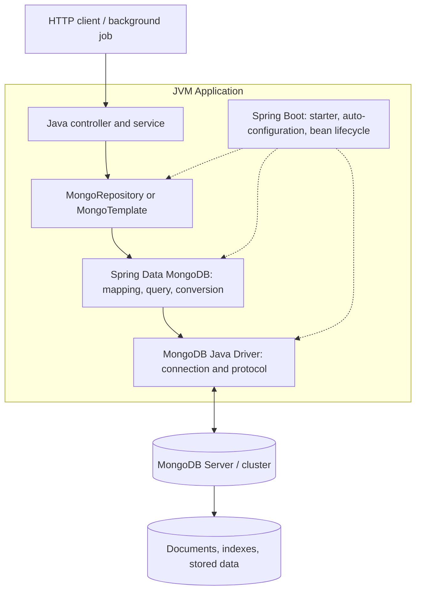

# Roles of MongoDB Server, Java Driver, Spring Data, and Spring Boot

In a Java application using **Spring Data MongoDB**, four components routinely appear together while solving distinct problems. **MongoDB Server** stores and processes data; the **MongoDB Java Driver** communicates with the server; **Spring Data MongoDB** provides a domain-level data access programming model; and **Spring Boot** wires up configuration and components so the application runs smoothly. Separating their responsibilities accurately helps you choose the right API, locate root causes of errors, and optimize performance at the right layer.

After this lesson, you will be able to:

- Explain the path of a read/write operation from Java code to MongoDB Server and back.
- Identify which responsibilities belong to the server, driver, Spring Data, or Spring Boot.
- Choose between `MongoRepository`, `MongoTemplate`, and the Java Driver in concrete scenarios.
- Recognize responsibility boundaries when configuring connections, creating indexes, using transactions, adopting reactive access, and diagnosing slow queries.

## 1. The big picture



Solid arrows represent the **data request processing path**. Dashed arrows represent Spring Boot's **initialization and configuration** role: Boot does not act as a database server or a network middleware hop that every query must pass through.

An application can use the Java Driver without Spring Data, or use Spring Data MongoDB without Spring Boot. In a typical Spring Boot application, these layers are integrated to minimize manual configuration work.

| Component | Primary Responsibility | Do Not Confuse With |
| --- | --- | --- |
| **MongoDB Server** | Stores BSON documents, executes queries and aggregations, manages indexes, authorization, replication, sharding, and transactions per deployment capabilities | A Java class-mapping library or Spring bean configuration |
| **MongoDB Java Driver** | Opens/manages connections, authentication, TLS, connection pools, sends commands and receives BSON over the MongoDB wire protocol, supports sessions and codecs | Spring's repository generator or the server's query execution engine |
| **Spring Data MongoDB** | Maps Java objects ↔ documents, builds queries, provides `MongoTemplate`, repositories, aggregation API, callbacks, and transaction integration | An actual storage database or a standalone network driver |
| **Spring Boot** | Provides starters, conditional bean auto-configuration, environment property binding, and operations/testing integration | An API replacing all Spring Data features or automatic index creation in every scenario |

## 2. MongoDB Server: where data is actually processed

MongoDB Server manages databases, collections, and documents. A document is stored in **BSON** (Binary JSON) format and can contain nested objects, arrays, dates, and many other data types. Java objects exist only inside the application; by the time data reaches the server, it is represented as documents and MongoDB commands.

Core server responsibilities include:

- **Query execution:** filtering, sorting, limiting results, running aggregation pipelines; selecting query plans and suitable indexes.
- **Storage and constraints:** writing documents, enforcing configured constraints such as unique indexes or collection validation.
- **Availability and scaling:** replication via replica sets, sharding when distributing data, and enforcing write concern and read concern.
- **Transactions:** coordinating commit/rollback of operations within a transaction on supported MongoDB topologies and versions.

For example, an application has a `products` collection with the document:

```javascript
{
  _id: ObjectId("64e000000000000000000001"),
  sku: "P-001",
  name: "Office Desk",
  priceVnd: 2590000
}
```

A lookup by `sku` can run faster when **the server actually has an index** on that field:

```javascript
// Run in mongosh / data schema management workflow.
db.products.createIndex({ sku: 1 }, { unique: true });
db.products.find({ sku: "P-001" }).explain("executionStats");
```

`createIndex` builds the index on the server; `explain` reports the execution plan and statistics. Declaring a Java class or calling a repository **does not automatically guarantee** that the index exists. Indexes must be managed intentionally, and duplicate data checked before applying a unique index.

## 3. MongoDB Java Driver: the communication bridge to the server

The Java Driver provides a lower-level API than Spring Data. The driver understands the MongoDB wire protocol, serializes values to BSON via codecs, routes requests, performs server selection, manages connection pools, and handles authentication and retries according to server capabilities and configuration. The driver **does not decide which index is best for a query**: that is MongoDB Server's job.

Example using the **synchronous Java Driver** directly:

```java
import com.mongodb.client.MongoClient;
import com.mongodb.client.MongoClients;
import com.mongodb.client.MongoCollection;
import org.bson.Document;

import static com.mongodb.client.model.Filters.eq;

// Short program example: manage and close the client explicitly when finished.
try (MongoClient client = MongoClients.create("mongodb://localhost:27017")) {
    MongoCollection<Document> products = client
            .getDatabase("shop")
            .getCollection("products");

    Document product = products.find(eq("sku", "P-001")).first();
    System.out.println(product);
}
```

Here, the code works directly with `Document` and driver filters. In a long-running service, **reuse `MongoClient`** because each client owns connection and pool resources; never create and close a client per HTTP request. When using Spring Boot and Spring Data, managed beans normally prevent this lifecycle mistake.

The driver has both **synchronous** and **Reactive Streams** variants. Both talk to the same MongoDB Server using different programming models; choosing reactive does not make the server execute queries faster automatically.

## 4. Spring Data MongoDB: domain-focused programming instead of manual BSON commands

Spring Data MongoDB builds on the Java Driver to provide APIs tied to the application's data model. Key capabilities include:

- **Object mapping:** annotations such as `@Document`, `@Id`, and `@Field`, plus converters to map objects to and from BSON documents.
- **Repository abstraction:** `MongoRepository` and derived query methods such as `findBySku`.
- **Template API:** `MongoTemplate` for dynamic queries, conditional updates, aggregation, bulk operations, and fine-grained control.
- **Spring integration:** dependency injection, entity callbacks, exception translation, transaction support, and reactive variants.

### 4.1. Mapping a document to a Java class

The following example uses **Java 17+** and Spring Data MongoDB with a record (split examples into their corresponding Java files):

```java
import org.springframework.data.annotation.Id;
import org.springframework.data.mongodb.core.mapping.Document;

@Document(collection = "products")
public record Product(
        @Id String id,
        String sku,
        String name,
        long priceVnd
) {}
```

`@Document` specifies the collection; `@Id` marks the identifier property. `String id` can be converted by Spring Data to and from an `ObjectId` `_id` value according to its mapping rules. `priceVnd` uses `long` to avoid ambiguity between integer currency amounts and BSON floating-point representations; when using `BigDecimal`, choose an appropriate storage representation such as `Decimal128`.

### 4.2. Common CRUD operations: Repository

```java
import java.util.Optional;
import org.springframework.data.mongodb.repository.MongoRepository;

public interface ProductRepository extends MongoRepository<Product, String> {
    Optional<Product> findBySku(String sku);
}
```

```java
import org.springframework.stereotype.Service;

@Service
public class ProductService {
    private final ProductRepository products;

    public ProductService(ProductRepository products) {
        this.products = products;
    }

    public Product create(String sku, String name, long priceVnd) {
        return products.save(new Product(null, sku, name, priceVnd));
    }

    public Product findBySku(String sku) {
        return products.findBySku(sku)
                .orElseThrow(() -> new IllegalArgumentException("SKU not found: " + sku));
    }
}
```

Spring Data generates the repository interface implementation at runtime. `findBySku("P-001")` is interpreted as a query on the `sku` property and sent down to the driver. Having a query method on a repository **does not mean an index already exists** on the server.

With `save`, a new entity (without an ID) is typically inserted; an entity with an ID is saved using the API's appropriate update/replace semantics. When only a few fields need updating, consider conditional update operators instead of accidentally overwriting other fields.

### 4.3. Dynamic queries: `MongoTemplate`

```java
import java.util.List;
import org.springframework.data.mongodb.core.MongoTemplate;
import org.springframework.data.mongodb.core.query.Criteria;
import org.springframework.data.mongodb.core.query.Query;
import org.springframework.stereotype.Service;

@Service
public class ProductSearchService {
    private final MongoTemplate mongoTemplate;

    public ProductSearchService(MongoTemplate mongoTemplate) {
        this.mongoTemplate = mongoTemplate;
    }

    public List<Product> affordable(long maxPriceVnd) {
        Query query = Query.query(Criteria.where("priceVnd").lte(maxPriceVnd))
                .limit(20);
        return mongoTemplate.find(query, Product.class);
    }
}
```

`MongoTemplate` constructs query criteria in Java/Spring Data style and maps results back to `Product`. For more complex problems, you can use the `Aggregation` API to build pipelines with `match`, `group`, `project`, `sort`, and so on; **the pipeline still executes on MongoDB Server**.

`MongoRepository` and `MongoTemplate` both use Spring Data; choose between them based on query complexity, not because one is automatically faster than the other. Performance depends on the actual query, indexes, document count, returned payload, connections, and server load.

## 5. Spring Boot: auto-configuring components to work together

Spring Boot lets you start an application without manually writing all the Java configuration. When a project includes the appropriate MongoDB starter and connection details, Boot can configure beans such as `MongoClient`, `MongoDatabaseFactory`, `MongoTemplate`, and repository scanning **subject to auto-configuration conditions**. Developers can still provide custom beans or configs to customize behavior.

For a Spring Boot 3.x project using blocking access, the standard dependency is `org.springframework.boot:spring-boot-starter-data-mongodb`. Example local configuration for that version:

```yaml
spring:
  data:
    mongodb:
      uri: ${MONGODB_URI:mongodb://localhost:27017/shop}
```

In real deployments, supply `MONGODB_URI` via a proper secret/configuration management mechanism and configure authentication, TLS, and topology accordingly. **Property names and auto-configuration behavior can vary across Spring Boot versions**, so check the exact documentation for your version before applying; the example above is explicitly noted for Boot 3.x.

Boot handles assembling and managing the lifecycle of components inside the application. After startup, **the Java Driver is still what sends requests over the network**, and **MongoDB Server is still what executes queries**. If configuration or permissions are missing, or if the server is unavailable, Boot cannot turn a broken connection into a successful query.

## 6. Tracing a request from start to finish

Suppose an HTTP endpoint calls `productService.findBySku("P-001")`. Typical execution flow:

1. **Controller/service** receives the parameter, applies business rules, and invokes the repository.
2. **Spring Data MongoDB** parses `findBySku`, uses mapping metadata to build the MongoDB filter, and prepares result conversion.
3. **MongoDB Java Driver** borrows a connection from the pool, encodes the command as BSON, sends it to the appropriate server, and receives the response.
4. **MongoDB Server** plans and runs the query, potentially using the `{ sku: 1 }` index if present and suitable, and returns the document.
5. **Driver and Spring Data** decode the data and map it into `Product`, returning the result to the service/controller.

When a query is slow, use this flow to isolate the cause: slowness from creating too many clients is an application/driver issue; `COLLSCAN` scanning millions of documents is a server-side query/index issue; converting huge payloads or APIs returning too many items is an application/Spring Data issue. One million documents should never be loaded just to display the first 20 rows.

## 7. Responsibility split in advanced features

| Requirement | Participating Components and Practical Responsibility |
| --- | --- |
| **Index creation** | Metadata such as `@Indexed` can be declared in Spring Data or managed via migrations/scripts; **the index must be created on MongoDB Server**. Do not assume every annotation automatically triggers index creation. |
| **Aggregation** | `MongoTemplate`/Spring Data expresses the pipeline; the driver sends the command; **the server processes the stages** and returns results. |
| **Transactions** | Spring manages boundaries via `@Transactional` when an appropriate transaction manager exists; Spring Data binds the session; the driver propagates commands/sessions; **the server performs commit/rollback** on supported deployments. |
| **Reactive access** | `ReactiveMongoRepository`/`ReactiveMongoTemplate` and the Reactive Streams Driver return `Mono`/`Flux` in a non-blocking model; the server is still MongoDB. Avoid calling blocking `MongoTemplate` inside a reactive flow. |
| **Connections and security** | Boot loads configuration; the driver manages pooling, TLS, and protocol authentication; MongoDB Server enforces user/role access controls. |
| **Testing** | Spring Boot provides test slices such as `@DataMongoTest`; a real MongoDB in test environments via Testcontainers verifies mapping, indexes, and query behavior. |
| **Performance observability** | The application measures latency, pools, and errors; MongoDB Server provides `explain`, query statistics, and metrics to pinpoint root causes. |

### Specific note on transactions

Do not assume every method annotated with `@Transactional` automatically runs inside a MongoDB transaction. You need the **right type of transaction manager**, session handling supported by Spring Data, and a compatible MongoDB deployment (typically a replica set or a qualifying sharded cluster). Multi-document transactions carry overhead; whenever possible, design documents to leverage **single-document** atomicity.

### Specific note on reactive

Reactive helps when an application handles high concurrent I/O asynchronously and the upper layers are also reactive. Switching from `MongoRepository` to `ReactiveMongoRepository` does not automatically create indexes, change server query algorithms, or eliminate data-design bottlenecks. Drivers, templates, and transaction managers for blocking vs. reactive access must be used consistently.

## 8. Which API should you choose?

| Scenario | Typically Appropriate Choice | Rationale |
| --- | --- | --- |
| Entity CRUD, lookups by a few fixed properties | `MongoRepository` | Minimal boilerplate, readable, integrated mapping and pagination. |
| Dynamically built filters, partial field updates, complex queries, aggregations | `MongoTemplate` | Control over queries and specific MongoDB operations while retaining Spring Data mapping. |
| Need low-level driver options/APIs not exposed by current abstractions | MongoDB Java Driver | Direct access to MongoDB APIs and codecs, at the cost of managing more details manually. |
| End-to-end reactive applications | `ReactiveMongoRepository` or `ReactiveMongoTemplate` | Integrates with Reactor and the Reactive Streams Driver. |

These choices are not mutually exclusive: an application can use repositories for routine business logic, `MongoTemplate` for aggregations, and the driver directly for a specialized requirement. However, keep client, session, mapping, and transaction management unified to avoid creating multiple connection pools or inconsistent behavior.

## 9. Practical diagnostic scenarios

**Scenario A — The application runs, but looking up by SKU is very slow.** `findBySku` works, which means Spring Data and the driver can send requests. Check the actual filter and `explain("executionStats")` on the server; if it performs a collection scan, define an appropriate index and verify selectivity. Adding another service layer or renaming repository methods will not fix this root cause.

**Scenario B — Connection fails immediately on startup.** Check the URI, DNS, credentials, TLS, network permissions, replica set state, and Boot configuration for your version. The driver is usually where connection failures surface; MongoDB Server may reject authentication or be unreachable on the network. This is not a `@Document` bug.

**Scenario C — `@Indexed(unique = true)` was added, yet duplicate SKUs still exist.** The annotation expresses mapping metadata, not proof that the index was created. Inspect `db.products.getIndexes()`, the project's index management mechanism, and existing duplicate data before applying a unique constraint.

**Scenario D — `@Transactional` is present, yet when the second operation fails, the first operation persists.** Check the transaction manager, Spring proxy invocation path, session binding, and MongoDB topology; never assume a transaction is active solely because the annotation appears in source code.

## 10. Key takeaway through one question

**If code calls `repository.findBySku(...)`, which component decides whether to use an index?**

Spring Data builds the query from the repository method; the Java Driver transmits the query; **MongoDB Server** selects the execution plan based on the query, existing indexes, and statistics. Spring Boot merely configures the beans needed along that path.

The relationship to internalize is: **Spring Boot wires → Spring Data models data operations → Java Driver communicates → MongoDB Server executes and stores**. When building CRUD, aggregations, indexes, transactions, reactive access, or investigating performance, always identify the responsible layer before choosing a fix.
