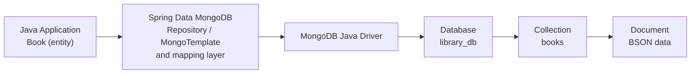
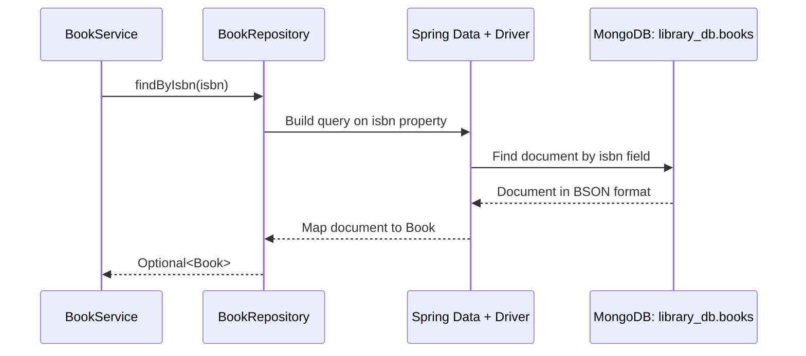

# Concept Map: Database, Collection, Document, BSON, Entity, and Repository

When learning Spring Data MongoDB, it is essential to distinguish the two sides of an application: **MongoDB stores data as documents inside a collection within a database**, while **Spring Data MongoDB enables Java code to map that data into entities and access it via repositories or `MongoTemplate`**. The six concepts in the title form a map for understanding reads, writes, queries, aggregation, and advanced topics later on.

## 1. Overall map



| Concept | Which Layer? | Role | Example in a Book Management App |
| --- | --- | --- | --- |
| **Database** | MongoDB | Namespace containing collections | `library_db` |
| **Collection** | MongoDB | Group of documents; target of operations and indexes | `books` |
| **Document** | MongoDB | Unit of data made of field name–value pairs, which may be nested | A book with `_id`, `isbn`, `title`, `author` |
| **BSON** | MongoDB | Binary format used to represent documents, supporting rich data types | `_id` as `ObjectId`, dates as BSON Date |
| **Entity** | Java / Spring Data | Java object mapped to document data | Class `Book` annotated with `@Document(collection = "books")` |
| **Repository** | Java / Spring Data | Data access interface with CRUD operations and query methods | `BookRepository extends MongoRepository<Book, ObjectId>` |

The first group and the second group are not synonymous: **a document is the stored data**, **an entity is the in-program representation**, and **a repository is how the program interacts with the data**. BSON is the format of a document, not a collection or a Java object.

## 2. Database → collection → document

Suppose a library application stores data as follows:

```text
MongoDB server / deployment
└── database: library_db
    ├── collection: books
    │   ├── document: book with _id = ObjectId("507f1f77bcf86cd799439011")
    │   └── document: book with _id = ObjectId("507f191e810c19729de860ea")
    └── collection: readers
        └── document: a reader's information
```

### Database: scope of data organization

`library_db` is the database name, used to group related collections within the same application. A MongoDB deployment can host multiple databases. When an application uses Spring Data MongoDB, the target database is typically specified via connection configuration; the database name is not a property of `BookRepository`.

Example connection URI configuration for a Spring Boot application using the `spring.data.mongodb.uri` property:

```properties
spring.data.mongodb.uri=mongodb://localhost:27017/library_db
```

The trailing path of the URI specifies the `library_db` database. In production environments, the URI may include credentials, a replica set, or additional parameters; this example assumes MongoDB is running locally.

### Collection: group of documents

`books` is the collection holding book documents. A collection resembles a relational database table in grouping records, but documents in the same collection do not have to share an identical field structure. MongoDB can enforce schema validation rules when configured, so a "flexible schema" does not mean skipping data design.

Indexes, such as an index for looking up books by `isbn`, belong to a collection. MongoDB queries usually target a specific collection, such as `db.books.find(...)`.

### Document: unit of data

A document represents a business object consisting of fields and values. A document can hold strings, numbers, dates, arrays, and nested documents. Every document in a collection has an `_id` field, and `_id` values must be unique **within that collection**.

Example of direct interaction using `mongosh`:

```javascript
use library_db

db.books.insertOne({
  isbn: "978-604-00-0000-1",
  title: "Introduction to Spring Data MongoDB",
  author: "An",
  publication_year: 2025
})

db.books.findOne({ isbn: "978-604-00-0000-1" })
```

If `_id` is not supplied, the MongoDB driver typically generates an `ObjectId` for the new document. The `_id` value does not always have to be an `ObjectId`: an application can choose another identifier type as long as it satisfies MongoDB's rules and the mapping design.

## 3. BSON: how is a document actually represented?

We commonly view documents in JSON-like syntax because it is human-readable. However, MongoDB uses **BSON (Binary JSON)**, a binary format with explicit data types. The following example uses **Extended JSON** to express BSON types in text:

```json
{
  "_id": { "$oid": "507f1f77bcf86cd799439011" },
  "isbn": "978-604-00-0000-1",
  "title": "Introduction to Spring Data MongoDB",
  "author": "An",
  "publication_year": 2025,
  "created_at": { "$date": "2025-02-10T08:00:00Z" },
  "tags": ["java", "mongodb"]
}
```

`{"$oid": "..."}` and `{"$date": "..."}` are **Extended JSON display notations** for `ObjectId` and BSON Date; they are not plain JSON strings stored literally in every case.

| MongoDB/BSON Data Type | Example Meaning | Common Mapped Java Type |
| --- | --- | --- |
| String | Book title, author | `String` |
| Int32 / Int64 | Publication year, borrow count | `Integer` / `Long` |
| Boolean | In-stock status | `Boolean` / `boolean` |
| ObjectId | Document identifier | `org.bson.types.ObjectId` or `String` with appropriate conversion rules |
| Date | Creation timestamp | `Date`, `Instant`, or a configured date/time type |
| Array | Tag list | `List<String>` |
| Embedded document | Publisher details nested inside a book | Nested Java object inside the entity |
| Decimal128 | Decimal numbers requiring exact precision | `Decimal128` or a Java type with corresponding conversion |

**Key takeaway:** JSON is a familiar display notation; BSON is the actual data format used inside MongoDB and driver communication. Never infer a field's type solely from how it looks in JSON, especially for identifiers, timestamps, and decimals.

## 4. Entity: the mirror of a document in Java code

Spring Data MongoDB provides mapping between **fields in a document** and **properties of a Java class**. For the example above, we create the `Book` entity:

```java
import org.bson.types.ObjectId;
import org.springframework.data.annotation.Id;
import org.springframework.data.mongodb.core.index.Indexed;
import org.springframework.data.mongodb.core.mapping.Document;
import org.springframework.data.mongodb.core.mapping.Field;

@Document(collection = "books")
public class Book {

    @Id
    private ObjectId id;

    @Indexed(unique = true)
    private String isbn;

    private String title;
    private String author;

    @Field("publication_year")
    private Integer publicationYear;

    protected Book() {
        // Used by the object instantiation mechanism during data mapping.
    }

    public Book(String isbn, String title, String author, Integer publicationYear) {
        this.isbn = isbn;
        this.title = title;
        this.author = author;
        this.publicationYear = publicationYear;
    }

    public ObjectId getId() {
        return id;
    }

    public String getIsbn() {
        return isbn;
    }

    public String getTitle() {
        return title;
    }

    public String getAuthor() {
        return author;
    }

    public Integer getPublicationYear() {
        return publicationYear;
    }
}
```

By reading the annotations, you can see the mapping rules:

| Java Element | Meaning When Stored in MongoDB |
| --- | --- |
| `@Document(collection = "books")` | Binds the entity to the `books` collection |
| `@Id` on `id` | Maps Java `id` to `_id` in the document |
| `@Field("publication_year")` | Maps the `publicationYear` property to the `publication_year` field |
| `@Indexed(unique = true)` on `isbn` | Declares metadata to create a unique index on `isbn` when index creation runs |
| No `@Field` on `title`, `author` | Uses field names matching the property names by default |

Note on `@Indexed`: **declaring the annotation does not guarantee the index exists in the database**. Automatic index creation depends on Spring Data configuration/version and index initialization workflows; in real systems, verify indexes in the collection or manage them via migrations. Uniqueness is only enforced by the database once the unique index actually exists.

An entity does not have to include every field in the document. In the Extended JSON example, `created_at` and `tags` are present, while the `Book` class does not declare those two properties; Spring Data can read the mapped fields and ignore fields absent from the Java object. If the application needs to preserve or process those fields, add the corresponding properties and mapping rules.

## 5. Repository: accessing documents through entities

A repository is a **Java abstraction**. You define an interface; Spring Data MongoDB provides the runtime implementation to execute operations against the target collection.

```java
import java.util.List;
import java.util.Optional;
import org.bson.types.ObjectId;
import org.springframework.data.mongodb.repository.MongoRepository;

public interface BookRepository extends MongoRepository<Book, ObjectId> {

    Optional<Book> findByIsbn(String isbn);

    List<Book> findByAuthor(String author);
}
```

In `MongoRepository<Book, ObjectId>`:

- `Book` is the managed entity type.
- `ObjectId` is the type of the identifier property `Book.id`, **not the database name**.
- `findByIsbn` and `findByAuthor` are query methods derived from Java property names. When `@Field` is present in the mapping, Spring Data uses that metadata to build the MongoDB query with the corresponding stored field name.

Using the repository in a service:

```java
import java.util.Optional;
import org.springframework.stereotype.Service;

@Service
public class BookService {

    private final BookRepository bookRepository;

    public BookService(BookRepository bookRepository) {
        this.bookRepository = bookRepository;
    }

    public Book addBook() {
        Book book = new Book(
            "978-604-00-0000-1",
            "Introduction to Spring Data MongoDB",
            "An",
            2025
        );
        return bookRepository.save(book);
    }

    public Optional<Book> findBook(String isbn) {
        return bookRepository.findByIsbn(isbn);
    }
}
```

In this flow, `save(book)` causes Spring Data to convert the `Book` object into a document and write it to `books`; `findByIsbn(...)` sends a query and converts the retrieved document back into a `Book`. If the entity has no identifier yet, saving typically creates a new record; for an entity that already has an identifier, `save` may overwrite/update the document with the same `_id` according to Spring Data's save semantics. **Do not assume `save` is always equivalent to `insertOne`**.

Repositories provide operations such as `findById`, `findAll`, `save`, `deleteById`, and derived query methods. For more complex queries, you can declare `@Query` or use `MongoTemplate`.

## 6. Where does `MongoTemplate` fit on the map?

`MongoTemplate` is another way to access MongoDB through Spring Data, offering an API to express query criteria, updates, and specialized operations directly. It uses the same entity/document mapping mechanism as repositories.

```java
import java.util.List;
import org.springframework.data.mongodb.core.MongoTemplate;
import org.springframework.data.mongodb.core.query.Criteria;
import org.springframework.data.mongodb.core.query.Query;

public class BookQueries {

    private final MongoTemplate mongoTemplate;

    public BookQueries(MongoTemplate mongoTemplate) {
        this.mongoTemplate = mongoTemplate;
    }

    public List<Book> publishedSince(int year) {
        Query query = Query.query(
            Criteria.where("publicationYear").gte(year)
        );
        return mongoTemplate.find(query, Book.class);
    }
}
```

In the example above, the criterion uses the **Java property name** `publicationYear`. When executing the query against the `Book` entity, the mapping layer translates it to the stored field name `publication_year`. Calling `mongoTemplate.find(query, Book.class)` selects the collection from `Book`'s `@Document` mapping and returns `List<Book>`.

| Requirement | Usually Suitable Tool |
| --- | --- |
| Standard CRUD, simple property-based queries | `MongoRepository` |
| Queries defined by method names or annotations | Repository |
| Dynamic queries with multiple optional criteria | `MongoTemplate` or custom repository |
| Aggregations, complex updates, fine-grained MongoDB API operations | `MongoTemplate` or appropriate repository APIs |
| Asynchronous streaming under the reactive model | `ReactiveMongoRepository` / `ReactiveMongoTemplate` and the corresponding reactive driver |

A reactive repository is not a new kind of collection: it changes how the application interacts with results and I/O, while the data still resides in MongoDB databases, collections, and documents.

## 7. Comparison with relational databases and common pitfalls

| Perspective | MongoDB / Spring Data MongoDB | Analogy if You Know SQL |
| --- | --- | --- |
| Data namespace | Database | Database |
| Data group | Collection | Table (rough analogy only) |
| Data unit | Document | Row (rough analogy only) |
| Data structure | BSON supporting nested arrays/documents | Row with fixed-schema columns |
| Application model | Mapped Java entity | ORM/JPA entity (different storage mechanics) |
| Access layer | Repository or `MongoTemplate` | Repository or SQL access tool |

Rules to avoid misunderstandings:

1. **A collection is not a Java class.** A `Book` class typically maps to the `books` collection, but mapping configuration and application design determine the actual relationship.
2. **A document is not an entity.** A document is data inside MongoDB; an entity is the Java object instantiated/converted during reads and writes.
3. **BSON is not plain JSON.** BSON supports `ObjectId`, Date, and many other types that must be handled accurately.
4. **A repository is not stored in MongoDB.** It is an application-side API; MongoDB only stores data and its management structures.
5. **Java property names can differ from BSON field names.** `publicationYear` and `publication_year` are one example; `@Field` defines the mapping.
6. **Documents do not have to be flat.** Arrays and nested documents can be used when aligned with query and update patterns.
7. **Identifiers and indexes must be designed explicitly.** `_id` enforces uniqueness within a collection; constraints like unique `isbn` require an actual created index.

## 8. Tracing a request from Java to MongoDB

Suppose a user looks up a book with ISBN `978-604-00-0000-1`:



Reading the diagram from left to right highlights clear boundaries of responsibility: **`BookService` handles business logic; `BookRepository` exposes the query interface; Spring Data and the driver convert/transmit commands; MongoDB stores and retrieves documents**. When optimizing performance, inspect both the query generated by Spring Data and the actual indexes on the collection; looking only at repository method names is never enough.

## 9. Self-check questions

Given `BookRepository extends MongoRepository<Book, ObjectId>` and database `library_db` with collection `books`, answer the following:

1. What are `Book`, `books`, and `library_db` respectively? **Answer:** Java entity, MongoDB collection, MongoDB database.
2. Why does the document have an `_id` field while the class has an `id` property? **Answer:** `@Id` maps the identifier between the two representations.
3. Why can `Criteria.where("publicationYear")` query the `publication_year` field? **Answer:** Spring Data uses the `@Field` mapping metadata when constructing entity-based queries.
4. Does `findByIsbn` live in BSON, the collection, or the repository? **Answer:** The application's repository; it generates a query against documents in the collection.
5. Does merely adding `@Indexed(unique = true)` guarantee MongoDB rejects duplicate ISBNs? **Answer:** No; you must verify that the unique index has actually been created in the collection.

**Takeaway for further study:** a database holds collections, a collection holds documents, and documents use BSON; Spring Data maps documents into entities, while repositories and `MongoTemplate` are the access paths from Java code. Upcoming topics—queries, aggregation, indexes, transactions, reactive access, testing, and performance diagnostics—all build on this foundational map.
