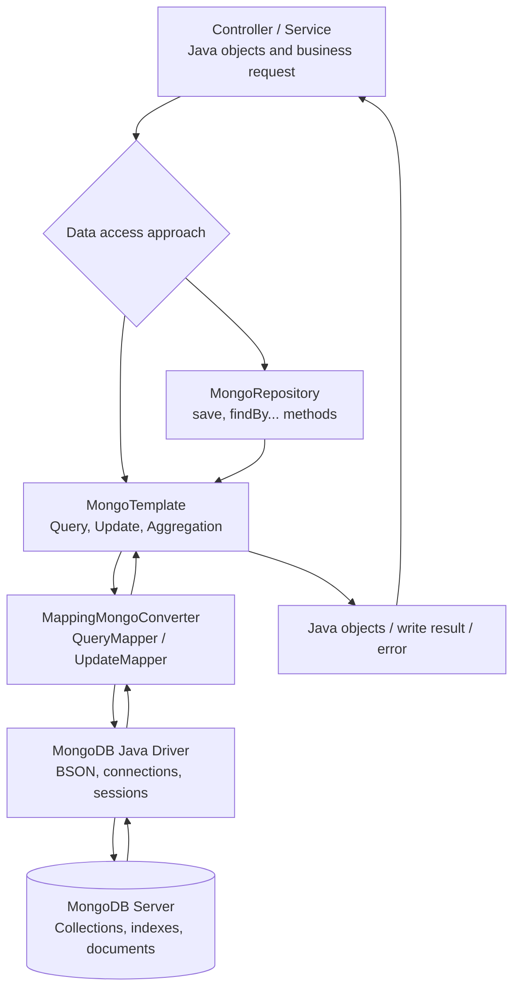

# Execution Flow from Java Objects to MongoDB Commands and Returned Results

In a Java application, we normally work with domain objects like `PurchaseOrder` rather than manually constructing BSON documents or sending wire-protocol commands. **Spring Data MongoDB** bridges those two worlds: mapping Java objects to documents, translating query conditions into MongoDB filters, calling the MongoDB Java Driver, and turning returned data into results the application consumes.

This lesson traces a request end-to-end to clarify the responsibilities of **repositories**, **`MongoTemplate`**, data converters, the driver, and MongoDB Server. Key operations include writes, reads, updates, aggregation, and reactive access, along with what to observe during testing and performance diagnostics.

## 1. The big picture



The diagram depicts **logical responsibilities**, not an implication that every box corresponds to a separate network round trip. When using standard repositories, Spring Data delegates operations through MongoDB Operations components; when using `MongoTemplate`, the application calls that operations layer directly. Both rely on the same underlying mapping layer and driver.

A typical request:

1. A service creates a Java object and calls `repository.save(order)`.
2. Spring Data determines the collection, whether the entity is new or existing, the fields to write, and conversion rules.
3. The driver encodes the request as BSON, uses a connection to MongoDB Server, and receives the response.
4. Spring Data interprets the result or error; the service receives back the entity, list, affected record count, or result type matching the API called.

**Distinguish three data layers:** the Java object is the application model; the BSON document is the data stored and transmitted by MongoDB; and result objects like `UpdateResult` describe **the outcome of an operation**, not the document itself.

## 2. Building a Java model to trace the flow

Suppose an application manages purchase orders. Each order is stored in the `purchase_orders` collection with a customer code, status, and total amount in Vietnamese dong.

```java
import org.springframework.data.annotation.Id;
import org.springframework.data.mongodb.core.mapping.Document;
import org.springframework.data.mongodb.core.mapping.Field;

@Document(collection = "purchase_orders")
public class PurchaseOrder {
    @Id
    private String id;

    @Field("customer_id")
    private String customerId;

    private String status;

    @Field("total_vnd")
    private long totalVnd;

    public PurchaseOrder() {}

    public PurchaseOrder(String customerId, String status, long totalVnd) {
        this.customerId = customerId;
        this.status = status;
        this.totalVnd = totalVnd;
    }

    public String getId() { return id; }
    public String getCustomerId() { return customerId; }
    public String getStatus() { return status; }
    public long getTotalVnd() { return totalVnd; }
}
```

In this example:

| Java Element | Meaning When Mapped to MongoDB |
| --- | --- |
| `@Document(collection = "purchase_orders")` | Specifies the collection for the entity. |
| `@Id String id` | Identifier property bound to the document's `_id` field. |
| `@Field("customer_id")` | Renames the stored field from `customerId` to `customer_id`. |
| `status` | Keeps the field name `status` when no other mapping rule applies. |
| `@Field("total_vnd") long totalVnd` | Writes field name `total_vnd`; a `long` value is typically represented as BSON Int64. |

Spring Data can access fields for mapping even without public setters. The no-arg constructor keeps this example simple; Spring Data also supports parameterized constructors and immutable objects when configured appropriately.

With `@Id String`, a string shaped like a valid ObjectId can be converted to a BSON ObjectId under default rules; when inserting a new record without an ID, MongoDB or the driver can generate an ObjectId and Spring Data converts it back to `String`. Therefore, **the Java type and BSON type of `_id` do not have to be identical**. If the application requires `_id` to remain a plain string literally, explicitly specify the ID strategy (such as `@MongoId`) instead of relying on default conversion.

A Spring Boot application can supply the MongoDB connection configuration and `MongoTemplate`/repository beans via the Spring Data MongoDB starter, and inject them into services. The examples below assume the connection and collection are ready; you do not open a new `MongoClient` per request.

## 3. Write flow: from `save()` to document

Repository declaration:

```java
import java.util.List;
import org.springframework.data.mongodb.repository.MongoRepository;

public interface PurchaseOrderRepository
        extends MongoRepository<PurchaseOrder, String> {

    List<PurchaseOrder> findByCustomerIdAndStatus(
            String customerId, String status);
}
```

Service creating and saving an order:

```java
PurchaseOrder draft = new PurchaseOrder("KH-101", "NEW", 1250000L);
PurchaseOrder saved = purchaseOrderRepository.save(draft);

String generatedId = saved.getId();
```

The flow proceeds in logical order:

1. **Repository receives the entity.** Spring Data's repository implementation determines whether the entity is new or existing. With `id == null`, the operation normally takes the **insert** path; for an existing entity, `save` typically persists the full mapped state of the entity. If `@Version` is used, entity detection and version checking also participate.
2. **Resolve collection and metadata.** The mapping context reads `@Document`, `@Id`, `@Field`, and conversion rules. Java property names do not always equal field names in MongoDB.
3. **Convert entity to BSON document.** `MappingMongoConverter` converts values, nested documents, collections, enums, IDs, and custom types according to configuration. Entity callbacks such as `BeforeConvertCallback` or `BeforeSaveCallback`, if registered, run at their corresponding hooks.
4. **Execute via the driver.** `MongoTemplate` uses the MongoDB Java Driver to send the operation to the server. The driver handles BSON encoding, connections, server selection, sessions, and response handling; Spring Data does not implement the MongoDB wire protocol itself.
5. **Complete on the Java side.** Once the write succeeds under the configured write concern, Spring Data returns the saved entity. For a generated ID, the returned object has the ID populated; post-save callbacks may run before returning.

The stored document on the server can be represented in MongoDB Shell as follows (illustrative ID):

```javascript
{
  _id: ObjectId("674000000000000000000101"),
  customer_id: "KH-101",
  status: "NEW",
  total_vnd: NumberLong("1250000"),
  _class: "com.example.orders.PurchaseOrder"
}
```

The `_class` field in the example illustrates type metadata that the default converter **may** write; its actual presence and value depend on the package, type mapper configuration, and object type. The MongoDB Shell representation above illustrates the stored document; it is **not a packet capture** of what the driver sends over the wire.

### How do `insert`, `save`, and partial updates differ?

| API | Purpose | Things to Watch Out For |
| --- | --- | --- |
| `repository.save(entity)` / `mongoTemplate.save(entity)` | Persists a new entity or the current state of an existing entity per ID/version detection rules. | For existing entities, full replacement can overwrite fields if only part of the document was loaded or the object is stale. |
| `mongoTemplate.insert(entity)` | Inserts a new document only. | Duplicate IDs or unique index violations cause the operation to fail. |
| `mongoTemplate.updateFirst(query, update, type)` | Updates specific fields on a document matching the filter. | Ideal for partial changes and atomic operators like `$set` and `$inc`. |
| `mongoTemplate.findAndModify(...)` | Finds and modifies in one atomic operation, returning either the before or after document. | Must explicitly request returning the new state if needed. |

Never fetch an entity with missing fields via a projection and then call `save` as a way to update a single field: unloaded fields risk being overwritten. To change an order's status, update just the field that needs changing.

## 4. Read flow: from Java method to MongoDB query

With a repository:

```java
List<PurchaseOrder> orders =
        purchaseOrderRepository.findByCustomerIdAndStatus("KH-101", "NEW");
```

Spring Data parses the method name `findByCustomerIdAndStatus` into conditions on the **Java properties** `customerId` and `status`. The query mapping component then translates `customerId` to `customer_id`. The semantically equivalent MongoDB filter is:

```javascript
db.purchase_orders.find({
  customer_id: "KH-101",
  status: "NEW"
});
```

An explicit equivalent using `MongoTemplate`:

```java
import java.util.List;
import org.springframework.data.domain.Sort;
import org.springframework.data.mongodb.core.MongoTemplate;
import org.springframework.data.mongodb.core.query.Criteria;
import org.springframework.data.mongodb.core.query.Query;

Query query = Query.query(
    Criteria.where("customerId").is("KH-101")
            .and("status").is("NEW")
);
query.with(Sort.by(Sort.Direction.DESC, "totalVnd"));

List<PurchaseOrder> result =
        mongoTemplate.find(query, PurchaseOrder.class);
```

Here `Query` uses Java property names; Spring Data translates both the `customerId` filter and the `totalVnd` sort into the corresponding BSON field names. When querying directly with the native driver or MongoDB Shell, you must use the field names **actually stored in the database**.

The return path from MongoDB consists of:

1. The server finds documents matching the filter, using an index when the query optimizer selects one.
2. The driver receives BSON documents from the cursor and handles fetching subsequent batches as needed.
3. `MappingMongoConverter` instantiates `PurchaseOrder`, mapping `_id → id`, `customer_id → customerId`, and `total_vnd → totalVnd`; `AfterConvertCallback` may run next if configured.
4. `MongoTemplate`/repository returns `List<PurchaseOrder>`. If no documents match, an empty list is returned; for an `Optional<PurchaseOrder>` API, the result is `Optional.empty()`.

**QueryMapper** handles query criteria, **UpdateMapper** handles update documents, and **MappingMongoConverter** converts between entities and documents. These are distinct responsibilities even though they share the same mapping metadata. Avoid thinking of Spring Data as merely performing string replacement on field names.

### Projections and pagination

You can fetch only the fields you need:

```java
Query small = Query.query(Criteria.where("status").is("NEW"));
small.fields().include("customerId").include("status");
small.limit(20);

List<PurchaseOrder> partial =
        mongoTemplate.find(small, PurchaseOrder.class);
```

Projections reduce transferred data and mapping work, but omitted fields receive default values in the Java object (for example, `long` becomes `0`). For API responses, dedicated DTOs/projections are usually clearer than partially populated entities. Pagination via `Pageable` may emit an extra count query depending on the API and usage; never assume a single repository call always equals a single MongoDB command.

## 5. Update flow: how are conditions and operators mapped?

Example updating the status of a single order:

```java
import com.mongodb.client.result.UpdateResult;
import org.springframework.data.mongodb.core.query.Criteria;
import org.springframework.data.mongodb.core.query.Query;
import org.springframework.data.mongodb.core.query.Update;

Query byId = Query.query(Criteria.where("id").is(generatedId));
Update changes = new Update().set("status", "PAID");

UpdateResult updateResult =
        mongoTemplate.updateFirst(byId, changes, PurchaseOrder.class);

long matched = updateResult.getMatchedCount();
long modified = updateResult.getModifiedCount();
```

Spring Data maps the `id` property in `Query` to `_id` and converts the ID value where necessary. Semantically equivalent MongoDB command:

```javascript
db.purchase_orders.updateOne(
  { _id: ObjectId("674000000000000000000101") },
  { $set: { status: "PAID" } }
);
```

`getMatchedCount()` reports how many documents matched the filter; `getModifiedCount()` reports how many documents actually changed. The two counts can differ—for instance, if the field already held `"PAID"`. A successful return from `updateFirst` does not mean an order was necessarily modified. When write concern is unacknowledged, confirmation counts are not available as they are with acknowledged writes.

For cases that require updating and returning the new state together, use:

```java
import org.springframework.data.mongodb.core.FindAndModifyOptions;

PurchaseOrder updated = mongoTemplate.findAndModify(
    byId,
    new Update().set("status", "SHIPPED"),
    FindAndModifyOptions.options().returnNew(true),
    PurchaseOrder.class
);
```

With `returnNew(true)`, the result is the document **after** the update mapped to `PurchaseOrder`, or `null` if no record matched. Without this option, the operation normally returns the state **before** the update. A `findAndModify` operation is atomic at the document level.

When concurrent requests update the same document, prefer appropriate filter conditions, operators like `$inc`/`$set`, or optimistic locking with `@Version` depending on business rules. A "read → mutate object → `save`" pattern is prone to lost updates under overlapping writes.

## 6. Aggregation flow and non-entity results

Not every query returns `PurchaseOrder`. For example, to calculate revenue by status, MongoDB can run an aggregation:

```javascript
db.purchase_orders.aggregate([
  { $group: { _id: "$status", total: { $sum: "$total_vnd" } } },
  { $sort: { total: -1 } }
]);
```

The output has the shape `{ _id: "PAID", total: ... }`, which no longer matches `PurchaseOrder`. In Spring Data, you can declare a result DTO:

```java
public record StatusRevenue(String id, long total) {}
```

```java
import static org.springframework.data.mongodb.core.aggregation.Aggregation.*;
import org.springframework.data.mongodb.core.aggregation.Aggregation;
import org.springframework.data.mongodb.core.aggregation.AggregationResults;

Aggregation pipeline = newAggregation(
    group("status").sum("totalVnd").as("total"),
    sort(Sort.Direction.DESC, "total")
);

AggregationResults<StatusRevenue> revenue =
        mongoTemplate.aggregate(
                pipeline, PurchaseOrder.class, StatusRevenue.class);

List<StatusRevenue> rows = revenue.getMappedResults();
```

By binding the input type `PurchaseOrder.class`, Spring Data has the context to map property `totalVnd` to field `total_vnd` inside the pipeline. The output type must match the document shape produced by the stages; if specific field names or `_id` handling are required, declare projections/DTOs and mapping explicitly. Aggregations can use indexes in certain stages such as `$match` and `$sort`, though you cannot assume the entire pipeline runs off an index.

## 7. What happens on errors or data changes?

| Symptom | Where It Originates | Observed on the Java Side |
| --- | --- | --- |
| Duplicate `_id` or violation of an **existing unique index** | MongoDB Server rejects the write | Spring Data typically translates the error into `DuplicateKeyException`. |
| Connection failure, timeout, unavailable server | Driver/connection/MongoDB cluster | Exception propagates, typically through the `DataAccessException` hierarchy or underlying driver exceptions. |
| Read filter matches no documents | Server returns zero matching documents | Empty list, `Optional.empty()`, or `null` depending on the API. |
| Update matches no document | MongoDB completes command with zero matches | `UpdateResult.getMatchedCount() == 0` (on acknowledged writes). |
| `@Version` conflict on save | Version condition no longer matches | May throw `OptimisticLockingFailureException`. |
| Data cannot be converted to the target Java type | Document mapping step | Conversion/mapping error; check raw data and custom converters. |

`@Indexed(unique = true)` only declares the **intent** to create a unique index. MongoDB only enforces uniqueness once **the index actually exists**. Automatic index creation from annotations depends on configuration and application lifecycle; in production, manage indexes via migrations or controlled index-creation workflows.

On transactions: writing a single document is atomic as guaranteed by MongoDB. Coordinating commits or rollbacks across multiple documents or collections requires transactions, a supporting topology (a properly configured replica set or sharded cluster), and `MongoTransactionManager` or its reactive counterpart. Placing `@Transactional` alone without proper session/transaction manager setup is not sufficient to achieve MongoDB transactions.

## 8. Reactive: same query semantics, different execution timing

When using Reactive Spring Data MongoDB, a service calls `ReactiveMongoRepository` or `ReactiveMongoTemplate` and receives `Mono<T>`/`Flux<T>`.

```java
import reactor.core.publisher.Flux;
import reactor.core.publisher.Mono;
import org.springframework.data.mongodb.repository.ReactiveMongoRepository;

public interface ReactivePurchaseOrderRepository
        extends ReactiveMongoRepository<PurchaseOrder, String> {

    Flux<PurchaseOrder> findByCustomerId(String customerId);
}

// Inside a reactive service:
Mono<PurchaseOrder> saved = reactiveRepository.save(
        new PurchaseOrder("KH-202", "NEW", 320000L));
Flux<PurchaseOrder> orders =
        reactiveRepository.findByCustomerId("KH-202");
```

Publishers are typically **lazy**: MongoDB operations run when the stream is subscribed to, not at the moment `saved` or `orders` is assigned. BSON mapping, command dispatch, data retrieval, and result mapping still occur, while the reactive driver coordinates signaling and backpressure. Never call `subscribe()` arbitrarily inside a service just to "force execution"; return the publisher to the caller so lifecycle, error handling, and transaction context are managed cleanly. Avoid `block()` on reactive request threads.

Reactive does not automatically make queries faster or fix missing indexes. Choose reactive when the entire processing chain and I/O concurrency demands align; stay with synchronous access when the application relies on standard thread-blocking execution.

## 9. Tracing the real path during testing and diagnostics

When a command behaves unexpectedly or runs slowly, inspect step by step from the service down to the server:

1. **Java inputs:** ID value, status, optional fields, new vs. existing object, data types, transaction/session. Also check `@Field`, `@Id`, `@Version`, and custom conversions.
2. **API invoked:** repository derived query, `@Query`, `MongoTemplate.find`, `updateFirst`, `save`, or aggregation? Distinguish full entity replacement from partial updates; check expected return types.
3. **Actual query:** enable selective logging in development (such as the `org.springframework.data.mongodb.core.MongoTemplate` logger and MongoDB driver command logging) to inspect emitted operations. Never expose secrets, tokens, or sensitive customer data in production logs.
4. **On MongoDB:** inspect stored documents, real field names, indexes, and the execution plan via `explain("executionStats")`. Separate server execution time, scanned document count, and mapping/network time; do not blame mapping for all latency.
5. **Results and errors:** confirm `matchedCount`, `modifiedCount`, return types, write acknowledgment, and exceptions propagated to the service.

Example checking index usage for a query:

```javascript
db.purchase_orders
  .find({ customer_id: "KH-101", status: "NEW" })
  .explain("executionStats");
```

Examine `winningPlan`, `totalDocsExamined`, `totalKeysExamined`, and `nReturned`. For heavy read traffic filtering by `customer_id` and `status`, a compound index such as `{ customer_id: 1, status: 1 }` **may** be appropriate; base the choice on query frequency, selectivity, and `explain` output. Indexes speed up many lookups at the cost of write overhead and storage space.

Integration tests against a real test MongoDB instance (such as Testcontainers) are especially valuable for verifying `_id`, field names, indexes, converters, and update behavior. Mocking a repository only verifies method-call logic; it does not prove MongoDB queries and mappings run properly on the server.

## 10. Self-check questions

**Scenario A:** An entity declares `@Field("customer_id") String customerId`. Inside `Criteria.where(...)` passed to `MongoTemplate.find(query, PurchaseOrder.class)`, do you write `customerId` or `customer_id`? **Answer:** write `customerId`, the Java property name, so the mapper translates it to `customer_id`. In MongoDB Shell, use `customer_id`.

**Scenario B:** `updateFirst` returns `matchedCount = 1`, `modifiedCount = 0`. Did the operation fail? **Answer:** no. The document may already have held the target value.

**Scenario C:** You project only `status` and `customerId`, then call `save` on that entity to change `status`. What is the risk? **Answer:** unloaded fields may be overwritten with default values; use a field-level update or load the full entity with concurrency control.

**Scenario D:** A call to `reactiveRepository.save(order)` produces a `Mono` that is never subscribed to. Has MongoDB definitely received the command? **Answer:** no; execution typically starts only when the publisher is subscribed to.

**Scenario E:** A MongoDB query returns the expected document in Shell, yet the repository returns an empty result. What should you inspect? **Answer:** `_id` value and type, mapped field names, target database/collection, query criteria, converters, collation, and session/transaction scope.

The key takeaway is to always trace **both directions**: on writes, Java entity → metadata & conversion → BSON/driver → MongoDB; on reads, BSON document → conversion → Java entity or DTO. Repositories let you write domain-level code while `MongoTemplate` gives explicit control over queries and updates; both rest on the same mapping rules that must be well understood when designing, testing, and tuning data access.
