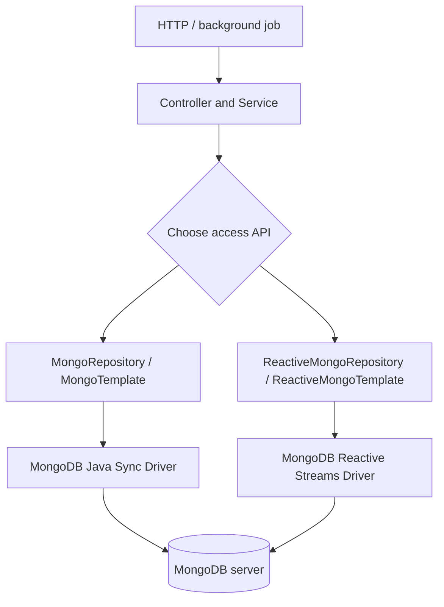

# Distinguishing Synchronous, Reactive, and MongoDB-Compatible Libraries

## 1. Context: same MongoDB, different ways the application waits for data

In a Java application, reading a list of books from MongoDB can be written in two styles:

- **Synchronous (blocking):** a query call waits for the result and then returns `Book`, `List<Book>`, or `Optional<Book>`. The calling thread is typically occupied while waiting for I/O.
- **Reactive (asynchronous, non-blocking under Reactive Streams):** a call returns a `Publisher`, typically represented by `Mono<Book>` or `Flux<Book>` in Spring. I/O work is scheduled when a subscriber subscribes; data, errors, and completion signals flow through an event stream.

Both styles access the same MongoDB database, using BSON documents, queries, aggregations, and indexes. The major differences lie in **APIs, drivers, return types, thread management, and integration with the rest of the application**. Reactive does not automatically make MongoDB execute a query faster.

Within the **SPRING_DATA_MONGODB** scope, Spring Data connects to MongoDB, maps documents to Java objects, and operates via repositories or templates. When deciding between synchronous and reactive APIs, evaluate everything from HTTP/service layers down to the driver, transactions, testing, and performance diagnostics.

## 2. Separating three layers: MongoDB, driver, and Spring Data

A request does not call MongoDB directly from a `@Document` annotation. It passes through several layers:



| Layer | Role | What to Understand |
| --- | --- | --- |
| MongoDB server | Stores documents, runs queries, aggregations, indexes, and transactions | Does not dictate whether the Java API must be blocking or reactive. |
| MongoDB Java driver | Handles connections, BSON, MongoDB commands, cursors, and I/O | Sync driver and Reactive Streams driver expose different APIs. |
| Spring Data MongoDB | `@Document` mapping, query generation, repositories, templates, Spring integration | Provides **two API branches** built on the two driver types. |
| Reactor | `Mono`, `Flux`, operators, schedulers, and subscription mechanics | A reactive programming library, not a MongoDB driver. |
| Spring MVC / WebFlux | Handles HTTP at the web tier | Web framework choice affects execution model but **does not turn** blocking MongoDB calls into non-blocking ones. |

**Common pitfall:** `MongoTemplate` and `ReactiveMongoTemplate` are both part of Spring Data MongoDB, yet they cannot be swapped merely by changing return types. They use different connection infrastructures.

## 3. Comparing synchronous and reactive APIs

| Criterion | Synchronous | Reactive |
| --- | --- | --- |
| Repository API | `MongoRepository<T, ID>` | `ReactiveMongoRepository<T, ID>` |
| Template API | `MongoTemplate` | `ReactiveMongoTemplate` |
| Primary driver | `com.mongodb.client.MongoClient` | `com.mongodb.reactivestreams.client.MongoClient` |
| Single-document read result | `Optional<T>` or `T` | `Mono<T>` (0 or 1 element) |
| Multi-document read result | `List<T>`, `Stream<T>`, or cursor depending on API | `Flux<T>` (0 to many elements) |
| When I/O starts | Executes when the blocking method is called | Typically starts when the publisher is subscribed to |
| Waiting for data | Calling thread normally blocks while waiting on I/O | Does not tie up a thread in blocking I/O wait |
| Error handling | `try/catch`, exceptions thrown on the call stack | `onError` signals and operators such as `onErrorResume` |
| Composition | Sequential statements, loops | `map`, `flatMap`, `filter`, `collectList`, etc. |
| Typical testing | JUnit and direct assertions | `StepVerifier` or controlled subscribe/await in tests |
| Best suited for | Routine CRUD, predominantly blocking apps, sequential workflows | High concurrent I/O demand, end-to-end reactive pipelines, streaming |

**Backpressure** is the subscriber's ability to signal demand for items via `request(n)` under the Reactive Streams protocol. It helps prevent upstream producers from pushing unbounded data onto downstream consumers; actual effectiveness still depends on driver batch/cursor fetching, operators, and MongoDB limits.

### How does a request execute?

With the synchronous API:

1. Service calls `repository.findById(id)`.
2. Calling thread waits for the driver to receive the response from MongoDB.
3. Repository returns `Optional<Book>` or throws an exception.
4. Controller proceeds to build the HTTP response.

With the reactive API:

1. Service returns `Mono<Book>` describing the operation to perform.
2. Consumer (such as WebFlux) subscribes to the pipeline.
3. Driver performs I/O, emitting data or an error and a completion signal.
4. WebFlux writes the response based on those signals.

In reactive code, **never call `subscribe()` manually in a service or controller just to "trigger" a query**. Doing so detaches the operation from error handling, request cancellation, transactions, and the HTTP lifecycle. Always return the publisher to the caller or compose it into an existing pipeline.

## 4. Choosing the right libraries and starters

| Tool / Library | Purpose | When to Use |
| --- | --- | --- |
| `org.mongodb:mongodb-driver-sync` | Official MongoDB driver with synchronous API | Direct BSON, session, or driver API operations without Spring Data. |
| `org.mongodb:mongodb-driver-reactivestreams` | Official MongoDB driver returning Reactive Streams `Publisher` | Reactive pipelines or backing Spring Data reactive infrastructure. |
| `spring-boot-starter-data-mongodb` | Spring Boot starter for synchronous Spring Data MongoDB | Using `MongoRepository` and `MongoTemplate` in Spring Boot apps. |
| `spring-boot-starter-data-mongodb-reactive` | Spring Boot starter for reactive Spring Data MongoDB | Using `ReactiveMongoRepository`, `ReactiveMongoTemplate`, and Reactor. |
| `spring-boot-starter-web` | Spring MVC, standard HTTP APIs | Commonly paired with synchronous MongoDB access. |
| `spring-boot-starter-webflux` | Spring WebFlux, reactive HTTP stack | Appropriate when requests are handled non-blocking end-to-end. |
| MongoDB Kotlin Coroutine Driver | MongoDB API for Kotlin `suspend`/`Flow` | Kotlin coroutine projects; not Spring Data's Java `Mono`/`Flux` API. |
| Morphia | Third-party Java/MongoDB ODM | An alternative mapping approach; not a `MongoRepository` implementation. |
| Mongock | MongoDB data change/migration management | Complements data evolution workflows; does not replace drivers or templates. |
| Testcontainers MongoDB | Runs MongoDB in a container for integration tests | Verifying mapping, queries, indexes, and real server behavior. |

**Understand dependency relationships:**

- Spring Data MongoDB **uses the MongoDB driver** to talk to the server. Spring Data is not a standalone database.
- `Mono` and `Flux` come from Reactor; the Reactive Streams driver uses `Publisher` as its foundational type. Spring Data integrates Reactor types for convenience in Java applications.
- Starter names are artifact IDs; actual versions should be managed cohesively via Spring Boot dependency management/BOM. Never mix arbitrary versions of Spring Data, the MongoDB driver, and Spring Boot.
- A library labeled "MongoDB support" may only cover migrations, ODM, testing, or BSON. That does not mean it provides both sync and reactive APIs.

### Configuring dependencies by approach

Maven examples relying on Spring Boot version management:

```xml
<!-- Choose for synchronous MongoDB access -->
<dependency>
    <groupId>org.springframework.boot</groupId>
    <artifactId>spring-boot-starter-data-mongodb</artifactId>
</dependency>
```

Or for a reactive application:

```xml
<!-- Choose for reactive MongoDB access -->
<dependency>
    <groupId>org.springframework.boot</groupId>
    <artifactId>spring-boot-starter-data-mongodb-reactive</artifactId>
</dependency>
```

These two snippets are **alternative configuration choices**, not a requirement to install both. When intentionally using both branches in one application, explicitly configure repository packages, client/template beans, and transactions to avoid accidental mixing.

## 5. Spring Data example: one requirement, two programming styles

Suppose the `books` collection contains:

```json
{
  "_id": "b-101",
  "title": "MongoDB in Java Applications",
  "author": "Nguyen A",
  "publicationYear": 2024
}
```

Shared conceptual document definition:

```java
import org.springframework.data.annotation.Id;
import org.springframework.data.mongodb.core.mapping.Document;

@Document(collection = "books")
public record Book(
    @Id String id,
    String title,
    String author,
    int publicationYear
) {}
```

The snippets below illustrate **two alternative implementations** of the same "find books by author" requirement; you do not need both repositories in one application.

### 5.1. Synchronous repository

```java
import java.util.List;
import org.springframework.data.mongodb.repository.MongoRepository;

public interface BookRepository extends MongoRepository<Book, String> {
    List<Book> findByAuthor(String author);
}
```

```java
import java.util.List;
import org.springframework.stereotype.Service;

@Service
public class BookService {
    private final BookRepository books;

    public BookService(BookRepository books) {
        this.books = books;
    }

    public List<Book> booksByAuthor(String author) {
        return books.findByAuthor(author);
    }
}
```

When calling `booksByAuthor("Nguyen A")`, the service proceeds only after the query returns a list or raises an error. This sequential style is straightforward to follow, especially in applications built on Spring MVC and other blocking integrations.

### 5.2. Reactive repository

```java
import org.springframework.data.mongodb.repository.ReactiveMongoRepository;
import reactor.core.publisher.Flux;

public interface ReactiveBookRepository
        extends ReactiveMongoRepository<Book, String> {
    Flux<Book> findByAuthor(String author);
}
```

```java
import org.springframework.stereotype.Service;
import reactor.core.publisher.Flux;

@Service
public class ReactiveBookService {
    private final ReactiveBookRepository books;

    public ReactiveBookService(ReactiveBookRepository books) {
        this.books = books;
    }

    public Flux<Book> booksByAuthor(String author) {
        return books.findByAuthor(author);
    }
}
```

The service returns `Flux<Book>` to the consumer without immediately materializing a `List<Book>`. Operators can be chained prior to subscription:

```java
Flux<String> titles = reactiveBookService.booksByAuthor("Nguyen A")
    .filter(book -> book.publicationYear() >= 2020)
    .map(Book::title);
```

If the full list is needed, `collectList()` returns `Mono<List<Book>>`. It is still a publisher: it **only emits the list once the source completes**, buffering all elements in memory. Never use it on an unbounded result set.

### 5.3. Templates for dynamic queries

Derived repository methods work well for simple queries. When criteria are constructed dynamically, or controlled queries, aggregations, or updates are needed, templates are usually more flexible:

```java
import org.springframework.data.domain.Sort;
import org.springframework.data.mongodb.core.query.Criteria;
import org.springframework.data.mongodb.core.query.Query;

Query query = Query.query(Criteria.where("publicationYear").gte(2020))
    .with(Sort.by(Sort.Direction.DESC, "publicationYear"))
    .limit(20);

// With MongoTemplate:
List<Book> result = mongoTemplate.find(query, Book.class);

// With ReactiveMongoTemplate (in a separate implementation):
Flux<Book> stream = reactiveMongoTemplate.find(query, Book.class);
```

These two `find` calls show usage for each template; real code needs a declared `mongoTemplate` or `reactiveMongoTemplate` field choosing the appropriate type. Query criteria, sorting, and MongoDB indexes still have to be designed identically.

### 5.4. HTTP responses and handling empty results

A WebFlux controller can return a publisher directly:

```java
import org.springframework.http.ResponseEntity;
import org.springframework.web.bind.annotation.GetMapping;
import org.springframework.web.bind.annotation.PathVariable;
import org.springframework.web.bind.annotation.RestController;
import reactor.core.publisher.Mono;

@RestController
public class ReactiveBookController {
    private final ReactiveBookRepository books;

    public ReactiveBookController(ReactiveBookRepository books) {
        this.books = books;
    }

    @GetMapping("/books/{id}")
    public Mono<ResponseEntity<Book>> getOne(@PathVariable String id) {
        return books.findById(id)
            .map(ResponseEntity::ok)
            .defaultIfEmpty(ResponseEntity.notFound().build());
    }
}
```

`Mono.empty()` signals that no document was found, so the controller maps it to HTTP 404 via `defaultIfEmpty`. Actual errors, such as losing connection to MongoDB, travel via the error signal and must be handled with appropriate exception handling or retry policies.

## 6. When should you choose which approach?

| Scenario | Usually Suitable Direction | Rationale |
| --- | --- | --- |
| Standard Spring MVC CRUD apps, linear business logic | Synchronous | Simpler call stacks, logging, debugging, and integration with blocking libraries. |
| WebFlux services with high concurrent I/O, data streaming | Reactive | Can leverage non-blocking I/O and end-to-end Reactor pipelines. |
| Systems using blocking JDBC across most steps | Consider staying synchronous | Switching MongoDB alone to reactive does not make the overall request pipeline non-blocking. |
| Services streaming continuous change feeds | Reactive | Natural fit for `Flux`, subscription cancellation, and demand management. |
| Small, sequential, easy-to-control batch jobs | Synchronous | Avoids unnecessary complexity; tune queries/indexes before changing APIs. |
| Teams experienced with Reactor, reactive metrics, and testing | Reactive if I/O load proves the benefit | Sustainable when the whole stack and operational skills match. |

**The decision criterion is not "reactive is always faster."** Given the same query, server, data, and indexes, MongoDB execution time can be identical. Reactive primarily improves thread efficiency under high concurrent I/O wait; in exchange, pipelines and debugging can be harder.

## 7. Common limitations and integration errors

### 7.1. Calling `block()` inside a WebFlux pipeline

```java
// Do not place inside a WebFlux request processing path:
Book book = reactiveBooks.findById(id).block();
```

`block()` forces a synchronous wait and can stall or fail when executed on a non-blocking event-loop thread. In reactive controllers and services, compose with `map` and `flatMap` and return `Mono`/`Flux`. For data sources that only offer blocking APIs, you can offload work to a dedicated scheduler via `Mono.fromCallable(...).subscribeOn(Schedulers.boundedElastic())` as an isolation measure; this **does not turn** a blocking driver into a non-blocking one.

### 7.2. Confusing client and template types

`com.mongodb.client.MongoClient` belongs to the sync driver; `com.mongodb.reactivestreams.client.MongoClient` belongs to the reactive driver. Their class names look similar but are not interchangeable. Dependencies, Spring beans, and repositories must align.

### 7.3. Calling `subscribe()` and discarding the result

```java
// Easily loses error control and operation lifecycle tracking:
reactiveBooks.save(book).subscribe();

// Keep the operation in the pipeline for the caller to manage:
Mono<Book> saved = reactiveBooks.save(book);
```

For writes with side effects, clearly define **who subscribes, when, and how errors are handled**. A publisher may never execute without a subscriber; conversely, multiple subscriptions can trigger repeated executions against a cold source.

### 7.4. Confusing reactive with CPU parallelism or unbounded memory safety

Reactive I/O does not automatically increase CPU throughput. `flatMap` can introduce concurrency, which must be bounded appropriately; `collectList` and `buffer` can still consume large amounts of RAM. Cursors/batching, result limits, and pagination remain crucial.

### 7.5. Transactions in the two branches do not share context

Synchronous access uses `MongoTransactionManager`, whereas reactive access uses `ReactiveMongoTransactionManager` with transaction context propagated along the reactive pipeline. Never assume a synchronous Spring transaction automatically wraps reactive operations spawned by a publisher. MongoDB multi-document transactions also require a supporting topology (e.g., a qualifying replica set or sharded cluster) and proper session/transaction configuration.

### 7.6. "MongoDB-compatible" does not mean 100% feature parity

A service or database advertising MongoDB protocol/API compatibility may differ in supported command versions, BSON types, aggregation stages, indexes, transactions, change streams, or sessions. When adopting a MongoDB-compatible service, check **that service's own feature matrix**, supported driver versions, and test every feature your application actually uses. Simply connecting successfully does not prove all queries and transactions work accurately.

## 8. Queries, aggregation, and indexes: common ground across both APIs

Whether you choose synchronous or reactive, performance still depends heavily on **data modeling and query patterns**:

- Create indexes matching actual filters, sorts, selectivity, and access patterns; use `explain` to check execution plans and scanned document counts.
- Use projections when only a subset of fields is needed; bound result sets with `limit` or suitable pagination.
- Push appropriate filtering and aggregation into MongoDB via queries/pipelines rather than fetching everything and filtering in Java.
- Watch out for aggregations producing oversized intermediate datasets, unindexed `sort` stages, and unbounded queries.
- Monitor connection pools, timeouts, command latency, queued requests, and server resources. Application backpressure cannot fix a MongoDB query missing an index.

Business example: if a "Books published since 2020" page spans millions of documents, replacing `List` with `Flux` lets consumers stream results smoothly, yet the query still needs filters, sorting, limits, and indexes. Run `explain` before blaming the programming model for bottlenecks.

## 9. Testing and observability

**Synchronous branch:** use JUnit, invoke the repository or template, and assert returned results and exceptions. For real integration coverage, run a test MongoDB instance (e.g., Testcontainers) to verify `_id` mapping, queries, indexes, and transaction behavior.

**Reactive branch:** alongside integration tests against real MongoDB, use `reactor-test` and `StepVerifier` to verify emitted items, completion signals, and errors:

```java
import reactor.test.StepVerifier;

StepVerifier.create(reactiveBooks.findById("b-101"))
    .expectNextMatches(book -> book.title().contains("MongoDB"))
    .verifyComplete();
```

Observability should cover both end-to-end metrics (latency, throughput, error rate) and MongoDB metrics (query latency, pool utilization, CPU, index usage). Compare sync and reactive under **identical workloads, queries, indexes, and load conditions**, measuring both per-request latency and thread/memory consumption as concurrency rises.

## 10. Hands-on practice

Build an API to fetch books by author and publication year:

1. Create a `books` collection with sample documents and verify `@Document` mapping.
2. Write a synchronous Spring Data method returning `List<Book>` and an equivalent reactive method returning `Flux<Book>`.
3. Add a publication-year filter, sort, and `limit` using the respective template API.
4. For the reactive variant, use `StepVerifier` to test matching data, empty results, and error cases.
5. Create an appropriate index and use `explain` to compare execution plans before and after. Observe that changing Java APIs does not replace query tuning.
6. Explain how error handling, timeouts, request cancellation, and transactions differ between the two implementations.

**Self-check questions:** Why is `Mono<List<Book>>` technically reactive yet a poor choice for collecting millions of documents? When must you use `ReactiveMongoTemplate` instead of `MongoTemplate`? Why does a WebFlux endpoint calling a synchronous repository not automatically become non-blocking?

## Key takeaways

MongoDB is the database engine; the driver handles wire communication; Spring Data provides mapping, repositories, and templates. **`MongoRepository`/`MongoTemplate` are synchronous; `ReactiveMongoRepository`/`ReactiveMongoTemplate` are reactive.** Pick the branch matching your overall architecture and operational requirements, then optimize queries, aggregations, indexes, and real-MongoDB testing in either case.
