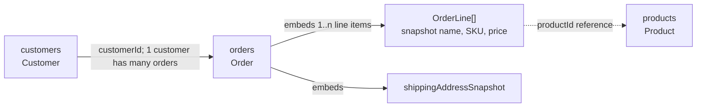

# Learning Roadmap and the Product–Customer–Order Model Used Throughout This Course

## 1. Lesson goals

Throughout the **Spring Data MongoDB** learning path, we build a compact e-commerce system called **Mini Commerce**. The system centers on three core business entities: **Product**, **Customer**, and **Order**. This same data model will be reused as we learn MongoDB connectivity, document mapping, querying via repositories or `MongoTemplate`, aggregation, indexes, transactions, reactive access, testing, and performance diagnostics.

After this lesson, learners will be able to:

- Explain Spring Data MongoDB's role between a Java/Spring application and a MongoDB database.
- Sketch the Product–Customer–Order domain relationships and decide which data should be embedded versus referenced by identifier.
- Recognize the collections, documents, fields, business constraints, and indexes used in subsequent lessons.
- Understand a logical learning sequence, practical deliverables for each stage, and scenarios that require verification.
- Distinguish tasks suited for `MongoRepository`, `MongoTemplate`, aggregation, transactions, and Reactive MongoDB.

**Prerequisites:** core Java (classes, collections, `BigDecimal`, `Instant`), Spring Boot fundamentals, HTTP/REST, and CRUD concepts. Learners new to MongoDB should review databases, collections, BSON documents, `_id`, and query filters. Code examples target Java 17 or higher using standard Spring Data MongoDB APIs; actual library versions should be managed consistently via Spring Boot.

## 2. The big picture: learning stages and deliverables

Each stage adds a new capability to the same Mini Commerce application. You can follow the order below; the reactive section is an alternative implementation branch after mastering the synchronous flow.

| Stage | Core Focus | Mini Commerce Practice Task | Target Outcome |
| --- | --- | --- | --- |
| 1. Setup | MongoDB, connection config, Spring Boot starter | Connect to `mini_commerce` database, read/write sample products | Application connects cleanly to MongoDB |
| 2. Mapping | `@Document`, `@Id`, `@Field`, BSON, data types | Model `Product`, `Customer`, and `Order` | Documents persist with accurate structure and types |
| 3. Repository | `MongoRepository`, derived queries, pagination, sorting | Look up products by SKU, view customer order history | Clean CRUD and simple lookups |
| 4. MongoTemplate | `Query`, `Criteria`, `Update`, conditional updates | Decrement stock only when sufficient inventory exists | Controlled querying and atomic updates |
| 5. Query design | Filters, projections, pagination, compound indexes | Filter products by category; list newest orders | Queries reflect real screen/API needs |
| 6. Aggregation | `$match`, `$unwind`, `$group`, `$sort` | Best-selling products and revenue reports | Data summarized directly in MongoDB |
| 7. Transactions | Replica set, `MongoTransactionManager`, `@Transactional` | Create order and decrement stock consistently | Multi-document operations with clear boundaries |
| 8. Reactive access | `ReactiveMongoRepository`, `ReactiveMongoTemplate`, `Mono`/`Flux` | Query catalog using reactive APIs | Contrast non-blocking vs. blocking access |
| 9. Testing | Unit tests, integration tests, Testcontainers | Verify unique indexes, stock integrity, order history | Catch data and query bugs early |
| 10. Performance | `explain`, indexes, logging, pooling, observability | Measure customer order queries, tune slow queries | Evidence comparing before and after tuning |

Not every technique is required for every workflow. Standard CRUD typically fits repositories; atomic updates, dynamic queries, or complex aggregations usually call for `MongoTemplate`. Transactions are reserved for cases requiring consistency across multiple documents. Reactive fits when **the entire I/O path** for a feature is built on a reactive stack.

## 3. The Mini Commerce domain and ubiquitous language

Suppose an online store must support four core workflows:

1. Staff create and update products, selling prices, categories, active status, and stock counts.
2. Customers register and save contact details and a default shipping address.
3. A customer places an order containing one or more products; the system locks in the product name, SKU, and unit price at checkout time.
4. Staff view orders per customer, compile sales statistics, and investigate slow queries.

Domain terms used consistently throughout:

| Term | Meaning | Key Rule |
| --- | --- | --- |
| `Product` | An item offered for sale | `sku` is a unique business code; `price` is the current price |
| `Customer` | A buyer | `email` is normalized before enforcing uniqueness |
| `Order` | A customer purchase | Contains `customerId`, timestamp, status, and line items |
| `OrderLine` | A line item inside an order | Holds `productId` plus name/SKU/unit price **snapshotted at checkout** |
| `shippingAddressSnapshot` | Delivery address for the order | Copied into the order so history stays unaffected by profile edits |
| `idempotencyKey` | Checkout request deduplication key | Prevents creating duplicate orders from retried requests |

### 3.1. Relationships between domain objects



This model follows **data access boundaries** rather than mirroring relational SQL tables:

- `products` and `customers` are independent collections because they have separate lifecycles and query patterns.
- `orders` stores `customerId` to look up orders for a customer. Never automatically embed a full customer profile inside every order.
- `OrderLine` items are **embedded** in `Order` because line items are always read with the order and belong strictly to it. MongoDB updates a single document atomically, so editing lines inside an order does not require a multi-document transaction.
- `OrderLine.productId` references the source product, while `sku`, `productName`, and `unitPrice` capture historical state. When a product is renamed or repriced, past orders still reflect the exact transaction as placed.
- The shipping address is also snapshotted into the order rather than pointing to the customer's mutable current address.

We avoid `@DBRef` by default in this model: explicit ID references keep query counts and loading behavior under direct control. Other reference mechanisms can be evaluated only when real requirements prove their value.

### 3.2. Design decisions made before writing code

| Decision | Convention Used Throughout | Rationale |
| --- | --- | --- |
| Database and collections | `mini_commerce`, `products`, `customers`, `orders` | Consistent names across logs, queries, and tests |
| Technical ID | MongoDB default `_id` (mappable via `String @Id`) | Decouples technical IDs from SKU/email |
| References | `customerId` and `productId` stored as string IDs | Avoids forcing MongoDB joins on routine reads |
| Money | Java `BigDecimal`, MongoDB `Decimal128` | Prevents binary floating-point rounding errors |
| Timestamps | Java `Instant`, stored in UTC | Avoids timezone ambiguity during filtering and reporting |
| Inventory | `stock` as a non-negative integer | Enables conditional stock checks during checkout |
| Order total | `totalAmount = sum(quantity × unitPrice)` | Never trust client-submitted totals |
| Order statuses | Start with `PLACED` and `CANCELLED` | Keeps learning focused before adding payment/fulfillment states |
| Historical data | Embed line-item and shipping-address snapshots | Preserves accurate history when source entities change |
| Retry key | Unique `idempotencyKey` in `orders` | Reduces risk of duplicate order creation |

**Note on IDs:** in Spring Data MongoDB, a `String` annotated with `@Id` can be converted to BSON `ObjectId` where appropriate. Regular reference fields like `customerId`/`productId` in these examples are treated as strings; use types consistently across writes and queries. If you choose to store references as BSON `ObjectId`, update types and mappings consistently everywhere rather than mixing them arbitrarily.

## 4. Standardized sample dataset for all lessons

Each collection below shows one illustrative document. The syntax is **MongoDB Extended JSON**: `$oid` represents ObjectId, `$numberDecimal` represents Decimal128, and `$date` represents a date/time. When viewed in `mongosh`, values may display as `ObjectId(...)`, `NumberDecimal(...)`, or `ISODate(...)`.

### 4.1. Product

```json
{
  "_id": { "$oid": "665000000000000000000001" },
  "sku": "LAP-001",
  "name": "Mini Mechanical Keyboard",
  "category": "phu-kien",
  "price": { "$numberDecimal": "129900.00" },
  "stock": 20,
  "active": true,
  "createdAt": { "$date": "2026-11-01T02:00:00Z" }
}
```

`sku` identifies the product within the catalog; `price` is the active selling price and may change over time. `stock` belongs to the product and is never copied into order line items.

### 4.2. Customer

```json
{
  "_id": { "$oid": "665000000000000000000002" },
  "fullName": "Nguyen Thi Lan",
  "email": "lan@example.test",
  "phone": "0900000000",
  "defaultAddress": {
    "recipient": "Nguyen Thi Lan",
    "street": "12 Duong Mau",
    "city": "TP Ho Chi Minh",
    "country": "VN"
  },
  "createdAt": { "$date": "2026-11-02T03:00:00Z" }
}
```

The default address is mutable; orders store a copy of the address captured at checkout. Emails should be normalized (for example, trimmed and lowercased per application policy) before saving, backed by a unique index.

### 4.3. Order

```json
{
  "_id": { "$oid": "665000000000000000000003" },
  "customerId": "665000000000000000000002",
  "idempotencyKey": "checkout-0001",
  "status": "PLACED",
  "lines": [
    {
      "productId": "665000000000000000000001",
      "sku": "LAP-001",
      "productName": "Mini Mechanical Keyboard",
      "quantity": 2,
      "unitPrice": { "$numberDecimal": "129900.00" },
      "lineTotal": { "$numberDecimal": "259800.00" }
    }
  ],
  "shippingAddressSnapshot": {
    "recipient": "Nguyen Thi Lan",
    "street": "12 Duong Mau",
    "city": "TP Ho Chi Minh",
    "country": "VN"
  },
  "totalAmount": { "$numberDecimal": "259800.00" },
  "placedAt": { "$date": "2026-11-20T02:00:00Z" }
}
```

This example has one line item: `2 × 129900.00 = 259800.00`. When seeding test data, make sure a completed order corresponds to stock dropping from 20 to 18; the three JSON documents above illustrate **document shapes**, not a post-transaction consistent snapshot.

For richer aggregation practice, learners can add a second product and multiple orders across different dates while keeping the same document structure.

## 5. From MongoDB documents to Java classes

Spring Data MongoDB provides the mapping layer between Java objects and BSON documents. `MongoRepository` handles most CRUD operations; `MongoTemplate` gives explicit control over queries, updates, and aggregations. Typical components in a Spring Boot application:

```text
HTTP API / Service
       |
       +--> MongoRepository --------+
       |                            |
       +--> MongoTemplate ----------+--> MongoDB driver --> MongoDB
       |
       +--> Mapping: @Document, @Id, @Field, ...
```

### 5.1. Mapping Product

```java
import java.math.BigDecimal;
import java.time.Instant;
import org.springframework.data.annotation.Id;
import org.springframework.data.mongodb.core.index.Indexed;
import org.springframework.data.mongodb.core.mapping.Document;
import org.springframework.data.mongodb.core.mapping.Field;
import org.springframework.data.mongodb.core.mapping.FieldType;

@Document(collection = "products")
public class Product {
    @Id
    private String id;

    @Indexed(unique = true)
    private String sku;

    private String name;
    private String category;

    @Field(targetType = FieldType.DECIMAL128)
    private BigDecimal price;

    private int stock;
    private boolean active;
    private Instant createdAt;

    // No-arg constructor, getters/setters, or instantiation style
    // appropriate for the Spring Data version in use.
}
```

`@Document` selects the collection; `@Id` maps to `_id`; `@Indexed(unique = true)` declares a unique index requirement; `@Field(targetType = FieldType.DECIMAL128)` ensures `BigDecimal` is stored as Decimal128. Declaring an index annotation **does not guarantee the index is created**: establish an environment setup or migration workflow to manage indexes. Never rely blindly on automatic index creation in production.

### 5.2. Mapping Customer and Order

The classes below list the required fields; constructors/getters/setters are omitted to keep the mapping structure clear. `OrderLine` is an embedded object without its own collection or independent `@Id`.

```java
@Document(collection = "customers")
public class Customer {
    @Id
    private String id;

    @Indexed(unique = true)
    private String email;

    private String fullName;
    private String phone;
    private ShippingAddress defaultAddress;
    private Instant createdAt;
    // Constructor / getter / setter
}

public class ShippingAddress {
    private String recipient;
    private String street;
    private String city;
    private String country;
    // Constructor / getter / setter
}

public class OrderLine {
    private String productId;
    private String sku;
    private String productName;
    private int quantity;

    @Field(targetType = FieldType.DECIMAL128)
    private BigDecimal unitPrice;

    @Field(targetType = FieldType.DECIMAL128)
    private BigDecimal lineTotal;
    // Constructor / getter / setter
}

@Document(collection = "orders")
@CompoundIndex(
    name = "customer_placed_idx",
    def = "{ 'customerId': 1, 'placedAt': -1 }"
)
public class Order {
    @Id
    private String id;

    private String customerId;

    @Indexed(unique = true)
    private String idempotencyKey;

    private String status;
    private List<OrderLine> lines;
    private ShippingAddress shippingAddressSnapshot;

    @Field(targetType = FieldType.DECIMAL128)
    private BigDecimal totalAmount;

    private Instant placedAt;
    // Constructor / getter / setter
}
```

Corresponding imports include `List`, `BigDecimal`, `Instant`, `Id`, `Indexed`, `CompoundIndex`, `Document`, `Field`, and `FieldType`. In production code, consider using an enum for order status, Bean Validation for inputs, and immutable class designs if the team is comfortable with Spring Data's constructor mapping.

**Monetary rules:** perform multiplication and addition strictly with `BigDecimal`, validate `quantity > 0`, and standardize scale and rounding rules per currency. Never use `double` for monetary calculations. During checkout, the server loads current prices from `products` and computes `lineTotal` and `totalAmount` itself; never trust prices supplied by the client.

## 6. Reusable practical patterns for upcoming lessons

### 6.1. Common queries with repositories

```java
public interface ProductRepository
        extends MongoRepository<Product, String> {
    Optional<Product> findBySku(String sku);

    Page<Product> findByActiveTrueAndCategory(
        String category, Pageable pageable);
}

public interface OrderRepository
        extends MongoRepository<Order, String> {
    Page<Order> findByCustomerIdOrderByPlacedAtDesc(
        String customerId, Pageable pageable);

    Optional<Order> findByIdempotencyKey(String idempotencyKey);
}
```

These interfaces import `MongoRepository`, `Optional`, `Page`, and `Pageable`. They serve as the starting point for `GET /products?category=phu-kien`, `GET /customers/{id}/orders`, and SKU lookups. Paginated requests can be created with `PageRequest.of(page, size)`; every API must enforce a reasonable max `size` and deterministic sorting.

### 6.2. Conditional stock reservation with MongoTemplate

An order workflow must never read `stock` and overwrite it unconditionally; two concurrent requests could oversell inventory. The pattern below checks **sufficient stock** atomically at update time:

```java
public boolean reserveStock(
        MongoTemplate mongoTemplate, String productId, int quantity) {
    if (quantity <= 0) {
        throw new IllegalArgumentException("Quantity must be positive");
    }

    Query filter = Query.query(
        Criteria.where("_id").is(productId)
            .and("active").is(true)
            .and("stock").gte(quantity)
    );
    Update update = new Update().inc("stock", -quantity);

    UpdateResult result =
        mongoTemplate.updateFirst(filter, update, Product.class);
    return result.getModifiedCount() == 1;
}
```

Typical imports: `MongoTemplate`, `Query`, `Criteria`, `Update`, and `com.mongodb.client.result.UpdateResult`. This method assumes consistent ID mapping and returns `false` if the product does not exist, is inactive, or lacks stock. For **one product**, this is atomic at the document level. For **an order spanning multiple products**, a transaction is needed if all stock deductions and order creation must succeed or roll back together.

### 6.3. Checkout flow and transaction boundaries

An order placement service can follow this sequence:

1. Validate the buyer and `idempotencyKey`; look up any existing order with this key and return the prior result if present.
2. Load `Customer` and the requested `Product` documents; reject inactive products or invalid quantities.
3. For each product, execute the conditional `stock >= quantity` decrement.
4. Build `OrderLine` snapshots, copy the shipping address, and compute totals with `BigDecimal`.
5. Insert the `Order` with status `PLACED` and return the order ID.

Stock deductions and order insertion should run inside the same **MongoDB multi-document transaction** when immediate consistency is required:

```java
@Configuration
class MongoTransactionConfig {
    @Bean
    MongoTransactionManager mongoTransactionManager(
            MongoDatabaseFactory factory) {
        return new MongoTransactionManager(factory);
    }
}

@Service
class CheckoutService {
    // Repositories and MongoTemplate injected via constructor.

    @Transactional
    public String placeOrder(PlaceOrderCommand command) {
        // Validate customer, products, and quantities.
        // Conditionally decrement stock for every product.
        // Build line-item snapshots and save Order.
        // Return the saved Order ID.
        throw new UnsupportedOperationException(
            "Implement business logic in the transaction lesson");
    }
}
```

The `placeOrder` stub is a **skeleton illustrating transaction boundaries**, not a runnable service yet. Later transaction lessons will supply the full implementation and tests. `MongoTransactionManager` is imported from `org.springframework.data.mongodb.MongoTransactionManager`; `MongoDatabaseFactory` from `org.springframework.data.mongodb.MongoDatabaseFactory`.

**Mandatory prerequisites:** multi-document transactions require MongoDB running as a replica set or compatible sharded cluster—even locally as a single-node replica set. Standalone MongoDB servers do not meet this requirement. Avoid self-invoking a `@Transactional` method on the same bean instance when relying on Spring proxies. Transactions can encounter write conflicts or transient errors: design bounded retries, idempotency, and duplicate-key handling; checking existence before inserting is **not enough** to prevent duplicates under concurrency.

### 6.4. Aggregation: top products by revenue

Because `lines` are embedded in orders, computing per-product totals requires unwinding the array in the pipeline:

```java
Aggregation pipeline = Aggregation.newAggregation(
    Aggregation.match(
        Criteria.where("status").is("PLACED")
            .and("placedAt").gte(from).lt(to)
    ),
    Aggregation.unwind("lines"),
    Aggregation.group("lines.productId")
        .sum("lines.quantity").as("unitsSold")
        .sum("lines.lineTotal").as("revenue"),
    Aggregation.sort(Sort.Direction.DESC, "revenue"),
    Aggregation.limit(10)
);

AggregationResults<Document> result =
    mongoTemplate.aggregate(pipeline, "orders", Document.class);
List<Document> topProducts = result.getMappedResults();
```

`from` and `to` are `Instant` values defining a half-open time window `[from, to)`. Required imports include `Aggregation`, `AggregationResults`, `Criteria`, `Sort`, `org.bson.Document`, and `List`. In production reports, explicitly define rules for cancelled/refunded orders—for example, `CANCELLED` orders must not count toward revenue. Update filters and reporting rules whenever new statuses are introduced.

### 6.5. Reactive access as an alternative branch

```java
public interface ReactiveProductRepository
        extends ReactiveMongoRepository<Product, String> {
    Flux<Product> findByActiveTrueAndCategory(String category);
}

// Inside a reactive service:
Mono<Product> one = reactiveProductRepository.findById(productId);
Flux<Product> catalog =
    reactiveProductRepository.findByActiveTrueAndCategory("phu-kien");
```

`Mono` and `Flux` come from Project Reactor; `ReactiveMongoRepository` comes from Spring Data MongoDB Reactive. This branch requires the reactive starter and driver. Never call `block()` on a non-blocking thread and never mix synchronous repositories casually into reactive chains. If transactions are used reactively, configure the reactive transaction manager and reactive transaction context instead of reusing the synchronous setup above.

## 7. Planned indexes and how to verify them

Do not index every conceivable field. Start from **known queries** and measure examined document counts. A sensible index set for Mini Commerce:

| Collection | Planned Index | Supported Query | Things to Watch Out For |
| --- | --- | --- | --- |
| `products` | `{ sku: 1 }` unique | Look up product by SKU | Clean up duplicate SKUs before creating the index |
| `products` | `{ active: 1, category: 1, price: 1 }` | Filter active items by category, sort by price | Benchmark before keeping the index |
| `customers` | `{ email: 1 }` unique | Look up account by normalized email | Case-normalization policy must be consistent |
| `orders` | `{ idempotencyKey: 1 }` unique | Deduplicate retried checkout requests | Define uniqueness scope per design |
| `orders` | `{ customerId: 1, placedAt: -1 }` | Customer's newest order history | Field order in a compound index matters |
| `orders` | `{ status: 1, placedAt: -1 }` | Filter orders by status and time | Add only if screens/reports actually need it |

MongoDB automatically creates an index on `_id`. `@Indexed` and `@CompoundIndex` declare mapping intent, whereas real deployments must control index creation/migrations—especially on pre-existing data. You can inspect a query in `mongosh`:

```javascript
db.orders
  .find({ customerId: "665000000000000000000002" })
  .sort({ placedAt: -1 })
  .explain("executionStats");
```

Inspect `winningPlan`, `totalDocsExamined`, `totalKeysExamined`, `nReturned`, and execution time. The goal is to understand records scanned and query plans, not just single-run wall-clock timing. With tiny datasets, MongoDB may choose different plans than in production; always verify on a representative dataset.

## 8. Minimum API contract and practice suite

Suggested APIs serving as the baseline across repository, service, and controller lessons. This is a **practice contract**, not something you must implement completely in the overview stage.

| API | Main Inputs | Expected Result / Rule |
| --- | --- | --- |
| `POST /api/products` | SKU, name, price, stock, category | Create product; reject duplicate SKU |
| `GET /api/products` | `category`, `page`, `size`, `sort` | Paginated list of active products |
| `GET /api/products/{id}` | Product ID | Product details or 404 |
| `POST /api/customers` | Full name, email, address | Normalize email, reject duplicates |
| `GET /api/customers/{id}/orders` | Customer ID, pagination | Newest orders first |
| `POST /api/orders` | Customer ID, list of `productId + quantity`, `idempotencyKey` | Server looks up prices, decrements stock, creates order, returns ID |
| `GET /api/reports/top-products` | `from`, `to` | Top products by confirmed revenue |

Sample create-order payload:

```json
{
  "customerId": "665000000000000000000002",
  "idempotencyKey": "checkout-0001",
  "items": [
    {
      "productId": "665000000000000000000001",
      "quantity": 2
    }
  ]
}
```

The client **does not send `unitPrice` or `totalAmount`**. The server owns calculating those values. Before writing the order, validate that the line-item list is non-empty, quantities are positive, products exist and are active, stock is sufficient, the customer is valid, statuses are valid, and the idempotency key meets formatting rules. APIs should return clear error codes such as 400 (invalid input), 404 (not found), and 409 (inventory/uniqueness conflict), tailored to the system's API contract.

## 9. Testing against business invariants

In upcoming lessons, rather than merely checking whether a repository can save an object, test Mini Commerce's **business invariants**:

| Scenario | Expected Outcome to Verify |
| --- | --- |
| Creating two products with the same SKU | One write fails when the unique index exists |
| Creating two customers with the same normalized email | No two profiles violate uniqueness |
| Ordering two units when stock = 1 | Never produces negative stock or two successful orders exceeding stock |
| Multi-line order where the second line is out of stock | All stock updates and order creation roll back when using a transaction |
| Resending the same `idempotencyKey` | Never creates a second independent order |
| Changing product name/price after checkout | Snapshots inside `OrderLine` remain unchanged |
| Changing a customer's default address | Shipping address on past orders stays unchanged |
| Cancelled order | Revenue report obeys status filtering rules |
| Querying orders by customer + timestamp | Results are properly ordered and query plan is verified |

Integration tests should run against a **real MongoDB instance in the test environment**, typically via Testcontainers, to verify BSON mapping, index enforcement, aggregations, and transactions. Emulated in-memory MongoDB substitutes may not accurately reflect these behaviors. Transaction tests specifically require a properly configured replica set. Monetary tests should include boundary values and compare `BigDecimal` values according to the application's scale conventions.

## 10. Common mistakes across the learning path

| Symptom | Common Root Cause | Recommended Approach |
| --- | --- | --- |
| Amounts off by cents or missing decimals | Using `double` or wrong conversion | Use `BigDecimal`/`Decimal128`; inspect actual BSON |
| Order history changes when product prices change | Order stores only a link to the product | Store snapshots in `OrderLine` |
| Order created without full stock deduction | Separate writes without a transaction | Define transaction boundaries, test rollbacks |
| Negative stock under concurrent requests | Unconditional read–modify–write | Use `$inc` with filter `stock >= quantity` |
| `@Transactional` fails with unsupported error | MongoDB not running as a replica set or wrong transaction config | Check topology and transaction manager |
| Duplicate SKU/email despite `@Indexed` | Unique index was never actually created | Inspect `getIndexes()` and migration setup |
| Customer order history query is slow | Missing index or mismatched filter/sort | Analyze `explain("executionStats")` |
| Reactive API still stalls | Calling blocking I/O or `block()` | Keep the pipeline consistently non-blocking |
| Mixed ID types stored on orders | Mixing BSON ObjectId and String references | Standardize storage types, mapping, and queries |

## 11. Completion criteria for the overview stage

Before moving into hands-on deep-dive lessons, make sure you can answer:

1. Why does `OrderLine` live inside the order document while `Product` lives in its own collection?
2. When a product's price changes, which fields on historical orders must remain unchanged?
3. Which index does `GET /customers/{id}/orders` need, and why does key order inside the index matter?
4. When two requests attempt to buy the last remaining unit simultaneously, what condition must the inventory update enforce?
5. Why can decrementing stock across multiple products and saving an order require a multi-document transaction? Which MongoDB topology is required?
6. Which tasks fit repositories versus `MongoTemplate` in this model?
7. What pipeline stages are needed to aggregate revenue per product from the `lines` array?
8. How do you verify correctness and performance using integration tests, indexes, and `explain`?

**Expected output:** learners can describe the three collections, an order holding line-item and shipping-address snapshots, the baseline API contract, and the progression from CRUD to testing/performance. In subsequent lessons, keep using these exact Mini Commerce collection names, field names, and business rules so it stays easy to compare repositories, templates, aggregations, transactions, and reactive access side by side.
