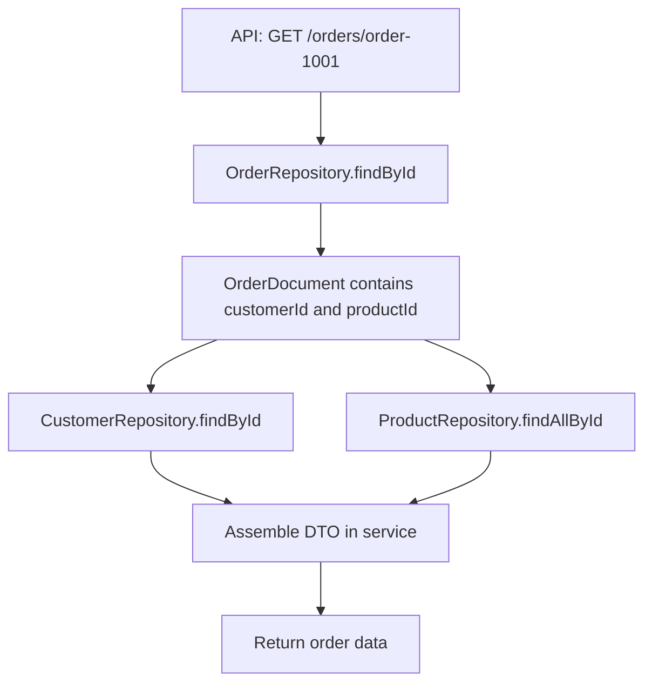

# Referencing by ID and Explicit Loading via Repository or Template

## 1. The Problem: An Order Needs Customer and Product Data

Suppose a retail application has three datasets:

- `customers` stores customer account information.
- `products` stores the product catalog, display names, and current selling prices.
- `orders` stores orders, the buyer, and the purchased line items.

An order must know **which customer** placed it and **which products** were purchased. In MongoDB, a straightforward way to represent this relationship is to store the **ID of the related document** inside the order document:

```javascript
// customers collection
{
  _id: "customer-01",
  displayName: "Nguyen Ha",
  email: "ha@example.test"
}

// products collection
{
  _id: "product-10",
  name: "Mechanical keyboard",
  currentPrice: NumberDecimal("1250000"),
  active: true
}

// orders collection
{
  _id: "order-1001",
  customerId: "customer-01",
  placedAt: ISODate("2026-11-20T02:00:00Z"),
  items: [
    {
      productId: "product-10",
      productNameAtPurchase: "Mechanical keyboard",
      quantity: 2,
      unitPriceAtPurchase: NumberDecimal("1200000")
    }
  ],
  total: NumberDecimal("2400000")
}
```

This is **referencing by ID**: `orders.customerId` points to `customers._id`, and `orders.items[].productId` points to `products._id`. In practice, these IDs are just data inside the order document; MongoDB **does not automatically load** the customer or product simply because an ID matches another document.

In the **SPRING_DATA_MONGODB** module, Spring Data MongoDB handles connecting, mapping documents to Java objects, and accessing data via repositories or `MongoTemplate`. This lesson shows how to:

1. Choose consistent ID fields and BSON types.
2. Store references as regular Java fields.
3. **Explicitly load** related documents using a repository or `MongoTemplate`.
4. Reduce redundant queries when loading multiple orders.
5. Handle missing references, changes in source data, consistency, and performance.
6. Understand the differences between explicit loading and `@DBRef`, `@DocumentReference`, and `$lookup`.

The goal is not to turn MongoDB into a relational database, but to design intentional read/write flows around business data.

## 2. How Does Referencing by ID Differ from Embedding Documents?

There are two fundamental choices for attaching related data to a document.

**Embedding:** copying fields that belong to the same business boundary into the parent document.

```javascript
{
  _id: "order-1001",
  shippingAddress: {
    recipient: "Nguyen Ha",
    city: "Da Nang",
    street: "12 Nguyen Van Linh"
  }
}
```

**Referencing:** storing the ID of a document that has its own lifecycle.

```javascript
{
  _id: "order-1001",
  customerId: "customer-01"
}
```

| Criterion | Embedding data | Storing ID and loading explicitly |
| --- | --- | --- |
| Reading one parent document | Embedded child data is immediately available | Requires an extra query if source data is needed |
| Updating a shared object | May require updating multiple copies | Updates the source document once |
| Unbounded one-to-many relationship | Easily makes the document too large | Related documents exist independently |
| Data lifecycle | Suitable when child data depends on the parent | Suitable when source data exists independently |
| Consistency across multiple documents | Does not arise for data in the same document | Must design how to handle concurrent changes |
| Queryability | Search nested fields, can use indexes | Find by ID, combine results in the application or via `$lookup` |

A practical design often **combines both**: the order stores `productId` as a reference while embedding `productNameAtPurchase` and `unitPriceAtPurchase` to preserve purchase history. Current prices can change while confirmed order data remains unchanged.

Avoid embedding *all* orders into the customer document, because the number of orders can grow without bound; MongoDB has a regular BSON document size limit of 16 MiB.

## 3. What Does “Explicit Loading” Mean?

With a regular Java field:

```java
String customerId;
```

Spring Data MongoDB only maps the ID value. When reading an `OrderDocument` from the `orders` collection, the framework **does not automatically run an additional query** to fetch `CustomerDocument`. A service that needs the customer's name must explicitly call:

```java
CustomerDocument customer = customerRepository
    .findById(order.customerId())
    .orElseThrow();
```

Typical flow:



The benefit of explicit loading is that the developer knows **when** related data is needed, **which fields** to return, **how many queries** will occur, and **how to handle** cases where the target document no longer exists.

Not every screen needs to load every relationship. For example, an order list may only need `customerId`, `placedAt`, and `total`; only the detail screen needs to supplement customer information. Reading less data can reduce latency, round trips, and query cost.

## 4. Designing Models with Plain IDs in Spring Data MongoDB

### 4.1. Standardizing ID Types and Field Names

The example uses **string IDs** like `"customer-01"` and `"product-10"` on both the Java side and MongoDB BSON side. You can declare `@MongoId(FieldType.STRING)` to make clear that `_id` should be kept as a BSON string:

```java
import org.springframework.data.mongodb.core.mapping.Document;
import org.springframework.data.mongodb.core.mapping.FieldType;
import org.springframework.data.mongodb.core.mapping.MongoId;

@Document(collection = "customers")
public record CustomerDocument(
    @MongoId(FieldType.STRING)
    String id,
    String displayName,
    String email
) {}
```

```java
import java.math.BigDecimal;

import org.springframework.data.mongodb.core.mapping.Document;
import org.springframework.data.mongodb.core.mapping.Field;
import org.springframework.data.mongodb.core.mapping.FieldType;
import org.springframework.data.mongodb.core.mapping.MongoId;

@Document(collection = "products")
public record ProductDocument(
    @MongoId(FieldType.STRING)
    String id,
    String name,
    @Field(targetType = FieldType.DECIMAL128)
    BigDecimal currentPrice,
    boolean active
) {}
```

And the order document:

```java
import java.math.BigDecimal;
import java.time.Instant;
import java.util.List;

import org.springframework.data.mongodb.core.mapping.Document;
import org.springframework.data.mongodb.core.mapping.Field;
import org.springframework.data.mongodb.core.mapping.FieldType;
import org.springframework.data.mongodb.core.mapping.MongoId;

@Document(collection = "orders")
public record OrderDocument(
    @MongoId(FieldType.STRING)
    String id,
    String customerId,
    Instant placedAt,
    List<OrderLine> items,
    @Field(targetType = FieldType.DECIMAL128)
    BigDecimal total
) {
    public record OrderLine(
        String productId,
        String productNameAtPurchase,
        int quantity,
        @Field(targetType = FieldType.DECIMAL128)
        BigDecimal unitPriceAtPurchase
    ) {}
}
```

`CustomerDocument`, `ProductDocument`, and `OrderDocument` are placed in their respective Java files. `OrderLine` is a **subdocument** inside `OrderDocument`; its `productId` fields are regular string fields.

Distinguish carefully:

- `@MongoId(FieldType.STRING)` on `id` specifies how the primary key `_id` of that document itself is stored.
- `customerId` and `productId` are **regular reference fields**. They do not have `@Id` or `@MongoId` annotations because they are not the primary key of the document containing them.
- `@Field(targetType = FieldType.DECIMAL128)` ensures `BigDecimal` is stored as BSON Decimal128 under the appropriate mapping. This relates to monetary precision, **not** the referencing mechanism.

If the system uses BSON `ObjectId`, referencing by ID still works, but the ID type at the source and the BSON type of the reference field must match. Do not assume a 24-character hex string is a BSON ObjectId: `"64b000000000000000000001"` and `ObjectId("64b000000000000000000001")` have different types.

### 4.2. Repository per Aggregate

```java
import org.springframework.data.mongodb.repository.MongoRepository;

public interface CustomerRepository
        extends MongoRepository<CustomerDocument, String> {}

public interface ProductRepository
        extends MongoRepository<ProductDocument, String> {}

public interface OrderRepository
        extends MongoRepository<OrderDocument, String> {}
```

`MongoRepository` provides operations such as `findById(...)`, `findAllById(...)`, `insert(...)`, and `save(...)`. The `findById(...)` method returns an `Optional` in the imperative API, suitable for handling missing documents.

There is no need to add `@DBRef` or `@DocumentReference` to `customerId`/`productId` to implement this approach; keeping the plain ID and calling the repository when needed is **explicit loading**.

## 5. Basic Example: Reading an Order Then Loading the Customer

### 5.1. Step-by-Step Querying

A service can load the order document and then load the customer as needed:

```java
import java.util.Optional;

import org.springframework.stereotype.Service;

@Service
public class OrderCustomerService {
    private final OrderRepository orders;
    private final CustomerRepository customers;

    public OrderCustomerService(
        OrderRepository orders,
        CustomerRepository customers
    ) {
        this.orders = orders;
        this.customers = customers;
    }

    public record OrderCustomerView(
        String orderId,
        String customerId,
        String customerDisplayName
    ) {}

    public OrderCustomerView getCustomerOfOrder(String orderId) {
        OrderDocument order = orders.findById(orderId)
            .orElseThrow(() ->
                new IllegalArgumentException("Order not found")
            );

        Optional<CustomerDocument> customer =
            customers.findById(order.customerId());

        return new OrderCustomerView(
            order.id(),
            order.customerId(),
            customer.map(CustomerDocument::displayName)
                    .orElse("(Account no longer available)")
        );
    }
}
```

The snippet illustrates **two queries**: one finding the order by `_id`, and one finding the customer by `_id`. If the customer has been deleted or hidden, the service returns a fallback label according to an assumed display policy. In another system, business rules might require an explicit error instead of a fallback.

How missing references are checked should be decided per relationship:

| Relationship | Potentially appropriate handling for missing reference |
| --- | --- |
| Order → customer account | Display snapshot name/address if available; preserve order history |
| Order → current product | Display purchased info; disable link to product page |
| Approval form → required approver | Return a business error or report data inconsistency |
| Draft → temporarily deleted resource | Allow the user to re-select or omit the missing part |

Do not apply a single “if ID is missing, ignore it” rule to every relationship.

### 5.2. Returning the Exact Committed Data

When a product changes its name or price, the transaction history screen must use the embedded attributes:

```java
OrderDocument order = orders.findById("order-1001")
    .orElseThrow();

for (OrderDocument.OrderLine line : order.items()) {
    System.out.println(line.productNameAtPurchase());
    System.out.println(line.unitPriceAtPurchase());
}
```

`ProductDocument.name` and `ProductDocument.currentPrice` are **current** data. Only load them if the screen actually needs them—for example, to show “View live product”—and never use them to recalculate amounts on past orders.

## 6. Loading Multiple Products at Once, Avoiding N+1 Queries

### 6.1. Common N+1 Mistake

Suppose an order has 20 line items. The naive approach iterates through each line and calls:

```java
for (OrderDocument.OrderLine line : order.items()) {
    ProductDocument product = products
        .findById(line.productId())
        .orElse(null);
    // Render line...
}
```

If all IDs are distinct, after **one query to fetch the order**, this snippet can generate **20 queries to fetch products**. When displaying 50 orders, the number of queries can grow with the total line items across all orders. This is a variant of the **N+1 problem**: the more records there are, the more database calls are made.

Latency is typically affected by network round trips, connection count, and query processing time; even indexed `_id` queries incur a fixed overhead per call.

### 6.2. Solution: Deduplicate IDs and Use `findAllById`

Load each document type in a batch:

```java
import java.util.LinkedHashSet;
import java.util.Map;
import java.util.Set;
import java.util.HashMap;
import java.util.List;

import org.springframework.stereotype.Service;

@Service
public class OrderDetailsService {
    private final OrderRepository orders;
    private final CustomerRepository customers;
    private final ProductRepository products;

    public OrderDetailsService(
        OrderRepository orders,
        CustomerRepository customers,
        ProductRepository products
    ) {
        this.orders = orders;
        this.customers = customers;
        this.products = products;
    }

    public record LineView(
        String productId,
        String purchasedName,
        String currentName,
        int quantity
    ) {}

    public record OrderDetailsView(
        String orderId,
        String customerName,
        List<LineView> lines
    ) {}

    public OrderDetailsView load(String orderId) {
        OrderDocument order = orders.findById(orderId)
            .orElseThrow(() ->
                new IllegalArgumentException("Order not found")
            );

        // Deduplicate IDs while preserving first-seen order.
        Set<String> ids = new LinkedHashSet<>();
        for (OrderDocument.OrderLine line : order.items()) {
            ids.add(line.productId());
        }

        // One repository call for the ID set, rather than one per line.
        Map<String, ProductDocument> byId = new HashMap<>();
        for (ProductDocument p : products.findAllById(ids)) {
            byId.put(p.id(), p);
        }

        List<LineView> lines = order.items().stream()
            .map(line -> {
                ProductDocument current = byId.get(line.productId());

                return new LineView(
                    line.productId(),
                    line.productNameAtPurchase(),
                    current == null ? null : current.name(),
                    line.quantity()
                );
            })
            .toList();

        String customerName = customers.findById(order.customerId())
            .map(CustomerDocument::displayName)
            .orElse("(Account no longer available)");

        return new OrderDetailsView(order.id(), customerName, lines);
    }
}
```

For one order, this approach typically produces **three repository-level data access calls**:

1. Fetch `OrderDocument`.
2. Fetch a set of `ProductDocument`s by all unique `productId`s.
3. Fetch `CustomerDocument`.

This does not depend directly on whether the order has 2 or 20 line items. `findAllById(ids)` accepts a set of IDs and returns the found documents; do not assume the **result order** matches the input order. Therefore, the example indexes the results into a `Map`, then iterates through the original `items` list to return lines in the original order.

When an ID does not exist, `byId.get(...)` returns `null` and the example sets `currentName=null`. The UI can decide to show a fallback label; the historical `purchasedName` remains intact.

For very large numbers of IDs, **chunk into batches** or paginate rather than building a massive `$in` list: request size, application memory, and document/command limits must all be considered. `findAllById` does not automatically solve all large-scale problems.

### 6.3. Batching When Returning a *List* of Orders

If you need to display 50 orders per page, avoid calling `load(orderId)` 50 times when each call queries customers and products separately. Instead:

1. Paginate `orders` using an indexed query.
2. Collect all `customerId`s from the 50 orders.
3. Collect all `productId`s across their line items.
4. Load both source document sets **in batches**, each via `findAllById` or `MongoTemplate`.
5. Index results into `Map<ID, Document>` and assemble data in the original order page sequence.

With this approach, the number of calls does not grow linearly with the number of line items, although the returned payload size still depends on the number of unique IDs.

Repository example for retrieving recent orders:

```java
import org.springframework.data.domain.Pageable;
import org.springframework.data.domain.Slice;
import org.springframework.data.mongodb.repository.MongoRepository;

public interface OrderRepository
        extends MongoRepository<OrderDocument, String> {

    Slice<OrderDocument> findByCustomerIdOrderByPlacedAtDesc(
        String customerId,
        Pageable pageable
    );
}
```

`Slice` is useful when you only need to know whether there is a next page; `Page` may trigger an additional total count query. Use `PageRequest` and an index that supports the filter and sort.

## 7. Explicit Loading with `MongoTemplate`

Repositories are concise for ID-based queries; `MongoTemplate` is suitable when you need control over conditions, projections, sorting, updates, or aggregations.

### 7.1. Loading a Single Source Document

```java
import org.springframework.data.mongodb.core.MongoTemplate;
import org.springframework.data.mongodb.core.query.Criteria;
import org.springframework.data.mongodb.core.query.Query;

public CustomerDocument findCustomer(
    MongoTemplate template,
    String customerId
) {
    Query query = Query.query(
        Criteria.where("_id").is(customerId)
    );

    return template.findOne(query, CustomerDocument.class);
}
```

`findOne` returns `null` when no document exists. Calling code must handle this case. When passing `CustomerDocument.class`, `MongoTemplate` uses entity metadata to determine the collection, convert types, and map the result to Java.

You can use the ID-based method for simple cases:

```java
CustomerDocument customer =
    mongoTemplate.findById(customerId, CustomerDocument.class);
```

In this example, both use the same collection and BSON string IDs. If using `@Id String` or configuring a converter that transforms hex strings into ObjectId, you must know the exact BSON type of `_id` to avoid lookup misses.

### 7.2. Loading by ID List with `Query.in(...)`

```java
import java.util.Collection;
import java.util.List;

import org.springframework.data.mongodb.core.MongoTemplate;
import org.springframework.data.mongodb.core.query.Criteria;
import org.springframework.data.mongodb.core.query.Query;

public List<ProductDocument> loadProducts(
    MongoTemplate template,
    Collection<String> productIds
) {
    if (productIds.isEmpty()) {
        return List.of();
    }

    Query query = Query.query(
        Criteria.where("_id").in(productIds)
    );

    return template.find(query, ProductDocument.class);
}
```

In MongoDB, the conceptually equivalent filter is:

```javascript
db.products.find({
  _id: { $in: ["product-10", "product-11"] }
});
```

`MongoTemplate.find(...)` returns a list of mapped entities. It **does not** automatically insert target documents into `OrderDocument`; assembling results by ID remains the service's responsibility.

### 7.3. Projection: Reading Only Required Fields

If the screen only needs current names, you can ask MongoDB to return fewer fields:

```java
Query query = Query.query(
    Criteria.where("_id").in(productIds)
);

query.fields()
     .include("_id")
     .include("name");

List<ProductDocument> partialProducts =
    mongoTemplate.find(query, ProductDocument.class);
```

**Note:** this is a **partially loaded entity**. Fields not included in the projection may receive `null` or their corresponding Java default values. Avoid calling `save(...)` on a partially loaded entity because you risk overwriting the document without those fields. For large APIs, use a dedicated DTO/projection or read raw documents directly for an optimized read query.

Even when using projections, you should still measure actual performance. Returning fewer fields does not guarantee a faster query if the filter/sort lacks an index.

### 7.4. Difference Between Mapped Queries and Raw Queries

`MongoTemplate.find(query, ProductDocument.class)` goes through Spring Data mapping. If the model has `@Field("display_name")`, a query built from the Java property can be mapped to the corresponding BSON field.

Conversely, when using the raw driver:

```java
import org.bson.Document;
import static com.mongodb.client.model.Filters.eq;

Document raw = mongoTemplate
    .getCollection("products")
    .find(eq("_id", "product-10"))
    .first();
```

The driver returns `org.bson.Document` without mapping via `ProductDocument`. Field names must be the actual BSON names. Raw reads are useful when diagnosing ID type mismatches, field name mismatches, or verifying stored data.

## 8. Referencing by ID Does Not Automatically Guarantee Integrity

Unlike foreign keys in a relational database, writing:

```javascript
db.orders.insertOne({
  _id: "order-9999",
  customerId: "customer-does-not-exist",
  items: [{ productId: "product-missing", quantity: 1 }]
});
```

is not automatically rejected by MongoDB simply because the target document does not exist. MongoDB does not create foreign key constraints between `orders.customerId` and `customers._id` from those fields.

Therefore, you must define **business invariants** and where they are enforced:

- When creating an order: verify that the customer and products are valid for use at the time of acceptance.
- When loading an order: handle target documents that were deleted, discontinued, or hidden by policy.
- When deleting a customer or product: decide whether to **reject deletion**, **soft delete**, **retain snapshots**, or **handle references** according to data and business rules.
- When migrating, changing IDs, or importing data: ensure the side storing the ID and the side owning `_id` share the same type, normalization, and mapping rules.

Even if a service calls `findById` before `insert(order)`, a **race condition** can still occur: the source document may be deleted or modified between the two operations. Further design is needed if the system requires stronger guarantees than “existed at check time.”

A common design is keeping discontinued product documents with `active=false` instead of hard-deleting them, so old orders still link to the source. However, personal data protection or deletion policies may require a different approach; do not assume soft delete is the answer for every data type.

## 9. Consistency and Transactions Across Multiple Referenced Documents

### 9.1. A Single Document Is an Atomicity Boundary

MongoDB guarantees that a write operation on **a single document** is atomic. For example, saving `OrderDocument` along with its `items` list in the same document can use a single `insert` operation.

However, creating an order, decrementing inventory, and updating customer points are changes across **multiple documents**. Referencing by ID does not automatically combine them into a single transaction.

If the application needs multi-document transactions, MongoDB supports this on appropriate deployment topologies (such as properly configured replica sets or sharded clusters). With imperative Spring Data MongoDB, you can configure `MongoTransactionManager` and use `@Transactional`. Reactive flows use `ReactiveMongoTransactionManager` with appropriate transaction context propagation.

This has operational overhead and does not replace designing for idempotency, handling inventory contention, or coordinating with external payment systems.

### 9.2. Multiple Queries Can Observe Data at Different Points in Time

Suppose:

```text
T1: API reads orders(order-1001), productId = product-10
T2: Admin renames products(product-10)
T3: API reads products(product-10)
T4: API returns order details
```

The result contains both the **old order snapshot** and the **new current product**. That is not necessarily wrong: if the UI distinguishes the two sources of truth, this may be the exact goal. But if business logic requires a consistent snapshot across multiple documents at the same point in time, consider read concern, sessions, transactions, or an appropriate business snapshot model.

Use multi-document read transactions when intentionally needed for guarantees; never assume a sequence of independent `findById` calls observes the exact same point in time.

### 9.3. Conditional Status Updates

For workflows that change order status, there is no need to load both customer and products if only one field is being updated:

```java
import com.mongodb.client.result.UpdateResult;
import org.springframework.data.mongodb.core.query.Criteria;
import org.springframework.data.mongodb.core.query.Query;
import org.springframework.data.mongodb.core.query.Update;

Query query = Query.query(
    Criteria.where("_id").is("order-1001")
            .and("status").is("PAID")
);

Update update = new Update()
    .set("status", "SHIPPED");

UpdateResult result = mongoTemplate.updateFirst(
    query, update, OrderDocument.class
);

if (result.getMatchedCount() != 1) {
    throw new IllegalStateException("Cannot transition status");
}
```

This **illustrates a conditional operation** on an `orders` entity that has a `status` field in its deployed schema. The minimal `OrderDocument` model in section 4 does not declare `status`; when applying this example, add the field and state transition rules to your domain model.

Conditional updates help prevent two concurrent requests from overwriting an order status. They do not verify the existence of `customerId` or `productId` unless those are included in the query criteria.

## 10. How Does Explicit Loading Differ from `@DBRef` and `@DocumentReference`?

Spring Data MongoDB offers mapping-level mechanisms to represent references. Understand the boundaries of each approach:

| Representation | Data stored in BSON | Who loads the target document? | Key considerations |
| --- | --- | --- | --- |
| **Plain String/ObjectId** | `customerId: "customer-01"` | Service calls repository/`MongoTemplate` | Controls read flow and batching; must assemble results manually |
| `@DBRef` | BSON DBRef value, e.g., `{ "$ref": "customers", "$id": ... }` | Spring Data dereferences when reading property per config | May trigger extra queries; watch lazy loading and performance |
| `@DocumentReference` | Typically an ID or simple reference value, depending on lookup config | Spring Data dereferences based on lookup | More flexible than DBRef; must understand resolution timing, order, and extra queries |
| `$lookup` aggregation | Requires no change to how IDs are stored | MongoDB joins data in the pipeline | Useful for complex queries; must check indexes and cost |

### 10.1. Plain IDs Keep the Loading Flow Easy to Control

```java
@Document(collection = "orders")
public record SimpleOrder(
    @MongoId(FieldType.STRING) String id,
    String customerId
) {}
```

Here `customerId` is a scalar. When the repository reads `SimpleOrder`, Spring Data returns the ID; no extra queries are opened.

### 10.2. `@DBRef` Is a Different Model

A simple example of a DBRef association:

```java
import org.springframework.data.annotation.Id;
import org.springframework.data.mongodb.core.mapping.DBRef;
import org.springframework.data.mongodb.core.mapping.Document;

@Document(collection = "orders")
class DbRefOrder {
    @Id String id;

    @DBRef
    CustomerDocument customer;
}
```

When using `@DBRef`, the stored field is no longer a simple scalar like `customerId`; Spring Data writes a reference value following the DBRef convention, and fetching `customer` is handled by the framework. Simply adding `@DBRef` does not turn it into a **MongoDB-enforced foreign key**.

Reading a large list of objects with DBRef can trigger many extra queries. `lazy=true` defers some loading, but has its own proxy requirements, access-timing constraints, and overhead. Do not rely on lazy loading as an automatic fix for N+1.

### 10.3. `@DocumentReference` Is Also Not a Plain ID

Example:

```java
import org.springframework.data.annotation.Id;
import org.springframework.data.mongodb.core.mapping.Document;
import org.springframework.data.mongodb.core.mapping.DocumentReference;

@Document(collection = "orders")
class LinkedOrder {
    @Id String id;

    @DocumentReference
    CustomerDocument customer;
}
```

With common default settings, Spring Data can store the ID and automatically resolve the source document when mapping `customer`. Options such as `lookup`, `collection`, and `lazy` allow customizing how lookups work. Check your Spring Data version and the actual BSON stored; `@DocumentReference` does not mean embedding the entire target document.

If your need is to **explicitly decide when to load** or **batch multiple IDs according to a specific plan**, plain IDs with repository/`MongoTemplate` are usually easier to control. If domain-level relationships need automatic resolution, consider these annotations after evaluating query patterns and costs.

## 11. When to Use `$lookup` Instead of Explicit Loading?

MongoDB provides the `$lookup` aggregation stage to join documents from another collection. Example where orders store `customerId` and `customers` stores `_id` with matching BSON string type:

```javascript
db.orders.aggregate([
  { $match: { _id: "order-1001" } },
  {
    $lookup: {
      from: "customers",
      localField: "customerId",
      foreignField: "_id",
      as: "customer"
    }
  },
  {
    $project: {
      _id: 1,
      customerId: 1,
      customer: { $first: "$customer" },
      items: 1,
      total: 1
    }
  }
]);
```

`$lookup` creates an array in the `customer` field; `$first` extracts the first element when at most one matching customer `_id` is expected. If there is no valid reference, the customer field may be missing or take the corresponding value in the projection, depending on the pipeline. Handle missing references explicitly when implementing.

**Comparison:**

- **Explicit loading in the service:** suitable when the API already has entity models, needs caching, uses repositories, batches multiple document types, or applies conditional display logic.
- **`$lookup`:** suitable when you want to join or filter by source data directly inside an aggregation pipeline, or when the query needs subsequent pipeline stages on the joined data.

Never assume `$lookup` is always faster—or always slower—than multiple batch queries. Performance depends on dataset size, number of joined documents, indexes on the target collection, relationship cardinality, and the execution plan. Use `explain("executionStats")` to measure on representative data.

Spring Data MongoDB supports building pipelines with `Aggregation` and `MongoTemplate.aggregate(...)`. Choose the API based on query needs, not syntax preference.

## 12. Indexes and Query Plans for References

### 12.1. Target `_id` Is Already Indexed

MongoDB creates a unique index on `_id` by default in standard collections. Therefore, looking up `customers` or `products` by `_id` is a basic and generally efficient access path.

However, **an index on the target collection does not help all queries on the source collection**. For example, finding a customer's orders requires an index on `orders.customerId`, not just `customers._id`:

```javascript
db.orders.createIndex({ customerId: 1, placedAt: -1 });

db.orders.find({ customerId: "customer-01" })
  .sort({ placedAt: -1 })
  .limit(20)
  .explain("executionStats");
```

For an application querying orders by product inside the line items array:

```javascript
db.orders.createIndex({
  "items.productId": 1,
  placedAt: -1
});

db.orders.find({
  "items.productId": "product-10"
}).sort({ placedAt: -1 })
  .limit(20);
```

Because `items` is an array, an index on `items.productId` is a **multikey index**. This has specific rules when combining multiple array fields, sorts, and filters. Do not create indexes on every ID just because it is a reference: base them on the actual queries you need to run.

### 12.2. Cost of Batching Many IDs

A query `{ _id: { $in: ids } }` uses the `_id` index, but still incurs costs for processing many values, transmitting results, deserialization, and building a `Map` in Java. A list of hundreds of thousands of IDs is not a reasonable batch just because it avoids N+1.

An appropriate strategy might be:

- Paginate on the source collection first.
- Collect unique IDs within **a single page** or a bounded work chunk.
- Batch load each document type.
- Cache relatively stable source data if appropriate, with an invalidation/TTL policy.
- Use projections when only a few fields are needed, and measure data transfer volume.

If using a cache, distinguish current content from historical snapshots. Product data from a cache can be stale; monetary fields locked into `OrderDocument` must never depend on current cached prices.

### 12.3. Practical Diagnostics

When an order detail API is slow, measure:

| Metric | Question to answer |
| --- | --- |
| Queries per request | Are products being loaded one by one? |
| Unique ID count | Can they be grouped into a single load? |
| Time per query | Which query is slow: orders or products? |
| `totalDocsExamined`/`totalKeysExamined` | Do the queries have appropriate indexes? |
| Missing source documents | Are there dangling references or documents being deleted? |
| Returned BSON size | Are long descriptions or images/metadata being fetched unnecessarily? |
| DTO assembly time | Are too many objects, overly large maps, or repeated lookups occurring? |
| Re-reads due to retries | Is caching/transaction handling or error recovery causing repeated calls? |

Do not infer that **every** `_id` query is equally fast: latency also depends on system load, network connections, data distribution, document size, and cluster configuration.

## 13. Reactive Access: Non-Blocking Batch Loading of References

Spring WebFlux applications can use `ReactiveMongoRepository` or `ReactiveMongoTemplate`. The goal remains **reading IDs first, then explicitly loading related data**, except operations return `Mono`/`Flux`.

Interface example:

```java
import org.springframework.data.mongodb.repository.ReactiveMongoRepository;

public interface ReactiveOrderRepository
        extends ReactiveMongoRepository<OrderDocument, String> {}

public interface ReactiveProductRepository
        extends ReactiveMongoRepository<ProductDocument, String> {}
```

Loading a list of products in batch:

```java
import java.util.LinkedHashSet;
import java.util.Map;
import java.util.Set;

import reactor.core.publisher.Mono;

public Mono<Map<String, ProductDocument>> loadReferencedProducts(
    String orderId,
    ReactiveOrderRepository orders,
    ReactiveProductRepository products
) {
    return orders.findById(orderId)
        .switchIfEmpty(Mono.error(
            new IllegalArgumentException("Order not found")
        ))
        .flatMap(order -> {
            Set<String> ids = new LinkedHashSet<>();
            for (OrderDocument.OrderLine line : order.items()) {
                ids.add(line.productId());
            }

            if (ids.isEmpty()) {
                return Mono.just(Map.of());
            }

            return products.findAllById(ids)
                .collectMap(ProductDocument::id);
        });
}
```

`findAllById(ids)` is a batch ID-loading path at the reactive repository level; do not replace it with `Flux.fromIterable(ids).flatMap(products::findById)` if the goal is to reduce the number of MongoDB queries. `collectMap(...)` also **does not guarantee order preservation**: when rendering, you still need to iterate over the original line-item list.

Reactive programming helps organize non-blocking processing in appropriate systems, but it does not automatically solve missing documents, consistency, collation, indexes, or discrepancies between snapshots and source data. Avoid calling `block()` inside server-side reactive pipelines.

## 14. Testing Reference Reads and Edge Cases

Use integration tests against a real MongoDB test instance (such as Testcontainers) to verify mapping, queries, and missing-relationship behavior. A test suite should cover:

| Scenario | Expected outcome |
| --- | --- |
| Order with valid `customerId` and one `productId` | Repositories load both source documents accurately |
| Order with two lines sharing the same `productId` | Unique ID set loads the product only once |
| `findAllById` returns results in a different order than input | DTO still follows the order's line-item sequence |
| One `productId` does not exist | Does not lose snapshot name/price; applies fallback policy |
| Customer is deleted or hidden | API handles cleanly without assuming the target always exists |
| Current product price changes | Price in order history is not modified |
| String ID resembling an ObjectId | Query uses the proper BSON string type per `@MongoId(FieldType.STRING)` |
| List of 50 orders with many duplicate products | Batches IDs per page instead of one query per line |
| Missing/malformed input IDs | Validation returns an appropriate error without creating bad references |
| Concurrent source update during order creation | Behavior satisfies pricing policy and transaction/version checks if required |

### 14.1. Example Test for ID-Based Loading

The example below illustrates how to verify return values, assuming a Spring Boot test, isolated test MongoDB, and injected repositories:

```java
import static org.assertj.core.api.Assertions.assertThat;

import java.math.BigDecimal;
import java.time.Instant;
import java.util.List;

import org.junit.jupiter.api.Test;
import org.springframework.beans.factory.annotation.Autowired;
import org.springframework.boot.test.context.SpringBootTest;

@SpringBootTest
class OrderDetailsIntegrationTest {

    @Autowired CustomerRepository customers;
    @Autowired ProductRepository products;
    @Autowired OrderRepository orders;
    @Autowired OrderDetailsService details;

    @Test
    void loadsProductByIdButPreservesPurchasedName() {
        customers.insert(new CustomerDocument(
            "customer-test-001", "Nguyen Ha", "ha@example.test"
        ));

        products.insert(new ProductDocument(
            "product-test-001",
            "New product name",
            new BigDecimal("1500000"),
            true
        ));

        orders.insert(new OrderDocument(
            "order-test-001",
            "customer-test-001",
            Instant.parse("2026-11-20T02:00:00Z"),
            List.of(new OrderDocument.OrderLine(
                "product-test-001",
                "Product name at purchase",
                1,
                new BigDecimal("1200000")
            )),
            new BigDecimal("1200000")
        ));

        OrderDetailsService.OrderDetailsView actual =
            details.load("order-test-001");

        assertThat(actual.customerName()).isEqualTo("Nguyen Ha");
        assertThat(actual.lines()).hasSize(1);
        assertThat(actual.lines().get(0).purchasedName())
            .isEqualTo("Product name at purchase");
        assertThat(actual.lines().get(0).currentName())
            .isEqualTo("New product name");
    }
}
```

Tests require isolated data per run: for example, using a dedicated collection, cleaning up created test data as needed, or using unique IDs to prevent collisions. This snippet illustrates **verification logic** and does not claim Testcontainers configuration is present or that tests were run in this repository.

### 14.2. Checking the BSON Type of References

You can inspect directly via `mongosh`:

```javascript
db.orders.aggregate([
  { $match: { _id: "order-1001" } },
  { $unwind: "$items" },
  {
    $project: {
      _id: 0,
      customerIdType: { $type: "$customerId" },
      productIdType: { $type: "$items.productId" }
    }
  }
]);
```

If string IDs were chosen, both fields should report `"string"`. When querying target documents, check that `_id` in `customers` and `products` is also a BSON string rather than mixed with ObjectId.

Documents may have been imported manually or written by different application versions. Note: a service using `findById` and Java mapping might still read certain ID types via converters; that **does not** prove the entire collection has uniform BSON types.

## 15. Common Pitfalls and How to Address Them

**“Having `customerId` means I automatically have `CustomerDocument`.”** Not true for a regular string field. The service must call a repository or `MongoTemplate` when needed.

**“`findAllById` always preserves input ID order.”** Never rely on this assumption. Build a `Map<ID, Document>` and reassemble according to the original list.

**“Every reference always exists.”** MongoDB does not enforce foreign keys on plain ID fields. You must handle missing data and define an appropriate delete/hide policy.

**“Adding `@DBRef` reduces query count.”** Annotations may resolve references automatically, but can also issue extra reads; measure actual queries. When batch control is a primary requirement, plain IDs are usually more predictable.

**“Using `@DocumentReference` automatically creates a transaction.”** Reference mapping is not a transaction and does not enforce foreign keys. Synchronization across multiple documents must be designed explicitly.

**“Using `$lookup` is definitely faster.”** It depends on data size, conditions, and indexes. Compare using `explain` and API measurements on representative data.

**“Since I saved a reference, I don't need a snapshot.”** For orders, agreed product names and unit prices usually must be stored in the order; the live product document can change.

**“Calling `findById` per item is fine because `_id` is indexed.”** Individual queries still pay round-trip and processing overhead. Collecting IDs to load once per page is usually more efficient.

## 16. Checklist When Choosing Referencing by ID

1. **Define the lifecycle:** does the source document exist independently, or should the data be embedded in the parent aggregate?
2. **Standardize IDs:** Java and BSON types of `_id` and the reference field must be compatible.
3. **Separate live data from history:** anything that must be preserved at transaction time should be snapshotted if business rules require it.
4. **Choose when to load:** which screens actually need the source data? Can queries be skipped when only the ID is needed?
5. **Batch:** can unique IDs be fetched together with `findAllById` or `Query.in(...)` instead of N+1?
6. **Handle missing targets:** if the source is deleted, discontinued, or hidden, what should the API return?
7. **Place indexes:** source targets use `_id`, while collections holding references need indexes matching real query patterns.
8. **Handle concurrency:** are version checks, price locks, transactions, or idempotency mechanisms needed?
9. **Verify performance:** count queries, measure latency, read `explain("executionStats")`, and check batch sizes.
10. **Test:** verify present and missing references, line order, BSON types, snapshots, and concurrent updates.

**Core mindset:** referencing by ID is a way to store **a link**; explicit loading is how the application **deliberately turns that link into needed data**. With Spring Data MongoDB, use repositories for simple ID operations and `MongoTemplate` when you need control over queries, projections, or aggregations. Good design keeps queries measurable, avoids N+1, preserves accurate order history, and makes consistency boundaries between documents clear.
