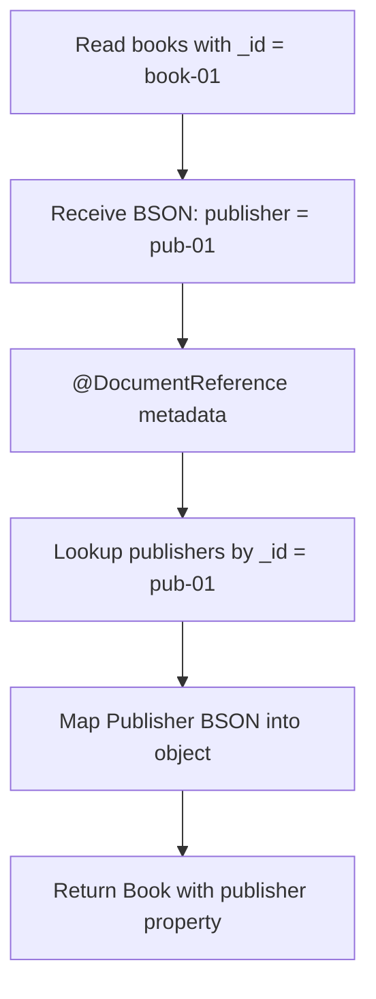

# @DocumentReference and Default ID-Based Referencing

## 1. Purpose and Context

In MongoDB, a document can **embed** related information directly inside itself or **store a reference identifier** pointing to another document. Spring Data MongoDB provides the `@DocumentReference` annotation to express reference relationships in Java models while keeping storage flexible.

For example, a book has a publisher. If the publisher's name changes, the application usually wants to update one `publishers` document and have books reference that publisher. With default `@DocumentReference`, the book document stores the publisher's **ID value**; Spring Data MongoDB uses that ID to look up and reconstruct the object on read.

This content belongs to the **Document References** chapter of the **SPRING_DATA_MONGODB** module. Understanding this mechanism helps you use `MongoTemplate` and repositories properly, design sound queries and indexes, avoid loading unnecessary data, and handle consistency when documents have independent lifecycles. Similar techniques must be considered for aggregations, transactions, reactive access, testing, and performance diagnostics.

After this lesson, you will be able to:

1. Describe accurately how `@DocumentReference` **by default** stores a reference value and queries by `_id`.
2. Distinguish `@DocumentReference` from embedded documents, manual ID storage, and `@DBRef`.
3. Map a single reference or a list of references to Java, and read/write via repositories and `MongoTemplate`.
4. Recognize reference resolution costs, missing-target scenarios, and limitations of lazy loading.
5. Design indexes, test actual BSON, and choose policies for updating or deleting related data.

## 2. Illustrative Data Model

Suppose there are two collections, `publishers` and `books`:

```javascript
db.publishers.insertOne({
  _id: "pub-01",
  name: "Tri Thuc Publisher",
  country: "VN"
});

db.books.insertOne({
  _id: "book-01",
  title: "Learning MongoDB",
  publisher: "pub-01",
  category: "database"
});
```

The book's `publisher` field only contains the string `"pub-01"`. It **does not** contain `name` or `country`; those live in the document inside the `publishers` collection.

```text
books                                      publishers
┌───────────────────────────┐             ┌────────────────────────────────┐
│ _id: "book-01"            │             │ _id: "pub-01"                  │
│ title: "Learning MongoDB" │             │ name: "Tri Thuc Publisher"     │
│ publisher: "pub-01" ──────┼────────────>│ country: "VN"                  │
└───────────────────────────┘             └────────────────────────────────┘
                    referenced by ID
```

This link is **defined and resolved by convention in the application**. MongoDB does not automatically enforce relational foreign keys merely because two fields hold the same value. Deleting a publisher can leave books with an unresolvable reference if the system has no handling rules.

## 3. How Does Default @DocumentReference Work?

### 3.1. Annotation on a Property

The Java 17+ example uses `record` for conciseness. In a real project, each type can be placed in its own file and declared `public` according to Java conventions.

```java
import org.springframework.data.annotation.Id;
import org.springframework.data.mongodb.core.mapping.Document;
import org.springframework.data.mongodb.core.mapping.DocumentReference;

@Document(collection = "publishers")
record Publisher(
    @Id String id,
    String name,
    String country
) {}

@Document(collection = "books")
record Book(
    @Id String id,
    String title,
    @DocumentReference Publisher publisher,
    String category
) {}
```

`@DocumentReference` is placed on the `publisher` property. Java sees `Publisher`, while the BSON in `books` by default stores the **ID value of the referenced object**. With ID `"pub-01"`, the book record matches the example in section 2. A key prerequisite is that the `Publisher` object already has a valid ID.

### 3.2. Default Lookup by _id

Conceptually, the default annotation uses a filter equivalent to:

```javascript
{ "_id": "pub-01" }
```

In `@DocumentReference` lookup syntax, the default expression is described as:

```text
{ '_id' : ?#{#target} }
```

`#target` is the **reference value read from the source document**. In our example, that value is `"pub-01"`. Spring Data MongoDB uses it to look up the matching `Publisher` document in the target collection, then maps it into a Java object.

You can visualize the process as:



The diagram illustrates the **concept of resolving a reference**. Exact query counts or optimizations for loading multiple elements may differ across Spring Data versions and data shapes. Do not assume each reference always equates to exactly one network round trip.

### 3.3. Default Behaviors to Remember

| Attribute | Default reference behavior |
| --- | --- |
| Value stored in source document | Target document's ID, not an embedded document |
| Lookup field in target document | `_id` |
| Target collection | From the referenced entity's metadata, e.g. `@Document("publishers")` |
| Java property type after read | `Publisher` |
| Loading mode | Typically eager; can request `lazy = true` |
| Saving/updating target document | No default cascade save |
| Target document existence constraint | Application must actively enforce it |

Note that `@DocumentReference` does not mean the server executes a join every time `books` is read. Spring Data may perform an additional lookup step in the application layer, whereas querying directly in `mongosh` only shows the stored ID.

## 4. Practicing Writes and Reads with Spring Data MongoDB

### 4.1. Initializing Data in the Correct Order

With repositories:

```java
import org.springframework.data.mongodb.repository.MongoRepository;

interface PublisherRepository
    extends MongoRepository<Publisher, String> {}

interface BookRepository
    extends MongoRepository<Book, String> {}
```

Example inside a service with both repositories injected:

```java
Publisher publisher = publisherRepository.save(
    new Publisher("pub-01", "Tri Thuc Publisher", "VN")
);

Book book = bookRepository.save(
    new Book("book-01", "Learning MongoDB", publisher, "database")
);
```

`Publisher` is saved first so there is a target document and valid ID. When saving `Book`, `@DocumentReference` encodes the relationship as an ID; `bookRepository.save(...)` **does not automatically save changes to `Publisher`**.

Verify the actual stored data:

```javascript
db.books.findOne({ _id: "book-01" });
```

The `publisher` path in BSON is expected to hold the string `"pub-01"`. Some mapping configurations may store type metadata like `_class` at the root document; that does not turn the `publisher` field into an embedded `Publisher`.

### 4.2. Reading and Resolving References

```java
Book loaded = bookRepository.findById("book-01")
    .orElseThrow();

System.out.println(loaded.publisher().name());
// Tri Thuc Publisher
```

Under default behavior, when Spring Data reads `Book` and successfully resolves the publisher, the Java property holds a `Publisher` object. If you use the driver directly or `mongosh` to read the `books` document, you only get the ID value as stored in BSON.

A common mistake is saving a book with a `Publisher` not yet in the database and expecting `bookRepository.save(book)` to create the publisher automatically. That is not default cascade behavior. For missing references, the resolution behavior and resulting value can vary by property type, collection, and version; **do not build business logic assuming the target document always exists**. Validate before writing or handle unresolvable references explicitly.

### 4.3. MongoTemplate Also Uses Mapping Metadata

```java
import org.springframework.data.mongodb.core.MongoTemplate;
import org.springframework.data.mongodb.core.query.Criteria;
import org.springframework.data.mongodb.core.query.Query;

class BookQueries {
    private final MongoTemplate template;

    BookQueries(MongoTemplate template) {
        this.template = template;
    }

    Book loadBook(String id) {
        return template.findOne(
            Query.query(Criteria.where("id").is(id)),
            Book.class
        );
    }
}
```

When results are mapped to `Book.class`, the converter knows `publisher` is a reference. If you request raw BSON `Document` results or use the driver directly, you are working with the physical ID without domain-entity reference resolution.

## 5. Comparing Embedding, @DocumentReference, and @DBRef

### 5.1. Three Different BSON Representations

**Embedding document:**

```javascript
{
  _id: "book-01",
  title: "Learning MongoDB",
  publisher: {
    _id: "pub-01",
    name: "Tri Thuc Publisher",
    country: "VN"
  }
}
```

**Default `@DocumentReference`:**

```javascript
{
  _id: "book-01",
  title: "Learning MongoDB",
  publisher: "pub-01"
}
```

**`@DBRef`:**

```javascript
{
  _id: "book-01",
  title: "Learning MongoDB",
  publisher: {
    "$ref": "publishers",
    "$id": "pub-01"
  }
}
```

`DBRef` is a conventional BSON structure containing `$ref`, `$id`, and optionally `$db`. By contrast, default `@DocumentReference` stores a **simple ID-based reference value**, without creating a BSON DBRef. Do not write queries against `publisher.$id` if your actual stored data only contains `publisher: "pub-01"`.

### 5.2. Choosing Based on Usage

| Modeling approach | When appropriate | Trade-offs |
| --- | --- | --- |
| Embed publisher | Snapshot info at purchase time; read with book and rarely updated separately | Duplicated data; must sync if global changes are desired |
| `@DocumentReference` | Publisher has its own lifecycle; many books link to one publisher | Resolution incurs query cost; must manage missing references |
| `@DBRef` | Integrating with systems already using BSON DBRef with reason to preserve it | Stores DBRef structure; management/resolution differs from plain IDs |
| Manually store `publisherId` String | Only ID needed; want full control over every query | Code looks up/maps `Publisher` manually when needed |

In new designs, plain IDs can be simpler and easier to integrate when `$ref` metadata in BSON is unnecessary. Choosing between `@DocumentReference` and manual `publisherId` depends on whether automatic object resolution is desired versus explicit query control.

**An important rule:** MongoDB does not enforce foreign keys for any of the three approaches above. Choosing an annotation does not replace business-level consistency checks.

## 6. ID Types Determine Resolvability

### 6.1. String and ObjectId Are Not the Same

Example:

```javascript
db.publishers.insertOne({
  _id: ObjectId("507f1f77bcf86cd799439011"),
  name: "Publisher A"
});
```

If the source document stores:

```javascript
{
  _id: "book-02",
  publisher: "507f1f77bcf86cd799439011"
}
```

that string `publisher` cannot be treated as equivalent to a BSON ObjectId with the same text content. The BSON query value must match both the **type** and **value** of the actual `_id` in `publishers`.

Spring Data has ID conversion rules for `@Id String` and certain 24-character hexadecimal string cases. However, changing annotations, converters, or write sources can introduce mismatches. Use `@MongoId(FieldType.STRING)` if the system intentionally stores IDs as BSON Strings; use `ObjectId` consistently if the system chooses ObjectIds.

### 6.2. Two Consistent Designs

**Approach A — Business String ID:**

```java
@Document("publishers")
record PublisherWithStringId(
    @MongoId(FieldType.STRING) String id,
    String name
) {}
```

The source field can hold `publisher: "pub-01"` and the target document has `_id: "pub-01"`.

**Approach B — ObjectId:**

```java
@Document("publishers")
record PublisherWithObjectId(
    @Id org.bson.types.ObjectId id,
    String name
) {}
```

When using `@DocumentReference` to this type, the stored value at the source must correspond to a BSON ObjectId. Test actual writes and reads before generating large datasets, especially if the application also involves import scripts, services in other languages, or legacy data.

**Note on both examples:** Imports for `@Document`, `@Id`, `@MongoId`, and `FieldType` match the snippets shown earlier; these are standalone illustrative types and do not directly replace `Publisher` in the preceding examples.

## 7. Reference Lists and One-to-Many Relationships

A bookstore may associate multiple authors with each book. Each author has an independent lifecycle, so an array of IDs is reasonable if the number of authors per book is usually small:

```java
import java.util.List;
import org.springframework.data.annotation.Id;
import org.springframework.data.mongodb.core.mapping.Document;
import org.springframework.data.mongodb.core.mapping.DocumentReference;

@Document("authors")
record Author(@Id String id, String displayName) {}

@Document("books")
record BookWithAuthors(
    @Id String id,
    String title,
    @DocumentReference List<Author> authors
) {}
```

With authors having IDs `author-01`, `author-02`, the book's BSON looks like:

```javascript
{
  _id: "book-03",
  title: "Designing with MongoDB",
  authors: ["author-01", "author-02"]
}
```

Spring Data can resolve the IDs in the array into a `List<Author>`. When writing business logic, consider what happens if an ID points to a deleted document: the resolved object list may not completely match the original ID list; never assume every reference is valid.

**Modeling limit:** A document holding a reference array can grow over time. If the element count grows without bound (for example, an account participating in millions of events), consider a separate join/link collection instead of a very long ID array. MongoDB limits a single BSON document to **16 MiB**, and long arrays also increase read/write and indexing costs.

### 7.1. Querying the ID List Directly in mongosh

```javascript
// Find books referencing a specific author.
db.books.find({ authors: "author-01" });

// Find books containing both authors.
db.books.find({
  authors: { $all: ["author-01", "author-02"] }
});
```

These queries operate on the **stored ID array** in MongoDB without needing to fetch full author objects. When you need to check or filter by author name, query the authors collection first, use an appropriate `$lookup`, or design supplemental data aligned with your access patterns.

## 8. Lazy References, Eager References, and N+1 Risks

### 8.1. What Is Eager?

With `@DocumentReference` when `lazy` is not specified, Spring Data typically resolves the reference while constructing the entity. This is convenient when screens always display related info, but it can generate extra queries when fetching a list of many documents.

For example, a list page of 100 books only needs `title` and `category`, yet the `Book` domain model references `Publisher`. If the query loads full `Book` entities and eagerly resolves `publisher`, the program may fetch extra publisher data even though the screen never uses it.

### 8.2. Lazy Defers When Resolution Happens

You can request deferred loading:

```java
@Document("books")
class BookLazy {
    @Id
    String id;
    String title;

    @DocumentReference(lazy = true)
    PublisherEntity publisher;
}

@Document("publishers")
class PublisherEntity {
    @Id
    String id;
    String name;
}
```

In this example, both classes are left **non-final** to illustrate proxying clearly; the snippet requires the same annotation imports as section 3. When Spring Data supports proxy creation for the property, querying the publisher is deferred until accessed.

Lazy does not mean never querying. Operations such as `toString()`, debuggers, JSON serialization, or calling getters can trigger resolution. `record`/final entities, non-proxiable property types, or Java module restrictions can cause issues with lazy loading; test against your actual model and runtime.

### 8.3. Measure Query Counts Instead of Guessing

When displaying 100 books with publishers, execution can take several forms depending on duplicate data and framework resolution:

- Query to retrieve the book list.
- One or more secondary queries to resolve references.
- Additional queries when accessing lazy properties.

The **N+1 query** phenomenon occurs when fetching a list of N documents leads to many extra trips to fetch related data, increasing latency. Do not claim an exact N+1 count for every version or collection shape; **measure actual MongoDB commands** using command monitoring, bounded logging, or the profiler.

If a page only needs the publisher ID, use a projection/DTO for the scalar ID or model an explicit `publisherId` field. If related data is needed at scale, consider `$lookup` aggregation, small snapshotted fields, or a dedicated read strategy.

## 9. References Do Not Create Automatic JOINs in mongosh

When calling:

```javascript
db.books.findOne({ _id: "book-01" });
```

MongoDB returns the book document with `publisher: "pub-01"`, without automatically fetching the publisher object. To combine data at the database level, use aggregation:

```javascript
db.books.aggregate([
  { $match: { _id: "book-01" } },
  {
    $lookup: {
      from: "publishers",
      localField: "publisher",
      foreignField: "_id",
      as: "publisherDetails"
    }
  },
  {
    $unwind: {
      path: "$publisherDetails",
      preserveNullAndEmptyArrays: true
    }
  },
  {
    $project: {
      _id: 1,
      title: 1,
      "publisherDetails.name": 1,
      "publisherDetails.country": 1
    }
  }
]);
```

`$lookup` relies on `books.publisher` and `publishers._id` having compatible BSON types. If the target document is missing, the initial `publisherDetails` array from `$lookup` will be empty; `preserveNullAndEmptyArrays` keeps the book document after `$unwind`.

**Distinction:**

| Technique | Where resolution occurs | Result |
| --- | --- | --- |
| `@DocumentReference` on entity read | Spring Data mapping layer | Java `Publisher` property |
| `$lookup` aggregation | MongoDB server layer | Combined BSON per pipeline |
| Storing `publisherId` and calling separate repository | Application code | Application controls queries directly |

When you need to filter or sort by publisher fields, think from the query shape first. Resolving references via annotations does not mean MongoDB can filter `books` by `publisher.name` as if the document were embedded.

## 10. Querying by Reference ID and Designing Indexes

### 10.1. Finding Books by Publisher ID

Direct query:

```javascript
db.books.find({ publisher: "pub-01" });
```

Avoid:

```javascript
db.books.find({ "publisher._id": "pub-01" }); // Wrong for scalar ID.
db.books.find({ "publisher.name": "Tri Thuc Publisher" }); // Wrong structure.
```

The two invalid paths above are deliberate error examples: they only make sense if the `publisher` field actually holds an embedded document with those subfields.

In a repository, you can declare a query against the **BSON field storing the ID**:

```java
import java.util.List;
import org.springframework.data.mongodb.repository.MongoRepository;
import org.springframework.data.mongodb.repository.Query;

interface BookSearchRepository extends MongoRepository<Book, String> {

    @Query("{ 'publisher' : ?0 }")
    List<Book> findByStoredPublisherId(String publisherId);
}
```

This example relies on the verified contract of storing a String ID and field name `publisher`. When using custom lookups, renaming fields with `@Field`, or using another ID type, check the actual BSON query sent. In application code, do not assume every derived-query property path automatically becomes a cross-reference join.

### 10.2. Which Indexes Help?

MongoDB has a default index on `publishers._id`, serving the ID lookup step. If business logic frequently queries **books by publisher**, consider:

```javascript
db.books.createIndex(
  { publisher: 1 },
  { name: "ix_books_publisher" }
);
```

This index serves `db.books.find({ publisher: "pub-01" })` and does not replace `publishers._id` when resolving target documents. With `authors: ["author-01", ...]`, an index on `authors` is a **multikey index**. Indexes carry storage and write overhead; only add them when access patterns genuinely require them.

To measure, run:

```javascript
db.books.find({ publisher: "pub-01" })
  .explain("executionStats");
```

Inspect `winningPlan`, `IXSCAN`/`COLLSCAN`, `totalKeysExamined`, `totalDocsExamined`, and `nReturned`. Running `explain` on the book query **does not measure** the secondary queries Spring Data executes afterward to resolve references; evaluating full-screen latency requires measuring all database calls from the application.

## 11. Data Lifecycle and Consistency

### 11.1. No Default Cascade Save

Suppose you rename the publisher:

```java
Publisher changedPublisher = new Publisher(
    "pub-01",
    "New Tri Thuc Publisher",
    "VN"
);

Book changedBook = new Book(
    "book-01",
    "Learning MongoDB",
    changedPublisher,
    "database"
);

bookRepository.save(changedBook);
```

Saving `Book` here updates the reference to ID `pub-01`; **it cannot be treated as renaming the `publishers` document**. To update the publisher, save or update the publisher explicitly:

```java
publisherRepository.save(changedPublisher);
```

In practice, to avoid overwriting other publisher fields with stale entity data, you can choose conditional updates or optimistic locking depending on business needs.

### 11.2. Deleting Target Documents Can Create Orphan References

```javascript
db.publishers.deleteOne({ _id: "pub-01" });

// The book still holds an ID pointing to the deleted publisher:
db.books.findOne({ _id: "book-01" });
```

MongoDB does not automatically delete `Book` or clear the `publisher` field simply because the two documents were linked by ID. The application must define a policy:

- **Disallow deletion** of a publisher while books still reference it.
- **Soft delete** the publisher, keeping the ID so historical data remains accessible.
- **Clean up references** or assign a replacement publisher per business rules.
- **Store a snapshot** of publisher info in the book if history strictly requires preserving the name at publication time.

If multiple collections must change together under a strict invariant, you need multi-document transactions or an equivalent consistency design. The atomicity of updating a single document **does not automatically extend** to referenced documents.

### 11.3. Do Not Mistake References for Authorization Checks

In a multi-tenant system, a `Book` carrying `tenantId: "tenant-a"` yet referencing `publisher: "pub-b"` can still point to a document in another tenant if code does not enforce boundaries. `@DocumentReference` specifies how to resolve, **not cross-tenant authorization**.

In multi-tenant systems, enforce permission checks at the service layer and define clear ID contracts. If IDs are only unique per tenant rather than collection-wide, default `_id`-only lookup cannot be used without an appropriate identification/lookup strategy.

## 12. When Is a Custom Lookup Needed?

By default, `@DocumentReference` uses the **ID as the pointer** and queries by `_id`. Spring Data also supports a `lookup` option to find documents by another key, such as a business code not stored in `_id`.

However, changing `lookup` is not just editing a query string: **the value stored in the source must match the key that `lookup` queries**. If the source still stores `publisher: "pub-01"` while `lookup` requires `{ acronym: "pub-01" }` and the actual `acronym` is `"NXB-TT"`, the reference will fail to resolve.

For custom lookups, design in sync:

1. The pointer value **written** to the source document.
2. The `lookup` query used to **read** the target document.
3. Uniqueness/indexes on the target key if a pointer is expected to return only one document.
4. How business key changes, migrations, and old references are handled.
5. Round-trip tests, including after application restart and when documents come from other writers.

Within the scope of this lesson, if the requirement is simply “Book references Publisher by ID,” **keeping the default configuration** is the easiest to test and verify. Use custom pointers and lookups when you have a clear access pattern, and verify pointer-writing behavior matches your Spring Data version.

## 13. Testing and Diagnostics

### 13.1. Checking Stored BSON

An integration test can proceed in order:

1. Create a `Publisher` with a known ID, e.g., `pub-test-01`.
2. Create a `Book` whose `publisher` property is that saved `Publisher` object.
3. Read `books` BSON via driver/`mongosh` and confirm the `publisher` field is an ID, not an embedded object or DBRef.
4. Read `Book` through the repository, confirming `publisher.id` and `publisher.name` match the target data.
5. Modify `Publisher` independently, re-read `Book` from the database, and verify the updated publisher data appears.
6. Delete `Publisher` in test data and verify behavior when the reference fails to resolve.

Example structure check in `mongosh`:

```javascript
db.publishers.findOne({ _id: "pub-test-01" });

db.books.findOne(
  { _id: "book-test-01" },
  { publisher: 1, title: 1 }
);
```

With test data saved under default behavior, `publisher` should contain an ID. Verify the **BSON type** of the ID, not just its displayed string text.

### 13.2. Verifying No Cascade

A useful test case: instantiate a `Publisher` in memory with `id = "pub-unsaved"` without **inserting** it into `publishers`, then save a `Book` referencing that publisher. The test must prove that saving `Book` does not automatically create the `Publisher` document, while also verifying the application policy when reading an invalid reference.

In production, it is usually best to validate that the target exists before creating the link, especially if the relationship is required by business rules.

### 13.3. Measuring Query Costs

For a book list screen, compare:

| Test scenario | What to measure |
| --- | --- |
| Fetch `Book` with eager reference | Database command count and total latency |
| Fetch `Book` with lazy reference without accessing `publisher` | Does a publisher query still fire? |
| Then call getter/serialize lazy `publisher` | Resolution cost and any proxy errors |
| Projection fetching only `title` | Does payload size and related query count drop? |
| Aggregation using `$lookup` | Documents scanned, index usage, result size |

Timings are only meaningful on datasets and query shapes reasonably close to production. Also distinguish Spring Data's internal reference-resolution queries from the main `find` command reading the root entity.

### 13.4. Common Errors

| Symptom | Possible cause | Check or fix |
| --- | --- | --- |
| Reading `Book` shows no `publisher` data | Target ID does not exist or BSON type mismatch | Check target document and ID type/subtype |
| `mongosh` shows only an ID string | That is the default representation of `@DocumentReference` | Read with Spring Data if you need the Java object |
| `publisher.name` in `books` query matches nothing | `Publisher` is stored as a scalar ID | Filter target first, use `$lookup`, or redesign |
| Saving `Book` does not create `Publisher` | No default cascade save | Save `Publisher` separately per lifecycle |
| Loading `Book` list is slow | Resolving many references, possibly N+1 | Measure query count; use projections/lookup/snapshots |
| Lazy fails with proxy error or unexpected queries | Final/record model or serialization triggers lazy | Test entities, DTOs, and runtime |
| Books point to a deleted publisher | No foreign key or cascade delete | Soft delete, pre-delete check, or cleanup |
| Query by publisher ID fails | Querying `publisher._id` instead of scalar field | Check raw BSON and write the proper query |
| Replacing `@DBRef` with `@DocumentReference` breaks old reads | DBRef BSON differs from plain ID BSON | Controlled migration and historical data testing |

## 14. Practice Exercises with Solutions

### Exercise 1 — Predict Stored BSON

**Prompt:** Given `Book` with `id = "book-07"` and `publisher.id = "pub-01"`, how is the `publisher` field stored when using default `@DocumentReference`?

**Solution:**

```javascript
{
  _id: "book-07",
  title: "A book",
  publisher: "pub-01",
  category: "database"
}
```

Because the target value is identified by ID, the book document stores the pointer `"pub-01"`. It does not embed the full `Publisher` or generate a `$ref/$id` structure.

### Exercise 2 — Why Doesn't Renaming Publisher Modify the Book Document?

**Prompt:** Publisher changes its name from “A” to “B”. Why does `db.books.findOne(...)` still show only `publisher: "pub-01"`?

**Solution:** The `books` document stores only the ID; the publisher name lives in the `publishers` collection. When Spring Data resolves `Book` into an object, it reads the latest details by ID. A `mongosh` query returns only the physical BSON of `Book`, without joining.

### Exercise 3 — Find Books by Publisher and Add an Index

**Prompt:** The application needs to find books by Publisher `pub-01`. Write the `mongosh` query and an index to consider.

**Solution:**

```javascript
db.books.find({ publisher: "pub-01" });

db.books.createIndex(
  { publisher: 1 },
  { name: "ix_books_publisher" }
);
```

The index helps lookups on the stored pointer if this query is frequent and the dataset is sufficiently large. Check `explain("executionStats")` and write overhead before finalizing.

### Exercise 4 — Choose Embedding or Referencing

**Prompt:** An order must preserve the recipient name and shipping address at checkout time, while the customer can later update their account address. Should the order only reference the current address document?

**Solution:** If the order requires historical data, **embed a snapshot** of the shipping address inside the order. You can simultaneously keep `customerId` to reference the live account. If you only reference the live address, viewing old orders after a customer moves would display information inaccurate for the transaction time.

### Exercise 5 — Identify Failure Modes When a Publisher Is Missing

**Prompt:** `Book` still has `publisher: "pub-01"`, but the `Publisher` document was deleted. Identify which layer must handle this and two sensible policies.

**Solution:** `@DocumentReference` does not enforce referential integrity. The business/service layer must decide—for example, **forbidding deletion** of a publisher still in use, or **soft-deleting** the publisher so historical data remains readable. If deletion is allowed, handle resolution failure explicitly and build a reference cleanup plan.

### Exercise 6 — Compare @DBRef and @DocumentReference

**Prompt:** Legacy data stores:

```javascript
publisher: { "$ref": "publishers", "$id": "pub-01" }
```

The new system uses default `@DocumentReference`. Can you simply swap the annotation and treat old data as already converted to plain IDs?

**Solution:** No. DBRef BSON has a different structure from scalar ID BSON. You must audit old data, define how references should be converted, and run a migration plus compatibility tests. Changing an annotation in Java does not alter existing BSON documents in the database.

## 15. Design Checklist and Key Takeaways

| Verification question | Required evidence |
| --- | --- |
| Does the target document have an independent lifecycle? | Justification for choosing reference over embedding |
| Is the target ID a String or ObjectId? | Compatible BSON `_id` and source pointer value |
| Is the target document saved beforehand? | Tests not relying on default cascading |
| Which field does the default lookup query? | `_id` via `@DocumentReference` |
| Does the screen actually need the related object? | Query/projection design and resolution cost |
| Are lazy references used? | Tests for proxies, serialization, and read lifecycle |
| Are there many reference elements? | Bounded cardinality, ID array limits, and proper indexes |
| What happens when a target document is deleted? | Referential integrity policy and tests |
| Is cross-document consistency required? | Transactions or appropriate synchronization mechanism |
| Is there DBRef/legacy data? | Migration plan and ability to read historical records |
| Which indexes are actually needed? | Queries on stored ID, target `_id`, query counts, and `explain` |

**Rules to remember:**

1. `@DocumentReference` by default stores the **target entity's ID** in the source document and resolves via an `_id` lookup.
2. The Java object returned after reading may contain the referenced entity, but `books` BSON still stores only the ID; MongoDB does not automatically join on `find`.
3. `@DocumentReference`, `@DBRef`, and embedding have **different BSON representations**. Never switch annotations while ignoring existing data.
4. Consistency, cascade save/delete, access permissions, and entity lifecycles are business design responsibilities, not automatic features of annotations.
5. Lazy only defers loading; verify proxy behavior and measure extra queries, especially when reading large lists.
6. Design from access patterns: to filter by stored ID, index the source collection; to resolve by `_id`, use the target key index; for large-scale combined reads, consider `$lookup` or another model.
